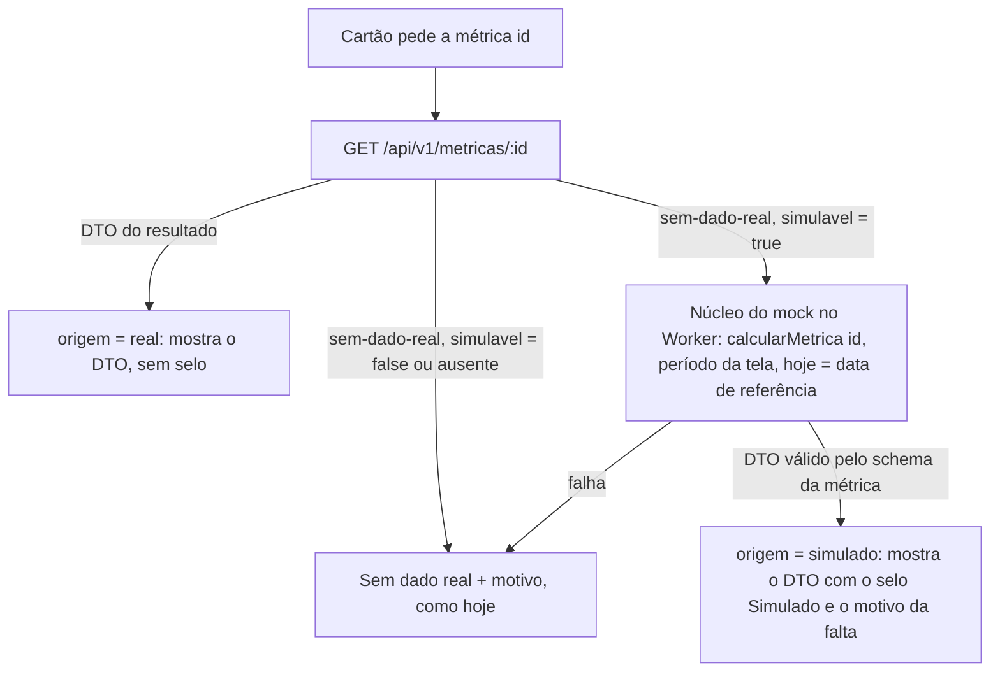

# 070 · Dado simulado por cartão onde ainda não há dado real: desenho

Pedido 070, etapa E1.1 (K-221). Autor: software-architect. Data: 2026-11-04. Estado: vigente desde 2026-11-05 (era proposta, dependente da E1.2 e das perguntas Q-070-1 a Q-070-6; selo validado pelo dono em 2026-11-04 e perguntas respondidas em 2026-11-04 e 2026-11-05, seção 9).
Decisão registrada na ADR 0028 (`docs/architecture/adr/0028-simulado-por-cartao.md`), que revê a ADR 0026 sem apagá-la.

**Fonte da leitura.** O checkout principal está numa branch de documentação, sem o código. O código foi lido, só para leitura, na worktree `/home/rodrigoisensee/MetricasDSPD-056d` (branch `feature/069-m1-frescor`, aberta da develop). O mapa de origem lido lá já inclui o pedido 065, que tirou BLOQUEADOS e O5 do mapa real. Antes de começar, o node-backend confere `packages/contratos/src/origem.ts` na develop (`d2ec79d`). Se o mapa divergir, a lista da seção 1 segue o código, porque o mapa é a fonte única (ADR 0026). Não consultei a base, as APIs externas nem o `.env`.

## Conferência com a constituição e com as regras invioláveis

Não existe `docs/constituicao.md`. Conferi as regras invioláveis do `CLAUDE.md`:

| Regra | Como o desenho cumpre |
|---|---|
| Nenhuma métrica individual | Nenhum DTO de `/api/v1/metricas/:id` tem campo de pessoa. Os schemas são `strict`, e `tambem.test.ts` varre os nomes dos campos. A aba Apontamento, a única com pessoa (exceção do dono de 2026-11-01), não usa essa rota e **nunca é simulada** (regra R5). |
| BusinessMap e Acelerato nunca se misturam | O simulado sai do mesmo núcleo do mock (ADR 0021), em que os geradores e os cálculos dos dois domínios já são separados pelo lint (`eslint.config.js`, blocos `businessmap/**` e `acelerato/**`). A `VISAO_GERAL`, que junta os dois domínios, fica fora da simulação (Q-070-6). |
| Story, frente e projeto nunca no mesmo histograma | O simulado é o DTO da própria métrica, com a mesma forma e as mesmas separações da biblioteca. |
| Percentis 50/85/95 em 12 semanas e piso de 20 itens | O simulado passa por `lib.calcularMetrica`, a mesma biblioteca, então o piso de 20 vale igual (o resultado pode sair `insuficiente`). |
| Todo cálculo pela biblioteca compartilhada | O simulado não tem cálculo próprio: é `calcularMetrica` sobre a base gerada por `@metricas-dspd/mock`. |
| Nunca sobrescrever histórico | O simulado não grava nada, em base nenhuma. Ele vive só no navegador, no heap do Worker. |
| Dúvida de regra vira pergunta | Seis perguntas ao dono, cada uma com uma proposta conservadora que vale até a resposta (seção 9). |

## 1. Métricas sem dado real hoje

São as métricas que não estão em `METRICAS_ORIGEM_REAL` (`packages/contratos/src/origem.ts:12-33`). A API responde a elas com `{ estado: 'sem-dado-real', metrica, motivo }` (`server/src/modulos/metricas/servico.ts`, portão da ADR 0026 P3). As lacunas vêm de `docs/analises/064-lacunas-dado-real.md`.

### 1.1 BusinessMap (fluxo de projeto)

| Painel | Ids | Motivo atual (`origem.ts`) | Lacuna no 064 | Simulável? |
|---|---|---|---|---|
| FL1, cartões principais | BLOQUEADOS | a coleta ainda não grava os bloqueios do quadro (pedido 065) | L1 | sim |
| FL1, cartões principais | O12, O15, O18 | aguardando campo no quadro | L2 | sim |
| FL1, complementares | O5 | bloqueios não coletados, eficiência sairia inflada (065, Q-065-1) | L1 | sim |
| FL1, complementares | O8, O14, O16 | aguardando campo no quadro | L2 | sim |
| FL1, complementares | O19, O20, O21, O22, O24, O25, O26 | fonte real ainda não definida (F6b) | L1 (O19); de portão e de cálculo (O20, O21, O25) | sim |
| FL2 tático | T1, T2, T3, T4, T5, T7, T9 (principais); T6, T8, T10, T11, T12, T13, T14 (complementares); EI_FL2 | fonte real ainda não definida | sem plano de fonte | sim |
| FL3 estratégico | E1, E2, E3 (principais); E4, E5, E6, E7, E8, E9 (complementares); EI_FL3 | fonte real ainda não definida | sem plano de fonte | sim (E8 só traz contagem de sistemas por faixa de pessoas, sem nome; ver R5) |
| Resumo | TENDENCIA_FLUXO | fonte real ainda não definida | L4 (deriva de O3 e O4, que são reais) | **não** (Q-070-4) |

Têm dado real no BusinessMap: O1, O2, O3, O4, O6, O7, O9, O10, O11, O13 e EI_FL1. **Não são simuladas, nem em parte.** As lacunas parciais seguem como hoje, com a nota que já existe: a parte de bloqueio de O1 e O2 (`null` com a nota `bloqueio-sem-dado-real`), O6 sem classe, O3 com "SLE não definido", O10 com a visão do cliente igual à do time. Preencher só a parte que falta com simulado poria real e simulado no mesmo cartão, o que o pedido proíbe (Fora do escopo).

### 1.2 Acelerato (sustentação)

| Painel | Ids | Motivo atual | Lacuna no 064 | Simulável? |
|---|---|---|---|---|
| Sustentação, principais | S1 | aguardando prazos de SLA por prioridade | L9 e `ref_alvo_prioridade` vazia | sim |
| Sustentação, principais | S5, S6, S7 | aguardando tipo e domínio do campo do chamado (P-DS-19) | L9 | sim |
| Sustentação, complementares | S9 | aguardando o motivo de pendência | L9 | sim |
| Sustentação, complementares | S11 | P-DS-19 | L9 | sim |
| Sustentação, complementares | S12 | aguardando fonte do registro posterior de exceção de SLA | L9 | sim |
| Sustentação, complementares | O17 (cálculo em `packages/metricas/src/acelerato/o17.ts`) | aguardando campo no quadro | campo de causa raiz | sim |
| Sustentação | EI_SUST | cálculo ainda não definido para o Acelerato | regra indefinida | **não** (Q-070-5) |
| Resumo | TENDENCIA_SUST | fonte real ainda não definida | L4 (deriva de S2 e S3, que são reais) | **não** (Q-070-4) |

Têm dado real no Acelerato: S2, S3, S4, S8 e S10. Mesma regra: não se simula parte de cartão real. Ficam como estão o S3 com "ajustes manuais" em 0 (L9), o S2 sem separar exceção de SLA e o S8 com a ressalva M5.

### 1.3 Fora das duas fontes

- **PV1** (pesquisa, terceira fonte): está no mapa real e mostra "sem pesquisa" (Q2 "A" do 060). **Não é simulada.** Mostrar "sem pesquisa" é a resposta real.
- **VISAO_GERAL**: junta os dois domínios e tem plano próprio (E3.4 a E3.6 do 060). **Não é simulada** (Q-070-6).
- **Aba Apontamento** (`/api/apontamento`): dado real, individual por exceção do dono. **Nunca é simulada** (Fora do escopo).

## 2. De onde vem o dado simulado

Do **gerador do mock que já existe**, pelo caminho da ADR 0021: `MockFonteMetricas` (`web/src/data/mock/MockFonteMetricas.ts`), com o núcleo `nucleoMock` rodando num Web Worker de módulo. Dentro do Worker ficam `gerarBaseMock`, `gerarExtensoesMock`, `gerarPesquisaMock`, os contextos `criarContextoBM` e `criarContextoAC` e `lib.calcularMetrica`. Nada disso é escrito de novo.

Por que no navegador e não na API:
- A ADR 0026 P2 continua de pé: **a API de produção não tem modo mock**, e o lint do server proíbe importar `@metricas-dspd/mock` fora do seed. O servidor e a base continuam 100% reais. A porta do caso A12 (número misto: base real com extensões fictícias) segue fechada **por construção**, porque o simulado nunca toca a base real nem o processo da API.
- A paridade do Worker (ADR 0021, seção 3) já garante que o núcleo dá, para todas as `MetricaId`, o mesmo DTO que a biblioteca chamada direto. O simulado herda essa garantia.

Parâmetros do simulado (decididos aqui, técnicos):
- **Semente fixa** (a padrão do mock). O mesmo cartão mostra o mesmo número a cada recarga. Um número que muda sozinho pareceria dado vivo.
- **`hoje` = a data de referência real** (`GET /api/v1/referencia`, a mesma que alimenta `useDataReferencia`). Assim a janela e os rótulos de período do simulado batem com os dos cartões reais ao lado.
- **Período: o mesmo filtro de período da tela.** Os filtros de dimensão (equipe, sistema, área, prioridade e outros) **não se aplicam ao simulado** (Q-070-1, confirmada pelo dono em 2026-11-05, S1). As equipes e os sistemas do mock são fictícios e não batem com as opções reais de `/api/v1/filtros/:dominio`, então aplicá-los daria cartão vazio ou um recorte enganoso. O cartão lista esses filtros como "não afetam este cartão", pelo mecanismo `naoAfetam` que já existe em `CartaoMetrica.tsx:159-165`.
- **Carga sob demanda.** O Worker e o chunk do mock (F9) só são baixados quando o primeiro cartão simulável recebe `sem-dado-real`. Um painel com todos os cartões reais não baixa nada (teste T-W5).

## 3. Como o cartão decide entre real e simulado

Quem decide é a API (o mapa de origem). Quem calcula o simulado é o navegador. O cartão só mostra o que recebe.



Regras (para o react-frontend e o node-backend):

- **R1. Um cartão, uma origem.** Cada resposta tem um único DTO, real ou simulado, nunca os dois. Não existe composição de partes: nenhum gráfico, número, série ou tabela junta valor real e simulado.
- **R2. O real sempre ganha.** Se a API devolve o DTO, o cartão não chama o mock. O simulado só existe depois de um `sem-dado-real` com `simulavel: true`.
- **R3. A troca é sozinha e só pelo mapa.** Quando uma métrica entra em `METRICAS_ORIGEM_REAL` pelo plano dela (ADR 0026 P3, último item), a API passa a mandar o DTO real e o selo some, sem mudança na web. Não há interruptor por cartão na interface nem configuração por ambiente.
- **R4. O selo é derivado no centro e falha fechado.** A origem `simulado` sai da camada de dados (`web/src/data/`) e chega ao `CartaoMetrica` pelo contexto de origem que já existe (`ProvedorOrigemCartoes` / `useOrigemCartao`), não por uma prop que cada cartão teria de lembrar de passar. Cartão que mostra DTO simulado sem selo é defeito bloqueante (teste T-W3).
- **R5. Fora da simulação.** Ficam fora: (a) a aba Apontamento e qualquer superfície com pessoa; (b) `VISAO_GERAL`, que junta BusinessMap e Acelerato; (c) `TENDENCIA_FLUXO` e `TENDENCIA_SUST`, que contradiriam O3, O4, S2 e S3 reais ao lado; (d) `EI_SUST`, cuja regra de cálculo não foi definida (simular seria publicar uma regra inferida). A lista vive no contrato (`METRICAS_SEM_SIMULACAO`, seção 4). (b), (c) e (d) foram confirmadas pelo dono (Q-070-4 a Q-070-6, seção 9).
- **R6. O simulado não alimenta nada além do próprio cartão.** As faixas "Pede atenção" (diária, semanal, sustentação), os números-chave e as tendências do Resumo, a contagem de origem do cabeçalho (`OrigemDosCartoes`) e a exportação leem só o real. A faixa continua "parcial" quando um dos cartões dela não tem dado real (`FaixaAtencao.tsx:26-38`). Faixas e Resumo confirmados pelo dono (Q-070-2), exportação também (Q-070-3, S2).
- **R7. Notas e motivo.** O cartão simulado mostra o motivo da falta de dado real, que é o mesmo `motivo` do `sem-dado-real`, para dizer por que está simulado. As notas fixas de cartão real (`NOTAS_FIXAS_DO_CARTAO`) não se aplicam ao simulado (`notasDoCartaoVisiveis` já filtra pela origem real). O texto e a forma do selo são da E1.2 (ux-designer).
- **R8. Homologação e modo mock não mudam.** Com `VITE_FONTE=mock` o painel inteiro já é fictício, com o selo global (ADR 0018 e 0026 P5). Ali não há selo por cartão, porque não há cartão real.

## 4. Contrato da API

Mudança aditiva e compatível no corpo `sem-dado-real` (`packages/contratos/src/origem.ts`). O formato exato é do node-backend; o que o cartão precisa saber é isto:

```ts
// packages/contratos/src/origem.ts (esqueleto, não é código final)
export const METRICAS_SEM_SIMULACAO: ReadonlySet<MetricaId> = new Set([
  'VISAO_GERAL', 'TENDENCIA_FLUXO', 'TENDENCIA_SUST', 'EI_SUST',
])

export function podeSimular(id: MetricaId): boolean {
  return origemDaMetrica(id) === 'mock' && !METRICAS_SEM_SIMULACAO.has(id)
}

export const semDadoRealSchema = z.object({
  estado: z.literal('sem-dado-real'),
  metrica: z.string(),
  motivo: z.string().min(1),
  /** Pedido 070 (ADR 0028): a web pode mostrar o simulado deste cartão, com o selo. Ausente = false (falha fechada). */
  simulavel: z.boolean().optional(),
}).strict()
```

Resposta de `GET /api/v1/metricas/O12` (sem dado real, simulável):

```json
{ "estado": "sem-dado-real", "metrica": "O12", "motivo": "aguardando campo no quadro", "simulavel": true }
```

Resposta de `GET /api/v1/metricas/EI_SUST` (sem dado real, não simulável):

```json
{ "estado": "sem-dado-real", "metrica": "EI_SUST", "motivo": "cálculo ainda não definido para o Acelerato", "simulavel": false }
```

Métrica real: o DTO de sempre, **sem nenhum campo novo**. Pontos do contrato:
- **A API nunca devolve número simulado.** Não existe `origem: 'simulado'` na resposta HTTP. O simulado é produzido e rotulado só na web. Assim, quem lê a API (o QA, uma integração futura) nunca recebe dado fictício.
- **A origem não entra no DTO.** Na web, a camada de dados devolve a origem ao lado do resultado (por exemplo `{ origem: 'real' | 'simulado', resultado }`, ou a origem registrada no contexto de origem por `MetricaId`; a forma é do react-frontend). O DTO simulado é idêntico em forma ao real e é validado pelo mesmo `SCHEMAS_RESULTADO[id]` antes de ir à tela. Os testes de paridade da ADR 0021 ficam intactos.
- **`podeSimular` é a fonte única** de "simulável ou não". A API copia o valor no corpo, para o cartão não precisar de uma segunda consulta e para os E2E `*-api` verificarem pela rede. A web usa só o campo da resposta, nunca o mapa por conta própria.
- **Invariantes testáveis do contrato:** `METRICAS_SEM_SIMULACAO ∩ METRICAS_ORIGEM_REAL = ∅`; `podeSimular(id) === false` para todo id do mapa real; o corpo de métrica real nunca tem `simulavel`.
- Documentação: `docs/api/` (OpenAPI gerado pelo `.meta({ id: 'SemDadoReal' })`) ganha o campo. Versão do contrato: acréscimo opcional, sem mudança de versão maior (ADR 0007).

## 5. Módulos afetados

| Camada | Arquivo ou módulo | Mudança |
|---|---|---|
| contratos | `packages/contratos/src/origem.ts` (+ `origem.test.ts`) | `METRICAS_SEM_SIMULACAO`, `podeSimular`, campo `simulavel` |
| server | `server/src/modulos/metricas/servico.ts` (portão, cerca da linha 248) | o corpo `sem-dado-real` leva `simulavel: podeSimular(id)`; nada mais. O server continua sem importar o mock |
| web, dados | `web/src/data/` (novo decorador sobre `HttpFonteMetricas`, por exemplo `FonteComSimulado`); `web/src/data/mock/MockFonteMetricas.ts` reaproveitado por `import()` dinâmico | depois de `SemDadoRealErro` com `simulavel`, chama o mock com o período da tela, `hoje` igual à data de referência e semente fixa; valida pelo schema; marca a origem |
| web, dados | `web/src/data/useMetrica.ts`, `web/src/data/http/SemDadoRealErro.ts` | o erro passa a carregar `simulavel`; o hook expõe a origem |
| web, UI | `web/src/components/ui/CartaoMetrica.tsx`, `ProvedorOrigemCartoes` | selo "Simulado" e motivo (spec da E1.2); filtros de dimensão listados em "não afetam" |
| web, painel | `FaixaAtencao`/`atencao.ts`, `resumo/*`, `features/coleta/OrigemDosCartoes.tsx`, `features/exportar/gerar.ts` | conferir que leem só o real (R6); o mais provável é nenhuma mudança, além de testes |
| lint | `eslint.config.js` | nenhuma regra nova: o decorador fica em `data/` e entra no mock só por `import()` dinâmico de `data/mock`, como já exige a regra das linhas 217-240 |
| e2e | projetos `*-api` | troca a asserção "cartão fora do mapa não mostra número" por "só mostra número com o selo Simulado" e "excluídos mostram Sem dado real" |

Modelo de dados: **nenhuma mudança**. Sem migração, sem tabela, sem grant.

## 6. Requisitos não funcionais

- **Desempenho (ADR 0003):** F6 (chunk inicial) não muda, porque o mock entra por `import()`. **Nota de 2026-11-05 (achado A2 do review 070-v4):** a previsão não se confirmou; o F6 subiu 2,33 KB com o L2 e ficou em 197,04 KB, com folga de cerca de 3 KB até o teto de 200 KB. O mock continua fora do chunk inicial; o acréscimo veio do código do L2 que fica no inicial. Registrado também na ADR 0028 (Consequências). F9 (chunk do mock) passa a ser baixado em produção, mas só quando há cartão simulável na tela. C6: a geração e o cálculo ficam no Worker (ADR 0021). O custo novo é o tempo até o primeiro cartão simulado (geração da base < 1,5 s, C2), que não atrasa os cartões reais, porque eles vêm da API em paralelo. O C5 (memória) soma o heap do Worker. O QA mede no `perf-api` com um painel que tenha simulado (FL2, por exemplo). F6, C6 e F9 no limite são portão do PR.
- **Observabilidade:** um `console.info` sem dado (id da métrica e "simulado") na primeira simulação de cada id ajuda a depurar. Falha do Worker vira "Sem dado real" no cartão e um `console.error` com o nome do erro, nunca um número.
- **Testabilidade:** o decorador recebe a fonte HTTP e a fábrica do mock por injeção, então os testes de unidade não sobem Worker (jsdom usa o caminho em processo, ADR 0021 seção 4).
- **CSP:** sem mudança. O Worker já sai como arquivo da mesma origem (ADR 0021 seção 6), coberto por `default-src 'self'`.

## 7. Testes

Contratos e server (node-backend):
- **T-C1** `METRICAS_SEM_SIMULACAO ∩ METRICAS_ORIGEM_REAL = ∅`, e `podeSimular` é falso para todo id real e para os quatro excluídos.
- **T-C2** `semDadoRealSchema` aceita o corpo com e sem `simulavel` e rejeita campo extra (strict continua).
- **T-S1** para cada `MetricaId` fora do mapa real, `GET /api/v1/metricas/:id` responde 200 com `simulavel === podeSimular(id)` e sem número (o teste atual do portão ganha a asserção). Para cada id real, o corpo não tem `estado` nem `simulavel`.
- **T-S2** o server segue sem importar `@metricas-dspd/mock` fora do seed (regra e teste estático que já existem; conferir que continuam verdes).

Web (react-frontend):
- **T-W1** DTO real: a origem é `real`, a fábrica do mock não é chamada e nenhum Worker é criado.
- **T-W2** `sem-dado-real` com `simulavel: true`: o mock é chamado com o mesmo id, o período da tela sem filtros de dimensão, `hoje` igual à data de referência e semente fixa. O DTO passa pelo schema e a origem é `simulado`.
- **T-W3** para **todo** id com `podeSimular(id)`, o cartão renderizado com o DTO simulado mostra o selo "Simulado" e o motivo. Para todo id real, o selo nunca aparece. O teste itera sobre o contrato, não sobre uma lista à mão.
- **T-W4** `simulavel: false`, campo ausente, falha do mock ou DTO fora do schema: o cartão mostra "Sem dado real" com o motivo e nunca um número.
- **T-W5** painel só com cartões reais: o chunk do mock não é pedido (espião do `import()` no Vitest; no E2E, rede sem o chunk do Worker).
- **T-W6** faixas de atenção, números-chave e tendências do Resumo, `OrigemDosCartoes` e exportação ignoram o simulado (R6).
- **T-W7** troca: a mesma métrica, primeiro `sem-dado-real` simulável e depois DTO real (fonte dublê), passa de simulado com selo para real sem selo, sem recarregar a página.
- **T-W8** com filtro de equipe ativo, o cartão simulado lista a equipe em "não afetam este cartão".

E2E `*-api` (qa-engineer, com o servidor de teste da API):
- **T-E1** em FL1 semanal, O12 mostra o selo "Simulado" e um número; O3 não tem selo.
- **T-E2** em sustentação, S1 simulado com selo, S2 real sem selo, EI_SUST com "Sem dado real".
- **T-E3** Resumo: TENDENCIA_FLUXO e TENDENCIA_SUST com "Sem dado real" (Q-070-4, confirmada pelo dono em 2026-11-05, S3).
- **T-E4** `perf-api`: F6 sem aumento (medido: +2,33 KB, 197,04 KB, dentro do teto; ver nota da seção 6), C6 dentro do orçamento num painel com simulado, F9 dentro do limite.

## 8. Divisão em lotes

| Lote | Agente | Conteúdo | Depende de | Paralelo com |
|---|---|---|---|---|
| L1 | node-backend (E1.3) | contratos (`METRICAS_SEM_SIMULACAO`, `podeSimular`, `simulavel`), portão do `servico.ts`, `docs/api`, T-C1, T-C2, T-S1, T-S2 | este desenho; as respostas às Q-070-4 a Q-070-6 só mudam o conteúdo da lista | E1.2 (UX) e preparação do QA |
| L2 | react-frontend (E1.4) | decorador da fonte, origem pelo contexto, `useMetrica`, selo no `CartaoMetrica` (spec da E1.2), filtros "não afetam", R6 nas faixas, no Resumo, na origem e na exportação, T-W1 a T-W8 | L1 no mesmo ramo ou já na develop; E1.2 validada pelo dono | QA preparando o E2E |
| L3 | react-frontend com qa-engineer | E2E `*-api` (T-E1 a T-E3) e medição `perf-api` (T-E4) | L2 | — |

Um ramo só, `feature/070-simulado-por-cartao`, com L1 antes de L2. O L1 é pequeno e pode começar já. O L2 só começa com o selo validado (E3 do pedido é condição do código).

## 9. Perguntas ao dono (R-DECISAO)

Cada uma tinha uma proposta conservadora, que valia até a resposta. Nenhuma foi decidida no código. **Todas respondidas pelo dono, que confirmou a proposta (a) de cada uma:** Q-070-2 e Q-070-6 na decisão "A" de 2026-11-04 (cartão simulado no resumo); Q-070-1, Q-070-3, Q-070-4 e Q-070-5 na decisão "A" de 2026-11-05 (suposições S1 a S3 do pedido 070). As linhas `DECISÃO DO DONO` estão no pedido (`docs/pedidos/070-simulado-por-cartao.md`, `## Decisões`).

- **Q-070-1. Filtros no simulado.** Com um filtro de equipe, sistema ou prioridade ativo, o cartão simulado (a) ignora o filtro e diz isso no cartão (proposta), ou (b) aplica o filtro ao dado fictício, que tem equipes e sistemas inventados e quase sempre sai vazio? **Respondida em 2026-11-05 (S1): (a).**
- **Q-070-2. Faixas e Resumo.** O simulado (a) fica só no cartão; as faixas "Pede atenção" e os números-chave do Resumo continuam "Sem dado real" (proposta), ou (b) aparece também ali, com o selo? **Respondida em 2026-11-04 (decisão "A" do cartão simulado no resumo): (a).**
- **Q-070-3. Exportar.** O arquivo exportado (a) leva só o real e marca o simulado como "simulado na tela, não exportado" (proposta), ou (b) leva o número simulado com a marca? **Respondida em 2026-11-05 (S2): (a).**
- **Q-070-4. Tendências do Resumo.** TENDENCIA_FLUXO e TENDENCIA_SUST derivam de O3, O4, S2 e S3, que já são reais (L4 do 064). Simular a tendência poria uma linha fictícia ao lado de números reais que a contradizem. Proposta: (a) não simular e (b) abrir o plano para elas entrarem no mapa real. O dono quer isso? **Respondida em 2026-11-05 (S3): não simular.** O item (b), o plano para o mapa real, não foi objeto da S3 e segue no L4 do 064.
- **Q-070-5. EI_SUST.** A regra de cálculo da espera invisível da sustentação ainda não foi definida. Simular seria mostrar uma regra que ninguém decidiu. Proposta: não simular até a regra existir. Confirma? **Respondida em 2026-11-05 (S3): confirmada.**
- **Q-070-6. Visão Geral.** Junta BusinessMap e Acelerato, tem desenho validado (E3.3 do 060) e plano próprio. Proposta: não simular; ela fica "Sem dado real" até o plano dela. Confirma? **Respondida em 2026-11-04 (decisão "A" do cartão simulado no resumo: o simulado fica fora da Visão geral): confirmada.**

## 10. Segurança (R-SEGURANCA)

**Nenhum gatilho**, o que confirma a leitura do Jarvis:
- sem dado de pessoa (os DTOs das métricas não têm pessoa; a aba Apontamento está fora);
- sem credencial, sem `.env` novo, sem variável `VITE_*` nova;
- sem banco, sem migração, sem grant;
- sem dependência nova (reuso de `@metricas-dspd/mock` e do Worker da ADR 0021);
- sem mudança de CSP, de Docker ou de CI (o E2E muda só asserções);
- sem webhook nem autenticação.

`gatilhos_seguranca: []`. O risco real é de **integridade da informação**: número fictício lido como real. Ele é tratado no desenho (R1, R4, R6, T-W3, T-W4) e no critério de reversão da ADR 0028, não como ameaça de segurança.
