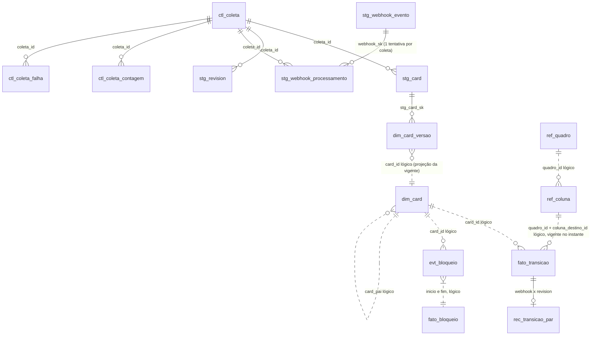
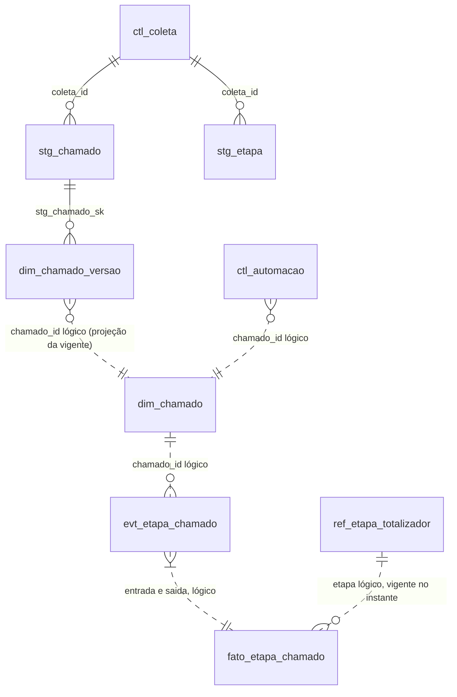
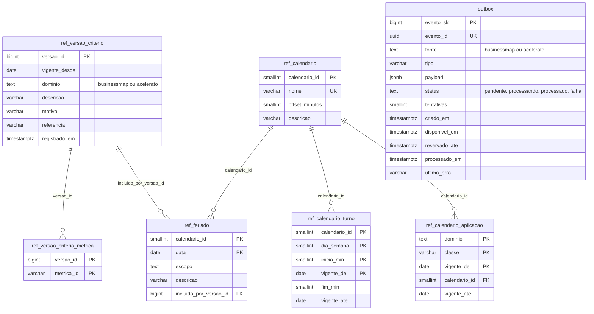

# Modelo de dados — base analítica (PostgreSQL)

- Status: aprovado (revisão de modelagem K-014 r2; code review 002-K-017-r1); **traduzido para PostgreSQL em 2026-10-10** (ADR 0014 revisão 2) com as correções do §11 e a decisão do usuário sobre nomes nas tabelas analíticas (§9)
- Propósito: modelo físico da base analítica (tabelas, chaves, privilégios, LGPD). Público: arquiteto, back-end, QA. Data: 2026-10-09 · Revisão: 2026-10-11 (ER do `dspd_core` em §5; caminho de `lgpd.ts`) · Decisões: **ADR 0014** (PostgreSQL, `pg` puro, node-pg-migrate, outbox, testes por schema), 0005 (SQL explícito), 0006 (contrato da coleta), 0013 (módulos, Acelerato via Metabase). A ADR 0004 (MySQL) está substituída.
- Origem do Acelerato: tabela no Metabase lida 1x/dia pela API (ADR 0013 §4).
- Forma da camada analítica = tipos de `@metricas-dspd/metricas` (`BaseBM`, `BaseAC`); o mock gera exatamente essa forma (paridade, D15).
- Colunas marcadas **(prov.)** são extensões ao modelo 4.5 do briefing, provisórias até T2.1 (de-para da API) e à resposta do usuário.

## 1. Camadas e regras de escrita

| Camada | Prefixo | Conteúdo | Escrita permitida | Reconstruível? |
|---|---|---|---|---|
| Staging (registro de origem) | `stg_` | payload original + hash + metadados de coleta | **só INSERT** (grant + gatilho de imutabilidade) | não: é a fonte da verdade fora da ferramenta |
| Eventos / histórico | `evt_`, `dim_*_versao`, `fato_transicao`, `rec_` | eventos normalizados e versões SCD2 | **só INSERT** (grant + gatilho) | sim, a partir do staging |
| Projeções | `dim_card`, `fato_bloqueio`, `dim_chamado`, `fato_etapa_chamado` | estado atual e intervalos, na forma do briefing 4.5 | substituição por entidade afetada (`DELETE` + `INSERT` na mesma transação) | sim, a partir de eventos + referência |
| Referência | `ref_` | colunas, domínios fechados, calendário, critérios, alvos | só INSERT de nova vigência; fechar vigência = única UPDATE, por `GRANT UPDATE (vigente_ate)` (§8) | arquivo versionado no repositório (`ref:sync`) |
| Controle | `ctl_` | log de coleta, marca d'água, falhas, reconciliação, automações | INSERT; UPDATE por coluna só em `ctl_coleta` (`status`, `finalizado_em`, `marca_dagua_ate`, `erro_resumo`) e em `ctl_coleta_contagem`; demais `ctl_` só INSERT (§8) | não |
| Operacional | `outbox` (só em `dspd_core`) | eventos internos para o poller | ver §5 | não precisa |

"Nunca sobrescrever histórico" é garantido no staging e nos eventos **por privilégio e por gatilho**, não por convenção: as tabelas append-only têm o gatilho `dspd_core.proibir_alteracao()` em `BEFORE UPDATE OR DELETE` (por linha) e `BEFORE TRUNCATE` (por instrução), que levanta exceção para qualquer papel, inclusive o migrador. Remover o gatilho exige migração revisada.

Projeções são refeitas por entidade, ou inteiras quando um critério muda (T2.6), com `DELETE` + `INSERT` numa transação: pelo MVCC, a API continua lendo a versão anterior até o `COMMIT`. Não há troca de tabela por `RENAME` (que perderia grants por coluna). Nenhuma FK física aponta para projeção (§2).

Fluxo: `stg_*` → normalizador (TS) → `evt_*`/`fato_transicao`/`*_versao` → projetor (TS, usa `@metricas-dspd/metricas` para marcos e horas úteis) → projeções → API carrega o contexto.

## 2. Convenções (PostgreSQL 17, mínimo 15)
- **Um database** (`metricas`; testes `metricas_test`), **três schemas nativos**: `dspd_bm`, `dspd_ac`, `dspd_core`. Todo SQL qualificado pelo schema, via o mapa `S` (ADR 0014). `public` sem uso.
- **Instantes:** `timestamptz(3)` (sufixo `_em`), sessão em `TimeZone = 'UTC'`. **Datas civis:** `date`. Durações calculadas pela biblioteca, guardadas como `numeric(12,2)` (horas úteis).
- **JSON:** `jsonb` para payloads e parâmetros. O hash é calculado no TS sobre o JSON canônico (chaves ordenadas) **antes** de gravar, então a normalização do `jsonb` não afeta a deduplicação.
- **Chave substituta:** `bigint GENERATED ALWAYS AS IDENTITY` (`*_sk`, `coleta_id`) onde a natural não é única. Papel com `INSERT` na tabela usa a identidade sem grant extra na sequence.
- **Chave natural da origem:** `varchar(32)` com `CHECK (id_origem ~ '^[\x21-\x7E]+$')` (ASCII visível; prov., confirmar no T2.1). Exceção: `fato_transicao.id_origem varchar(64)` (SHA-256 hex do webhook).
- **Listas fechadas:** `text` + `CHECK (col IN (...))` no lugar de `ENUM` (alterar a lista é uma migração simples, com `down`). Colunas que guardam um código de `ref_dominio` usam o mesmo tipo de `ref_dominio.codigo` (`varchar(80)`), sem `CHECK` (a lista vigente está na referência); um teste estático compara os tipos.
- **Booleanos:** `boolean`. **Hash:** `bytea` com `CHECK (octet_length(payload_sha256) = 32)`.
- Rastreabilidade em **toda** linha de staging, evento e projeção: `sistema_origem` (constante por schema, `CHECK`), `id_origem`, `coletado_em`, `coleta_id` (FK `ctl_coleta`). Projeções guardam `atualizado_por_coleta_id`.
- **Idempotência:** chave natural como restrição nomeada (`uq_<tabela>`); escrita com `INSERT ... ON CONFLICT ON CONSTRAINT uq_<tabela> DO NOTHING RETURNING <pk>`. Sem linha devolvida = já existente. `ON CONFLICT` sem alvo e `DO UPDATE` são proibidos fora das projeções (ADR 0014).
- **FK física só para `ctl_coleta` e entre tabelas imutáveis** (staging, eventos, versões). Evento, versão e staging nunca têm FK para projeção nem para `ref_*` com vigência na PK: a dependência é lógica (`card_id`, `chamado_id`, `coluna_id`), indexada e verificada pela reconciliação. Motivos: o evento pode chegar antes da projeção; FK bloquearia a substituição da projeção. No ER, relações lógicas aparecem pontilhadas (`..`).
- Toda FK e toda chave lógica indexadas. **Nenhuma FK nem chave lógica cruza `dspd_bm` × `dspd_ac`.**
- **Views:** sempre `WITH (security_invoker = true)` e com **lista explícita de colunas** (nunca `*`), para que o GRANT por coluna do papel que consulta valha também através da view (§8, §9).

## 3. Schema `dspd_bm` (BusinessMap)

### 3.1 Staging
| Tabela | Chave natural (restrição) | Campos além do padrão |
|---|---|---|
| `stg_card` | `uq_stg_card` (`id_origem`, `anterior_sk`) `NULLS NOT DISTINCT` | `payload jsonb`, `quadro_id`, `arquivado`, `excluido_detectado` |
| `stg_revision` | (`card_id`, `revision_id`) (prov.: chave da revision no T2.1) | `payload jsonb` |
| `stg_vinculo` | (`pai_id`, `filho_id`, `anterior_sk`) `NULLS NOT DISTINCT` | `payload jsonb` |
| `stg_custom_field` | (`id_origem`, `anterior_sk`) `NULLS NOT DISTINCT` | definição + valores |
| `stg_coluna` | (`quadro_id`, `id_origem`, `anterior_sk`) `NULLS NOT DISTINCT` | estrutura do workflow |
| `stg_bloqueio` | (`card_id`, `id_origem`, `anterior_sk`) `NULLS NOT DISTINCT` | `payload jsonb` |
| `stg_webhook_evento` | (`payload_sha256`) | `webhook_sk` (PK, identidade), `recebido_em`, `payload jsonb`. Cada entrega é um evento; reentrega idêntica = mesma linha. **Sem `coleta_id`** (a entrega não pertence a uma coleta); o vínculo fica em `stg_webhook_processamento` |
| `stg_webhook_processamento` | (`webhook_sk`, `coleta_id`) | `resultado text CHECK IN ('processado','ignorado','erro')`, `erro`; uma linha por tentativa. Processado = existe linha `processado`; pendentes são reprocessados na coleta seguinte |
| `stg_card_presenca` | (`varredura_id`, `id_origem`) | resultado da varredura semanal; card ausente → `evt_card` tipo `excluido_detectado` |

**Deduplicação contra a última versão do item, não contra todas.** Cada tabela versionada de staging tem `stg_sk` (PK, identidade), `payload_sha256` e `anterior_sk bigint NULL` (`stg_sk` da versão anterior do mesmo item; `NULL` na primeira), com `UNIQUE NULLS NOT DISTINCT` (chave do item, `anterior_sk`) e índice (chave do item, `stg_sk DESC`). O coletor lê a última versão (`stg_sk`, `payload_sha256`) do item: hash igual → `ja_existentes`, nada gravado; hash diferente → `INSERT ... ON CONFLICT ON CONSTRAINT uq_... DO NOTHING RETURNING stg_sk` com `anterior_sk` = último `stg_sk`.

**Concorrência:** o `UNIQUE` garante cadeia linear. Duas gravações sobre a mesma versão anterior: a segunda espera o `COMMIT` da primeira e recebe zero linhas; então relê a última versão e reavalia (hash igual → `ja_existentes`; diferente → nova tentativa com o novo `anterior_sk`, até 3 vezes, depois falha do item). Como `ON CONFLICT` não gera erro, a transação da coleta não é abortada (no Postgres, um `23505` abortaria a transação inteira). `NULLS NOT DISTINCT` é obrigatório: sem ele, duas "primeiras versões" com `anterior_sk NULL` passariam. Testes de borda obrigatórios: A → B → A (três linhas), recoleta idêntica (zero linhas) e duas conexões simultâneas gravando a mesma versão (uma linha).

Qualquer erro que não seja o conflito da chave natural é falha do item (`ctl_coleta_falha`). Nada é atualizado.

### 3.2 Eventos e histórico
| Tabela | Grão | Chave natural (UNIQUE) | Campos |
|---|---|---|---|
| `dim_card_versao` (SCD2) | 1 versão por mudança de atributo | (`card_id`, `vigente_de`) | todos os atributos de `dim_card` exceto marcos, inclusive `responsaveis` (§9); `vigente_de`, `stg_card_sk` |
| `evt_card` | ciclo de vida | (`card_id`, `tipo`, `ocorrido_em`) | `tipo CHECK IN ('criado','arquivado','desarquivado','excluido_detectado','restaurado')` |
| `fato_transicao` | 1 linha por movimentação (4.5) | (`fonte`, `id_origem`); índice (`card_id`, `ocorrido_em`) | `quadro_id` (prov.), `coluna_origem_id`, `coluna_destino_id`, `tipo_coluna CHECK IN ('fila','execucao')`, `direcao CHECK IN ('avanco','retorno')`, `fonte CHECK IN ('revision','webhook')`, `id_origem varchar(64)`, **`usuario text NULL`** (4.5, §9) |
| `rec_transicao_par` | casamento webhook × revision | (`transicao_webhook_sk`) UNIQUE, (`transicao_revision_sk`) UNIQUE | `delta_ms`, `casado_em` |
| `evt_bloqueio` | início e fim de bloqueio | (`card_id`, `id_origem`, `tipo CHECK IN ('inicio','fim')`) | `motivo_codigo`, `coluna_id`, `fornecedor_codigo`, `ocorrido_em` |

Versão vigente: em `dim_card_versao` não há `vigente_ate`; a vigente é a de maior `vigente_de` por card e é materializada em `dim_card`. O UNIQUE (`card_id`, `vigente_de`) atende a busca (varredura reversa do B-tree); sem índice extra (vale também para `dim_chamado_versao`).

Transição canônica (consumida pela biblioteca) = view `vw_transicao_canonica` (`security_invoker`, **sem `usuario`**): todas as `revision` + `webhook` sem par em `rec_transicao_par`. Tolerância de casamento |Δt| ≤ 120 s (prov., pergunta N-3). `tipo_coluna` e `direcao` derivados da `ref_coluna` vigente no instante; reclassificar coluna = nova vigência + nova versão de critério + rebuild das projeções.

### 3.3 Projeções (forma do briefing 4.5 = tipos da biblioteca)
| Tabela | Grão | PK | Campos |
|---|---|---|---|
| `dim_card` | 1 linha por card (inclui arquivados e excluídos) | `card_id` | 4.5: `tipo`, `classe_servico`, `sistema`, `area_solicitante`, `fornecedor`, `objetivo_estrategico`, `card_pai`, `criado_em`, `comprometido_em`, `iniciado_em`, `concluido_em`, `arquivado_em`, `motivo_descarte`, `tamanho_declarado`, **`responsaveis text[] NOT NULL DEFAULT '{}'`** (§9). Extensões (prov.): `titulo`, `granularidade`, `equipe`, `quadro_id`, `coluna_atual_id`, `excluido_em`, `eh_subtarefa`, `data_acordada date`, `responsabilidade_atraso`, `origem_demanda varchar(80)`, `fase_deteccao`, `severidade`, `causa_raiz`, `origem_bug`, `adicionado_apos_inicio_pai` |
| `fato_bloqueio` | 1 linha por bloqueio | `bloqueio_sk`; UNIQUE (`card_id`, `id_origem`) | `motivo`, `coluna_em_que_bloqueou`, `fornecedor`, `inicio`, `fim`, `duracao_horas_uteis numeric(12,2)` (calculada pela biblioteca com o calendário vigente; nunca em SQL) |

Marcos (`comprometido_em`, `iniciado_em`, `concluido_em`) derivados das transições canônicas por uma função única em `@metricas-dspd/metricas/businessmap` (T2.4), a mesma usada pelo mock; `entrega` = entrada em coluna de papel `entrega`.

### 3.4 Referência BM (vigência `vigente_de date`, `vigente_ate date NULL`)
| Tabela | Chave | Uso |
|---|---|---|
| `ref_quadro` | `quadro_id` + vigência | equipe, nível (time/coordenação/gerência), `eh_teste` (fora de todo cálculo, 4.2) |
| `ref_coluna` | (`quadro_id`, `coluna_id`, `vigente_de`) | nome, `tipo_coluna`, `papel`, `ordem`, `limite_wip` (T1.1, T1.4) |
| `ref_dominio` | (`campo`, `codigo varchar(80)`, `vigente_de`) | domínios fechados 4.4 e 4.3: `tipo_card`, `classe_servico`, `motivo_bloqueio`, `fase_deteccao`, `causa_raiz`, `origem_demanda`, `area_solicitante`, `sistema_afetado`, `fornecedor`, `objetivo_estrategico`, `severidade`, `responsabilidade_atraso`, `tamanho`; `rotulo varchar(120)`, `ordem` (ordem neutra) |
| `ref_sle`, `ref_alocacao_acordada`, `ref_limite_frentes` | chave + vigência | `ConfigBM` (origem real: pergunta N-5) |
| `ref_ficha_resultado` | `card_id` + vigência | `FichaResultado` (E3) |

Vigente única por chave: índice parcial `UNIQUE (chave) WHERE vigente_ate IS NULL` em cada `ref_` com vigência (substitui a coluna gerada do MySQL).

## 4. Schema `dspd_ac` (Acelerato)

| Tabela | Grão | Chave natural (UNIQUE) | Notas |
|---|---|---|---|
| `stg_chamado` | linha da tabela do Metabase (ADR 0013 §4) | (`id_origem`, `anterior_sk`) `NULLS NOT DISTINCT`, dedup e concorrência como no §3.1 | payload = linha JSON da exportação, validada pelo schema zod da tabela antes de gravar; `ausente_na_extracao boolean NOT NULL DEFAULT false` (abaixo) |
| `stg_etapa` | transição de etapa, **se a tabela tiver** (P6) | (`chamado_id`, `id_origem`, `anterior_sk`) `NULLS NOT DISTINCT` | sem histórico de etapas na fonte, fica vazia e as métricas dependentes ficam `pendente-usuario` (nunca inferidas do estado diário); `ausente_na_extracao` idem |
| `dim_chamado_versao` (SCD2) | versão por mudança | (`chamado_id`, `vigente_de`) | atributos de `dim_chamado`, **incluindo `organizacao` e `tipo`** (mudança de recorte fica no histórico) |
| `evt_etapa_chamado` | entrada em etapa | (`chamado_id`, `etapa`, `entrada_em`) | `motivo_pendencia` |
| `dim_chamado` | 1 por chamado (inclui `excluido = true`, filtrado na view) | `chamado_id` | **colunas = campos de `Chamado` da biblioteca** (teste de paridade de colunas): `natureza`, `equipe`, `organizacao`, `tipo` (= `tipo_fila`), `categoria_sistema`, `excluido`, `status`, `impacto`, `urgencia`, `prioridade`, `prioridade_ajustada_manualmente`, `aberto_em`, `primeiro_atendimento_em`, `restaurado_em`, `data_finalizado`, `status_sla_r`, `status_sla_pa` (prov., P5), `motivo_escalacao`, `motivo_pendencia_atual`, `previsao_retorno`, `motivo_encerramento`, `avaliacao_problema`, `excecao_sla_registro_posterior`, `incidente_critico_coordenado`, `nivel_resolucao`, `etapa`. `justificativa_ajuste` **não** entra (§9) |
| `fato_etapa_chamado` | intervalo por etapa | (`chamado_id`, `etapa`, `entrada`) | `saida`, `motivo_pendencia`, `totalizador` |
| `ref_etapa_totalizador` | etapa → um dos 5 totalizadores (3.2, T4.4) | (`natureza`, `etapa_origem`, `vigente_de`) | requisição, incidente e fila antiga mapeados separadamente |
| `ref_dominio` | domínios 3.4 e recorte 3.2 | (`campo`, `codigo varchar(80)`, `vigente_de`) | `organizacao_recorte`, `tipo_recorte`, `motivo_escalacao`, `motivo_pendencia`, `motivo_encerramento`, `avaliacao_problema`, `impacto`, `urgencia`, `prioridade`, `etapa`, `equipe` |
| `ref_alvo_prioridade` | prazos P1–P5 | (`prioridade`, `vigente_de`) | `prazo_pa_horas_uteis`, `prazo_r_horas_uteis` `numeric(8,2)` |
| `ctl_automacao` | ação da T4.3 | (`chamado_id`, `regra`, `momento_gatilho`, `tentativa`) | `acao`, `modo CHECK IN ('simulacao','ativo')`, `resultado`, `registrado_no_chamado`; resultado conhecido depois = nova linha, sem UPDATE |

Domínios do SLA (fixos pelo briefing 3.2, com `CHECK`): `status_sla_r varchar(32) CHECK (status_sla_r IN ('REALIZADO_NO_PRAZO','REALIZADO_APOS_VENCIMENTO'))`, `NULL` só em aberto. `status_sla_pa` com o mesmo desenho quando P5 confirmar os valores.

**Ausência (ADR 0013):** quando um `id_origem` presente na última versão não vem na extração do dia, grava-se uma nova versão na mesma cadeia com `ausente_na_extracao = true` (mesmo payload da versão anterior; o hash inclui a marca). Nada é apagado; reaparecer gera nova versão com `false`. A projeção trata ausente como fora do recorte, sem inferir exclusão (P7). `ctl_coleta.parametros` registra o id da pergunta do Metabase e o SHA-256 do SQL versionado em `docs/architecture/fontes/acelerato-metabase.sql` (mudança = `ref_versao_criterio`, T2.6). Sem coluna de atualização na tabela, cada coleta lê a tabela inteira (o staging deduplica pelo hash).

Views do recorte (T5.1), `security_invoker`, colunas explícitas, sobre a nossa cópia:
- `vw_populacao_sssc`: `excluido = false AND organizacao IN (ref_dominio 'organizacao_recorte' vigente) AND tipo IN ('tipo_recorte' vigente) AND equipe IN ('equipe' vigente)` (valores na referência, não fixos na view).
- `vw_fechados_sla`: `status = 'Concluído' AND data_finalizado IS NOT NULL`, com `dentro_sla = CASE status_sla_r WHEN 'REALIZADO_NO_PRAZO' THEN true WHEN 'REALIZADO_APOS_VENCIMENTO' THEN false END` (fechado com `status_sla_r` nulo fica `NULL`, contado à parte, nunca como dentro nem como fora) e `excecao_sla_registro_posterior` como **coluna explícita**, nunca filtrada em silêncio.
- `vw_abertos`: `data_finalizado IS NULL`.

## 5. Schema `dspd_core` (sem dados de origem)

| Tabela | Chave | Campos |
|---|---|---|
| `ref_calendario` | `calendario_id` | `nome`, `offset_minutos` (−180), `descricao` |
| `ref_calendario_turno` | (`calendario_id`, `dia_semana`, `inicio_min`, `vigente_de`) | `fim_min`, `vigente_ate` |
| `ref_feriado` | (`calendario_id`, `data`) | `escopo CHECK IN ('nacional','estadual','municipal','ponto_facultativo')`, `descricao`, `incluido_por_versao_id` |
| `ref_calendario_aplicacao` | (`dominio`, `classe`, `vigente_de`) | qual calendário vale para cada classe (4.2; P2/N-6) |
| `ref_versao_criterio` (T2.6) | `versao_id` | `vigente_desde date`, `dominio CHECK IN ('businessmap','acelerato')`, `descricao`, `motivo`, `referencia` (PR/ata), `registrado_em`. Mudança que afeta os dois domínios = duas linhas |
| `ref_versao_criterio_metrica` | (`versao_id`, `metrica_id`) | quais `MetricaId` são afetadas |
| `pgmigrations` | `id` | controle do node-pg-migrate (ADR 0014); só o migrador acessa |
| `outbox` | `evento_sk` | abaixo |

### ER do `dspd_core`
Origem: migrações `server/migrations/0010_core_referencia.ts` e `0011_core_outbox.ts`. Os `ctl_*` não estão aqui: vivem em `dspd_bm` e `dspd_ac` (§6). A `outbox` não tem FK (o evento aponta só por identificador técnico no `payload`). Termos de domínio: [`ddd/01-linguagem-ubiqua.md`](ddd/01-linguagem-ubiqua.md).

Legenda: cada bloco é uma tabela; `PK` chave primária, `FK` chave estrangeira, `UK` chave única; o texto entre aspas é a lista fechada (`CHECK`) ou o nome da coluna da relação. `||--o{` lê-se "um para zero ou muitos". Sem cor: o significado está no texto. `pgmigrations` (controle do node-pg-migrate, criado em `dspd_core`) fica fora do diagrama.

Alternativa em lista: relações do `dspd_core`

- `ref_versao_criterio` -> `ref_versao_criterio_metrica`: uma versão afeta zero ou mais métricas (`versao_id`).
- `ref_versao_criterio` -> `ref_feriado`: uma versão de critério inclui zero ou mais feriados (`incluido_por_versao_id`).
- `ref_calendario` -> `ref_calendario_turno`: um calendário tem zero ou mais turnos (`calendario_id`).
- `ref_calendario` -> `ref_feriado`: um calendário tem zero ou mais feriados (`calendario_id`).
- `ref_calendario` -> `ref_calendario_aplicacao`: um calendário vale para zero ou mais classes (`calendario_id`).
- `outbox`: sem relação com as demais; `fonte` filtra o poller.

Função `proibir_alteracao()` (gatilho das tabelas append-only, §1) também fica em `dspd_core`.

### `outbox`: eventos transacionais lidos por polling (ADR 0014)
Gravada na **mesma transação** da mudança que gera o evento; lida pelo poller da fonte (`FOR UPDATE SKIP LOCKED`). Tabela **operacional**: única exceção à regra de não apagar (retenção de 30 dias para `processado`). Sem gatilho de imutabilidade.

| Campo | Tipo | Regra |
|---|---|---|
| `evento_sk` | `bigint GENERATED ALWAYS AS IDENTITY` PK | ordem de processamento |
| `evento_id` | `uuid` UNIQUE, `DEFAULT gen_random_uuid()` | chave de idempotência do consumidor |
| `fonte` | `text NOT NULL CHECK IN ('businessmap','acelerato')` | o poller sempre filtra por uma fonte; BM e AC nunca no mesmo lote |
| `tipo` | `varchar(64) NOT NULL` | `bm.webhook.recebido`, `coleta.concluida` (lista fechada no código) |
| `payload` | `jsonb NOT NULL` | só identificadores técnicos; **nenhum dado pessoal** (teste de LGPD) |
| `status` | `text NOT NULL DEFAULT 'pendente' CHECK IN ('pendente','processando','processado','falha')` | `falha` após 8 tentativas |
| `tentativas` | `smallint NOT NULL DEFAULT 0 CHECK (tentativas >= 0)` | |
| `criado_em`, `disponivel_em` | `timestamptz(3) NOT NULL DEFAULT now()` | `disponivel_em` recebe o backoff |
| `reservado_ate`, `processado_em` | `timestamptz(3) NULL` | reserva vencida volta a ser elegível |
| `ultimo_erro` | `varchar(500) NULL` | só a categoria |

Índices: `ix_outbox_fila (fonte, disponivel_em, evento_sk) WHERE status IN ('pendente','processando')` (parcial), `ix_outbox_retencao (processado_em) WHERE status = 'processado'`. Grants no §8.

A biblioteca recebe o `Calendario` montado a partir das tabelas de calendário (ADR 0002); nenhuma função usa o padrão do mock em produção. Critério T2.6: cada mudança de feriado, turno, mapeamento de etapa, classificação de coluna ou regra de métrica entra com uma `ref_versao_criterio`; o `ref:sync` recusa mudança de referência sem versão de critério associada.

## 6. Log de coleta e marca d'água (em `dspd_bm` e em `dspd_ac`, tabelas idênticas e separadas)

| Tabela | Campos |
|---|---|
| `ctl_coleta` | `coleta_id` PK (identidade), `tarefa CHECK IN ('coleta_incremental','varredura','webhook','projecao','reconciliacao')`, `iniciado_em`, `finalizado_em`, `status CHECK IN ('em_andamento','sucesso','parcial','falha')`, `marca_dagua_de`, `marca_dagua_ate`, `sobreposicao_s`, `versao_coletor` (SHA), `parametros jsonb`, `erro_resumo` |
| `ctl_coleta_contagem` | (`coleta_id`, `entidade`) PK, `lidos`, `inseridos`, `ja_existentes`, `falhas` |
| `ctl_coleta_falha` | `falha_sk`, `coleta_id`, `entidade`, `id_origem`, `tentativas`, `erro` (sem payload, sem dado pessoal) |
| `vw_marca_dagua` | view: último `marca_dagua_ate` com `status = 'sucesso'` por (`tarefa`, `entidade`) |
| `ctl_reconciliacao` | (`dia`, `entidade`, `tipo`) PK, `contagem_ferramenta`, `contagem_base`, `divergencia_pct` (T2.2, T2.3, T5.1) |

Uma coleta por fonte por vez: `pg_try_advisory_lock` com chave fixa por fonte (`hashtext('dspd:bm')`, `hashtext('dspd:ac')`); sem o lock, a execução sai sem abrir `ctl_coleta`. A próxima execução lê a partir de `marca_dagua_ate − sobreposicao_s`; a idempotência do staging torna a sobreposição segura. O frescor sai no corpo de `GET /fontes/:dominio/estado` (`docs/api/fontes.md`).

## 7. Índices por filtro de painel

O servidor carrega o contexto por domínio e filtra em memória; os índices cobrem essa carga, as views do recorte e a reconciliação. `EXPLAIN (ANALYZE, BUFFERS)` registrado em `docs/architecture/explain/` (M2).

| Tabela | Índice | Filtro / consulta coberta |
|---|---|---|
| `dim_card` | (`equipe`, `granularidade`, `tipo`, `concluido_em`) | equipe + tipo + período (O3, O4, O9, T1...) |
| `dim_card` | (`granularidade`, `sistema`, `concluido_em`) | sistema + período (T5, FL3) |
| `dim_card` | (`iniciado_em`) `WHERE concluido_em IS NULL` (parcial) | abertos/WIP e aging |
| `dim_card` | (`criado_em`) | entrada × saída (O7), backlog aging |
| `dim_card` | (`card_pai`) | hierarquia projeto → frente → story |
| `fato_transicao` | (`card_id`, `ocorrido_em`) | marcos e retornos por card |
| `fato_transicao` | (`ocorrido_em`) | CFD e WIP diário (O1, T4) |
| `fato_bloqueio` | (`card_id`, `inicio`), (`inicio`) `WHERE fim IS NULL` | bloqueados atuais e tempo bloqueado |
| `stg_*` | (`coleta_id`), (`coletado_em`) | reprocessamento e retenção |
| `dim_chamado` | (`equipe`, `prioridade`, `data_finalizado`) | equipe + prioridade + período (S1, S2, S3) |
| `dim_chamado` | (`aberto_em`) `WHERE data_finalizado IS NULL` | abertos e aging |
| `fato_etapa_chamado` | (`chamado_id`, `entrada`), (`etapa`, `entrada`) | decomposição por etapa e totalizador |
| `ref_*` | (chave, `vigente_de`) + parcial da vigente | vigência no instante |

## 8. Papéis do PostgreSQL e privilégios

Papéis com `LOGIN`, criados pelo init do compose (senhas de `.env`), donos de nada exceto `dspd_migrador` (dono de todos os objetos). Os `GRANT` vêm de `gerarGrants(S)` e são reaplicados ao fim de cada `migrate up`. Todos os papéis recebem `USAGE` só nos schemas listados.

| Papel | `dspd_bm` / `dspd_ac` | `dspd_core` |
|---|---|---|
| `dspd_migrador` | dono (DDL); usado também no seed em desenvolvimento | dono |
| `dspd_coletor` | `SELECT, INSERT` em `stg_`, `evt_`, `*_versao`, `fato_transicao`, `rec_`; `SELECT, INSERT, UPDATE, DELETE` em projeções; `SELECT, INSERT` em `ctl_` + `UPDATE (status, finalizado_em, marca_dagua_ate, erro_resumo)` em `ctl_coleta` e `UPDATE` em `ctl_coleta_contagem`; `SELECT` em `ref_` | `SELECT` em `ref_`; `outbox`: `SELECT, INSERT, DELETE` + `UPDATE (status, tentativas, disponivel_em, reservado_ate, processado_em, ultimo_erro)` |
| `dspd_ref` (só `ref:sync`) | `SELECT, INSERT` em `ref_` + `UPDATE (vigente_ate)` | idem em `ref_` |
| `dspd_webhook` | `INSERT` em `dspd_bm.stg_webhook_evento` (+ `SELECT (webhook_sk, payload_sha256)` para devolver o existente) | `INSERT` em `outbox` |
| `dspd_api` | `SELECT` em projeções, `vw_`, `ref_`, `ctl_`, **por coluna nas tabelas com coluna de pessoa** (todas as colunas menos as de `COLUNAS_PESSOA`, §9); **sem acesso a `stg_`**, `evt_`, `*_versao` | `SELECT` em `ref_`; sem `outbox` nem `pgmigrations` |
| `dspd_automacao` | `dspd_ac`: `SELECT, INSERT` em `ctl_automacao` | `SELECT` em `ref_` (sem uso até a T4.3) |

Nenhum papel tem `TRUNCATE`, `REFERENCES` nem `TRIGGER`. Serviços do compose (ADR 0014): `api` usa `dspd_api` + `dspd_webhook`; `worker` usa `dspd_coletor`; `migrate` usa `dspd_migrador` + `dspd_ref`.

O teste de grants (CI, job `db`) lê `information_schema.role_table_grants`/`column_privileges` e `has_column_privilege` e compara com `gerarGrants`; verifica também que `dspd_api` não lê nenhuma coluna de `COLUNAS_PESSOA` (nem por view) e não tem nada em `stg_`.

## 9. Dados pessoais (LGPD) e "nenhuma visão individual" no modelo

**Decisões do usuário:** L-1 (2026-10-10, §3): nomes não são pseudonimizados. §8 (2026-10-10 15:14): **nomes também nas tabelas analíticas**, como no modelo 4.5 do briefing (`responsaveis`, `usuario`); o usuário de banco da API **não lê** essas colunas; nenhuma view, rota, DTO ou tela agrega ou exibe por pessoa.

| Dado de pessoa | Onde fica | Quem lê |
|---|---|---|
| Responsáveis do card | staging (payload) + **`dim_card.responsaveis`**, **`dim_card_versao.responsaveis`** (`text[]`) | `dspd_coletor`, `dspd_migrador`; **nunca `dspd_api`** |
| Usuário da transição | staging (revision, webhook) + **`fato_transicao.usuario`** | idem |
| Autores de comentário, tempo apontado | só staging | idem; horas apontadas nunca viram esforço (7.1) |
| Solicitante, atendente/agente, e-mail (Acelerato) | só staging (o modelo 4.5 não os traz para o analítico; trazer exige nova decisão do usuário) | `dspd_coletor`, `dspd_migrador` |
| Texto livre (título, justificativa de reclassificação) | título projetado (prov., L-2); justificativa só no staging (T5.5, pessoa autorizada) | — |
| Identidade de quem acessa o painel | sessão | HMAC do `sub`, sem nome (ADR 0009) |

Garantias (cada uma verificada por teste ou privilégio):
1. **Colunas de pessoa só numa lista fechada.** Fonte única em `server/src/plataforma/db/lgpd.ts`: `SEGMENTO_PESSOA` (regex), `COLUNAS_PESSOA` (colunas de pessoa **permitidas** no analítico, por `schema.tabela.coluna`: `dspd_bm.dim_card.responsaveis`, `dspd_bm.dim_card_versao.responsaveis`, `dspd_bm.fato_transicao.usuario`), `EXCECOES_PESSOA` (falsos positivos: `dspd_bm.dim_card.area_solicitante`, `dspd_bm.dim_card_versao.area_solicitante`, área organizacional, briefing 4.5) e `violaLgpd`. Fora de `stg_`, qualquer coluna cujo nome, dividido por `_`, tenha segmento casando `^(pessoa|responsav\w*|usuario\w*|user\w*|agente\w*|atendente\w*|solicitante\w*|autor\w*|criador\w*|email\w*|login\w*|assignee\w*|justificativa\w*)$` e não esteja em `COLUNAS_PESSOA` nem em `EXCECOES_PESSOA` reprova. Usada pelo teste estático das migrações (`ddl(S)`), pelo teste do seed e pelo teste de catálogo no CI. Nenhum teste copia a lista. Entrada nova em qualquer das duas listas só com alteração desta seção e revisão de modelagem (arquiteto + tech-lead).
2. **Privilégio:** `dspd_api` não tem `SELECT` em nenhuma coluna de `COLUNAS_PESSOA` (GRANT por coluna) nem em `stg_`; consulta que tente ler a coluna falha com `42501`, mesmo com bug no código. Por isso `SELECT *` é proibido nos repositórios da API.
3. **Views:** todas `security_invoker` e com colunas explícitas; nenhuma `vw_` seleciona, agrupa ou ordena por coluna de pessoa (teste sobre `information_schema.view_column_usage`); `equipe` existe só como filtro, e nenhuma view agrupa por equipe para comparar times (7.1).
4. **Contrato da API:** nenhuma rota, DTO ou schema zod tem campo de pessoa, nem como saída nem como filtro ou agrupamento; entrada `strict` recusa parâmetro desconhecido (ADR 0007); nenhum endpoint agrega por pessoa.
5. **Telas:** nenhuma tela mostra, filtra ou ordena por pessoa (testes de UI e E2E).
6. **Biblioteca:** `DimCard.responsaveis` e `FatoTransicao.usuario` continuam **fora** dos tipos de `@metricas-dspd/metricas` e do mock (nenhuma métrica os usa). O repositório da API não os seleciona; o projetor os grava a partir do staging.

Uso permitido das colunas de pessoa: reconciliação e auditoria por pessoa autorizada, com o papel `dspd_coletor`/`dspd_migrador`, fora da API. Retenção a definir com o DPO (I-12).

## 10. Testes: um conjunto de schemas por execução (ADR 0014)
- Database `metricas_test`; prefixo `t<6 base36>_` aplicado aos três schemas (`t1a2b3c_dspd_bm`...), pelo mapa `S`. Sem `search_path` (BM e AC têm tabelas homônimas).
- `globalSetup`: migrações com `S` prefixado + `gerarGrants(S)` com os papéis compartilhados do cluster. `globalTeardown`: `DROP SCHEMA ... CASCADE`. Execuções simultâneas não colidem.
- Testes de catálogo obrigatórios no CI: snapshot de esquema; gatilho de imutabilidade presente em toda tabela append-only; `security_invoker` em toda view; grants (§8); LGPD (§9); nenhum objeto criado em schema sem prefixo durante a execução de teste.

## 11. Correções incorporadas no port do MySQL
| # | Problema no SQL MySQL (0006, 0008, 0009) | No Postgres |
|---|---|---|
| C1 | `origem_demanda varchar(40)`: o valor "Processo manual que deveria estar automatizado" tem 46 caracteres | `varchar(80)`, igual a `ref_dominio.codigo`, com teste estático de tipos |
| C2 | `status_sla_r varchar(20)`: "REALIZADO_APOS_VENCIMENTO" tem 25 | `varchar(32)` + `CHECK` com os dois valores do briefing 3.2 |
| C3 | `vw_fechados_sla` comparava `status_sla_r = 'dentro'` (sempre falso) | `CASE` com `REALIZADO_NO_PRAZO`/`REALIZADO_APOS_VENCIMENTO`; nulo não conta como dentro nem fora; `excecao_sla_registro_posterior` explícita |
| C4 | Concorrência na staging dependia do erro 1062 e do sentinela `anterior_sk = 0` | `UNIQUE NULLS NOT DISTINCT` + `ON CONFLICT ON CONSTRAINT ... DO NOTHING RETURNING` + releitura (§3.1), sem abortar a transação |
| C5 | `dim_chamado` sem vários campos de `Chamado` (`status_sla_pa`, `primeiro_atendimento_em`, `restaurado_em`, `excecao_sla_registro_posterior`...) | colunas = campos de `Chamado` (§4), teste de paridade de colunas |
| C6 | Rebuild por `RENAME TABLE` | `DELETE` + `INSERT` em transação (preserva grants por coluna) |

## 12. Perguntas de modelagem para o usuário (não resolvidas por inferência)
| # | Pergunta | Recomendação | Alternativa |
|---|---|---|---|
| L-2 | Título de card pode aparecer nas listas (O2, bloqueados)? | sim, com aviso de não escrever nomes no título | mostrar só o código do card |
| N-3 | Webhook × revision: qual instante vale e qual a tolerância de casamento? | revision é canônica; webhook só antecipa; 120 s | webhook canônico quando houver |
| N-5 | De onde vêm SLE, alocação acordada, limites de frentes e fichas de resultado? | arquivo versionado no repositório, preenchido pela governança (WS6) | campos/cartões no BusinessMap |
| N-6 | Quais classes usam calendário de plantão (4.2)? | nenhuma até definição | lista por classe de serviço |
| L-3 | Nomes de pessoas do Acelerato (solicitante, agente) também no analítico? | não: o §8 citou o modelo 4.5, que só traz `responsaveis` e `usuario` (BM) | trazer para `dim_chamado` com o mesmo GRANT por coluna |
| — | Filtro por agente na sustentação: já registrada; não implementar | — | — |
| — | Card arquivado não entregue conta como aberto: P1 de `regras-metricas.md`; o modelo guarda `arquivado_em` | — | — |
