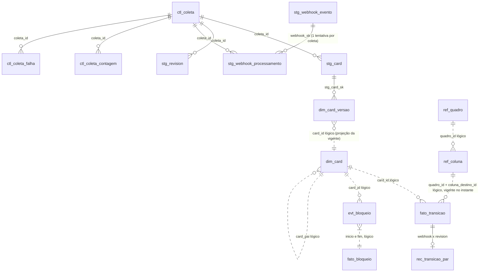
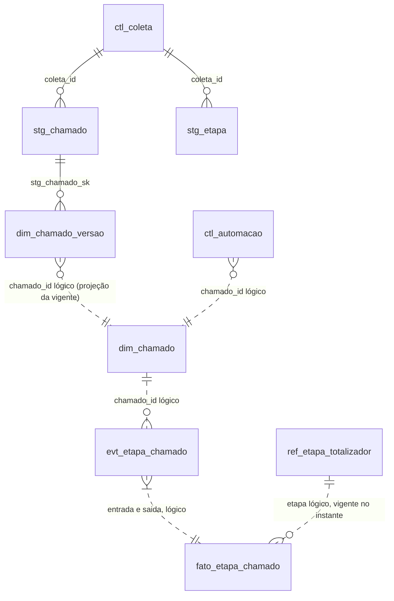

# Modelo de dados — base analítica (MySQL 8)

- Status: aprovado (revisão de modelagem K-014 r2); atualizado com o code review 002-K-017-r1 (B1, R1, R2, R4–R6, R8 e §9) e a decisão L-1 do usuário (2026-10-10)
- Data: 2026-10-09 · Revisão: 2026-10-10 · Decisões: ADR 0004 (MySQL, no RDS), 0005 (SQL explícito), **0014** (`mysql2` puro, migrador próprio, outbox), 0006 (contrato de execução da coleta), **0013** (Lambdas, Acelerato via Metabase)
- **Revisão ADR 0013 (2026-10-10):** a origem do Acelerato passa a ser uma tabela no Metabase lida 1x/dia pela API (não mais o MySQL `acelerato_dev_corporativo`). Muda o §4 (staging AC, ausência) e o §8 (sem `acelerato_leitor`). Schemas, camadas e grants continuam.
- Forma da camada analítica = tipos de `@metricas-dspd/metricas` (`BaseBM`, `BaseAC`); o mock gera exatamente essa forma (paridade, D15).
- Colunas marcadas **(prov.)** são extensões ao modelo 4.5 do briefing, provisórias até T2.1 (de-para da API) e à resposta do usuário.

## 1. Camadas e regras de escrita

| Camada | Prefixo | Conteúdo | Escrita permitida | Reconstruível? |
|---|---|---|---|---|
| Staging (registro de origem) | `stg_` | payload original + hash + metadados de coleta | **só INSERT** (grant) | não: é a fonte da verdade fora da ferramenta |
| Eventos / histórico | `evt_`, `dim_*_versao`, `fato_transicao` | eventos normalizados e versões SCD2 | **só INSERT** (grant) | sim, a partir do staging |
| Projeções | `dim_card`, `fato_bloqueio`, `dim_chamado`, `fato_etapa_chamado` | estado atual e intervalos, na forma do briefing 4.5 | substituição por entidade afetada, em transação | sim, a partir de eventos + referência |
| Referência | `ref_` | colunas, domínios fechados, calendário, critérios, alvos | só INSERT de nova vigência; fechar vigência = única UPDATE, por grant de coluna `UPDATE (vigente_ate)` (§8) | arquivo versionado no repositório (`ref:sync`) |
| Controle | `ctl_` | log de coleta, marca d'água, falhas, reconciliação, automações | INSERT; UPDATE por grant de coluna só em `ctl_coleta` (`status`, `finalizado_em`, `marca_dagua_ate`, `erro_resumo`) e em `ctl_coleta_contagem`; demais `ctl_` (inclusive `ctl_automacao`) só INSERT (§8) | não |

"Nunca sobrescrever histórico" é garantido no staging e nos eventos por privilégio, não por convenção. Projeções podem ser refeitas inteiras (tabela nova + `RENAME TABLE` atômico) quando um critério muda (T2.6). Por isso nenhuma FK física aponta para projeção (§2).

Fluxo: `stg_*` → normalizador (TS) → `evt_*`/`fato_transicao`/`*_versao` → projetor (TS, usa `@metricas-dspd/metricas` para marcos e horas úteis) → projeções → API carrega o contexto.

## 2. Convenções
- InnoDB, `utf8mb4_0900_ai_ci`; instantes `DATETIME(3)` UTC (sufixo `_em`); datas civis `DATE`.
- Rastreabilidade em **toda** linha de staging, evento e projeção: `sistema_origem` (constante por schema, coluna `CHECK`), `id_origem` (chave natural na ferramenta), `coletado_em`, `coleta_id` (FK `ctl_coleta`). Projeções guardam `atualizado_por_coleta_id`.
- Chave natural da origem: `VARCHAR(32) CHARACTER SET ascii` (prov., confirmar tipo no T2.1). Exceção: `fato_transicao.id_origem` é `VARCHAR(64) CHARACTER SET ascii`, porque com `fonte = 'webhook'` guarda o SHA-256 do webhook em hex (64 caracteres).
- PK substituta `BIGINT UNSIGNED AUTO_INCREMENT` (`*_sk`) onde a natural não é única (versões, eventos).
- Hash de payload: `payload_sha256 BINARY(32)` = SHA-256 do JSON canônico (chaves ordenadas) do payload gravado, que é o payload original, sem pseudonimização (decisão L-1, §9). Mudar a canonicalização exige migração planejada (mudaria todos os hashes e duplicaria o staging).
- **FK física só para `ctl_coleta` e entre tabelas imutáveis** (staging, eventos, versões). Evento, versão e staging **nunca** têm FK física para projeção (`dim_card`, `fato_bloqueio`, `dim_chamado`, `fato_etapa_chamado`) nem para `ref_*` com vigência na PK: a dependência é lógica (`card_id`, `chamado_id`, `coluna_id`), com índice, e verificada pela reconciliação. Motivos: o evento pode chegar antes da projeção do card; o rebuild por tabela nova + `RENAME TABLE` levaria as FKs dos filhos junto com a tabela renomeada; FK bloquearia a substituição da projeção. No ER, relações lógicas aparecem pontilhadas (`..`).
- Toda FK e toda chave lógica indexadas. Nenhuma FK nem chave lógica cruza `dspd_bm` × `dspd_ac`.

## 3. Schema `dspd_bm` (BusinessMap)

### 3.1 Staging
| Tabela | Chave natural / UNIQUE | Campos além do padrão |
|---|---|---|
| `stg_card` | (`id_origem`, `anterior_sk`) | `payload JSON`, `quadro_id`, `arquivado`, `excluido_detectado` |
| `stg_revision` | (`card_id`, `revision_id`) (prov.: chave da revision no T2.1) | `payload JSON` |
| `stg_vinculo` | (`pai_id`, `filho_id`, `anterior_sk`) | `payload JSON` |
| `stg_custom_field` | (`id_origem`, `anterior_sk`) | definição + valores |
| `stg_coluna` | (`quadro_id`, `id_origem`, `anterior_sk`) | estrutura do workflow |
| `stg_bloqueio` | (`card_id`, `id_origem`, `anterior_sk`) | `payload JSON` |
| `stg_webhook_evento` | (`payload_sha256`) | `webhook_sk` (PK), `recebido_em`, `payload JSON` (cada entrega é um evento; reentrega idêntica = mesma linha). **Sem `coleta_id`**: a entrega não pertence a uma coleta (o `dspd_webhook` só insere aqui); o vínculo com a coleta fica em `stg_webhook_processamento` |
| `stg_webhook_processamento` | (`webhook_sk`, `coleta_id`) | `resultado ENUM('processado','ignorado','erro')`, `erro`; uma linha por tentativa; separada para o staging continuar só-INSERT. Webhook "processado" = existe linha com `resultado = 'processado'`; pendentes = sem essa linha (com ou sem tentativa de `erro`), reprocessados na coleta seguinte |
| `stg_card_presenca` | (`varredura_id`, `id_origem`) | resultado da varredura completa semanal; card ausente → `evt_card` tipo `excluido_detectado` |

**Deduplicação contra a última versão do item, não contra todas.** Cada tabela versionada de staging tem `stg_sk` (PK), `payload_sha256` e `anterior_sk BIGINT UNSIGNED NOT NULL` (`stg_sk` da versão anterior do mesmo item; `0` na primeira, porque UNIQUE no MySQL aceita vários `NULL`), com UNIQUE (chave do item, `anterior_sk`) e índice (chave do item, `stg_sk`). O coletor lê a última versão (`stg_sk`, `payload_sha256`) do item: hash igual → `ja_existentes`, nada gravado; hash diferente → `INSERT` com `anterior_sk` = último `stg_sk`. O UNIQUE garante cadeia linear: duas gravações concorrentes sobre a mesma versão anterior → a segunda recebe 1062, relê e reavalia. Assim A → B → A gera três linhas (a reversão não é perdida) e a recoleta de A sem mudança não gera nenhuma. Teste de borda obrigatório no K-017: A → B → A, recoleta idêntica e concorrência.

Escrita sempre com `INSERT` normal; só o erro 1062 (`ER_DUP_ENTRY`) é "já existente"; qualquer outro erro é falha do item (`ctl_coleta_falha`). `INSERT IGNORE` e `ON DUPLICATE KEY UPDATE` proibidos (ADR 0004). Nada é atualizado.

### 3.2 Eventos e histórico
| Tabela | Grão | Chave natural (UNIQUE) | Campos |
|---|---|---|---|
| `dim_card_versao` (SCD2) | 1 versão por mudança de atributo | (`card_id`, `vigente_de`) | todos os atributos de `DimCard` exceto marcos, `vigente_de`, `stg_card_sk` |
| `evt_card` | ciclo de vida | (`card_id`, `tipo`, `ocorrido_em`) | `tipo ENUM('criado','arquivado','desarquivado','excluido_detectado','restaurado')` |
| `fato_transicao` | 1 linha por movimentação (4.5) | (`fonte`, `id_origem`); índice (`card_id`, `ocorrido_em`) | `quadro_id` (prov.: dispensável se `coluna_id` for global no T2.1), `coluna_origem_id`, `coluna_destino_id`, `tipo_coluna ENUM('fila','execucao')`, `direcao ENUM('avanco','retorno')`, `fonte ENUM('revision','webhook')`, `id_origem VARCHAR(64) CHARACTER SET ascii` (id da revision ou SHA-256 hex do webhook) |
| `rec_transicao_par` | casamento webhook × revision | (`transicao_webhook_sk`) UNIQUE, (`transicao_revision_sk`) UNIQUE | `delta_ms`, `casado_em` |
| `evt_bloqueio` | início e fim de bloqueio | (`card_id`, `id_origem`, `tipo ENUM('inicio','fim')`) | `motivo_codigo`, `coluna_id`, `fornecedor_codigo`, `ocorrido_em` |

Versão vigente sem índice parcial: em `dim_card_versao` não há `vigente_ate`; a vigente é a de maior `vigente_de` por card e é materializada em `dim_card`. O próprio UNIQUE (`card_id`, `vigente_de`) atende a busca (o InnoDB percorre o índice ao contrário); não há índice `DESC` adicional (o mesmo vale para `dim_chamado_versao`).

Transição canônica (consumida pela biblioteca) = view `vw_transicao_canonica`: todas as `revision` + `webhook` sem par em `rec_transicao_par`. Tolerância de casamento: mesmo card e destino, |Δt| ≤ 120 s (prov., pergunta N-3). `tipo_coluna` e `direcao` são derivados com a `ref_coluna` vigente no instante da transição; reclassificar coluna = nova vigência + nova versão de critério + rebuild das projeções.

### 3.3 Projeções (forma do briefing 4.5 = tipos da biblioteca)
| Tabela | Grão | PK | Campos |
|---|---|---|---|
| `dim_card` | 1 linha por card (inclui arquivados e excluídos) | `card_id` | 4.5: `tipo`, `classe_servico`, `sistema`, `area_solicitante`, `fornecedor`, `objetivo_estrategico`, `card_pai`, `criado_em`, `comprometido_em`, `iniciado_em`, `concluido_em`, `arquivado_em`, `motivo_descarte`, `tamanho_declarado`. Extensões (prov.): `titulo`, `granularidade`, `equipe`, `quadro_id`, `coluna_atual_id`, `excluido_em`, `eh_subtarefa`, `data_acordada`, `responsabilidade_atraso`, `origem_demanda`, `fase_deteccao`, `severidade`, `causa_raiz`, `origem_bug`, `adicionado_apos_inicio_pai`. **Sem `responsaveis`** (§9) |
| `fato_bloqueio` | 1 linha por bloqueio | `bloqueio_sk`; UNIQUE (`card_id`, `id_origem`) | `motivo`, `coluna_em_que_bloqueou`, `fornecedor`, `inicio`, `fim`, `duracao_horas_uteis` (calculada pela biblioteca com o calendário vigente; nunca em SQL) |

Marcos (`comprometido_em`, `iniciado_em`, `concluido_em`) derivados das transições canônicas por uma função única em `@metricas-dspd/metricas/businessmap` (T2.4), a mesma usada pelo mock; `entrega` = entrada em coluna de papel `entrega`.

### 3.4 Referência BM (com vigência `vigente_de DATE`, `vigente_ate DATE NULL`)
| Tabela | Chave | Uso |
|---|---|---|
| `ref_quadro` | `quadro_id` + vigência | equipe, nível (time/coordenação/gerência), `eh_teste` (quadro de teste fora de todo cálculo, 4.2) |
| `ref_coluna` | (`quadro_id`, `coluna_id`, `vigente_de`) | nome, `tipo_coluna`, `papel`, `ordem`, `limite_wip` (T1.1, T1.4) |
| `ref_dominio` | (`campo`, `codigo`, `vigente_de`) | domínios fechados 4.4 e 4.3: `tipo_card`, `classe_servico`, `motivo_bloqueio`, `fase_deteccao`, `causa_raiz`, `origem_demanda`, `area_solicitante`, `sistema_afetado`, `fornecedor`, `objetivo_estrategico`, `severidade`, `responsabilidade_atraso`, `tamanho`; `rotulo`, `ordem` (ordem neutra) |
| `ref_sle`, `ref_alocacao_acordada`, `ref_limite_frentes` | chave + vigência | `ConfigBM` (origem real: pergunta N-5) |
| `ref_ficha_resultado` | `card_id` + vigência | `FichaResultado` (E3) |

## 4. Schema `dspd_ac` (Acelerato)

| Tabela | Grão | Chave natural (UNIQUE) | Notas |
|---|---|---|---|
| `stg_chamado` | linha da tabela do Metabase (pergunta salva, ADR 0013 §4) | (`id_origem`, `anterior_sk`), dedup contra a última versão (§3.1) | payload = linha JSON da exportação, validada pelo schema zod da tabela antes de gravar; recorte 3.2 conforme P7 (se a tabela já vier recortada, chamados que saem do recorte aparecem como **ausentes**) |
| `stg_etapa` | linha de transição de etapa, **se a tabela tiver** (P6) | (`chamado_id`, `id_origem`, `anterior_sk`) | sem histórico de etapas na fonte, a tabela fica vazia e as métricas que dependem dela ficam `pendente-usuario` (nunca inferidas do estado diário) |

**Ausência (ADR 0013):** quando um `id_origem` presente na última versão não vem na extração do dia, grava-se uma nova versão na mesma cadeia com `ausente_na_extracao = 1` (coluna nova, migração a criar, com o mesmo payload da versão anterior; o hash inclui a marca). Nada é apagado; reaparecer gera nova versão com `0`. A projeção trata ausente como fora do recorte, sem inferir exclusão (pergunta P7). `ctl_coleta.parametros` registra o id da pergunta do Metabase e o SHA-256 do SQL versionado em `docs/architecture/fontes/acelerato-metabase.sql` (mudança = `ref_versao_criterio`, T2.6). Marca d'água: se a tabela não tiver coluna de atualização, cada coleta lê a tabela inteira (o staging deduplica pelo hash).
| `dim_chamado_versao` (SCD2) | versão por mudança | (`chamado_id`, `vigente_de`) | atributos de `Chamado`, **incluindo `organizacao` e `tipo`** (campos do recorte 3.2: mudança de recorte de um chamado fica no histórico); sem índice `DESC` adicional (§3.2) |
| `evt_etapa_chamado` | entrada em etapa | (`chamado_id`, `etapa`, `entrada_em`) | `motivo_pendencia` |
| `dim_chamado` | 1 por chamado (inclui `excluido = true`, filtrado na view) | `chamado_id` | forma de `Chamado`; `justificativa_ajuste` **não** entra (§9) |
| `fato_etapa_chamado` | intervalo por etapa | (`chamado_id`, `etapa`, `entrada`) | `saida`, `motivo_pendencia`, `totalizador` |
| `ref_etapa_totalizador` | etapa → um dos 5 totalizadores (3.2, T4.4) | (`natureza`, `etapa_origem`, `vigente_de`) | requisição, incidente e fila antiga mapeados separadamente |
| `ref_dominio` | domínios 3.4 e recorte 3.2 | (`campo`, `codigo`, `vigente_de`) | `organizacao_recorte`, `tipo_recorte` (valores do recorte usados por `vw_populacao_sssc`), `motivo_escalacao`, `motivo_pendencia`, `motivo_encerramento`, `avaliacao_problema`, `impacto`, `urgencia`, `prioridade`, `etapa`, `equipe` |
| `ref_alvo_prioridade` | prazos P1–P5 | (`prioridade`, `vigente_de`) | `AlvoPrioridade` |
| `ctl_automacao` | ação da T4.3 | (`chamado_id`, `regra`, `momento_gatilho`, `tentativa`) | `acao`, `modo ENUM('simulacao','ativo')`, `resultado`, `registrado_no_chamado`; resultado conhecido depois = nova linha (tentativa), sem UPDATE |

Views do recorte (T5.1), sobre a nossa cópia, nunca no banco do Acelerato:
- `vw_populacao_sssc`: `organizacao = 'DSPD Sustentação' AND tipo = 'DSPD - SSSC' AND equipe IN (...) AND excluido = false` (valores vêm de `ref_dominio` vigente, campos `organizacao_recorte`, `tipo_recorte` e `equipe`; não fixos na view).
- `vw_fechados_sla`: `status = 'Concluído' AND data_finalizado IS NOT NULL`, `status_sla_r` → dentro/fora.
- `vw_abertos`: `data_finalizado IS NULL`.
- Exceção de SLA por registro posterior sempre como coluna explícita, nunca filtrada em silêncio (T5.1).

## 5. Schema `dspd_core` (sem dados de origem)

| Tabela | Chave | Campos |
|---|---|---|
| `ref_calendario` | `calendario_id` | `nome`, `offset_minutos` (−180), `descricao` |
| `ref_calendario_turno` | (`calendario_id`, `dia_semana`, `inicio_min`, `vigente_de`) | `fim_min`, `vigente_ate` |
| `ref_feriado` | (`calendario_id`, `data`) | `escopo ENUM('nacional','estadual','municipal','ponto_facultativo')`, `descricao`, `incluido_por_versao_id` |
| `ref_calendario_aplicacao` | (`dominio`, `classe`, `vigente_de`) | qual calendário vale para cada classe (exceção de plantão, 4.2; pergunta P2/N-6) |
| `ref_versao_criterio` (T2.6) | `versao_id` | `vigente_desde DATE`, `dominio ENUM('businessmap','acelerato')`, `descricao`, `motivo`, `referencia` (PR/ata), `registrado_em`. Mudança que afeta os dois domínios = duas linhas |
| `ref_versao_criterio_metrica` | (`versao_id`, `metrica_id`) | quais `MetricaId` são afetadas (alimenta `criterios.serie/janela` nos DTOs) |
| `kysely_migration` | `name` | controle das migrações; nome histórico mantido, agora usado pelo executor próprio sobre `mysql2` (ADR 0014) |
| `kysely_migration_lock` | — | sem uso desde a ADR 0014 (lock por `GET_LOCK('dspd:migracao')`); remoção só por migração futura |
| `outbox` (ADR 0014, migração `0011_core_outbox`) | `evento_sk` | ver abaixo |

### `outbox`: eventos transacionais lidos por polling (ADR 0014)
Gravada na **mesma transação** da mudança que gera o evento; lida pelo poller da fonte (`FOR UPDATE SKIP LOCKED`). Tabela **operacional**, não histórico: é a única exceção à regra de não apagar (retenção de 30 dias para `processado`).

| Campo | Tipo | Regra |
|---|---|---|
| `evento_sk` | `BIGINT UNSIGNED AUTO_INCREMENT` PK | ordem de processamento |
| `evento_id` | `CHAR(36) CHARACTER SET ascii` UNIQUE | UUID; chave de idempotência do consumidor |
| `fonte` | `ENUM('businessmap','acelerato')` NOT NULL | o poller sempre filtra por uma fonte; BM e AC nunca no mesmo lote |
| `tipo` | `VARCHAR(64) ascii` NOT NULL | `bm.webhook.recebido`, `coleta.concluida` (lista fechada no código) |
| `payload` | `JSON` NOT NULL | só identificadores técnicos (`webhookSk`, `coletaId`, `status`); **nenhum dado pessoal** (teste de LGPD) |
| `status` | `ENUM('pendente','processando','processado','falha')` NOT NULL DEFAULT `'pendente'` | `falha` após 8 tentativas, com alarme |
| `tentativas` | `SMALLINT UNSIGNED` NOT NULL DEFAULT 0 | |
| `criado_em`, `disponivel_em` | `DATETIME(3)` NOT NULL | `disponivel_em` recebe o backoff |
| `reservado_ate` | `DATETIME(3)` NULL | reserva vencida volta a ser elegível |
| `processado_em` | `DATETIME(3)` NULL | |
| `ultimo_erro` | `VARCHAR(500)` NULL | só a categoria, sem payload nem segredo |

Índices: `ix_outbox_fila (fonte, status, disponivel_em, evento_sk)`, `ix_outbox_retencao (status, processado_em)`. Grants: `dspd_webhook` INSERT; `dspd_coletor` SELECT, INSERT, `UPDATE (status, tentativas, disponivel_em, reservado_ate, processado_em, ultimo_erro)`, DELETE; `dspd_api` nenhum. Migração com `down` (`DROP TABLE`), revisão de modelagem antes (praticas §6).

A biblioteca recebe o `Calendario` montado a partir dessas tabelas (ADR 0002); nenhuma função usa o padrão do mock em produção. Critério T2.6: cada mudança de feriado, turno, mapeamento de etapa, classificação de coluna ou regra de métrica entra junto com uma `ref_versao_criterio`; o `ref:sync` recusa mudança de referência sem versão de critério associada.

## 6. Log de coleta e marca d'água (em `dspd_bm` e em `dspd_ac`, tabelas idênticas e separadas)

| Tabela | Campos |
|---|---|
| `ctl_coleta` | `coleta_id` PK, `tarefa` (`coleta_incremental`, `varredura`, `webhook`, `projecao`, `reconciliacao`), `iniciado_em`, `finalizado_em`, `status ENUM('em_andamento','sucesso','parcial','falha')`, `marca_dagua_de`, `marca_dagua_ate`, `sobreposicao_s`, `versao_coletor` (SHA), `parametros JSON`, `erro_resumo` |
| `ctl_coleta_contagem` | (`coleta_id`, `entidade`) PK, `lidos`, `inseridos`, `ja_existentes`, `falhas` |
| `ctl_coleta_falha` | `falha_sk`, `coleta_id`, `entidade`, `id_origem`, `tentativas`, `erro` (sem payload, sem dado pessoal) |
| `vw_marca_dagua` | view: último `marca_dagua_ate` com `status = 'sucesso'` por (`tarefa`, `entidade`) |
| `ctl_reconciliacao` | (`dia`, `entidade`, `tipo`) PK, `contagem_ferramenta`, `contagem_base`, `divergencia_pct` (critérios de pronto de T2.2, T2.3, T5.1) |

Próxima execução lê a partir de `marca_dagua_ate − sobreposicao_s`; a idempotência do staging torna a sobreposição segura. O frescor da API sai no corpo de `GET /fontes/:dominio/estado` (`EstadoColeta`, `docs/api/fontes.md`), calculado sobre `coleta_incremental` do domínio; não há cabeçalho `X-Ultima-Coleta`.

## 7. Índices por filtro de painel

O servidor carrega o contexto por domínio (recorte do histórico necessário) e filtra em memória; os índices cobrem essa carga, as views do recorte e as consultas de reconciliação. `EXPLAIN` registrado em `docs/architecture/explain/` (M2) no K-017.

| Tabela | Índice | Filtro / consulta coberta |
|---|---|---|
| `dim_card` | (`equipe`, `granularidade`, `tipo`, `concluido_em`) | equipe + tipo + período (O3, O4, O9, T1...) |
| `dim_card` | (`granularidade`, `sistema`, `concluido_em`) | sistema + período (T5, FL3) |
| `dim_card` | (`concluido_em`, `iniciado_em`) | abertos/WIP (`concluido_em IS NULL`) e aging |
| `dim_card` | (`criado_em`) | entrada × saída (O7), backlog aging |
| `dim_card` | (`card_pai`) | hierarquia projeto → frente → story |
| `fato_transicao` | (`card_id`, `ocorrido_em`) | marcos e retornos por card |
| `fato_transicao` | (`ocorrido_em`) | CFD e WIP diário (O1, T4) por janela |
| `fato_bloqueio` | (`card_id`, `inicio`), (`inicio`, `fim`) | bloqueados atuais e tempo bloqueado |
| `dim_card_versao` | (`card_id`, `vigente_de`) | vigente e histórico |
| `stg_*` | (`coleta_id`), (`coletado_em`) | reprocessamento e retenção |
| `dim_chamado` | (`equipe`, `prioridade`, `data_finalizado`) | equipe + prioridade + período (S1, S2, S3) |
| `dim_chamado` | (`data_finalizado`, `aberto_em`) | abertos e aging |
| `fato_etapa_chamado` | (`chamado_id`, `entrada`), (`etapa`, `entrada`) | decomposição por etapa e totalizador |
| `ref_*` | (`campo`/chave, `vigente_de`) | vigência no instante |

## 8. Usuários do MySQL e privilégios

| Usuário | `dspd_bm` / `dspd_ac` | `dspd_core` | Acelerato |
|---|---|---|---|
| `dspd_migrador` | DDL (só no job de deploy) | DDL | — |
| `dspd_coletor` | INSERT/SELECT em `stg_`, `evt_`, `*_versao`, `fato_transicao`, `rec_`; SELECT/INSERT/UPDATE/DELETE em projeções; INSERT/SELECT em `ctl_` + `UPDATE (status, finalizado_em, marca_dagua_ate, erro_resumo)` em `ctl_coleta` e UPDATE em `ctl_coleta_contagem`; SELECT em `ref_` | SELECT | — |
| `dspd_ref` (só o `ref:sync`) | INSERT/SELECT em `ref_` + `UPDATE (vigente_ate)` por coluna nas tabelas com vigência | idem em `ref_`, inclusive `ref_calendario_turno` e `ref_calendario_aplicacao` | — |
| `dspd_webhook` | INSERT só em `dspd_bm.stg_webhook_evento` | — | — |
| `dspd_api` | SELECT em projeções, `vw_`, `ref_`, `ctl_`; **sem acesso a `stg_`** | SELECT | — |
| `dspd_automacao` | `dspd_ac`: INSERT/SELECT em `ctl_automacao` | SELECT | — |
| ~~`acelerato_leitor`~~ (substituído pela ADR 0013) | — | — | sem acesso ao MySQL do Acelerato; a leitura é pela API do Metabase com chave de usuário só leitura (Secrets Manager) |

Mapeamento para as funções (ADR 0013): Lambda `api` usa `dspd_api` e `dspd_webhook`; Lambda `coleta` usa `dspd_coletor`; Lambda `migrar` usa `dspd_migrador` e `dspd_ref` (`ref:sync`). `dspd_automacao` fica sem uso até a T4.3 voltar.

## 9. Dados pessoais (LGPD) e "nenhuma visão individual" no modelo

| Dado de pessoa | Onde aparece na origem | Tratamento |
|---|---|---|
| Responsáveis do card (`responsaveis`, 4.5) | payload do card | **mantido com o nome** no staging (payload original, sem pseudonimização: decisão L-1); **não projetado** em coluna do analítico (nenhuma métrica usa) |
| Usuário da transição (`usuario`, 4.5) | revision, webhook | idem |
| Autores de comentário, tempo apontado | payloads BM | idem; horas apontadas nunca viram esforço (7.1) |
| Solicitante, atendente/agente, e-mail | payload do chamado | idem |
| Texto livre (título do card, justificativa de reclassificação, comentários) | payloads | título projetado (prov., pode conter nome: aceitar ou mascarar, L-2); justificativa só no staging, extraída para T5.5 por pessoa autorizada |
| Identidade de quem acessa o painel | sessão | HMAC do `sub`, sem nome (ADR 0009) |

**Decisão L-1 (usuário, 2026-10-10, `docs/alinhamentos/2026-10-10-decisoes-do-usuario.md` §3):** os nomes **não** são pseudonimizados nem retirados da base. O staging guarda o payload original, com nomes; acesso restrito a `dspd_coletor` e `dspd_migrador` (retenção a definir com o DPO). A regra "nenhuma visão individual" passa a ser garantida pelas camadas que leem a base (privilégio, esquema analítico, contrato da API e telas), e não pela ausência do nome no banco.

Garantias (cada uma verificada por teste ou privilégio):
1. **Esquema analítico sem coluna de pessoa** em `dim_`, `fato_`, `evt_`, `rec_`, `vw_`, `ref_`, `ctl_` (tudo fora de `stg_`). Regra com **fonte única** em `server/src/db/lgpd.ts` (`SEGMENTO_PESSOA`, `EXCECOES_PESSOA`, `violaLgpd`), usada pelo teste estático das migrações, pelo teste do seed e pelo teste de `information_schema.COLUMNS` no CI. Nenhum teste copia a lista.
   - **Busca por segmento snake_case:** o nome da coluna é dividido por `_` e viola a regra se algum segmento casar `^(pessoa|responsav\w*|usuario\w*|user\w*|agente\w*|atendente\w*|solicitante\w*|autor\w*|criador\w*|email\w*|login\w*|assignee\w*|justificativa\w*)$` (sem diferenciar maiúsculas). Pega nomes prefixados (`ultimo_usuario`, `card_responsavel`) e plurais (`responsaveis`) sem depender de `\b`. `justificativa` entra porque a justificativa de reclassificação é texto livre que pode citar pessoa (fica só no staging).
   - **Exceções só por `schema.tabela.coluna`**, cada uma com justificativa e item do briefing. Vigentes: `dspd_bm.dim_card.area_solicitante` e `dspd_bm.dim_card_versao.area_solicitante` (briefing 4.5 e domínio fechado 4.4: área organizacional, não pessoa). Proibida exceção por prefixo (`area_*`), curinga ou nome de coluna solto. Exceção nova só entra alterando esta seção, com revisão de modelagem (arquiteto + tech-lead), e depois em `EXCECOES_PESSOA`.
2. **Privilégio:** `dspd_api` não tem acesso a `stg_` (único lugar com nomes); nenhuma rota consegue devolver nome, mesmo com bug. Verificado no teste de grants.
3. **Contrato da API:** nenhuma rota, DTO ou schema zod tem campo de pessoa, nem como saída nem como parâmetro de filtro ou agrupamento; entrada `strict` recusa parâmetro desconhecido (ADR 0007); propriedade 6 da matriz de regras. Nenhum endpoint agrega por pessoa (ranking, contagem, tempo ou volume por pessoa).
4. **Views e agrupamento:** nenhuma `vw_` seleciona, agrupa ou ordena por campo de pessoa; `equipe` existe só como filtro, e nenhuma view agrupa por equipe para comparar times (7.1).
5. **Telas:** nenhuma tela mostra, filtra ou ordena por pessoa (filtro por agente fora da sustentação, decisão confirmada). Verificado nos testes de UI e E2E pelo `qa-engineer`.
6. **Saída do staging:** extração de dado de pessoa do staging (ex.: justificativa para T5.5) só por pessoa autorizada, fora da API, e nunca vira coluna analítica sem passar pela regra de exceção da garantia 1.

Consequência para o código: `DimCard.responsaveis` e `FatoTransicao.usuario` continuam fora dos tipos da biblioteca e do mock (nenhuma métrica os usa: mínimo necessário). O nome continua disponível no staging para reconciliação e auditoria.

## 10. Perguntas de modelagem para o usuário (não resolvidas por inferência)
| # | Pergunta | Recomendação | Alternativa |
|---|---|---|---|
| L-1 | ~~Pseudonimizar pessoas no staging?~~ **Respondida (2026-10-10):** não pseudonimizar; nomes ficam na base; garantia de nenhuma visão individual na API, views e telas (§9) | — | — |
| L-2 | Título de card pode aparecer nas listas (O2, bloqueados)? | sim, com aviso de não escrever nomes no título | mostrar só o código do card |
| N-3 | Webhook × revision: qual instante vale e qual a tolerância de casamento? | revision é canônica; webhook só antecipa; 120 s | webhook canônico quando houver |
| N-5 | De onde vêm SLE, alocação acordada, limites de frentes e fichas de resultado? | arquivo versionado no repositório, preenchido pela governança (WS6) | campos/cartões no BusinessMap |
| N-6 | Quais classes usam calendário de plantão (4.2)? | nenhuma até definição | lista por classe de serviço |
| — | Filtro por agente na sustentação (T5.1): já registrada (spec UX, pergunta 17); o modelo não tem coluna de agente | não implementar | — |
| — | Card arquivado não entregue conta como aberto: já registrada (P1 de `regras-metricas.md`); o modelo guarda `arquivado_em` e serve às duas respostas | — | — |
