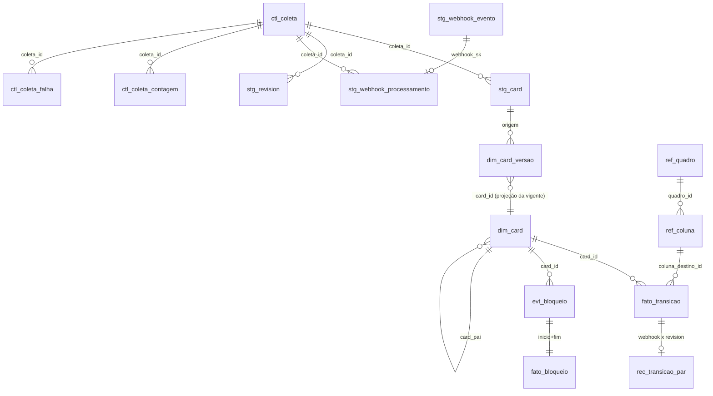
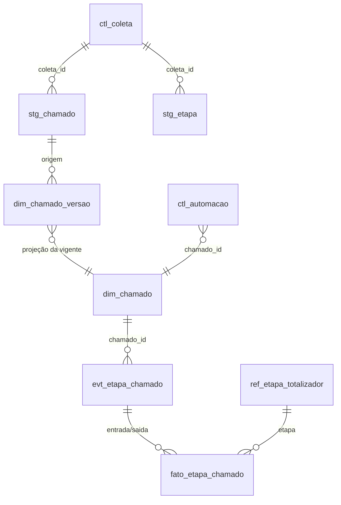

# Modelo de dados — base analítica (MySQL 8)

- Status: proposta para revisão de modelagem (tech-lead + arquiteto) antes das migrações do K-017
- Data: 2026-10-09 · Decisões: ADR 0004 (MySQL), 0005 (Kysely + SQL), 0006 (coletas)
- Forma da camada analítica = tipos de `@metricas-dspd/metricas` (`BaseBM`, `BaseAC`); o mock gera exatamente essa forma (paridade, D15).
- Colunas marcadas **(prov.)** são extensões ao modelo 4.5 do briefing, provisórias até T2.1 (de-para da API) e à resposta do usuário.

## 1. Camadas e regras de escrita

| Camada | Prefixo | Conteúdo | Escrita permitida | Reconstruível? |
|---|---|---|---|---|
| Staging (registro de origem) | `stg_` | payload original + hash + metadados de coleta | **só INSERT** (grant) | não: é a fonte da verdade fora da ferramenta |
| Eventos / histórico | `evt_`, `dim_*_versao`, `fato_transicao` | eventos normalizados e versões SCD2 | **só INSERT** (grant) | sim, a partir do staging |
| Projeções | `dim_card`, `fato_bloqueio`, `dim_chamado`, `fato_etapa_chamado` | estado atual e intervalos, na forma do briefing 4.5 | substituição por entidade afetada, em transação | sim, a partir de eventos + referência |
| Referência | `ref_` | colunas, domínios fechados, calendário, critérios, alvos | só INSERT de nova vigência (fechar vigência = única UPDATE, no campo `vigente_ate`) | arquivo versionado no repositório (`ref:sync`) |
| Controle | `ctl_` | log de coleta, marca d'água, falhas, reconciliação, automações | INSERT; UPDATE só de status/fim da própria execução | não |

"Nunca sobrescrever histórico" é garantido no staging e nos eventos por privilégio, não por convenção. Projeções podem ser refeitas inteiras (tabela nova + `RENAME TABLE` atômico) quando um critério muda (T2.6).

Fluxo: `stg_*` → normalizador (TS) → `evt_*`/`fato_transicao`/`*_versao` → projetor (TS, usa `@metricas-dspd/metricas` para marcos e horas úteis) → projeções → API carrega o contexto.

## 2. Convenções
- InnoDB, `utf8mb4_0900_ai_ci`; instantes `DATETIME(3)` UTC (sufixo `_em`); datas civis `DATE`.
- Rastreabilidade em **toda** linha de staging, evento e projeção: `sistema_origem` (constante por schema, coluna `CHECK`), `id_origem` (chave natural na ferramenta), `coletado_em`, `coleta_id` (FK `ctl_coleta`). Projeções guardam `atualizado_por_coleta_id`.
- Chave natural da origem: `VARCHAR(32) CHARACTER SET ascii` (prov., confirmar tipo no T2.1).
- PK substituta `BIGINT UNSIGNED AUTO_INCREMENT` (`*_sk`) onde a natural não é única (versões, eventos).
- Hash de payload: `payload_sha256 BINARY(32)` = SHA-256 do JSON canônico (chaves ordenadas).
- Toda FK indexada. Nenhuma FK cruza `dspd_bm` × `dspd_ac`.

## 3. Schema `dspd_bm` (BusinessMap)

### 3.1 Staging
| Tabela | Chave natural / UNIQUE | Campos além do padrão |
|---|---|---|
| `stg_card` | (`id_origem`, `payload_sha256`) | `payload JSON`, `quadro_id`, `arquivado`, `excluido_detectado` |
| `stg_revision` | (`card_id`, `revision_id`) (prov.: chave da revision no T2.1) | `payload JSON` |
| `stg_vinculo` | (`pai_id`, `filho_id`, `payload_sha256`) | `payload JSON` |
| `stg_custom_field` | (`id_origem`, `payload_sha256`) | definição + valores |
| `stg_coluna` | (`quadro_id`, `id_origem`, `payload_sha256`) | estrutura do workflow |
| `stg_bloqueio` | (`card_id`, `id_origem`, `payload_sha256`) | `payload JSON` |
| `stg_webhook_evento` | (`payload_sha256`) | `recebido_em`, `payload JSON` |
| `stg_webhook_processamento` | (`webhook_sk`) | `coleta_id`, `resultado` (processado/ignorado/erro); separada para o staging continuar só-INSERT |
| `stg_card_presenca` | (`varredura_id`, `id_origem`) | resultado da varredura completa semanal; card ausente → `evt_card` tipo `excluido_detectado` |

Recoleta do mesmo conteúdo não gera linha (mesmo hash); conteúdo novo gera linha nova. Nada é atualizado.

### 3.2 Eventos e histórico
| Tabela | Grão | Chave natural (UNIQUE) | Campos |
|---|---|---|---|
| `dim_card_versao` (SCD2) | 1 versão por mudança de atributo | (`card_id`, `vigente_de`) | todos os atributos de `DimCard` exceto marcos, `vigente_de`, `stg_card_sk` |
| `evt_card` | ciclo de vida | (`card_id`, `tipo`, `ocorrido_em`) | `tipo ENUM('criado','arquivado','desarquivado','excluido_detectado','restaurado')` |
| `fato_transicao` | 1 linha por movimentação (4.5) | (`card_id`, `ocorrido_em`, `coluna_destino_id`, `fonte`) | `coluna_origem_id`, `coluna_destino_id`, `tipo_coluna ENUM('fila','execucao')`, `direcao ENUM('avanco','retorno')`, `fonte ENUM('revision','webhook')`, `id_origem` (revision ou hash do webhook) |
| `rec_transicao_par` | casamento webhook × revision | (`transicao_webhook_sk`) UNIQUE, (`transicao_revision_sk`) UNIQUE | `delta_ms`, `casado_em` |
| `evt_bloqueio` | início e fim de bloqueio | (`card_id`, `id_origem`, `tipo ENUM('inicio','fim')`) | `motivo_codigo`, `coluna_id`, `fornecedor_codigo`, `ocorrido_em` |

Versão vigente sem índice parcial: em `dim_card_versao` não há `vigente_ate`; a vigente é a de maior `vigente_de` por card (índice (`card_id`, `vigente_de` DESC)) e materializada em `dim_card`.

Transição canônica (consumida pela biblioteca) = view `vw_transicao_canonica`: todas as `revision` + `webhook` sem par em `rec_transicao_par`. Tolerância de casamento: mesmo card e destino, |Δt| ≤ 120 s (prov., pergunta N-3). `tipo_coluna` e `direcao` são derivados com a `ref_coluna` vigente no instante da transição; reclassificar coluna = nova vigência + nova versão de critério + rebuild das projeções.

### 3.3 Projeções (forma do briefing 4.5 = tipos da biblioteca)
| Tabela | Grão | PK | Campos |
|---|---|---|---|
| `dim_card` | 1 linha por card (inclui arquivados e excluídos) | `card_id` | 4.5: `tipo`, `classe_servico`, `sistema`, `area_solicitante`, `fornecedor`, `objetivo_estrategico`, `card_pai`, `criado_em`, `comprometido_em`, `iniciado_em`, `concluido_em`, `arquivado_em`, `motivo_descarte`, `tamanho_declarado`. Extensões (prov.): `titulo`, `granularidade`, `equipe`, `quadro_id`, `coluna_atual_id`, `excluido_em`, `eh_subtarefa`, `data_acordada`, `responsabilidade_atraso`, `origem_demanda`, `fase_deteccao`, `severidade`, `causa_raiz`, `origem_bug`, `adicionado_apos_inicio_pai`. **Sem `responsaveis`** (§9) |
| `fato_bloqueio` | 1 linha por bloqueio | `bloqueio_sk`; UNIQUE (`card_id`, `id_origem`) | `motivo`, `coluna_em_que_bloqueou`, `fornecedor`, `inicio`, `fim`, `duracao_horas_uteis` (calculada pela biblioteca com o calendário vigente; nunca em SQL) |

Marcos (`comprometido_em`, `iniciado_em`, `concluido_em`) derivados das transições canônicas por uma função única em `@metricas-dspd/metricas/businessmap` (T2.4), a mesma usada pelo mock; `entrega` = entrada em coluna de papel `entrega`.

### 3.4 Referência BM (com vigência `vigente_de DATE`, `vigente_ate DATE NULL`)
| Tabela | Chave | Uso |
|---|---|---|
| `ref_quadro` | `quadro_id` + vigência | equipe, nível (time/coordenação/gerência), `eh_teste` (quadro de teste fora de todo cálculo, 4.2) |
| `ref_coluna` | (`quadro_id`, `coluna_id`, `vigente_de`) | nome, `tipo_coluna`, `papel`, `ordem`, `limite_wip` (T1.1, T1.4) |
| `ref_dominio` | (`campo`, `codigo`, `vigente_de`) | domínios fechados 4.4 e 4.3: `tipo_card`, `classe_servico`, `motivo_bloqueio`, `fase_deteccao`, `causa_raiz`, `origem_demanda`, `area_solicitante`, `sistema_afetado`, `fornecedor`, `objetivo_estrategico`, `severidade`, `responsabilidade_atraso`, `tamanho`; `rotulo`, `ordem` (ordem neutra) |
| `ref_sle`, `ref_alocacao_acordada`, `ref_limite_frentes` | chave + vigência | `ConfigBM` (origem real: pergunta N-5) |
| `ref_ficha_resultado` | `card_id` + vigência | `FichaResultado` (E3) |

## 4. Schema `dspd_ac` (Acelerato)

| Tabela | Grão | Chave natural (UNIQUE) | Notas |
|---|---|---|---|
| `stg_chamado` | linha lida do Acelerato | (`id_origem`, `payload_sha256`) | lido com o recorte 3.2 **e** chamados que saíram do recorte (para não perder mudança de equipe/exclusão) |
| `stg_etapa` | linha da tabela/view de etapas | (`chamado_id`, `id_origem`, `payload_sha256`) | `VIEW_ESTATISTICAS_ETAPAS_2` cobre só fechados; abertos precisam da tabela de histórico de etapas (pergunta I-4b) |
| `dim_chamado_versao` (SCD2) | versão por mudança | (`chamado_id`, `vigente_de`) | atributos de `Chamado` |
| `evt_etapa_chamado` | entrada em etapa | (`chamado_id`, `etapa`, `entrada_em`) | `motivo_pendencia` |
| `dim_chamado` | 1 por chamado (inclui `excluido = true`, filtrado na view) | `chamado_id` | forma de `Chamado`; `justificativa_ajuste` **não** entra (§9) |
| `fato_etapa_chamado` | intervalo por etapa | (`chamado_id`, `etapa`, `entrada`) | `saida`, `motivo_pendencia`, `totalizador` |
| `ref_etapa_totalizador` | etapa → um dos 5 totalizadores (3.2, T4.4) | (`natureza`, `etapa_origem`, `vigente_de`) | requisição, incidente e fila antiga mapeados separadamente |
| `ref_dominio` | domínios 3.4 | (`campo`, `codigo`, `vigente_de`) | `motivo_escalacao`, `motivo_pendencia`, `motivo_encerramento`, `avaliacao_problema`, `impacto`, `urgencia`, `prioridade`, `etapa`, `equipe` |
| `ref_alvo_prioridade` | prazos P1–P5 | (`prioridade`, `vigente_de`) | `AlvoPrioridade` |
| `ctl_automacao` | ação da T4.3 | (`chamado_id`, `regra`, `momento_gatilho`) | `acao`, `modo ENUM('simulacao','ativo')`, `resultado`, `registrado_no_chamado` |

Views do recorte (T5.1), sobre a nossa cópia, nunca no banco do Acelerato:
- `vw_populacao_sssc`: `organizacao = 'DSPD Sustentação' AND tipo = 'DSPD - SSSC' AND equipe IN (...) AND excluido = false` (valores vêm de `ref_dominio`, não fixos na view).
- `vw_fechados_sla`: `status = 'Concluído' AND data_finalizado IS NOT NULL`, `status_sla_r` → dentro/fora.
- `vw_abertos`: `data_finalizado IS NULL`.
- Exceção de SLA por registro posterior sempre como coluna explícita, nunca filtrada em silêncio (T5.1).

## 5. Schema `dspd_core` (sem dados de origem)

| Tabela | Chave | Campos |
|---|---|---|
| `ref_calendario` | `calendario_id` | `nome`, `offset_minutos` (−180), `descricao` |
| `ref_calendario_turno` | (`calendario_id`, `dia_semana`, `inicio_min`, `vigente_de`) | `fim_min`, `vigente_ate` |
| `ref_feriado` | (`calendario_id`, `data`) | `escopo ENUM('nacional','estadual','municipal','ponto_facultativo')`, `descricao`, `incluido_por_versao_id` |
| `ref_calendario_aplicacao` | (`dominio`, `classe`, `vigente_de`) | qual calendário vale para cada classe (exceção de plantão, 4.2; pergunta P2/N-6) |
| `ref_versao_criterio` (T2.6) | `versao_id` | `vigente_desde DATE`, `dominio ENUM('businessmap','acelerato')`, `descricao`, `motivo`, `referencia` (PR/ata), `registrado_em`. Mudança que afeta os dois domínios = duas linhas |
| `ref_versao_criterio_metrica` | (`versao_id`, `metrica_id`) | quais `MetricaId` são afetadas (alimenta `criterios.serie/janela` nos DTOs) |
| `kysely_migration`, `kysely_migration_lock` | — | controle do Migrator (ADR 0005) |

A biblioteca recebe o `Calendario` montado a partir dessas tabelas (ADR 0002); nenhuma função usa o padrão do mock em produção. Critério T2.6: cada mudança de feriado, turno, mapeamento de etapa, classificação de coluna ou regra de métrica entra junto com uma `ref_versao_criterio`; o `ref:sync` recusa mudança de referência sem versão de critério associada.

## 6. Log de coleta e marca d'água (em `dspd_bm` e em `dspd_ac`, tabelas idênticas e separadas)

| Tabela | Campos |
|---|---|
| `ctl_coleta` | `coleta_id` PK, `tarefa` (`coleta_incremental`, `varredura`, `webhook`, `projecao`, `reconciliacao`), `iniciado_em`, `finalizado_em`, `status ENUM('em_andamento','sucesso','parcial','falha')`, `marca_dagua_de`, `marca_dagua_ate`, `sobreposicao_s`, `versao_coletor` (SHA), `parametros JSON`, `erro_resumo` |
| `ctl_coleta_contagem` | (`coleta_id`, `entidade`) PK, `lidos`, `inseridos`, `ja_existentes`, `falhas` |
| `ctl_coleta_falha` | `falha_sk`, `coleta_id`, `entidade`, `id_origem`, `tentativas`, `erro` (sem payload, sem dado pessoal) |
| `ctl_marca_dagua` | view: último `marca_dagua_ate` com `status = 'sucesso'` por (`tarefa`, `entidade`) |
| `ctl_reconciliacao` | (`dia`, `entidade`, `tipo`) PK, `contagem_ferramenta`, `contagem_base`, `divergencia_pct` (critérios de pronto de T2.2, T2.3, T5.1) |

Próxima execução lê a partir de `marca_dagua_ate − sobreposicao_s`; a idempotência do staging torna a sobreposição segura. `X-Ultima-Coleta` da API = `finalizado_em` da última `sucesso` de `coleta_incremental` do domínio.

## 7. Índices por filtro de painel

O servidor carrega o contexto por domínio (recorte do histórico necessário) e filtra em memória; os índices cobrem essa carga, as views do recorte e as consultas de reconciliação. `EXPLAIN` registrado em `docs/architecture/explain/` (M2) no K-017.

| Tabela | Índice | Filtro / consulta coberta |
|---|---|---|
| `dim_card` | (`equipe`, `granularidade`, `tipo`, `concluido_em`) | equipe + tipo + período (O3, O4, O9, T1...) |
| `dim_card` | (`granularidade`, `sistema`, `concluido_em`) | sistema + período (T5, FL3) |
| `dim_card` | (`concluido_em`, `iniciado_em`) | abertos/WIP (`concluido_em IS NULL`) e aging |
| `dim_card` | (`criado_em`) | entrada × saída (O7), backlog aging |
| `dim_card` | (`card_pai`) | hierarquia projeto → frente → story |
| `fato_transicao` | (`card_id`, `ocorrido_em`) | marcos e retornos por card |
| `fato_transicao` | (`ocorrido_em`) | CFD e WIP diário (O1, T4) por janela |
| `fato_bloqueio` | (`card_id`, `inicio`), (`inicio`, `fim`) | bloqueados atuais e tempo bloqueado |
| `dim_card_versao` | (`card_id`, `vigente_de`) | vigente e histórico |
| `stg_*` | (`coleta_id`), (`coletado_em`) | reprocessamento e retenção |
| `dim_chamado` | (`equipe`, `prioridade`, `data_finalizado`) | equipe + prioridade + período (S1, S2, S3) |
| `dim_chamado` | (`data_finalizado`, `aberto_em`) | abertos e aging |
| `fato_etapa_chamado` | (`chamado_id`, `entrada`), (`etapa`, `entrada`) | decomposição por etapa e totalizador |
| `ref_*` | (`campo`/chave, `vigente_de`) | vigência no instante |

## 8. Usuários do MySQL e privilégios

| Usuário | `dspd_bm` / `dspd_ac` | `dspd_core` | Acelerato |
|---|---|---|---|
| `dspd_migrador` | DDL (só no job de deploy) | DDL | — |
| `dspd_coletor` | INSERT/SELECT em `stg_`, `evt_`, `*_versao`, `fato_transicao`, `rec_`; INSERT/UPDATE/DELETE em projeções e `ctl_` | SELECT; INSERT em `ref_` via `ref:sync` | — |
| `dspd_webhook` | INSERT só em `dspd_bm.stg_webhook_evento` | — | — |
| `dspd_api` | SELECT em projeções, `vw_`, `ref_`, `ctl_`; **sem acesso a `stg_`** | SELECT | — |
| `dspd_automacao` | `dspd_ac`: INSERT/SELECT em `ctl_automacao` | SELECT | — |
| `acelerato_leitor` (no servidor do Acelerato) | — | — | SELECT só nas tabelas/views lidas; `MAX_EXECUTION_TIME` |

## 9. Dados pessoais (LGPD) e "nenhuma visão individual" no modelo

| Dado de pessoa | Onde aparece na origem | Tratamento |
|---|---|---|
| Responsáveis do card (`responsaveis`, 4.5) | payload do card | **não projetado** no analítico; no staging, pseudonimizado (recomendação, pergunta L-1) |
| Usuário da transição (`usuario`, 4.5) | revision, webhook | idem |
| Autores de comentário, tempo apontado | payloads BM | idem; horas apontadas nunca viram esforço (7.1) |
| Solicitante, atendente/agente, e-mail | payload do chamado | idem |
| Texto livre (título do card, justificativa de reclassificação, comentários) | payloads | título projetado (prov., pode conter nome: aceitar ou mascarar, L-2); justificativa só no staging, extraída para T5.5 por pessoa autorizada |
| Identidade de quem acessa o painel | sessão | HMAC do `sub`, sem nome (ADR 0009) |

Garantias (cada uma verificada por teste ou privilégio):
1. **Esquema:** nenhuma coluna de pessoa em `dim_`, `fato_`, `evt_`, `vw_`, `ref_`. Teste de esquema no CI varre `information_schema.COLUMNS` dos três schemas (fora de `stg_`) e falha em nomes que casem `pessoa|responsav|usuario|user|agente|atendente|solicitante|autor|criador|email|login|assignee`.
2. **Privilégio:** `dspd_api` não lê `stg_`; logo nenhuma rota consegue devolver dado pessoal, mesmo com bug.
3. **Contrato:** schemas zod sem campo de pessoa; entrada `strict` recusa parâmetro de pessoa (ADR 0007); propriedade 6 da matriz de regras.
4. **Agrupamento:** `equipe` existe só como filtro; nenhuma view agrupa por equipe para comparar times.
5. **Staging:** pseudonimização por HMAC-SHA-256 com chave em `.env` (recomendada) preserva reconciliação sem nome; retenção do payload integral, se o usuário preferir, definida com o DPO (L-1).

Consequência para o código: `DimCard.responsaveis` e `FatoTransicao.usuario` saem dos tipos da biblioteca e do mock (nenhuma métrica os usa; mudança coordenada react-frontend + node-backend no K-017, com hash da base mock recalculado e registrado). Isso diverge do texto literal do 4.5 e vai como pergunta L-1 ao usuário; até a resposta, o analítico não os guarda.

## 10. Perguntas de modelagem para o usuário (não resolvidas por inferência)
| # | Pergunta | Recomendação | Alternativa |
|---|---|---|---|
| L-1 | Remover `responsaveis` e `usuario` do analítico e pseudonimizar pessoas no staging? | sim, ambos | payload integral no staging, acesso restrito e retenção definida pelo DPO |
| L-2 | Título de card pode aparecer nas listas (O2, bloqueados)? | sim, com aviso de não escrever nomes no título | mostrar só o código do card |
| N-3 | Webhook × revision: qual instante vale e qual a tolerância de casamento? | revision é canônica; webhook só antecipa; 120 s | webhook canônico quando houver |
| N-5 | De onde vêm SLE, alocação acordada, limites de frentes e fichas de resultado? | arquivo versionado no repositório, preenchido pela governança (WS6) | campos/cartões no BusinessMap |
| N-6 | Quais classes usam calendário de plantão (4.2)? | nenhuma até definição | lista por classe de serviço |
| — | Filtro por agente na sustentação (T5.1): já registrada (spec UX, pergunta 17); o modelo não tem coluna de agente | não implementar | — |
| — | Card arquivado não entregue conta como aberto: já registrada (P1 de `regras-metricas.md`); o modelo guarda `arquivado_em` e serve às duas respostas | — | — |
