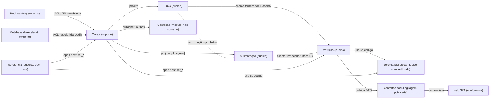

# Contextos delimitados e mapa de contextos

Propósito: mostrar os cinco contextos do domínio, como se relacionam (padrões de integração do DDD) e onde cada um vive no código. Público: arquiteto, desenvolvedores e agentes de IA. Revisão: 2026-10-11.

Os contextos são os do Siegard (`docs/especificacao/domain/`, [mapa](../../especificacao/domain/README.md)). `operacao` e a camada HTTP são módulos de aplicação, não contextos (decisão do [plano](00-plano.md) §2). O Siegard não guarda relações entre contextos; elas vivem só nesta página. Termos: [linguagem ubíqua](01-linguagem-ubiqua.md).

## Quais são os contextos?
| Contexto | Siegard | Papel estratégico | Fonte de dados | Responsabilidade |
|---|---|---|---|---|
| Fluxo | [`flow`](../../especificacao/domain/flow/_context.md) | núcleo | BusinessMap | Linguagem do fluxo de projeto: card, quadro, coluna, transição, bloqueio |
| Sustentação | [`support`](../../especificacao/domain/support/_context.md) | núcleo | Acelerato | Linguagem de chamado, etapa e SLA |
| Métricas | [`metrics`](../../especificacao/domain/metrics/_context.md) | núcleo | lê Fluxo ou Sustentação, nunca os dois num cálculo | Amostra, janela, percentil, taxa e previsão, por fonte |
| Coleta | [`collection`](../../especificacao/domain/collection/_context.md) | suporte | as duas, em separado | Execução de coleta, marca d'água, staging imutável, reconciliação |
| Referência | [`reference`](../../especificacao/domain/reference/_context.md) | suporte | arquivo versionado e migrações | Calendário, critérios versionados, domínios fechados, vigência |

## Como os contextos se relacionam?

### Mapa de contextos do MetricasDSPD

Legenda (a forma não carrega significado; vale o texto):
- "(externo)": sistema fora do MetricasDSPD. "(suporte)" e "(núcleo)": papel estratégico do Siegard (`strategic: supporting` ou `core`).
- "(módulo, não contexto)": módulo de aplicação do `server/`.
- Seta cheia: relação com sentido de dependência (o rótulo diz o padrão). Linha tracejada sem seta: ausência deliberada de relação.
- "[planejado]": o código ainda não existe.

Alternativa em lista: quem conversa com quem

- BusinessMap -> Coleta: API REST v2 e webhook, atrás de uma camada anticorrupção (ACL).
- Metabase -> Coleta: leitura diária da tabela do Acelerato, atrás de uma ACL.
- Coleta -> Fluxo: projeta `dim_card`, `fato_transicao`, `fato_bloqueio`.
- Coleta -> Sustentação: projeta `dim_chamado`, `fato_etapa_chamado` [planejado].
- Fluxo -> Métricas: cliente-fornecedor, pelo tipo `BaseBM`.
- Sustentação -> Métricas: cliente-fornecedor, pelo tipo `BaseAC`.
- Fluxo e Sustentação: sem relação; nenhuma FK, consulta, módulo ou cache os cruza.
- Referência -> Métricas e Coleta: open host, leitura das tabelas `ref_*`.
- Coleta -> Operação: publisher/subscriber pela outbox (evento `coleta.concluida`).
- Métricas e Coleta -> `core`: núcleo compartilhado, só código de cálculo, sem dado.
- Métricas -> contratos -> web: a web é conformista com o DTO publicado.

Origem das decisões: ADR 0013 (módulos e fontes), ADR 0014 (outbox, schemas), ADR 0007 (contratos), ADR 0011 (pacote de cálculo).

## Qual padrão vale em cada relação e onde está no código?
| Relação | Padrão | Evidência no código | Observação |
|---|---|---|---|
| BusinessMap -> Coleta -> Fluxo | Camada anticorrupção (ACL) | `server/src/modulos/businessmap/staging.ts` (`gravarStgCard`), `webhook.ts` (`receberWebhook`) | O payload entra cru em `stg_*` (jsonb + hash) e só depois é normalizado; o vocabulário da ferramenta não chega ao domínio. Normalizador e projetor: [planejado] (WS2). |
| Metabase -> Coleta -> Sustentação | ACL | Nenhum arquivo em `server/src/modulos/acelerato/` | [planejado] (WS2/WS5). Desenho em `data-model.md` §4 e ADR 0013 §4. |
| Fluxo e Sustentação -> Métricas | Cliente-fornecedor | `server/src/modulos/metricas/mapa.ts` (`montarBaseBM`, `montarBaseAC`), `repositorio.ts` | Métricas é o cliente: monta `BaseBM` e `BaseAC` e a biblioteca os consome; o fornecedor não conhece o cliente. |
| `@metricas-dspd/metricas/core` | Núcleo compartilhado | `packages/metricas/src/core/` (percentil, janela, calendário, Monte Carlo) | Só código, nenhum dado. Todo tempo, percentil e previsão passa por ele (T2.5, CLAUDE.md). |
| Referência -> demais | Open host | `server/src/modulos/referencia/` (`rotasReferencia`, `lerVersaoCriterioVigente`), `GET /api/v1/referencia`, `GET /api/v1/filtros/:dominio` | Linguagem publicada pelas tabelas `ref_*` e pelas rotas. `metricas` e `operacao` leem a referência pela API do módulo (`lerEquipesBM`, `lerVersaoCriterioVigente`) e por `ref_*` do próprio schema. |
| Coleta -> Operação | Publisher/subscriber | `server/src/modulos/operacao/concluida.ts` (`fecharColeta`, `consumidorColetaConcluida`), `server/src/plataforma/eventos/` | Pela outbox transacional, no mesmo banco: [04-eventos](04-eventos.md). |
| Contratos -> web | Conformista | `web/src/data/FonteMetricas.ts` (só tipos de `@metricas-dspd/contratos`) | A web aceita o modelo publicado sem traduzir. Hoje a implementação é `MockFonteMetricas`; `HttpFonteMetricas` [planejado] (nenhuma classe com esse nome em `web/src`). |
| Fluxo x Sustentação | Sem relação, por regra | `server/eslint.config.js` (`businessmap` e `acelerato` sem import entre si), `data-model.md` §2 (nenhuma FK cruza `dspd_bm` x `dspd_ac`) | Regra inviolável: BusinessMap e Acelerato nunca se misturam. A Visão geral só justapõe blocos, e o cruzamento acontece dentro da biblioteca (`packages/metricas/src/visaoGeral.ts`), sem cálculo conjunto. |

## Onde cada contexto vive no repositório?
| Contexto | Módulo do `server/` | Schema físico | Pasta da biblioteca |
|---|---|---|---|
| Fluxo | `src/modulos/businessmap/` (staging, webhook) | `dspd_bm` | `packages/metricas/src/businessmap/` |
| Sustentação | `src/modulos/acelerato/` [planejado] | `dspd_ac` | `packages/metricas/src/acelerato/` |
| Métricas | `src/modulos/metricas/` | lê `dspd_bm` e `dspd_ac` em consultas separadas | raiz (`calcular.ts`) e `core/` |
| Coleta | `src/plataforma/` (`worker.ts`, `agenda.ts`, `eventos/`, `db/trava.ts`) e `src/modulos/operacao/` (fechamento e estado) | `stg_*`, `evt_*` e `ctl_*` em `dspd_bm` e `dspd_ac`; `outbox` em `dspd_core` | `core/coleta.ts` (estado da coleta) |
| Referência | `src/modulos/referencia/` | `ref_*` em `dspd_core` (calendário, critérios) e em `dspd_bm`/`dspd_ac` (quadro, coluna, domínios, alvos) | `core/calendario.ts`, `core/criterios.ts` |

Fontes: `server/src/modulos/`, `server/migrations/`, `packages/metricas/src/`.

## O que merece atenção?
- **Referência é open host só em parte.** O calendário usado nas métricas hoje é `CALENDARIO_PADRAO` da biblioteca (`server/src/modulos/metricas/servico.ts`); a leitura de `ref_calendario*` do banco não existe no código. [planejado]
- **Referência lê projeções.** `lerEquipesBM` e `lerSistemasBM` leem `dim_card` (`server/src/modulos/referencia/repositorio.ts`) para montar os filtros; é o único módulo que não é de coleta nem de cálculo a ler projeção. Confirmar se isso fica em Referência ou vai para Métricas.
- **Coleta não tem módulo próprio.** O Siegard a trata como contexto, mas no código ela está dividida entre `plataforma/` e `operacao`; o coletor (WS2) ainda não existe (`tarefas: []` em `server/src/entradas/worker.ts`). [planejado]
- **Classificação Coleta -> Fluxo/Sustentação.** O [plano](00-plano.md) não nomeia um padrão para essa relação (a ACL é a fronteira externa; "projeta" é interno ao desenho). Não é regra de negócio: fica como decisão de arquitetura a registrar quando o coletor existir.
