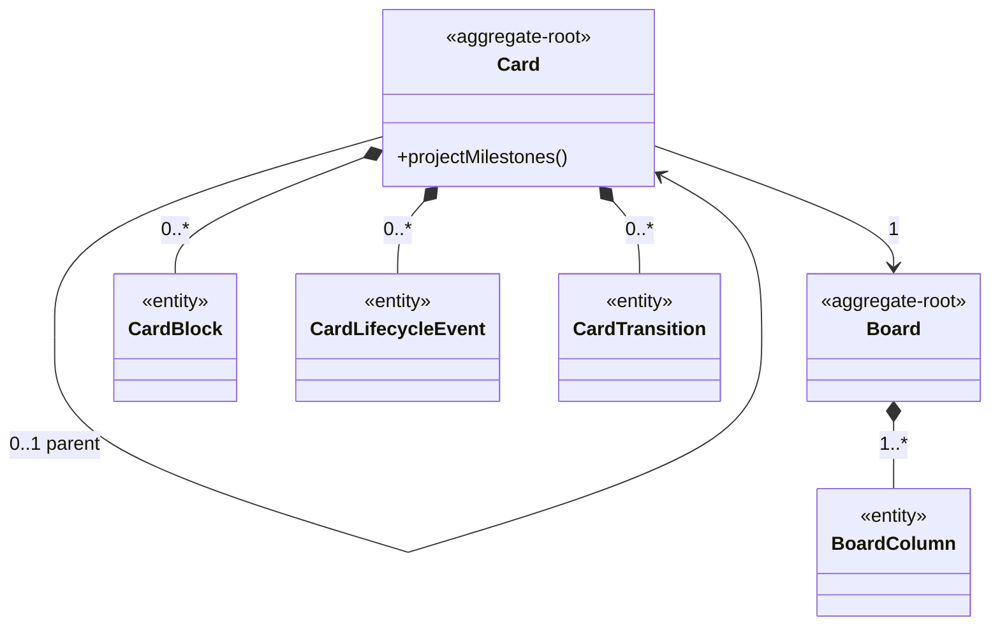
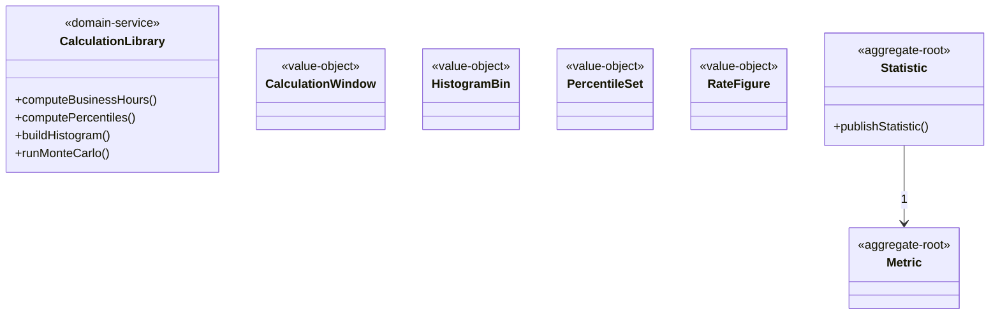
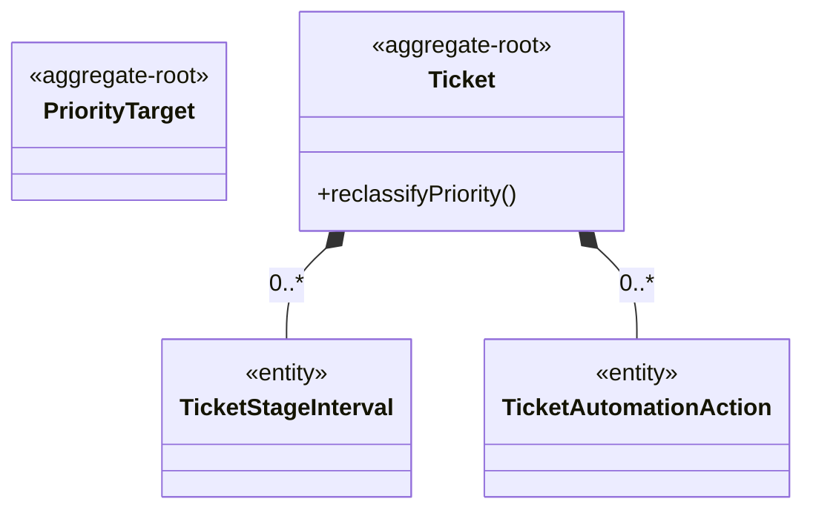
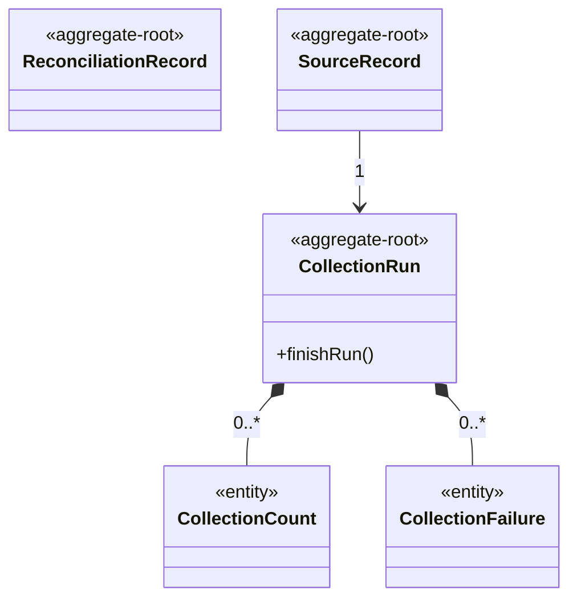
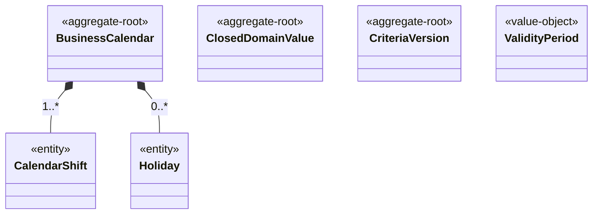

# Agregados e entidades por contexto

Propósito: mostrar, por contexto, os agregados, entidades e objetos de valor do Modelo de Domínio, sem repetir atributos. Público: time e agentes de IA. Revisão: 2026-10-11.

<!-- gerado:inicio -->
Gerado de `docs/especificacao/domain/**` por `pnpm run docs:gerar`; não edite entre as marcas. Atributos, enumerações e regras ficam no Siegard (link em cada contexto).

## Fluxo (`flow`, núcleo)

Fluxo de projeto coletado do BusinessMap (schema físico `dspd_bm`): cards, quadros, colunas, transições e bloqueios. Origem: [`_context.md`](../../especificacao/domain/flow/_context.md).

| Elemento | Tipo | Agregado | Relações | Operações |
|---|---|---|---|---|
| [`board-column`](../../especificacao/domain/flow/board-column.md) | entidade | `board` | - | - |
| [`board`](../../especificacao/domain/flow/board.md) | raiz de agregado | - | compõe BoardColumn (1..*) | - |
| [`card-block`](../../especificacao/domain/flow/card-block.md) | entidade | `card` | - | - |
| [`card-lifecycle-event`](../../especificacao/domain/flow/card-lifecycle-event.md) | entidade | `card` | - | - |
| [`card-transition`](../../especificacao/domain/flow/card-transition.md) | entidade | `card` | - | - |
| [`card`](../../especificacao/domain/flow/card.md) | raiz de agregado | - | compõe CardTransition (0..*); compõe CardBlock (0..*); compõe CardLifecycleEvent (0..*); referencia Card (0..1, parent); referencia Board (1) | `project-milestones` |

Enumerações (14, não desenhadas): `block-reason`, `board-level`, `card-lifecycle-event-type`, `card-type`, `column-kind`, `declared-size`, `delay-responsibility`, `demand-origin`, `detection-phase`, `granularity`, `root-cause`, `service-class`, `severity`, `transition-direction`.

### Contexto Fluxo: classes e relações

Legenda: cada retângulo é uma classe do modelo e o estereótipo `<<...>>` diz o tipo (raiz de agregado, entidade, objeto de valor ou serviço de domínio); `*--` é composição (a parte não vive sem o todo) e `-->` é referência; o texto da seta é a cardinalidade.

Alternativa em lista

- BoardColumn (entidade): sem relações declaradas.
- Board (raiz de agregado): compõe BoardColumn (1..*).
- CardBlock (entidade): sem relações declaradas.
- CardLifecycleEvent (entidade): sem relações declaradas.
- CardTransition (entidade): sem relações declaradas.
- Card (raiz de agregado): compõe CardTransition (0..*); compõe CardBlock (0..*); compõe CardLifecycleEvent (0..*); referencia Card (0..1, parent); referencia Board (1); operações: projectMilestones.

## Métricas (`metrics`, núcleo)

Cálculo e publicação de estatísticas de tempo, percentis, taxas e previsão, por fonte. Origem: [`_context.md`](../../especificacao/domain/metrics/_context.md).

| Elemento | Tipo | Agregado | Relações | Operações |
|---|---|---|---|---|
| [`calculation-library`](../../especificacao/domain/metrics/calculation-library.md) | serviço de domínio | - | - | `compute-business-hours`, `compute-percentiles`, `build-histogram`, `run-monte-carlo` |
| [`calculation-window`](../../especificacao/domain/metrics/calculation-window.md) | objeto de valor | - | - | - |
| [`histogram-bin`](../../especificacao/domain/metrics/histogram-bin.md) | objeto de valor | - | - | - |
| [`metric`](../../especificacao/domain/metrics/metric.md) | raiz de agregado | - | - | - |
| [`percentile-set`](../../especificacao/domain/metrics/percentile-set.md) | objeto de valor | - | - | - |
| [`rate-figure`](../../especificacao/domain/metrics/rate-figure.md) | objeto de valor | - | - | - |
| [`statistic`](../../especificacao/domain/metrics/statistic.md) | raiz de agregado | - | referencia Metric (1); referencia Domain/reference/criteriaVersion (0..*, applied-criteria) | `publish-statistic` |

Enumerações (2, não desenhadas): `data-source`, `window-unit`.

### Contexto Métricas: classes e relações

Legenda: cada retângulo é uma classe do modelo e o estereótipo `<<...>>` diz o tipo (raiz de agregado, entidade, objeto de valor ou serviço de domínio); `*--` é composição (a parte não vive sem o todo) e `-->` é referência; o texto da seta é a cardinalidade.

Alternativa em lista

- CalculationLibrary (serviço de domínio): sem relações declaradas; operações: computeBusinessHours, computePercentiles, buildHistogram, runMonteCarlo.
- CalculationWindow (objeto de valor): sem relações declaradas.
- HistogramBin (objeto de valor): sem relações declaradas.
- Metric (raiz de agregado): sem relações declaradas.
- PercentileSet (objeto de valor): sem relações declaradas.
- RateFigure (objeto de valor): sem relações declaradas.
- Statistic (raiz de agregado): referencia Metric (1); referencia Domain/reference/criteriaVersion (0..*, applied-criteria); operações: publishStatistic.

## Sustentação (`support`, núcleo)

Sustentação coletada do Acelerato (schema físico `dspd_ac`): chamados, etapas, SLA e automações. Origem: [`_context.md`](../../especificacao/domain/support/_context.md).

| Elemento | Tipo | Agregado | Relações | Operações |
|---|---|---|---|---|
| [`priority-target`](../../especificacao/domain/support/priority-target.md) | raiz de agregado | - | - | - |
| [`ticket-automation-action`](../../especificacao/domain/support/ticket-automation-action.md) | entidade | `ticket` | - | - |
| [`ticket-stage-interval`](../../especificacao/domain/support/ticket-stage-interval.md) | entidade | `ticket` | - | - |
| [`ticket`](../../especificacao/domain/support/ticket.md) | raiz de agregado | - | compõe TicketStageInterval (0..*); compõe TicketAutomationAction (0..*) | `reclassify-priority` |

Enumerações (10, não desenhadas): `automation-mode`, `closure-reason`, `escalation-reason`, `impact-level`, `priority`, `resolution-level`, `sla-outcome`, `support-team`, `ticket-nature`, `urgency-level`.

### Contexto Sustentação: classes e relações

Legenda: cada retângulo é uma classe do modelo e o estereótipo `<<...>>` diz o tipo (raiz de agregado, entidade, objeto de valor ou serviço de domínio); `*--` é composição (a parte não vive sem o todo) e `-->` é referência; o texto da seta é a cardinalidade.

Alternativa em lista

- PriorityTarget (raiz de agregado): sem relações declaradas.
- TicketAutomationAction (entidade): sem relações declaradas.
- TicketStageInterval (entidade): sem relações declaradas.
- Ticket (raiz de agregado): compõe TicketStageInterval (0..*); compõe TicketAutomationAction (0..*); operações: reclassifyPriority.

## Coleta (`collection`, suporte)

Coleta incremental, staging imutável e reconciliação, em cada fonte separadamente (prefixos físicos `stg_` e `ctl_`). Origem: [`_context.md`](../../especificacao/domain/collection/_context.md).

| Elemento | Tipo | Agregado | Relações | Operações |
|---|---|---|---|---|
| [`collection-count`](../../especificacao/domain/collection/collection-count.md) | entidade | `collection-run` | - | - |
| [`collection-failure`](../../especificacao/domain/collection/collection-failure.md) | entidade | `collection-run` | - | - |
| [`collection-run`](../../especificacao/domain/collection/collection-run.md) | raiz de agregado | - | compõe CollectionCount (0..*); compõe CollectionFailure (0..*) | `finish-run` |
| [`reconciliation-record`](../../especificacao/domain/collection/reconciliation-record.md) | raiz de agregado | - | - | - |
| [`source-record`](../../especificacao/domain/collection/source-record.md) | raiz de agregado | - | referencia CollectionRun (1) | - |

Enumerações (2, não desenhadas): `collection-outcome`, `collection-task`.

### Contexto Coleta: classes e relações

Legenda: cada retângulo é uma classe do modelo e o estereótipo `<<...>>` diz o tipo (raiz de agregado, entidade, objeto de valor ou serviço de domínio); `*--` é composição (a parte não vive sem o todo) e `-->` é referência; o texto da seta é a cardinalidade.

Alternativa em lista

- CollectionCount (entidade): sem relações declaradas.
- CollectionFailure (entidade): sem relações declaradas.
- CollectionRun (raiz de agregado): compõe CollectionCount (0..*); compõe CollectionFailure (0..*); operações: finishRun.
- ReconciliationRecord (raiz de agregado): sem relações declaradas.
- SourceRecord (raiz de agregado): referencia CollectionRun (1).

## Referência (`reference`, suporte)

Calendário, critérios versionados e domínios fechados, com vigência (prefixo físico `ref_`). Origem: [`_context.md`](../../especificacao/domain/reference/_context.md).

| Elemento | Tipo | Agregado | Relações | Operações |
|---|---|---|---|---|
| [`business-calendar`](../../especificacao/domain/reference/business-calendar.md) | raiz de agregado | - | compõe CalendarShift (1..*); compõe Holiday (0..*) | - |
| [`calendar-shift`](../../especificacao/domain/reference/calendar-shift.md) | entidade | `business-calendar` | - | - |
| [`closed-domain-value`](../../especificacao/domain/reference/closed-domain-value.md) | raiz de agregado | - | - | - |
| [`criteria-version`](../../especificacao/domain/reference/criteria-version.md) | raiz de agregado | - | - | - |
| [`holiday`](../../especificacao/domain/reference/holiday.md) | entidade | `business-calendar` | - | - |
| [`validity-period`](../../especificacao/domain/reference/validity-period.md) | objeto de valor | - | - | - |

Enumerações (1, não desenhadas): `holiday-scope`.

### Contexto Referência: classes e relações

Legenda: cada retângulo é uma classe do modelo e o estereótipo `<<...>>` diz o tipo (raiz de agregado, entidade, objeto de valor ou serviço de domínio); `*--` é composição (a parte não vive sem o todo) e `-->` é referência; o texto da seta é a cardinalidade.

Alternativa em lista

- BusinessCalendar (raiz de agregado): compõe CalendarShift (1..*); compõe Holiday (0..*).
- CalendarShift (entidade): sem relações declaradas.
- ClosedDomainValue (raiz de agregado): sem relações declaradas.
- CriteriaVersion (raiz de agregado): sem relações declaradas.
- Holiday (entidade): sem relações declaradas.
- ValidityPeriod (objeto de valor): sem relações declaradas.

<!-- gerado:fim -->
