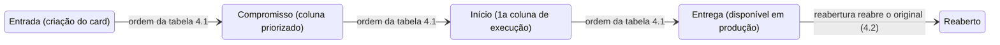
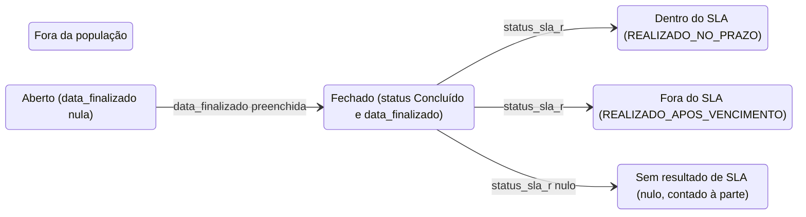
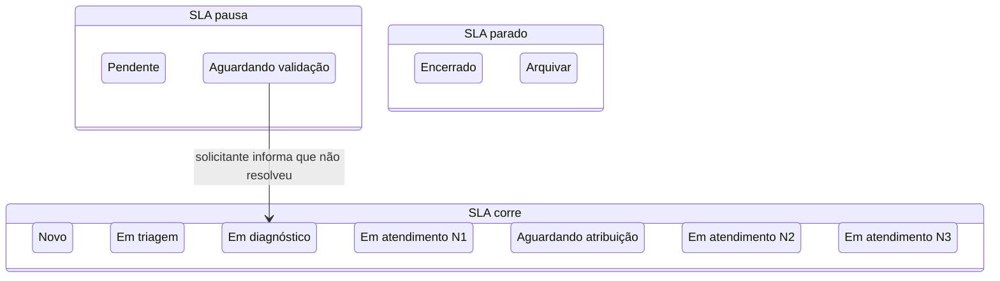
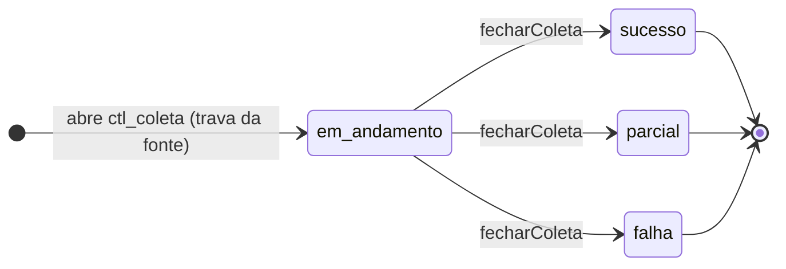
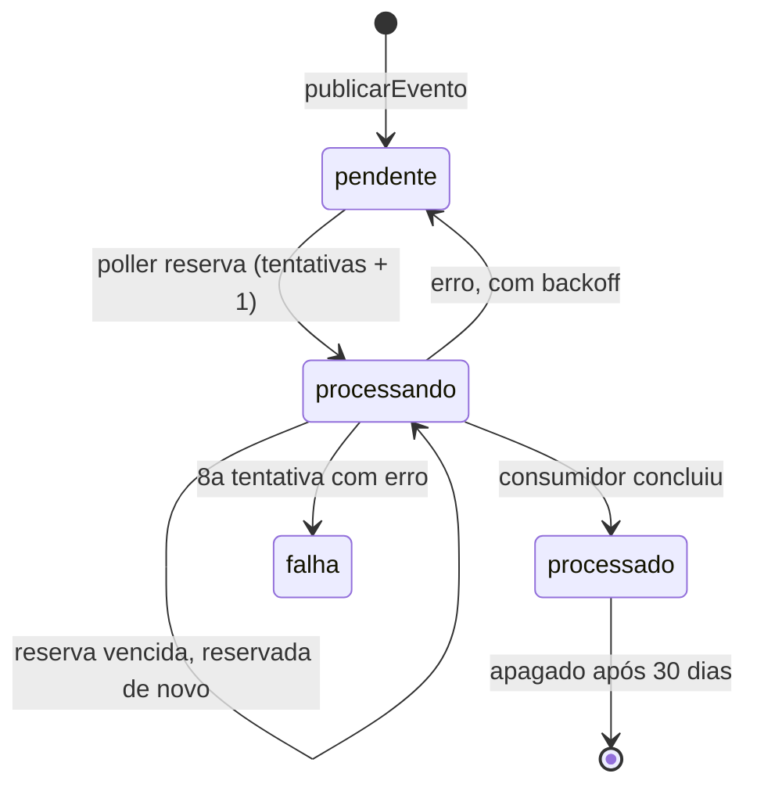

# Ciclos de vida: card, chamado, coleta e evento da outbox

Propósito: mostrar os estados de card, chamado, execução de coleta e evento da outbox, derivados só do que o briefing e o código afirmam. Público: arquiteto, desenvolvedores, QA e agentes de IA. Revisão: 2026-10-11.

Regra desta página: o briefing define **marcos** (4.1) e critérios de população (3.2, 3.4), não uma máquina de estados. Os diagramas de card e chamado usam só o que está escrito; tudo o que falta virou pergunta (última seção). Coleta e outbox têm máquina de estados real, lida no código.

## Em que marcos um card passa?

### Marcos do card (briefing 4.1)

Legenda: cada retângulo arredondado é um marco temporal do card, nomeado pelo texto; a seta indica a ordem em que a tabela 4.1 os lista. A ordem é da tabela, não uma garantia de que todo card passa por todos (pergunta 1). Fonte: briefing 4.1, 4.2; Siegard [`card`](../../especificacao/domain/flow/card.md) (campos `created_at`, `committed_at`, `started_at`, `completed_at`) e operação `project-milestones`.

Alternativa em lista: o que cada marco alimenta

- Entrada -> Compromisso: lead time da equipe usa o compromisso; o lead time do cliente parte da entrada.
- Compromisso -> Início: o início é a primeira entrada em coluna de execução (cycle time, tamanho, aging do WIP).
- Início -> Entrega: a entrega alimenta todas as métricas de tempo e vazão.
- Entrega -> Reaberto: "reaberto reabre o original, tempo volta a contar" (briefing 4.2); o marco de destino após a reabertura não está definido (pergunta 2).
- Aceite (confirmação do solicitante) é medido à parte e não entra no lead time do cliente: não é estado deste diagrama.

Condições que não são marcos e que o briefing trata à parte (briefing 4.2, sem transição definida):
| Condição | Efeito declarado | Evidência no modelo |
|---|---|---|
| Descartado | Sai do cálculo de tempo de ciclo; entra na taxa de descarte com o tempo já consumido | `dim_card.arquivado_em`, `motivo_descarte` |
| Arquivado ou excluído | Permanece na base; nunca é apagado | `evt_card.tipo` (`arquivado`, `desarquivado`, `excluido_detectado`, `restaurado`), `dim_card.arquivado_em`, `excluido_em` |
| Quadro de teste ou rascunho | Fora de qualquer cálculo | `ref_quadro.eh_teste` |
| Bloqueado | Marca no card; não move o card de coluna | `fato_bloqueio` |

Onde o marco é gravado: `dim_card` guarda `comprometido_em`, `iniciado_em`, `concluido_em`, derivados das transições canônicas por uma função única (T2.4, `data-model.md` §3.3). O projetor que os deriva a partir do staging é [planejado] (WS2); a biblioteca já consome os marcos prontos (`MarcosCard`, `packages/metricas/src/businessmap/indice.ts`).

## Em que situação um chamado está?

### Situação do chamado e resultado do SLA (briefing 3.2)

Legenda: cada retângulo arredondado é uma situação definida pelos critérios do briefing 3.2 e pelas views de `data-model.md` §4 (`vw_abertos`, `vw_fechados_sla`); a seta é a passagem de uma situação a outra, com a condição no rótulo. "Fora da população" (`excluido = true` ou fora do recorte DSPD-SSSC) é declarado, sem seta, porque o briefing não diz como se chega lá; fica só como estado à parte. Siegard: [`ticket`](../../especificacao/domain/support/ticket.md), [`sla-outcome`](../../especificacao/domain/support/sla-outcome.md).

Alternativa em lista: quem passa para onde

- Aberto -> Fechado: quando `data_finalizado` é preenchida e o status é Concluído.
- Fechado -> Dentro do SLA: `status_sla_r = REALIZADO_NO_PRAZO`.
- Fechado -> Fora do SLA: `status_sla_r = REALIZADO_APOS_VENCIMENTO`.
- Fechado -> Sem resultado: `status_sla_r` nulo; é contado à parte, nunca como dentro nem como fora (`data-model.md` §4).
- Fora da população: `excluido = true` ou fora do recorte (organização, tipo, equipes do 3.2); não tem seta.

### Etapas do chamado e efeito no SLA (briefing 3.4)

Legenda: três grupos de etapas conforme o efeito no SLA (corre, pausa, parado), nomeados no texto; as 11 etapas são as da tabela do briefing 3.4 (tipo `EtapaAcelerato`, `packages/metricas/src/acelerato/modelo.ts`). A única seta é a única transição que o briefing nomeia ("a mais fácil de esquecer e mais crítica": Aguardando validação -> Em diagnóstico). As demais transições estão no PROC 30.000.010 e na parametrização do Acelerato (WS4, feita por pessoas); não são inferidas aqui. Regra correlata: escalação não reinicia o SLA (briefing 3.4).

Alternativa em lista: etapas por efeito no SLA

- SLA corre: Novo, Em triagem, Em diagnóstico, Em atendimento N1, Aguardando atribuição, Em atendimento N2, Em atendimento N3.
- SLA pausa: Pendente, Aguardando validação.
- SLA parado: Encerrado, Arquivar.
- Aguardando validação -> Em diagnóstico: reabertura; sem essa transição o atendente abre chamado novo e a taxa de reabertura (S8) fica artificialmente baixa.

O histórico de etapas depende da tabela do Metabase ter histórico (P6): sem ele, `fato_etapa_chamado` fica vazia e as métricas dependentes ficam `pendente-usuario`, nunca inferidas do estado diário (`data-model.md` §4).

## Como uma coleta termina?

### Estados de `ctl_coleta` (execução de coleta)

Legenda: cada nome é um valor de `ctl_coleta.status` (`data-model.md` §6); a seta é a transição, com o evento no rótulo. Fonte: `server/src/modulos/operacao/concluida.ts` (`fecharColeta` só atualiza `WHERE status = 'em_andamento'` e publica `coleta.concluida` na mesma transação). A abertura da coleta é feita pelo coletor [planejado: WS2]; hoje só os testes abrem. Siegard: [`collection-run`](../../especificacao/domain/collection/collection-run.md), [`collection-outcome`](../../especificacao/domain/collection/collection-outcome.md).

Alternativa em lista: passagens de estado

- Início -> em_andamento: abertura da coleta, sob `pg_try_advisory_lock` da fonte; sem a trava, a execução sai sem abrir `ctl_coleta`.
- em_andamento -> sucesso, parcial ou falha: `fecharColeta`; só `sucesso` avança a marca d'água (`vw_marca_dagua`).
- Estados finais: não há reabertura; a próxima execução é uma nova linha.

## Como um evento da outbox termina?

### Estados do evento da outbox

Legenda: cada nome é um valor de `outbox.status` (`data-model.md` §5); a seta é a passagem, com a causa no rótulo. Fonte: `server/src/plataforma/eventos/outbox.ts` (`processarOutbox`). `falha` não é apagado pelo código.

Alternativa em lista: passagens de estado

- Início -> pendente: `publicarEvento`, na transação do chamador.
- pendente -> processando: o poller reserva (`FOR UPDATE SKIP LOCKED`) só tipos com consumidor registrado; `reservado_ate` = agora + 5 min.
- processando -> processando: reserva vencida volta a ser elegível.
- processando -> processado: o consumidor terminou sem erro.
- processando -> pendente: erro; `disponivel_em` recebe o backoff (30 s x 2^(n-1), teto de 1 h).
- processando -> falha: erro na oitava tentativa.
- processado -> fim: apagado depois de 30 dias.

Catálogo e garantias: [04-eventos](04-eventos.md).

## O que falta responder?
Dúvida de regra de negócio não se resolve por inferência. Perguntas ao usuário, em ordem de impacto:
1. **Marcos opcionais.** Todo card tem compromisso e início? Um card que entra direto em coluna de execução, sem passar por priorizado, tem `compromisso` vazio ou igual ao início? (briefing 4.1 não diz.)
2. **Reabertura.** Quando o card entregue é reaberto, volta a qual marco (início, compromisso)? O briefing só diz que o original é reaberto e o tempo volta a contar (4.2).
3. **Descartado.** A partir de quais marcos um card pode ser descartado, e ele é arquivado, excluído ou ambos? (4.2 define o efeito no cálculo, não a origem.)
4. **Eventos de ciclo de vida.** `arquivado -> desarquivado` e `excluido_detectado -> restaurado` são pares? O nome sugere, mas o briefing e o Siegard só listam os cinco valores de `evt_card.tipo`.
5. **Etapas do chamado.** Quais transições entre as 11 etapas são permitidas além de Aguardando validação -> Em diagnóstico? A fonte é a parametrização do Acelerato (WS4); sem ela, o diagrama não as desenha.
6. **Como um chamado sai da população.** `excluido = true` surge a partir de que situação? (3.2 só define o filtro.)
