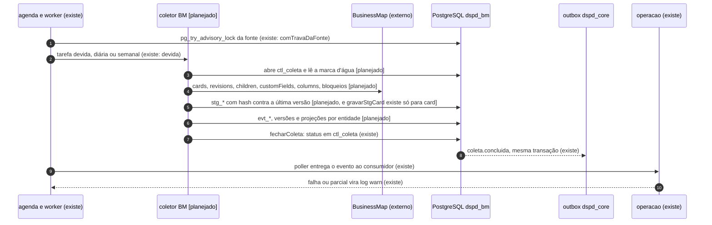
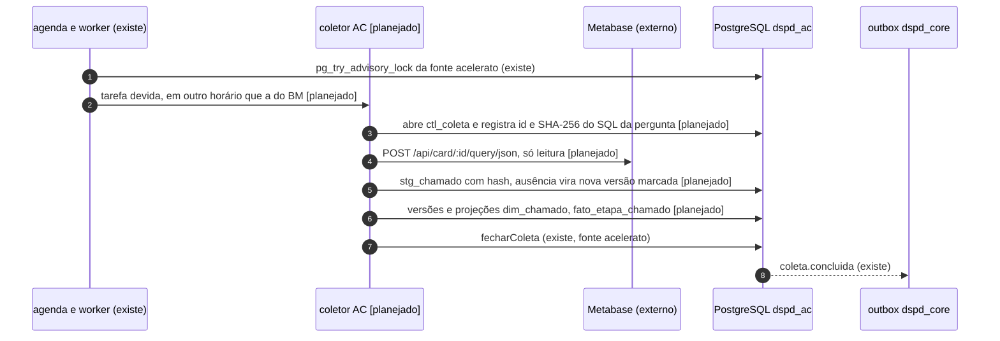
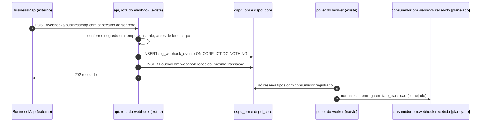
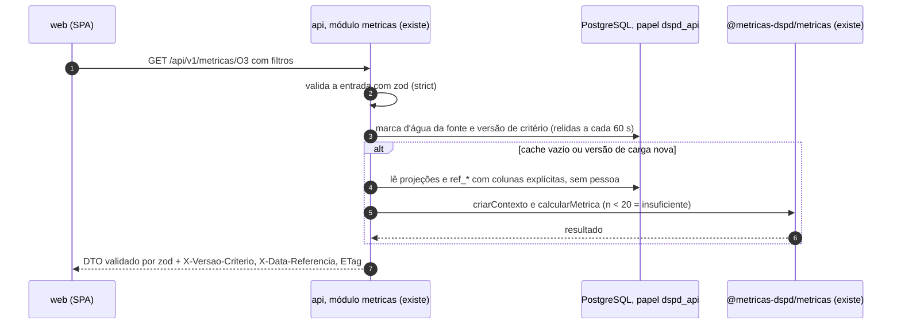
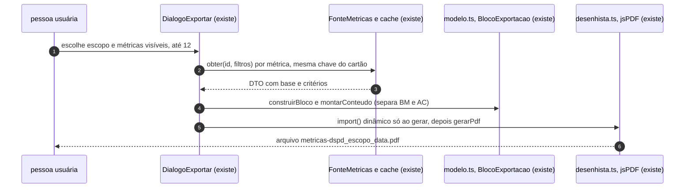

# Sequências: coleta, webhook, cálculo e publicação, exportação

Propósito: mostrar a ordem das chamadas nos quatro fluxos principais, marcando o que já existe no código e o que é [planejado]. Público: desenvolvedores, arquiteto e QA. Revisão: 2026-10-11.

Esta página recebe a sequência "Da coleta ao cartão" que estava em [`overview.md`](../overview.md) §4 (o overview passa a apontar para cá). Estados citados: [05-ciclos-de-vida](05-ciclos-de-vida.md). Eventos: [04-eventos](04-eventos.md). Componentes: [07-componentes](07-componentes.md).

Convenção das legendas: nome do participante entre aspas é um serviço ou módulo; "[planejado]" na mensagem indica que o passo depende do coletor (WS2) ou do módulo `acelerato`, que não existem em `server/src/modulos/`. Uma seta sólida é chamada que espera resposta; a tracejada é resposta ou envio sem espera.

## Como roda a coleta do BusinessMap?

### Coleta diária do BusinessMap

Legenda: participantes na ordem da esquerda para a direita são a agenda, o coletor, a ferramenta externa, o banco do schema `dspd_bm`, a outbox e o módulo `operacao`. Fontes: `server/src/plataforma/worker.ts` (`criarWorker`), `agenda.ts`, `db/trava.ts`, `modulos/businessmap/staging.ts`, `modulos/operacao/concluida.ts`; contrato da coleta na ADR 0006 e `data-model.md` §3, §6.

Alternativa em lista: quem conversa com quem

- agenda -> banco: trava por fonte; sem a trava, a tarefa fica para o próximo ciclo (a cada `WORKER_INTERVALO_MS`, 15 s).
- agenda -> coletor: executa a tarefa devida [planejado: `tarefas` está vazio em `entradas/worker.ts`].
- coletor -> banco: abre `ctl_coleta`, lê `vw_marca_dagua`, grava staging, eventos e projeções, só com `INSERT` no staging e nos eventos.
- coletor -> BusinessMap: leitura incremental a partir da marca d'água menos a sobreposição.
- coletor -> banco: `fecharColeta` fecha `ctl_coleta` e publica `coleta.concluida` na mesma transação.
- agenda -> operacao: o poller reserva o evento e chama o consumidor.

## Como roda a coleta do Acelerato?

### Coleta diária do Acelerato [planejado]

Legenda: mesma notação da coleta do BusinessMap; o schema e a fonte são outros e nenhum participante é compartilhado com ela, exceto a agenda e a trava, que filtram por fonte. Fonte do desenho: `data-model.md` §4 (ausência, `ctl_coleta.parametros`), ADR 0013 §4. O módulo `acelerato` não existe em `server/src/modulos/`.

Alternativa em lista: quem conversa com quem

- agenda -> banco: trava `dspd:fonte:acelerato`, independente da trava do BusinessMap.
- agenda -> coletor: tarefa diária, em horário distinto [planejado].
- coletor -> banco: abre `ctl_coleta` no schema `dspd_ac`.
- coletor -> Metabase: leitura da tabela inteira a cada coleta (a tabela não tem coluna de atualização); o staging deduplica por hash.
- coletor -> banco: staging com `ausente_na_extracao`, versões e projeções.
- coletor -> banco: `fecharColeta` e `coleta.concluida` com `fonte = 'acelerato'`.

## Como o webhook do BusinessMap é recebido?

### Webhook do BusinessMap (recebe e antecipa)

Legenda: a resposta 202 não depende do processamento; o normalizador roda depois, no worker. Fonte: `server/src/modulos/businessmap/webhook.ts` (`rotasWebhook`, `receberWebhook`, `segredoConfere`), `plataforma/eventos/outbox.ts`. Enquanto o sistema roda só local, o webhook não alcança a máquina (`overview.md` §1); a rota existe e é testada.

Alternativa em lista: quem conversa com quem

- BusinessMap -> api: `POST /webhooks/businessmap`; corpo JSON objeto até 256 KB, senão 413 ou 400.
- api -> api: segredo inválido ou ausente = 401, sem consumir corpo nem banco.
- api -> banco: grava a entrega bruta e o evento na mesma transação; entrega idêntica (mesmo SHA-256) não duplica nada.
- api -> BusinessMap: 202.
- poller -> banco: sem consumidor registrado, o evento fica `pendente` e o dado bruto segue em `stg_webhook_evento`.
- poller -> consumidor: normalizador do coletor [planejado]; ao registrá-lo, o backlog é processado.

## Como o cartão chega ao navegador?

### Cálculo e publicação de uma métrica

Legenda: cada requisição trata uma só fonte (a Visão geral justapõe blocos e só o cálculo dentro da biblioteca lê as duas). Fontes: `server/src/modulos/metricas/rotas.ts` (`rotasMetricas`, cabeçalhos), `servico.ts` (`ServicoMetricas.calcular`, `marca`, `carga`), `mapa.ts`, `repositorio.ts`. Cache: `Cache-Control: private, max-age=60`; resultado guardado por métrica, versões de carga, versão de critério, data e filtros normalizados; máximo de 500 resultados por domínio (`MAX_RESULTADOS`).

Alternativa em lista: quem conversa com quem

- web -> api: `GET /api/v1/metricas/:id` (uma rota por métrica) com `If-None-Match` opcional; ETag igual devolve 304.
- api -> banco: marca d'água (`coletaId`) e última versão de critério; juntas formam a versão de carga.
- api -> banco: se a versão mudou, descarta o cache do domínio e recarrega `BaseBM` ou `BaseAC` (consultas separadas por fonte).
- api -> biblioteca: `calcularMetrica`; nenhuma estatística é calculada em SQL ou no módulo.
- api -> web: DTO conforme o schema da métrica; fora do schema, o erro é 500 (contrato).
- Erros: data futura 400; período fora do histórico 422; referência ausente 503 (`REFERENCIA_AUSENTE`).

## Como a exportação em PDF funciona?

### Exportação em PDF (no navegador, sem recalcular)

Legenda: tudo acontece no navegador; nada vai ao servidor e nada é registrado (decisão D-5 do pedido 008). Fontes: `web/src/features/exportar/` (`DialogoExportar.tsx`, `gerar.ts`, `modelo.ts`, `carregarPdf.ts`, `desenhista.ts`) e o plano [`features/exportar-metricas.md`](../features/exportar-metricas.md). O spike E-1 deixou o gráfico como tabela de pontos do DTO, sem svg2pdf (plano §1).

Alternativa em lista: quem conversa com quem

- pessoa -> diálogo: seleciona o escopo; métrica oculta pelas preferências não aparece.
- diálogo -> FonteMetricas: `obter`, reaproveitando o cache do React Query; nada é recalculado.
- diálogo -> modelo: DTOs viram blocos de texto e tabela, em seções por fonte (BusinessMap, depois Acelerato), nunca somadas.
- diálogo -> desenhista: o chunk com o jsPDF carrega sob demanda; gera o `Blob`.
- desenhista -> pessoa: download do PDF; em mock, rodapé "Dados fictícios" e sufixo `_ficticio`.
- Limites no código: `LIMITE_METRICAS = 12`, 20 linhas e 8 colunas por tabela (`modelo.ts`).

