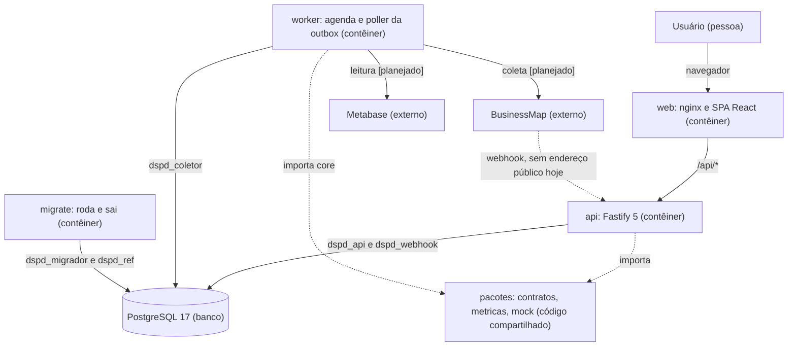
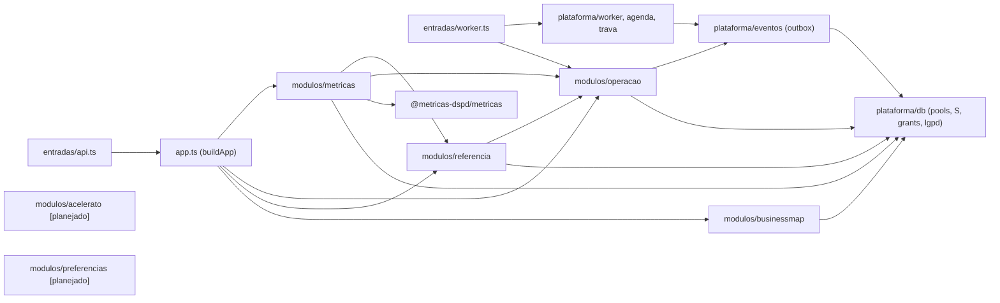
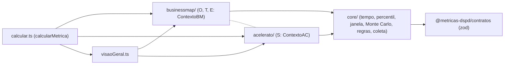

# Componentes: contêineres, módulos do servidor e biblioteca de cálculo

Propósito: mostrar, em C4 níveis 2 e 3, o que existe hoje no código e o que ainda é alvo (marcado [planejado]). Público: arquiteto, desenvolvedores e agentes de IA. Revisão: 2026-10-11.

O contexto (nível 1) e o resumo de decisões ficam em [`overview.md`](../overview.md) §1; o detalhe do servidor, em [`server.md`](../server.md); o nível 3 do front, em [`tecnica/arquitetura-front.md`](../../tecnica/arquitetura-front.md). Relações entre contextos: [02-contextos-e-mapa](02-contextos-e-mapa.md).

## Quais são os contêineres?

### Contêineres do MetricasDSPD (C4 nível 2, Docker Compose local)

Legenda: "(contêiner)" é um serviço do Compose; "(banco)" é o PostgreSQL; "(externo)" é sistema fora do projeto; "(código compartilhado)" são pacotes pnpm importados, não processos. Seta cheia é chamada em tempo de execução, com o protocolo ou o papel do banco no rótulo; seta tracejada é dependência de código ou entrega que depende de endereço público. Fonte: `docker-compose.yml`, `server/src/entradas/`, [`overview.md`](../overview.md) §2.

Alternativa em lista: quem conversa com quem

- Usuário -> web: navegador.
- web -> api: `/api/*`, pelo proxy do nginx.
- BusinessMap -> api: webhook `POST /webhooks/businessmap`; não alcança a máquina enquanto o sistema roda só local.
- api -> PostgreSQL: papéis `dspd_api` (leitura por coluna) e `dspd_webhook` (só `INSERT` em `stg_webhook_evento` e `outbox`).
- worker -> PostgreSQL: papel `dspd_coletor`.
- migrate -> PostgreSQL: `dspd_migrador` (DDL e grants) e `dspd_ref` (`ref:sync` [planejado]).
- worker -> BusinessMap e Metabase: coleta e leitura diária [planejado: WS2].
- api e worker -> pacotes: importam `contratos` e `metricas`; só `metricas` usa a raiz da biblioteca; o worker usa `core`.

Não aparecem como processos: SSO corporativo (ADR 0009, pendente de P3) e canal de alertas (I-7); ambos são [planejado] e estão no contexto do `overview.md`. A SPA hoje consome `MockFonteMetricas`; `HttpFonteMetricas` ([planejado]) vai chamar a `api` pelo mesmo contrato.

## Como é o servidor por dentro?

### Módulos e plataforma do `server/` (C4 nível 3)

Legenda: retângulo com "modulos/" é um módulo de domínio ou de aplicação; "plataforma/" é infraestrutura compartilhada; "[planejado]" não existe no código. A seta é "importa" (o módulo de origem chama o `index.ts` do destino); `A & B --> C` quer dizer que A e B importam C. `modulos/acelerato` e `modulos/preferencias` aparecem sem setas porque ainda não existem. Regras impostas por lint (`server/eslint.config.js`): módulos só se chamam pelo `index.ts`; `businessmap` e `acelerato` não se importam; só `metricas` importa a raiz da biblioteca; `servico.ts` e `repositorio.ts` não leem relógio nem aleatório (`server.md`, "Lint").

Alternativa em lista: quem depende de quem

- entradas/api.ts -> app.ts: monta a API (`buildApp`), com o pool do papel `dspd_api` e, se houver, o do `dspd_webhook`.
- app.ts -> metricas, operacao, referencia: registram rotas sob `/api/v1`; app.ts -> businessmap: só a rota do webhook.
- entradas/worker.ts -> plataforma/worker (agenda, trava, ciclo) e -> operacao (consumidor de `coleta.concluida`).
- plataforma/worker -> plataforma/eventos: o poller chama `processarOutbox`.
- metricas -> referencia e operacao: versão de critério, equipes e sistemas, marca d'água.
- referencia -> operacao: marca d'água e última coleta com sucesso (`modulos/referencia/servico.ts`).
- metricas -> `@metricas-dspd/metricas`: único módulo que chama a raiz da biblioteca.
- operacao -> plataforma/eventos: `fecharColeta` publica `coleta.concluida`.
- businessmap, metricas, operacao, referencia e eventos -> plataforma/db: SQL explícito, parâmetros por `$n`, schemas pelo mapa `S`.
- Entradas fora do desenho: `entradas/migrar.ts` (migrações, grants) e `entradas/openapi.ts` (gera `docs/api/openapi.json`).

### O que cada módulo faz hoje?
| Módulo / pasta | Estado | Responsabilidade | Arquivos principais |
|---|---|---|---|
| `modulos/businessmap` | existe | Staging de card e receptor do webhook; só toca `dspd_bm` | `staging.ts`, `webhook.ts` |
| `modulos/acelerato` | [planejado] | Staging e projeção do Acelerato; só tocaria `dspd_ac` | nenhum arquivo |
| `modulos/referencia` | existe | Filtros (`/filtros/:dominio`), referência (`/referencia`), versão de critério vigente | `rotas.ts`, `repositorio.ts`, `servico.ts` |
| `modulos/metricas` | existe | Rotas de métrica (33), carga das bases em memória, cache por versão de carga | `rotas.ts`, `servico.ts`, `mapa.ts`, `repositorio.ts`, `schemas.ts` |
| `modulos/operacao` | existe | Estado e histórico de coleta (`/fontes/:dominio/estado`, `/coletas`, `/criterios`), `fecharColeta`, consumidor de `coleta.concluida` | `servico.ts`, `repositorio.ts`, `concluida.ts`, `rotas.ts` |
| `modulos/preferencias` | [planejado] no servidor | Preferências do usuário, sem dado de outra pessoa; hoje só no navegador (`LocalStoragePreferencias`, `web/src/features/preferencias/fonte.ts`) | nenhum arquivo no `server/` |
| `plataforma/db` | existe | Pools por papel, `emTransacao`, mapa `S`, migração, grants por coluna, regra LGPD, seed | `pool.ts`, `esquemas.ts`, `grants.ts`, `lgpd.ts`, `migrar.ts`, `trava.ts` |
| `plataforma/eventos` | existe | Outbox: `publicarEvento`, `processarOutbox`, `RegistroConsumidores`, catálogo Zod dos tipos | `catalogo.ts`, `outbox.ts`, `consumidores.ts` |
| `plataforma` (demais) | existe | Config zod por entrada, logs, erros (ADR 0007), saúde, agenda e ciclo do worker, OpenAPI | `config.ts`, `log.ts`, `erros.ts`, `saude.ts`, `agenda.ts`, `worker.ts`, `openapi.ts` |

## Como é a biblioteca de cálculo por dentro?

### Pacote `@metricas-dspd/metricas` (C4 nível 3)

Legenda: retângulo é uma pasta ou arquivo do pacote em `packages/metricas/src/`; seta é "importa"; a linha tracejada entre `businessmap/` e `acelerato/` é a ausência de dependência (nenhum tipo compartilhado além de primitivos e domínios fechados de `contratos`). O que cada pasta contém é a verdade do código; a tabela de regras (`REGRAS_METRICA`) está em `core/regras.ts`.

Alternativa em lista: quem depende de quem

- `calcular.ts` -> `businessmap/`, `acelerato/`, `visaoGeral.ts`: despacha por `MetricaId` para o contexto da fonte.
- `visaoGeral.ts` -> `businessmap/` e `acelerato/`: justapõe blocos; nenhum cálculo conjunto.
- `businessmap/` e `acelerato/` -> `core/`: calendário, horas úteis, percentis, histogramas, Monte Carlo.
- `core/` -> `contratos`: tipos e domínios fechados.
- `businessmap/` e `acelerato/`: sem dependência entre si.

Onde cada coisa mora: marcos do card (`businessmap/indice.ts`), estado da coleta e frescor (`core/coleta.ts`, `core/frescor.ts`), calendário (`core/calendario.ts`, hoje `CALENDARIO_PADRAO`), critérios (`core/criterios.ts`, `core/calibracao.ts`).

## O que fica para depois?
- `modulos/acelerato` e coletor do Acelerato (WS2, WS5).
- Coletor do BusinessMap: tarefas do worker, normalizador, projetor e consumidor de `bm.webhook.recebido` (WS2).
- `modulos/preferencias` no servidor, se houver necessidade (hoje a persistência é local no navegador).
- `ref:sync` e leitura do calendário de `ref_calendario*` (hoje `CALENDARIO_PADRAO`).
- `HttpFonteMetricas` no web.
- Autenticação (ADR 0009, pendente de P3).
