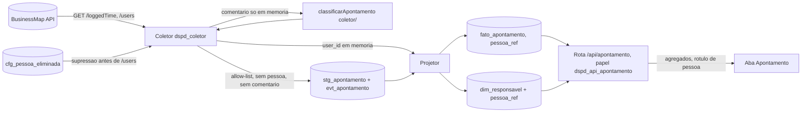

# 059 - Aba Apontamento: desenho técnico enxuto, texto da exceção e correções à especificação

Etapa E1.2 do pedido 059 (K-193). Entrada: a especificação do dono "Painel de Capacidade", seções 1 a 10, em texto e sem nomes (faz o papel de protótipo, decisão técnica de 2026-11-01 17:50). Discovery em paralelo: UX em `docs/ux/059-aba-apontamento.md` (E1.3) e modelo de ameaças em `docs/security/059-aba-apontamento-ameacas.md` (E1.4). Este documento **adota** os controles AP-1 a AP-11 da segurança e as melhorias M-1 a M-16 do UX onde tocam o desenho, e não os repete; diverge em nada (onde completa, diz). Nenhum nome de pessoa aqui (ADR 0020).

**Conferência com a constituição:** o projeto não tem `docs/constituicao.md`. Conferido contra as regras invioláveis do `CLAUDE.md`: conforme, **com um desvio declarado e decidido pelo dono** (exceção "A" à regra de métrica individual, 2026-11-01), que só vale depois do PR do §1 mesclado pelo dono. As demais regras seguem integrais: BusinessMap e Acelerato não se misturam (a aba lê só `dspd_bm`), carga incremental sem sobrescrever histórico (§3.3), cálculo só pela biblioteca T2.5 (§3.7), piso de 20 itens para estatística (§3.7), mudança de critério registrada com data (§3.6), credencial só no `.env`, só GET.

**Fato novo desta etapa (lido na OpenAPI pública do BusinessMap, `demo.kanbanize.com/openapi/json`, 2026-11-01; marcar `[DOC]` na doc de integração na E2):** o worklog tem rota própria, e não é o `logged_times` do card que a doc de integração manda evitar (§4.2, linha 66):
- `GET /loggedTime`: filtros `card_ids`, `parent_card_ids`, `user_ids`, `category_ids`, `include_logged_time_for_subtasks`, `from_date`/`to_date` (data do apontamento), `logged_from`/`logged_to` e `logged_from_date`/`logged_to_date` (quando foi registrado), `page`, `per_page` (padrão 200, máximo 1000), `fields` com a lista fechada `logged_time_id`, `parent_card_id`, `card_id`, `subtask_id`, `lane_id`, `column_id`, `user_id`, `category_id`, `date`, `time`, `comment`, `logged_at`. **Não há filtro por quadro.** `time` é em **segundos** (descrição do POST e do PATCH).
- `GET /loggedTime/history`: eventos `logged_time_created`, `logged_time_updated`, `logged_time_deleted`, `logged_time_transferred_to_card_after_subtask_deleted`, `logged_time_updated_after_subtask_converted_to_card`; filtros `logged_time_ids`, `card_ids`, `user_ids`, `event_types`, `from`/`to`, `per_page` até 200. **Os campos do evento não estão no trecho lido** `[NÃO LIDO]`.
- `GET /loggedTimeCategories`: catálogo de **categorias de tempo**, domínio fechado do próprio BusinessMap (base da melhoria MA-3).
- Consequência: a chave única do apontamento existe (`logged_time_id`), a exclusão tem fonte (`logged_time_deleted`) e o resto do AP-6 da segurança passa de "não lido" a "lido na documentação, confirmar no spike" (F1, §7).
- **Resultado do spike E2.3 (2026-11-01, máquina do dono, só forma e contagens; volta 1, E2.11):** `/loggedTime` devolve exatamente os 12 campos pedidos em `fields`, `time` em segundos, `date` em `AAAA-MM-DD`, **sem paginação** (o lote vem inteiro numa resposta), `category_id` nulo no lote lido. `/loggedTime/history` devolve **403** para a chave do dono. Pela DECISÃO TÉCNICA do Jarvis (2026-11-01 23:45), a coleta nasce com a **varredura de presença como fonte de edição e exclusão** (§3.2, ADR 0025 itens 4 a 7); o histórico entra só se o dono liberar a permissão na chave (pergunta com o Jarvis). Q-A3 fica respondida pelo dado: o time não usa categoria; M-1 fica fora e `ref_categoria_tempo` não nasce.

## 0. Decisões do dono aplicadas (E2.2, 2026-11-01)
Revisão E2.2 deste plano: o prazo passou a ser **a aba inteira até 2026-11-02 22:00** (decisão do dono de 2026-11-01 21:09, que supera a fatia "só F0" do §7 original). Aplicado aqui, sem nova inferência:
- **Exceção e texto (Q-A12 = "A"):** textos 1.1 e 1.2 aprovados com as cláusulas o1 a o4 na redação registrada no pedido em 2026-11-01 21:30 (ver §1.3, que passa a trazer essa redação). Aplicação pela E1.7 (PR do tech-lead, merge do dono).
- **Recomendações em bloco ("A"):** Q-A1 a Q-A11 deste plano, P-1 a P-7 do UX e P-3 a P-8 da segurança seguem a recomendação registrada em cada pergunta (§6 traz a resposta em cada linha). O dono pode reabrir qualquer item; reabertura muda o item no plano, não o código já mesclado sem nova delegação.
- **Onde o nome real roda (P-1 da segurança):** nome real **só na máquina do dono ou na rede local sob controle dele**; desligado em qualquer outro ambiente (homologação, CI, servidor). Login pelo AD da empresa é fatia futura, fora deste prazo. Controle técnico: interruptor `APONTAMENTO_NOMES` (ADR 0020, revisão 4, R4-5).
- **Retenção (P-2 da segurança = "A"):** o vínculo entre horas e pessoa fica enquanto a aba usar o dado; na eliminação a pedido saem o nome (linha de `dim_responsavel`) e o vínculo (`fato_apontamento.pessoa_ref` anulada), e as horas ficam como agregado do time, sem sobrescrever valor de métrica. O prazo exato vai ao DPO **antes** da fatia de retenção (expurgo automático), que fica fora deste prazo; o procedimento de eliminação a pedido entra (§7, trilha A).
- **Horas apontadas ("A"):** só capacidade, utilização e distribuição do tempo do time e de cada pessoa; nunca esforço de entrega, velocidade, custo de card ou meta (já no texto 1.1 e 1.2).

## 1. Texto da exceção (proposta literal; aplicada depois por PR que o dono revisa e mescla)

Decisões do dono que o texto traduz (2026-11-01): "A" (registrar a exceção no `CLAUDE.md` e no briefing por PR do dono), "C" (qualquer usuário do painel vê a aba, inclusive fora do time), "A" das horas (horas só para capacidade, utilização e distribuição do tempo do time e de cada pessoa; nunca esforço de entrega, velocidade, custo de card ou meta). Nada nesta etapa edita o `CLAUDE.md` nem o briefing.

### 1.1 `CLAUDE.md`, seção "Regras invioláveis"
Inserir logo **depois** do item "Nenhuma métrica pode servir para avaliação individual..." e **antes** de "Métricas proibidas (seção 7.1)":

> - **Exceção única: aba Apontamento** (decisão do dono de 2026-11-01, pedido 059; briefing §7.1). Só nessa aba, e só com o worklog do BusinessMap (`GET /loggedTime`), o painel mostra o nome de quem apontou e a visão por pessoa (horas, capacidade, utilização, distribuição do tempo e qualidade do apontamento), visíveis a qualquer usuário do painel. As horas apontadas servem ali só para capacidade, utilização e distribuição do tempo do time e de cada pessoa; nunca como esforço de entrega, velocidade, custo de card ou meta. Continua proibido, inclusive na aba: meta por pessoa, comparação entre times e uso das horas ou da visão por pessoa em qualquer outra aba, métrica, exportação ou cálculo. O comentário do apontamento nunca chega à base: é classificado na fronteira do coletor e descartado. O Acelerato fica fora da exceção. O controle técnico (papel de banco dedicado, rota única) está na ADR 0020, revisão 4.

### 1.2 Briefing `docs/briefing-execucao-metricas.md`, §7.1 "Métricas proibidas"
Acrescentar **ao fim da lista** do §7.1, sem alterar os itens existentes (o item "Horas apontadas como proxy de esforço entregue" continua valendo em todo o sistema, inclusive na aba):

> **Exceção registrada (decisão do dono de 2026-11-01, pedido 059): aba Apontamento.** Vale só para essa aba e só para o worklog do BusinessMap. Ali o painel mostra nome e visão por pessoa (horas apontadas, capacidade, utilização, distribuição do tempo e qualidade do apontamento) a qualquer usuário do painel, inclusive fora do time. As horas apontadas são lidas como uso da capacidade do time e de cada pessoa, nunca como esforço de entrega, velocidade, custo de card ou meta. Não se cria meta por pessoa nem comparação entre times, e a visão por pessoa não sai da aba para outra métrica, painel ou exportação. A finalidade é dimensionar capacidade e melhorar a qualidade do apontamento, não avaliar desempenho individual. A sustentação (Acelerato) não entra na exceção.

### 1.3 Cláusulas o1 a o4 (aprovadas pelo dono em 2026-11-01, Q-A12 = "A")
**Redação aprovada** (a apresentada ao dono e registrada no pedido em 2026-11-01 21:30; é a que a E1.7 aplica nos textos 1.1 e 1.2):
- (o1) "a lista de pessoas vem em ordem neutra (alfabética); ordenar por total é escolha de quem lê"
- (o2) "a utilização por pessoa não tem semáforo, faixa de bom ou ruim, nem comparação com a média"
- (o3) "percentual por pessoa só aparece com 20 apontamentos ou mais; abaixo disso, só soma e contagem"
- (o4) "a aba fica fora da exportação do painel"

Redação original da proposta, para registro (vem da segurança, §6 do modelo de ameaças, P-7, e do UX, M-3, M-4, P-2):
- (o1) "A ordem padrão de pessoas é neutra (alfabética ou por equipe); ordenar por total é escolha explícita de quem lê."
- (o2) "Utilização por pessoa sem semáforo, faixa de bom/ruim nem comparação com a média; é leitura relativa, porque o worklog não cobre a jornada inteira."
- (o3) "Estatística derivada por pessoa (utilização, percentual de qualidade) só com 20 ou mais apontamentos na janela; abaixo disso, só soma e contagem."
- (o4) "A aba fica fora da exportação do painel" (ou: "só o que está na tela, sem linhas por pessoa e dia").

## 2. Módulos afetados

| Camada | Módulo | O que muda |
|---|---|---|
| Cliente HTTP | `server/src/plataforma/http.ts` (ADR 0015) | `CAMINHOS_PERMITIDOS` ganha só `/loggedTime` (o `/loggedTime/history` devolveu 403 no spike e entra só com a permissão liberada e novo spike de forma; `/loggedTimeCategories` não entra, `category_id` nulo, ADR 0025 item 1); consulta própria, com `fields` de **valor fixo** (regex de igualdade, como `CONSULTA_USERS`), datas e listas de id; nada de `/loggedTime/{id}` com outro método (CA-AP-11). |
| Coleta | `server/src/modulos/businessmap/apontamento/` (novo, dentro do perímetro `coleta*`/`businessmap` da ADR 0020) | coleta incremental do worklog, allow-list `CAMPOS_APONTAMENTO` em `allow-list.ts`, classificação na fronteira, gravação em staging e eventos, ids de pessoa só em memória até o projetor. Etapa do comando de coleta do BusinessMap, depois dos cards, sob a mesma trava de fonte. |
| Projetor | `server/src/modulos/businessmap/projetor.ts` | projeta `fato_apontamento` (estado atual) e `dim_card_raiz` (hierarquia); grava `pessoa_ref` na mesma execução (padrão do item 4b). |
| Biblioteca T2.5 | `packages/metricas/src/coletor/classificarApontamento.ts` (novo) | função pura que recebe o comentário (texto livre, só em memória) e devolve só lista fechada; fica em `coletor/`, fora do `index.ts` e do bundle do `web/` (ADR 0020, item 3). |
| Biblioteca T2.5 | `packages/metricas/src/businessmap/apontamento/` (novo) | capacidade, utilização, distribuição, qualidade agregada, mapa diário, anomalia e achados gerados; usa `core/calendario.ts` (dias úteis com feriados) e `core/amostra.ts` (piso de 20). Sem identidade: recebe `pessoaRef` opaco. |
| Contratos | `packages/contratos/src/apontamento.ts` (novo) | schema zod da consulta (`strict`) e da resposta, versionado (`docs/contratos/politica-de-mudanca.md`). |
| Banco | migrações novas no `dspd_bm` e `grants.ts`/`lgpd.ts` | tabelas do §3; papel `dspd_api_apontamento` (AP-2 da segurança); colunas novas em `COLUNAS_PESSOA`. |
| API | `server/src/modulos/apontamento/` (novo, rota única) | `GET /api/apontamento` com pool próprio do papel dedicado, `Cache-Control: no-store`, sem log de corpo, interruptor `APONTAMENTO_NOMES`. |
| Front | `web/src/features/apontamento/` (novo) | aba conforme a E1.3 (cartões, filtros, estados, acessibilidade); consome só a rota da aba; filtro de pessoa por `pessoaRef`. |
| Referência | arquivo versionado de `ref:sync` | dicionário de subgrupo e qualidade (§3.5), conferido pelo dono. |



## 3. Desenho técnico

### 3.1 Coleta do worklog
- **Escopo pela lista de cards, não pelo quadro.** `/loggedTime` não filtra por quadro; sem filtro, devolveria o worklog da conta inteira (pessoas de outras áreas lidas em memória sem necessidade, contra a minimização). O coletor pede por `card_ids` em lotes de até 200 (limite de `LISTA_IDS`), tirados dos cards do escopo da aba já coletados em `dim_card` (todos os estados: ativo, arquivado, descartado), com `include_logged_time_for_subtasks=1`. Custo estimado: `ceil(cards do escopo / 200)` chamadas por execução mais as páginas; com alguns milhares de cards, dezenas de chamadas, dentro do limitador de 600/h da F0. Escopo de quadros e workflows: pergunta Q-A1.
- **`fields` fixo:** `logged_time_id,card_id,parent_card_id,subtask_id,lane_id,column_id,user_id,category_id,date,time,comment,logged_at`. O `comment` é pedido porque a classificação precisa dele; vive só na função do §3.4. O spike confirmou que `fields` restringe (vieram exatamente os 12); a allow-list do código continua cortando como 2ª camada.
- **Sem paginação (spike):** `per_page=1000`; lote com 1000 registros ou mais é dividido ao meio por `card_ids` e repedido; lote de um card no teto vira falha `lote_no_teto` e coleta `parcial` (ADR 0025 item 4).
- **Allow-list `CAMPOS_APONTAMENTO` (proposta para a ADR 0020, item 4h):** gravam em staging `logged_time_id`, `card_id`, `parent_card_id`, `subtask_id`, `lane_id`, `column_id`, `category_id`, `date`, `time` (segundos), `logged_at`. **Nunca gravam:** `comment` (nem hash, nem trecho), `user_id` (só em memória até o projetor), título de subtarefa, de card pai ou qualquer outro campo. Saída da classificação: `subgrupo_codigo`, `flags_qualidade`, `qtd_palavras`, `versao_dicionario` (lista fechada e inteiros).
- **Validação na fronteira:** `logged_time_id` e ids só dígitos; `date` `AAAA-MM-DD` e não futura; `time` inteiro, maior que 0 e até 86 400 por apontamento. Fora disso: `ctl_coleta_falha` com código e `id_origem` (nunca o valor, B-4), coleta fecha `parcial`. Soma diária acima do limite **não é recusada**: vira flag na projeção (§3.6, P-5 da segurança, P-4 do UX).
- **Erro e log:** só código, entidade, `id_origem` e caminho do campo; `id_origem` de falha de `/users` é o `logged_time_id` do apontamento, nunca o `user_id`; `redact` do pino conforme a lista da ADR 0020 R4-2 (quatro caminhos, em um e em dois níveis), que prevalece sobre qualquer lista deste plano (AP-9).

### 3.2 Carga incremental com a chave do apontamento
- **Chave natural:** `logged_time_id`. Nada de deduplicação por combinação de campos (correção C-4).
- **Novos:** `GET /loggedTime` com `logged_from = marca d'água − 1 h` (sobreposição, como `SOBREPOSICAO_S` dos cards) pega os registrados desde a última execução. A staging deduplica por `(logged_time_id, registro_sha256)` com `INSERT ... ON CONFLICT DO NOTHING`: a mesma versão relida não duplica; versão nova vira linha nova (append-only, nunca `UPDATE`).
- **Editados e removidos, pela varredura de presença** (o histórico devolveu 403 no spike; ADR 0025 item 6; **não pode ser cortada**, ver C-3): diária com `from_date = hoje − 90 dias` e semanal (domingo) com `from_date` no início da carga, por lote de cards. Hash novo = versão nova na staging (edição); apontamento ativo da janela que não volta num **lote completo** vira `excluido_detectado`; excluído que volta vira `reaparecido`. Guarda de massa: mais de 20% de exclusões dos ativos da janela numa execução não grava nenhuma exclusão e fecha `parcial` com `exclusao_em_massa`. Nada é apagado: o fato marca `excluido_em` e sai das somas (recomendação para a P-7 do UX, Q-A2). Resíduo: edição e exclusão anteriores à janela da carga só com a releitura manual do período.
- **Se o dono liberar o histórico:** volta a fonte por evento (`excluido_origem`, `transferido`), com a lista fechada da ADR 0020 4h-2 confirmada por novo spike; a varredura fica como rede de segurança.
- **Carga inicial:** por comando manual, na máquina do dono (A6 do 052), por `from_date` no período da carga (proposta: os mesmos 12 meses dos cards, Q-A6), em lotes de cards.
- **Marca d'água própria:** fonte `bm_apontamento` em `ctl_coleta`; a coleta de apontamentos roda depois da de cards na mesma execução (precisa de `dim_card` atualizado para o escopo e a hierarquia) e não roda se a de cards falhou.

### 3.3 Modelo de dados (esquema `dspd_bm`; forma final na revisão de modelagem com o tech-lead)
| Tabela | Natureza | Colunas principais | Regras |
|---|---|---|---|
| `stg_apontamento` | staging append-only (gatilho `proibir_alteracao`) | `coleta_id`, `logged_time_id`, `card_id`, `parent_card_id`, `subtask_id`, `lane_id`, `column_id`, `category_id` (anulável; nulo no spike), `data_apontamento date`, `segundos int`, `registrado_em timestamptz`, `subgrupo_codigo`, `flags_qualidade smallint` (máscara de lista fechada), `qtd_palavras smallint`, `versao_dicionario`, `registro_sha256` | `UNIQUE (logged_time_id, registro_sha256)` com `INSERT ... ON CONFLICT DO NOTHING`; `registro_sha256` só sobre o registro gravável em forma canônica (ADR 0020 R4-2); **sem coluna de pessoa e sem texto livre** (CA-AP-13); sem `payload`. |
| `evt_apontamento` | eventos append-only (gatilho `proibir_alteracao`) | `logged_time_id`, `card_id`, `tipo` (lista fechada: `excluido_detectado`, `reaparecido`; `excluido_origem` e `transferido` só com o histórico liberado), `origem` (`varredura`, `historico`), `chave_ocorrencia text`, `ocorrido_em timestamptz NULL` (instante na origem; nulo na varredura), `detectado_em`, `coleta_id` | **chave natural** `UNIQUE (logged_time_id, tipo, chave_ocorrencia)` com `INSERT ... ON CONFLICT DO NOTHING` (A1 do review): na varredura `chave_ocorrencia` = data civil da detecção (America/Sao_Paulo), então sobreposição e reexecução no mesmo dia não duplicam; no histórico, id do evento ou `event_type` + instante (ADR 0025 item 7). Só essas colunas, nunca `payload`, autor, `user_id`, valores antigo e novo ou comentário (lista fechada `CAMPOS_EVENTO_APONTAMENTO`, ADR 0020 4h-2). Nunca apagado. Teste: duas execuções no mesmo dia com o mesmo apontamento ausente geram um evento. |
| `cfg_pessoa_eliminada` | configuração (lista de supressão, A2 do review, A5 da segurança) | `hash_usuario bytea PK` (HMAC-SHA256 do `user_id` com o sal `PESSOA_ELIMINADA_SAL` do `.env`), `eliminada_em date` | `INSERT` só do `dspd_migrador`; `SELECT` só do `dspd_coletor`; fora do `dspd_api` e do `dspd_api_apontamento`; o projetor a consulta antes de `/users` e de criar `dim_responsavel`/`pessoa_ref` e, se casar, projeta com `pessoa_ref` nulo (ADR 0020 R4-6, ADR 0025 item 8). Teste CA-AP-10 estendido. |
| `fato_apontamento` | projeção do estado atual (reconstruível da staging, menos `pessoa_ref`) | `logged_time_id PK`, os campos da staging na última versão, `iniciativa_card_id`, `pessoa_ref bigint NULL`, `versoes smallint`, `excluido_em`, `atualizado_em` | fora do gatilho (eliminação a pedido anula `pessoa_ref`, AP-10); `pessoa_ref` em `COLUNAS_PESSOA`; reconstruir a partir da staging **preserva** `pessoa_ref` (como `responsaveis`, ADR 0020 4b). |
| `dim_responsavel` (existente, F3 do 052) | projeção de pessoa do BusinessMap | + `pessoa_ref bigint GENERATED ALWAYS AS IDENTITY UNIQUE` | o `user_id` de quem apontou é resolvido por `/users` (R3-1, já implementado em `usuarios.ts`) igual ao responsável; a tabela passa a ser "pessoa do BusinessMap" (o nome fica, para não migrar à toa). `pessoa_ref` é a chave opaca da segurança (AP-8, revisão 4 item 4), sem relação com o `user_id`. |
| `dim_card_raiz` | projeção | `card_id PK`, `raiz_card_id`, `profundidade`, `raiz_fora_do_escopo boolean` | §3.5; reutilizável por outras métricas de hierarquia. |
| `ref_apontamento_subgrupo`, `ref_apontamento_termo`, `ref_apontamento_regra_tipo` | referência versionada | subgrupo (`codigo`, `rotulo`, `prioridade`), termo (`subgrupo_codigo`, `termo_normalizado`), regra por tipo de card (`type_id`, `condicao`, `subgrupo_codigo`); todas com `incluido_por_versao_id` → `ref_versao_criterio` | §3.6; carga por `ref:sync`. |
| ~~`ref_categoria_tempo`~~ | não nasce | — | o spike mostrou `category_id` nulo (Q-A3 pelo dado); volta só com a M-1. |

Grants: `dspd_coletor` escreve staging, eventos e projeções (sem `DELETE`) e só lê `cfg_pessoa_eliminada`; a eliminação a pedido é do `dspd_migrador` (A7 do review); `dspd_api` **não lê nenhuma** dessas tabelas (o teste de grants de K-085 fica como está, CA-AP-1); `dspd_api_apontamento` lê por coluna `fato_apontamento` (sem `logged_time_id` se não for necessário), `dim_card_raiz`, as `ref_apontamento_*`, `dim_card` (só id, título e tipo do card; nomes de coluna na revisão de modelagem) e de `dim_responsavel` só `pessoa_ref` e `responsavel_nome` (nunca `responsavel_id`). `data-model.md` §3, §8 e §9 recebem as tabelas na E2.

Recomendados do review de modelagem (`docs/reviews/059-modelagem.md`), aplicados na A1 pelo node-backend sem nova volta ao arquiteto: A4 (ids `text` com `CHECK` de dígitos, `DT()`, `CHECK` em `segundos` 1 a 86 400, `qtd_palavras >= 0` e máscara de `flags_qualidade`; coluna já renomeada acima), A5 (índices parciais com `excluido_em` nulo e `EXPLAIN` registrado), A6 (escolher entre gravar `iniciativa_card_id` na mesma transação de `dim_card_raiz` com teste de igualdade ou juntar na consulta; decisão do tech-lead na A1), A7 (`pessoa_ref` sequencial revela ordem de descoberta: aceito e declarado), A8, A9, A11 (uma mudança por migração, cada uma com `down`). A10 (expor nomes por view só de quem apontou) **esbarra na R3-3 da ADR 0020** ("nunca em `vw_*`"): só entra com nova leitura do `security-engineer` e ressalva na revisão 4; até lá vale o GRANT por coluna em `dim_responsavel` com a consulta da rota juntando só `pessoa_ref` presentes no fato.

### 3.4 Classificação do comentário na fronteira
- `classificarApontamento({ comentario, typeId, categoriaId }, dicionario) → { subgrupo, flags, qtdPalavras }` em `packages/metricas/src/coletor/`, pura, sem efeito colateral, sem log; o coletor a chama e descarta o comentário logo depois. O resultado é a única coisa que sobrevive.
- Normalização antes de casar: minúsculas, sem acento (NFD sem diacríticos), espaços colapsados; termos guardados já normalizados; casamento por **início de palavra** (correção C-6). Regras na ordem da seção 4 da especificação, com os termos do dicionário vigente; a ordem é a `prioridade` do subgrupo.
- **Limites, matriz e orçamento (A3 da segurança; critério do cartão B2, entregue antes do código):**
  - **Entrada limitada:** o coletor trunca o comentário em 2000 pontos de código antes de normalizar (`qtdPalavras` conta o truncado). Normalização: `toLowerCase()` sem localidade, NFD, remoção de marcas combinantes (`\p{M}`), remoção de caracteres de controle e de direção (`\p{Cc}`, `\p{Cf}`) e de surrogate isolado; palavras = sequências de `\p{L}\p{N}`; o resto é separador.
  - **Casamento sem regex do dicionário:** cada termo (uma palavra só, já normalizado) é comparado por `startsWith` com cada palavra; custo O(palavras × termos), com no máximo 2000 caracteres e 500 termos. O `ref:sync` recusa termo vazio, de 1 caractere, com espaço, maiúscula, acento, metacaractere ou repetido, e prioridade repetida.
  - **Dimensões da matriz:** (1) tamanho: vazio, só espaços, 1, 3, 4 palavras, exatamente 2000 e acima de 2000 pontos de código; (2) codificação: ASCII, acento pré-composto e decomposto, caixa mista, `ß`, `İ`, emoji, surrogate isolado, `\u0000`, controle e direção (`‮`); (3) posição do termo: início, meio, fim, colado depois de outra palavra (não casa), depois de pontuação, de número e de quebra de linha (casa); (4) tipo do card e categoria: cada `type_id` com regra (Kaizen, Incidente de Produção), tipo fora do dicionário, categoria nula; (5) dicionário: vazio, um termo, termos que são prefixo um do outro, empate resolvido por `prioridade`, termo inválido recusado no `ref:sync`; (6) versão do dicionário: mesma entrada com versões diferentes devolve `versao_dicionario` coerente.
  - **Corpus de legítimos** (deve passar e classificar como esperado, conferido com o dicionário de `059-dicionario-apontamento.md`): comentários curtos em português com e sem acento ("Análise do erro", "reuniao de alinhamento"), siglas ("RDM 1234", "GMUD"), números de chamado, texto com quebra de linha, comentário só com número, Kaizen sem comentário, Incidente sem comentário.
  - **Gerador** (fast-check): produto das dimensões 1, 2, 3 e 5. **Propriedades:** nunca lança; saída sempre em lista fechada; `qtdPalavras` igual à contagem de palavras do texto normalizado e truncado; mesma entrada, mesma saída; nenhum trecho do texto de entrada aparece na saída serializada.
  - **Orçamento de tempo:** teste com 10 000 comentários de 2000 pontos de código contra o dicionário no teto (500 termos) termina em menos de 5 s na máquina de CI; um comentário no pior caso, em menos de 5 ms. Falha da função vira `ctl_coleta_falha` só com código e `id_origem` (`logged_time_id`).
- **Qualidade** (seção 5): `sem_comentario`, `generico` (até 3 palavras), `sem_vinculo` (subgrupo "Execução técnica" ou "Não classificado"), `sem_projeto` (ver C-9), `valor_atipico` (projeção, §3.6). Máscara de bits de lista fechada; "Completo" = nenhuma flag.
- **Reclassificar o passado** exige reler o worklog na API pelo período (custo: o mesmo da carga inicial); a staging guarda `versao_dicionario` e a aba mostra a marca de mudança de critério (T2.6). Recomendação alinhada à P-8 da segurança: não guardar o comentário.

### 3.5 Pessoa, hierarquia e calendário
- **De-para de pessoa por id (limitação 6):** a chave é o `user_id` do BusinessMap, estável; o nome vem de `/users` (`realname`), um por id, então a variação de nome entre exports some. A tela usa `pessoa_ref`; nome nunca é chave de junção. Unificação de duas contas da mesma pessoa só se o dono mostrar que o caso existe (Q-A10); não se constrói antes.
- **Hierarquia até a iniciativa (limitação 1):** `dim_card_raiz` sobe por `dim_card.card_pai` (vínculo nativo `parent`, já projetado pela F4 do 052; pai do tipo Sprint não vale) até o card sem pai, com guarda de ciclo e profundidade máxima 10; recalculada a cada projeção. Raiz preferida: o primeiro ancestral em workflow de iniciativa (`ref_workflow.nivel` projeto, H-1); sem ele, o card mais alto alcançado. Pai fora dos quadros coletados: a cadeia para no último card conhecido e marca `raiz_fora_do_escopo` (rótulo na tela: Q-A7). O "projeto" da aba é o `title` da raiz (L-2, provisório, com o aviso de não escrever nome no título).
- **Calendário com feriados (limitação 3):** reaproveita `ref_calendario`, `ref_feriado` (escopo nacional, estadual, municipal, ponto facultativo) e `ref_calendario_aplicacao` (migração 0010) com a classe `apontamento` do domínio BusinessMap; a biblioteca recebe o `Calendario` montado da referência (`criarCalendario({ feriados })`), nunca a lista provisória `FERIADOS_NACIONAIS`. Jornada: `horasPorDia` do calendário (8 h com os turnos atuais). Quais feriados além dos nacionais: Q-A5.

### 3.6 Dicionário configurável e anomalia
- O dicionário da seção 4 vira a carga inicial das `ref_apontamento_*` num arquivo versionado de `ref:sync` (padrão das exceções de coluna do 052), preparado pelo arquiteto e conferido pelo dono; toda mudança cria uma `ref_versao_criterio` com data (T2.6), marcada nos gráficos.
- Anomalia: flag `valor_atipico` quando a soma do dia da pessoa passa do limite configurável (proposta do UX: 16 h); calculada na projeção pela biblioteca, nunca descartada; se entra ou não na soma é P-5 da segurança e P-4 do UX.

### 3.7 Cálculos pela biblioteca T2.5
Nenhum cálculo na rota nem no front. Em `packages/metricas/src/businessmap/apontamento/`:
- `horas(segundos)` e somas em segundos inteiros; arredondamento só na apresentação (C-5).
- `capacidadePessoa(apontamentos, calendario, base)`: dias úteis (com feriados) × `horasPorDia`; `base` = intervalo do primeiro ao último apontamento (regra da especificação) ou vigência configurada (Q-A4).
- `capacidadeMensal(...)`: soma, por pessoa ativa, dos dias úteis do mês dentro do seu intervalo (C-8, Q-A9), ou a regra da especificação se o dono preferir; mês corrente corta na data da última coleta bem-sucedida (C-7).
- `utilizacao = realizadas ÷ capacidade`, sem teto (pode passar de 100%) e com o selo de leitura relativa.
- distribuição por projeto, tipo, subgrupo, subtarefa (se P-4 da segurança permitir) e categoria; qualidade por flag (flags não excludentes, M-11); matriz pessoa × nível (um nível por vez, M-10); mapa diário com faixas fixas (M-6) e dias não úteis marcados (M-8); achados gerados por regra (M-1), sem nome de pessoa no texto.
- Piso de 20 por `core/amostra.ts` para estatística derivada (o3, P-1 do UX, P-6 da segurança); não há percentil nem Monte Carlo nesta aba.
- Story, frente e projeto não se misturam: a aba não faz histograma de tempo de ciclo; "projeto" é só rótulo de agrupamento das horas.

### 3.8 Contrato da API da aba (alto nível; o detalhe é do node-backend)
- `GET /api/apontamento`, rota única, pool do papel `dspd_api_apontamento`, `Cache-Control: no-store`, sem log de corpo, consulta `strict` (desconhecido = 400, CA-AP-6).
- Consulta: `de` e `ate` (`AAAA-MM-DD`, janela máxima de 12 meses), `pessoa` (lista de `pessoaRef`), `projeto` (`card_id` da raiz), `tipo` (`type_id`), `subgrupo` e `qualidade` (códigos de lista fechada), `categoria` (se Q-A3), `subtarefa` (se P-4), `nivelMatriz` (`tipo|subtarefa|subgrupo`), `diarioDe`/`diarioAte` (janela do mapa, M-7). Nada de texto livre.
- Resposta (agregada no servidor pela biblioteca; nunca linhas brutas por pessoa e dia além do mapa diário): `pessoas[] { pessoaRef, rotulo }` (rótulo = nome com `APONTAMENTO_NOMES` ligado, senão "Pessoa n"), `kpis`, `distribuicao { projeto, tipo, subgrupo, categoria }`, `qualidade { geral, porPessoa }`, `matriz`, `capacidade { porPessoa, mensal }`, `diario`, `achados[]`, `base { n, insuficiente }` por bloco, `criterios[]` (versões do dicionário e do calendário com data, T2.6), `frescor` (última coleta). Comentário, `user_id` e `responsavel_id` nunca saem.
- Front: `web/src/features/apontamento/` consome só esta rota; filtro de pessoa por `pessoaRef` na URL, nunca nome; não persiste a pessoa em `localStorage` (AP-8).
- A forma exata é o schema zod do §3.9; onde este §3.8 e o §3.9 divergirem, vale o §3.9.

### 3.9 Contrato zod da API da aba (versão 1, para o front começar com mock)
Arquivo de destino: `packages/contratos/src/apontamento.ts` (exportado pelo `index.ts` do pacote de contratos; **não** é o pacote de métricas, então não toca a fronteira `coletor/` da ADR 0020). O node-backend cria o arquivo copiando este bloco e pode ajustar nomes internos, tipos auxiliares e mensagens; **mudar a forma** (campo, enum, nulidade) depois que o front começar é mudança de contrato pela `docs/contratos/politica-de-mudanca.md` e avisa o react-frontend. Princípios que o schema carrega:
- **Rota única e resposta agregada:** `GET /api/apontamento` devolve tudo o que a aba mostra numa resposta; nada de rota por cartão (AP-2: um módulo, um pool, um papel). Nenhum campo traz `user_id`, `responsavel_id`, comentário, título de subtarefa ou e-mail.
- **Horas em segundos inteiros** (C-3); o front só formata. Todo percentual vem pronto da biblioteca T2.5, com o piso de 20 (`taxaSchema` e `pctComPisoSchema`); o front não divide nada.
- **Pessoa só por `pessoaRef`** (`p` + inteiro, chave opaca de `dim_responsavel.pessoa_ref`, ADR 0020 R4-4); o rótulo vem em `pessoas[]`. Blocos por pessoa referem `pessoaRef`, nunca repetem o rótulo.
- **Ordem neutra (o1):** `pessoas[]` e toda lista por pessoa vêm em ordem alfabética do rótulo (com nomes desligados, "Pessoa n" na ordem de `pessoaRef`); "ordenar por total" é ordenação local do front, sem nova chamada.
- **Sem semáforo nem média por pessoa (o2):** o schema não tem campo de meta, faixa, status ou média da equipe por pessoa; utilização por pessoa é só número.
- **Consulta estrita:** parâmetro desconhecido = 400 (CA-AP-6); listas por vírgula, com teto de tamanho; nada de texto livre.

```ts
import { z } from 'zod'
import { MINIMO_AMOSTRA, marcacaoCriterioSchema, taxaSchema } from './comum'
import { seloFrescorSchema } from './coletas'

export const VERSAO_CONTRATO_APONTAMENTO = 1 as const

// ---------- primitivos ----------
const dataCivil = z.string().regex(/^\d{4}-\d{2}-\d{2}$/) // AAAA-MM-DD, America/Sao_Paulo
const mesCivil = z.string().regex(/^\d{4}-(0[1-9]|1[0-2])$/) // AAAA-MM
const instante = z.string().regex(/^\d{4}-\d{2}-\d{2}T\d{2}:\d{2}:\d{2}(\.\d{1,3})?([+-]\d{2}:\d{2}|Z)$/)
const idNumerico = z.string().regex(/^\d{1,12}$/) // card_id, type_id do BusinessMap
const codigo = z.string().regex(/^[a-z0-9]+(-[a-z0-9]+)*$/).max(40) // códigos de lista fechada da referência
const segundos = z.number().int().nonnegative()
const contagem = z.number().int().nonnegative()

/** Chave opaca de pessoa (`dim_responsavel.pessoa_ref`), nunca o `user_id` do BusinessMap (ADR 0020, R4-4). */
export const pessoaRefSchema = z.string().regex(/^p[1-9]\d{0,8}$/)
export type PessoaRef = z.infer<typeof pessoaRefSchema>

/** Flags de qualidade (§3.4; não excludentes, M-11 do UX). "completo" = nenhuma flag. */
export const FLAGS_QUALIDADE = ['sem-comentario', 'generico', 'sem-vinculo', 'sem-iniciativa', 'valor-atipico'] as const
export const flagQualidadeSchema = z.enum(FLAGS_QUALIDADE)
export const filtroQualidadeSchema = z.enum([...FLAGS_QUALIDADE, 'completo'])

export const NIVEIS_MATRIZ = ['tipo', 'subtarefa', 'subgrupo'] as const // um nível por vez (CA-5)
export const FAIXAS_DIARIO = ['zero', 'ate-4h', '4h-a-8h', 'mais-de-8h'] as const // faixas fixas (M-6 do UX)

/** Percentual com piso de 20 (o3; P-1 do UX): abaixo do mínimo não há `pct`, só a contagem `n`. */
export const pctComPisoSchema = z.discriminatedUnion('status', [
  z.object({ status: z.literal('ok'), n: z.number().int().min(MINIMO_AMOSTRA), pct: z.number().nonnegative() }).strict(),
  z.object({ status: z.literal('insuficiente'), n: z.number().int().max(MINIMO_AMOSTRA - 1), minimo: z.literal(MINIMO_AMOSTRA) }).strict(),
])
export type PctComPiso = z.infer<typeof pctComPisoSchema>

// ---------- consulta ----------
const lista = <T extends z.ZodTypeAny>(item: T, max: number) =>
  z.preprocess(
    (v) => (typeof v === 'string' ? (v === '' ? [] : v.split(',')) : v),
    z.array(item).max(max),
  )

/**
 * Consulta de `GET /api/apontamento`. Sem `de`/`ate`, o servidor usa o período padrão do painel
 * (P-3 do UX: 12 semanas); janela máxima de 12 meses (366 dias), validada no `superRefine`.
 * `diarioDe`/`diarioAte`: janela do mapa diário (M-7 do UX, padrão 4 semanas, máximo 62 dias).
 */
export const consultaApontamentoSchema = z
  .object({
    de: dataCivil.optional(),
    ate: dataCivil.optional(),
    pessoa: lista(pessoaRefSchema, 200).optional(),
    projeto: lista(idNumerico, 200).optional(), // card_id da raiz (dim_card_raiz)
    tipo: lista(idNumerico, 50).optional(), // type_id
    subtarefa: lista(codigo, 50).optional(),
    subgrupo: lista(codigo, 50).optional(),
    qualidade: lista(filtroQualidadeSchema, 6).optional(),
    nivelMatriz: z.enum(NIVEIS_MATRIZ).default('tipo'),
    diarioDe: dataCivil.optional(),
    diarioAte: dataCivil.optional(),
    anomalos: z.enum(['incluir', 'ocultar']).default('incluir'), // P-5 da segurança e M-5 do UX: marcar e manter; ocultar é escolha de quem lê
  })
  .strict()
  .superRefine((c, ctx) => {
    // (de e ate juntos ou nenhum; de <= ate; até 366 dias) e o mesmo para diarioDe/diarioAte (até 62 dias).
    // Mensagem de erro sem eco do valor recebido (B-4, CA-AP-6).
  })
export type ConsultaApontamento = z.infer<typeof consultaApontamentoSchema>

// ---------- blocos da resposta ----------
const opcaoSchema = z.object({ id: z.string(), rotulo: z.string() }).strict()

export const pessoaApontamentoSchema = z
  .object({
    pessoaRef: pessoaRefSchema,
    /** Nome real só com `APONTAMENTO_NOMES` ligado (R4-5); senão "Pessoa n". Sem de-para: "Pessoa não identificada" (CA-10). */
    rotulo: z.string().min(1).max(200),
    identificada: z.boolean(),
  })
  .strict()

/** Linha de distribuição (projeto, tipo, subgrupo, subtarefa). `participacao` = parte das horas do bloco. */
const linhaDistribuicaoSchema = z
  .object({
    id: z.string(),
    rotulo: z.string(),
    segundos,
    apontamentos: contagem,
    participacao: pctComPisoSchema,
    /** Só em projeto: raiz fora dos quadros coletados (Q-A7). */
    foraDoEscopo: z.boolean().optional(),
  })
  .strict()

const blocoBaseSchema = z.object({ n: contagem, unidade: z.literal('apontamentos') }).strict()

export const kpisApontamentoSchema = z
  .object({
    segundos,
    apontamentos: contagem,
    pessoasAtivas: contagem,
    completos: taxaSchema, // k de n apontamentos sem flag; % só com n >= 20
    atipicos: contagem, // apontamentos com valor-atipico no recorte (CA-7)
  })
  .strict()

export const distribuicaoApontamentoSchema = z
  .object({
    base: blocoBaseSchema,
    porProjeto: z.array(linhaDistribuicaoSchema),
    porTipo: z.array(linhaDistribuicaoSchema),
    porSubgrupo: z.array(linhaDistribuicaoSchema),
  })
  .strict()

const qualidadePorFlagSchema = z.object({ flag: flagQualidadeSchema, apontamentos: contagem, pct: pctComPisoSchema }).strict()

export const qualidadeApontamentoSchema = z
  .object({
    geral: z.object({ completos: taxaSchema, porFlag: z.array(qualidadePorFlagSchema) }).strict(),
    /** o3: percentuais por pessoa só com 20 apontamentos ou mais; abaixo, `taxaSchema`/`pctComPiso` insuficientes (só contagem). */
    porPessoa: z.array(
      z.object({ pessoaRef: pessoaRefSchema, apontamentos: contagem, completos: taxaSchema, porFlag: z.array(qualidadePorFlagSchema) }).strict(),
    ),
    /** Flags não excludentes: a soma dos percentuais passa de 100% (M-11). */
    flagsNaoExcludentes: z.literal(true),
  })
  .strict()

export const matrizApontamentoSchema = z
  .object({
    nivel: z.enum(NIVEIS_MATRIZ),
    colunas: z.array(opcaoSchema),
    linhas: z.array(
      z
        .object({
          pessoaRef: pessoaRefSchema,
          segundos, // soma da linha
          apontamentos: contagem,
          celulas: z.array(z.object({ colunaId: z.string(), segundos, participacao: pctComPisoSchema }).strict()),
        })
        .strict(),
    ),
  })
  .strict()

/** Utilização = realizadas ÷ capacidade, sem teto (pode passar de 1), leitura relativa (M-4 do UX); piso de 20 (o3). */
const utilizacaoSchema = pctComPisoSchema

export const capacidadeApontamentoSchema = z
  .object({
    horasPorDiaSegundos: segundos, // do calendário (8 h hoje)
    mensal: z.array(
      z
        .object({
          mes: mesCivil,
          capacidadeSegundos: segundos, // soma por pessoa-dia útil ativa (C-8, Q-A9)
          realizadoSegundos: segundos,
          apontamentos: contagem,
          utilizacao: utilizacaoSchema,
          /** Mês corrente cortado na última coleta ok (C-7). */
          parcialAte: dataCivil.nullable(),
        })
        .strict(),
    ),
    porPessoa: z.array(
      z
        .object({
          pessoaRef: pessoaRefSchema,
          inicio: dataCivil, // primeiro apontamento no período (Q-A4, regra da especificação)
          fim: dataCivil, // último apontamento no período
          diasUteis: contagem, // com feriados (C-10)
          capacidadeSegundos: segundos,
          realizadoSegundos: segundos,
          apontamentos: contagem,
          utilizacao: utilizacaoSchema,
        })
        .strict(),
    ),
    leituraRelativa: z.literal(true), // selo fixo "comparação relativa; não é jornada total"
  })
  .strict()

export const diarioApontamentoSchema = z
  .object({
    de: dataCivil,
    ate: dataCivil,
    limiteAtipicoSegundos: segundos, // 16 h por pessoa e dia (P-4 do UX), configurável
    dias: z.array(z.object({ data: dataCivil, util: z.boolean(), feriado: z.boolean() }).strict()), // M-8
    linhas: z.array(
      z
        .object({
          pessoaRef: pessoaRefSchema,
          segundos,
          celulas: z.array(
            z.object({ data: dataCivil, segundos, faixa: z.enum(FAIXAS_DIARIO), atipico: z.boolean() }).strict(),
          ),
        })
        .strict(),
    ),
  })
  .strict()

/** Achados gerados por regra (M-1 do UX, CA-11): código + números; o front monta a frase. Nunca nome ou `pessoaRef`. */
export const CODIGOS_ACHADO = [
  'nao-classificado-alto',
  'sem-comentario-alto',
  'concentracao-em-projeto',
  'dias-atipicos',
  'utilizacao-mensal-variou',
] as const
export const achadoApontamentoSchema = z
  .object({
    codigo: z.enum(CODIGOS_ACHADO),
    valores: z.record(z.string().regex(/^[a-z][a-zA-Z0-9]{0,30}$/), z.union([z.number(), dataCivil, mesCivil])),
    rotuloRef: z.string().max(200).nullable(), // rótulo de projeto/tipo/subgrupo citado, nunca de pessoa
  })
  .strict()

export const opcoesApontamentoSchema = z
  .object({
    pessoas: z.array(pessoaApontamentoSchema), // mesma ordem neutra (o1)
    projetos: z.array(opcaoSchema.extend({ foraDoEscopo: z.boolean() }).strict()),
    tipos: z.array(opcaoSchema),
    subtarefas: z.array(opcaoSchema),
    subgrupos: z.array(opcaoSchema),
    historico: z.object({ inicio: dataCivil, fim: dataCivil }).strict(), // limites do período personalizado
  })
  .strict()

// ---------- resposta ----------
export const respostaApontamentoSchema = z
  .object({
    versaoContrato: z.literal(VERSAO_CONTRATO_APONTAMENTO),
    dominio: z.literal('businessmap'), // nunca Acelerato
    periodo: z.object({ de: dataCivil, ate: dataCivil }).strict(),
    frescor: z.object({ selo: seloFrescorSchema, ultimaColetaOk: instante.nullable() }).strict(), // CA-1
    nomesReais: z.boolean(), // true só com APONTAMENTO_NOMES ligado; o front mostra o aviso de nome real
    opcoes: opcoesApontamentoSchema,
    kpis: kpisApontamentoSchema,
    distribuicao: distribuicaoApontamentoSchema,
    qualidade: qualidadeApontamentoSchema,
    matriz: matrizApontamentoSchema,
    capacidade: capacidadeApontamentoSchema,
    diario: diarioApontamentoSchema,
    achados: z.array(achadoApontamentoSchema),
    /** Mudanças de critério com data (T2.6): versões do dicionário de subgrupo/qualidade e do calendário. */
    criterios: z.array(marcacaoCriterioSchema),
  })
  .strict()
export type RespostaApontamento = z.infer<typeof respostaApontamentoSchema>
```

Notas para quem implementa:
- **Códigos de flag:** o §3.4 usa os nomes de banco (`sem_comentario`, `generico`, `sem_vinculo`, `sem_projeto`, `valor_atipico`); o contrato usa a forma de URL com hífen, e `sem_projeto` passa a `sem-iniciativa` pela Q-A8 (C-9). O node-backend mantém a tabela de tradução num só lugar.
- **Vazio (CA-2):** recorte sem apontamento devolve 200 com listas vazias e `kpis.apontamentos = 0`; o front mostra `EstadoVazio`. Erro de banco devolve 503 sem corpo de detalhe.
- **Filtros por cartão (CA-4):** o mapa diário aplica só `pessoa` (UX §1.2); os demais blocos aplicam todos os filtros. A regra é do servidor; o front só declara `aplicaveis` no chip.
- **`subtarefa`:** códigos do dicionário fechado de subtarefa (§7, ponto de corte C-2); até ele existir, só `em-subtarefa` e `direto-no-card`.
- **Mock do front:** fixture tipada por `RespostaApontamento`, com pessoas fictícias marcadas ("Pessoa 1" a "Pessoa 8", `nomesReais: false`), passando por `respostaApontamentoSchema.parse` no teste (AP-8: E2E e CI só com mock).
- **Testes de contrato (QA):** a resposta de qualquer recorte passa no schema; nenhuma chave `user_id`, `responsavel_id`, `comment`, `comentario`, `email` aparece em nenhum nível (varredura recursiva, CA-AP-5); consulta com chave desconhecida, `pessoa` com nome, data inválida ou janela acima do máximo = 400 sem eco (CA-AP-6).

## 4. Correções e melhorias à especificação
C = corrige problema; M = melhoria. As de interface estão no UX (M-1 a M-16) e as de segurança no modelo de ameaças (§10); aqui só as de dado e cálculo.

| Id | Tipo | Especificação | Proposta | Motivo |
|---|---|---|---|---|
| C-1 | C | §1: HTML estático, base substituída a cada export | Coleta incremental pela API, staging append-only, rota com controle de acesso | A substituição perde editados e removidos (a própria §1 diz) e viola a carga incremental sem sobrescrever histórico; um HTML com nomes é vazamento portátil (segurança §10). |
| C-2 | C | §2: export CSV "Worklog entries" | `GET /loggedTime` e `/loggedTime/history` | A rota existe e traz chave única e eventos de edição e exclusão (fato novo, topo). |
| C-3 | C | §3: `horas` = `logged_time (hours)` arredondado a 2 casas | Guardar segundos inteiros; arredondar só na tela | A API devolve segundos; arredondar cada linha antes de somar acumula erro nos totais. |
| C-4 | C | §2 e §10: duplicidade checada por combinação de campos | Chave `logged_time_id` | A combinação junta dois apontamentos iguais legítimos (mesma pessoa, card, dia e horas) num só. |
| C-5 | C | §3: `projeto` = título do card pai ou do card | Raiz da hierarquia por `card_pai` (`dim_card_raiz`), rótulo pelo título da raiz | É a limitação 1 resolvida; o título do card pulveriza os projetos. |
| C-6 | C | §4: termos com e sem acento à mão ("análise, analise"); casamento por trecho | Normalizar acento e casar por início de palavra | "configuracao" sem acento hoje não casa; trecho solto casa dentro de outras palavras (por exemplo "teste" dentro de "contestei", "call" dentro de "recall"). Muda o resultado da classificação: **o dono confirma** (é regra de negócio, Q-A11). |
| C-7 | C | §7: mês corrente para na data máxima da base | Para na data da última coleta bem-sucedida | Se ninguém apontou no último dia coletado, a data máxima recua e a capacidade do mês encolhe sem motivo. |
| C-8 | C | §7: capacidade mensal = dias úteis × usuários ativos × 8 | Soma por pessoa dos dias úteis em que ela estava ativa no mês | Quem apontou um único dia conta o mês inteiro e derruba a utilização; incoerente com a §6, que usa o intervalo da pessoa. Regra de negócio: Q-A9. |
| C-9 | C | §5: flag "Sem projeto/cartão identificável" = projeto "Não informado" | Redefinir como "card sem iniciativa" (`raiz_fora_do_escopo` ou raiz sem pai de iniciativa) | Pela API todo apontamento tem card; a flag original nunca dispararia. Q-A8. |
| C-10 | C | §6 e §9.3: dias úteis sem feriados | Calendário da referência com feriados (§3.5) | Feriado inflava a capacidade e baixava a utilização. |
| C-11 | C | §8: filtros sobre `raw-data` no navegador | Filtros e agregação no servidor pela biblioteca | Mandar todas as linhas por pessoa e dia ao navegador expõe mais dado que a tela mostra (AP-8) e tira o cálculo da T2.5. |
| C-12 | C | Escopo implícito no export (filtro por quadro) | Escopo explícito da aba por quadros e workflows, **independente** da lista de workflows fora do painel operacional | A regra de subgrupo usa o tipo Kaizen e RDM/GMUD, que o painel operacional exclui (workflows 313 e 203, pedido 057); aplicar aquela exclusão à aba apagaria esses subgrupos. Q-A1. |
| M-1 | M | §4: subgrupo só por palavra-chave | Usar a **categoria de tempo nativa** do BusinessMap (`category_id`, `/loggedTimeCategories`) como primeira fonte, e o dicionário só quando o apontamento vier sem categoria | Categoria é domínio fechado (o briefing §7.3 pede domínio fechado no lugar de texto livre) e reduz a heurística da limitação 2. Depende de o time usar categorias: Q-A3. |
| M-2 | M | §9.2: dicionário "parametrizável" | Tabelas `ref_apontamento_*` versionadas por `ref:sync`, com data de vigência marcada nos gráficos | Atende a §10 e a T2.6; mudança de dicionário fica rastreável. |
| M-3 | M | §9.5: anomalia sem tratamento | Validação por apontamento (0 < segundos ≤ 86 400) na fronteira e flag `valor_atipico` por pessoa e dia na projeção | Nada se perde em silêncio; o caso de 115 h aparece marcado. |
| M-4 | M | §9.8: Reporter × user | A aba usa `user_id` do apontamento; Reporter não é lido | Reporter é pessoa sem uso na aba (minimização); rótulo "Pessoa que apontou" (M-15 do UX). |
| M-5 | M | §6: capacidade pelo primeiro e último apontamento | Fase seguinte: vigência por pessoa configurada (entrada, saída, jornada), sem férias nominais | Corrige admissão e desligamento no meio do período (limitação 3) sem guardar ausência de pessoa; Q-A4. |

## 5. Riscos, dependências e decisões em aberto
- **R-1. Histórico negado (403 no spike).** A varredura de presença é a fonte única de edição e exclusão (§3.2, ADR 0025 item 6): até um dia de atraso (uma semana além de 90 dias), dobro de chamadas diárias e risco de exclusão falsa por resposta incompleta, contido pela exclusão só de lote completo, pela guarda de massa e pelo evento `reaparecido`. Pergunta ao dono (pelo Jarvis): liberar `/loggedTime/history` na chave.
- **R-2. `fields` ignorado pela API:** o spike mostrou que `/loggedTime` respeita `fields`; a allow-list do código continua como 2ª camada.
- **R-9. Resposta sem paginação:** um lote grande pode vir truncado sem aviso; tratado pela divisão de lote no teto de 1000 (ADR 0025 item 4) e pelo critério de reversão "lote de um card no teto".
- **R-10. Pessoas de fora do time nos cards do escopo (A7 da segurança):** pergunta ao dono pelo Jarvis; não resolvida aqui.
- **R-3. Cota:** a releitura por `card_ids` cresce com os cards do escopo; o limitador da F0 segura, e a carga inicial roda em lotes, à mão.
- **R-4. Reclassificação cara:** mudar o dicionário pede releitura do período (aceito pela P-8 da segurança, a confirmar).
- **R-5. Exposição de nome sem autenticação no painel:** P-1 respondida pelo dono (2026-11-01): nome real só na máquina dele ou na rede local sob controle dele; G-1 fica atendida nesse perímetro pelo bind em `127.0.0.1` (ou endereço de rede local declarado) e pelo interruptor `APONTAMENTO_NOMES`, que a partida recusa ligar fora dele, mais a validação de `Host` e `Origin` com 421 contra DNS rebinding (ADR 0020, R4-5). Ligado em rede local, qualquer máquina dessa rede lê a aba com nome até o login pelo AD. Qualquer outro ambiente com nome real depende do login pelo AD (fatia futura). Não se contorna (`R-CONFORMIDADE`).
- **R-7. Numeração da revisão 4 da ADR 0020.** O plano 052 (F3b) e a ADR 0022 item 3 reservavam "revisão 4" para as listas de `stg_bloqueio`, `stg_vinculo`, `stg_custom_field` e `stg_coluna`, que não foi escrita. A revisão 4 passa a ser a da aba Apontamento (esta E2.2); as listas da F3b passam a ser a **revisão 5**, e o "negado por padrão" da ADR 0022 continua valendo para elas até lá (nota na própria revisão 4).
- **R-8. Prazo.** A aba inteira em cerca de 24 h depende de três esperas fora do time (spike na máquina do dono, merge do PR da exceção, carga real com o dono presente) e de QA serial (uma suíte por vez no teto de 8 GB). Mitigação: trilhas paralelas e a lista de corte do §7.4, decidida em ordem pelo tech-lead com aviso ao dono; nenhum corte remove controle de segurança, QA, review ou regra inviolável.
- **R-6. Raiz fora dos quadros coletados:** projetos parciais; rótulo explícito (Q-A7).
- **Dependências:** F0 a F4 do 052 em `develop` (cliente, `dim_card.card_pai`, `dim_responsavel`, `ref_workflow`); PR do texto da exceção mesclado pelo dono antes de qualquer código que mostre pessoa; ADR 0020 revisão 4 com leitura do security-engineer.
- **Decisões de arquitetura registradas na E2.2 (2026-11-01, estado proposta até a leitura do security-engineer):** `docs/architecture/adr/0020-protecao-de-pessoa-no-coletor.md`, seção "Revisão 4", e `docs/architecture/adr/0025-coleta-do-worklog-businessmap.md`. Texto do registro anterior: ADR 0020 revisão 4 (texto proposto pela segurança no §4 do modelo de ameaças, mais a allow-list 4h deste §3.1 e a chave opaca do §3.3) e uma ADR nova "Coleta do worklog do BusinessMap" (escopo por `card_ids`, incremental por `logged_at` e histórico, exclusão por evento e varredura). **Por que o existente não basta:** a coleta atual de cards não traz o worklog (o `logged_times` do card está fora da allow-list 4a por ser pessoa e texto livre, e não tem chave por apontamento); o GRANT por coluna do `dspd_api` e o R3-3 proíbem o nome em rota, e a decisão "C" do dono exige que ele saia, então só um papel dedicado (AP-2) atende sem afrouxar o resto da API.

## 6. Perguntas ao dono (`R-DECISAO`; nenhuma resolvida por inferência)
**Estado (2026-11-01):** todas respondidas. Q-A1 a Q-A11 pela decisão "A" em bloco (vale a recomendação entre parênteses); Q-A12 = "A" (todas as cláusulas). Q-A3, Q-A5 e Q-A10 dependem de dado: a resposta em bloco vale como regra até o spike (Q-A3: categoria só depois, M-1 fica fora deste prazo; Q-A5: nacionais; Q-A10: sem unificação). UX: P-1 = (a), P-2 = (a), P-3 = sim (período padrão com atalho de mês), P-4 = 16 h, só marca, P-5 = sem agrupamento por equipe até o dado mostrar equipe no BusinessMap, P-6 = não exibir comentário, P-7 = estado atual com histórico preservado. Segurança: P-1 e P-2 decididas à parte (§0), P-3 = fora da exportação (o4), P-4 = alternativa mais segura (subtarefa sem texto livre: código de dicionário fechado ou "em subtarefa/direto no card"), P-5 = marcar e manter na soma (com "ocultar anômalos" à escolha de quem lê), P-6 = piso de 20 (o3), P-7 = limites 1 a 5 aceitos (o1 a o4 e a finalidade na legenda), P-8 = reclassificação só na coleta nova ou no que for relido.

Somam-se às do UX (P-1 a P-7) e da segurança (P-1 a P-8). Recomendação entre parênteses.
- **Q-A1. Escopo da aba:** quais quadros e workflows? (Os 7 quadros do 052 com todos os workflows, inclusive Kaizen 313, RDM/GMUD 203 e Acompanhamento 234, que ficam fora só do painel operacional; os workflows fora de todo cálculo, H-7, ficam fora.)
- **Q-A2. Editado e removido no BusinessMap** (responde a P-7 do UX): a aba mostra o estado atual (removido sai da soma, editado vale a última versão) com o histórico preservado na base? (Sim.)
- **Q-A3. Categorias de tempo:** o time usa a categoria do apontamento no BusinessMap? Se sim, ela vira a primeira fonte do subgrupo (M-1). (Pergunta de dado; o spike mostra quantos apontamentos têm `category_id`.) **Respondida pelo spike E2.3:** `category_id` nulo no lote lido; M-1 fica fora.
- **Q-A4. Capacidade por pessoa:** intervalo do primeiro ao último apontamento (especificação) agora e vigência configurada por pessoa (entrada, saída, jornada) numa fase seguinte? (Sim; sem férias nominais.)
- **Q-A5. Feriados:** só nacionais, ou também estaduais e municipais de alguma cidade? (Informar quais; até lá, nacionais.)
- **Q-A6. Carga inicial:** quantos meses de worklog? (12, como os cards.)
- **Q-A7. Projeto quando a raiz está fora dos quadros coletados:** rótulo "Fora dos quadros coletados" com o título do card mais alto conhecido? (Sim.)
- **Q-A8. Flag "sem projeto"** redefinida como "card sem iniciativa" (C-9)? (Sim.)
- **Q-A9. Capacidade mensal:** por pessoa-dia ativo no mês (C-8) ou usuários ativos × dias úteis (especificação)? (Por pessoa-dia.)
- **Q-A10. Duas contas da mesma pessoa** existem no BusinessMap? (Só se existir se constrói a unificação.)
- **Q-A11. Normalização de acento e início de palavra** na classificação (C-6)? (Sim; muda contagens, por isso é pergunta.)
- **Q-A12. Texto da exceção (§1):** aprova os textos 1.1 e 1.2 e quais cláusulas opcionais (o1 a o4) entram? (Todas.)

## 7. Plano de execução até 2026-11-02 22:00 (refeito na E2.2)

O §7 original (só a F0 até 2026-11-02) está superado pela decisão do dono de 2026-11-01 21:09. As fatias F1 a F4 viram **quatro PRs em trilhas paralelas**; o que não depende entre si roda ao mesmo tempo, e cada PR passa por parecer de segurança, code review, QA e (no front) revisão de UX antes de ir à `develop` (`R-SEGURANCA`). Horários são metas de 2026-11-02 (America/Sao_Paulo); a noite de 2026-11-01 é usada pelo que não depende do dono.

### 7.1 O que é "a aba inteira" no prazo
Pronto às 22:00 quando: (1) os PRs α, β, γ e δ (§7.2) estão mesclados na `develop`, cada um com parecer de segurança em `docs/security/`, review do tech-lead, parecer do QA em `docs/qa/` e, no δ, revisão de UX; (2) `develop` promovida a `homolog` com o portão da CI verde; (3) a carga inicial de 12 meses do worklog rodou na máquina do dono, com ele presente; (4) a aba abre na máquina do dono com dado real, todos os blocos da especificação (KPIs, distribuição, qualidade, matriz, capacidade, achados, diário) e o interruptor de nome real na posição que o dono escolher. O PR de release `homolog` → `main` é do dono e pode ficar para depois das 22:00 sem que a entrega deixe de estar pronta.

### 7.2 Trilhas, agentes e ordem
| Trilha | Agente | Tarefa (ordem dentro da trilha) | Depende de | Janela | PR |
|---|---|---|---|---|---|
| A. Coleta | node-backend (instância A, worktree 052d) | **A0** spike E2.3 (só leitura; pronto para o dono rodar). **A1** migrações do §3.3 (`stg_apontamento`, `evt_apontamento`, `fato_apontamento`, `dim_card_raiz`, `dim_responsavel.pessoa_ref`, `ref_apontamento_*`), grants do `dspd_coletor`, `COLUNAS_PESSOA`. **A2** cliente HTTP com `/loggedTime` (só ele; histórico e categorias fora, ADR 0025 item 1), `fields` fixo e divisão de lote no teto, `CAMPOS_APONTAMENTO`, validação na fronteira, `redact` do pino. **A3** coleta incremental e carga inicial (ADR 0025), projetor de `fato_apontamento`, `dim_card_raiz` e `pessoa_ref`, carga do dicionário por `ref:sync`. **A4** procedimento de eliminação a pedido (CA-AP-10, ponto de corte C-4). Testes CA-AP-2, 8, 9, 10, 11, 13 e os do item 7 da ADR 0020. | A0: nada. A1: PE-1, PE-4. A2 e A3: PE-1, PE-2, `classificarApontamento` (B2). Merge: PE-3. | A0 até 01/11 24:00; A1 09:30-11:00; A2 e A3 11:00-15:30; A4 15:30-16:30 | **β** `feature/059-coleta-worklog` |
| B. Contrato, biblioteca e rota | node-backend (instância B) | **B1** `packages/contratos/src/apontamento.ts` copiado do §3.9, com teste de contrato. **B2** `classificarApontamento` em `packages/metricas/src/coletor/` (§3.4; normalização, início de palavra, flags), com property test e o teste de bundle do `web/`. **B3** cálculos em `packages/metricas/src/businessmap/apontamento/` (§3.7: capacidade com calendário, utilização, distribuição, qualidade, matriz, diário com faixas fixas, achados, piso de 20), 100% de cobertura. **B4** papel `dspd_api_apontamento` no `gerarGrants`, pool e módulo `server/src/modulos/apontamento/`, rota única, interruptor `APONTAMENTO_NOMES` com a guarda de partida definida e a validação de `Host`/`Origin` com 421 no `onRequest` do módulo (R4-5), lint do pool, `no-store`. Testes CA-AP-1, 3 a 6, 12. | B1 a B3: nada (fixtures sintéticas). B4: migrações da A1 (empilhada sobre a branch β, rebase depois do merge). Merge do α: PE-3. | B1 01/11 22:00-23:30; B2 23:30-02/11 03:00; B3 03:00-10:00; B4 11:00-16:00 | **α** `feature/059-contrato-biblioteca` (B1 a B3); **γ** `feature/059-rota-apontamento` (B4) |
| C. Front | react-frontend | **C1** `web/src/features/apontamento/` contra fixture tipada do §3.9 (pessoas fictícias): seções e cartões da E1.3, filtros na URL por `pessoaRef`, estados, tabela alternativa, mapa diário com faixas fixas e rolagem só no bloco, ordem neutra com "ordenar por total" local (o1), utilização sem semáforo (o2), `AmostraInsuficiente` (o3), aba fora da exportação (o4), aviso quando `nomesReais`. **C2** troca da fixture pela rota, sem persistir pessoa em `localStorage`. Testes CA-1 a CA-11. | C1: §3.9 (já existe; o B1 só o torna importável). C2: γ mesclado ou a branch γ. | C1 01/11 22:30-02/11 14:00; C2 17:00-18:30 | **δ** `feature/059-aba-front` |
| D. QA | qa-engineer | **D1** plano de teste e casos CA-1 a CA-11 e CA-AP-1 a 13, fixtures sintéticas (worklog com marcador no comentário, 115 h, data futura, editado, excluído) e servidor falso dos três caminhos. **D2** execução por PR, na ordem α, β, γ, δ, uma suíte por vez (teto de 8 GB). **D3** E2E da aba só com mock. | D1: nada. D2: cada PR pronto para teste. | D1 01/11 22:00-02/11 09:00; D2 α 10:30-11:30, β 16:30-17:30, γ 17:30-18:30, δ 19:00-20:00 | parecer em `docs/qa/` por PR |
| E. Segurança | security-engineer | **E1** leitura da revisão 4 da ADR 0020 e da ADR 0025 (PE-2). **E2** parecer por PR: α (identidade em memória, bundle), β (allow-list, comentário, staging, cliente), γ (papel, grants, interruptor, log), δ (URL, cache, exportação, mock). | E1: este plano. E2: cada PR. | E1 01/11 23:00-02/11 09:00; E2 α 10:30, β 16:00, γ 17:30, δ 19:00 | pareceres em `docs/security/` |
| F. Liderança técnica | tech-lead | **F1** E1.7: PR só de documentação com a exceção (textos 1.1 e 1.2 com o1 a o4), pronto para o dono na manhã. **F2** revisão de modelagem do §3.3 (antes da A1; confirma colunas depois do spike). **F3** branches, worktrees e briefs das trilhas. **F4** code review e merge de α, β, γ, δ (squash). **F5** pontos de controle 12:00 e 16:00 (§7.4). **F6** promoção `develop` → `homolog` e PR de release para o dono. | F1, F2, F3: nada. F4: parecer de segurança e QA de cada PR. F6: os quatro PRs. | F1 e F2 01/11 22:00-02/11 08:00; F4 conforme as trilhas; F6 20:30-21:30 | PR da exceção; PR de release |
| G. Arquitetura | software-architect | **G1** esta E2.2 (plano, contrato, ADRs). **G2** arquivo versionado de `ref:sync` com o dicionário da seção 4 da especificação (subgrupos, termos normalizados, regras por tipo) e o dicionário fechado de subtarefa, para o dono conferir (PE-5). **G3** `data-model.md` §3, §8 e §9 com as tabelas, depois da F2. **G4** marcas `[DOC]` dos três caminhos na doc de integração e ajuste da ADR 0025 aos fatos do spike. | G2: texto da especificação passado pelo Jarvis (está fora do repositório). G3: F2. G4: PE-1. | G2 01/11 23:30-02/11 03:00; G3 10:30-11:30; G4 09:30-10:30 | entra no α (G2) e num PR de documentação (G3, G4) |
| H. UX | ux-designer | **H1** textos da aba para o C1: "Como ler" de cada cartão, frase de cada código de achado (`CODIGOS_ACHADO`), legenda da finalidade, aviso de nome real, selo de leitura relativa. **H2** revisão da interface implementada (δ). | H1: §3.9. H2: δ pronto para revisão. | H1 01/11 22:30-02/11 06:00; H2 18:30-19:00 | revisão em `docs/ux/` |
| Dono | — | Rodar o spike na máquina dele (PE-1); mesclar o PR da exceção (PE-3); conferir o dicionário (PE-5); rodar a carga inicial com o node-backend (PE-6); validar a aba com dado real (PE-8); mesclar o release quando quiser. | — | 08:00-09:30; 17:00-18:30; 21:00-21:45 | — |

**Ordem de merge na `develop`:** α (~12:00) → β (~17:30) → γ (~18:45) → δ (~20:15) → promoção a `homolog` (~21:00). α vai antes porque o β importa `classificarApontamento`; γ depende das migrações do β; δ depende da rota do γ. Nenhum PR com visão por pessoa vai à `develop` antes do PE-3.

**Se o limite de 1 cartão por agente valer por papel** (uma só instância do node-backend): a trilha B corre à noite (B1 a B3, sem esperar nada), a A entra às 09:30 com a A1, e a B4 vai depois da A3; nesse caso o ponto de controle das 12:00 já aplica o corte C-1 e o das 16:00 avalia o C-2 em diante.

### 7.3 Pontos de espera
| Id | Espera | Quem desbloqueia | Bloqueia | Meta |
|---|---|---|---|---|
| PE-1 | Resultado do spike E2.3 (forma e contagens): `fields` restringe ou não; campos do evento de `/loggedTime/history` (há `logged_time_id` em `logged_time_deleted`?); quantos apontamentos têm `category_id` e `subtask_id`; paginação real. **Define a allow-list `CAMPOS_APONTAMENTO`** e confirma ou ajusta a ADR 0025. **Cumprido em 2026-11-01:** 12 campos, segundos, `AAAA-MM-DD`, sem paginação, `category_id` nulo, histórico 403; ADR 0025 e ADR 0020 R4-2 ajustadas na E2.11. | dono (roda na máquina dele) e node-backend A | A1, A2, A3, G4 | 02/11 09:30 |
| PE-2 | Leitura do security-engineer da revisão 4 da ADR 0020 e da ADR 0025 | security-engineer | início do review do β e do γ | 02/11 09:00 |
| PE-3 | PR da exceção (E1.7) mesclado pelo dono | dono | merge de α, β, γ, δ na `develop` (as branches seguem antes) | 02/11 10:00 |
| PE-4 | Revisão de modelagem do §3.3 com o tech-lead | tech-lead | A1 | 02/11 09:30 (confirmação pós-spike) |
| PE-5 | Dicionário de subgrupo e de subtarefa conferido pelo dono | dono | carga inicial real (PE-6); não bloqueia testes | 02/11 12:00 |
| PE-6 | Carga inicial de 12 meses na máquina do dono, com ele presente (ADR 0022 item 4, ADR 0025) | dono e node-backend A | dado real na aba, validação PE-8 | 02/11 17:30-18:30 |
| PE-7 | Parecer de segurança, review, QA e (no δ) UX de cada PR | security-engineer, tech-lead, qa-engineer, ux-designer | merge do PR | conforme §7.2 |
| PE-8 | Validação do dono na aba com dado real | dono | promoção final e release | 02/11 21:00-21:45 |

### 7.4 Pontos de controle e o que fica para depois se o prazo apertar
O tech-lead avalia às 12:00 e às 16:00 e aplica os cortes **em ordem**, avisando o dono pelo Jarvis; corte fora desta lista volta ao dono como pergunta. O que é cortado entra numa fatia seguinte com cartão próprio.
- **Já fora deste prazo (decidido no plano):** capacidade por vigência configurada (M-5, Q-A4), categoria de tempo como fonte do subgrupo (M-1, Q-A3), expurgo automático por prazo (depende do DPO, §0), limite de taxa na rota (dependência nova, passa por devops-engineer e tech-lead; o nome real só roda na máquina do dono), lista "Ver apontamentos" (M-12 do UX), login pelo AD.
- **C-1** achados gerados (CA-11): o bloco sai da tela; `achados` vem vazio no contrato (forma mantida).
- **C-2** matriz e filtro por subtarefa com dicionário fechado: ficam só `em-subtarefa` e `direto-no-card` (sem título de subtarefa em lugar nenhum).
- **C-3** ~~varredura de presença~~: **não pode mais ser cortada** (o spike recebeu 403 no histórico; a varredura é a única fonte de edição e exclusão). O corte passa direto ao C-4. Só a varredura semanal longa pode ficar para depois, com o resíduo de apontamentos com mais de 90 dias registrado na aba.
- **C-4** procedimento de eliminação a pedido e lista de supressão `cfg_pessoa_eliminada` (CA-AP-10): vão juntos para a fatia de retenção, com o prazo do DPO; a ADR 0020 R4-6 registra a eliminação como **não entregue** e o nome real só existe na máquina do dono até lá.
- **C-5** nome real: a aba entrega com o interruptor desligado ("Pessoa n") e liga depois, sem mudança de código.
- **Nunca se corta:** allow-list e descarte do comentário na fronteira, papel dedicado e testes de grants, `no-store` e consulta estrita, piso de 20 (o3), ordem neutra (o1), sem semáforo (o2), fora da exportação (o4), cálculo pela biblioteca T2.5, carga incremental sem sobrescrever, parecer de segurança, review, QA e revisão de UX.
- Se às 16:00 o β não estiver em QA, a entrega com dado real não cabe: o tech-lead leva ao dono a escolha entre (a) estender o prazo ou (b) entregar α, γ e δ na `develop` com a rota devolvendo vazio até o β; aba com mock em produção não é opção.

### 7.5 Onde foram parar as fatias originais
| Fatia original | Onde está agora |
|---|---|
| F0 | Cumprida no discovery (E1.2 a E1.5); resta a E1.7 (trilha F, F1) e o PE-3. |
| F1 | A0 (spike E2.3) e G1 (revisão 4 da ADR 0020 e ADR 0025, esta E2.2). |
| F2 | Trilha A (PR β) e B2 (`classificarApontamento`, PR α). |
| F3 | B1, B3 (PR α), B4 (PR γ) e trilha C (PR δ). |
| F4 | `pessoa_ref` e nome ligado entram já (A1, B4; P-1 respondida); eliminação a pedido na A4 (corte C-4); exportação vira exclusão obrigatória no C1 (o4); vigência (M-5), categorias (M-1) e expurgo ficam para depois (§7.4). |
