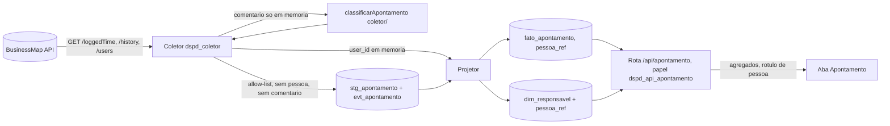

# 059 - Aba Apontamento: desenho técnico enxuto, texto da exceção e correções à especificação

Etapa E1.2 do pedido 059 (K-193). Entrada: a especificação do dono "Painel de Capacidade", seções 1 a 10, em texto e sem nomes (faz o papel de protótipo, decisão técnica de 2026-11-01 17:50). Discovery em paralelo: UX em `docs/ux/059-aba-apontamento.md` (E1.3) e modelo de ameaças em `docs/security/059-aba-apontamento-ameacas.md` (E1.4). Este documento **adota** os controles AP-1 a AP-11 da segurança e as melhorias M-1 a M-16 do UX onde tocam o desenho, e não os repete; diverge em nada (onde completa, diz). Nenhum nome de pessoa aqui (ADR 0020).

**Conferência com a constituição:** o projeto não tem `docs/constituicao.md`. Conferido contra as regras invioláveis do `CLAUDE.md`: conforme, **com um desvio declarado e decidido pelo dono** (exceção "A" à regra de métrica individual, 2026-11-01), que só vale depois do PR do §1 mesclado pelo dono. As demais regras seguem integrais: BusinessMap e Acelerato não se misturam (a aba lê só `dspd_bm`), carga incremental sem sobrescrever histórico (§3.3), cálculo só pela biblioteca T2.5 (§3.7), piso de 20 itens para estatística (§3.7), mudança de critério registrada com data (§3.6), credencial só no `.env`, só GET.

**Fato novo desta etapa (lido na OpenAPI pública do BusinessMap, `demo.kanbanize.com/openapi/json`, 2026-11-01; marcar `[DOC]` na doc de integração na E2):** o worklog tem rota própria, e não é o `logged_times` do card que a doc de integração manda evitar (§4.2, linha 66):
- `GET /loggedTime`: filtros `card_ids`, `parent_card_ids`, `user_ids`, `category_ids`, `include_logged_time_for_subtasks`, `from_date`/`to_date` (data do apontamento), `logged_from`/`logged_to` e `logged_from_date`/`logged_to_date` (quando foi registrado), `page`, `per_page` (padrão 200, máximo 1000), `fields` com a lista fechada `logged_time_id`, `parent_card_id`, `card_id`, `subtask_id`, `lane_id`, `column_id`, `user_id`, `category_id`, `date`, `time`, `comment`, `logged_at`. **Não há filtro por quadro.** `time` é em **segundos** (descrição do POST e do PATCH).
- `GET /loggedTime/history`: eventos `logged_time_created`, `logged_time_updated`, `logged_time_deleted`, `logged_time_transferred_to_card_after_subtask_deleted`, `logged_time_updated_after_subtask_converted_to_card`; filtros `logged_time_ids`, `card_ids`, `user_ids`, `event_types`, `from`/`to`, `per_page` até 200. **Os campos do evento não estão no trecho lido** `[NÃO LIDO]`.
- `GET /loggedTimeCategories`: catálogo de **categorias de tempo**, domínio fechado do próprio BusinessMap (base da melhoria MA-3).
- Consequência: a chave única do apontamento existe (`logged_time_id`), a exclusão tem fonte (`logged_time_deleted`) e o resto do AP-6 da segurança passa de "não lido" a "lido na documentação, confirmar no spike" (F1, §7).

## 1. Texto da exceção (proposta literal; aplicada depois por PR que o dono revisa e mescla)

Decisões do dono que o texto traduz (2026-11-01): "A" (registrar a exceção no `CLAUDE.md` e no briefing por PR do dono), "C" (qualquer usuário do painel vê a aba, inclusive fora do time), "A" das horas (horas só para capacidade, utilização e distribuição do tempo do time e de cada pessoa; nunca esforço de entrega, velocidade, custo de card ou meta). Nada nesta etapa edita o `CLAUDE.md` nem o briefing.

### 1.1 `CLAUDE.md`, seção "Regras invioláveis"
Inserir logo **depois** do item "Nenhuma métrica pode servir para avaliação individual..." e **antes** de "Métricas proibidas (seção 7.1)":

> - **Exceção única: aba Apontamento** (decisão do dono de 2026-11-01, pedido 059; briefing §7.1). Só nessa aba, e só com o worklog do BusinessMap (`GET /loggedTime`), o painel mostra o nome de quem apontou e a visão por pessoa (horas, capacidade, utilização, distribuição do tempo e qualidade do apontamento), visíveis a qualquer usuário do painel. As horas apontadas servem ali só para capacidade, utilização e distribuição do tempo do time e de cada pessoa; nunca como esforço de entrega, velocidade, custo de card ou meta. Continua proibido, inclusive na aba: meta por pessoa, comparação entre times e uso das horas ou da visão por pessoa em qualquer outra aba, métrica, exportação ou cálculo. O comentário do apontamento nunca chega à base: é classificado na fronteira do coletor e descartado. O Acelerato fica fora da exceção. O controle técnico (papel de banco dedicado, rota única) está na ADR 0020, revisão 4.

### 1.2 Briefing `docs/briefing-execucao-metricas.md`, §7.1 "Métricas proibidas"
Acrescentar **ao fim da lista** do §7.1, sem alterar os itens existentes (o item "Horas apontadas como proxy de esforço entregue" continua valendo em todo o sistema, inclusive na aba):

> **Exceção registrada (decisão do dono de 2026-11-01, pedido 059): aba Apontamento.** Vale só para essa aba e só para o worklog do BusinessMap. Ali o painel mostra nome e visão por pessoa (horas apontadas, capacidade, utilização, distribuição do tempo e qualidade do apontamento) a qualquer usuário do painel, inclusive fora do time. As horas apontadas são lidas como uso da capacidade do time e de cada pessoa, nunca como esforço de entrega, velocidade, custo de card ou meta. Não se cria meta por pessoa nem comparação entre times, e a visão por pessoa não sai da aba para outra métrica, painel ou exportação. A finalidade é dimensionar capacidade e melhorar a qualidade do apontamento, não avaliar desempenho individual. A sustentação (Acelerato) não entra na exceção.

### 1.3 Cláusulas opcionais (cada uma entra no texto só se o dono aceitar)
Vêm das propostas da segurança (§6 do modelo de ameaças, P-7) e do UX (M-3, M-4, P-2); são regra de negócio e não entram por inferência:
- (o1) "A ordem padrão de pessoas é neutra (alfabética ou por equipe); ordenar por total é escolha explícita de quem lê."
- (o2) "Utilização por pessoa sem semáforo, faixa de bom/ruim nem comparação com a média; é leitura relativa, porque o worklog não cobre a jornada inteira."
- (o3) "Estatística derivada por pessoa (utilização, percentual de qualidade) só com 20 ou mais apontamentos na janela; abaixo disso, só soma e contagem."
- (o4) "A aba fica fora da exportação do painel" (ou: "só o que está na tela, sem linhas por pessoa e dia").

## 2. Módulos afetados

| Camada | Módulo | O que muda |
|---|---|---|
| Cliente HTTP | `server/src/plataforma/http.ts` (ADR 0015) | `CAMINHOS_PERMITIDOS` ganha `/loggedTime`, `/loggedTime/history` e `/loggedTimeCategories`; consulta própria de cada um, com `fields` de **valor fixo** (regex de igualdade, como `CONSULTA_USERS`), datas e listas de id; nada de `/loggedTime/{id}` com outro método (CA-AP-11). |
| Coleta | `server/src/modulos/businessmap/apontamento/` (novo, dentro do perímetro `coleta*`/`businessmap` da ADR 0020) | coleta incremental do worklog, allow-list `CAMPOS_APONTAMENTO` em `allow-list.ts`, classificação na fronteira, gravação em staging e eventos, ids de pessoa só em memória até o projetor. Etapa do comando de coleta do BusinessMap, depois dos cards, sob a mesma trava de fonte. |
| Projetor | `server/src/modulos/businessmap/projetor.ts` | projeta `fato_apontamento` (estado atual) e `dim_card_raiz` (hierarquia); grava `pessoa_ref` na mesma execução (padrão do item 4b). |
| Biblioteca T2.5 | `packages/metricas/src/coletor/classificarApontamento.ts` (novo) | função pura que recebe o comentário (texto livre, só em memória) e devolve só lista fechada; fica em `coletor/`, fora do `index.ts` e do bundle do `web/` (ADR 0020, item 3). |
| Biblioteca T2.5 | `packages/metricas/src/businessmap/apontamento/` (novo) | capacidade, utilização, distribuição, qualidade agregada, mapa diário, anomalia e achados gerados; usa `core/calendario.ts` (dias úteis com feriados) e `core/amostra.ts` (piso de 20). Sem identidade: recebe `pessoaRef` opaco. |
| Contratos | `packages/contratos/src/apontamento.ts` (novo) | schema zod da consulta (`strict`) e da resposta, versionado (`docs/contratos/politica-de-mudanca.md`). |
| Banco | migrações novas no `dspd_bm` e `grants.ts`/`lgpd.ts` | tabelas do §3; papel `dspd_api_apontamento` (AP-2 da segurança); colunas novas em `COLUNAS_PESSOA`. |
| API | `server/src/modulos/apontamento/` (novo, rota única) | `GET /api/apontamento` com pool próprio do papel dedicado, `Cache-Control: no-store`, sem log de corpo, interruptor `APONTAMENTO_NOMES`. |
| Front | `web/src/features/apontamento/` (novo) | aba conforme a E1.3 (cartões, filtros, estados, acessibilidade); consome só a rota da aba; filtro de pessoa por `pessoaRef`. |
| Referência | arquivo versionado de `ref:sync` | dicionário de subgrupo e qualidade (§3.5), conferido pelo dono. |

## 3. Desenho técnico

### 3.1 Coleta do worklog
- **Escopo pela lista de cards, não pelo quadro.** `/loggedTime` não filtra por quadro; sem filtro, devolveria o worklog da conta inteira (pessoas de outras áreas lidas em memória sem necessidade, contra a minimização). O coletor pede por `card_ids` em lotes de até 200 (limite de `LISTA_IDS`), tirados dos cards do escopo da aba já coletados em `dim_card` (todos os estados: ativo, arquivado, descartado), com `include_logged_time_for_subtasks=1`. Custo estimado: `ceil(cards do escopo / 200)` chamadas por execução mais as páginas; com alguns milhares de cards, dezenas de chamadas, dentro do limitador de 600/h da F0. Escopo de quadros e workflows: pergunta Q-A1.
- **`fields` fixo:** `logged_time_id,card_id,parent_card_id,subtask_id,lane_id,column_id,user_id,category_id,date,time,comment,logged_at`. O `comment` é pedido porque a classificação precisa dele; vive só na função do §3.4. Se o spike mostrar que `fields` não restringe (como em `/users`, A4 da F1), a allow-list do código corta (2ª camada).
- **Allow-list `CAMPOS_APONTAMENTO` (proposta para a ADR 0020, item 4h):** gravam em staging `logged_time_id`, `card_id`, `parent_card_id`, `subtask_id`, `lane_id`, `column_id`, `category_id`, `date`, `time` (segundos), `logged_at`. **Nunca gravam:** `comment` (nem hash, nem trecho), `user_id` (só em memória até o projetor), título de subtarefa, de card pai ou qualquer outro campo. Saída da classificação: `subgrupo_codigo`, `flags_qualidade`, `qtd_palavras`, `versao_dicionario` (lista fechada e inteiros).
- **Validação na fronteira:** `logged_time_id` e ids só dígitos; `date` `AAAA-MM-DD` e não futura; `time` inteiro, maior que 0 e até 86 400 por apontamento. Fora disso: `ctl_coleta_falha` com código e `id_origem` (nunca o valor, B-4), coleta fecha `parcial`. Soma diária acima do limite **não é recusada**: vira flag na projeção (§3.6, P-5 da segurança, P-4 do UX).
- **Erro e log:** só código, entidade, `id_origem` e caminho do campo; `redact` do pino ganha `*.comment`, `*.comentario`, `*.realname` (AP-9).

### 3.2 Carga incremental com a chave do apontamento
- **Chave natural:** `logged_time_id`. Nada de deduplicação por combinação de campos (correção C-4).
- **Novos e editados:** `GET /loggedTime` com `logged_from = marca d'água − 1 h` (sobreposição, como `SOBREPOSICAO_S` dos cards) pega os registrados desde a última execução. Para editados, `GET /loggedTime/history` com `event_types=logged_time_updated,logged_time_transferred_to_card_after_subtask_deleted,logged_time_updated_after_subtask_converted_to_card` e `from = marca d'água − 1 h` dá os `card_ids` afetados; o coletor relê esses cards em `/loggedTime` por `card_ids`. A staging deduplica por `(logged_time_id, registro_sha256)`: a mesma versão relida não duplica; versão nova vira linha nova (append-only, nunca `UPDATE`).
- **Removidos:** `logged_time_deleted` no histórico vira linha em `evt_apontamento` (`tipo = excluido_origem`, `detectado_em`). Rede de segurança, enquanto os campos do evento não forem confirmados: varredura semanal de presença por janela de data (`from_date` = hoje − 90 dias), como `stg_card_presenca`; apontamento da janela que sumiu da origem vira `excluido_detectado`. Nada é apagado: o fato marca `excluido_em` e sai das somas (recomendação para a P-7 do UX, Q-A2).
- **Carga inicial:** por comando manual, na máquina do dono (A6 do 052), por `from_date` no período da carga (proposta: os mesmos 12 meses dos cards, Q-A6), em lotes de cards.
- **Marca d'água própria:** fonte `bm_apontamento` em `ctl_coleta`; a coleta de apontamentos roda depois da de cards na mesma execução (precisa de `dim_card` atualizado para o escopo e a hierarquia) e não roda se a de cards falhou.

### 3.3 Modelo de dados (esquema `dspd_bm`; forma final na revisão de modelagem com o tech-lead)
| Tabela | Natureza | Colunas principais | Regras |
|---|---|---|---|
| `stg_apontamento` | staging append-only (gatilho `proibir_alteracao`) | `coleta_id`, `logged_time_id`, `card_id`, `parent_card_id`, `subtask_id`, `lane_id`, `column_id`, `category_id`, `data date`, `segundos int`, `registrado_em timestamptz`, `subgrupo_codigo`, `flags_qualidade smallint` (máscara de lista fechada), `qtd_palavras smallint`, `versao_dicionario`, `registro_sha256` | `UNIQUE (logged_time_id, registro_sha256)`; **sem coluna de pessoa e sem texto livre** (CA-AP-13); `payload` só com a allow-list, se existir. |
| `evt_apontamento` | eventos append-only | `logged_time_id`, `tipo` (`excluido_origem`, `excluido_detectado`, `transferido`), `detectado_em`, `coleta_id` | nunca apagado. |
| `fato_apontamento` | projeção do estado atual (reconstruível da staging, menos `pessoa_ref`) | `logged_time_id PK`, os campos da staging na última versão, `iniciativa_card_id`, `pessoa_ref bigint NULL`, `versoes smallint`, `excluido_em`, `atualizado_em` | fora do gatilho (eliminação a pedido anula `pessoa_ref`, AP-10); `pessoa_ref` em `COLUNAS_PESSOA`; reconstruir a partir da staging **preserva** `pessoa_ref` (como `responsaveis`, ADR 0020 4b). |
| `dim_responsavel` (existente, F3 do 052) | projeção de pessoa do BusinessMap | + `pessoa_ref bigint GENERATED ALWAYS AS IDENTITY UNIQUE` | o `user_id` de quem apontou é resolvido por `/users` (R3-1, já implementado em `usuarios.ts`) igual ao responsável; a tabela passa a ser "pessoa do BusinessMap" (o nome fica, para não migrar à toa). `pessoa_ref` é a chave opaca da segurança (AP-8, revisão 4 item 4), sem relação com o `user_id`. |
| `dim_card_raiz` | projeção | `card_id PK`, `raiz_card_id`, `profundidade`, `raiz_fora_do_escopo boolean` | §3.5; reutilizável por outras métricas de hierarquia. |
| `ref_apontamento_subgrupo`, `ref_apontamento_termo`, `ref_apontamento_regra_tipo` | referência versionada | subgrupo (`codigo`, `rotulo`, `prioridade`), termo (`subgrupo_codigo`, `termo_normalizado`), regra por tipo de card (`type_id`, `condicao`, `subgrupo_codigo`); todas com `incluido_por_versao_id` → `ref_versao_criterio` | §3.6; carga por `ref:sync`. |
| `ref_categoria_tempo` | referência | `category_id`, `rotulo`, `ativa` | de `/loggedTimeCategories`; só se Q-A3 = sim. |

Grants: `dspd_coletor` escreve staging, eventos e projeções (sem `DELETE`); `dspd_api` **não lê nenhuma** dessas tabelas (o teste de grants de K-085 fica como está, CA-AP-1); `dspd_api_apontamento` lê por coluna `fato_apontamento` (sem `logged_time_id` se não for necessário), `dim_card_raiz`, as `ref_apontamento_*`, `dim_card` (só id, título e tipo do card; nomes de coluna na revisão de modelagem) e de `dim_responsavel` só `pessoa_ref` e `responsavel_nome` (nunca `responsavel_id`). `data-model.md` §3, §8 e §9 recebem as tabelas na E2.

### 3.4 Classificação do comentário na fronteira
- `classificarApontamento({ comentario, typeId, categoriaId }, dicionario) → { subgrupo, flags, qtdPalavras }` em `packages/metricas/src/coletor/`, pura, sem efeito colateral, sem log; o coletor a chama e descarta o comentário logo depois. O resultado é a única coisa que sobrevive.
- Normalização antes de casar: minúsculas, sem acento (NFD sem diacríticos), espaços colapsados; termos guardados já normalizados; casamento por **início de palavra** (correção C-6). Regras na ordem da seção 4 da especificação, com os termos do dicionário vigente; a ordem é a `prioridade` do subgrupo.
- **Qualidade** (seção 5): `sem_comentario`, `generico` (até 3 palavras), `sem_vinculo` (subgrupo "Execução técnica" ou "Não classificado"), `sem_projeto` (ver C-9), `valor_atipico` (projeção, §3.6). Máscara de bits de lista fechada; "Completo" = nenhuma flag.
- **Reclassificar o passado** exige reler o worklog na API pelo período (custo: o mesmo da carga inicial); a staging guarda `versao_dicionario` e a aba mostra a marca de mudança de critério (T2.6). Recomendação alinhada à P-8 da segurança: não guardar o comentário.

### 3.5 Pessoa, hierarquia e calendário
- **De-para de pessoa por id (limitação 6):** a chave é o `user_id` do BusinessMap, estável; o nome vem de `/users` (`realname`), um por id, então a variação de nome entre exports some. A tela usa `pessoa_ref`; nome nunca é chave de junção. Unificação de duas contas da mesma pessoa só se o dono mostrar que o caso existe (Q-A10); não se constrói antes.
- **Hierarquia até a iniciativa (limitação 1):** `dim_card_raiz` sobe por `dim_card.card_pai` (vínculo nativo `parent`, já projetado pela F4 do 052; pai do tipo Sprint não vale) até o card sem pai, com guarda de ciclo e profundidade máxima 10; recalculada a cada projeção. Raiz preferida: o primeiro ancestral em workflow de iniciativa (`ref_workflow.nivel` projeto, H-1); sem ele, o card mais alto alcançado. Pai fora dos quadros coletados: a cadeia para no último card conhecido e marca `raiz_fora_do_escopo` (rótulo na tela: Q-A7). O "projeto" da aba é o `title` da raiz (L-2, provisório, com o aviso de não escrever nome no título).
- **Calendário com feriados (limitação 3):** reaproveita `ref_calendario`, `ref_feriado` (escopo nacional, estadual, municipal, ponto facultativo) e `ref_calendario_aplicacao` (migração 0010) com a classe `apontamento` do domínio BusinessMap; a biblioteca recebe o `Calendario` montado da referência (`criarCalendario({ feriados })`), nunca a lista provisória `FERIADOS_NACIONAIS`. Jornada: `horasPorDia` do calendário (8 h com os turnos atuais). Quais feriados além dos nacionais: Q-A5.

### 3.6 Dicionário configurável e anomalia
- O dicionário da seção 4 vira a carga inicial das `ref_apontamento_*` num arquivo versionado de `ref:sync` (padrão das exceções de coluna do 052), preparado pelo arquiteto e conferido pelo dono; toda mudança cria uma `ref_versao_criterio` com data (T2.6), marcada nos gráficos.
- Anomalia: flag `valor_atipico` quando a soma do dia da pessoa passa do limite configurável (proposta do UX: 16 h); calculada na projeção pela biblioteca, nunca descartada; se entra ou não na soma é P-5 da segurança e P-4 do UX.

### 3.7 Cálculos pela biblioteca T2.5
Nenhum cálculo na rota nem no front. Em `packages/metricas/src/businessmap/apontamento/`:
- `horas(segundos)` e somas em segundos inteiros; arredondamento só na apresentação (C-5).
- `capacidadePessoa(apontamentos, calendario, base)`: dias úteis (com feriados) × `horasPorDia`; `base` = intervalo do primeiro ao último apontamento (regra da especificação) ou vigência configurada (Q-A4).
- `capacidadeMensal(...)`: soma, por pessoa ativa, dos dias úteis do mês dentro do seu intervalo (C-8, Q-A9), ou a regra da especificação se o dono preferir; mês corrente corta na data da última coleta bem-sucedida (C-7).
- `utilizacao = realizadas ÷ capacidade`, sem teto (pode passar de 100%) e com o selo de leitura relativa.
- distribuição por projeto, tipo, subgrupo, subtarefa (se P-4 da segurança permitir) e categoria; qualidade por flag (flags não excludentes, M-11); matriz pessoa × nível (um nível por vez, M-10); mapa diário com faixas fixas (M-6) e dias não úteis marcados (M-8); achados gerados por regra (M-1), sem nome de pessoa no texto.
- Piso de 20 por `core/amostra.ts` para estatística derivada (o3, P-1 do UX, P-6 da segurança); não há percentil nem Monte Carlo nesta aba.
- Story, frente e projeto não se misturam: a aba não faz histograma de tempo de ciclo; "projeto" é só rótulo de agrupamento das horas.

### 3.8 Contrato da API da aba (alto nível; o detalhe é do node-backend)
- `GET /api/apontamento`, rota única, pool do papel `dspd_api_apontamento`, `Cache-Control: no-store`, sem log de corpo, consulta `strict` (desconhecido = 400, CA-AP-6).
- Consulta: `de` e `ate` (`AAAA-MM-DD`, janela máxima de 12 meses), `pessoa` (lista de `pessoaRef`), `projeto` (`card_id` da raiz), `tipo` (`type_id`), `subgrupo` e `qualidade` (códigos de lista fechada), `categoria` (se Q-A3), `subtarefa` (se P-4), `nivelMatriz` (`tipo|subtarefa|subgrupo`), `diarioDe`/`diarioAte` (janela do mapa, M-7). Nada de texto livre.
- Resposta (agregada no servidor pela biblioteca; nunca linhas brutas por pessoa e dia além do mapa diário): `pessoas[] { pessoaRef, rotulo }` (rótulo = nome com `APONTAMENTO_NOMES` ligado, senão "Pessoa n"), `kpis`, `distribuicao { projeto, tipo, subgrupo, categoria }`, `qualidade { geral, porPessoa }`, `matriz`, `capacidade { porPessoa, mensal }`, `diario`, `achados[]`, `base { n, insuficiente }` por bloco, `criterios[]` (versões do dicionário e do calendário com data, T2.6), `frescor` (última coleta). Comentário, `user_id` e `responsavel_id` nunca saem.
- Front: `web/src/features/apontamento/` consome só esta rota; filtro de pessoa por `pessoaRef` na URL, nunca nome; não persiste a pessoa em `localStorage` (AP-8).

## 4. Correções e melhorias à especificação
C = corrige problema; M = melhoria. As de interface estão no UX (M-1 a M-16) e as de segurança no modelo de ameaças (§10); aqui só as de dado e cálculo.

| Id | Tipo | Especificação | Proposta | Motivo |
|---|---|---|---|---|
| C-1 | C | §1: HTML estático, base substituída a cada export | Coleta incremental pela API, staging append-only, rota com controle de acesso | A substituição perde editados e removidos (a própria §1 diz) e viola a carga incremental sem sobrescrever histórico; um HTML com nomes é vazamento portátil (segurança §10). |
| C-2 | C | §2: export CSV "Worklog entries" | `GET /loggedTime` e `/loggedTime/history` | A rota existe e traz chave única e eventos de edição e exclusão (fato novo, topo). |
| C-3 | C | §3: `horas` = `logged_time (hours)` arredondado a 2 casas | Guardar segundos inteiros; arredondar só na tela | A API devolve segundos; arredondar cada linha antes de somar acumula erro nos totais. |
| C-4 | C | §2 e §10: duplicidade checada por combinação de campos | Chave `logged_time_id` | A combinação junta dois apontamentos iguais legítimos (mesma pessoa, card, dia e horas) num só. |
| C-5 | C | §3: `projeto` = título do card pai ou do card | Raiz da hierarquia por `card_pai` (`dim_card_raiz`), rótulo pelo título da raiz | É a limitação 1 resolvida; o título do card pulveriza os projetos. |
| C-6 | C | §4: termos com e sem acento à mão ("análise, analise"); casamento por trecho | Normalizar acento e casar por início de palavra | "configuracao" sem acento hoje não casa; trecho solto casa dentro de outras palavras (por exemplo "teste" dentro de "contestei", "call" dentro de "recall"). Muda o resultado da classificação: **o dono confirma** (é regra de negócio, Q-A11). |
| C-7 | C | §7: mês corrente para na data máxima da base | Para na data da última coleta bem-sucedida | Se ninguém apontou no último dia coletado, a data máxima recua e a capacidade do mês encolhe sem motivo. |
| C-8 | C | §7: capacidade mensal = dias úteis × usuários ativos × 8 | Soma por pessoa dos dias úteis em que ela estava ativa no mês | Quem apontou um único dia conta o mês inteiro e derruba a utilização; incoerente com a §6, que usa o intervalo da pessoa. Regra de negócio: Q-A9. |
| C-9 | C | §5: flag "Sem projeto/cartão identificável" = projeto "Não informado" | Redefinir como "card sem iniciativa" (`raiz_fora_do_escopo` ou raiz sem pai de iniciativa) | Pela API todo apontamento tem card; a flag original nunca dispararia. Q-A8. |
| C-10 | C | §6 e §9.3: dias úteis sem feriados | Calendário da referência com feriados (§3.5) | Feriado inflava a capacidade e baixava a utilização. |
| C-11 | C | §8: filtros sobre `raw-data` no navegador | Filtros e agregação no servidor pela biblioteca | Mandar todas as linhas por pessoa e dia ao navegador expõe mais dado que a tela mostra (AP-8) e tira o cálculo da T2.5. |
| C-12 | C | Escopo implícito no export (filtro por quadro) | Escopo explícito da aba por quadros e workflows, **independente** da lista de workflows fora do painel operacional | A regra de subgrupo usa o tipo Kaizen e RDM/GMUD, que o painel operacional exclui (workflows 313 e 203, pedido 057); aplicar aquela exclusão à aba apagaria esses subgrupos. Q-A1. |
| M-1 | M | §4: subgrupo só por palavra-chave | Usar a **categoria de tempo nativa** do BusinessMap (`category_id`, `/loggedTimeCategories`) como primeira fonte, e o dicionário só quando o apontamento vier sem categoria | Categoria é domínio fechado (o briefing §7.3 pede domínio fechado no lugar de texto livre) e reduz a heurística da limitação 2. Depende de o time usar categorias: Q-A3. |
| M-2 | M | §9.2: dicionário "parametrizável" | Tabelas `ref_apontamento_*` versionadas por `ref:sync`, com data de vigência marcada nos gráficos | Atende a §10 e a T2.6; mudança de dicionário fica rastreável. |
| M-3 | M | §9.5: anomalia sem tratamento | Validação por apontamento (0 < segundos ≤ 86 400) na fronteira e flag `valor_atipico` por pessoa e dia na projeção | Nada se perde em silêncio; o caso de 115 h aparece marcado. |
| M-4 | M | §9.8: Reporter × user | A aba usa `user_id` do apontamento; Reporter não é lido | Reporter é pessoa sem uso na aba (minimização); rótulo "Pessoa que apontou" (M-15 do UX). |
| M-5 | M | §6: capacidade pelo primeiro e último apontamento | Fase seguinte: vigência por pessoa configurada (entrada, saída, jornada), sem férias nominais | Corrige admissão e desligamento no meio do período (limitação 3) sem guardar ausência de pessoa; Q-A4. |

## 5. Riscos, dependências e decisões em aberto
- **R-1. Campos do evento de `/loggedTime/history` não lidos.** Mitigação: varredura de presença semanal (§3.2) até o spike confirmar; se o evento de exclusão não trouxer `logged_time_id`, a varredura vira o único caminho.
- **R-2. `fields` pode ser ignorado pela API** (já visto em `/users`): a allow-list do código corta; achado vai ao security-engineer.
- **R-3. Cota:** a releitura por `card_ids` cresce com os cards do escopo; o limitador da F0 segura, e a carga inicial roda em lotes, à mão.
- **R-4. Reclassificação cara:** mudar o dicionário pede releitura do período (aceito pela P-8 da segurança, a confirmar).
- **R-5. Exposição de nome sem autenticação no painel:** bloqueio da segurança (P-1, G-1); o nome real só liga com `APONTAMENTO_NOMES` depois da resposta. Não se contorna (`R-CONFORMIDADE`).
- **R-6. Raiz fora dos quadros coletados:** projetos parciais; rótulo explícito (Q-A7).
- **Dependências:** F0 a F4 do 052 em `develop` (cliente, `dim_card.card_pai`, `dim_responsavel`, `ref_workflow`); PR do texto da exceção mesclado pelo dono antes de qualquer código que mostre pessoa; ADR 0020 revisão 4 com leitura do security-engineer.
- **Decisões de arquitetura a registrar na E2 (depois da E1.6):** ADR 0020 revisão 4 (texto proposto pela segurança no §4 do modelo de ameaças, mais a allow-list 4h deste §3.1 e a chave opaca do §3.3) e uma ADR nova "Coleta do worklog do BusinessMap" (escopo por `card_ids`, incremental por `logged_at` e histórico, exclusão por evento e varredura). **Por que o existente não basta:** a coleta atual de cards não traz o worklog (o `logged_times` do card está fora da allow-list 4a por ser pessoa e texto livre, e não tem chave por apontamento); o GRANT por coluna do `dspd_api` e o R3-3 proíbem o nome em rota, e a decisão "C" do dono exige que ele saia, então só um papel dedicado (AP-2) atende sem afrouxar o resto da API.

## 6. Perguntas ao dono (`R-DECISAO`; nenhuma resolvida por inferência)
Somam-se às do UX (P-1 a P-7) e da segurança (P-1 a P-8). Recomendação entre parênteses.
- **Q-A1. Escopo da aba:** quais quadros e workflows? (Os 7 quadros do 052 com todos os workflows, inclusive Kaizen 313, RDM/GMUD 203 e Acompanhamento 234, que ficam fora só do painel operacional; os workflows fora de todo cálculo, H-7, ficam fora.)
- **Q-A2. Editado e removido no BusinessMap** (responde a P-7 do UX): a aba mostra o estado atual (removido sai da soma, editado vale a última versão) com o histórico preservado na base? (Sim.)
- **Q-A3. Categorias de tempo:** o time usa a categoria do apontamento no BusinessMap? Se sim, ela vira a primeira fonte do subgrupo (M-1). (Pergunta de dado; o spike mostra quantos apontamentos têm `category_id`.)
- **Q-A4. Capacidade por pessoa:** intervalo do primeiro ao último apontamento (especificação) agora e vigência configurada por pessoa (entrada, saída, jornada) numa fase seguinte? (Sim; sem férias nominais.)
- **Q-A5. Feriados:** só nacionais, ou também estaduais e municipais de alguma cidade? (Informar quais; até lá, nacionais.)
- **Q-A6. Carga inicial:** quantos meses de worklog? (12, como os cards.)
- **Q-A7. Projeto quando a raiz está fora dos quadros coletados:** rótulo "Fora dos quadros coletados" com o título do card mais alto conhecido? (Sim.)
- **Q-A8. Flag "sem projeto"** redefinida como "card sem iniciativa" (C-9)? (Sim.)
- **Q-A9. Capacidade mensal:** por pessoa-dia ativo no mês (C-8) ou usuários ativos × dias úteis (especificação)? (Por pessoa-dia.)
- **Q-A10. Duas contas da mesma pessoa** existem no BusinessMap? (Só se existir se constrói a unificação.)
- **Q-A11. Normalização de acento e início de palavra** na classificação (C-6)? (Sim; muda contagens, por isso é pergunta.)
- **Q-A12. Texto da exceção (§1):** aprova os textos 1.1 e 1.2 e quais cláusulas opcionais (o1 a o4) entram? (Todas.)

## 7. Fatias e o que cabe até 2026-11-02

| Fatia | Conteúdo | Agentes | Cabe até 2026-11-02? |
|---|---|---|---|
| F0 | Discovery (E1.2 a E1.4), validação do dono (E1.6), PR só de documentação com o texto da exceção (§1) no `CLAUDE.md` e no briefing, para o dono mesclar. | arquiteto, UX, segurança, tech-lead | **Sim.** É o que se compromete. |
| F1 | Spike de `/loggedTime`, `/loggedTime/history` e `/loggedTimeCategories` num lote pequeno de cards, na máquina do dono, com a resposta inspecionada só por forma e contagem (sem nome nem comentário em documento); ADR 0020 revisão 4 e ADR da coleta escritas. | node-backend, arquiteto, segurança | **Talvez**, se a E1.6 sair na manhã de 2026-11-02; é leitura e documento, sem código de produção. |
| F2 | Cliente com os caminhos novos, allow-list 4h, `classificarApontamento`, staging, eventos, carga inicial e incremental, `fato_apontamento` sem `pessoa_ref` ainda, `dim_card_raiz`, dicionário por `ref:sync`. Testes CA-AP-2, 8, 9, 11, 13. | node-backend, qa-engineer, tech-lead, segurança | Não. |
| F3 | Biblioteca de cálculo da aba, contrato, papel `dspd_api_apontamento` e rota única com `APONTAMENTO_NOMES` desligado, aba no front com mock de pessoas fictícias e depois com dado real sem nome. Testes CA-AP-1, 3 a 6, 12. | node-backend, react-frontend, qa-engineer, UX, tech-lead, segurança | Não. |
| F4 | `pessoa_ref` e nome ligado (depois de P-1 e G-1), retenção e eliminação (CA-AP-10), exportação (CA-AP-7), capacidade por vigência (M-5), categorias (M-1). | todos | Não. |

Ordem e paralelismo: F1 antes de F2 (o formato confirmado define a allow-list); em F2, a biblioteca (`classificarApontamento` e cálculos) e o cliente correm em paralelo; o front de F3 começa com mock assim que o contrato zod existir, em paralelo à rota; o QA escreve os casos CA-AP-* desde F2. Toda fatia com código e dado pessoal passa por parecer de segurança, code review e QA antes do PR (`R-SEGURANCA`).
