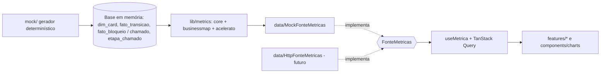

# Plano técnico - Dashboard de métricas com dados mockados

- Data: 2026-10-09 · Pedido: `docs/pedidos/001-dashboard-mock.md`
- Especificação de UX (em paralelo): `docs/ux/dashboard-metricas/especificacao.md`
- Stack: ADR `docs/architecture/adr/0001-stack-front-dashboard-mock.md` (parcialmente substituída pela 0002)
- (rev. 3) Monorepo e pacotes compartilhados: ADR `docs/architecture/adr/0002-monorepo-pacotes-compartilhados.md` · Orçamento de performance: ADR `docs/architecture/adr/0003-orcamento-de-performance.md`
- Revisão 2 (2026-10-09): alinhado às decisões J1 (janela de 12 semanas em todas as granularidades) e J2 (sustentação em horas úteis, inclusive P1) do tech lead e às lacunas L11 e L13 da spec de UX revisão 2. Trechos alterados marcados "(rev. 2)".
- Revisão 3 (2026-10-09): decisões D1, D2, D3 e D6 da ata `docs/alinhamentos/2026-10-09-checkpoint-001-kickoff-002.md`. `contracts/`, `lib/metrics/` e `mock/` saem de `web/` para pacotes do monorepo depois do review/QA da fase A e antes da fase B. Os caminhos `web/src/...` citados nas seções 3 a 6 valem até a extração; o mapeamento está na seção 2. Trechos alterados marcados "(rev. 3)".

## 1. Resumo
SPA em `web/` que gera, no navegador e de forma determinística, uma base fictícia no formato do modelo analítico (briefing 4.5) e de chamados do Acelerato (3.2/3.4), calcula as métricas do núcleo com uma biblioteca única (T2.5) e as exibe por trás de uma interface de fonte de dados que amanhã será implementada por HTTP. Não há back-end nem endpoints nesta etapa.

Fluxo de dados (camadas, de baixo para cima):



Regra estrutural: a UI só conhece `FonteMetricas` e os DTOs de `contracts/`. Ela nunca importa `mock/` nem `lib/metrics/` (garantido por lint, ver ADR 0001; (rev. 3) após a extração, por fronteira de pacote, ADR 0002).

## 2. Estrutura de pastas

### 2.1 (rev. 3) Estrutura após a extração (ADR 0002)
```
/
  package.json (workspaces) · package-lock.json · tsconfig.base.json · eslint.config.js · .prettierrc
  packages/
    contratos/  @metricas-dspd/contratos   src/ = antigo web/src/contracts (comum, filtros, metricas, schemas)
    metricas/   @metricas-dspd/metricas    src/ = antigo web/src/lib/metrics
                exports: "." (calcularMetrica, calcularVisaoGeral, slug) · "./core" · "./businessmap" · "./acelerato"
    mock/       @metricas-dspd/mock        src/ = antigo web/src/mock (CRITERIOS_MOCK em arquivo neutro, fora de businessmap/)
  web/          @metricas-dspd/web         src/: main.tsx, app/, data/ (permanece), content/, features/, components/, styles/
  e2e/          @metricas-dspd/e2e         Playwright + axe + projeto perf (ADR 0003)
  server/       @metricas-dspd/server      criado no pedido 002 (feature/arquitetura-mysql)
```
- Dependências: `contratos ← metricas ← mock`; `web` usa `contratos` em todo lugar e `metricas`/`mock` só em `web/src/data/mock/**`, por `import()` dinâmico.
- Pacotes como TS-fonte (exports para `.ts`), sem build próprio; `@/` só existe dentro de `web/`.
- Calendário (expediente e feriados) entra como parâmetro no contexto das métricas; `CALENDARIO_PADRAO` é o padrão provisório usado pelo mock (P2).
- Procedimento e critério da extração (mesmo número de testes e mesmo hash da base mock): ADR 0002, "Procedimento da extração".

### 2.2 Estrutura da fase A (antes da extração)

```
web/
  package.json · vite.config.ts · tsconfig*.json · eslint.config.js · .prettierrc · index.html
  src/
    main.tsx
    app/                    # App, router (rotas lazy por painel), providers, layout, tema, aviso de dados fictícios
    contracts/              # DTOs e filtros: a "API" do front. Futuro packages/shared
      comum.ts              # Estatistica<T>, BaseAmostral, Janela, MarcacaoCriterio, MetricaId
      filtros.ts            # FiltrosFluxo, FiltrosSustentacao + schemas zod
      metricas.ts           # ContratoMetricas: MetricaId -> { filtros, resultado }
      schemas.ts            # schemas zod dos resultados (validação)
    data/
      FonteMetricas.ts      # interface
      FonteMetricasProvider.tsx · useMetrica.ts · useOpcoesFiltro.ts
      mock/MockFonteMetricas.ts
      http/                 # vazio nesta etapa
    mock/                   # gerador (TS puro)
      prng.ts · distribuicoes.ts · config.ts · index.ts (gerarBaseMock)
      businessmap/tipos.ts · catalogos.ts · hierarquia.ts · fluxo.ts · bloqueios.ts · bugs.ts · gerador.ts
      acelerato/tipos.ts · catalogos.ts · gerador.ts
    lib/metrics/            # biblioteca única (TS puro, sem React/DOM)
      core/calendario.ts · feriados.ts · percentil.ts · janela.ts · amostra.ts · estatistica.ts
           histograma.ts · series.ts · criterios.ts · montecarlo.ts (reservado)
      businessmap/marcos.ts · wip.ts · o1.ts … o18.ts · t1.ts … t9.ts · e1.ts … e3.ts · ei.ts
      acelerato/sla.ts · totalizadores.ts · s1.ts … s7.ts · ei.ts
      index.ts
    content/catalogo-metricas.ts   # id, nome, nível, pergunta, nota metodológica (o que é, cálculo, leitura, meta)
    features/
      filtros/              # useFiltros(dominio), barra de filtros
      visao-geral/ · operacional/ · tatico/ · estrategico/ · sustentacao/ · espera-invisivel/
      metodologia/          # NotaMetodologica, BaseAmostral, AmostraInsuficiente
    components/
      ui/                   # botões, cartões, tabs, popover (Radix)
      charts/               # Histograma, LinhaComFaixas, AreaEmpilhada, Dispersao, Barras, TabelaDados, MarcadorCriterio
    styles/tokens.css
  # testes ao lado do código: *.test.ts(x)
e2e/                        # Playwright + axe (responsabilidade do qa-engineer)
```

## 3. Gerador de mock

### 3.1 Determinismo
- PRNG `mulberry32(semente)` em `mock/prng.ts`; um sub-gerador derivado por domínio e por equipe (`derivar(semente, 'acelerato')`), para que mudar o volume de um domínio não altere os dados do outro.
- `config.ts`: `{ semente: 20261009, hoje: '2026-10-09T18:00:00-03:00', mesesHistorico: 18, volumes }`. Sobrescrevível por `VITE_MOCK_SEMENTE` e `VITE_MOCK_HOJE`, e por parâmetro direto de `gerarBaseMock(config)` nos testes.
- Proibido `Math.random`, `Date.now` e `new Date()` sem argumento em `mock/` e `lib/metrics/` (lint). "Hoje" é sempre um parâmetro.
- Distribuições em `distribuicoes.ts`: `lognormal(mediana, sigma)`, `poisson(lambda)`, `bernoulli(p)`, `escolhaPonderada(pesos)`. Durações são geradas em horas úteis e convertidas em instantes pelo calendário da biblioteca (mesmo calendário do cálculo). (rev. 2, J2) Vale para os dois domínios: chamados do Acelerato, de todas as prioridades inclusive P1, também usam o calendário de expediente.

### 3.2 BusinessMap - tipos (espelham 4.5)
Campos de 4.5 sem alteração; extensões marcadas `// extensão 4.4/4.5` e listadas na seção 9.

```ts
type Granularidade = 'projeto' | 'frente' | 'story';           // frente = feature ou pacote (mesmo nível)
type TipoCard = 'Incidente' | 'Requisição' | 'Melhoria' | 'Iniciativa'
  | 'Bug interno' | 'Defeito em produção' | 'Dívida técnica';  // 4.3

interface DimCard {
  card_id: string; tipo: TipoCard; classe_servico: string; sistema: string;
  area_solicitante: string; fornecedor: string | null; objetivo_estrategico: string | null;
  card_pai: string | null; criado_em: number; comprometido_em: number | null;
  iniciado_em: number | null; concluido_em: number | null; arquivado_em: number | null;
  motivo_descarte: string | null; responsaveis: string[]; tamanho_declarado: 'P'|'M'|'G' | null;
  // extensões (4.4 / necessidades do núcleo)
  granularidade: Granularidade; equipe: string; quadro_id: string;
  excluido_em: number | null; data_acordada: number | null;
  responsabilidade_atraso: 'Interno' | 'Solicitante' | 'Terceiro' | null;
  origem_demanda: string | null; fase_deteccao: FaseDeteccao | null;
  severidade: 'Crítica'|'Alta'|'Média'|'Baixa' | null; origem_bug: string | null;
  adicionado_apos_inicio_pai: boolean;                          // T1.7, para T9
}
interface FatoTransicao { card_id: string; coluna_origem: string | null; coluna_destino: string;
  tipo_coluna: 'fila' | 'execucao'; usuario: string; timestamp: number; direcao: 'avanco' | 'retorno'; }
interface FatoBloqueio { card_id: string; motivo: MotivoBloqueio; coluna_em_que_bloqueou: string;
  fornecedor: string | null; inicio: number; fim: number | null; duracao_horas_uteis: number | null; }
// apoio (extensão): DimColuna {quadro_id, coluna, tipo_coluna, ordem, limite_wip}, FichaResultado (E3), AlocacaoAcordada (T3)
```
- `responsaveis` e `usuario` recebem pseudônimos ("Pessoa 01"...) e **nunca** são agregados por nenhuma função da biblioteca (não existe função que receba pessoa como dimensão).
- Domínios fechados de 4.4 (motivos de bloqueio, fase de detecção, causa raiz, origem da demanda) em `catalogos.ts` como `as const`.

### 3.3 BusinessMap - volume e distribuição (ordem de grandeza)
| Item | Valor |
|---|---|
| Equipes / quadros | 6 fictícias: ERP Protheus, Fluig, Senior, Marketing e Vendas, Dados, Plataforma 5G |
| Sistemas | Protheus, Fluig, Senior, CRM, Site/Marketing, Data Lake, Core 5G, Portal do cliente |
| Histórico | 18 meses até `hoje` (cobre 12+ meses e a janela de 12 semanas em toda a série) |
| Projetos | ~40 (≈10 abertos), lead time aprovação→entrega lognormal mediana ~120 dias úteis |
| Frentes | ~220 (3 a 8 por projeto), ciclo mediana ~15 dias úteis, sigma 0,7 |
| Stories de projeto | ~3.000 (4 a 20 por frente), ciclo mediana ~3 dias úteis, sigma 0,9 (cauda longa) |
| Cards sem pai (sustentação e não planejada nos quadros dos times) | ~1.500, tipos Incidente/Requisição |
| Transições / bloqueios | ~30 mil / ~1.200 |

Regras de geração:
- Marcos ordenados `criado_em ≤ comprometido_em ≤ iniciado_em ≤ concluido_em ≤ hoje`; fila antes do compromisso lognormal longa (gera Espera invisível entre 30% e 60%).
- `fato_transicao` é a fonte; os marcos de `dim_card` são coerentes com ela (testado). Colunas de fila iniciam por "Aguardando" ou "Pronto para" (4.2).
- Bloqueios em ~20% das stories (1 a 3), motivos do domínio fechado, duração lognormal mediana ~8 h úteis; bloqueio não move coluna.
- Descarte ~6% (com `motivo_descarte` e `arquivado_em`); arquivados e excluídos permanecem na base.
- Reabertura ~3%: transição `retorno` depois da entrega, nova entrega posterior, e card de defeito vinculado.
- Bugs: Poisson(0,3) por story entregue, `fase_deteccao` ponderada (maioria antes da homologação); defeitos em produção criados de 1 a 60 dias após a entrega (exercita a janela de 30 dias).
- `data_acordada` em ~30% dos compromissos, parte vencida com `responsabilidade_atraso`.
- ~3% de stories de projeto sem `card_pai` (defeito de dado, visível como tal).
- Classes pequenas deliberadas: "Dívida técnica" na equipe Plataforma 5G e "Iniciativa" em Senior ficam com < 20 concluídos em 12 semanas; projetos ficam naturalmente abaixo de 20 na janela.
- (rev. 2, L11; spec 9.2) **No consolidado com filtros padrão** (todas as equipes, 12 semanas até `hoje`), o Operacional precisa ter pelo menos um tipo de demanda **disponível no filtro de tipo** com < 20 itens concluídos na janela (ex.: "Dívida técnica" ou "Defeito em produção"), ao lado de tipos com ≥ 20. Não basta a classe pequena existir só no filtro de uma equipe, e "Iniciativa" não conta (não é opção do filtro de tipo). O volume desse tipo é calibrado no total, não por equipe.
- (rev. 2, J1; spec 9.2) Com a janela de 12 semanas: projetos concluídos na janela < 20 (E1 e EI-FL3 insuficientes, esperado); frentes concluídas na janela ≥ 20 no consolidado padrão (T7 publica) e < 20 em filtros estreitos. O gerador mantém projetos concluídos ao longo de 12+ meses, pois os pontos de E1 usam o período escolhido.
- Nunca gerar pacote agrupando features (quarto nível, seção 02).

### 3.4 Acelerato - tipos (separados, sem nenhum tipo em comum com o BusinessMap além de primitivos)
```ts
type Prioridade = 'P1' | 'P2' | 'P3' | 'P4' | 'P5';
type EtapaAcelerato = 'Novo' | 'Em triagem' | 'Em diagnóstico' | 'Em atendimento N1'
  | 'Aguardando atribuição' | 'Em atendimento N2' | 'Em atendimento N3' | 'Pendente'
  | 'Aguardando validação' | 'Encerrado' | 'Arquivar';          // 3.4
interface Chamado {
  chamado_id: string; organizacao: 'DSPD Sustentação'; tipo_fila: 'DSPD - SSSC';
  equipe: 'SSSC TOTVS' | 'SSSC SENIOR' | 'SSSC FLUIG'; natureza: 'incidente' | 'requisicao';
  categoria_sistema: string; excluido: boolean; status: string;
  impacto: 'Alto'|'Médio'|'Baixo'; urgencia: 'Alta'|'Média'|'Baixa'; prioridade: Prioridade;
  prioridade_ajustada_manualmente: boolean; justificativa_ajuste: string | null;
  aberto_em: number; primeiro_atendimento_em: number | null; restaurado_em: number | null;
  data_finalizado: number | null;
  status_sla_r: 'REALIZADO_NO_PRAZO' | 'REALIZADO_APOS_VENCIMENTO' | null;
  status_sla_pa: 'NO_PRAZO' | 'APOS_VENCIMENTO' | null;          // provisório, ver P5
  motivo_escalacao: MotivoEscalacao | null; motivo_pendencia_atual: MotivoPendencia | null;
  previsao_retorno: number | null; motivo_encerramento: MotivoEncerramento | null;
  avaliacao_problema: 'Aberto' | 'Não aplicável' | null; excecao_sla_registro_posterior: boolean;
  incidente_critico_coordenado: boolean; nivel_resolucao: 'N1' | 'N2' | 'N3' | 'Fornecedor' | null;
}
interface EtapaChamado { chamado_id: string; etapa: EtapaAcelerato; entrada: number; saida: number | null;
  motivo_pendencia: MotivoPendencia | null; }
```
- Prioridade sempre derivada da matriz Impacto × Urgência (3.4), exceto nos ~4% com ajuste manual (com justificativa).
- `incidente_critico_coordenado` = true em todo P1 e em parte dos P2.
- Volume: ~6.000 chamados em 18 meses, distribuição P1 1%, P2 6%, P3 30%, P4 43%, P5 20% (P1 fica com < 20 na janela, exercitando a regra).
- Tempos lognormais por prioridade, em horas úteis para todas as prioridades, inclusive P1 (rev. 2, J2), calibrados para aderência entre 80% e 95%; `status_sla_r` só é preenchido quando `status = 'Concluído'` e `data_finalizado` não nulo. Chamados abertos com `data_finalizado` nulo.
- Escalação não reinicia relógio (o gerador nunca reseta prazo ao mudar de nível).
- Mapeamento etapa → totalizador (sem atendimento, em atendimento, espera combinada, espera do solicitante, espera de outros times) em `lib/metrics/acelerato/totalizadores.ts`.

## 4. Biblioteca de cálculo (`lib/metrics`)
TypeScript puro, sem React, sem DOM, sem fuso do sistema. Toda métrica do núcleo é uma função `(base, filtros, contexto) => DTO`; nenhum componente calcula.

### 4.1 Núcleo (`core/`)
- **Calendário** (`calendario.ts`): `horasUteisEntre(inicio, fim, cal)`, `somarHorasUteis(inicio, horas, cal)`, `diasUteis(horas) = horas / cal.horasPorDia`. `Calendario = { modo: 'expediente' | 'corrido', turnos, feriados, offsetMinutos: -180 }`. Expediente e feriados provisórios (P2).
  - (rev. 2, J2) Todo cálculo de sustentação (S1 a S7 e EI-SUST), em todas as prioridades inclusive P1, usa o calendário de expediente: dia útil = 8 h úteis (seg–sex, 08:00–12:00 e 13:00–17:00, feriados nacionais, −03:00). O modo `corrido` continua existindo e testado na biblioteca para a exceção de plantão de 4.2, mas **não é ligado ao P1** nem a nenhuma métrica nesta etapa. A escolha do calendário por prioridade fica num ponto único (`CALENDARIO_POR_PRIORIDADE` em `acelerato/sla.ts`, hoje expediente para P1–P5), para trocar em uma linha se a pergunta P7 for respondida de outro jeito. Exibição (unidades h úteis/dias úteis por prioridade) é da UI, conforme a spec.
- **Percentil** (`percentil.ts`): interpolação linear entre ordens, `h = (n−1)·p` (tipo 7 de Hyndman-Fan, igual a `PERCENTILE.INC` do Excel/Power BI e ao padrão do NumPy). Provisório, P1. Registrado como critério v1.
- **Janela** (`janela.ts`): 12 semanas = 84 dias corridos terminando em `referencia` (inclusive), filtrando pela data de conclusão. Séries semanais recalculam a janela para cada fim de semana (semana segunda a domingo).
  - (rev. 2, J1) A janela de percentis é de 12 semanas em **todas** as granularidades, parametrizada numa constante única:
    ```ts
    // core/janela.ts — único lugar onde a janela é definida (critério v1, T2.6)
    export const JANELA_POR_GRANULARIDADE = {
      story: { semanas: 12 }, frente: { semanas: 12 }, projeto: { semanas: 12 }, chamado: { semanas: 12 },
    } as const satisfies Record<'story' | 'frente' | 'projeto' | 'chamado', { semanas: number }>;
    ```
    Nenhuma métrica recebe ou define janela própria; o construtor de `Amostra` obtém a janela a partir da classe. Se o usuário decidir diferente (pergunta P3), a troca é de uma linha e deve ser registrada como nova versão de critério em `criterios.ts` (marcação nos gráficos). Não existe janela "12 meses (provisória)". E1, EI-FL3 e, às vezes, T7 e EI-FL2 em "insuficiente" são estado normal (spec 6.3.1).
- **Amostra e domínio** (`amostra.ts`):
  ```ts
  type Dominio = 'businessmap' | 'acelerato';
  interface Amostra<D extends Dominio, G extends string> {
    readonly dominio: D; readonly classe: G; readonly valores: readonly number[]; readonly janela: Janela;
  }
  ```
  Construtores só existem dentro de `businessmap/` (com `G = Granularidade`) e `acelerato/` (com `G = Prioridade`). Nenhuma função aceita amostras de domínios ou classes distintos ao mesmo tempo; não existe função de concatenação de amostras.
- **Regra de mínimo** (`estatistica.ts`):
  ```ts
  type Estatistica<T> =
    | { status: 'ok'; n: number; valor: T; janela: Janela }
    | { status: 'insuficiente'; n: number; minimo: 20; janela: Janela };
  function percentis(a: Amostra<Dominio, string>): Estatistica<{ p50: number; p85: number; p95: number }>;
  ```
  Toda estatística de distribuição passa por aqui. Média só é exposta junto com percentis (`resumoComMedia`), nunca sozinha. Contagens simples (vazão, volume) não estão sujeitas ao mínimo, mas o DTO sempre declara `n`.
- **Histograma** (`histograma.ts`): faixas em dias úteis com largura padrão por granularidade (story 1, frente 5, projeto 20; provisório) e opção de largura explícita; recebe uma única `Amostra`, logo uma única granularidade.
- **Critérios** (`criterios.ts`, T2.6): `VersaoCriterio = { id, data, descricao, afeta: MetricaId[] }`; `marcacoesNoPeriodo(metrica, inicio, fim)` devolvida em todo DTO de série para o gráfico desenhar a marcação. O mock inclui uma mudança fictícia (ex.: 2026-03-02, "marco de entrada corrigido, T1.5") para exercitar a marcação.
- **Monte Carlo**: nenhuma métrica do núcleo (T6 e E5 estão fora) precisa. Fica só a assinatura reservada em `montecarlo.ts`, sem implementação nesta etapa.

### 4.2 Específicos
- `businessmap/marcos.ts` deriva entrada, compromisso, início, entrega de `dim_card`/`fato_transicao`; aplica regras de 4.2 (subtarefa não conta, descartado fora do ciclo, reaberto conforme P10, janela de 30 dias do bug).
- `businessmap/wip.ts` reconstrói WIP diário a partir das transições (fila conta no WIP; bloqueado conta).
- Um arquivo por métrica do núcleo: O1, O2, O3, O4, O7, O9, O10, O12, O15, O18; T1, T2, T3, T4, T5, T7, T9; E1, E2, E3; S1 a S7; EI nos quatro níveis (`businessmap/ei.ts` por granularidade e `acelerato/ei.ts`).

## 5. Camada de acesso a dados
```ts
// contracts/metricas.ts
interface ContratoMetricas {
  O3: { filtros: FiltrosFluxo; resultado: ResultadoO3 };
  S1: { filtros: FiltrosSustentacao; resultado: ResultadoS1 };
  // ... uma entrada por métrica do núcleo + 'EI_FL1' | 'EI_FL2' | 'EI_FL3' | 'EI_SUST' + 'VISAO_GERAL'
}
// data/FonteMetricas.ts
interface FonteMetricas {
  readonly tipo: 'mock' | 'api';                       // 'mock' liga o aviso de dados fictícios
  obter<K extends keyof ContratoMetricas>(id: K, f: ContratoMetricas[K]['filtros']): Promise<ContratoMetricas[K]['resultado']>;
  opcoesFiltro(dominio: Dominio): Promise<OpcoesFiltro>;
  criterios(): Promise<VersaoCriterio[]>;
  dataReferencia(): Promise<string>;
}
```
- `MockFonteMetricas` gera a base uma vez (memoizada, carregada por `import()` dinâmico para não pesar no chunk inicial) e chama a biblioteca. `HttpFonteMetricas` (futuro) faz `GET /api/v1/metricas/:id?filtros` e valida com os schemas zod.
- `useMetrica(id, filtros)` = `useQuery({ queryKey: ['metrica', id, filtros], ... })`; cada cartão de métrica tem seus próprios estados (carregando, erro, vazio, insuficiente, ok).
- Todo resultado carrega `base: { n, janela, descricao }` e `marcacoes: MarcacaoCriterio[]` quando for série.
- Filtros: `FiltrosFluxo = { equipe?, tipo?, sistema?, periodo }` e `FiltrosSustentacao = { equipe?, prioridade?, periodo }` são tipos distintos; o TypeScript impede pedir uma métrica S* com filtros de fluxo.
- (rev. 2, L13; spec 6.6) Simulação de estados pelo parâmetro de URL `mock`, implementada **na `MockFonteMetricas`** (decorador sobre `obter`), nunca nos componentes: `carregando` (promessa que não resolve), `erro` (erro de painel), `vazio`, `erro:{id}` (o cartão falha em toda tentativa) e `erro-uma-vez:{id}` (falha só na primeira chamada daquele id; o "Tentar de novo" resolve normalmente). `{id}` aceita lista por vírgula; ids inexistentes e valores inválidos são ignorados sem aviso. O controle de "já falhou uma vez" é estado da instância da fonte, por id, e zera ao recarregar a página. `HttpFonteMetricas` ignora o parâmetro. Propagação na navegação e em "Copiar link" segue a spec 6.6 (responsabilidade do `useFiltros`/links, não da fonte).
- ~~Ao migrar: a biblioteca vai para `packages/shared` ou `server/`; `contracts/` vira `packages/shared`; os painéis não mudam.~~ (rev. 3) A biblioteca vai para `packages/metricas` e `contracts/` para `packages/contratos` já no 001 (ADR 0002); no 002 o servidor usa os mesmos pacotes e os painéis não mudam.

## 6. Estratégia de testes
- **Biblioteca (`lib/metrics/core`)**: testes de tabela com casos de borda documentados no próprio teste: início/fim fora do expediente, atravessando almoço, fim de semana e feriado, intervalo nulo, `fim < início` (erro), modo corrido; percentil com n = 1, 19, 20, valores repetidos e conferência contra valores de referência de `PERCENTILE.INC`; borda da janela (dia 84 dentro, 85 fora); marcação de critério ao cruzar a data. Propriedades com fast-check: `p50 ≤ p85 ≤ p95`, `min ≤ p ≤ max`, `n < 20 ⇒ insuficiente`, horas úteis aditivas em intervalos contíguos.
- **Métricas**: fixtures pequenas montadas à mão com builders (`umCard().iniciadoEm(...).entregueEm(...)`), não com o gerador. Uma regra de 4.2 por teste (descarte, reabertura, bug na janela de 30 dias, subtarefa, fila no WIP).
- **Gerador**: determinismo (mesma semente ⇒ mesmo hash da base; semente diferente ⇒ hash diferente); invariantes (integridade de `card_pai`, ordem dos marcos, coerência transição × marcos, nada depois de `hoje`, arquivados presentes, prioridade = matriz salvo ajuste justificado, `status_sla_r` só em concluídos, nenhum chamado fora da população 3.2); existência de classes com < 20 itens; (rev. 2, L11/J1) no consolidado padrão, ao menos um tipo do filtro do Operacional com < 20 e outros com ≥ 20, frentes na janela ≥ 20 e projetos na janela < 20; (rev. 2, J2) durações de chamados P1 coerentes com o calendário de expediente; orçamento de tempo ((rev. 3) geração completa < 1,5 s no CI, ADR 0003 item C2; testes de tempo por métrica e por painel conforme C3/C4).
- **Fonte mock**: cada `obter` devolve DTO válido pelo schema zod. (rev. 2) Toda amostra usa a janela de `JANELA_POR_GRANULARIDADE`; `erro:{id}` falha em chamadas repetidas e `erro-uma-vez:{id}` falha na primeira e resolve na segunda; valores inválidos de `mock` não alteram o resultado.
- **UI (Testing Library)**: estados de cada cartão, tabela alternativa, filtros ↔ URL (ida e volta, valor inválido normalizado).
- Todos os testes com `TZ=UTC` e `hoje` fixo. E2E e axe ficam com o `qa-engineer`.

## 7. Divisão de tarefas (`react-frontend`)
| # | Tarefa | Depende de |
|---|---|---|
| 1 | Scaffold de `web/` conforme ADR 0001 (scripts, lint com regras arquiteturais, Tailwind, Vitest com `TZ=UTC`) | — |
| 2 | `lib/metrics/core` + testes | 1 |
| 3 | `contracts/` (DTOs, filtros, schemas) + interface `FonteMetricas` | 1 |
| 4 | Gerador BusinessMap + testes | 2 (calendário) |
| 5 | Gerador Acelerato + testes | 2 |
| 6 | Métricas BusinessMap (FL1 → FL2 → FL3 → EI) + testes | 2, 3, 4 |
| 7 | Métricas Acelerato S1–S7 + EI sustentação + testes | 2, 3, 5 |
| 8 | `MockFonteMetricas`, provider, `useMetrica` | 3, 6, 7 |
| 9 | Shell: rotas lazy, layout, tema, aviso de dados fictícios, `useFiltros` + barra de filtros | 1, 3 e spec de UX |
| 10 | `components/charts` com tabela alternativa, marcação de critério, `AmostraInsuficiente`, `NotaMetodologica`, `content/catalogo-metricas.ts` | 9 |
| 11 | Painéis: Operacional → Tático → Estratégico → Sustentação → Espera invisível → Visão geral | 8, 10 |
| 12 | `README.md` na raiz | 11 |

Paralelismo: 2 e 3 juntos; 4 e 5 juntos; 6 e 7 juntos; 9 e 10 podem começar logo após 3, com fonte falsa simples. O `qa-engineer` pode montar `e2e/` (Playwright + axe) a partir da tarefa 9.

## 8. Riscos e pontos de atenção
- **Desempenho do gerador e do cálculo**: (rev. 3) orçamento em ADR 0003 (geração + contexto < 500 ms; métrica < 50 ms p95 inclusive a frio; painel < 300 ms). Medido em 2026-10-09: geração + contexto 309–422 ms (ok); O1 a frio 554 ms e `VISAO_GERAL` 655 ms (fora). Remédio (D6): WIP diário por varredura única memoizada no contexto, memoização de resultados por `(MetricaId, filtros)` com a Visão geral composta a partir deles, laço no lugar de `Math.min(...array)`; Web Worker atrás da `MockFonteMetricas` se ainda ficar fora. Séries com janela móvel: pré-ordenar por data de conclusão e usar busca binária para recortar janelas.
- **Bundle**: gerador e biblioteca em chunk carregado por `import()` dinâmico; rotas lazy; Recharts importado só em `components/charts`. Orçamento: chunk inicial < 200 KB gz; (rev. 3) gráficos e mock em chunks próprios, limites em ADR 0003 (F6–F9).
- **Fuso e calendário**: qualquer uso de getters locais de `Date` na lógica quebra o cálculo em outra máquina; mitigado por lint e testes com `TZ=UTC`.
- **Percentis em filtros estreitos**: combinar filtros reduz `n` e aciona "amostra insuficiente" com frequência; é o comportamento correto, a UX precisa tratar como estado normal.
- **Dados fictícios lidos como reais**: aviso permanente ligado a `fonte.tipo === 'mock'`; nomes de equipes e pessoas claramente fictícios.
- **Uso individual**: `responsaveis`/`usuario` existem só por fidelidade ao 4.5; nenhuma função agrega por pessoa e nenhum DTO expõe pessoa. Revisão de código deve barrar.
- **Cálculo no front é transitório**: manter `lib/metrics` sem dependências de UI para a migração ao servidor. (rev. 3) Garantido pela extração para `packages/metricas` (sem `DOM` no `lib` do tsconfig, sem React, lint por pacote).
- (rev. 3) **Cruzamento BM → AC no mock**: `mock/acelerato/gerador.ts` importa `CRITERIOS_MOCK` de `mock/businessmap/catalogos.ts`; mover para arquivo neutro antes da extração (ADR 0002, passo 2), sem alterar o hash da base.
- **Extensões ao modelo 4.5** (seção 9) precisam ser confirmadas antes da T2.4 real.

## 9. Perguntas em aberto (escolhas provisórias, valem só para o mock)
| # | Pergunta | Escolha provisória (PROVISÓRIA) |
|---|---|---|
| P1 | Método de percentil não definido no briefing | Interpolação linear tipo 7 (`PERCENTILE.INC`) |
| P2 | Expediente e calendário de feriados (nacional? estadual SC? municipal?) | Seg–sex, 08:00–12:00 e 13:00–17:00 (8 h/dia), feriados nacionais 2025–2026, fuso −03:00 |
| P3 | Janela de 12 semanas e mínimo de 20 valem também para projetos (E1) e frentes (T7)? Projetos quase nunca terão 20 concluídos em 12 semanas | (rev. 2, J1) 12 semanas em todas as granularidades (story, frente, projeto, chamado), via `JANELA_POR_GRANULARIDADE`; E1, EI-FL3 e às vezes T7 e EI-FL2 aparecem como "amostra insuficiente". Pergunta segue aberta (spec, pergunta 2) |
| P4 | Na Espera invisível, a "visão do time" é compromisso→entrega ou início→entrega? E na sustentação, quais são as duas visões? | Fluxo: cliente = entrada→entrega, time = compromisso→entrega. Sustentação: cliente = abertura→restauração; time = mesmo intervalo descontando etapas que pausam SLA (Pendente, Aguardando validação); (rev. 2, J2) ambas em horas úteis |
| P5 | Existe campo de SLA de primeiro atendimento no Acelerato (S2 separa primeiro atendimento de restauração) e `status_sla_r` é o da restauração? | Mock cria `status_sla_pa` (nome hipotético) e trata `status_sla_r` como restauração |
| P6 | S1 cita MTTA/MTTR (médias), mas a regra proíbe média sozinha | Exibir P50/P85/P95 com média ao lado, mínimo de 20 por prioridade |
| P7 | P1 em horas corridas (15 min / 4 h, sem "úteis", plantão) e P2–P5 em horas úteis? | (rev. 2, J2) Todas as prioridades, inclusive P1, em horas úteis (dia útil = 8 h úteis, calendário de P2); EI-SUST também. Modo `corrido` existe na lib, mas não é ligado ao P1; troca em `CALENDARIO_POR_PRIORIDADE`. Pergunta sobre plantão do P1 segue aberta (spec, perguntas 11 e 15) |
| P8 | Classes de alocação do T3 (sustentação, evolução, projetos, dívida técnica): mapeamento a partir do tipo e do vínculo com projeto, e valores acordados | Incidente/Requisição sem pai = sustentação; Melhoria/Iniciativa sem pai = evolução; qualquer card com projeto acima = projetos; Dívida técnica = dívida. Acordado fictício: 30/25/35/10 |
| P9 | Valores de `classe_servico` | Apenas "Padrão" e "Data fixa" |
| P10 | Reaberto "tempo volta a contar": o intervalo em que o card esteve entregue conta? | Não conta: soma início→1ª entrega + reabertura→entrega final |
| P11 | E2: "obrigação legal" e "fora de objetivo" são valores de `objetivo_estrategico`? | Sim, dois valores especiais do domínio |
| P12 | E3: campos da ficha de resultado (ganho previsto, medido, unidade, data de declaração) não estão em 4.5 | Tabela de apoio `FichaResultado` com esses quatro campos |
| P13 | Limites de WIP por coluna (O1) | Valores fictícios por coluna em `DimColuna.limite_wip` |
| P14 | Largura das faixas dos histogramas | Story 1 dia útil, frente 5, projeto 20 |
| P15 | Extensões ao 4.5 usadas pelo mock: `granularidade`, `equipe`, `quadro_id`, `excluido_em`, campos de 4.4 em `dim_card`, `DimColuna`, `FichaResultado`, `AlocacaoAcordada`, `EtapaChamado` | Adotadas como hipóteses; confirmar na T2.4 |
