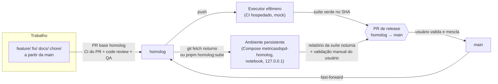

# Plano técnico: ambiente de homologação e branch `homolog`

- Data: 2026-10-12 · Autor: `software-architect` · Estado: **vigente**, com as decisões do usuário de 2026-10-12 ([alinhamento](../../alinhamentos/2026-10-12-homologacao.md)), que prevalecem sobre o texto abaixo
- Decisão estrutural: [ADR 0018](../adr/0018-ambiente-de-homologacao.md) (vigente)
- Pedido do usuário: "montar um ambiente e uma branch para homologação; sempre vamos subir para homolog, rodar mais testes, e só depois vai para a `main`".
- Sem interface nova de produto: não há especificação de UX. A única peça visível é a faixa "Homologação · <sha>" (§7), que o `ux-designer` revisa.

> **Decisões que superam trechos deste plano** (fonte: alinhamento e `docs/engineering/fluxo-homologacao.md`): (1) vale `feature/*` → `develop` → `homolog` → `main`, e não PR direto para `homolog` (S3 e §2); (2) `homolog` não avança por fast-forward da `main`; a ressincronização é por PR de merge, uma vez por release; (3) sem agendador do Windows (H-5): portão e rodada noturna rodam na CI hospedada, e o ambiente local sobe sob demanda; (4) `perf` e Lighthouse rodam no PR para `homolog` e no portão, além do PR para a `main`; (5) a evidência para a `main` são as execuções do `homolog.yml` lidas pelo check `homolog-aprovada`.

## 1. Requisitos e suposições

**Funcionais**
- RF1. Uma branch `homolog` pela qual toda mudança passa antes da `main`.
- RF2. Um ambiente implantado a partir de `homolog`, que o usuário pode abrir e validar à mão.
- RF3. Testes que hoje não rodam no PR rodam contra esse ambiente, e o resultado é a evidência do PR de release `homolog` → `main`.

**Não funcionais (restrições já decididas)**
- Custo zero; sem hospedagem; notebook WSL com 8 GB e o teto de recursos do Jarvis (`.claude/agents/jarvis.md`, "Teto de recursos"); homologação pesada de madrugada.
- Tem de funcionar igual no Git corporativo (migração prevista para terça).
- D-1: tudo em `127.0.0.1` até o SSO. D-2: webhook desligado. Dados mockados por enquanto.

**Suposições (confirmar no §10)**
- S1. O repositório no GitHub tem Actions disponível até a migração; o Git corporativo terá algum CI, mas não sabemos se com runners hospedados.
- S2. O notebook pode ficar ligado na tomada de madrugada, sem suspender.
- S3. A `develop` deixa de ser a branch de integração: as branches de trabalho saem da `main` e têm PR para `homolog`.
- S4. A SPA ainda lê o mock no navegador (`web/src/data/FonteMetricas.ts:13`: a `HttpFonteMetricas` não existe). Até ela existir, o E2E contra o ambiente testa a SPA servida pelo nginx e a API por HTTP, separadamente.

## 2. Fluxo de branches e ambientes

| Ambiente | Onde | Dados | Para quê |
|---|---|---|---|
| dev | Compose `metricasdspd` (5432, 3000, 8080) + `pnpm dev` | seed mock | desenvolvimento |
| CI do PR | GitHub Actions, efêmero | mock, schemas prefixados | portão do PR (inalterado) |
| homolog efêmero | CI hospedado, `push` em `homolog` | seed mock | portão automático da release |
| homolog persistente | Compose `metricasdspd-homolog` no notebook (18080, 13000, 15432, só loopback) | seed mock; real só após §5 | validação do usuário e suíte noturna |
| produção | não existe (ADR 0013/0014: nuvem adiada) | — | — |

**Regras da branch** (o `tech-lead` registra em `praticas.md` §9):
- Branch de trabalho nasce da `main` (não da `homolog`), para que uma feature rejeitada não arraste outras.
- PR com base `homolog`; o portão de review e QA não muda. Merge em `homolog` com `--no-ff` (H-1 decide quem faz).
- PR de release `homolog` → `main` só com a suíte verde **no SHA da ponta**. Commits posteriores que tocam só `docs/**` não invalidam a execução (o script compara o diff).
- Após o merge na `main`, `homolog` avança por fast-forward até a `main`. Antes de cada implantação o script confere que `main` é ancestral de `homolog`; se não for, aborta ("homolog atrás da main").
- Feature reprovada em homologação: `git revert -m 1 <merge>` na `homolog`; nunca reescrever.
- Hotfix: mesmo caminho, com a suíte em modo `--rapida` (H-3).

## 3. Onde o ambiente roda

**Recomendação: executor efêmero no CI hospedado (portão automático) + ambiente persistente local (validação e noturno), ambos chamando os mesmos scripts.** Alternativas e porquês na ADR 0018.

| Opção | Custo | Memória do notebook | Funciona no Git corporativo | Dado real | Veredito |
|---|---|---|---|---|---|
| Compose `homolog` local, loopback | zero | ~0,7 GB de pé; picos na suíte | igual (só scripts) | sim (local) | **adotar** (persistente) |
| Job efêmero em runner hospedado | zero (público; cota em privado) | nenhuma | depende de runner hospedado (H-6) | **nunca** | **adotar** enquanto houver CI |
| Runner self-hosted no notebook | zero | serviço sempre de pé | sim | sim | rejeitar agora (executa código do repo com acesso ao `.env` e ao Docker) |
| GitHub Environments + deploy | zero (público) | — | não | — | sem alvo para implantar; só rótulo |
| Codespaces | cota gratuita | nenhuma | não | não | rejeitar (não persistente) |
| Hospedagem gratuita | zero | nenhuma | sim | não (LGPD) | rejeitar (viola D-1) |

## 4. Implantação

### 4.1 Peças novas (esqueleto, implementação do `node-backend`)
- `docker-compose.homolog.yml` (sobreposição ao `docker-compose.yml`, sem duplicar serviços):
  - `image: metricasdspd-server:${HOMOLOG_SHA}` e `metricasdspd-web:${HOMOLOG_SHA}` (tag = SHA; mantém as 3 últimas para voltar);
  - portas `127.0.0.1:${PG_PORT:-15432}`, `${API_PORT:-13000}`, `${WEB_PORT:-18080}`;
  - senhas **obrigatórias** (`${DSPD_PWD_API:?defina no .env.homolog}` etc.): nenhum padrão `*_dev` vale aqui;
  - `WEBHOOK_BM_SEGREDO: ""` fixo (D-2), `LOG_LEVEL: info`;
  - `deploy.resources.limits.memory` por serviço (postgres 512 MB, api 384 MB, worker 256 MB, web 64 MB) para que a homologação nunca derrube o notebook;
  - `restart: "no"`: o ambiente não volta sozinho quando o WSL reinicia.
- `.env.homolog` (fora do git: o `.gitignore` já cobre `.env.*`), `.env.homolog.example` versionado sem valores.
- `scripts/homolog/` + `package.json`:

| Comando | Faz |
|---|---|
| `homolog:subir [sha]` | pré-checagem de recursos → `git fetch` → confere `main` ⊂ `homolog` → `git archive origin/homolog` para `~/.metricasdspd/homolog/src/<sha>` → build das imagens com tag do SHA → **backup pré-implantação** → `up -d --wait` (o serviço `migrate` aplica as migrações novas sobre o banco existente) → seed (idempotente) → smoke `/health/ready` + 1 página → grava `estado.json` |
| `homolog:suite [--efemero] [--rapida] [--etapa X]` | roda as etapas do §6, uma pesada por vez, e grava `relatorios/<sha>/resumo.md` |
| `homolog:noite` | se `origin/homolog` mudou desde o último SHA verde: `subir` + `suite`; se não, só `backup` + etapa de restauração; ao fim, `stop` (não `down`) |
| `homolog:abrir` / `homolog:parar` | `start`/`stop` dos contêineres já construídos (segundos, sem build) |
| `homolog:status` | SHA implantado, data, resultado por etapa, idade do último backup, contêineres de pé |
| `homolog:voltar <sha>` | restaura o backup tirado antes de `<sha>` e sobe as imagens daquele SHA (rollback de migração rejeitada) |
| `homolog:resetar` | `down -v` + implantação do estado da `main` + seed (só com confirmação interativa) |

### 4.2 Gatilhos
- **CI hospedado:** `.github/workflows/homolog.yml`, `on: push: branches: [homolog]` e `workflow_dispatch`, `permissions: contents: read`, `concurrency` sem cancelar a execução em curso, timeout 60 min; um job que roda `pnpm homolog:suite --efemero` (senhas geradas por execução, nada de segredo do repositório) e publica `relatorios/` como artefato por 14 dias. O status do job no SHA é a evidência do PR de release.
- **Local:** agendador do Windows (`wsl.exe -d <distro> -- bash -lc 'cd ~/MetricasDSPD && pnpm homolog:noite'`) às 01:30, com "acordar o computador" e "só na tomada". Alternativa: `systemd` timer no WSL, se o systemd estiver ligado no `wsl.conf` (H-5).
- **Sob demanda:** `pnpm homolog:subir` quando o usuário quiser ver uma mudança de dia; respeita a pré-checagem.

Não há "deploy automático ao mesclar" no notebook: o remoto não alcança a máquina (e não deve, D-1). O efêmero é automático; o persistente acompanha por polling noturno ou por comando.

### 4.3 Portabilidade para o Git corporativo
Nada da lógica fica no YAML. Na migração: trocar `homolog.yml` pelo arquivo de pipeline da plataforma (GitLab CI, Azure Pipelines, Bitbucket Pipelines: todos com gatilho por branch e artefato), recriar a branch `homolog` protegida e a regra "PR para `main` só a partir de `homolog`" se a plataforma permitir. Sem runner hospedado lá, o executor local passa a ser o portão (o PR de release anexa o `resumo.md`). Com runner corporativo na rede interna, ele vira o candidato natural para o executor com dado real (ADR 0010, I-9).

## 5. Dados

| Fase | Fonte | Regra |
|---|---|---|
| Agora | `pnpm db:seed` sobre o banco de homologação: `gerarBaseMock` com semente e data âncora fixas (as do CI e do gate de hash) | determinístico; o seed nunca apaga nem sobrescreve, então reaplicar é seguro; a etapa "paridade" compara o hash da base mock |
| Volume | o mesmo gerador com fator de escala (ex.: 2 anos, 10× cards) num **database separado** `metricas_volume` do Postgres de homologação, criado e destruído pela etapa | nenhuma regra nova no seed (só parâmetro de tamanho); não contamina o banco que o usuário valida |
| Real (futuro) | coleta real somente leitura pelo `worker` de homologação, com credenciais próprias em `.env.homolog` (conta de serviço só leitura, I-8) | só depois de D-5 (retenção e eliminação), I-13 e decisão do usuário (H-7); só no executor local; nunca no CI hospedado; backups com dado real cifrados e com retenção definida |

O selo de frescor vai mostrar "desatualizado" com o mock (data âncora fixa): esperado e documentado no `resumo.md`. Mudar a âncora para a data da implantação quebraria a determinação.

## 6. Suíte de homologação (o que roda a mais)

Todas as etapas rodam **contra a pilha implantada** (nginx → API → PostgreSQL com os papéis reais), não contra `vite preview` nem `app.inject()`. No executor local, uma etapa pesada por vez, com a pré-checagem entre elas.

| # | Etapa | O que prova | Bloqueia a release | Custo no notebook |
|---|---|---|---|---|
| H1 | **Migração a partir da `main`** | no efêmero: sobe a imagem da `main`, migra e semeia; troca para a de `homolog`, migra. Confere `checksums.json`, snapshot de esquema, grants (`dspd_api` sem coluna de pessoa), contagens e hash das tabelas append-only iguais antes e depois, e `down` → `up` só das migrações novas. No persistente, a própria implantação faz isso sobre o banco que viveu as releases anteriores | sim | leve |
| H2 | **Smoke do ambiente** | `/health/live` e `/health/ready`, nginx serve a SPA, proxy `/api` responde, portas só em `127.0.0.1` (`ss -ltn`), webhook responde 404/desligado, cabeçalhos do nginx (quando a S-25 existir) | sim | leve |
| H3 | **Contrato da API sobre o seed** | cada `GET /api/v1/metricas/:id` do catálogo responde 200 e valida no schema de `contratos`; regra dos 20 itens; nenhum campo de pessoa; **paridade mock × API** (mesmo resultado que a biblioteca calcula sobre a base mock, D15) | sim | leve |
| H4 | **E2E completo contra o ambiente** | Playwright com `E2E_BASE_URL=http://127.0.0.1:18080` (sem `webServer`), todos os projetos e navegadores, axe. Enquanto a SPA ler o mock (S4), cobre a SPA servida pelo nginx; com a `HttpFonteMetricas`, cobre o caminho real tela → API → banco | sim | **pesado** (1 worker local) |
| H5 | **Testes de banco** | `test:pg` contra o Postgres de homologação (database `metricas_test` dele), com o mesmo init e papéis do ambiente | sim | médio |
| H6 | **Performance** | Lighthouse (F10) e projeto `perf` (F1–F5) contra o nginx; A1–A3 (p95 da API, ADR 0003) com carga leve | F10 e A1 sim; o resto alerta | **pesado** |
| H7 | **Carga de volume** | seed em escala em `metricas_volume`; mede tempo de seed e migração, M1 (consultas de painel p95, 2 anos), memória dos contêineres (`docker stats`), tamanho do banco | M1 sim | **pesado**, só no noturno local e no efêmero |
| H8 | **Backup e restauração** | `pg_dump -Fc` como `dspd_migrador` → `pg_restore` num database `metricas_restauro` → mesmas contagens por tabela, mesmo hash das append-only, grants restaurados, e a API sobe apontada para ele | sim | médio |

Modo `--rapida` (hotfix, H-3): H1, H2, H3, H8. Mudança só em `docs/**`: nenhuma etapa (o script registra "sem código").

Percentis da medição de performance usam a função da biblioteca compartilhada (`packages/metricas`), para não criar um segundo cálculo de percentil no repositório.

**Mudanças no CI do PR:** o job `perf` hoje roda em PR para a `main`; passa a rodar em `push` para `homolog` (dentro da suíte) e no agendamento. O resto do CI do PR não muda.

## 7. Observabilidade e frescor
- `estado.json` e `relatorios/<sha>/resumo.md` em `~/.metricasdspd/homolog/` (fora do repositório): SHA, horário, duração e resultado por etapa, números de performance, idade do backup. `homolog:status` lê daqui.
- Logs: `docker compose logs --no-color` de cada execução salvos em `relatorios/<sha>/logs/` (JSON do Pino, já com redação); 14 dias de retenção, apagados pelo próprio script.
- Saúde: os healthchecks do Compose; o smoke H2 roda também no início de cada `homolog:abrir`.
- Identificação na tela: build da web com `VITE_AMBIENTE=homolog` e `VITE_VERSAO=<sha curto>`, faixa discreta "Homologação · <sha>" (não é segredo; `VITE_*` é público). Evita confundir homologação com dev quando os dois estão abertos.
- Frescor dos dados: com mock, a data âncora é fixa (§5). Com dado real, o selo de `/dados` e o `ctl_coleta` mostram a última coleta; a suíte noturna falha a etapa H2 se não houver coleta com sucesso há mais de 26 h (mesmo critério da ADR 0010).
- Alerta: sem canal (I-7). Por ora, o resultado do noturno aparece no `homolog:status` e no resumo; o Jarvis o lê ao abrir a sessão.

## 8. Segurança (skill `cyber-security`)
- **Exposição:** todas as portas em `127.0.0.1` (D-1); nenhuma porta nova fora do loopback; webhook fixo em desligado (D-2). Ninguém além do usuário acessa a homologação até o SSO.
- **Segredos separados:** `.env.homolog` próprio (permissão 600), senhas diferentes das de dev, sem padrão `*_dev` (o Compose recusa subir sem elas). O executor efêmero gera senhas aleatórias por execução e não usa segredo do repositório. Credenciais reais (BusinessMap, Metabase) só em `.env.homolog` e só na fase real.
- **Integridade do que é implantado:** snapshot de `origin/homolog` por `git archive` (nem a árvore de trabalho, nem uma worktree editável); tag da imagem = SHA.
- **CI:** `homolog.yml` com `permissions: contents: read`, só gatilhos `push` em `homolog` e `workflow_dispatch` (nada de `pull_request_target`), ações de terceiros por SHA (S-27). Nenhum runner self-hosted.
- **Governança:** a `homolog` não aceita force push; com a S-31, `permissions.deny` continua negando `gh pr merge` aos agentes (por isso o merge do tech-lead, se H-1 o permitir, é local + `git push origin homolog`; o GitHub marca o PR como mesclado). O hook `pre-push` ganha a checagem "push para `homolog` só fast-forward". Ruleset de branch depende de D-4.
- **LGPD:** com mock não há dado pessoal. Com dado real: backups de homologação contêm nomes (staging), então cifrar (`age` ou `gpg` com chave fora do repositório), reter no máximo N dias (H-7) e nunca levar ao CI hospedado nem anexar a PR. Relatórios e logs nunca incluem payload.
- Achados novos para `docs/security/revisao-de-seguranca.md`: nenhum de severidade; registrar o ambiente como fronteira nova (mesma máquina, mesmas premissas) quando o cartão HM-01 entrar.

## 9. Recursos e agenda

| Item | Estimativa | Observação |
|---|---|---|
| Ambiente de pé, ocioso | ~0,6–0,8 GB | parado (`stop`) fora do uso; volume em disco |
| Build das imagens | pico ~1,5–2 GB, 3–6 min | só quando o SHA muda |
| H4 E2E local | ~1,5 GB, 1 worker | nunca junto com outra etapa pesada |
| H6/H7 | ~1–1,5 GB cada | só no noturno local ou no efêmero |
| Disco | imagens de 3 SHAs + volume + backups de 7 dias: ~3–5 GB | o script poda o excedente |
| Noturno completo | ~40–70 min | 01:30, termina antes das 03:00 |

Pré-checagem embutida no script (o teto do Jarvis vira código): aborta se load average > 8 ou memória disponível < 1,5 GB, ou se a pilha de dev estiver de pé durante uma etapa pesada (no noturno, ela pede para parar ou adia 30 min, até 2 vezes, e registra "adiado"). Durante o dia, só `homolog:subir`, `abrir`, `parar` e `status` (leves), uma de cada vez com o resto do time.

## 10. Perguntas que só o usuário responde
- **H-1 Quem mescla em `homolog`?** (a) o `tech-lead`, depois de review e QA aprovados (merge local + push; o usuário só mescla na `main`); (b) o usuário, nas duas etapas. Recomendação: (a).
- **H-2 Mudança só de documentação também passa por `homolog`?** (a) sim, sempre (a suíte reconhece e pula as etapas); (b) PR de docs direto para a `main`. Recomendação: (a), que é o "sempre" do pedido.
- **H-3 Hotfix:** passa por `homolog` com a suíte rápida (H1, H2, H3, H8, ~10 min, pode rodar de dia) ou espera a noturna? Recomendação: suíte rápida.
- **H-4 Cadência da release `homolog` → `main`:** a cada feature verde, ou em lote (ex.: semanal)? Define quantas features convivem na `homolog` e o custo de reverter uma.
- **H-5 O notebook fica ligado e na tomada de madrugada?** Se não, a suíte local roda quando o usuário pedir e o executor efêmero vira o único automático. E o WSL tem `systemd` ligado (para o agendador) ou usamos o agendador do Windows?
- **H-6 Git corporativo:** qual plataforma (GitLab, Azure DevOps, Bitbucket, outra)? Tem runners hospedados ou compartilhados? O repositório será privado? Isso decide se o executor efêmero continua existindo.
- **H-7 Dado real em homologação (I-13):** quando houver integração, homologação usa coleta real somente leitura na máquina do usuário? Por quanto tempo se guardam backups com nomes? Depende de D-5 e do DPO (I-12).
- **H-8 Validação manual:** o usuário quer homologar à mão cada release (abrir 18080 e aprovar no PR) ou a suíte verde basta para abrir o PR de release?

## 11. Riscos

| Risco | Prob. × impacto | Mitigação |
|---|---|---|
| Noturno não roda (notebook dormindo, WSL fechado) | média × médio | executor efêmero; `homolog:status` mostra a idade do último verde; PR de release exige verde no SHA |
| Noturno esgota memória e trava a máquina | baixa × alto | limites de memória no Compose, pré-checagem, uma etapa pesada por vez, `stop` ao final |
| `homolog` diverge da `main` | média × médio | verificação de ancestralidade no script e no PR de release; fast-forward após cada merge na `main` |
| Migração aplicada em homologação e depois rejeitada | média × médio | backup pré-implantação + `homolog:voltar`; migração aplicada em `homolog` nunca é editada, a correção é migração nova (o `checksums.json` já impõe) |
| Feature ruim bloqueia a release em lote | média × baixo | `revert -m 1` na `homolog`; cadência menor (H-4) |
| SPA ainda no mock: E2E "contra o ambiente" não passa pela API | certa × médio | H3 cobre a API por HTTP; cartão da `HttpFonteMetricas` (fora deste plano, é do WS3) fecha o caminho |
| Git corporativo sem runner hospedado | média × médio | lógica em scripts; executor local vira portão |
| Divergência efêmero × local (Docker, kernel) | baixa × baixo | mesmas imagens por SHA, mesmos scripts; falha só num lado é investigada como bug do ambiente |
| Dado real vazar via backup ou relatório | baixa × alto | §8: só local, cifrado, retenção, nada de payload em relatório |

## 12. Cartões

| Cartão | Escopo | Dono | Esf. | Depende de | Paralelo com |
|---|---|---|---|---|---|
| **HM-00** Decisões | levar H-1 a H-8 ao usuário; aceitar a ADR 0018 | `jarvis` | P | — | — |
| **HM-01** Branch e regras | criar `homolog` a partir da `main`; `praticas.md` §9 e §10 (fluxo, release, fast-forward, revert); `pre-push` com "homolog só fast-forward"; modelo de PR de release; CLAUDE.md "Fluxo de uma demanda" (via usuário) | `tech-lead` | P | HM-00 (H-1, H-2, H-4) | HM-02 |
| **HM-02** Compose de homologação | `docker-compose.homolog.yml`, `.env.homolog.example`, limites de memória, senhas obrigatórias, tags por SHA; teste de config (portas só loopback, webhook desligado) | `node-backend` | P | — | HM-01, HM-04 |
| **HM-03** Scripts `homolog:*` | `subir`, `abrir`, `parar`, `status`, `voltar`, `resetar`, `noite`; `git archive`; pré-checagem de recursos; backup pré-implantação; `estado.json` e resumo; poda de imagens, logs e backups | `node-backend` | M | HM-02 | HM-04 |
| **HM-04** Etapas H1, H3, H5, H8 | migração a partir da `main` (efêmero) com contagens e hash; contrato e paridade mock × API por HTTP; `test:pg` contra homologação; backup e restauração com verificação | `node-backend` + `qa-engineer` | M | HM-02 | HM-05 |
| **HM-05** Etapas H2, H4, H6 | Playwright com `E2E_BASE_URL` (sem `webServer` quando definido), smoke do ambiente, Lighthouse e `perf` contra o nginx; medição A1–A3 com o percentil da biblioteca | `qa-engineer` | M | HM-03 | HM-04 |
| **HM-06** Carga de volume H7 | parâmetro de escala no gerador (sem regra nova), database `metricas_volume`, M1 e memória | `node-backend` + `qa-engineer` | M | HM-04 | — |
| **HM-07** Workflow efêmero | `homolog.yml` (push em `homolog`, permissões mínimas, artefato); `perf` sai do PR para a `main` | `tech-lead` | P | HM-03, HM-05 | — |
| **HM-08** Agendamento noturno | tarefa do Windows (ou timer systemd) + roteiro de instalação em `docs/engineering/` | `tech-lead` (o usuário instala) | P | HM-03, H-5 | HM-07 |
| **HM-09** Faixa de ambiente | `VITE_AMBIENTE`/`VITE_VERSAO` e faixa "Homologação · <sha>"; revisão do `ux-designer` | `react-frontend` | P | — | qualquer |
| **HM-10** Portabilidade | pipeline equivalente no Git corporativo e regra de branch | `tech-lead` | P | H-6, migração | — |
| **HM-11** Fase de dado real | credenciais só leitura em `.env.homolog`, backup cifrado e retenção, registro em `docs/security/` | `software-architect` + `node-backend` | M | D-5, I-13, H-7, integração real | — |

Ordem: HM-00 → (HM-01 ∥ HM-02 ∥ HM-09) → HM-03 → (HM-04 ∥ HM-05, respeitando "pesado um de cada vez" na execução, não no desenvolvimento) → HM-06, HM-07, HM-08 → HM-10 na migração → HM-11 com a integração real. Todo cartão de código passa por code review e QA, como qualquer outro. Mínimo útil para o usuário já ter homologação: HM-01, HM-02, HM-03 e as etapas H1, H2, H3, H8 (HM-04 parcial).
