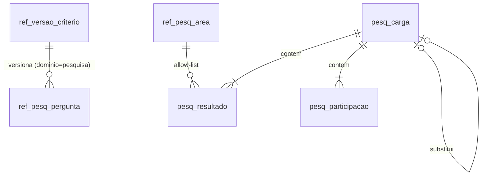

# Plano técnico: lacuna de valor na sustentação (K-036, PV1, dados mockados)

UX: `docs/ux/lacuna-de-valor/02-definicao.md`, `03-ideacao.md` (alternativa C2 + D1), protótipos `docs/ux/figma/prototipos/lacuna-valor-{1280,375}.html`.
Decisões: `docs/alinhamentos/2026-10-11-decisoes-delegadas-ao-time.md`, decisões 22 a 31 (D-1 a D-10).
Padrão seguido: `docs/architecture/features/metricas-complementares.md` (contratos → biblioteca + mock → server; o front começa depois dos contratos).
Briefing: lacuna conhecida da sustentação (seção de sustentação, "não especificada neste briefing"); regras 4.2 (mínimo de 20), 7.1 (proibidas), T2.6 (mudança de critério).

## 0. Resumo e decisões técnicas deste plano

Pesquisa trimestral de percepção com os gestores das áreas atendidas. Ela roda fora do app, e o app recebe só contagens agregadas por trimestre, área, pergunta e faixa. O resultado aparece numa seção própria no fim do painel Sustentação, lida ao lado de S1/S2, com a fonte "Pesquisa de percepção". Nesta entrega os dados são mockados, mas a tabela e o script de carga já ficam prontos para os dados reais.

| # | Decisão | Por quê |
|---|---|---|
| A1 | Id de métrica **`PV1`** ("Percepção de valor"), cartão `pv1`; não `S13` | É uma terceira fonte. Vários testes e ferramentas decidem a fonte pelo prefixo `S` (`server/tests/base-duble.ts:14`, `web/src/features/exportar/modelo.test.ts:46`, `packages/metricas/src/regras.test.ts:88`, `packages/metricas/src/complementares.test.ts:63`). Com `S13`, a métrica seria tratada como Acelerato sem nenhum erro aparecer. |
| A2 | Nova fonte `'pesquisa'` **ao lado** de `Dominio`, sem alargar esse tipo: `type FonteMetrica = Dominio \| 'pesquisa'` e `METRICAS_PESQUISA = ['PV1']` | `Dominio` tipa `Amostra`, percentis e calibração. A pesquisa não tem tempo nem percentil e não pode entrar em amostra de BM/AC. Assim o compilador barra qualquer mistura. |
| A3 | Função única `fonteDaMetrica(id): FonteMetrica \| 'ambos'` em `contratos`, que substitui os testes binários `METRICAS_SUSTENTACAO.includes(id)` que decidem filtro ou fonte | Hoje há cerca de 15 pontos com "é sustentação? senão é fluxo" (lista em 6). PV1 cairia em "fluxo" em todos eles. |
| A4 | PV1 **não** entra em `METRICAS_SUSTENTACAO` | Essa lista quer dizer "Acelerato" para o server (`servico.ts:42`) e para a calibração. O painel é Sustentação, mas a fonte não é o Acelerato (D-8). |
| A5 | Filtros de PV1: `Record<string, never>`, como a `VISAO_GERAL`. Aceita só `dataReferencia` | Equipe, prioridade e período não se aplicam (regra 4 da ideação). O resultado já traz os 4 últimos trimestres. |
| A6 | Toda regra de anonimato e de mínimo fica **na biblioteca**. O schema zod do resultado torna impossível enviar faixa abaixo do mínimo | O payload nunca carrega número que a regra proíbe (pergunta 4 da ideação). A UI não decide nada. |
| A7 | Carga por **script externo** (`tools/pesquisa`), com papel de banco próprio `dspd_pesquisa` (só `INSERT` nas tabelas `pesq_`). **Nenhuma rota de escrita na API** | D-10/decisão 31. A API não tem autenticação (S M-1). |
| A8 | Área validada contra **lista fechada** (`ref_pesq_area`), e não como texto livre | Com allow-list não há como um nome de pessoa chegar à base pela coluna `area`. As outras colunas são numéricas. |
| A9 | Mudança de questionário = nova `ref_versao_criterio` com `dominio = 'pesquisa'` e `afeta = ['PV1']`, marcada pela função existente `criteriosDe` | Reaproveita o mecanismo T2.6 que já existe. Não cria um segundo. |
| A10 | Supressão complementar em "Outras áreas" (ver 3.3) | Sem ela, consolidado menos as áreas publicadas revelaria um grupo de 1 ou 2 respondentes. É uma consequência técnica da D-3 e só torna a regra mais restritiva. |

## 1. Módulos afetados

| Camada | Arquivos (novos em negrito) |
|---|---|
| contratos | `comum.ts` (id `PV1`, `FonteMetrica`, `MINIMOS_PESQUISA`, `FAIXAS_ESCALA`), `metricas.ts` (`ContratoMetricas.PV1`, `METRICAS_PESQUISA`, `fonteDaMetrica`), `schemas.ts`/`validacao.ts` (`resultadoPV1`), `cartoes.ts` (cartão `pv1`, `leiaJunto` S1/S2 ↔ pv1), **`pesquisa.ts`** (schema da linha agregada, compartilhado entre o mock e o script) |
| metricas | **`pesquisa/modelo.ts`** (`BasePesquisa`, `ContextoPesquisa`), **`pesquisa/pv1.ts`**, **`pesquisa/anonimato.ts`**, `calcular.ts` (`ctx.pesq`), `core/regras.ts` (linha PV1) |
| mock | **`pesquisa.ts`** (`gerarPesquisaMock(config)`), testes de hash e determinismo |
| server | `modulos/metricas/servico.ts` (fonte `pesquisa`), `rotas.ts` (`queryPesquisaSchema`), **`repositorio-pesquisa.ts`**, `plataforma/db/grants.ts` (papel `dspd_pesquisa`), **`migrations/0013_core_pesquisa.ts`**, `app.ts` (`deps.pesquisa`, mock por padrão), `docs/api/` |
| tools | **`tools/pesquisa/`** (CLI `carregar`, validador puro e testes) |
| web | `features/sustentacao/SustentacaoPage.tsx` (seção no fim), **`features/percepcao/`** (cartão, distribuição, tendência, "O que mudou", estados), `data/mock/MockFonteMetricas.ts` (contexto `pesq` sob demanda), `content/catalogo-metricas.ts`, página `/metricas` |
| docs | `docs/architecture/data-model.md`, `docs/api/`, `docs/security/revisao-de-seguranca.md` (no review), roteiro de carga para a coordenação |

## 2. Modelo de dados

### 2.1 Entidades (schema `dspd_core`, prefixo `pesq_` para dados e `ref_pesq_` para referência)

Ficam fora de `dspd_bm` e `dspd_ac`: nenhuma tabela do BusinessMap ou do Acelerato é tocada (pergunta 1 da ideação). Nenhuma coluna guarda respondente, analista, comentário ou texto livre de respondente.



| Tabela | Colunas | Chave / integridade |
|---|---|---|
| `ref_pesq_pergunta` (ref, `ref:sync`) | `versao_id` (FK `ref_versao_criterio`), `codigo` (`resolve`, `prazo`, `informado`, `nao_volta`, `confianca`), `ordem` smallint, `texto` varchar(200), `vigente_de` date, `vigente_ate` date null | PK (`versao_id`, `codigo`). Escala fixa de 5 pontos (rótulos em `FAIXAS_ESCALA`, contratos). Trocar texto ou escala exige nova versão (decisão 22). |
| `ref_pesq_area` (ref, `ref:sync`) | `codigo` varchar(40), `rotulo` varchar(80), `vigente_de`, `vigente_ate` | PK (`codigo`, `vigente_de`). É uma lista fechada de áreas atendidas (unidade organizacional, nunca pessoa). Ver dúvida U1. |
| `pesq_carga` | `carga_id` identity, `trimestre` char(7) (`2026-T3`, CHECK por regex), `versao_id` (questionário vigente), `recebida_em` timestamptz, `arquivo_sha256` char(64), `linhas` int, `substitui_carga_id` null (FK), `o_que_mudou` varchar(500) null | Append-only (gatilho `proibir_alteracao`). A carga vigente de um trimestre é a de maior `carga_id`. Reenvio cria uma nova carga e a anterior fica guardada (nunca sobrescrever). |
| `pesq_resultado` | `carga_id`, `area_codigo`, `pergunta_codigo`, `faixa` smallint 1..5, `contagem` int >= 0 | PK (`carga_id`, `area_codigo`, `pergunta_codigo`, `faixa`). Append-only. |
| `pesq_participacao` | `carga_id`, `area_codigo`, `convidados` int, `respondentes` int | PK (`carga_id`, `area_codigo`), CHECK `respondentes <= convidados`. Append-only. Por invariante (validada no script e em teste), `respondentes` = soma das faixas de cada pergunta da área. |
| `vw_pesq_vigente` (view, `security_invoker`) | carga vigente por trimestre | Usada pela API. |

Migração: `0013_core_pesquisa.ts` (expandir; down remove só as tabelas novas). A mesma migração estende o `ENUM('dominio')` de `ref_versao_criterio` com `'pesquisa'` e adiciona os índices `pesq_carga (trimestre, carga_id DESC)` e `pesq_resultado (carga_id)`.

### 2.2 Papéis e GRANTs (`grants.ts`)

- `dspd_pesquisa` (novo em `PAPEIS`): `USAGE` em `dspd_core`, `SELECT, INSERT` em `pesq_*`, `SELECT` em `ref_pesq_*` e `ref_versao_criterio*`. Sem `UPDATE` e sem `DELETE`. Credencial só no `.env` (`DSPD_PWD_PESQUISA`), com variável nova no `.env.example` sem valor.
- `dspd_api`: `SELECT` em `pesq_*`, `vw_pesq_vigente` e `ref_pesq_*`. Nenhuma dessas tabelas tem coluna de pessoa, então `COLUNAS_PESSOA` não muda.
- `dspd_ref`: `SELECT, INSERT` e `UPDATE (vigente_ate)` em `ref_pesq_*` (regra geral de `ref_` no core, já existente).
- Teste em `papeis.pg.test.ts`: `dspd_pesquisa` não faz `UPDATE`/`DELETE` em `pesq_*` nem lê `dspd_bm`/`dspd_ac`; `dspd_api` não faz `INSERT` em `pesq_*`.

### 2.3 LGPD
Não há dado pessoal: as contagens não têm identificador, a área vem de lista fechada e não se importa comentário (decisão 25). O único texto livre é o `o_que_mudou`, escrito pela coordenação (decisão 28), nunca pelo respondente. Ver o risco R3.

## 3. Contrato da métrica PV1

### 3.1 Parâmetros (em `contratos/comum.ts`, alteráveis só com nova versão de critério T2.6)
```ts
export const MINIMOS_PESQUISA = { consolidado: 5, area: 3, porAreaDesdeCiclo: 2 } as const // decisões 24 e 30
export const FAIXAS_ESCALA = ['Discordo totalmente', 'Discordo', 'Neutro', 'Concordo', 'Concordo totalmente'] as const
// MINIMO_AMOSTRA (20) continua a regra de percentual: abaixo de 20, só "k de n" (decisão 24, regra inviolável).
```

### 3.2 Resultado (esqueleto; o detalhe final é do `node-backend`)
```ts
type Bloco =
  | { status: 'base-insuficiente'; n: number; minimo: 5 | 3 }               // sem faixas
  | { status: 'publicado'; n: number;                                        // n >= minimo (z.min no schema)
      perguntas: { codigo: string; faixas: { faixa: 1|2|3|4|5; contagem: Taxa }[] }[] }
      // contagem = taxa(k, n) de core/estatistica: n < 20 → 'insuficiente' (só k de n); n >= 20 → pct

type ResultadoPV1 =
  | { status: 'sem-pesquisa'; fonte: 'pesquisa' }
  | { status: 'ok'; fonte: 'pesquisa';
      trimestre: string                         // vigente mais recente até a dataReferencia ('2026-T3')
      ciclo: number                             // ordinal entre os trimestres carregados
      questionario: { versaoId: string; vigenteDesde: string; perguntas: { codigo: string; ordem: number; texto: string }[] }
      participacao: { respondentes: number; convidados: number; taxa: Taxa } // sem meta (decisão 26)
      consolidado: Bloco
      porArea:
        | { status: 'nao-publicado'; motivo: 'primeiro-ciclo' | 'base-insuficiente' }
        | { status: 'publicado'; areas: { rotulo: string; outras: boolean; bloco: Extract<Bloco, { status: 'publicado' }> }[] } // alfabética; "Outras áreas" por último
      tendencia: { trimestre: string; versaoId: string; bloco:              // até 4 trimestres
        | { status: 'base-insuficiente'; n: number; minimo: 5 }
        | { status: 'publicado'; n: number; concordam: { codigo: string; contagem: Taxa }[] } }[] // faixas 4+5 (ver U3)
      oQueMudou: { trimestre: string; texto: string } | null                 // texto do ciclo vigente
      criterios: CriteriosResultado                                         // marcações T2.6 na série da tendência
      base: BaseAmostral                                                    // { n, unidade: 'respostas', janela: null }
    }
```
O que o contrato proíbe por desenho: média, nota única, meta, semáforo, ranking (a ordem é alfabética e fixa), qualquer campo de pessoa ou de comentário, e percentual com n < 20 (o `taxaSchema` já recusa).

### 3.3 Regras de publicação (`pesquisa/anonimato.ts`, funções puras)
1. **Consolidado:** com `n < 5` o bloco é `base-insuficiente` (só n e mínimo, sem faixas). Com 5 a 19, as faixas vão como contagens "k de n". Com 20 ou mais, vão contagem e percentual.
2. **Por área:** não é publicado no ciclo 1 (`primeiro-ciclo`). Do ciclo 2 em diante, áreas com `n < 3` vão para "Outras áreas".
3. **Supressão complementar:** se `0 < n(Outras) < 3`, a área publicada com menor n (empate: ordem alfabética) também vai para "Outras", e isso se repete até `n(Outras) >= 3` ou `n(Outras) = 0`. Se sobrar menos de 2 grupos publicáveis, o resultado é `porArea = nao-publicado (base-insuficiente)`. A ordem por n é só interna e nunca é exibida.
4. **Tendência:** usa os 4 trimestres vigentes mais recentes até a `dataReferencia`, cada um com o próprio mínimo. Uma troca de `versaoId` entre dois pontos gera marcação em `criterios.serie` (data = `vigente_desde` da versão) e a UI desenha a quebra de série.
5. **Fontes separadas:** o contexto `pesq` não recebe `bm` nem `ac`, e o PV1 não lê S1/S2. "Ao lado de" é só posição na tela.

### 3.4 Biblioteca (T2.5)
`calcularPV1(ctx.pesq)` usa somente `core/estatistica.taxa` (k de n e mínimo de 20), `core/criterios.criteriosDe` (T2.6) e `core/calendario.trimestreDeDia` (corte). Não há tempo nem percentil, e nada é calculado fora da biblioteca: front e server só repassam o resultado. `CALCULOS.PV1 = (_f, c) => PESQ.calcularPV1(c.pesq)`. Sem `ctx.pesq`, o resultado é `sem-pesquisa` (nunca 500). `ContextosMetricas` ganha `pesq?: ContextoPesquisa`, e as outras 50 métricas o ignoram.

`REGRAS_METRICA.PV1`: `dominio: 'pesquisa'` (o tipo passa a `Dominio | 'pesquisa' | 'composicao'`), `segmentacao: ['pergunta', 'area']` (`'pergunta'` é chave nova), `ordem: 'neutra'`, `incluiArquivados: 'nao-se-aplica'`, `minimo: 20`, `minimoSobre: ['faixa', 'taxa']`, `granularidade: 'resposta'` (novo valor de `GranularidadeRegra`), `status: 'ok'`.

## 4. Mock determinístico

`packages/mock/src/pesquisa.ts`: `gerarPesquisaMock(config: ConfigMock): BasePesquisa`. É função pura de `config` (semente e hoje), com stream próprio `derivar(config.semente, 'pesquisa')`. Não recebe nem consome `BaseMock`, então `924448d4` e `b2bfd4c0` não mudam. Tudo é fictício (rótulo "Dados fictícios").

Cenário fixo, pensado para exercitar cada regra (contagens dentro dos trimestres sorteadas pelo PRNG, com os totais fixados):

| Trimestre | n | Exercita |
|---|---|---|
| 2025-T2 | 9 | ciclo 1: só consolidado |
| 2025-T3 | 11 | por área com "Outras áreas" |
| 2025-T4 | 4 | consolidado `base-insuficiente` na tendência |
| 2026-T1 | 14 | supressão complementar (áreas 4,3,3,3,1) |
| 2026-T2 | 19 | fronteira do 20 (só k de n); **reenviado** (carga 1 com n=17 substituída e guardada) |
| 2026-T3 | 24 | percentual no consolidado; áreas 5,4,4,3,3,2,2,1 (Outras = 5) |

- Questionário v1 até 2026-03-31 e v2 a partir de 2026-04-01 (texto da pergunta `informado` ajustado), com a marcação T2.6 caindo dentro da tendência.
- 8 áreas fictícias em `ref_pesq_area` (nomes de unidade, nunca de pessoa). Convidados com taxa de resposta de 60% a 85%. Um texto de "O que mudou" por ciclo, sem nomes.
- Testes: hash fixo de `hashJson(gerarPesquisaMock(config))` em teste próprio, determinismo por semente e invariantes (soma por pergunta = respondentes, respondentes <= convidados).
- Server: `extensoes-mock.ts` ganha a irmã `pesquisa-mock.ts` (memoizada), usada quando `fonteDados !== 'real'`. Web: `MockFonteMetricas` gera o contexto `pesq` só quando PV1 é pedido (como as extensões).

## 5. Carga (script externo, T4.3; sem rota de upload)

`tools/pesquisa`, comando `pnpm --filter @metricas-dspd/pesquisa carregar --trimestre 2026-T3 --arquivo percepcao.csv --o-que-mudou texto.txt [--substituir 2026-T3]`.

- **CSV com allow-list exata de cabeçalho:** `trimestre,area,pergunta,f1,f2,f3,f4,f5,convidados`. Qualquer coluna a mais (como `email` ou `nome`) recusa o arquivo inteiro e a mensagem cita o nome da coluna. Aspas são recusadas e não entra dependência nova de parser.
- **Validações, todas antes de qualquer escrita (validador puro `validarCsv(texto, ref)`, testável sem banco):**
  - trimestre igual ao do argumento;
  - `area` na lista `ref_pesq_area` vigente;
  - `pergunta` no questionário vigente e todas as 5 presentes por área;
  - faixas inteiras >= 0;
  - soma das faixas igual entre as perguntas da área;
  - `convidados` constante por área e >= respondentes;
  - célula com `@` recusada;
  - `o-que-mudou` com até 500 caracteres, sem e-mail nem URL, exibido de volta para confirmação.
- **Escrita** em uma transação com `dspd_pesquisa`: `pesq_carga`, depois `pesq_resultado`, depois `pesq_participacao`. Se o trimestre já existe sem `--substituir <mesmo trimestre>`, a carga para com a mensagem "Substituir a pesquisa de 3T/2026? A versão anterior fica guardada.". Nunca há `UPDATE`/`DELETE`.
- **Log:** só trimestre, `sha256`, número de linhas e o erro (linha, coluna e regra), **sem o conteúdo das células** e sem o arquivo bruto.
- **Roteiro da coordenação:** um passo a passo curto em `docs/` (exportar o agregado da ferramenta corporativa, rodar o comando, conferir o painel).
- **Execução em produção:** o RDS é privado (ADR 0013). O caminho operacional (onde o comando roda com acesso ao banco) é definido junto com o ambiente AWS (P11). Até lá o script roda contra o PG local e de homologação. Isso não bloqueia esta entrega, que é mockada.

## 6. Server e rota

- **Rota:** `GET /api/v1/metricas/PV1` nasce da iteração existente sobre `METRICA_IDS` (`rotas.ts`). `queryDe('PV1')` passa a usar `queryPesquisaSchema` (só `dataReferencia`, estrito). Não há rota nova nem rota de escrita.
- **Serviço:** `dominioDe` passa a usar `fonteDaMetrica`. A fonte `'pesquisa'` tem carga, versão e cache próprios. A versão é o maior `carga_id` mais a versão de critério, e o mock usa versão constante. O corte considera só cargas com `recebida_em <= dataReferencia`. Cache, ETag e cabeçalhos ficam como estão.
- **Repositório real:** lê `vw_pesq_vigente`, `pesq_resultado`, `pesq_participacao`, `ref_pesq_*` e `lerVersoes(db, 'pesquisa')`, com colunas explícitas (o lint proíbe `SELECT *`).
- **Pontos binários a migrar para `fonteDaMetrica`** (senão o PV1 vira "fluxo"):
  - `server/src/modulos/metricas/{rotas,servico}.ts`, `server/tests/{base-duble,metricas.paridade.test,metricas.pg.test}.ts`;
  - `packages/metricas/src/{regras.test,regras.property.test,varredura.test,complementares.test}.ts`, `core/calibracao.ts` (PV1 fora da calibração);
  - `packages/mock/src/{desempenho,sistemico}.test.ts`, `tools/docs-contratos/src/insumos.ts`;
  - `web/src/data/simulacao.ts`, `web/src/data/mock/MockFonteMetricas.test.ts`, `web/src/features/exportar/{modelo,selecao,gerar}.ts` e testes, `web/src/features/dados/MudancasCriterio.tsx` (passa a listar a fonte "Pesquisa de percepção").
- **Fora desta entrega:** exportação (PV1 fica explicitamente fora da seleção, com teste), alertas e Visão geral (sem alerta, regra 6 da ideação).

## 7. Web

- **Cartão:** `pv1` em `CATALOGO_CARTOES`, `secao('sustentacao', 'percepcao', 'Percepção de valor · pesquisa trimestral', [['PV1', 'Percepção de valor do serviço', undefined, ['s1', 's2']]], 'percepcao')`. `grupo` ganha o valor `'percepcao'`, renderizado como seção visível no fim do painel, fora de "Mais métricas". `status: 'mock'` até existir carga real. S1 e S2 ganham `leiaJunto: [..., 'pv1']`. As preferências ocultam e mostram o cartão como qualquer outro.
- **Conteúdo:**
  - rótulo de fonte "Pesquisa de percepção (não é Acelerato)" e "Pesquisa de 3T/2026";
  - participação "k de n convidados", com percentual só com n >= 20 e sem meta;
  - distribuição por pergunta em barras empilhadas com **rótulo numérico em cada faixa** e legenda textual, mais a tabela equivalente para leitor de tela (sem depender de cor);
  - tendência com 4 trimestres e marcação T2.6;
  - bloco "Por área" (alfabético, com "Outras áreas" e o motivo quando não publicado);
  - bloco **"O que mudou por causa da pesquisa"**, em texto puro, sem `dangerouslySetInnerHTML`.
- **Rodapé:** "Não afetado por: equipe, prioridade, período" e a nota "filtros não se aplicam a esta seção".
- **Estados:**
  - `sem-pesquisa`: "Nenhuma pesquisa carregada. A coordenação carrega o resultado do trimestre pelo procedimento de carga." Sem botão de upload.
  - `base-insuficiente`: "Base insuficiente: N respostas. Mínimo M para publicar.", sem faixas (ver U2).
  - abaixo de 20: só "k de n", sem percentual;
  - carregando e erro, no padrão dos cartões;
  - "Dados fictícios".
- **Catálogo:** `content/catalogo-metricas.ts` e `/metricas` ganham PV1, com fonte "Pesquisa de percepção" e granularidade "resposta agregada".
- **Ajuste ao protótipo:** "taxa de resposta 75%" com 9 de 12 viola a regra do 20. A UI mostra só "9 de 12".

## 8. Testes

- **Unitários (lib):**
  - fronteiras 4/5 no consolidado, 2/3 por área e 19/20 (k de n contra percentual);
  - ciclo 1 sem área;
  - supressão complementar (cenário 2026-T1 e o caso "menos de 2 grupos");
  - quebra de série com a versão;
  - reenvio, em que vale a carga mais recente e a anterior não aparece;
  - `sem-pesquisa`.
- **Propriedade (fast-check, `regras.property.test.ts`):**
  - para qualquer base gerada, nenhum bloco publicado tem `n < mínimo`;
  - nenhuma `Taxa` com `pct` e `n < 20`;
  - o n de "Outras áreas" é 0 ou >= 3;
  - consolidado menos a soma das áreas publicadas nunca dá um valor entre 1 e 2;
  - a saída não depende da ordem de entrada;
  - as áreas saem em ordem alfabética, com "Outras" por último;
  - o resultado não tem chave fora do schema (`.strict()`).
- **Mock:** hashes `924448d4` e `b2bfd4c0` intactos, hash próprio da pesquisa e invariantes.
- **Script:**
  - recusa coluna `email`/`nome`, área fora da lista, soma divergente, célula com `@` e trimestre já carregado sem `--substituir`;
  - o log não contém conteúdo de célula;
  - o teste PG prova append-only (o `UPDATE` falha com 55000).
- **Server:**
  - rota PV1 com schema de saída, 304, paridade entre lib e rota, e `dataReferencia` antes de uma carga dando `sem-pesquisa`;
  - os papéis do item 2.2;
  - a resposta não contém chaves de pessoa (varredura existente estendida).
- **E2E (Playwright) e axe:**
  - a seção aparece no fim da Sustentação com fonte, "k de n" e o bloco "O que mudou";
  - "Outras áreas" aparece;
  - a marcação de quebra de série aparece;
  - ocultar o `pv1` nas preferências faz o link "Leia junto" de S1 sumir;
  - axe sem violações nas larguras 1280 e 375;
  - nenhuma requisição de upload existe.

## 9. Riscos

- **R1. Cascata do id novo:** `MetricaId` passa a 51 valores e a terceira fonte quebra suposições binárias (lista em 6). O compilador pega os `satisfies Record<MetricaId, …>`, mas não pega `includes`/`startsWith`. Mitigação: `fonteDaMetrica` e um teste de varredura que exige fonte conhecida para cada id.
- **R2. Reidentificação com poucas áreas:** a mitigação é o mínimo 5/3, o ciclo 1 só consolidado e a supressão complementar (A10). Resta o risco de combinar com conhecimento externo (quem foi convidado). O mínimo é parâmetro e só sobe.
- **R3. Texto "O que mudou":** é o único texto livre e não há como detectar nome de pessoa por máquina. Mitigação: autoria só da coordenação, limite de 500 caracteres, recusa de e-mail e URL, confirmação no script e exibição como texto puro. É um risco aceito a registrar na revisão de segurança.
- **R4. Execução da carga em produção:** depende da P11 e da ADR 0013 (RDS privado). Não bloqueia o mock.
- **R5. Segurança:** não há rota de escrita, segredo novo fica só no `.env`, não entra dependência nova e o papel tem privilégio mínimo. O registro em `docs/security/` é feito pelo `software-architect` no review do cartão B4.

## 10. Divisão em cartões

Ordem: **B1 → (B2 ∥ F1 ∥ Q1) → B3 → (B4 ∥ F2) → Q2**. Cada agente tem 1 cartão em andamento por vez.

| Cartão | Agente | Depende de | Conteúdo |
|---|---|---|---|
| **B1 Contratos** | node-backend | nada | `PV1`, `FonteMetrica`, `fonteDaMetrica`, `METRICAS_PESQUISA`, `MINIMOS_PESQUISA`, `FAIXAS_ESCALA`, `resultadoPV1` (zod estrito, com os mínimos no schema), `ContratoMetricas.PV1`, cartão `pv1` com grupo `'percepcao'` e `leiaJunto`, `contratos/pesquisa.ts` (linha do CSV), testes de contratos. Publicar primeiro, porque desbloqueia F1 e Q1. |
| **B2 Biblioteca + mock** | node-backend | B1 | `pesquisa/{modelo,anonimato,pv1}.ts`, `REGRAS_METRICA.PV1`, `CALCULOS`, `gerarPesquisaMock`, migração dos testes binários de `packages/` para `fonteDaMetrica`, testes unitários, de propriedade e de hash. |
| **B3 Server (mock)** | node-backend | B2 | fonte `pesquisa` no serviço (carga, versão e cache), `queryPesquisaSchema`, `pesquisa-mock.ts`, testes de rota e paridade, migração dos pontos binários do server e das tools, `docs/api/`. |
| **B4 Persistência + carga** | node-backend | B3 (B1 para o validador) | migração `0013`, `ref_pesq_*` no `ref:sync` (áreas e perguntas provisórias marcadas como tais), `dspd_pesquisa` e grants, repositório real, `tools/pesquisa` (validador puro e CLI), testes PG e de papéis, `data-model.md`, roteiro da coordenação. |
| **F1 Cartão PV1** | react-frontend | B1 (dados via mock depois de B2; antes disso, fixtures do schema) | seção no fim da Sustentação, distribuição, tendência com quebra, "Por área", "O que mudou", estados, rótulos de fonte e de dados fictícios, a11y. |
| **F2 Integrações de UI** | react-frontend | F1 e B2 | `leiaJunto` S1/S2 ↔ pv1, preferências, `/metricas` e catálogo, `MudancasCriterio` com a fonte pesquisa, exclusão explícita na exportação e pontos binários do `web/`. |
| **Q1 Plano de testes** | qa-engineer | B1 | casos de fronteira (4/5, 2/3, 19/20), anonimato e supressão, LGPD (nenhuma chave de pessoa, recusa de colunas), anti-meta (nenhuma média, nota ou meta), E2E e axe. |
| **Q2 Execução e parecer** | qa-engineer | B3, B4, F2 | executa o Q1, E2E e axe, revisa os testes de propriedade e registra o parecer em `docs/qa/`. |

Depois: code review do `tech-lead` em todos os cartões, revisão de interface do `ux-designer` (F1/F2) e revisão de segurança do `software-architect` no B4.

## 11. Dúvidas de regra para o usuário

As três têm um padrão provisório marcado no código como provisório. Nenhuma delas bloqueia o mock.

- **U1. Lista de áreas atendidas:** existe lista oficial (fonte e quem a mantém)? O mock usa 8 áreas fictícias em `ref_pesq_area`.
- **U2. Bloco com base insuficiente: exibir o total ("Base insuficiente: 4 respostas, mínimo 5") ou nenhum número?** A decisão 24 diz "sem número", e a ideação mostra N. Padrão adotado: mostrar só o total de respostas, nunca as faixas. A participação (decisão 26) já exibe esse total de qualquer forma.
- **U3. Indicador da tendência:** "Concordam" = faixas 4 e 5 somadas, por pergunta, como no protótipo. Confirma essa leitura (e não a distribuição completa por trimestre)?
