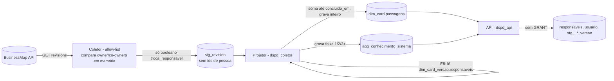

# Plano técnico: métricas "Também disponíveis" (pedido 011), viabilidade e desenho

Estado: **vigente** desde 2026-10-14. O protótipo foi validado pelo usuário (ponto de compromisso), e a revisão de desenho do tech-lead (`docs/alinhamentos/2026-10-14-revisao-desenho-011.md`, K-078, "aprovado com ajustes") foi incorporada: ajustes A1 a A13 e decisões P-T3 a P-T6. Os cartões do back da fase 1 (B1 a B12) são os da ata, §3, sem mudança; este plano os resume em §5.

**Decisões do usuário incorporadas** (2026-10-14, `docs/pedidos/011-metricas-tambem-disponiveis.md`; onde entraram: §8 d):
- **D-8 = A** (T12), **D-5' = B** (O26), **D-6' = A** e **R-1 = A** (O24);
- **D-1' = A** (E7, custo total do DSPD rateado; **revista pela D2 = A, 2026-10-17**: o E7 mostra a participação percentual pelas entregas, sem R$), **D-10 = A** (T10 sem prazo contratado, R-7 = P85 para quando houver contratos);
- **R-2' = A** e **motivos de descarte = A** (O25);
- **D-9'** (O22, só o primeiro comentário humano);
- **D-14' = A** e **R-4 = sim** (T13);
- **T14 nova = A**, **Q-T14-1 = B**, **Q-T14-5 = D** e **Q-T14-6 = A** (T14).

**Decisões do usuário de 2026-10-14 (21:15) e 2026-10-16** (pedido 011, "Decisões do usuário"; registradas no plano em 2026-10-16, K-104):
- **P-1 = A** (2026-10-14 21:15): a R-2' vale em todas as métricas, como mudança de critério com data (T2.6) (O25, §2);
- **O19-pct = B** (O19), **O20-destaque = A** (O20), **O25(b) = B** (O25), **T10-janela = A** (T10, já implementado);
- **Q-a = 1 passagem**, **Q-b = conta (1 passagem)** (O26, §8 a) e **Q-E7-1 = pró-rata por dias corridos** (E7; **revista pela D2 = A, 2026-10-17**: sem custo, a conversão deixou de valer);
- **R-1 = B** (E8 e T14; revê a D-4 = B e, com menos de 2 pessoas, a Q-T14-6 = A) e **R-2 = B** (`fato_transicao.usuario` removida, #88), as duas na ADR 0020 (item 9 e "Decisões do usuário").

**Pendências que este plano não fecha:**
- **Q-T14-10 (nova, com o usuário):** na T14, "menos de 2 pessoas" conta quem? Leitura adotada até a resposta: os responsáveis distintos dos cards contados em "outros times" (§9.5). Não bloqueia a fase 2 (no mock o booleano é gerado direto).
- **Emenda de C4 na ADR 0003 (A11):** dizer se C4 vale com a seção "Mais métricas" fechada, aberta ou nas duas, e com que limite. Depende do merge do PR #74 (orçamento móvel), que altera a mesma ADR; feita pelo architect logo depois. **Precisa estar escrita antes do B12**, que mede C4 nessas condições.
- **ADR 0020** (proteção de pessoa no coletor, A10): `vigente` para a fase 2 desde 2026-10-14; a fase 3 depende da nova leitura do `security-engineer`.

Insumos: `01-cobertura.md`, `02-especificacao.md`, `04-decisoes.md` (UX); `data-model.md` §3, §7, §8 e §9; `features/metricas-complementares.md` (precedente das extensões de mock); ADR 0003 (orçamento); `packages/metricas/src` (módulos `core/` e `businessmap/`).

**Conferência com a constituição:** o projeto não tem `docs/constituicao.md`. Conferido contra as regras invioláveis do `CLAUDE.md`: **conforme**. Detalhe:
- **Pessoa:** nenhuma das 17 publica, filtra, ordena ou segmenta por pessoa. O26 e E8 recebem só inteiros calculados no coletor (§3, ADR 0020).
- **Comparação entre times:** nenhuma lista nem ordena times. No T14, os outros times são um inteiro só, sem nome (Q-T14-6 = A, §9), oculto quando somar menos de 2 pessoas (R-1 = B).
- **BM × AC:** as 17 são só BusinessMap. Nenhuma lê `BaseAC`. O gêmeo de sazonalidade na Sustentação (D-11) fica fora.
- **Granularidade:** uma por gráfico. No T13, o seletor troca entre demanda e frente, uma de cada vez.
- **Biblioteca:** todo tempo, percentil e taxa vem de `core/` (`calendario`, `percentil`, `estatistica`, `histograma`, `series`, `janela`).
- **Amostra mínima:** abaixo de 20 não se publica estatística (`MINIMO_AMOSTRA`).
- **Histórico:** append-only preservado. Os dados novos são projeções derivadas ou tabelas novas, sem `UPDATE` em evento.
- **T2.6:** os critérios novos têm limite e prazo versionados, nunca como literal solto no código. A versão vive em um de dois lugares (A8, ajustado em 2026-10-15): na base (`ref_versao_criterio`, via `ref:sync`) ou, quando o critério nasce na própria biblioteca, em `VERSOES_DA_BIBLIOTECA` (`packages/metricas/src/core/criterios.ts`), que `marcacoesNoPeriodo` soma às da base sem repetir id. O critério do estoque parado (O23, `LIMITE_PARADO_DIAS_UTEIS`, `VERSAO_CRITERIO_PARADOS_V1`) usa a segunda via. Todo DTO de série devolve `marcacoes` (`praticas.md` §3).
- **Métricas proibidas (7.1):** nenhuma usa horas apontadas. O E7 mostra só a participação percentual de cada sistema pelas entregas do período, sem R$ (D2 = A, 2026-10-17, que revê a D-1' = A); a proposta de usar horas apontadas foi sinalizada e não adotada.

## 1. Códigos finais

Os códigos provisórios do UX ficam **confirmados**, sem colisão: hoje o fluxo vai até O18, T9 e E5.

| Código | Nome | Entra em `METRICA_IDS`? |
|---|---|---|
| O19 | Bloqueios por causa | sim |
| O20 | Fluxo cumulativo | sim |
| O21 | Fluxo reverso | sim |
| O22 | Primeiro toque | sim |
| O23 | Estoque parado dentro do WIP | **não**: é um bloco do O2 (U-2). O código existe só no catálogo web (`catalogo-metricas.ts`), apontando para `o2`, e o dado vem como campo novo de `ResultadoO2`. |
| O24 | Ordem de chegada | sim |
| O25 | Descarte | sim |
| O26 | Passagens de mão | sim |
| T10 | Tempo de terceiros | sim |
| T11 | Sazonalidade da chegada | sim |
| T12 | Qualidade da entrada por área | sim |
| T13 | Dependências entre quadros | sim |
| E6 | Datas do portfólio | sim |
| E7 | Capacidade por sistema | sim |
| E8 | Concentração de conhecimento | sim |
| E9 | Projetos aguardando início | sim |
| T14 | Participação do meu time no projeto | sim (acrescentada em 2026-10-14, decisão "T14 nova = A"; desenho em §9) |

São **17 métricas e 16 ids novos** em `METRICA_IDS` (o O23 é bloco do O2 e não tem id): O19 a O26 sem o O23 (7), T10 a T14 (5) e E6 a E9 (4), inseridos na ordem do painel depois dos complementares de cada nível. Cada id entra no cartão do seu cálculo, nunca antes (B1 cria só os contratos), para não existir rota que devolva dado inventado. Isso gera o efeito em cascata já conhecido:
- `SCHEMAS_RESULTADO`;
- `ContratoMetricas`;
- `APLICABILIDADE_FLUXO`;
- `REGRAS_METRICA`;
- `CALCULOS`;
- `CATALOGO_CARTOES` com `grupo: 'complementar'` e `status: 'mock'`;
- `calibracao.ts`;
- `varredura.test.ts`.

As rotas `GET /api/v1/metricas/:id` nascem pela iteração de `METRICA_IDS`, sem rota nova. A OpenAPI é regenerada (`pnpm run openapi:gerar`) em cada cartão que acrescenta id, e `docs/api/` e `docs/tecnica/` vão no mesmo commit (`praticas.md` §7.7). Todos os schemas de resultado são `strict`.

Novas chaves em `ChaveSegmentacao`: `'motivo-bloqueio'`, `'fornecedor'` e `'mes-do-ano'` na fase 1 (B1); `'faixa-passagens'` na fase 2, com o O26. Não entram `pessoa`, `responsavel` nem `equipe`.

## 2. As 17 métricas

Legenda da coluna "Dado":
- **existe**: está em `BaseBM` e em `dim_card`, `fato_transicao` ou `fato_bloqueio`.
- **extensão**: dado novo que no mock fica fora de `BaseBM`, num mapa por id, seguindo o precedente das complementares (§4).
- **real**: o que a coleta real precisa ter.

Os contratos estão em alto nível; o detalhe zod é do `node-backend`. Todo resultado segue o envelope atual, com `base`, `janela`, `criterio` e `estatistica`/`taxa` de `contratos/comum`. Quando falta amostra, o resultado traz `insuficiente` com "k de n".

**Forma da taxa (alinhada ao contrato implementado, B1).** Onde este plano escreve `taxa`, `{ k, n, taxa }` ou `pct`, a forma real é o `taxaSchema` de `contratos/comum`: uma união discriminada por `status`, `{ status: 'ok', k, n, pct }` (só com n ≥ 20) ou `{ status: 'insuficiente', k, n, minimo: 20 }` (n ≤ 19, sem `pct`). Assim o mínimo de 20 é garantido pelo tipo, e "k de n" permanece nos dois casos. Nos contratos abaixo, `taxa` significa esse schema inteiro, nunca um número solto.

### O19 Bloqueios por causa
- **Fonte:** BM.
- **Dado:** existe. `fato_bloqueio` (motivo, início, fim, `duracao_horas_uteis`) junto com o card, que dá os filtros.
- **Cálculo:** módulo novo `businessmap/o19.ts`.
  - Seleciona os bloqueios com `fim` dentro do período e o card nos filtros.
  - Para cada um dos 7 motivos de `MOTIVOS_BLOQUEIO` (ordem neutra do domínio no contrato; a UI ordena por soma), calcula:
    - soma de horas úteis, convertida para dias úteis por `core/calendario`;
    - contagem;
    - P50/P85 da duração com `core/percentil`, só com n ≥ 20.
  - Conta à parte os bloqueios ainda abertos (`fim = null`).
  - **Percentual decidido (O19-pct = B, usuário, 2026-10-16):** `pctDoTotal` de cada causa é calculado sobre os **dias úteis bloqueados**: dias úteis da causa ÷ `totalDiasUteis`. O mínimo de 20 vale sobre o **número de bloqueios** da causa: com menos de 20 bloqueios, o percentual não sai ("k de n" em bloqueios). A implementação da fase 1 (percentual sobre bloqueios) muda no node-backend, junto com o ajuste do O20. Como o `taxaSchema` é `{ k, n, pct }` com `n` de itens, a forma do campo (por exemplo, `pct` em dias e o mínimo pelo `bloqueios`) é do node-backend, com aceite de mudança incompatível (§2, "Aceites de contrato") se o schema mudar.
- **Contrato:** `{ motivos: [{ motivo, bloqueios, diasUteis, pctDoTotal: taxaSchema, duracao: estatistica }], abertosForaDaSoma, totalDiasUteis }`.
- **Mock:** a base atual já tem bloqueios, com motivo sorteado de forma uniforme (`gerador.ts:289`). A spec 8.1 pede distribuição desigual, mas isso alteraria o hash da base (`924448d4`). Decidido (P-T3 = a): a base não muda. O B3 mede se algum motivo passa de 20 em 12 semanas e algum fica abaixo e registra o número no teste; se faltar amostra, o cartão mostra o que existe.
- **Mínimo:** soma e contagem são censo e saem sempre. P50/P85 e o percentual (sobre dias úteis bloqueados) só saem com 20 ou mais bloqueios no motivo.

### O20 Fluxo cumulativo
- **Fonte:** BM.
- **Dado:** existe. `fato_transicao` (canônica, `vw_transicao_canonica`) e `dim_coluna` (papel, ordem). O fim de vida do card é dado por `fimDeVidaAberta`.
- **Cálculo:** módulo novo `businessmap/o20.ts`. É uma varredura única de eventos +1/−1 por (dia, faixa), a mesma técnica do remédio de C3 do O1 (ADR 0003). O ideal é **generalizar a varredura do O1** para "por coluna", memoizada por quadro no contexto, em vez de escrever outra.
  - Faixa = coluna, quando uma equipe está filtrada.
  - Faixa = `PapelColuna`, quando o filtro é "Todas".
  - A frase de leitura usa o maior crescimento absoluto nas faixas de fila (`tipo_coluna = 'fila'`).
  - **Destaque decidido (O20-destaque = A, usuário, 2026-10-16):** o `destaque` considera só as faixas **a partir do compromisso** (papel `compromisso` em diante; por coluna, as colunas desses papéis). O Backlog continua desenhado como faixa, mas **nunca** é o destaque. Ajuste no `o20.ts` e no alvo do mock `destaqueDoTodasAceito` (node-backend); o CA é do UX.
  - As mudanças de critério do período vêm de `core/criterios`.
- **Contrato:** `{ agrupamento: 'coluna' | 'papel', faixas: [{ chave, rotulo, ordem, tipoColuna }], dias: [{ dia, contagens: number[] }], destaque: { faixa, de, para } | null, mudancasCriterio }` (sem mudança no B9; `destaque.faixa` é a `chave`; só há faixa para item em progresso, a varredura do B8; ver `docs/api/metricas.md`).
- **Mock:** a base já tem a história. Para a faixa que cresce nas últimas 4 semanas, o mock **não** altera a base. Se a base não mostrar crescimento, a frase cai em "Nenhuma etapa acumulou", que é um estado válido.
- **Mínimo:** contagem diária (censo), sem estatística. Sem transição no período, o estado é vazio.

### O21 Fluxo reverso
- **Fonte:** BM.
- **Dado:** existe. `fato_transicao.direcao = 'retorno'`, origem e destino. O mock já gera retornos (`gerador.ts:423`).
- **Cálculo:** módulo novo `businessmap/o21.ts`.
  - Considera as entregas do período (`concluido_em`, demanda) e marca com retorno as que tiveram ≥ 1 transição `retorno` até a conclusão.
  - A matriz conta pares (origem → destino) de retorno, agregados por papel quando o filtro é "Todas".
  - A linha "reaberto" junta os retornos com origem de papel `entrega`.
  - O par com × sem compara o tempo de ciclo do tipo escolhido. Reaproveita a função de marcos e de ciclo do O3; não recalcula o ciclo.
- **Contrato:** `{ entregas: taxaSchema, matriz: { eixo: 'coluna'|'papel', celulas: [{ origem, destino, retornos, reaberto }] }, reaberturas, segmentoPor: 'tipo', comparacoes: [{ tipo, com: estatistica, sem: estatistica, grupoAbaixoDoMinimo: 'com'|'sem'|'ambos'|null }] }` (ajuste de 2026-10-15 no B7: o par é por tipo, regra 7, CA-6, e a célula marca a reabertura).
- **Mock:** a base atual já tem os retornos. Medir quantos são: a spec pede cerca de 25% das entregas. Se a base tiver menos, o cartão mostra o que existe; não se mexe na base.
- **Mínimo:**
  - percentual com n ≥ 20 entregas;
  - par com × sem só quando **cada** grupo tem ≥ 20 no tipo; abaixo disso, o contrato indica qual grupo faltou (CA-6).

### O22 Primeiro toque
- **Fonte:** BM.
- **Dado:** **extração nova**: `dim_card.primeiro_toque_em timestamptz NULL`.
  - Definição **decidida (D-9', 2026-10-14; CA-43):** o primeiro **comentário humano** posterior a `criado_em`. Mudança de coluna e atribuição de responsável **não** contam. Comentário de conta de automação fica fora.
  - Real: o projetor calcula o campo só a partir de uma staging nova, `stg_comentario_instante (card_id, comentario_id, criado_em)`, gravada pelo coletor por **allow-list** (ADR 0020): sem autor e sem texto. O O22 **não** depende de `stg_revision`.
  - Depois de preenchido, o campo não muda mais. Por isso o coletor deixa de buscar comentários desse card (economia de chamadas, K1).
- **Cálculo:** módulo novo `businessmap/o22.ts`.
  - Mede de `criado_em` até `primeiro_toque_em` em horas úteis, convertidas para dias úteis com uma casa (`core/calendario`).
  - P50/P85/P95 por tipo na janela (`core/janela`, `JANELA_PERCENTIS_PADRAO`).
  - Histograma com as faixas fixas da spec (`core/histograma`).
  - "Ainda sem toque": abertos com `primeiro_toque_em = null`, com a contagem e a idade do mais antigo.
- **Contrato:** `{ tipo, distribuicao: estatistica, histograma: [{ faixa, itens }], semToque: { itens, maisAntigoDiasUteis | null } }`.
- **Mock:** extensão `primeiroToque: Record<card_id, number | null>`.
  - Distribuição lognormal assimétrica: mediana menor que 1 dia útil, cauda até 15.
  - 5 a 8 abertos sem toque.
  - Um tipo com menos de 20, para exercitar `insuficiente`.
- **Mínimo:** percentis com ≥ 20 pedidos tocados no tipo, na janela.

### O23 Estoque parado dentro do WIP (bloco do O2)
- **Fonte:** BM.
- **Dado:** existe. `semMoverHaDiasUteis` já é calculado por item em `o2.ts`.
- **Cálculo:** dentro de `o2.ts`, sem módulo novo.
  - `k` = itens em andamento com `semMover > limite`; `n` = WIP atual; quebra por etapa (papel ou coluna, a mesma do O2).
  - O limite (5 dias úteis, U-11) entra como constante única `LIMITE_PARADO_DIAS_UTEIS` com `VersaoCriterio` v1 em `VERSOES_DA_BIBLIOTECA` (T2.6, A8); mudar o limite exige nova versão no mesmo commit.
  - **Por que não um "parâmetro versionado com valor e vigência" agora:** seria mecanismo novo (campo de valor em `VersaoCriterio` ou tabela de parâmetros lida pela biblioteca), e o existente basta: a constante é lida num lugar só, e a `VersaoCriterio` já dá data, descrição e marcação. Valor que o usuário configura sem deploy (por exemplo, o prazo de fornecedor do T10; o custo do DSPD do E7 saiu pela D2 = A, 2026-10-17) já tem padrão próprio, a tabela `ref_` com vigência. **Critério para propor ADR de parâmetro:** um limite da biblioteca precisar mudar por configuração, sem deploy, ou dois valores do mesmo limite precisarem valer em períodos diferentes do mesmo cálculo.
- **Contrato:** acréscimo compatível em `ResultadoO2`: `parados: { limiteDiasUteis, taxa: taxaSchema, porEtapa: [{ etapa, k }] }` (o `k` e o `n` ficam dentro da `taxa`). É campo novo no schema zod (ADR 0007: acréscimo, não quebra).
- **Mock:** a base atual. Medir a parcela acima de 5 dias úteis; a spec pede 20% a 30%, mas sem mexer na base.
- **Mínimo:** censo do WIP. A taxa só sai com n ≥ 20; abaixo, "k de n".

### O24 Ordem de chegada
- **Fonte:** BM.
- **Dado:** existe. `criado_em`, `iniciado_em`, `equipe`, `tipo` e `classe_servico`.
- **Cálculo:** módulo novo `businessmap/o24.ts`.
  - Grupo de comparação **decidido (D-6' = A, 2026-10-14):** a fila de cada equipe (quadro), só a classe **Padrão** e o mesmo tipo. Urgente, Prazo fixo e Intangível ficam fora do O24 (P:597-600). Não há fila do DSPD inteiro.
  - Para cada início no período, verifica se havia no mesmo grupo um card criado antes, ainda não iniciado e não descartado nem arquivado naquele instante (`arquivadoAte`). Se houver, é "fora de ordem".
  - Algoritmo: para cada grupo, ordenar por `criado_em` e varrer os inícios em ordem temporal com um conjunto ordenado dos não iniciados. O custo é O(n log n) por grupo.
  - Custo da ultrapassagem **decidido (R-1 = A, 2026-10-14):** para cada ultrapassado, dias úteis (`core/calendario`) entre o início do **primeiro** item que passou na frente dele e o seu próprio início. P50/P85 por tipo (`core/percentil`). Texto do cartão: "esperaram, depois de ultrapassados, X dias úteis até começar" (nunca "dias a mais"). Ultrapassado ainda não iniciado fica fora da estatística até iniciar.
- **Contrato:** `{ inicios: taxaSchema, meses: [{ mes, emOrdem, foraDeOrdem, emAndamento }], custo: { segmentoPor: 'tipo', porTipo: [{ tipo, ultrapassados, estatistica }] }, marcacoes, grupo: 'equipe-tipo-padrao' }`. O `grupo` é literal único (sem alternativas no contrato). No B10 o `custo` único virou `porTipo` (regra 7, mesmo ajuste do O25); ver `docs/api/metricas.md`. `marcacoes` são as versões de critério que cruzam a série (A9).
- **Mock:** a base atual. Medir a parcela fora de ordem na classe Padrão; a spec pede cerca de 25%. Não se mexe na base. As pendências D-6 e R-1 deixam de ser `pendente-usuario` em `REGRAS_METRICA`.
- **Testes próprios (B10):** CA-17 e CA-37; Urgente, Prazo fixo e Intangível fora; ultrapassado não iniciado fora da estatística.
- **Mínimo:** a taxa com ≥ 20 inícios; P50/P85 do custo com ≥ 20 ultrapassados no tipo.

### O25 Descarte
- **Fonte:** BM.
- **Regra decidida (R-2' = A, 2026-10-14; CA-26):** descartado é o card com estado nativo `discarded` do BusinessMap **e** o card excluído. O instante é o `discarded_at`; no excluído, o instante da exclusão ou, sem ele, a última revisão, **marcada como aproximada**. Motivo preenchido sem descarte nem exclusão vira **aviso de preenchimento**, listado à parte e **fora da taxa**.
- **Motivos decididos (motivos de descarte = A; CA-44):** o domínio é o catálogo nativo `/discardReasons` (`reason_id`), com mudanças versionadas (T2.6). O `discard_comment` **nunca** entra (nem na allow-list do coletor). Até a integração ler o catálogo, `porMotivo = null`. Não se usa `ref_dominio` para motivo de descarte.
- **Dado:**
  - Fase 1 (mock): `motivo_descarte`, `arquivado_em`, `excluido_em` e `iniciado_em`, que já existem. No mock, o gerador sempre arquiva junto com o motivo, então "estado nativo `discarded`" e a Q6 dão o mesmo conjunto, e o aviso de preenchimento fica vazio.
  - Fase 3 (real): projeção do estado nativo e do instante (`discarded_at`) e do `reason_id` em `dim_card`, mais o catálogo `/discardReasons` como `ref_` com vigência. Nomes de coluna na revisão de modelagem da fase 3 (§5).
  - **Restrição de código:** `descartado.ts` é o único arquivo que pode ler `motivo_descarte` e `arquivado_em` (regra de lint `semLeituraDeArquivamento`). O O25 exige funções novas **nesse arquivo**: `instanteDoDescarte(card)` (com a marca de aproximado) e `motivoDoDescarte(card)`. O `o25.ts` usa essas funções e não lê os campos direto.
- **Cálculo:** módulo novo `businessmap/o25.ts`.
  - O índice tira os excluídos dos cálculos (`indice.ts:147`), mas o O25 **inclui** o card excluído como descarte, com o instante `excluido_em`.
  - **Entregue e depois excluído (O25(b) = B, usuário, 2026-10-16):** card com `concluido_em` e excluído depois **não** é descarte; continua como entrega na vazão e no ciclo. A regra fica em `descartado.ts` (função do O25), com teste próprio (node-backend). Revê a implementação do B6, que o contava como descarte.
  - Encerrados no período = entregues (`concluido_em`) + descartados (instante do descarte); taxa = descartados ÷ encerrados (`core/estatistica`). O aviso de preenchimento não entra em nenhum dos dois.
  - Tempo consumido pela D-13 (CA-19): do `iniciado_em` ao descarte em horas úteis. Descartado antes do início conta zero e aparece à parte.
- **[P-1] Decidida pelo usuário = A (2026-10-14 21:15): vale a saída (ii)** abaixo, a R-2' em todas as métricas, com `VersaoCriterio` e marcação (T2.6); só afeta `descartado.ts` na coleta real. As duas saídas ficam como registro da análise:
  - **(i) A R-2' vale só para o O25.** `descartado(card)` mantém a definição da Q6 (motivo preenchido) para WIP, aberto, vazão e as demais. O O25 usa a definição nativa, por uma função própria em `descartado.ts`. Na coleta real, um card com motivo e sem estado `discarded` conta como descartado no WIP e como aviso no O25; a diferença fica documentada em `REGRAS_METRICA` dos dois lados.
  - **(ii) A R-2' substitui a Q6 em todas.** `descartado(card)` passa à definição nativa, no mesmo arquivo, com nova `VersaoCriterio` (`afeta` = todas as métricas que usam `descartado`) e marcação nos gráficos (T2.6). O excluído continua fora das demais métricas pelo índice; só o O25 o inclui. No mock nenhum snapshot muda, porque os conjuntos coincidem.
  - Nas duas, a mudança fica em `descartado.ts`, o único ponto que a regra de lint deixa ler os campos. No mock os conjuntos coincidem; a troca de `descartado()` para a definição nativa entra com a coleta real (fase 3), e a P-1 sai das pendências de `REGRAS_METRICA`.
- **Contrato:** `{ encerrados: taxaSchema, meses: [{ mes, taxa: taxaSchema, emAndamento }], marcacoes, consumido: { antesDoInicio: { itens }, depoisDoInicio: { itens, diasUteis, estatistica } }, instanteAproximado: { itens }, avisoPreenchimento: { itens }, porMotivo: [{ motivo, itens }] | null }`. `instanteAproximado` conta os descartes cujo instante veio da última revisão; `avisoPreenchimento` conta os cards com motivo sem descarte nem exclusão (CA-26); `porMotivo` é anulável (CA-44); `marcacoes` na série mensal (A9).
- **Mock:** a base atual já descarta (`aplicarDescarte`) com `MOTIVOS_DESCARTE` (4 valores mais "Criado por engano" para os excluídos).
  - **"Criado por engano" sai do O25** (§8 c): não existe em nenhum documento. O adaptador do O25 o mapeia para `null`, sem tocar em `gerarBaseMock` (o hash `924448d4` não muda). O card excluído entra no descarte (R-2').
  - `porMotivo = null` também no mock, pela CA-44: os 4 valores do gerador não são o catálogo nativo e não são publicados como motivo.
- **Mínimo:**
  - taxa com ≥ 20 encerrados;
  - P50/P85 do consumido **por tipo** (regra 7; ajuste de 2026-10-15), com ≥ 20 descartados após o início no tipo (raro);
  - fora isso, soma e contagem.

### O26 Passagens de mão
- **Fonte:** BM.
- **Dado:** **extração nova**: `dim_card.passagens smallint NULL`. É um inteiro, não é coluna de pessoa, e a API pode ler. Cálculo e proteção em §3 e na ADR 0020. Mock na fase 2, real na fase 3; as bordas Q-a e Q-b (§8 a) estão **decididas** (usuário, 2026-10-16): Q-a = 1 passagem por revisão em que o conjunto é substituído; Q-b = conta 1, comparando com o último conjunto não vazio.
- **Cálculo:**
  - No coletor: a contagem de trocas pela **D-5' = B** (decidida em 2026-10-14): conta só quando alguém sai e outro entra, ou o conjunto é substituído; incluir co-responsável sem ninguém sair não conta. Fonte e mecanismo: §8 a.
  - Na biblioteca: módulo novo `businessmap/o26.ts`. Para cada entregue do tipo escolhido, faz o histograma por faixa (0, 1, 2, 3, 4+) e o P85 do tempo de ciclo por faixa, reaproveitando o ciclo do O3.
- **Contrato:** `{ tipo, faixas: [{ faixa, itens, pct (taxa), cicloP85: estatistica }], semDado: number }`. `semDado` conta os cards sem `passagens`, por exemplo os anteriores à coleta.
- **Mock:** extensão `passagens: Record<card_id, number>`.
  - Valores de 0 a 6, tirados de uma distribuição condicionada ao tempo de ciclo, para criar correlação positiva.
  - O mock **não** lê `responsaveis` para isso.
- **Mínimo:** histograma (contagem) sempre. Percentual e P85 por faixa com ≥ 20.

### T10 Tempo de terceiros
- **Fonte:** BM.
- **Dado:** existe. `fato_bloqueio` com `fornecedor` informado, **qualquer** motivo do domínio fechado (B:136). O critério é o campo, não o motivo (§8 c).
  - **Sem prazo contratado (D-10 = A, 2026-10-14; CA-36):** o T10 mostra só o praticado (P50/P85) por fornecedor, com a linha fixa "Prazo contratado não informado" na interface. Não há coluna de prazo nem status "dentro/acima".
  - Quando o usuário informar os contratos, entra o cadastro versionado (opção B da D-10, R-7 = P85): tabela `ref_prazo_fornecedor (fornecedor_codigo, dias_uteis, vigente_de, vigente_ate)`, no padrão `ref_` com vigência, cada vigência nova gerando `VersaoCriterio`, e o status comparando o P85 com o prazo vigente no `fim` do bloqueio. **Fora da fila até lá**: não está em nenhuma fase deste plano.
- **Cálculo:** módulo novo `businessmap/t10.ts`.
  - Para cada fornecedor, em ordem alfabética (CA-11): bloqueios encerrados no período, soma em dias úteis e P50/P85 da duração (`core/percentil`).
- **Contrato:** `{ fornecedores: [{ fornecedor, bloqueios, diasUteis, duracao: estatistica }], totalDiasUteis }`. Sem `prazoDiasUteis`, `status` nem `prazoFornecedor`. A volta do prazo, quando houver contrato, é acréscimo compatível (ADR 0007).
- **Mock:**
  - A base já tem 3 fornecedores (`catalogos.ts:60`: Alfa, Beta e Gama). Não há Delta; a spec aceita de 3 a 4.
  - Sem prazo de mock: o campo `prazoFornecedor` saiu da extensão (A2).
  - A base também põe `fornecedor` em "Aguardando licença ou contrato". Esses bloqueios **entram** no T10: entra todo bloqueio encerrado com fornecedor informado (R-5, resolvida pelos documentos; §8 c). O filtro "só Aguardando fornecedor" da versão anterior deste plano foi retirado por não ter base. Bloqueio "Aguardando fornecedor" sem fornecedor é falha de preenchimento e fica fora da tabela.
- **Mínimo:** P50/P85 por fornecedor com ≥ 20 encerrados; abaixo, "— amostra insuficiente" e só contagem e soma.

### T11 Sazonalidade da chegada
- **Fonte:** BM.
- **Dado:** existe. `criado_em` (marco de entrada, T1.5), com `tipo`, `equipe`, `sistema` e `granularidade` para os filtros. Exige **24 meses** de histórico na base real: a carga histórica inicial do coletor precisa alcançar 24 meses mais o mês corrente.
- **Cálculo:** módulo novo `businessmap/t11.ts`.
  - Contagem de demandas (story, sem subtarefa) por (ano, mês), em janela fixa de 24 meses fechados mais o corrente, ancorada em `hoje` e não no filtro de período.
  - Mês corrente marcado com `emAndamento`.
  - A média mensal é só referência de contagem.
  - A agregação por mês vem de `core/series`.
- **Contrato:** `{ anos: [{ ano, meses: [{ mes, entradas | null, emAndamento }] }], marcacoes, mesesComDado, mediaMensal, historicoCurto: boolean }`. `marcacoes` cobre a janela de 24 meses (A9).
- **Mock:** **o ponto mais sensível.** O mock tem 18 meses (`config.ts:13`, `mesesHistorico: 18`), sem padrão sazonal. **Decidido (P-T3 = a, tech-lead):** série própria `entradasSazonais: { criado_em, tipo, equipe, sistema }[]` na extensão `ExtensaoTambemBM`, com 24 meses e picos em janeiro e julho, consumida só pelo T11 quando a fonte é mock. A função de cálculo é a mesma; só muda o adaptador. A base não muda (`924448d4`, `b2bfd4c0`). No mock, T11 e O7 divergem nos meses em comum: isso fica documentado no teste do T11 e na nota de QA. Na coleta real, o adaptador lê `dim_card` e a divergência some. Descartada: (b) rebaseline da base para 24 meses (mudaria hashes e snapshots e somaria cerca de 33% de cards, com risco em C1).
- **Fase 1 (B11):** o T11 entra com a extensão, sem coleta nova. Testes: CA-12 (o T11 não muda com o período); sem extensão, vazio ou insuficiente, nunca 500.
- **Mínimo:** contagem (censo), sem percentil. Com menos de 24 meses, `historicoCurto = true` e a nota da spec.

### T12 Qualidade da entrada por área
- **Fonte:** BM.
- **Dado:** existe. `area_solicitante`, `fato_bloqueio` ("Falta de informação no chamado") e `fato_transicao` (retorno do papel `compromisso` para `backlog`).
- **Cálculo:** módulo novo `businessmap/t12.ts`.
  - Demandas que entraram no período (`criado_em`).
  - "Ida e volta" pela **D-8 = A** (decidida em 2026-10-14): bloqueio desse motivo com `inicio < iniciado_em` (ou o card ainda não iniciado), **ou** um retorno compromisso → backlog.
  - Para cada área, ordenada por volume (neutra): `k`, `n` e taxa (`core/estatistica`).
- **Contrato:** `{ total: taxaSchema, areas: [{ area, taxa: taxaSchema }] }` (o `k` e o `n` de cada área ficam dentro da `taxa`).
- **Mock:** a base atual (`AREAS_EXTERNAS` mais a área interna). A frequência de ida e volta depende dos bloqueios uniformes e dos retornos já existentes. Medir; a spec pede de 10% a 25%, com duas áreas abaixo de 20.
- **Mínimo:** taxa por área com ≥ 20; abaixo, "k de n".

### T13 Dependências entre quadros
- **Fonte:** BM.
- **Dado:** **extração nova**.
  - Projeção `fato_vinculo (card_id, card_relacionado_id, tipo_vinculo, quadro_relacionado_id, outro_quadro boolean, criado_em, removido_em NULL)`, a partir de uma staging nova `stg_vinculo_relacao`.
  - Por que staging nova: a `stg_vinculo` atual cobre só pai e filho (`pai_id`, `filho_id`), não predecessor nem relacionado.
  - **Tipo decidido (D-14' = A, 2026-10-14; CA-40, CA-21):** só o vínculo `predecessor` com card de **outro quadro**. `successor`, `relative` e pai/filho ficam fora. A API não dá data de criação nem de remoção do vínculo: as datas só saem da comparação entre revisões (§8 b).
  - Pela conciliação da D-14 (04-decisoes, seção C), o bloqueio "Dependência de outra demanda" sai do T13 e vira "leia junto" com o O19.
  - Um vínculo removido gera evento, nunca `DELETE` em evento.
- **Cálculo:** módulo novo `businessmap/t13.ts`.
  - Entregas do período na granularidade escolhida, uma por vez (`story` ou `frente`; seletor, CA-8).
  - "Dependeu" = vínculo `predecessor` com `outro_quadro = true` **vigente em algum momento antes de `concluido_em`** (R-4 = sim), inclusive o removido antes da entrega (CA-40). Depende de a API registrar a mudança de vínculo nas revisões, a confirmar no spike da fase 3 (§8 b); se não registrar, o T13 volta ao usuário.
  - Card com `outro_quadro` desconhecido (quadro do relacionado sem permissão) vai para `semDado`, nunca para "não dependeu".
  - Par P50/P85 do lead time com × sem no mesmo tipo, reaproveitando o T1.
  - A resposta não traz o quadro nem a equipe do relacionado: só o booleano.
- **Contrato:** `{ granularidade, entregas: { k, n, taxa }, semDado, comparacao: { tipo, com: estatistica, sem: estatistica } }`. O bloco de bloqueio por dependência saiu (conciliação da D-14).
- **Mock (fase 2):** extensão `vinculos: { card_id, relacionado_id, tipo: 'predecessor', outro_quadro, vigenteAte: number | null }[]` em cerca de 35% das stories e 50% das frentes, apontando para cards existentes de outras equipes; uma parte removida antes da entrega, para exercitar a R-4, e alguns de mesmo quadro, que não contam.
- **Mínimo:**
  - taxa com ≥ 20 entregas;
  - par só quando cada grupo tem ≥ 20 no tipo **e** na granularidade (CA-6).

### E6 Datas do portfólio
- **Fonte:** BM.
- **Dado:**
  - `data_acordada` existe em `dim_card`. No mock, porém, **só as stories** a recebem (`acordar()` é chamada em `finalizarStory`); os projetos não têm.
  - A data original e o número de replanejamentos são **extração nova**: as projeções `dim_card.data_acordada_original date NULL` e `dim_card.replanejamentos smallint NULL` são derivadas pelo projetor das mudanças de `data_acordada` em `dim_card_versao` (SCD2, ADR 0016) e, para o período anterior ao início da coleta, de `stg_revision` (se a revision trouxer mudança de campo customizado, P-T1).
  - Qual data vale: D-7.
- **Cálculo:** módulo novo `businessmap/e6.ts`.
  - Projetos concluídos no período (padrão de 12 meses).
  - Deslize = dias úteis entre a data comprometida e `concluido_em`, com sinal (`core/calendario`). Tolerância zero (D-7).
  - k projetos na data, de n.
  - P50/P85 do deslize com n ≥ 20.
  - Pontos por projeto, com código, título, deslize e replanejamentos.
- **Contrato:** `{ projetos: [{ cardId, codigo, titulo, deslizeDiasUteis, replanejamentos }], naData: { k, n, taxa }, deslize: estatistica }`. A lista é pequena (dezenas), sem paginação.
- **Mock:** extensão `datasProjeto: Record<card_id, { original: number, final: number, replanejamentos: 0..3 }>` para 11 a 14 projetos concluídos em 12 meses. Ficam abaixo de 20 de propósito, para a variante `lenta`.
- **Mínimo:** taxa e P50/P85 com ≥ 20 projetos; abaixo, AmostraInsuficiente `lenta` com os pontos e "k de n".

### E7 Capacidade por sistema
- **Fonte:** BM.
- **Dado:** existe. `sistema`, `tipo`, `concluido_em`, demanda sem subtarefa. Nada de horas apontadas.
- **Sem R$ (D2 = A, usuário, 2026-10-17; CA-35, CA-13):** o E7 mostra a **participação percentual de cada sistema pelas entregas do período** (ex.: "Fluig: 23% das entregas"), sem valor em dinheiro. Nunca por área, equipe ou pessoa; horas apontadas não entram (briefing 7.1). Mudança de critério registrada com data (T2.6).
  - **Histórico (revisto pela D2 = A):** a D-1' = A (2026-10-14) fazia o E7 ratear o **custo total do DSPD** pela participação nas entregas, com a tabela `ref_custo_dspd` e as saídas `custoRateado` e `custoPorDemanda`; a Q-E7-1 (2026-10-16) fixava a conversão do valor para o período em pró-rata por dias corridos. Nenhuma das duas vale mais. A tabela `ref_custo_dspd` não será criada, e o `ref_custo_area` da versão anterior já tinha saído.
- **Cálculo:** módulo novo `businessmap/e7.ts`.
  - Entregas do período por sistema; participação = entregas do sistema ÷ total (`core/estatistica`). Peso pela D-2 (contagem).
  - A natureza vem da função **`naturezaDe` do T3** (`t3.ts:14`), com as 4 naturezas (CA-23), sem um segundo mapeamento.
  - Sistemas com menos de 20 entregas vão para o fim, com "k de n".
  - Sem cálculo de custo: a interface mostra a participação e as entregas, sem aviso de rateio (o aviso do CA-35 saiu com o R$).
- **Contrato:** `{ total, sistemas: [{ sistema, entregas, participacao: taxaSchema, porNatureza: [{ natureza, taxa: taxaSchema }] }] }`. Os campos de custo do desenho anterior saíram (D2 = A); ver `docs/api/metricas.md` para o contrato vigente.
- **Mock:** a base atual (18 a 20 sistemas). Sem custo (CA-13): nenhum R$ em mock, fixture ou configuração.
- **Mínimo:** participação com ≥ 20 entregas no total; por sistema, abaixo de 20 só "k de n".

### E8 Concentração de conhecimento
- **Fonte:** BM.
- **Dado:** **agregado novo**, calculado no coletor: `agg_conhecimento_sistema` (§3). A API não toca em pessoa.
- **Cálculo:**
  - No projetor: a faixa por sistema e janela.
  - Na biblioteca: módulo novo `businessmap/e8.ts`, que só conta sistemas por faixa (1, 2, 3+) na janela escolhida.
  - Se houver menos de 5 sistemas com entregas, devolve `recortePequeno` e omite as faixas (CA-10).
  - **Só a contagem, sem nomes (R-1 = B, usuário, 2026-10-16; ADR 0020, item 9):** o E8 mostra quantos sistemas estão com 1 pessoa (e em 2 e em 3 ou mais), **sem nomear nenhum sistema**. Revê a D-4 = B (2026-10-14), que publicava a lista de sistemas em "1 pessoa". Sem nomes, o cruzamento com as `entregas` por sistema do E7 deixa de identificar a pessoa.
- **Contrato:** `{ janelaMeses, sistemasComEntrega, faixas: { uma, duas, tresOuMais } | null, recortePequeno: boolean }`. O campo `sistemasUmaPessoa` da versão anterior deste plano sai (o schema do E8 ainda não existe no código; nasce sem ele). Nenhum campo traz nome de sistema nem de pessoa; a validação zod é `strict`, e um teste falha se aparecer código ou nome de sistema na resposta.
- **Mock:** a extensão gera **diretamente** o agregado, sem pessoas: 4 sistemas em uma pessoa, 6 em duas e o resto em três ou mais. A faixa por sistema fica na extensão (como fica em `agg_conhecimento_sistema`); só a contagem por faixa chega ao resultado.
- **Mínimo:** censo de sistemas, sem percentil. O recorte precisa ter 5 ou mais sistemas.

### E9 Projetos aguardando início
- **Fonte:** BM.
- **Dado:** existe. Cards `granularidade = 'projeto'` com `iniciado_em = null`, não descartados e não arquivados (`descartado`, `arquivadoSemDesfecho`).
- **Cálculo:** módulo novo `businessmap/e9.ts`.
  - É o retrato de `hoje`: idade em dias úteis desde `criado_em` (`core/calendario`), com as faixas fixas da spec.
  - A referência é o P85 do "antes do início" **importado do `e1.ts`** (não recalculado), **por tipo** (`referenciasP85`), e só aparece no tipo que tem ≥ 20 projetos concluídos.
  - O E9 não calcula deslize nem "na data": `deslizeDiasUteis` e `naData` são do E6 (correção de 2026-10-15, review do B2 a B10).
- **Contrato:** `{ projetos: [{ cardId, codigo, titulo, tipo, criadoEm, idadeDiasUteis, faixa }], segmentoPor: 'tipo', referenciasP85: [{ tipo, referenciaP85: estatistica }] }` (uma referência por tipo, mínimo 20 por tipo; ajuste de 2026-10-15, regra 7 e Q4).
- **Mock:** a base atual. Medir quantos projetos estão abertos e não iniciados. Se forem menos de 6, ou nenhum passar de 180 dias úteis, a extensão **não** cria projeto (mexeria em E1 e E4); o cartão mostra o que existe.
- **Mínimo:** censo dos abertos; a referência de percentil só com ≥ 20 concluídos.

### Aceites de contrato (política de mudança §5, ratificação do architect, 2026-10-15)
Ratifico, junto com o tech-lead, os aceites de mudança incompatível do lote B2 a B10:
- enum `indicadores[].metrica` do `VISAO_GERAL`: O19, T10, T12, E7, E9, O25, O21, O20, O24;
- E7, `participacao` anulável;
- contratos de E9 (`e9085e7`), O25, O21 e O24 (por tipo, regra 7), e O20 (`emProgresso` obrigatório).

Motivo: nenhum desses contratos está publicado e nenhum consumidor os lê. No `VISAO_GERAL`, o enum só cresce e `visaoGeral.ts` emite apenas ids do núcleo, então a resposta não muda. São, portanto, ajustes de desenho antes da publicação, sem custo de migração. Sem discordância. Exigência de processo, vinda do tech-lead: daqui em diante, toda mudança incompatível passa pelo aceite de uso único, mesmo em contrato não publicado.

Alinhamento de texto: o plano escreve `{ k, n, taxa }` (O24, O25, T12, O21) e `{ natureza, itens, pct }` (E7); o código usa `taxaSchema` (`k`, `n`, `pct`, com `pct` só quando n ≥ 20). É a mesma informação, com o mínimo garantido pelo tipo; vale o `taxaSchema` e `docs/api/metricas.md`.

## 3. Proteção de pessoa (O26, E8 e O22)

Princípio: **a identidade só existe dentro do coletor e do projetor (papel `dspd_coletor`); o que sai deles é um inteiro sem pessoa.** A API (`dspd_api`) continua sem `SELECT` em `COLUNAS_PESSOA` (GRANT por coluna) e sem acesso a `*_versao` e `stg_`.

A decisão de arquitetura desta seção está na **ADR 0020** (proteção de pessoa no coletor: subpasta `coletor/`, regra de lint de import, allow-list de revisões e comentários, agregado por faixa). Ela está como `proposta` e precisa estar `vigente` antes da fase 2. Por mexer com dado pessoal, a revisão inclui o `security-engineer` (R-SEGURANCA). `gatilhos_seguranca` deste plano: dados pessoais (responsáveis e autores na fronteira do coletor), banco (tabelas e GRANTs novos na fase 3).

- **O26 `passagens`:** fonte = as revisões do card (`owner_user_id` e `co_owner_ids` em `CardRevision`), comparadas em memória no coletor; só um booleano por revisão e o inteiro final saem dele. Mecanismo completo e o que falta confirmar: §8 a.
  - Pela D-5' = B, conta só quando alguém sai e outro entra (ou o conjunto é substituído).
  - Card sem revisões coletadas (ou com o spike de §8 a negativo): `passagens = null`, contado em `semDado`.
  - O SCD2 diário (`dim_card_versao`) deixa de ser a fonte da contagem: ele perderia trocas no mesmo dia (P-T2). Fica só como estado de partida opcional (§8 a).
- **E8 `agg_conhecimento_sistema`:**
  - Chave: `(sistema_codigo, janela_fim date (último dia do mês), janela_meses smallint, versao_criterio)`.
  - Coluna: **`faixa_concentracao smallint CHECK (faixa_concentracao IN (1,2,3))`**, em que 3 significa "3 ou mais".
  - Também `entregas int`.
  - Minimização: guarda a faixa, não o número exato de pessoas. O nome da coluna não casa com o regex de `lgpd.ts`, e a tabela não entra em `COLUNAS_PESSOA` porque não tem pessoa.
  - O projetor recalcula por janela mensal móvel (D-3: 12 meses), contando os responsáveis distintos na `dim_card_versao` vigente em `concluido_em` das entregas do sistema.
  - Projeção substituível por janela (`DELETE`+`INSERT` na mesma transação), como as demais projeções.
  - Na API, só a contagem de sistemas por faixa, sem nome de sistema (R-1 = B, ADR 0020 item 9).
- **T14, "outros times" com menos de 2 pessoas (R-1 = B, ADR 0020 item 9):** o projetor conta, em memória, os responsáveis distintos dos cards de "outros times" de cada `(projeto, equipe, granularidade)` e grava só o booleano de publicação; a forma da projeção fica para a revisão de modelagem da fase 3. Na fase 2 o mock gera o booleano direto (§9.3).
- **O22 (D-9': só comentário humano):** a staging de comentário guarda só `(card_id, comentario_id, criado_em)`.
  - Autor e texto são descartados na fronteira (allow-list, ADR 0020; o mesmo princípio do Acelerato no `CLAUDE.md`).
  - Para excluir os comentários automáticos, o coletor compara o autor **em memória** com uma lista de contas de sistema (`ref_conta_automacao`, ids técnicos de robô, não de pessoa) e descarta o autor em seguida.
  - O O22 não lê revisões: atribuição e mudança de coluna não são toque.
- **Onde fica a função de contagem (ADR 0020):**
  - Funções puras em `packages/metricas/src/coletor/` (subpasta nova): `houveTroca(anterior: ReadonlySet<string>, atual: ReadonlySet<string>): boolean` (§8 a) e `faixaConcentracao(idsDistintos: number)`.
  - Recebem ids opacos e devolvem números.
  - **Não** são exportadas pelo `index.ts` público, não entram no bundle web, e uma regra de lint permite importá-las só a partir de `server/src/modulos/coleta*`.
  - Isso cumpre "cálculo pela biblioteca compartilhada" sem expor pessoa a nenhum consumidor da API.
- **Testes obrigatórios:**
  - teste de grants: `dspd_api` lê `passagens` e `agg_conhecimento_sistema` e não lê `responsaveis`;
  - teste LGPD de catálogo (`lgpd.ts`): nenhuma coluna nova viola o regex;
  - property test existente (`regras.property.test.ts:581`): nenhuma string de pessoa do mock aparece na saída dos **16 ids novos** (cada cartão acrescenta o seu; o B12 confere os 10 da fase 1);
  - teste da allow-list do coletor (fase 3): falha se `owner_user_id`, `co_owner_ids`, `user_id`, autor ou texto de comentário chegarem a staging;
  - E2E: CA-9 e CA-10.
- **`responsaveis` e `usuario` nos tipos da biblioteca (P-T6, decidido pelo tech-lead):** os dois campos **continuam** em `modelo.ts` (`:34`, `:58`) e no mock (pseudônimos, `gerador.ts:391`). A proteção é na saída e na leitura: (1) regra de lint que proíbe ler `responsaveis` e `usuario` em `packages/metricas/src/businessmap/*.ts`, **entregue no B1**, antes da primeira métrica nova (mesmo padrão de `semLeituraDeArquivamento` do `eslint.config.js`); (2) o property test de pessoa. O `data-model.md` §9, garantia 6, foi alinhado a isso (A12).

## 4. Mock: estrutura

Segue o precedente das complementares sem mexer em `BaseBM`/`gerarBaseMock`. O hash `924448d4` (escala 0,2: `b2bfd4c0`) continua intacto.
- Interface nova `ExtensaoTambemBM` em `businessmap/extensao.ts`. Os campos entram com as métricas que os usam:
  - fase 1 (B11): `entradasSazonais` (T11);
  - fase 2: `primeiroToque` (O22), `passagens` (O26), `vinculos` (T13), `datasProjeto` (E6), `conhecimentoSistema` (E8) e `equipeResponsavel` (T14).
  - Não há `prazoFornecedor` (D-10 = A) nem custo de mock (CA-13).
- Gerador **separado** (P-T4, decidido): `gerarExtensaoTambemMock(base)`, com streams `derivar(semente, 'tambem:<campo>')`. Assim o hash das extensões existentes (`fbddcf28`) **não muda**, e o novo ganha teste de hash próprio e de determinismo.
- `ContextosMetricas` ganha `tambem?: ExtensaoTambemBM`. Os cálculos que dependem dele devolvem `insuficiente`/vazio quando ele falta, nunca 500.
- Geração **lazy**: só quando a seção "Mais métricas" abre ou no primeiro cálculo que precise dela, nunca em C1.
- `COM_EXTENSAO_MOCK` (`cartoes.ts:55`) recebe T11 na fase 1 e O22, O26, T13, E6, E8 e T14 na fase 2. T10 e E7 não entram (sem prazo e, pela D2 = A, sem custo).
- **`pendencias` em `REGRAS_METRICA`** (atualizado em 2026-10-16): só o que segue aberto com o usuário entra como `status: 'pendente-usuario'`, e hoje isso é só o **T14**: a cardinalidade do campo "Time responsável", as suposições Q-T14-2, 3, 4, 7, 8 e 9 do pedido e a **Q-T14-10** (quem conta nas "2 pessoas"), cada uma com a recomendação de §9.5 valendo até confirmação. Saem da lista as decididas pelo usuário: **P-1 = A** (2026-10-14), **Q-a**, **Q-b** e **Q-E7-1** (2026-10-16), que passam a regra em `REGRAS_METRICA` do O25 (e das que usam `descartado`), do O26 e do E7. Também não entram as demais decididas (D-1', D-4 revista pela R-1 = B, D-5', D-6', D-8, D-9', D-10, D-14', R-1 do O24, R-1 = B de pessoa, R-2', R-4, motivos de descarte, O19-pct = B, O20-destaque = A, O25(b) = B, T10-janela = A, Q-T14-1, Q-T14-5, Q-T14-6) nem as resolvidas pelos documentos (D-7, D-13, R-3, R-5, R-6).

## 5. Ordem de implementação recomendada

Segue a divisão da ata de revisão (`docs/alinhamentos/2026-10-14-revisao-desenho-011.md`, §3 e §4). Os cartões B1 a B12, com os critérios de pronto comuns e os próprios, são **os da ata, sem mudança**; aqui fica o resumo e o que cada fase exige antes de começar.

### Fase 1: dado que já está em `BaseBM` e no mock (cartões B1 a B12)
Sem coleta nova, sem migração e sem tocar em `gerarBaseMock`. Métricas: **O19, O20, O21, O23, O24, O25, T10 (sem prazo), T11, T12, E7 (sem R$) e E9**, ou seja, 11 métricas e 10 ids (o O23 é bloco do O2).

| Cartão | Conteúdo (resumo; o critério de pronto é o da ata) |
|---|---|
| B1 | Contratos zod `strict` dos 10 resultados e de `ResultadoO2.parados`, com os ajustes de A2, A3, A1 e A9 (T10 sem prazo, O25 com aviso e `porMotivo` anulável, E7 com `custoPorDemanda` anulável (campo retirado pela D2 = A, 2026-10-17), `marcacoes` em toda série); chaves `'motivo-bloqueio'`, `'fornecedor'`, `'mes-do-ano'`; regra de lint de `responsaveis`/`usuario` (P-T6). Nenhum id em `METRICA_IDS`. |
| B2 | O23 no O2, constante única mais `VersaoCriterio` v1 (A8). |
| B3 | O19 e T10. |
| B4 | T12. |
| B5 | E7 sem R$ e E9. |
| B6 | O25, com `descartado()` mantido na Q6 enquanto a P-1 estiver aberta. |
| B7 | O21. |
| B8 | Varredura por coluna (refatoração do O1). |
| B9 | O20 sobre o B8. |
| B10 | O24. |
| B11 | `ExtensaoTambemBM` (só `entradasSazonais`), gerador lazy com hash próprio, e T11. |
| B12 | Fechamento: C4 nas condições da emenda A11, rotas das 10 ids, `docs:check`, `openapi:verificar`, property test de pessoa nas 10 ids. |

Ordem: B1 primeiro (desbloqueia o front); depois B2 a B7, B10 e B11, em qualquer ordem; B8 antes de B9; B12 por último. Com um `node-backend` e um cartão por agente: B1 a B12 em sequência.

**Pré-condição do B12:** a emenda de C4 na ADR 0003 (A11), feita pelo architect depois do merge do PR #74. Pendência registrada no topo deste plano.

### Fase 2: métricas de extração nova, primeiro em mock
Começa depois do B12 e com a **ADR 0020 `vigente`**. Cada uma com o seu campo em `ExtensaoTambemBM` (§4):
- **E6:** `datasProjeto` (D-7, CA-20), com a variante `lenta` abaixo de 20.
- **T13:** `vinculos`, só `predecessor` com outro quadro e vigente em algum momento antes da entrega (D-14' = A, R-4 = sim; CA-40, CA-21), seletor story/frente (CA-8) e CA-6.
- **O22:** `primeiroToque`, só o primeiro comentário humano (D-9', CA-43).
- **O26:** `passagens`, função pura `houveTroca` com property test (CA-38); chave `'faixa-passagens'`; Q-a = 1 passagem e Q-b = conta (decididas em 2026-10-16).
- **E8:** `conhecimentoSistema` gerado direto como agregado, recorte de 5 sistemas e só a contagem de sistemas por faixa, sem nomes (D-3; R-1 = B, que revê a D-4 = B; CA-9, CA-10; os CAs do E8 são atualizados pelo UX).
- **T14:** `equipeResponsavel` (Q-T14-1 = B) e o booleano de publicação de "outros times" (R-1 = B), CA-27 a CA-34, CA-41 e CA-42 (Q-T14-5 = D, Q-T14-6 = A revista pela R-1 = B). Desenho em §9.
- **E7 sem R$ (D2 = A, 2026-10-17):** participação percentual por entregas, sem custo. A versão anterior (custo total do DSPD como configuração versionada, rateio e custo por demanda, D-1' = A) foi revista e não será feita.

### Fase 3: coleta real e integração
Depende do coletor real do BusinessMap (WS2) e da configuração da WS1.
- Spike P-T1 no card real (§8 a e b): troca de responsável e vínculo geram revisão? Qual o instante? Como fica o card relacionado em quadro sem permissão? O campo "Time responsável" (nome, cardinalidade)? Com resultado negativo, O26, T13 ou T14 voltam ao usuário.
- **Revisão de modelagem (architect + tech-lead) antes de qualquer migração:**
  - `dim_card`: `primeiro_toque_em`, `passagens`, `data_acordada_original`, `replanejamentos`, `equipe_responsavel` (também em `dim_card_versao`), e o instante e o motivo nativos de descarte (`discarded_at`, `reason_id`);
  - `stg_comentario_instante`, `stg_vinculo_relacao`, `fato_vinculo`, `agg_conhecimento_sistema`, `ref_conta_automacao`, o catálogo de `/discardReasons` (ref com vigência) (a `ref_custo_dspd` saiu, D2 = A);
  - `gerarGrants`, `lgpd.ts` e os índices de §6.
  - **Pré-condição da migração que cria `agg_conhecimento_sistema` e `ref_conta_automacao` (K-085, B-K1 a B-K3):**
    - manter exatamente esses nomes e o schema `dspd_bm`: a exclusão da API é por nome (`TABELAS_FORA_DA_API`, `COLUNAS_FORA_DA_API`), e outro nome ou schema abriria acesso em silêncio;
    - citar o K-085 no cartão e no PR;
    - rodar a guarda (`guarda-api.pg.test.ts`) no mesmo PR: tabela ou coluna nova sem classificação derruba o teste; `ref_conta_automacao` entra como "fora da API" e `agg_conhecimento_sistema` como "na API", sem `responsaveis` e sem coluna que case com o regex de pessoa.
- Allow-list do coletor com o teste da ADR 0020. Medição de K1 por entidade, com a carga histórica de 24 meses numa execução separada.
- `porMotivo` do O25 a partir do catálogo nativo. O tratamento definitivo do descarte segue a resposta à **P-1** (O25, §2).
- Estado de partida do O26 (§8 a, passo 5): escolhido pelo tech-lead com o K1 medido.
- **Fora da fila:** o prazo contratado do T10 (`ref_prazo_fornecedor`, R-7 = P85), só quando o usuário informar os contratos (D-10 = A).

### Divisão
- `node-backend`: cartões B1 a B12, depois a fase 2; contratos primeiro, para desbloquear o front.
- `react-frontend`: cartões, seção "Mais métricas" e bloco do O2, depois de K-074 e K-075 (prioridade = A), a partir dos tipos do B1.
- `qa-engineer`: em paralelo, plano com borda 19/20 por métrica, CA-6 (cada grupo), CA-7 (BM × AC), CA-9/CA-10 (pessoa), CA-12 (T11 fora do período), CA-14 (nenhum novo em "Pede atenção"), lazy da seção e orçamento (C3 por id, C4 nas condições da emenda A11).
- `tech-lead`: review por cartão e revisão da ADR 0020 com o `security-engineer`.
- `software-architect`: emenda A11 na ADR 0003 depois do PR #74; revisão de modelagem da fase 3.

## 6. Riscos de desempenho (ADR 0003)

| Item | Risco | Métrica | Mitigação | Verificação |
|---|---|---|---|---|
| C3 (< 50 ms, inclusive a frio) | alto | O20 | Varredura +1/−1 por coluna, memoizada por quadro no contexto. O O20 é o O1 multiplicado pelas colunas; foi o O1 a frio (554 ms) que estourou na fase A. | `desempenho.test.ts` cobre os 16 ids novos (cada um no seu cartão), a frio e 20×, filtro padrão e período máximo; limite de CI de 150 ms |
| C3 | médio | O24 | Conjunto ordenado por grupo, O(n log n). Proibido o O(n²) ingênuo sobre a base inteira. | idem |
| C3 | médio | O21, O26, T13 | Reaproveitar ciclo e lead time memoizados do O3 e do T1 em vez de recalcular por card. | idem |
| C1 (< 500 ms; medido entre 309 e 422) | médio | todas | `gerarExtensaoTambemMock` é lazy, fora de C1. Rebaseline da base para 24 meses (opção b do T11) quebraria C1. | `mock` C2 inalterado; teste de tempo próprio do novo gerador |
| C4 (< 300 ms por painel; CI 900 ms) | médio | Operacional ganha 7 ids e o bloco do O23; Tático 5; Estratégico 4 | As novas só calculam com a seção "Mais métricas" aberta (lazy). A ADR 0003 define C4 como "todas as métricas do painel" e não diz o que vale com a seção fechada ou aberta: **emenda A11 pendente**, depois do merge do PR #74. | B12 mede C4 por painel nas duas condições da emenda, com o valor registrado; QA confere |
| A3 (payload < 50 KB gzip) | baixo | O20 | 12 meses × até 9 faixas = cerca de 3,3 mil inteiros, bem abaixo do limite. E6 e E9 têm listas de dezenas. | medir no teste de rota |
| M1/M2 (< 500 ms, sem full scan) | médio | O19, T10, T13, E9 | Índices novos: `fato_bloqueio (motivo, fim) WHERE fim IS NOT NULL`; `fato_vinculo (card_id)` e `(card_relacionado_id)`; `dim_card (granularidade, criado_em) WHERE iniciado_em IS NULL` para o E9. `EXPLAIN` registrado. | job `db` do CI |
| S1 (partida a frio < 1,5 s) | baixo | todas | O contexto carrega 4 colunas a mais em `dim_card` e 2 tabelas pequenas (`fato_vinculo`, `agg_`). | medição do S1 no QA |
| K1 (coleta BM < 15 min, limite de taxa) | **alto** | O22, T13 | Comentários e vínculos podem custar uma chamada por card (N+1). Buscar só nos cards alterados desde a marca d'água; parar os comentários depois de `primeiro_toque_em` preenchido; usar `expand`/inclusão no payload de cards, se a OpenAPI permitir (P-T1). Carga histórica de 24 meses (T11, E6) numa execução separada, fora da janela diária. | log K3 por entidade |

## 7. Perguntas técnicas novas (não duplicam as D-n do 04)

| # | Pergunta | Para | Recomendação |
|---|---|---|---|
| P-T1 | A OpenAPI do BusinessMap expõe, no histórico do card (revisions ou equivalente), (a) a troca de responsável, (b) a mudança do campo de data acordada, (c) o instante de criação de comentário, (d) os vínculos predecessor/relacionado com o quadro do outro card e (e) a marca de evento automático? O briefing 3.1 proíbe assumir nomes. | spike do `node-backend` na OpenAPI do subdomínio, antes da fase 3 | **Respondida em parte pela OpenAPI pública (K-079, §8):** (a) sim, `CardRevision` traz `owner_user_id` e `co_owner_ids`; (b) `CardRevision` traz `custom_fields` (a confirmar no card real); (d) sim para o tipo (`predecessor`, `successor`, `relative`, `parent`, `child`), não para datas do vínculo e não para o quadro do outro card. (c) e (e) não verificados nesta rodada. O que resta é o spike no card real (§8 a e b). |
| P-T2 | O SCD2 diário perde trocas de responsável no mesmo dia (A→B→A). Isso basta para o O26? | arquiteto + tech-lead (se mudar a leitura, vai ao usuário) | **Resolvida pelo §8 a:** a contagem usa as revisões, não o SCD2. Só volta se o spike mostrar que a troca de responsável não gera revisão. |
| P-T3 | Mock do T11: série própria no ext (a) ou rebaseline da base para 24 meses (b)? E o mesmo para a distribuição de motivos do O19, se faltar amostra. | tech-lead | **Decidida (ata K-078): (a).** A base não muda; a divergência T11 × O7 no mock fica no teste e na nota de QA. No O19, se faltar amostra, o cartão mostra o que existe. |
| P-T4 | Gerador separado (`gerarExtensaoTambemMock`) para manter o hash `fbddcf28`, ou incorporar ao gerador atual e atualizar o hash conscientemente? | tech-lead | **Decidida: separado**, com teste de hash próprio e de determinismo. |
| P-T5 | No E8, guardar a faixa (1, 2, 3+) em vez do número exato de pessoas. | arquiteto + tech-lead | **Decidida: faixa**, para a fase 2 (ADR 0020). |
| P-T6 | Divergência entre `data-model.md` §9.6 e `modelo.ts` (`responsaveis`/`usuario` nos tipos da biblioteca). | tech-lead | **Decidida: alinhar o documento ao código** (§3); regra de lint no B1; `data-model.md` §9, garantia 6, atualizado. |

**Regras de negócio: situação em 2026-10-16.**

| # | Métrica | Situação | Onde |
|---|---|---|---|
| **P-1** | O25 e as que usam `descartado` | **Decidida pelo usuário, A (2026-10-14 21:15):** a R-2' substitui a Q6 em todas as métricas, como mudança de critério com data (T2.6); só afeta `descartado.ts` na coleta real. | O25 (§2), saída (ii) |
| O19-pct | O19 | Decidida, B (2026-10-16): percentual sobre dias úteis bloqueados; mínimo de 20 sobre o número de bloqueios da causa | O19 |
| O20-destaque | O20 | Decidida, A (2026-10-16): destaque só nas faixas a partir do compromisso; o Backlog nunca é destaque | O20 |
| O25(b) | O25 | Decidida, B (2026-10-16): entregue e depois excluído não é descarte | O25 |
| T10-janela | T10 | Decidida, A (2026-10-16): percentis na janela móvel de 12 semanas; contagem no período (já implementado) | T10 |
| R-1 (pessoa) | E8, T14 | Decidida, B (2026-10-16): E8 só contagem, sem nomes de sistema; T14 "outros times" oculto com menos de 2 pessoas | E8, §9, ADR 0020 item 9 |
| R-2 (pessoa) | `fato_transicao` | Decidida, B (2026-10-16): `usuario` removida (#88) | ADR 0020 |
| R-1 | O24 | Decidida, A | O24 |
| R-2 → R-2' | O25 | Decidida, A (estado nativo e excluído; motivo sem descarte vira aviso) | O25 |
| Motivos de descarte | O25 | Decidida, A (catálogo `/discardReasons`, `reason_id`; `discard_comment` nunca) | O25 |
| R-3 | E7 | Resolvida pelos documentos: 4 naturezas do T3 (CA-23) | E7 |
| R-4 | T13 | Decidida: sim (vigente em algum momento antes da entrega) | T13 |
| R-5 | T10 | Resolvida pelos documentos: todo bloqueio com fornecedor informado | T10, §8 c |
| R-6 | E9 | Resolvida pelos documentos: o card de projeto nasce com a aprovação (nota do marco no cartão) | E9 |
| R-7 | T10 | Decidida com a D-10: P85 contra o prazo, só quando houver contratos | T10 |
| Q-a, Q-b | O26 | Decididas (2026-10-16): Q-a = 1 passagem; Q-b = conta 1 | §8 a |
| Q-E7-1 | E7 | Decidida (2026-10-16): pró-rata por dias corridos de cada vigência dentro do período. **Revista pela D2 = A (2026-10-17):** sem custo, não se aplica | E7 |
| Cardinalidade de "Time responsável" | T14 | Aberta, a confirmar na integração (Q-T14-1 = B); vale a Q-T14-9 = A | §9 |
| Q-T14-10 | T14 | **Nova, com o usuário:** quem conta nas "2 pessoas" da R-1 = B. Leitura adotada até a resposta: responsáveis distintos dos cards de "outros times". `pendente-usuario` | §9.5 |

## 8. Confirmações técnicas (cartão K-079, 2026-10-14)

**Fonte:** a especificação OpenAPI pública da API v2 do BusinessMap, `https://demo.kanbanize.com/openapi/json` (2,2 MB), lida inteira em blocos de 100 mil caracteres por um resumidor automático, em 2026-10-14. É a mesma fonte e o mesmo limite de `docs/integracao/businessmap-api-configuracao.md` §0: o resumidor parafraseia; nomes de campo e enums são confiáveis, descrições longas não. Legenda igual à daquele documento: **[DOC]** consta na especificação; **[INF]** inferência, a confirmar; **não confirmado** quando a especificação não responde. A base de conhecimento (`knowledgebase.businessmap.io`) devolve 403 e não foi lida.

### a) Responsáveis nas revisões do card (O26, D-5' = B)
- **Confirmado [DOC]:** o schema `CardRevision` (base de `CardRevisionCard` e `CardRevisionInitiative`, devolvidos por `GET /cards/{card_id}/revisions/{revision}`) traz `owner_user_id` ("The ID of the user assigned as the owner of the card") e `co_owner_ids` ("A list of user IDs assigned as co-owners of the card"), além de `column_id`, `custom_fields`, `linked_cards`, `revision`, `user_id` e `replaced_at`.
- **Confirmado [DOC]:** `GET /cards/{card_id}/revisions` lista só `revision`, `user_id` (quem fez a alteração) e `replaced_at`. O conjunto de responsáveis exige o detalhe de cada revisão.
- **Confirmado [DOC]:** não existe na OpenAPI um endpoint de histórico de eventos do card (procurado em todos os blocos; há histórico de quadro, tipo de card, campo customizado, usuário e outros, nenhum de card).
- **Não confirmado:** (1) se toda troca de dono ou de co-responsável gera uma revisão nova; (2) se o instante da troca é o `replaced_at` da revisão anterior. **O que falta:** no swagger da conta, um card de teste com a sequência dono A → co-responsável B incluído → A removido, e a leitura das revisões. Sem isso, o O26 não sai da fase de mock.
- **Custo (K1):** o detalhe de revisão é 1 chamada por revisão. É o mesmo detalhe que a `fato_transicao` já precisa (B:53), então o O26 não acrescenta chamadas se o coletor ler as revisões completas. Se o coletor optar por `expand=transitions` para a transição (businessmap-api-configuracao §4.3), o O26 passa a custar o detalhe das revisões de cards alterados: medir no log K3 por entidade.
- **Como a contagem vira inteiro na fronteira, sem pessoa:**
  1. O coletor recebe o detalhe da revisão e monta, **em memória**, o conjunto `R_i = {owner_user_id} ∪ co_owner_ids` (ids opacos; nulos descartados). O papel (dono ou co-responsável) não importa: trocar quem é dono entre os mesmos dois responsáveis não muda o conjunto e não conta.
  2. Compara com o conjunto da revisão anterior, `R_(i-1)`, pela função pura `houveTroca(anterior, atual)`: verdadeiro se e só se `R_(i-1) \ R_i` não é vazio **e** `R_i \ R_(i-1)` não é vazio (alguém saiu e alguém entrou; a substituição do conjunto inteiro é um caso disso). Incluir co-responsável sem saída: falso. Só remover: falso.
  3. Grava em `stg_revision` apenas `troca_responsavel boolean` ao lado de `revision` e `replaced_at`. Os ids, `user_id` da revisão e o conjunto são descartados ali mesmo (allow-list); nenhum id de pessoa chega a staging.
  4. O projetor soma `troca_responsavel` das revisões até `concluido_em` e grava `dim_card.passagens smallint`. A soma é recalculável, e a staging é append-only.
  5. Estado de partida na coleta incremental: o conjunto da última revisão já processada. Recomendação: reler esse detalhe (1 GET por card alterado, em memória). Alternativa mais barata: `dim_card_versao.responsaveis`, que já é coluna protegida do `dspd_coletor`. Quem escolhe é o tech-lead, pelo K1 medido.
  6. Testes: `houveTroca` com propriedade (conjunto igual → falso; só entrada → falso; troca → verdadeiro); teste de grants e de catálogo LGPD de §3; e um teste da allow-list do coletor que falha se `owner_user_id`, `co_owner_ids` ou `user_id` aparecerem no registro de staging.
- **Duas bordas que a D-5' não fechava, decididas pelo usuário em 2026-10-16** (confirmou as recomendações):
  - **Q-a = 1 passagem:** `{A, B} → {C, D}` numa única revisão conta 1, uma por revisão.
  - **Q-b = conta 1:** saída e entrada em revisões diferentes, com o card sem responsável no meio (`{A} → {} → {B}`), é uma passagem. Ajuste no passo 2: `houveTroca` compara o conjunto atual com o **último conjunto não vazio** (a revisão com conjunto vazio não conta, e o estado de partida do passo 5 também é o último não vazio). O property test ganha o caso `{A} → {} → {B}` = 1 e `{A} → {} → {A}` = 0.

### b) Vínculos entre cards (spike P-T1 d, D-14' e R-4)
- **Tipos expostos [DOC]:** `LinkedCardWithType.link_type` tem o enum `child`, `parent`, `relative`, `predecessor`, `successor`. As rotas são `GET /cards/{card_id}/linkedCards` (todos, com tipo), `/predecessors`, `/successors`, `/relatives`, `/parents` e `/children`. Na listagem, `expand=linked_cards` ("A list of cards linked to the card, along with their relationship type").
- **Há vínculo de dependência:** `predecessor`/`successor`. **O T13 tem fonte.**
- **Datas do vínculo [DOC, por ausência]:** `LinkedCard` só tem `position`; `LinkedCardWithType` tem `card_id`, `link_type` e `position`. **Não há data de criação nem de remoção do vínculo**, e não há histórico de eventos do card (item a).
- **Datas por derivação [INF], não confirmado:** `CardRevision` traz `linked_cards`. Comparando revisões consecutivas, o vínculo aparece numa revisão e some em outra; o instante seria o `replaced_at` da revisão anterior. Falta confirmar no card real: (1) se criar ou remover vínculo gera revisão; (2) em qual dos dois cards (ou nos dois) a revisão aparece.
- **Quadro do outro card:** o vínculo traz só o `card_id`. O quadro vem de `dim_card` quando o card relacionado está num quadro coletado; caso contrário, de `GET /cards/{card_id}` (só se o usuário de serviço tiver acesso ao quadro). Sem acesso, `outro_quadro` é desconhecido e o card cai num `semDado` do T13, nunca em "não dependeu". **Não confirmado** o comportamento da API quando o card relacionado está num quadro sem permissão.
- **Consequência para as decisões do usuário:**
  - **D-14' = A (decidida, 2026-10-14):** só `predecessor` com card de outro quadro. `parent`/`child` (hierarquia projeto → frente → story, B:54), `relative` e `successor` ficam fora.
  - **R-4 = sim (decidida, 2026-10-14):** conta o vínculo vigente em algum momento antes de `concluido_em`. Só é calculável pelas revisões: com o estado atual do vínculo, um vínculo removido antes da entrega não deixa rastro. Se o spike do item anterior der negativo, o T13 fica sem fonte para datas, e a decisão volta ao usuário com essa limitação.
- **Custo (K1):** com `expand=linked_cards` na listagem, o estado atual não custa chamada a mais; as datas vêm do mesmo detalhe de revisão do item a.

### c) T10 e O25 alinhados aos documentos
- **T10, motivo:** o filtro "só Aguardando fornecedor" não tem base. O domínio fechado de motivos (B:136) tem sete valores, entre eles "Aguardando fornecedor" e "Aguardando licença ou contrato", e nenhum documento amarra a métrica a um motivo. A métrica depende do campo `fornecedor` (B:126; P:344). Vale a R-5 como resolvida em `04-decisoes.md`, seção D: entra todo bloqueio encerrado com fornecedor informado, de qualquer motivo do domínio. Corrigido no T10 (§2). Ressalva da própria R-5: a leitura do campo como critério pode ser contestada pelo usuário na validação.
- **O25, "Criado por engano":** não existe em nenhum documento (04-decisoes, R-2). Os domínios fechados do briefing (B:135-139) são motivo de bloqueio, fase de detecção, causa raiz e origem da demanda; **não há domínio de motivo de descarte**. O valor sai do O25 (§2), e o card excluído entra no descarte com motivo `null` (P:564).
- **O25, motivo e instante (respondidas pelo usuário em 2026-10-14):** o domínio é o catálogo nativo `GET /discardReasons` (`reason_id`), versionado (motivos = A), e o instante é o `discarded_at` do estado nativo `discarded` (R-2' = A), distinto de `archived_at`. `discard_comment` é texto livre e nunca entra na allow-list. Até a integração ler o catálogo, o O25 publica taxa e tempo consumido, e `porMotivo = null` (CA-44). Ficou a P-1 (alcance da R-2' sobre a Q6, §7).

### d) Decisões do usuário incorporadas
| Decisão | Onde entrou |
|---|---|
| D-8 = A | T12 (§2), B4 |
| D-5' = B | O26 (§2), §3 e item a acima, com as bordas Q-a e Q-b |
| D-6' = A (por equipe, classe Padrão, mesmo tipo) | O24 (§2): grupo `equipe-tipo-padrao`, B10 |
| R-1 = A | O24 (§2): custo da ultrapassagem e texto do cartão |
| D-1' = A (revista pela D2 = A, 2026-10-17) | E7 (§2): era custo total do DSPD rateado; hoje só participação percentual por entregas, sem R$ (CA-35) |
| D-4 = B | E8 (§2): revista pela R-1 = B (2026-10-16); o E8 não nomeia sistemas |
| R-1 = B, R-2 = B (2026-10-16) | E8 (§2), §3, §9.3 e ADR 0020 (item 9 e "Decisões do usuário") |
| P-1 = A, O19-pct = B, O20-destaque = A, O25(b) = B, T10-janela = A, Q-a, Q-b, Q-E7-1 | §2 de cada métrica e §7 |
| D-9' (só comentário humano) | O22 (§2) e §3 (CA-43); sem `stg_revision` |
| D-10 = A (e R-7 = P85 para depois) | T10 (§2): sem prazo nem status (CA-36), B3 |
| R-2' = A | O25 (§2), CA-26, B6; P-1 aberta |
| Motivos de descarte = A | O25 (§2) e item c, CA-44 |
| D-14' = A e R-4 = sim | T13 (§2) e item b, CA-40, CA-21 |
| T14 nova = A, Q-T14-1 = B, Q-T14-5 = D, Q-T14-6 = A | §9 |

## 9. T14 Participação do meu time no projeto (cartão K-078, 2026-10-14)

Decisão do usuário ("T14 nova = A", pedido 011): métrica nova do Tático, separada do T13. Mede, de um projeto, a fração dos cards com o meu time no campo de time responsável. Os outros times são sempre somados em "outros times", sem lista e sem ordem. Motivo: o time é cobrado por entregas de projetos em que atua pouco. A especificação de tela é do `ux-designer`, em paralelo; aqui ficam só a fonte, o cálculo, o contrato em alto nível e as perguntas.

**Conferência com as regras invioláveis:**
- **Comparação entre times:** a resposta tem só "meu time", "outros times" (um número) e "sem time informado". Não traz o nome, a quantidade nem a ordem dos outros times. O zod é `strict`, e um teste falha se aparecer qualquer equipe além da filtrada. Com um único outro time, "outros times" é publicado mesmo assim (Q-T14-6 = A): o usuário registrou que participação de cards no projeto não é comparação de desempenho entre times (7.1). **Exceção de pessoa (R-1 = B, 2026-10-16):** quando "outros times" somar menos de 2 pessoas, o número fica oculto e o projeto mostra só "meu time: k de n" (§9.3, item 6). Por isso o T14 nunca traz tempo, vazão nem ranking de times, e a frase "nenhum time é identificado" não é usada.
- **Pessoa:** não lê `responsaveis` nem `usuario`. "Time" é unidade organizacional (valor do campo "Time responsável"), não pessoa.
- **BM × AC:** só BusinessMap. A `equipe` do Acelerato (`dim_chamado.equipe`, SSSC) é outro domínio e não entra.
- **Granularidade:** uma só por resultado (§9.3).
- **Biblioteca:** `taxa`, `publicavel` e `MINIMO_AMOSTRA` de `core/estatistica`, e `projetoId` de `businessmap/indice.ts`.

### 9.1 De onde vem o "time responsável": **decidido, campo customizado (Q-T14-1 = B)**
**Decisão do usuário (2026-10-14):** a fonte é o campo customizado do card, nome provisório "Time responsável". O nome exato e a cardinalidade (escolha única ou múltipla) se confirmam na integração com o BusinessMap (spike da fase 3, itens 1 a 3 abaixo). Até lá vale a Q-T14-9 = A, que funciona nos dois casos. Consequência: o T14 sai da fase 1; entra na **fase 2** em mock (extensão `equipeResponsavel`) e na **fase 3** na coleta real. A recomendação técnica anterior, (a), não foi adotada; a tabela abaixo fica como registro da análise.

Contexto da análise (antes da decisão). Nenhum documento define um campo "time responsável":
- O briefing não o lista entre os campos customizados exigidos (B:121-134) nem no modelo analítico (B:142).
- A API do BusinessMap não tem campo nativo de equipe no card. Os campos de card em `businessmap-api-configuracao.md` §4.2 são `board_id`, `workflow_id`, `lane_id`, `column_id`, `owner_user_id` e `co_owner_ids`, mais os customizados (§4.6).

Candidatos, do que já existe ao que falta:

| Fonte | Já existe? | Situação |
|---|---|---|
| **(a) `dim_card.equipe`, vinda do quadro do card** pela configuração `ref_quadro.equipe` (data-model §3.3 e §3.4) | **Sim**, no modelo, no mock (`DimCard.equipe`, `modelo.ts:38`) e no filtro de equipe de todas as métricas do fluxo (`FILTROS_FLUXO`) | A hierarquia do briefing põe a story no quadro do time e a frente no quadro do coordenador (B:41). Por isso o quadro identifica o time. A equipe **não vem da API**: é configuração humana da WS1 (`businessmap-api-configuracao.md` §5, linha `ref_quadro`). Sem coleta nova. |
| (b) Campo customizado de equipe ou time responsável no card | Não está no catálogo 4.4 nem em `ref_dominio` | Se existir nos quadros reais, o valor já chega em `stg_card.payload` pelo `expand=custom_fields` (§4.6). Falta mapear o `field_id`, criar o domínio `equipe_responsavel` em `ref_dominio` e criar a coluna `dim_card.equipe_responsavel`. É extração nova. |
| (c) Raia (`lane_id`) | No payload, mas não é projetada | Só valeria se os quadros de coordenação separassem os times por raia. Não há indício disso nos documentos. |
| (d) Responsáveis do card | Existe (`responsaveis`) | **Recusada:** derivaria o time de pessoa, contra a regra de pessoa (§3). |

**Situação da coleta:** o coletor real do BusinessMap ainda não existe. Há gravação de staging em `server/src/modulos/businessmap/staging.ts`, mas não há cliente nem projetor real. Nada está "na staging" com dado real. No mock, (a) já existe: projeto em `Portfólio`, frente com a equipe do sistema em 90% dos casos (`gerador.ts:602`) e story com a equipe da frente (`gerador.ts:657`).

A recomendação técnica era (a). O usuário escolheu (b) (Q-T14-1 = B), e é o que vale. O campo "Time responsável" passa a ser campo que a métrica exige, com o T14 como métrica que depende dele (B:140).

**O que o spike no card real precisa ver** (`node-backend`, fase 3, com o swagger da conta, mesmo roteiro do §8):
1. `GET /customFields`: o `field_id` e o nome exato do campo "Time responsável", o tipo (lista única ou múltipla), os `allowedValues` e em quais quadros é usado.
2. Os valores do campo batem com as equipes de `ConfigBM.equipes` (e `ref_quadro.equipe`)? Se não baterem, o mapeamento valor → equipe vira configuração (`ref_dominio` `equipe_responsavel`), sem inferência.
3. Uma story cujo valor do campo mudou: a revisão registra o valor anterior (`CardRevision.custom_fields`, [DOC])? Necessário para a Q-T14-8 (time na entrega).

### 9.2 Como associar card e projeto
- Pela hierarquia pai e filho: projeto → frente → story (B:41; `stg_vinculo` → `dim_card.card_pai`). O índice já resolve isso: `MarcosCard.projetoId = raiz(card, 'projeto')` (`indice.ts:174`), subindo até 4 níveis. O T14 reaproveita esse campo e não refaz a subida.
- O próprio card de projeto (quadro da gerência, equipe `Portfólio`) **não** é contado.
- Ficam fora:
  - subtarefa (`eh_subtarefa`, B:110 "subtarefa NÃO conta como item");
  - card de quadro de teste (`ref_quadro.eh_teste`);
  - story sem pai: não tem projeto. Ela já aparece como defeito de dado (B:42), não no T14.
- **Nível contado:** um só por resultado (B:45). Pela suposição **Q-T14-2** (pedido 011): story por padrão, com seletor para frente, uma de cada vez. Por frente, quase nenhum projeto chega a 20 (um projeto tem de 3 a 12 frentes no mock).
- **População e janela** (suposições Q-T14-3 e Q-T14-4): entram os cards não descartados (abertos e entregues), do projeto inteiro; o período escolhe quais projetos aparecem. "Descartado" aqui usa `descartado()`, e por isso segue a resposta à **P-1** (§7) sem mudança neste módulo.

### 9.3 Cálculo pela biblioteca compartilhada
Módulo novo `businessmap/t14.ts`, só função pura sobre `ContextoBM`:
1. "Meu time" = o valor do filtro `equipe`, quando **exatamente uma** equipe está selecionada. Com "Todas" **ou com mais de uma equipe** no filtro, o resultado é o estado `semEquipe` e nenhum valor é calculado (CA-28), nunca uma tabela de equipes.
2. **O filtro `equipe` não recorta a população**, ao contrário das outras métricas: recortar apagaria os "outros times". Para o T14, o filtro só diz qual equipe é "meu time". Os filtros `sistema` e `periodo` continuam valendo; `tipo` não se aplica (o recorte vem do projeto). Em `FILTROS_FLUXO`: `T14: ['equipe', 'sistema', 'periodo']`, e o comportamento diferente da equipe vai documentado em `REGRAS_METRICA`.
3. **Projetos listados (Q-T14-5 = D, decidida):** a união de (i) os projetos ligados a um sistema do meu time (`ConfigBM.equipes[].sistemas`), **inclusive com 0% de atuação**, e (ii) qualquer projeto com pelo menos 1 card do meu time.
4. Para cada projeto, com os cards da granularidade escolhida (§9.2):
   - `total` = todos os cards, inclusive os sem time (CA-33);
   - `semTime` = cards sem valor no campo, listados em "Sem time informado" e **fora do denominador** (CA-33);
   - `n` = cards **com time informado** = `total − semTime` (CA-31);
   - `k` = cards com o meu time no campo (com campo múltiplo, conta quando o meu time está entre os marcados, Q-T14-9 = A);
   - `outrosTimes` = `n − k` (cards com time informado e sem o meu time);
   - `participacao = taxa(k, n)` (`core/estatistica`).
5. **Mínimo de 20:** com `publicavel(n)` falso (`n < 20` demandas com time informado, no projeto ou no total), o projeto mostra só "k de n" e "percentual não publicado (menos de 20)", com `participacao = null` (CA-31). A contagem (censo) sai sempre.
6. **"Outros times"** é um inteiro só, publicado mesmo quando há um único outro time (Q-T14-6 = A), sem nome, tempo, vazão nem ranking. A biblioteca não monta mapa por equipe nem em memória: conta `meu` × `outro` × `sem valor`. Isso evita que um consumidor futuro exponha a quebra por acidente.
   - **Oculto com menos de 2 pessoas (R-1 = B, usuário, 2026-10-16):** quando os cards de "outros times" do projeto somarem menos de 2 pessoas, `outrosTimes` vem `null` e a tela mostra só "meu time: k de n". A biblioteca **não** conta pessoas: recebe, por projeto (na equipe e granularidade do filtro), o booleano `outrosPublicavel` calculado fora dela (no mock, gerado direto pela extensão; na coleta real, pelo projetor, ADR 0020 item 9). Quem conta como "pessoa" é a Q-T14-10 (§9.5); vale a leitura adotada até a resposta.
   - Com `outrosTimes = null`, `meuTime` (k de n), `total` e `semTime` continuam saindo, como decidido. Risco registrado na ADR 0020 (Consequências): `n − k` ainda dá a quantidade de cards dos outros times; não muda a decisão.
7. **Ordem dos projetos (CA-30):** pelo `total` de demandas do projeto, do maior para o menor, por `ordenarNeutro` com o `total` decrescente como primeira chave e o código como desempate. Nunca pela participação do meu time.
8. Critério versionado (T2.6): a fonte do time (o campo), a granularidade padrão e o tratamento de troca de time entram como `VersaoCriterio`. Mudança no mapeamento valor do campo → equipe gera marcação.

**Contrato (alto nível; detalhe zod do `node-backend`):**
`{ equipe | null, granularidade: 'story' | 'frente', semEquipe: boolean, projetos: [{ projetoId, codigo, titulo, total, meuTime: { k, n, taxa | null }, outrosTimes: number | null, semTime: number }] }`

Não há campo com nome de outra equipe nem número de pessoas. O schema é `strict`. Com `semEquipe = true`, `projetos` é vazio. `outrosTimes = null` significa "oculto por ter menos de 2 pessoas" (R-1 = B); se o UX precisar distinguir esse estado na tela, o node-backend decide a forma (por exemplo, um literal de motivo), sem expor contagem de pessoas.

**Mock (fase 2):** extensão `equipeResponsavel: Record<card_id, string | null>` em `ExtensaoTambemBM` (§4), partindo da equipe da frente ou da story na base, com cerca de 15% dos cards de outro time e 5% sem valor, e ao menos um projeto ligado a um sistema do meu time com 0 cards dele (Q-T14-5 = D). Para a R-1 = B, a extensão gera também, **sem pessoas**, o booleano `outrosPublicavel` por `(projetoId, equipe, granularidade)`, com ao menos um projeto em que ele é falso e o projeto tem cards de outro time. Ressalva para o QA: no mock, "story" e "frente" diferem pouco; medir quantos projetos passam de 20 cards com time informado na granularidade frente.

**Testes obrigatórios:**
- Borda 19/20 do `n` (com time informado), inclusive um projeto com `total ≥ 20` e `n < 20`.
- Filtro "Todas" e filtro com duas equipes levam a `semEquipe` (CA-28).
- O property test garante que nenhuma string de equipe diferente da filtrada aparece na saída.
- As somas `k + outrosTimes = n` (quando `outrosTimes` não é nulo) e `n + semTime = total`.
- Com `outrosPublicavel` falso, `outrosTimes` é `null` e o resto do projeto sai (R-1 = B); a biblioteca não lê `responsaveis`.
- Um projeto ligado a sistema do meu time em que o meu time tem 0 cards aparece (Q-T14-5 = D).
- Ordem pelo `total` decrescente (CA-30), não pela participação.
- Card com campo múltiplo que inclui o meu time conta em `k`, e não em `outrosTimes`.

**Desempenho (ADR 0003, C3):** uma passada linear sobre `marcos`, agrupando por `projetoId`. Custo O(n), sem risco.

### 9.4 Ordem no plano de implementação
- **Fonte decidida, campo customizado (Q-T14-1 = B):** o T14 **não** está na fase 1. Entra na **fase 2** em mock (extensão `equipeResponsavel`, §5) e na **fase 3** na coleta real, que precisa de:
  - a migração de `dim_card.equipe_responsavel`, também em `dim_card_versao` para a Q-T14-8 (com campo múltiplo, o tipo da coluna é decidido na revisão de modelagem, depois do spike);
  - o domínio `equipe_responsavel` em `ref_dominio`;
  - o mapeamento do `field_id`.
  - O `expand=custom_fields` já está previsto, sem chamada a mais (K1).
- O T14 entra em `METRICA_IDS` depois do T13. As suposições Q-T14-2, 3, 4, 7, 8, 9 e 10 e a cardinalidade do campo ficam como `pendencias` com `status: 'pendente-usuario'` em `REGRAS_METRICA`; as decididas (Q-T14-1, 5 e 6) não entram.

### 9.5 Perguntas de regra do T14: situação
A coluna "Recomendação" é a da análise original; a coluna "Situação" é a que vale.

| # | Pergunta | Opções | Recomendação | Situação |
|---|---|---|---|---|
| Q-T14-1 | O que é o "time responsável" de um card? | A: a equipe dona do quadro em que o card está (já existe, é o filtro "equipe" dos painéis); B: um campo customizado do card (diga o nome; não está no briefing); C: outro (raia ou quadro compartilhado) | A | **Decidida: B** (campo "Time responsável", nome e cardinalidade a confirmar na integração) |
| Q-T14-2 | Que nível de card é contado? | A: story; B: frente; C: as duas, com seletor, uma de cada vez | C, com story como padrão | Suposição registrada no pedido (story padrão, seletor para frente); `pendente-usuario` |
| Q-T14-3 | Que cards do projeto entram? | A: todos os não descartados (abertos e entregues); B: só os entregues; C: todos, inclusive os descartados | A | Suposição registrada (não descartados); `pendente-usuario`. "Descartado" segue a P-1 |
| Q-T14-4 | A métrica olha o projeto inteiro ou só a janela do período? | A: o projeto inteiro (censo desde a criação), com o período escolhendo quais projetos aparecem; B: só os cards criados ou entregues dentro do período | A | Suposição registrada (projeto inteiro); `pendente-usuario` |
| Q-T14-5 | Que projetos aparecem para "meu time"? | A: os que têm ao menos 1 card do meu time; B: os ligados a um sistema do meu time (`ConfigBM.equipes[].sistemas`); C: todos os projetos ativos ou concluídos no período | B ∪ A | **Decidida: D** (B ∪ A: ligados a sistema do meu time, inclusive com 0%, mais os com ≥ 1 card do meu time) |
| Q-T14-6 | Quando o projeto tem só um outro time, "outros times" o identifica. Publicar mesmo assim? | A: publicar; a regra proíbe comparar, e aqui não se compara desempenho, só a fatia de cards; B: juntar "outros" e "sem time" nesse caso; C: não publicar "outros", só "meu time: k de n" | A | **Decidida: A**, sem a frase "nenhum time é identificado" (seria falsa com um único outro time). Sem nome, tempo, vazão nem ranking. **Revista em parte pela R-1 = B (2026-10-16):** com menos de 2 pessoas, "outros times" fica oculto e sai só "meu time: k de n" (a opção C, só nesse caso) |
| Q-T14-10 | Na R-1 = B, quem conta nas "2 pessoas" de "outros times"? (Não há cadastro de membros de time no sistema.) | A: os responsáveis distintos dos cards contados em "outros times" no projeto e na granularidade; B: os membros dos outros times, por cadastro novo; C: outro | A | Leitura A adotada até a resposta; `pendente-usuario`. Com B, o booleano muda de fonte, não de forma |
| Q-T14-7 | E o card sem time responsável? (Com a fonte A, só acontece com quadro sem equipe em `ref_quadro`. Com a fonte B, quando o campo está vazio.) | A: conta no `n` como "sem time informado", à parte; B: fica fora do `n`; C: conta em "outros times" | A | Suposição A, na forma da spec (CA-33): conta no total e em "Sem time informado", **fora do denominador** do percentual; `pendente-usuario` |
| Q-T14-8 | E o card que mudou de time (de quadro ou de valor do campo)? | A: vale o time atual; B: vale o time na entrega (para o aberto, o atual); C: conta para todos os times por que passou | B | Suposição registrada (time na entrega); `pendente-usuario`. Exige o histórico do campo (spike §9.1, item 3) |
| Q-T14-9 | E o card com mais de um time? (Só existe com a fonte B e campo de múltipla escolha.) | A: conta como do meu time se eu estiver entre eles; B: divide igualmente entre os times; C: fica em "sem time" | A | Vale A até confirmar a cardinalidade (pedido, Q-T14-1 = B); `outrosTimes` conta o card só se o meu time não estiver entre os marcados |

## Histórico do plano

- 2026-10-16 (K-104): decisões do usuário de 2026-10-16 (R-1 = B, R-2 = B, O19-pct = B, O20-destaque = A, O25(b) = B, T10-janela = A, Q-a, Q-b, Q-E7-1) e a P-1 = A (2026-10-14) registradas em O19, O20, O25, O26, E7, E8, §3, §4, §5, §7, §8 e §9; contrato do E8 sem `sistemasUmaPessoa`; `outrosTimes` do T14 anulável; Q-T14-10 nova.
- 2026-10-17 (pedido 024, K-114): decisão do usuário D2 = A: E7 sem R$, com a participação percentual por entregas. D-1' e Q-E7-1 revistas (histórico mantido); `ref_custo_dspd`, `custoRateado`, `custoPorDemanda` e `custoConfigurado` saem do plano.
- 2026-10-14: forma dos percentuais alinhada ao `taxaSchema` implementado no B1 (`tambem.ts`), sem mudar decisão nem cartão: O19, O21, O23 (`parados`), O24, O25, T12 e E7 passam a descrever `taxa: taxaSchema` (`{ status, k, n, pct }` ou `{ status, k, n, minimo }`), e o `{ itens, pct }` do E7 vira `taxa: taxaSchema` (review B1, item 5).
