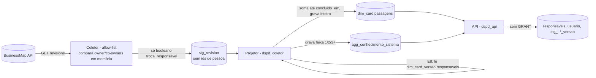

# Plano técnico: métricas "Também disponíveis" (pedido 011), viabilidade e desenho

Estado: **proposta** (discovery). Vira `vigente` depois da validação do usuário no protótipo e das decisões D-1 a D-14 de `docs/ux/metricas-tambem-disponiveis/04-decisoes.md`. Nada aqui foi implementado.

Decisões do usuário já incorporadas (2026-10-14, `docs/pedidos/011-metricas-tambem-disponiveis.md`): **D-8 = A** (T12), **D-5' = B** (O26), **D-6' = A** (O24) e **R-1 = A** (O24). Confirmações técnicas do cartão K-079 (revisões, vínculos, T10 e O25): §8. Métrica nova T14 (decisão "T14 nova = A", cartão K-078): §9. A D-1' (custo) segue em aberto com o usuário e não é tratada aqui.

Insumos: `01-cobertura.md`, `02-especificacao.md`, `04-decisoes.md` (UX); `data-model.md` §3, §7, §8 e §9; `features/metricas-complementares.md` (precedente das extensões de mock); ADR 0003 (orçamento); `packages/metricas/src` (módulos `core/` e `businessmap/`).

**Conferência com a constituição:** o projeto não tem `docs/constituicao.md`. Conferido contra as regras invioláveis do `CLAUDE.md`: **conforme**. Detalhe:
- **Pessoa:** nenhuma das 16 publica, filtra, ordena ou segmenta por pessoa. O26 e E8 recebem só inteiros calculados no coletor (§3).
- **BM × AC:** as 16 são só BusinessMap. Nenhuma lê `BaseAC`. O gêmeo de sazonalidade na Sustentação (D-11) fica fora.
- **Granularidade:** uma por gráfico. No T13, o seletor troca entre demanda e frente, uma de cada vez.
- **Biblioteca:** todo tempo, percentil e taxa vem de `core/` (`calendario`, `percentil`, `estatistica`, `histograma`, `series`, `janela`).
- **Amostra mínima:** abaixo de 20 não se publica estatística (`MINIMO_AMOSTRA`).
- **Histórico:** append-only preservado. Os dados novos são projeções derivadas ou tabelas novas, sem `UPDATE` em evento.
- **T2.6:** os critérios novos têm limite e prazo versionados em `criterios` ou `ref_`, nunca como literal no código.
- **Métricas proibidas (7.1):** nenhuma usa horas apontadas. O E7 fica sem R$ enquanto a D-1 não for decidida, e a opção C da D-1 está recusada.

## 1. Códigos finais

Os códigos provisórios do UX ficam **confirmados**, sem colisão: hoje o fluxo vai até O18, T9 e E5.

| Código | Nome | Entra em `METRICA_IDS`? |
|---|---|---|
| O19 | Bloqueios por causa | sim |
| O20 | Fluxo cumulativo | sim |
| O21 | Fluxo reverso | sim |
| O22 | Primeiro toque | sim |
| O23 | Estoque parado dentro do WIP | **não**: é um bloco do O2 (U-2). O código existe só no catálogo web (`catalogo-metricas.ts`), apontando para `o2`, e o dado vem como campo novo de `ResultadoO2`. |
| O24 | Ordem de chegada | sim |
| O25 | Descarte | sim |
| O26 | Passagens de mão | sim |
| T10 | Tempo de terceiros | sim |
| T11 | Sazonalidade da chegada | sim |
| T12 | Qualidade da entrada por área | sim |
| T13 | Dependências entre quadros | sim |
| E6 | Datas do portfólio | sim |
| E7 | Capacidade por sistema | sim |
| E8 | Concentração de conhecimento | sim |
| E9 | Projetos aguardando início | sim |
| T14 | Participação do meu time no projeto | sim (acrescentada em 2026-10-14, decisão "T14 nova = A"; desenho em §9) |

`METRICA_IDS` ganha 15 ids, inseridos na ordem do painel depois dos complementares de cada nível: O19 a O26 sem O23, T10 a T13, E6 a E9. Isso gera o efeito em cascata já conhecido:
- `SCHEMAS_RESULTADO`;
- `ContratoMetricas`;
- `APLICABILIDADE_FLUXO`;
- `REGRAS_METRICA`;
- `CALCULOS`;
- `CATALOGO_CARTOES` com `grupo: 'complementar'` e `status: 'mock'`;
- `calibracao.ts`;
- `varredura.test.ts`.

As rotas `GET /api/v1/metricas/:id` nascem pela iteração de `METRICA_IDS`, sem rota nova.

Novas chaves em `ChaveSegmentacao`: `'motivo-bloqueio'`, `'fornecedor'`, `'faixa-passagens'` e `'mes-do-ano'`. Não entram `pessoa`, `responsavel` nem `equipe`.

## 2. As 16 métricas

Legenda da coluna "Dado":
- **existe**: está em `BaseBM` e em `dim_card`, `fato_transicao` ou `fato_bloqueio`.
- **extensão**: dado novo que no mock fica fora de `BaseBM`, num mapa por id, seguindo o precedente das complementares (§4).
- **real**: o que a coleta real precisa ter.

Os contratos estão em alto nível; o detalhe zod é do `node-backend`. Todo resultado segue o envelope atual, com `base`, `janela`, `criterio` e `estatistica`/`taxa` de `contratos/comum`. Quando falta amostra, o resultado traz `insuficiente` com "k de n".

### O19 Bloqueios por causa
- **Fonte:** BM.
- **Dado:** existe. `fato_bloqueio` (motivo, início, fim, `duracao_horas_uteis`) junto com o card, que dá os filtros.
- **Cálculo:** módulo novo `businessmap/o19.ts`.
  - Seleciona os bloqueios com `fim` dentro do período e o card nos filtros.
  - Para cada um dos 7 motivos de `MOTIVOS_BLOQUEIO` (ordem neutra do domínio no contrato; a UI ordena por soma), calcula:
    - soma de horas úteis, convertida para dias úteis por `core/calendario`;
    - contagem;
    - P50/P85 da duração com `core/percentil`, só com n ≥ 20.
  - Conta à parte os bloqueios ainda abertos (`fim = null`).
- **Contrato:** `{ motivos: [{ motivo, bloqueios, diasUteis, pctDoTotal (taxa), duracao: estatistica }], abertosForaDaSoma, totalDiasUteis }`.
- **Mock:** a base atual já tem bloqueios, com motivo sorteado de forma uniforme (`gerador.ts:289`). A spec 8.1 pede distribuição desigual, mas isso alteraria o hash da base (`924448d4`). Proposta: aceitar a distribuição atual e conferir na implementação que ao menos um motivo passa de 20 em 12 semanas e outro fica abaixo. Se não passar, ver P-T3.
- **Mínimo:** soma e contagem são censo e saem sempre. P50/P85 e o percentual só saem com n ≥ 20 por motivo.

### O20 Fluxo cumulativo
- **Fonte:** BM.
- **Dado:** existe. `fato_transicao` (canônica, `vw_transicao_canonica`) e `dim_coluna` (papel, ordem). O fim de vida do card é dado por `fimDeVidaAberta`.
- **Cálculo:** módulo novo `businessmap/o20.ts`. É uma varredura única de eventos +1/−1 por (dia, faixa), a mesma técnica do remédio de C3 do O1 (ADR 0003). O ideal é **generalizar a varredura do O1** para "por coluna", memoizada por quadro no contexto, em vez de escrever outra.
  - Faixa = coluna, quando uma equipe está filtrada.
  - Faixa = `PapelColuna`, quando o filtro é "Todas".
  - A frase de leitura usa o maior crescimento absoluto nas faixas de fila (`tipo_coluna = 'fila'`).
  - As mudanças de critério do período vêm de `core/criterios`.
- **Contrato:** `{ agrupamento: 'coluna' | 'papel', faixas: [{ chave, rotulo, ordem, tipoColuna }], dias: [{ dia, contagens: number[] }], destaque: { faixa, de, para } | null, mudancasCriterio }`.
- **Mock:** a base já tem a história. Para a faixa que cresce nas últimas 4 semanas, o mock **não** altera a base. Se a base não mostrar crescimento, a frase cai em "Nenhuma etapa acumulou", que é um estado válido.
- **Mínimo:** contagem diária (censo), sem estatística. Sem transição no período, o estado é vazio.

### O21 Fluxo reverso
- **Fonte:** BM.
- **Dado:** existe. `fato_transicao.direcao = 'retorno'`, origem e destino. O mock já gera retornos (`gerador.ts:423`).
- **Cálculo:** módulo novo `businessmap/o21.ts`.
  - Considera as entregas do período (`concluido_em`, demanda) e marca com retorno as que tiveram ≥ 1 transição `retorno` até a conclusão.
  - A matriz conta pares (origem → destino) de retorno, agregados por papel quando o filtro é "Todas".
  - A linha "reaberto" junta os retornos com origem de papel `entrega`.
  - O par com × sem compara o tempo de ciclo do tipo escolhido. Reaproveita a função de marcos e de ciclo do O3; não recalcula o ciclo.
- **Contrato:** `{ entregas: { k, n, taxa }, matriz: { eixo: 'coluna'|'papel', celulas: [{ origem, destino, retornos }] }, reaberturas, comparacao: { tipo, com: estatistica, sem: estatistica } }`.
- **Mock:** a base atual já tem os retornos. Medir quantos são: a spec pede cerca de 25% das entregas. Se a base tiver menos, o cartão mostra o que existe; não se mexe na base.
- **Mínimo:**
  - percentual com n ≥ 20 entregas;
  - par com × sem só quando **cada** grupo tem ≥ 20 no tipo; abaixo disso, o contrato indica qual grupo faltou (CA-6).

### O22 Primeiro toque
- **Fonte:** BM.
- **Dado:** **extração nova**: `dim_card.primeiro_toque_em timestamptz NULL`.
  - Definição pela D-9 (recomendação A): o primeiro evento entre mudança de coluna, comentário e atribuição de responsável, posterior a `criado_em`, excluindo eventos automáticos.
  - Real: o projetor calcula o campo a partir de `stg_revision` (atribuição e coluna) e de uma staging nova, `stg_comentario_instante (card_id, comentario_id, criado_em)`, gravada pelo coletor por **allow-list**: sem autor e sem texto.
  - Depois de preenchido, o campo não muda mais. Por isso o coletor deixa de buscar comentários desse card (economia de chamadas, K1).
- **Cálculo:** módulo novo `businessmap/o22.ts`.
  - Mede de `criado_em` até `primeiro_toque_em` em horas úteis, convertidas para dias úteis com uma casa (`core/calendario`).
  - P50/P85/P95 por tipo na janela (`core/janela`, `JANELA_PERCENTIS_PADRAO`).
  - Histograma com as faixas fixas da spec (`core/histograma`).
  - "Ainda sem toque": abertos com `primeiro_toque_em = null`, com a contagem e a idade do mais antigo.
- **Contrato:** `{ tipo, distribuicao: estatistica, histograma: [{ faixa, itens }], semToque: { itens, maisAntigoDiasUteis | null } }`.
- **Mock:** extensão `primeiroToque: Record<card_id, number | null>`.
  - Distribuição lognormal assimétrica: mediana menor que 1 dia útil, cauda até 15.
  - 5 a 8 abertos sem toque.
  - Um tipo com menos de 20, para exercitar `insuficiente`.
- **Mínimo:** percentis com ≥ 20 pedidos tocados no tipo, na janela.

### O23 Estoque parado dentro do WIP (bloco do O2)
- **Fonte:** BM.
- **Dado:** existe. `semMoverHaDiasUteis` já é calculado por item em `o2.ts`.
- **Cálculo:** dentro de `o2.ts`, sem módulo novo.
  - `k` = itens em andamento com `semMover > limite`; `n` = WIP atual; quebra por etapa (papel ou coluna, a mesma do O2).
  - O limite (5 dias úteis, U-11) entra como **parâmetro versionado** em `criterios` (T2.6), não como literal.
- **Contrato:** acréscimo compatível em `ResultadoO2`: `parados: { limiteDiasUteis, k, n, taxa, porEtapa: [{ etapa, k }] }`. É campo novo no schema zod (ADR 0007: acréscimo, não quebra).
- **Mock:** a base atual. Medir a parcela acima de 5 dias úteis; a spec pede 20% a 30%, mas sem mexer na base.
- **Mínimo:** censo do WIP. A taxa só sai com n ≥ 20; abaixo, "k de n".

### O24 Ordem de chegada
- **Fonte:** BM.
- **Dado:** existe. `criado_em`, `iniciado_em`, `equipe`, `tipo` e `classe_servico`.
- **Cálculo:** módulo novo `businessmap/o24.ts`.
  - Grupo de comparação **decidido (D-6' = A, 2026-10-14):** a fila de cada equipe (quadro), só a classe **Padrão** e o mesmo tipo. Urgente, Prazo fixo e Intangível ficam fora do O24 (P:597-600). Não há fila do DSPD inteiro.
  - Para cada início no período, verifica se havia no mesmo grupo um card criado antes, ainda não iniciado e não descartado nem arquivado naquele instante (`arquivadoAte`). Se houver, é "fora de ordem".
  - Algoritmo: para cada grupo, ordenar por `criado_em` e varrer os inícios em ordem temporal com um conjunto ordenado dos não iniciados. O custo é O(n log n) por grupo.
  - Custo da ultrapassagem **decidido (R-1 = A, 2026-10-14):** para cada ultrapassado, dias úteis (`core/calendario`) entre o início do **primeiro** item que passou na frente dele e o seu próprio início. P50/P85 por tipo (`core/percentil`). Texto do cartão: "esperaram, depois de ultrapassados, X dias úteis até começar" (nunca "dias a mais"). Ultrapassado ainda não iniciado fica fora da estatística até iniciar.
- **Contrato:** `{ inicios: { k, n, taxa }, meses: [{ mes, emOrdem, foraDeOrdem, emAndamento }], custo: { tipo, estatistica } | null, grupo: 'equipe-tipo-padrao' }`. O `grupo` é literal único (sem alternativas no contrato).
- **Mock:** a base atual. Medir a parcela fora de ordem na classe Padrão; a spec pede cerca de 25%. Não se mexe na base. As pendências D-6 e R-1 deixam de ser `pendente-usuario` em `REGRAS_METRICA`.
- **Mínimo:** a taxa com ≥ 20 inícios; P50/P85 do custo com ≥ 20 ultrapassados no tipo.

### O25 Descarte
- **Fonte:** BM.
- **Dado:** existe. `motivo_descarte`, `arquivado_em` e `iniciado_em`.
  - **Restrição de código:** `descartado.ts` é o único arquivo que pode ler `motivo_descarte` e `arquivado_em` (regra de lint). O O25 exige funções novas **nesse arquivo**: `instanteDoDescarte(card)` e `motivoDoDescarte(card)`. O `o25.ts` usa essas funções e não lê os campos direto.
- **Cálculo:** módulo novo `businessmap/o25.ts`.
  - Encerrados no período = entregues (`concluido_em`) + descartados (instante do descarte); taxa = descartados ÷ encerrados (`core/estatistica`).
  - Tempo consumido pela D-13 (recomendação A): do `iniciado_em` ao descarte em horas úteis. Descartado antes do início conta zero e aparece à parte.
  - Tabela por motivo só quando o motivo pertence a um domínio fechado vigente (`ref_dominio` campo `motivo_descarte`, ainda inexistente). Os domínios fechados do briefing (B:135-139) não incluem motivo de descarte; os valores do domínio são **pergunta ao usuário** (§8 c). Enquanto não houver resposta, `porMotivo = null` no real e no contrato o campo é anulável.
- **Contrato:** `{ encerrados: { k, n, taxa }, meses: [{ mes, taxa, emAndamento }], consumido: { antesDoInicio: { itens }, depoisDoInicio: { itens, diasUteis, estatistica } }, porMotivo: [{ motivo, itens }] | null }`.
- **Mock:** a base atual já descarta (`aplicarDescarte`) com `MOTIVOS_DESCARTE` (4 valores mais "Criado por engano" para os excluídos).
  - **"Criado por engano" sai do O25** (§8 c): não existe em nenhum documento (04-decisoes, R-2). O O25 não o exibe como motivo nem o usa como filtro. O card excluído entra no descarte como o arquivado (P:564; 04-decisoes, R-2), com motivo `null` ("motivo não informado").
  - Os 4 valores restantes são marcados como **provisórios**, como `CAUSAS_RAIZ`, até o usuário responder a pergunta do domínio. Retirar o valor do gerador mudaria o hash da base (`924448d4`); a correção fica no adaptador do O25 (mapear o valor para `null`), sem tocar em `gerarBaseMock`.
- **Mínimo:**
  - taxa com ≥ 20 encerrados;
  - P50/P85 do consumido com ≥ 20 descartados após o início (raro);
  - fora isso, soma e contagem.

### O26 Passagens de mão
- **Fonte:** BM.
- **Dado:** **extração nova**: `dim_card.passagens smallint NULL`. É um inteiro, não é coluna de pessoa, e a API pode ler. Cálculo e proteção em §3.
- **Cálculo:**
  - No coletor: a contagem de trocas pela **D-5' = B** (decidida em 2026-10-14): conta só quando alguém sai e outro entra, ou o conjunto é substituído; incluir co-responsável sem ninguém sair não conta. Fonte e mecanismo: §8 a.
  - Na biblioteca: módulo novo `businessmap/o26.ts`. Para cada entregue do tipo escolhido, faz o histograma por faixa (0, 1, 2, 3, 4+) e o P85 do tempo de ciclo por faixa, reaproveitando o ciclo do O3.
- **Contrato:** `{ tipo, faixas: [{ faixa, itens, pct (taxa), cicloP85: estatistica }], semDado: number }`. `semDado` conta os cards sem `passagens`, por exemplo os anteriores à coleta.
- **Mock:** extensão `passagens: Record<card_id, number>`.
  - Valores de 0 a 6, tirados de uma distribuição condicionada ao tempo de ciclo, para criar correlação positiva.
  - O mock **não** lê `responsaveis` para isso.
- **Mínimo:** histograma (contagem) sempre. Percentual e P85 por faixa com ≥ 20.

### T10 Tempo de terceiros
- **Fonte:** BM.
- **Dado:** existe. `fato_bloqueio` com `fornecedor` informado, **qualquer** motivo do domínio fechado (B:136). O critério é o campo, não o motivo (§8 c).
  - Prazo contratado: **configuração nova** (D-10, B), na tabela `ref_prazo_fornecedor (fornecedor_codigo, dias_uteis, vigente_de, vigente_ate)`, que segue o padrão `ref_` com vigência.
  - Toda vigência nova gera uma versão de critério (T2.6).
- **Cálculo:** módulo novo `businessmap/t10.ts`.
  - Para cada fornecedor, em ordem alfabética: bloqueios encerrados no período, soma em dias úteis e P50/P85 da duração (`core/percentil`).
  - Status em relação ao prazo vigente no `fim` do bloqueio: compara o **P85** com o prazo. Isso é uma escolha de exibição já na spec; a comparação pelo P85 deve ser confirmada na validação.
- **Contrato:** `{ fornecedores: [{ fornecedor, bloqueios, diasUteis, duracao: estatistica, prazoDiasUteis | null, status: 'dentro'|'acima'|'sem-prazo'|null }], totalDiasUteis }`.
- **Mock:**
  - A base já tem 3 fornecedores (`catalogos.ts:60`: Alfa, Beta e Gama). Não há Delta; a spec aceita de 3 a 4.
  - Prazo de mock em `ConfigBM` estendido no ext (`prazoFornecedor`) para 2 dos 3.
  - A base também põe `fornecedor` em "Aguardando licença ou contrato". Esses bloqueios **entram** no T10: entra todo bloqueio encerrado com fornecedor informado (R-5, resolvida pelos documentos; §8 c). O filtro "só Aguardando fornecedor" da versão anterior deste plano foi retirado por não ter base. Bloqueio "Aguardando fornecedor" sem fornecedor é falha de preenchimento e fica fora da tabela.
- **Mínimo:** P50/P85 por fornecedor com ≥ 20 encerrados; abaixo, "— amostra insuficiente" e só contagem e soma.

### T11 Sazonalidade da chegada
- **Fonte:** BM.
- **Dado:** existe. `criado_em` (marco de entrada, T1.5), com `tipo`, `equipe`, `sistema` e `granularidade` para os filtros. Exige **24 meses** de histórico na base real: a carga histórica inicial do coletor precisa alcançar 24 meses mais o mês corrente.
- **Cálculo:** módulo novo `businessmap/t11.ts`.
  - Contagem de demandas (story, sem subtarefa) por (ano, mês), em janela fixa de 24 meses fechados mais o corrente, ancorada em `hoje` e não no filtro de período.
  - Mês corrente marcado com `emAndamento`.
  - A média mensal é só referência de contagem.
  - A agregação por mês vem de `core/series`.
- **Contrato:** `{ anos: [{ ano, meses: [{ mes, entradas | null, emAndamento }] }], mesesComDado, mediaMensal, historicoCurto: boolean }`.
- **Mock:** **o ponto mais sensível.** O mock tem 18 meses (`config.ts:13`, `mesesHistorico: 18`), sem padrão sazonal. Duas opções (decisão técnica, P-T3):
  - **(a) Série própria no ext.** `entradasSazonais: { criado_em, tipo, equipe, sistema }[]` com 24 meses e picos em janeiro e julho, consumida só pelo T11 quando a fonte é mock. A função de cálculo é a mesma; só muda o adaptador. Custo: no mock, T11 e O7 divergem nos meses em comum. Isso precisa ficar documentado no teste e na nota de QA.
  - **(b) Rebaseline da base para 24 meses com sazonalidade.** É fiel e coerente, mas muda o hash `924448d4` e os snapshots das 50 métricas. Também soma cerca de 33% de cards, com risco direto em C1 (medido entre 309 e 422 ms para um limite de 500).
  - **Recomendação: (a)** enquanto o status for `mock`. Na coleta real, o adaptador lê `dim_card` e a divergência some.
- **Mínimo:** contagem (censo), sem percentil. Com menos de 24 meses, `historicoCurto = true` e a nota da spec.

### T12 Qualidade da entrada por área
- **Fonte:** BM.
- **Dado:** existe. `area_solicitante`, `fato_bloqueio` ("Falta de informação no chamado") e `fato_transicao` (retorno do papel `compromisso` para `backlog`).
- **Cálculo:** módulo novo `businessmap/t12.ts`.
  - Demandas que entraram no período (`criado_em`).
  - "Ida e volta" pela **D-8 = A** (decidida em 2026-10-14): bloqueio desse motivo com `inicio < iniciado_em` (ou o card ainda não iniciado), **ou** um retorno compromisso → backlog.
  - Para cada área, ordenada por volume (neutra): `k`, `n` e taxa (`core/estatistica`).
- **Contrato:** `{ total: { k, n, taxa }, areas: [{ area, k, n, taxa }] }`.
- **Mock:** a base atual (`AREAS_EXTERNAS` mais a área interna). A frequência de ida e volta depende dos bloqueios uniformes e dos retornos já existentes. Medir; a spec pede de 10% a 25%, com duas áreas abaixo de 20.
- **Mínimo:** taxa por área com ≥ 20; abaixo, "k de n".

### T13 Dependências entre quadros
- **Fonte:** BM.
- **Dado:** **extração nova**.
  - Projeção `fato_vinculo (card_id, card_relacionado_id, tipo_vinculo, quadro_relacionado_id, outro_quadro boolean, criado_em, removido_em NULL)`, a partir de uma staging nova `stg_vinculo_relacao`.
  - Por que staging nova: a `stg_vinculo` atual cobre só pai e filho (`pai_id`, `filho_id`), não predecessor nem relacionado.
  - O tipo de vínculo segue a D-14'. A API expõe `predecessor`/`successor` além de pai/filho e `relative`, mas o vínculo não tem data de criação nem de remoção: as datas só saem da comparação entre revisões (§8 b).
  - Pela conciliação da D-14 (04-decisoes, seção C), o bloqueio "Dependência de outra demanda" sai do T13 e vira "leia junto" com o O19.
  - Um vínculo removido gera evento, nunca `DELETE` em evento.
- **Cálculo:** módulo novo `businessmap/t13.ts`.
  - Entregas do período na granularidade escolhida, uma por vez (`story` ou `frente`).
  - "Dependeu" = vínculo do tipo decidido na D-14' para `outro_quadro`, vigente conforme a R-4 (A: em algum momento antes de `concluido_em`; B: na entrega). As duas são calculáveis só a partir das revisões (§8 b).
  - Par P50/P85 do lead time com × sem no mesmo tipo, reaproveitando o T1.
  - A resposta não traz o quadro nem a equipe do relacionado: só o booleano.
- **Contrato:** `{ granularidade, entregas: { k, n, taxa }, comparacao: { tipo, com: estatistica, sem: estatistica } }`. O bloco de bloqueio por dependência saiu (conciliação da D-14).
- **Mock:** extensão `vinculos: { card_id, relacionado_id, outro_quadro }[]` em cerca de 35% das stories e 50% das frentes, apontando para cards existentes de outras equipes.
- **Mínimo:**
  - taxa com ≥ 20 entregas;
  - par só quando cada grupo tem ≥ 20 no tipo **e** na granularidade.

### E6 Datas do portfólio
- **Fonte:** BM.
- **Dado:**
  - `data_acordada` existe em `dim_card`. No mock, porém, **só as stories** a recebem (`acordar()` é chamada em `finalizarStory`); os projetos não têm.
  - A data original e o número de replanejamentos são **extração nova**: as projeções `dim_card.data_acordada_original date NULL` e `dim_card.replanejamentos smallint NULL` são derivadas pelo projetor das mudanças de `data_acordada` em `dim_card_versao` (SCD2, ADR 0016) e, para o período anterior ao início da coleta, de `stg_revision` (se a revision trouxer mudança de campo customizado, P-T1).
  - Qual data vale: D-7.
- **Cálculo:** módulo novo `businessmap/e6.ts`.
  - Projetos concluídos no período (padrão de 12 meses).
  - Deslize = dias úteis entre a data comprometida e `concluido_em`, com sinal (`core/calendario`). Tolerância zero (D-7).
  - k projetos na data, de n.
  - P50/P85 do deslize com n ≥ 20.
  - Pontos por projeto, com código, título, deslize e replanejamentos.
- **Contrato:** `{ projetos: [{ cardId, codigo, titulo, deslizeDiasUteis, replanejamentos }], naData: { k, n, taxa }, deslize: estatistica }`. A lista é pequena (dezenas), sem paginação.
- **Mock:** extensão `datasProjeto: Record<card_id, { original: number, final: number, replanejamentos: 0..3 }>` para 11 a 14 projetos concluídos em 12 meses. Ficam abaixo de 20 de propósito, para a variante `lenta`.
- **Mínimo:** taxa e P50/P85 com ≥ 20 projetos; abaixo, AmostraInsuficiente `lenta` com os pontos e "k de n".

### E7 Capacidade por sistema
- **Fonte:** BM.
- **Dado:** existe. `sistema`, `tipo`, `concluido_em`, demanda sem subtarefa. Custo (só com D-1 = B): `ref_custo_area (valor, vigente_de, vigente_ate)`, um único valor por área, nunca por equipe ou pessoa. Nada de horas apontadas.
- **Cálculo:** módulo novo `businessmap/e7.ts`.
  - Entregas do período por sistema; participação = entregas do sistema ÷ total (`core/estatistica`). Peso pela D-2 (recomendação A: contagem).
  - A natureza vem da função **`naturezaDe` do T3** (`t3.ts:14`), sem um segundo mapeamento. Atenção: ela tem 4 naturezas (inclui "Projetos"), e a spec cita 3 (ver R-3).
  - Sistemas com menos de 20 entregas vão para o fim, com "k de n".
  - O rateio em R$ (só com D-1 = B) = participação × custo vigente, calculado na biblioteca.
- **Contrato:** `{ total, sistemas: [{ sistema, entregas, participacao (taxa), porNatureza: [{ natureza, itens, pct }], custoRateado | null }], custoConfigurado: boolean }`.
- **Mock:** a base atual (18 a 20 sistemas). Sem custo (CA-13).
- **Mínimo:** participação com ≥ 20 entregas no total; por sistema, abaixo de 20 só "k de n".

### E8 Concentração de conhecimento
- **Fonte:** BM.
- **Dado:** **agregado novo**, calculado no coletor: `agg_conhecimento_sistema` (§3). A API não toca em pessoa.
- **Cálculo:**
  - No projetor: a faixa por sistema e janela.
  - Na biblioteca: módulo novo `businessmap/e8.ts`, que só conta sistemas por faixa (1, 2, 3+) na janela escolhida.
  - Se houver menos de 5 sistemas com entregas, devolve `recortePequeno` e omite as faixas (CA-10).
  - A lista de sistemas em "1 pessoa" só vem com D-4 = B.
- **Contrato:** `{ janelaMeses, sistemasComEntrega, faixas: { uma, duas, tresOuMais } | null, recortePequeno: boolean, sistemasUmaPessoa: string[] | null }`. Não tem campo de pessoa; a validação zod é `strict`.
- **Mock:** a extensão gera **diretamente** o agregado, sem pessoas: 4 sistemas em uma pessoa, 6 em duas e o resto em três ou mais.
- **Mínimo:** censo de sistemas, sem percentil. O recorte precisa ter 5 ou mais sistemas.

### E9 Projetos aguardando início
- **Fonte:** BM.
- **Dado:** existe. Cards `granularidade = 'projeto'` com `iniciado_em = null`, não descartados e não arquivados (`descartado`, `arquivadoSemDesfecho`).
- **Cálculo:** módulo novo `businessmap/e9.ts`.
  - É o retrato de `hoje`: idade em dias úteis desde `criado_em` (`core/calendario`), com as faixas fixas da spec.
  - A referência é o P85 do "antes do início" **importado do `e1.ts`** (não recalculado), e só aparece quando o E1 tem ≥ 20 projetos.
- **Contrato:** `{ projetos: [{ cardId, codigo, titulo, tipo, criadoEm, idadeDiasUteis, faixa }], segmentoPor: 'tipo', referenciasP85: [{ tipo, referenciaP85: estatistica }] }` (uma referência por tipo, mínimo 20 por tipo; ajuste de 2026-10-15, regra 7 e Q4).
- **Mock:** a base atual. Medir quantos projetos estão abertos e não iniciados. Se forem menos de 6, ou nenhum passar de 180 dias úteis, a extensão **não** cria projeto (mexeria em E1 e E4); o cartão mostra o que existe.
- **Mínimo:** censo dos abertos; a referência de percentil só com ≥ 20 concluídos.

## 3. Proteção de pessoa (O26, E8 e O22)

Princípio: **a identidade só existe dentro do coletor e do projetor (papel `dspd_coletor`); o que sai deles é um inteiro sem pessoa.** A API (`dspd_api`) continua sem `SELECT` em `COLUNAS_PESSOA` (GRANT por coluna) e sem acesso a `*_versao` e `stg_`.

- **O26 `passagens`:** fonte = as revisões do card (`owner_user_id` e `co_owner_ids` em `CardRevision`), comparadas em memória no coletor; só um booleano por revisão e o inteiro final saem dele. Mecanismo completo e o que falta confirmar: §8 a.
  - Pela D-5' = B, conta só quando alguém sai e outro entra (ou o conjunto é substituído).
  - Card sem revisões coletadas (ou com o spike de §8 a negativo): `passagens = null`, contado em `semDado`.
  - O SCD2 diário (`dim_card_versao`) deixa de ser a fonte da contagem: ele perderia trocas no mesmo dia (P-T2). Fica só como estado de partida opcional (§8 a).
- **E8 `agg_conhecimento_sistema`:**
  - Chave: `(sistema_codigo, janela_fim date (último dia do mês), janela_meses smallint, versao_criterio)`.
  - Coluna: **`faixa_concentracao smallint CHECK (faixa_concentracao IN (1,2,3))`**, em que 3 significa "3 ou mais".
  - Também `entregas int`.
  - Minimização: guarda a faixa, não o número exato de pessoas. O nome da coluna não casa com o regex de `lgpd.ts`, e a tabela não entra em `COLUNAS_PESSOA` porque não tem pessoa.
  - O projetor recalcula por janela mensal móvel (D-3: 12 meses), contando os responsáveis distintos na `dim_card_versao` vigente em `concluido_em` das entregas do sistema.
  - Projeção substituível por janela (`DELETE`+`INSERT` na mesma transação), como as demais projeções.
- **O22:** a staging de comentário guarda só `(card_id, comentario_id, criado_em)`.
  - Autor e texto são descartados na fronteira (allow-list, o mesmo padrão do Acelerato).
  - Para excluir os eventos automáticos, o coletor compara o autor **em memória** com uma lista de contas de sistema (`ref_conta_automacao`, ids técnicos de robô, não de pessoa) e descarta o autor em seguida.
- **Onde fica a função de contagem:**
  - Funções puras em `packages/metricas/src/coletor/` (subpasta nova): `houveTroca(anterior: ReadonlySet<string>, atual: ReadonlySet<string>): boolean` (§8 a) e `faixaConcentracao(idsDistintos: number)`.
  - Recebem ids opacos e devolvem números.
  - **Não** são exportadas pelo `index.ts` público, não entram no bundle web, e uma regra de lint permite importá-las só a partir de `server/src/modulos/coleta*`.
  - Isso cumpre "cálculo pela biblioteca compartilhada" sem expor pessoa a nenhum consumidor da API.
- **Testes obrigatórios:**
  - teste de grants: `dspd_api` lê `passagens` e `agg_conhecimento_sistema` e não lê `responsaveis`;
  - teste LGPD de catálogo (`lgpd.ts`): nenhuma coluna nova viola o regex;
  - property test existente (`regras.property.test.ts:581`): nenhuma string de pessoa do mock aparece na saída das 15 métricas novas;
  - E2E: CA-9 e CA-10.
- **Achado informativo (não bloqueia):** `data-model.md` §9, garantia 6, diz que `DimCard.responsaveis` e `FatoTransicao.usuario` ficam **fora** dos tipos da biblioteca e do mock. Hoje eles estão em `modelo.ts:34`/`:58`, e o mock os preenche com pseudônimos (`gerador.ts:391`). Nenhuma métrica os lê, e o property test protege a saída. Proposta ao tech-lead: alinhar o documento ao código, ou tirar os campos dos tipos públicos e deixá-los só no tipo do projetor. Em qualquer caso, nenhuma das 15 pode ler esses campos: regra de lint `no-restricted-properties` em `businessmap/*.ts`.

## 4. Mock: estrutura

Segue o precedente das complementares sem mexer em `BaseBM`/`gerarBaseMock`. O hash `924448d4` (escala 0,2: `b2bfd4c0`) continua intacto.
- Interface nova `ExtensaoTambemBM` em `businessmap/extensao.ts`, com os campos:
  - `primeiroToque`;
  - `passagens`;
  - `vinculos`;
  - `datasProjeto`;
  - `conhecimentoSistema`;
  - `prazoFornecedor`;
  - `entradasSazonais`.
- Gerador **separado**, `gerarExtensaoTambemMock(base)`, com streams `derivar(semente, 'tambem:<campo>')`. Assim o hash das extensões existentes (`fbddcf28`) **não muda**, e o novo ganha teste de hash próprio e de determinismo.
- `ContextosMetricas` ganha `tambem?: ExtensaoTambemBM`. Os cálculos que dependem dele devolvem `insuficiente`/vazio quando ele falta, nunca 500.
- Geração **lazy**: só quando a seção "Mais métricas" abre ou no primeiro cálculo que precise dela, nunca em C1.
- `COM_EXTENSAO_MOCK` (`cartoes.ts:55`) recebe O22, O26, T13, E6 e E8 sempre. T10 e E7 entram só quando tiverem prazo ou custo de mock (T10 sim, E7 não).
- Os 24 meses da sazonalidade vêm de `entradasSazonais` (opção (a) do T11).
- Regras ainda pendentes com o usuário (D-9', D-10/R-7, D-14'/R-4, R-2', D-1', o domínio de motivo de descarte e as duas bordas da D-5' em §8 a): a recomendação marcada fica como `pendencias` em `REGRAS_METRICA`, com `status: 'pendente-usuario'`. D-5', D-6', D-8 e R-1 já estão decididas e não entram como pendência.

## 5. Ordem de implementação recomendada

Coincide com a D-12 A, refinada pelo que já está no modelo e no mock.

1. **Fase 1: só dado existente, sem extensão.**
   - O23 (acréscimo no O2, o menor);
   - O19;
   - E9;
   - E7 sem custo;
   - T10 sem prazo;
   - O25 (com as funções novas em `descartado.ts`);
   - T12 (D-8 = A, decidida);
   - O21;
   - O20 (generalizar a varredura do O1);
   - O24 (D-6' = A e R-1 = A, decididas);
   - T14, **só se** a Q-T14-1 confirmar `equipe` do quadro como fonte (§9.4). Se a fonte for um campo customizado, o T14 vai para a fase 3.
   - Paralelizáveis em três grupos: bloqueios (O19, T10, T12), fluxo (O20, O21, O24) e retrato/estratégico (O23, O25, E7, E9).
2. **Fase 2: extensão de mock sem coleta nova.**
   - T11 (`entradasSazonais`);
   - prazo do T10 (`prazoFornecedor`).
3. **Fase 3: extração nova, primeiro em mock.**
   - E6;
   - T13 (depende da D-14' e da R-4; sem dependência de bloqueio, §8 b);
   - O22;
   - O26;
   - E8.
   - Os três últimos têm pessoa na fronteira e dependem de P-T1. A coleta real dessas cinco depende do coletor real (WS2) e do spike da OpenAPI do BusinessMap.
4. **Na coleta real:**
   - migrações para `dim_card` (`primeiro_toque_em`, `passagens`, `data_acordada_original`, `replanejamentos`), `stg_comentario_instante`, `stg_vinculo_relacao`, `fato_vinculo`, `agg_conhecimento_sistema`, `ref_prazo_fornecedor`, `ref_conta_automacao` e, só com D-1 = B, `ref_custo_area`;
   - `gerarGrants` atualizado;
   - revisão de modelagem (arquiteto + tech-lead) por tocar `lgpd.ts`/§9.

Divisão:
- `node-backend`: contratos (primeiro, para desbloquear o front), cálculos e `REGRAS_METRICA`, extensão de mock, serviço e testes de rota.
- `react-frontend`: cartões, seções novas e bloco do O2, assim que os tipos de resultado existirem.
- `qa-engineer`: em paralelo, plano com:
  - borda 19/20 por métrica;
  - CA-6 (cada grupo);
  - CA-9/CA-10 (pessoa);
  - CA-12 (T11 não afetado por período);
  - lazy da seção;
  - orçamento.
- `tech-lead`: review, P-T3 e o achado de §3.

## 6. Riscos de desempenho (ADR 0003)

| Item | Risco | Métrica | Mitigação | Verificação |
|---|---|---|---|---|
| C3 (< 50 ms, inclusive a frio) | alto | O20 | Varredura +1/−1 por coluna, memoizada por quadro no contexto. O O20 é o O1 multiplicado pelas colunas; foi o O1 a frio (554 ms) que estourou na fase A. | `desempenho.test.ts` cobre os 15 ids novos, a frio e 20×, filtro padrão e período máximo |
| C3 | médio | O24 | Conjunto ordenado por grupo, O(n log n). Proibido o O(n²) ingênuo sobre a base inteira. | idem |
| C3 | médio | O21, O26, T13 | Reaproveitar ciclo e lead time memoizados do O3 e do T1 em vez de recalcular por card. | idem |
| C1 (< 500 ms; medido entre 309 e 422) | médio | todas | `gerarExtensaoTambemMock` é lazy, fora de C1. Rebaseline da base para 24 meses (opção b do T11) quebraria C1. | `mock` C2 inalterado; teste de tempo próprio do novo gerador |
| C4 (< 300 ms por painel) | médio | Operacional passa a ter +15 complementares | As complementares só calculam com a seção aberta (lazy). Medir C4 do núcleo e da seção aberta separadamente. | C4 com a seção aberta, registrado pelo QA |
| A3 (payload < 50 KB gzip) | baixo | O20 | 12 meses × até 9 faixas = cerca de 3,3 mil inteiros, bem abaixo do limite. E6 e E9 têm listas de dezenas. | medir no teste de rota |
| M1/M2 (< 500 ms, sem full scan) | médio | O19, T10, T13, E9 | Índices novos: `fato_bloqueio (motivo, fim) WHERE fim IS NOT NULL`; `fato_vinculo (card_id)` e `(card_relacionado_id)`; `dim_card (granularidade, criado_em) WHERE iniciado_em IS NULL` para o E9. `EXPLAIN` registrado. | job `db` do CI |
| S1 (partida a frio < 1,5 s) | baixo | todas | O contexto carrega 4 colunas a mais em `dim_card` e 2 tabelas pequenas (`fato_vinculo`, `agg_`). | medição do S1 no QA |
| K1 (coleta BM < 15 min, limite de taxa) | **alto** | O22, T13 | Comentários e vínculos podem custar uma chamada por card (N+1). Buscar só nos cards alterados desde a marca d'água; parar os comentários depois de `primeiro_toque_em` preenchido; usar `expand`/inclusão no payload de cards, se a OpenAPI permitir (P-T1). Carga histórica de 24 meses (T11, E6) numa execução separada, fora da janela diária. | log K3 por entidade |

## 7. Perguntas técnicas novas (não duplicam as D-n do 04)

| # | Pergunta | Para | Recomendação |
|---|---|---|---|
| P-T1 | A OpenAPI do BusinessMap expõe, no histórico do card (revisions ou equivalente), (a) a troca de responsável, (b) a mudança do campo de data acordada, (c) o instante de criação de comentário, (d) os vínculos predecessor/relacionado com o quadro do outro card e (e) a marca de evento automático? O briefing 3.1 proíbe assumir nomes. | spike do `node-backend` na OpenAPI do subdomínio, antes da fase 3 | **Respondida em parte pela OpenAPI pública (K-079, §8):** (a) sim, `CardRevision` traz `owner_user_id` e `co_owner_ids`; (b) `CardRevision` traz `custom_fields` (a confirmar no card real); (d) sim para o tipo (`predecessor`, `successor`, `relative`, `parent`, `child`), não para datas do vínculo e não para o quadro do outro card. (c) e (e) não verificados nesta rodada. O que resta é o spike no card real (§8 a e b). |
| P-T2 | O SCD2 diário perde trocas de responsável no mesmo dia (A→B→A). Isso basta para o O26? | arquiteto + tech-lead (se mudar a leitura, vai ao usuário) | **Resolvida pelo §8 a:** a contagem usa as revisões, não o SCD2. Só volta se o spike mostrar que a troca de responsável não gera revisão. |
| P-T3 | Mock do T11: série própria no ext (a) ou rebaseline da base para 24 meses (b)? E o mesmo para a distribuição de motivos do O19, se faltar amostra. | tech-lead | (a). O rebaseline fica para quando houver outro motivo para mexer na base. |
| P-T4 | Gerador separado (`gerarExtensaoTambemMock`) para manter o hash `fbddcf28`, ou incorporar ao gerador atual e atualizar o hash conscientemente? | tech-lead | Separado. |
| P-T5 | No E8, guardar a faixa (1, 2, 3+) em vez do número exato de pessoas. | arquiteto + tech-lead | Faixa (minimização LGPD). O cartão só precisa das três faixas. |
| P-T6 | Divergência entre `data-model.md` §9.6 e `modelo.ts` (`responsaveis`/`usuario` nos tipos da biblioteca). | tech-lead | Ver §3, achado informativo. |

**Lacunas de regra de negócio** que os documentos de UX ainda não tratam. Não foram decididas aqui e vão ao usuário pelo Jarvis, junto com as D-n:
- **R-1 (O24): decidida, A** (2026-10-14), leitura (i). Incorporada no O24.
- **R-2 (O25):** qual é o instante do descarte quando o card tem `motivo_descarte` mas não foi arquivado? E os excluídos com "Criado por engano" entram na taxa de descarte?
- **R-3 (E7):** a natureza tem 3 valores (spec) ou os 4 do T3, incluindo "Projetos"? A recomendação técnica é reaproveitar o T3, com 4.
- **R-4 (T13):** um vínculo removido antes da entrega conta como "dependeu"? Continua com o usuário, junto com a D-14'. Dado técnico para a decisão em §8 b: as duas opções só são calculáveis pelas revisões.
- **R-5 (T10): resolvida pelos documentos** (04-decisoes, seção D): entra todo bloqueio com fornecedor informado. Incorporada no T10 (§8 c).
- **R-6 (E9):** a spec supõe que "o card de projeto nasce logo após a aprovação". Isso é verdade nos quadros reais, ou existe um campo ou coluna de aprovação que deveria ser o marco? Se não for verdade, a idade mede outra coisa.
- **R-7 (T10):** o status "dentro/acima do contratado" compara o P85 com o prazo, ou a fração de bloqueios dentro do prazo?

## 8. Confirmações técnicas (cartão K-079, 2026-10-14)

**Fonte:** a especificação OpenAPI pública da API v2 do BusinessMap, `https://demo.kanbanize.com/openapi/json` (2,2 MB), lida inteira em blocos de 100 mil caracteres por um resumidor automático, em 2026-10-14. É a mesma fonte e o mesmo limite de `docs/integracao/businessmap-api-configuracao.md` §0: o resumidor parafraseia; nomes de campo e enums são confiáveis, descrições longas não. Legenda igual à daquele documento: **[DOC]** consta na especificação; **[INF]** inferência, a confirmar; **não confirmado** quando a especificação não responde. A base de conhecimento (`knowledgebase.businessmap.io`) devolve 403 e não foi lida.

### a) Responsáveis nas revisões do card (O26, D-5' = B)
- **Confirmado [DOC]:** o schema `CardRevision` (base de `CardRevisionCard` e `CardRevisionInitiative`, devolvidos por `GET /cards/{card_id}/revisions/{revision}`) traz `owner_user_id` ("The ID of the user assigned as the owner of the card") e `co_owner_ids` ("A list of user IDs assigned as co-owners of the card"), além de `column_id`, `custom_fields`, `linked_cards`, `revision`, `user_id` e `replaced_at`.
- **Confirmado [DOC]:** `GET /cards/{card_id}/revisions` lista só `revision`, `user_id` (quem fez a alteração) e `replaced_at`. O conjunto de responsáveis exige o detalhe de cada revisão.
- **Confirmado [DOC]:** não existe na OpenAPI um endpoint de histórico de eventos do card (procurado em todos os blocos; há histórico de quadro, tipo de card, campo customizado, usuário e outros, nenhum de card).
- **Não confirmado:** (1) se toda troca de dono ou de co-responsável gera uma revisão nova; (2) se o instante da troca é o `replaced_at` da revisão anterior. **O que falta:** no swagger da conta, um card de teste com a sequência dono A → co-responsável B incluído → A removido, e a leitura das revisões. Sem isso, o O26 não sai da fase de mock.
- **Custo (K1):** o detalhe de revisão é 1 chamada por revisão. É o mesmo detalhe que a `fato_transicao` já precisa (B:53), então o O26 não acrescenta chamadas se o coletor ler as revisões completas. Se o coletor optar por `expand=transitions` para a transição (businessmap-api-configuracao §4.3), o O26 passa a custar o detalhe das revisões de cards alterados: medir no log K3 por entidade.
- **Como a contagem vira inteiro na fronteira, sem pessoa:**
  1. O coletor recebe o detalhe da revisão e monta, **em memória**, o conjunto `R_i = {owner_user_id} ∪ co_owner_ids` (ids opacos; nulos descartados). O papel (dono ou co-responsável) não importa: trocar quem é dono entre os mesmos dois responsáveis não muda o conjunto e não conta.
  2. Compara com o conjunto da revisão anterior, `R_(i-1)`, pela função pura `houveTroca(anterior, atual)`: verdadeiro se e só se `R_(i-1) \ R_i` não é vazio **e** `R_i \ R_(i-1)` não é vazio (alguém saiu e alguém entrou; a substituição do conjunto inteiro é um caso disso). Incluir co-responsável sem saída: falso. Só remover: falso.
  3. Grava em `stg_revision` apenas `troca_responsavel boolean` ao lado de `revision` e `replaced_at`. Os ids, `user_id` da revisão e o conjunto são descartados ali mesmo (allow-list); nenhum id de pessoa chega a staging.
  4. O projetor soma `troca_responsavel` das revisões até `concluido_em` e grava `dim_card.passagens smallint`. A soma é recalculável, e a staging é append-only.
  5. Estado de partida na coleta incremental: o conjunto da última revisão já processada. Recomendação: reler esse detalhe (1 GET por card alterado, em memória). Alternativa mais barata: `dim_card_versao.responsaveis`, que já é coluna protegida do `dspd_coletor`. Quem escolhe é o tech-lead, pelo K1 medido.
  6. Testes: `houveTroca` com propriedade (conjunto igual → falso; só entrada → falso; troca → verdadeiro); teste de grants e de catálogo LGPD de §3; e um teste da allow-list do coletor que falha se `owner_user_id`, `co_owner_ids` ou `user_id` aparecerem no registro de staging.
- **Duas bordas que a D-5' não fecha (pergunta ao usuário, sem inferência):**
  - **Q-a:** `{A, B} → {C, D}` numa única revisão conta como 1 passagem ou 2? Recomendação: 1, uma por revisão, que é o que a definição "o conjunto é substituído" descreve como um evento.
  - **Q-b:** saída e entrada em revisões diferentes, com o card sem responsável no meio (`{A} → {} → {B}`), é uma passagem? Pela regra do passo 2, nenhuma das duas revisões conta. Recomendação: contar 1, comparando com o último conjunto não vazio. A regra do passo 2 só muda depois da resposta.

### b) Vínculos entre cards (spike P-T1 d, D-14' e R-4)
- **Tipos expostos [DOC]:** `LinkedCardWithType.link_type` tem o enum `child`, `parent`, `relative`, `predecessor`, `successor`. As rotas são `GET /cards/{card_id}/linkedCards` (todos, com tipo), `/predecessors`, `/successors`, `/relatives`, `/parents` e `/children`. Na listagem, `expand=linked_cards` ("A list of cards linked to the card, along with their relationship type").
- **Há vínculo de dependência:** `predecessor`/`successor`. **O T13 tem fonte.**
- **Datas do vínculo [DOC, por ausência]:** `LinkedCard` só tem `position`; `LinkedCardWithType` tem `card_id`, `link_type` e `position`. **Não há data de criação nem de remoção do vínculo**, e não há histórico de eventos do card (item a).
- **Datas por derivação [INF], não confirmado:** `CardRevision` traz `linked_cards`. Comparando revisões consecutivas, o vínculo aparece numa revisão e some em outra; o instante seria o `replaced_at` da revisão anterior. Falta confirmar no card real: (1) se criar ou remover vínculo gera revisão; (2) em qual dos dois cards (ou nos dois) a revisão aparece.
- **Quadro do outro card:** o vínculo traz só o `card_id`. O quadro vem de `dim_card` quando o card relacionado está num quadro coletado; caso contrário, de `GET /cards/{card_id}` (só se o usuário de serviço tiver acesso ao quadro). Sem acesso, `outro_quadro` é desconhecido e o card cai num `semDado` do T13, nunca em "não dependeu". **Não confirmado** o comportamento da API quando o card relacionado está num quadro sem permissão.
- **Consequência para as decisões do usuário:**
  - **D-14':** os tipos existem; a escolha continua com o usuário. Dado técnico: `parent`/`child` é a hierarquia projeto → frente → story (B:54) e fica fora pela conciliação; `relative` não expressa direção nem espera. Quanto a `predecessor` × `successor`: "trabalho que não é nosso" (P:348) aponta para o card que tem um predecessor em outro quadro, mas incluir ou não o `successor` é decisão do usuário.
  - **R-4:** tanto A (vigente em algum momento antes de `concluido_em`) quanto B (vigente na entrega) dependem das revisões. Com só o estado atual do vínculo, nenhuma das duas é calculável para card já concluído: um vínculo removido depois da entrega some, e um removido antes não deixa rastro. Se o spike do item anterior der negativo, o T13 fica sem fonte para datas, e a decisão volta ao usuário com essa limitação.
- **Custo (K1):** com `expand=linked_cards` na listagem, o estado atual não custa chamada a mais; as datas vêm do mesmo detalhe de revisão do item a.

### c) T10 e O25 alinhados aos documentos
- **T10, motivo:** o filtro "só Aguardando fornecedor" não tem base. O domínio fechado de motivos (B:136) tem sete valores, entre eles "Aguardando fornecedor" e "Aguardando licença ou contrato", e nenhum documento amarra a métrica a um motivo. A métrica depende do campo `fornecedor` (B:126; P:344). Vale a R-5 como resolvida em `04-decisoes.md`, seção D: entra todo bloqueio encerrado com fornecedor informado, de qualquer motivo do domínio. Corrigido no T10 (§2). Ressalva da própria R-5: a leitura do campo como critério pode ser contestada pelo usuário na validação.
- **O25, "Criado por engano":** não existe em nenhum documento (04-decisoes, R-2). Os domínios fechados do briefing (B:135-139) são motivo de bloqueio, fase de detecção, causa raiz e origem da demanda; **não há domínio de motivo de descarte**. O valor sai do O25 (§2), e o card excluído entra no descarte com motivo `null` (P:564).
- **Pergunta ao usuário (O25):** existe um domínio fechado de motivo de descarte, e quais são os valores? Dado técnico: o BusinessMap tem catálogo nativo `GET /discardReasons` [DOC], e o card tem `reason_id`, `discarded_at` e `discard_comment` [DOC] e o estado `discarded` (businessmap-api-configuracao §4.2). `discard_comment` é texto livre e nunca entra na allow-list. Até a resposta, o O25 publica taxa e tempo consumido, e `porMotivo = null`. Observação para a R-2' (sem decidir): `discarded_at` é um instante nativo de descarte, distinto de `archived_at`.

### d) Decisões do usuário incorporadas
| Decisão | Onde entrou |
|---|---|
| D-8 = A | T12 (§2) e fase 1 (§5) |
| D-5' = B | O26 (§2), §3 e item a acima, com as bordas Q-a e Q-b |
| D-6' = A (por equipe, classe Padrão, mesmo tipo) | O24 (§2): grupo `equipe-tipo-padrao` |
| R-1 = A | O24 (§2): custo da ultrapassagem e texto do cartão |

## 9. T14 Participação do meu time no projeto (cartão K-078, 2026-10-14)

Decisão do usuário ("T14 nova = A", pedido 011): métrica nova do Tático, separada do T13. Mede, de um projeto, a fração dos cards com o meu time no campo de time responsável. Os outros times são sempre somados em "outros times", sem lista e sem ordem. Motivo: o time é cobrado por entregas de projetos em que atua pouco. A especificação de tela é do `ux-designer`, em paralelo; aqui ficam só a fonte, o cálculo, o contrato em alto nível e as perguntas.

**Conferência com as regras invioláveis:**
- **Comparação entre times:** a resposta tem só "meu time", "outros times" (um número) e "sem time informado". Não traz o nome, a quantidade nem a ordem dos outros times. O zod é `strict`, e um teste falha se aparecer qualquer equipe além da filtrada. Bloqueio residual: ver Q-T14-6.
- **Pessoa:** não lê `responsaveis` nem `usuario`. "Time" é unidade organizacional (quadro), não pessoa.
- **BM × AC:** só BusinessMap. A `equipe` do Acelerato (`dim_chamado.equipe`, SSSC) é outro domínio e não entra.
- **Granularidade:** uma só por resultado (§9.3).
- **Biblioteca:** `taxa`, `publicavel` e `MINIMO_AMOSTRA` de `core/estatistica`, e `projetoId` de `businessmap/indice.ts`.

### 9.1 De onde vem o "time responsável": **não confirmado**
Nenhum documento define um campo "time responsável":
- O briefing não o lista entre os campos customizados exigidos (B:121-134) nem no modelo analítico (B:142).
- A API do BusinessMap não tem campo nativo de equipe no card. Os campos de card em `businessmap-api-configuracao.md` §4.2 são `board_id`, `workflow_id`, `lane_id`, `column_id`, `owner_user_id` e `co_owner_ids`, mais os customizados (§4.6).

Candidatos, do que já existe ao que falta:

| Fonte | Já existe? | Situação |
|---|---|---|
| **(a) `dim_card.equipe`, vinda do quadro do card** pela configuração `ref_quadro.equipe` (data-model §3.3 e §3.4) | **Sim**, no modelo, no mock (`DimCard.equipe`, `modelo.ts:38`) e no filtro de equipe de todas as métricas do fluxo (`FILTROS_FLUXO`) | A hierarquia do briefing põe a story no quadro do time e a frente no quadro do coordenador (B:41). Por isso o quadro identifica o time. A equipe **não vem da API**: é configuração humana da WS1 (`businessmap-api-configuracao.md` §5, linha `ref_quadro`). Sem coleta nova. |
| (b) Campo customizado de equipe ou time responsável no card | Não está no catálogo 4.4 nem em `ref_dominio` | Se existir nos quadros reais, o valor já chega em `stg_card.payload` pelo `expand=custom_fields` (§4.6). Falta mapear o `field_id`, criar o domínio `equipe_responsavel` em `ref_dominio` e criar a coluna `dim_card.equipe_responsavel`. É extração nova. |
| (c) Raia (`lane_id`) | No payload, mas não é projetada | Só valeria se os quadros de coordenação separassem os times por raia. Não há indício disso nos documentos. |
| (d) Responsáveis do card | Existe (`responsaveis`) | **Recusada:** derivaria o time de pessoa, contra a regra de pessoa (§3). |

**Situação da coleta:** o coletor real do BusinessMap ainda não existe. Há gravação de staging em `server/src/modulos/businessmap/staging.ts`, mas não há cliente nem projetor real. Nada está "na staging" com dado real. No mock, (a) já existe: projeto em `Portfólio`, frente com a equipe do sistema em 90% dos casos (`gerador.ts:602`) e story com a equipe da frente (`gerador.ts:657`).

**Recomendação técnica:** (a). Já existe, é o mesmo conceito que o filtro "equipe" usa em todos os painéis, e não pede campo novo. Pelo princípio do briefing, nenhum campo obrigatório entra sem métrica que dependa dele (B:140). Mas o usuário falou em "campo de time responsável", e a fonte é decisão dele (**Q-T14-1**).

**O que o spike no card real precisa ver** (`node-backend`, com o swagger da conta, mesmo roteiro do §8):
1. `GET /customFields`: existe campo de equipe ou time responsável? Se existir: tipo (lista única ou múltipla), `allowedValues` e em quais quadros é usado.
2. Um projeto real com `GET /cards/{id}/childGraph`: as frentes e stories de um projeto estão em quadros de times diferentes? O `board_id` de cada filho bate com o time que de fato fez o trabalho?
3. Uma story que mudou de quadro: a revisão registra o `board_id` anterior (`CardRevision.board_id`, [DOC])?
4. `GET /boards` e a estrutura de raias: algum quadro é compartilhado por mais de um time, separado por raia? Se for, (a) não basta para esse quadro.

### 9.2 Como associar card e projeto
- Pela hierarquia pai e filho: projeto → frente → story (B:41; `stg_vinculo` → `dim_card.card_pai`). O índice já resolve isso: `MarcosCard.projetoId = raiz(card, 'projeto')` (`indice.ts:174`), subindo até 4 níveis. O T14 reaproveita esse campo e não refaz a subida.
- O próprio card de projeto (quadro da gerência, equipe `Portfólio`) **não** é contado.
- Ficam fora:
  - subtarefa (`eh_subtarefa`, B:110 "subtarefa NÃO conta como item");
  - card de quadro de teste (`ref_quadro.eh_teste`);
  - story sem pai: não tem projeto. Ela já aparece como defeito de dado (B:42), não no T14.
- **Nível contado:** um só por resultado (B:45). Duas opções, decididas pelo usuário (**Q-T14-2**):
  - **story** (recomendação): é no quadro do time que o trabalho acontece (B:41), e a contagem é mais sensível. Um projeto tem de 4 a 20 stories por frente no mock.
  - **frente:** é a unidade de avanço do projeto (B:47). Porém um projeto tem de 3 a 12 frentes, e quase nenhum chegaria a 20 (§9.3).
  - O seletor de granularidade, igual ao do T13, pode oferecer as duas, uma de cada vez. Isso cabe ao UX.
- A população de cards (abertos, entregues, descartados) e a janela são perguntas (**Q-T14-3**, **Q-T14-4**).

### 9.3 Cálculo pela biblioteca compartilhada
Módulo novo `businessmap/t14.ts`, só função pura sobre `ContextoBM`:
1. "Meu time" = o valor do filtro `equipe`. Com o filtro em "Todas", não existe "meu time": o resultado é o estado `semEquipe` (o cartão pede para escolher uma equipe), nunca uma tabela de todas as equipes.
2. **O filtro `equipe` não recorta a população**, ao contrário das outras métricas: recortar apagaria os "outros times". Para o T14, o filtro só diz qual equipe é "meu time". Os filtros `sistema` e `periodo` continuam valendo; `tipo` não se aplica (o recorte vem do projeto). Em `FILTROS_FLUXO`: `T14: ['equipe', 'sistema', 'periodo']`, e o comportamento diferente da equipe vai documentado em `REGRAS_METRICA`.
3. Projetos listados: pela Q-T14-5.
4. Para cada projeto, com os cards da granularidade escolhida (§9.2):
   - `n` = total;
   - `k` = cards cuja fonte de time (§9.1) é igual ao meu time;
   - `outros` = cards com outro time;
   - `semTime` = cards sem time (só se o usuário mantiver isso no `n`, Q-T14-7).
   - `participacao = taxa(k, n)` (`core/estatistica`).
5. **Mínimo de 20:** com `publicavel(n)` falso (`n < 20`), o projeto mostra só "k de n" e `participacao = null`, como nas outras taxas deste plano. A contagem (censo) sai sempre.
6. **"Outros times"** é um inteiro só. A biblioteca não monta mapa por equipe nem em memória: conta `igual` × `diferente` × `sem valor`. Isso evita que um consumidor futuro exponha a quebra por acidente.
7. Ordem dos projetos: neutra (`ordenarNeutro` por código). Ordem por participação, se o UX quiser, é ordem de projetos, não de times, e não fere a regra 7.1.
8. Critério versionado (T2.6): a fonte do time (quadro ou campo), a granularidade padrão e o tratamento de troca de time entram como versão em `criterios`. Se a configuração de `ref_quadro.equipe` mudar, a mudança gera marcação nos gráficos.

**Contrato (alto nível; detalhe zod do `node-backend`):**
`{ equipe, granularidade: 'story' | 'frente', semEquipe: boolean, projetos: [{ projetoId, codigo, titulo, meuTime: { k, n, taxa | null }, outrosTimes: number, semTime: number }] }`

Não há campo com nome de outra equipe. O schema é `strict`.

**Mock:** se a fonte for (a), não precisa de extensão: a base atual já tem equipe por frente e por story. Ressalva para o QA: no mock, a story sempre herda a equipe da frente. Por isso "story" e "frente" só diferem no peso de cada frente. Medir quantos projetos passam de 20 cards na granularidade frente; o esperado é quase nenhum. Se a fonte for (b), entra a extensão `equipeResponsavel: Record<card_id, string | null>` em `ExtensaoTambemBM` (§4), com cerca de 15% dos cards de outro time e 5% sem valor.

**Testes obrigatórios:**
- Borda 19/20 do `n`.
- Filtro "Todas" leva a `semEquipe`.
- O property test garante que nenhuma string de equipe diferente da filtrada aparece na saída.
- A soma `k + outrosTimes + semTime = n`.
- Um projeto em que o meu time tem 0 cards (conforme a Q-T14-5).

**Desempenho (ADR 0003, C3):** uma passada linear sobre `marcos`, agrupando por `projetoId`. Custo O(n), sem risco.

### 9.4 Ordem no plano de implementação
- **Fonte (a), `equipe` do quadro:** usa dado que já existe no modelo e no mock. Entra na **fase 1** (§5), no grupo "retrato/estratégico", e não depende de coleta nova. Na coleta real, depende só de `dim_card.equipe` preenchida pelo projetor a partir de `ref_quadro`, que a WS1 configura. Isso já é exigência de todas as métricas com filtro de equipe.
- **Fonte (b), campo customizado:** vai para a **fase 3** (extensão de mock e depois extração nova). Na coleta real, precisa de:
  - a migração de `dim_card.equipe_responsavel`, também em `dim_card_versao` para a Q-T14-8;
  - o domínio `equipe_responsavel` em `ref_dominio`;
  - o mapeamento do `field_id`.
  - O `expand=custom_fields` já está previsto, sem chamada a mais (K1).
- Em qualquer caso, o T14 entra em `METRICA_IDS` depois do T13. Enquanto as perguntas abaixo estiverem abertas, suas recomendações ficam como `pendencias` com `status: 'pendente-usuario'` em `REGRAS_METRICA`.

### 9.5 Perguntas de regra ao usuário (não decididas aqui)
| # | Pergunta | Opções | Recomendação |
|---|---|---|---|
| Q-T14-1 | O que é o "time responsável" de um card? | A: a equipe dona do quadro em que o card está (já existe, é o filtro "equipe" dos painéis); B: um campo customizado do card (diga o nome; não está no briefing); C: outro (raia ou quadro compartilhado) | **A.** Já existe e não cria campo obrigatório novo (B:140). Se houver quadro compartilhado entre times, só o spike (§9.1, item 4) mostra. |
| Q-T14-2 | Que nível de card é contado? | A: story; B: frente; C: as duas, com seletor, uma de cada vez | **C, com story como padrão.** Por frente, quase nenhum projeto chega a 20. |
| Q-T14-3 | Que cards do projeto entram? | A: todos os não descartados (abertos e entregues); B: só os entregues; C: todos, inclusive os descartados | **A.** A cobrança é sobre o projeto inteiro, e o card descartado não é atuação. |
| Q-T14-4 | A métrica olha o projeto inteiro ou só a janela do período? | A: o projeto inteiro (censo desde a criação), com o período escolhendo quais projetos aparecem; B: só os cards criados ou entregues dentro do período | **A.** A pergunta "quanto deste projeto é do meu time" é sobre o projeto inteiro. |
| Q-T14-5 | Que projetos aparecem para "meu time"? | A: os que têm ao menos 1 card do meu time; B: os ligados a um sistema do meu time (`ConfigBM.equipes[].sistemas`); C: todos os projetos ativos ou concluídos no período | **B ∪ A.** O motivo declarado é a cobrança por projetos com pouca atuação. Em A, um projeto cobrado em que o time tem 0 cards não aparece. Precisa confirmar se "o time é cobrado" segue o sistema. |
| Q-T14-6 | Quando o projeto tem só um outro time, "outros times" o identifica. Publicar mesmo assim? | A: publicar; a regra proíbe comparar, e aqui não se compara desempenho, só a fatia de cards; B: juntar "outros" e "sem time" nesse caso; C: não publicar "outros", só "meu time: k de n" | **A**, com a frase "do restante, nenhum time é identificado". **Ponto de conformidade:** se o usuário vir nisso comparação entre times, vale C. |
| Q-T14-7 | E o card sem time responsável? (Com a fonte A, só acontece com quadro sem equipe em `ref_quadro`. Com a fonte B, quando o campo está vazio.) | A: conta no `n` como "sem time informado", à parte; B: fica fora do `n`; C: conta em "outros times" | **A.** Mantém o `n` honesto e mostra a falha de preenchimento sem inflar "outros". |
| Q-T14-8 | E o card que mudou de time (de quadro ou de valor do campo)? | A: vale o time atual; B: vale o time na entrega (para o aberto, o atual); C: conta para todos os times por que passou | **B.** A entrega é o marco de todas as métricas de vazão (B:107). Exige o histórico de `dim_card_versao` (ADR 0016), que já está no modelo. C quebra a soma `k + outros = n`. |
| Q-T14-9 | E o card com mais de um time? (Só existe com a fonte B e campo de múltipla escolha.) | A: conta como do meu time se eu estiver entre eles; B: divide igualmente entre os times; C: fica em "sem time" | **A**, e `outrosTimes` conta o card só se não houver o meu time entre os marcados, para preservar a soma. Com a fonte A, a pergunta não se aplica. |
