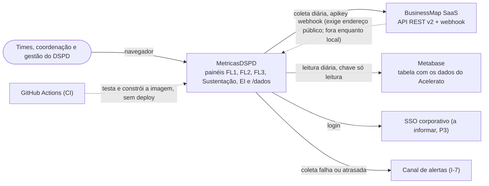
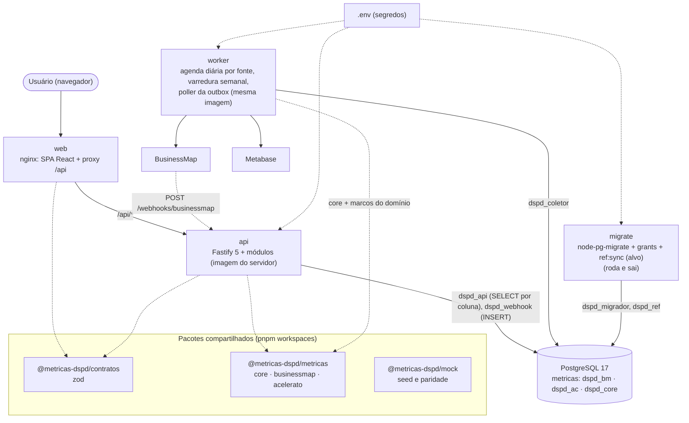
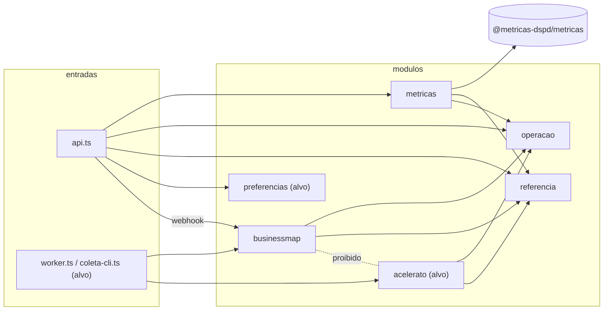

# Visão geral da arquitetura

- Propósito: visão de contexto, contêineres, módulos e regras invioláveis do sistema. Público: arquiteto, desenvolvedores, agentes de IA, QA. Detalhe por contexto, eventos, estados, sequências e componentes: pasta [`ddd/`](ddd/00-plano.md).
- Data: 2026-10-09 · Revisão: 2026-10-11 (módulos ainda inexistentes marcados como alvo; sequência da coleta movida para `ddd/06-sequencias.md`; antes, 2026-10-10: ADR 0014 revisão 2: PostgreSQL, tudo local em Docker Compose, nuvem adiada) · Pedido 002
- Decisões: ADR 0001 (front), 0002 (monorepo e pacotes), 0003 (performance), 0005 (SQL explícito), 0007 (contratos), 0009 (autenticação, pendente do SSO), 0011 (pacote de cálculo), 0012 (gráficos), 0013 (monólito modular; a parte AWS virou alvo futuro), **0014 (stack: pnpm, Fastify 5, PostgreSQL com `pg` puro, node-pg-migrate, outbox com polling, Zod 4, OpenAPI, Vitest com schemas por execução, Docker Compose)**. Substituídas: 0004 (MySQL) pela 0014; 0006 e 0008 pela 0013.
- Modelo: `data-model.md` · Servidor: `server.md` · Ordem de implementação: `roadmap.md`

Resumo: **um back-end Node em TypeScript, com módulos em pastas, empacotado como uma imagem de contêiner** e executado em dois serviços (`api` e `worker`), com **PostgreSQL** e a SPA React servida por nginx, **tudo em Docker Compose na máquina local** (custo zero, decisão do usuário). Os dados vêm do BusinessMap (API e webhook) e do Acelerato (tabela no Metabase), uma vez ao dia. Simplicidade primeiro: sem fila, barramento nem snapshot; eventos só pela outbox transacional no Postgres, lida por polling. A implantação em nuvem (AWS ou servidor da Unifique) foi adiada; a imagem é o artefato portátil.

## 1. Contexto (C4 nível 1)

Fora do sistema: configuração do BusinessMap (WS1), parametrização do Acelerato (WS4), a consulta que alimenta a tabela do Metabase (P7) e a governança (WS6), feitas por pessoas. As automações da T4.3 ficam fora até P4/I-6.

Enquanto o sistema roda só localmente, o webhook do BusinessMap não alcança a máquina; a coleta diária pelas revisions é suficiente (o webhook só antecipa, T2.3). A rota existe e é testada.

## 2. Containers (C4 nível 2, Docker Compose local)

| Container | Responsabilidade | Não faz |
|---|---|---|
| `web` | painéis FL1, FL2, FL3, Sustentação, EI, `/dados`; filtros na URL; `FonteMetricas` (mock ou HTTP) | não calcula (lint) |
| `api` | validação, autenticação (P3), contexto por fonte, chamada da biblioteca, cache em memória, `/fontes`, webhook, OpenAPI | não lê staging nem colunas de pessoa; escreve só `stg_webhook_evento` + `outbox` |
| `worker` | coleta BM ou AC (uma fonte por execução, advisory lock), varredura semanal, normalização, projeções, reconciliação, poller da outbox | não serve HTTP |
| `migrate` | migrações, grants, `ref:sync` antes de `api` e `worker` subirem | não fica de pé |
| `postgres` | staging, eventos, projeções, referência, controle, outbox | não calcula estatística |

**Alvo futuro (sem data):** a mesma imagem em ECS, num servidor da Unifique ou, com ADR nova, em Lambda (ADR 0013 como referência). Muda só a execução e onde ficam os segredos.

## 3. Módulos dentro do `server/`

Estado em 2026-10-11: existem `businessmap`, `referencia`, `metricas` e `operacao` em `server/src/modulos/`; **`acelerato` e `preferencias` são alvo (não existem)**, e as entradas existentes são `api.ts`, `worker.ts`, `migrar.ts` e `openapi.ts` (`coleta-cli.ts` é alvo). Hoje as preferências ficam só no navegador (`web/src/features/preferencias/fonte.ts`) e o worker ainda não chama `businessmap` nem `acelerato` (`tarefas: []` em `server/src/entradas/worker.ts`). O diagrama abaixo mostra o desenho de destino; nomes com "(alvo)" não existem. Detalhe por módulo: [`ddd/07-componentes.md`](ddd/07-componentes.md).

Legenda: seta cheia = "chama pelo `index.ts`"; linha rotulada "proibido" = ausência deliberada de dependência; "(alvo)" = não existe ainda. Quem conversa com quem, em lista: `la` chama `met`, `ops`, `ref` e `pref`, e `bm` só pelo webhook; `lc` chama `bm` e `ac`; `bm` e `ac` chamam `ops` e `ref`; `met` chama a biblioteca, `ref` e `ops`; `bm` e `ac` não se chamam.

Os módulos se chamam só pelo `index.ts`; `businessmap` só toca em `dspd_bm`, `acelerato` só em `dspd_ac` (ambos leem `dspd_core.ref_*`). Só `metricas` chama a raiz da biblioteca; os coletores usam `core` e a derivação de marcos do próprio domínio.

## 4. Da coleta ao cartão

As sequências (coleta do BusinessMap, coleta do Acelerato, webhook, cálculo e publicação, exportação) moveram-se para [`ddd/06-sequencias.md`](ddd/06-sequencias.md), com a marcação do que existe e do que é planejado (o coletor e o módulo `acelerato` ainda não existem). Eventos da outbox: [`ddd/04-eventos.md`](ddd/04-eventos.md); estados: [`ddd/05-ciclos-de-vida.md`](ddd/05-ciclos-de-vida.md).

Invariantes do fluxo:
- BM e AC percorrem caminhos separados (schemas, módulos, execuções, locks, lotes da outbox, contextos e chaves de cache distintos); a Visão geral só justapõe blocos.
- Toda estatística sai de `@metricas-dspd/metricas`; o SQL só seleciona.
- Reprocessar qualquer passo produz o mesmo resultado (chaves naturais, hash, projeções determinísticas).
- Do mock ao real muda só a fonte: `MockFonteMetricas` → `HttpFonteMetricas`, mesmos DTOs (ADR 0007, paridade D15).

## 5. Onde cada regra inviolável é garantida
| Regra (CLAUDE.md) | Garantia |
|---|---|
| BusinessMap e Acelerato nunca se misturam | módulos sem import entre si (lint), schemas separados, coleta e poller por fonte, teste de schemas por repositório |
| Nenhuma visão individual | nomes só nas colunas da lista `COLUNAS_PESSOA`; `dspd_api` sem `SELECT` nelas (GRANT por coluna) nem no staging; views `security_invoker` sem essas colunas; DTOs `strict`; `preferencias` (alvo; hoje só no navegador) responde só ao próprio usuário |
| Biblioteca única (T2.5) | só o módulo `metricas` importa a raiz da biblioteca (lint) |
| Nunca sobrescrever histórico | staging e eventos só INSERT (grant + gatilho `proibir_alteracao`); nova versão (SCD2) quando a linha muda; ausência registrada, nunca apagada |
| Mudança de critério marcada (T2.6) | `ref_versao_criterio`; SQL da pergunta do Metabase versionado |
| Credenciais fora do código, fonte só de leitura | `.env` (não versionado), validado por zod na partida; chave do Metabase e apikey do BusinessMap só leitura |

## 6. Requisitos não funcionais
| Tema | Como | Onde |
|---|---|---|
| Credenciais | `.env` local, validado por zod; papéis do Postgres por função | ADR 0014; data-model §8 |
| Autenticação | SSO a informar (P3); BFF com cookie ou JWT | ADR 0009 |
| LGPD | nomes no staging e em 3 colunas analíticas, ilegíveis pela API; retenção com DPO | data-model §9 |
| Observabilidade | pino JSON com `requestId`/`coleta_id`; `ctl_coleta`; estado em `/dados`; `/health/live` e `/health/ready` | ADR 0014 |
| Confiabilidade | DDL transacional, idempotência, backoff, advisory lock por fonte, marca d'água só avança em sucesso, outbox com reentrega; backup = `pg_dump` local agendado pelo usuário (sem nuvem) | ADR 0006, 0014 |
| Performance | contexto em memória por fonte + cache por chave; índices por filtro (inclusive parciais); A1–A3, M1–M3, K1–K4 (S1 de partida a frio não se aplica fora da Lambda) | ADR 0003; data-model §7 |
| Testabilidade | biblioteca pura, dependências por parâmetro, `app.inject()`, Postgres do compose com schemas prefixados por execução, paridade | ADR 0005, 0007, 0014 |

## 7. Perguntas abertas
Continuam: I-3 (= P3, SSO), I-5 (BusinessMap: limite de taxa, conta de serviço, segredo do webhook), I-6 (= P4), I-7 (canal de alertas), I-12 (DPO e retenção), I-13 (homologação com dados reais), P5–P10 e P12 (Metabase), P13 (frequência da coleta BM). **Respondidas em 2026-10-10:** P14 (onde o Fastify roda: contêiner local, nuvem adiada) e o banco (PostgreSQL). P11 (conta AWS) fica suspensa até a nuvem voltar. Nova: L-3 (nomes do Acelerato no analítico, data-model §12).
