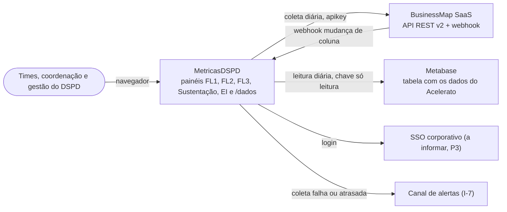
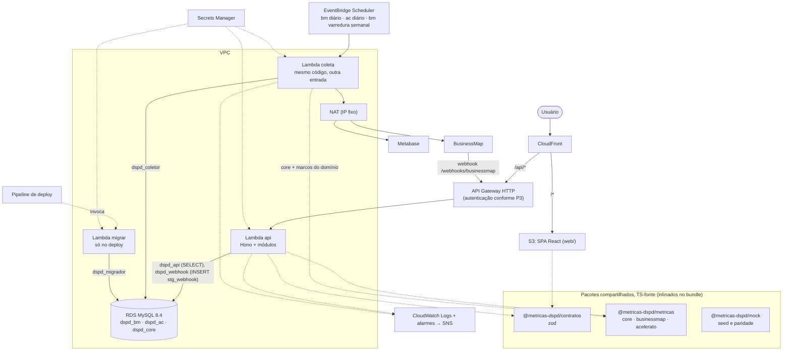
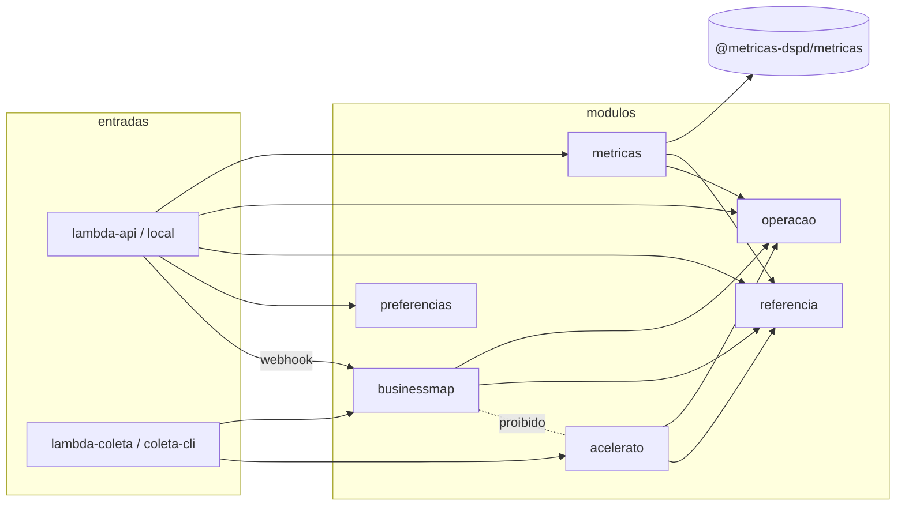
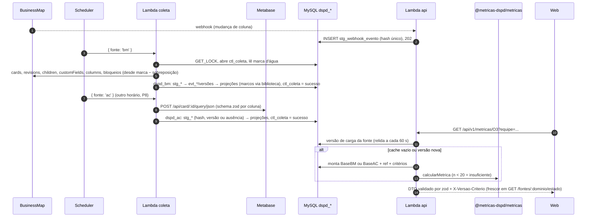

# Visão geral da arquitetura

- Data: 2026-10-09 · Revisão: 2026-10-10 (ADR 0013: serverless na AWS, Acelerato via Metabase) · Pedido 002
- Decisões: ADR 0001 (front), 0002 (monorepo e pacotes), 0003 (performance), 0004 (MySQL), 0005 (Kysely + SQL), 0007 (contratos), 0009 (autenticação, pendente do SSO), 0011 (pacote de cálculo), 0012 (gráficos), **0013 (back-end modular em duas Lambdas na AWS)**. Substituídas pela 0013: 0006 (processos), 0008 (Fastify), 0010 (implantação).
- Modelo: `data-model.md` · Servidor: `server.md` · Ordem de implementação: `roadmap.md`
- Origem da revisão: `propostas/serverless-outra-sessao/` (registro da sessão em que o usuário decidiu)

Resumo: **um back-end Node em TypeScript, com módulos em pastas, publicado em duas Lambdas** (`api` e `coleta`), com RDS MySQL 8.4 e a SPA React no S3 + CloudFront. Os dados vêm do BusinessMap (API e webhook) e do Acelerato (tabela no Metabase), uma vez ao dia. Simplicidade primeiro: sem fila, barramento nem snapshot.

## 1. Contexto (C4 nível 1)

Fora do sistema: configuração do BusinessMap (WS1), parametrização do Acelerato (WS4), a consulta que alimenta a tabela do Metabase (P7) e a governança (WS6), feitas por pessoas. As automações da T4.3 (escrita no Acelerato) ficam fora até P4/I-6.

## 2. Containers (C4 nível 2, AWS)

| Container | Responsabilidade | Não faz |
|---|---|---|
| Web (S3 + CloudFront) | painéis FL1, FL2, FL3, Sustentação, EI; filtros na URL; `FonteMetricas` (mock ou HTTP) | não calcula (lint) |
| Lambda `api` | validação, autenticação (P3), montagem do contexto por fonte, chamada da biblioteca, cache em memória, `/fontes`, recepção do webhook | não lê staging; não escreve fora de `stg_webhook_evento` |
| Lambda `coleta` | coleta incremental BM ou AC (uma fonte por invocação), varredura semanal de excluídos, normalização (inclusive do webhook), projeções, reconciliação | não serve HTTP |
| Lambda `migrar` | migrações e `ref:sync` no deploy | não tem gatilho próprio |
| RDS MySQL | staging (registro de origem), eventos, projeções, referência, controle | não calcula estatística |

## 3. Módulos dentro do `server/`

Os módulos se chamam só pelo `index.ts`; `businessmap` só toca em `dspd_bm`, `acelerato` só em `dspd_ac` (ambos leem `dspd_core.ref_*`). Só `metricas` chama a raiz da biblioteca; os coletores usam `core` e a derivação de marcos do próprio domínio.

## 4. Da coleta ao cartão

Invariantes do fluxo:
- BM e AC percorrem caminhos separados (schemas, módulos, invocações, contextos e chaves de cache distintos); a Visão geral só justapõe blocos.
- Toda estatística sai de `@metricas-dspd/metricas`; o SQL só seleciona (ADR 0004).
- Reprocessar qualquer passo produz o mesmo resultado (chaves naturais, hash, projeções determinísticas).
- Do mock ao real muda só a fonte: `MockFonteMetricas` → `HttpFonteMetricas`, mesmos DTOs (ADR 0007, paridade D15).

## 5. Onde cada regra inviolável é garantida
| Regra (CLAUDE.md) | Garantia |
|---|---|
| BusinessMap e Acelerato nunca se misturam | módulos sem import entre si (lint), schemas separados, coleta de cada fonte em invocação separada, teste de esquema |
| Nenhuma visão individual | sem coluna de pessoa no analítico, `dspd_api` sem acesso ao staging, DTOs `strict`; `preferencias` responde só ao próprio usuário |
| Biblioteca única (T2.5) | só o módulo `metricas` importa a raiz da biblioteca (lint) |
| Nunca sobrescrever histórico | staging só INSERT (grant); nova versão (SCD2) quando a linha muda; ausência registrada, nunca apagada |
| Mudança de critério marcada (T2.6) | `ref_versao_criterio`; SQL da pergunta do Metabase versionado no repositório |
| Credenciais fora do código, fonte só de leitura | Secrets Manager (`.env` no dev); chave do Metabase e apikey do BusinessMap só leitura |

## 6. Requisitos não funcionais
| Tema | Como | Onde |
|---|---|---|
| Credenciais | Secrets Manager / `.env`, validadas por zod na partida; usuários MySQL por papel | ADR 0004, 0013; data-model §8 |
| Autenticação | SSO a informar (P3); BFF com cookie ou autorizador JWT | ADR 0009, 0013 §8 |
| LGPD | nomes só no staging (L-1); mínimo necessário; retenção com DPO | data-model §9 |
| Observabilidade | pino JSON com `requestId`/`coleta_id`; `ctl_coleta`; alarmes CloudWatch por fonte | ADR 0013 §6 |
| Confiabilidade | idempotência, retentativa com backoff, `GET_LOCK`, marca d'água só avança em sucesso, backup do RDS com recuperação pontual | ADR 0006 (contrato), 0013 |
| Performance | contexto em memória por fonte + cache por chave; índices por filtro; A1–A3, M1–M3, K1–K4, S1 | ADR 0003; data-model §7 |
| Testabilidade | biblioteca pura, dependências por parâmetro, `app.request()` do Hono, MySQL em container, paridade | ADR 0005, 0007, 0013 |

## 7. Perguntas abertas
Infraestrutura da ADR anterior (I-1, I-2, I-8 a I-11, I-14, I-15) foi respondida ou deixou de valer com a AWS. Continuam: I-3 (= P3, SSO), I-5 (BusinessMap: limite de taxa, conta de serviço, segredo do webhook), I-6 (= P4), I-7 (canal de alertas), I-12 (DPO e retenção), I-13 (homologação com dados reais). Novas: P5–P13 da ADR 0013 (Metabase, conta AWS, credenciais, frequência da coleta BM). I-4 e I-4b (MySQL do Acelerato) foram substituídas por P5–P10.
