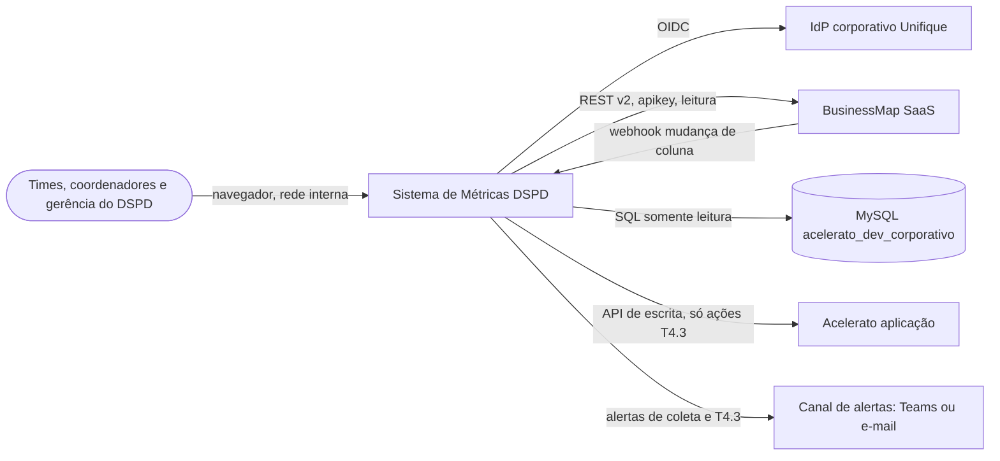
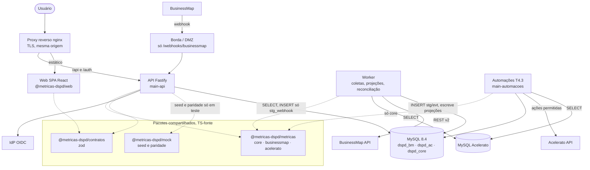

# Visão geral da arquitetura

- Data: 2026-10-09 · Pedido 002 (K-014)
- Decisões: ADR 0001 (front), 0002 (monorepo e pacotes), 0003 (performance), 0004 (MySQL), 0005 (Kysely + SQL), 0006 (coletas, webhook, automações), 0007 (contratos), 0008 (framework da API), 0009 (autenticação), 0010 (implantação e CI)
- Modelo: `data-model.md` · Ordem de implementação: `roadmap.md`
- Biblioteca de gráficos (Recharts) e pacote de cálculo compartilhado: ADR 0001 e 0002, sem mudança.

## 1. Contexto (C4 nível 1)



Fora do sistema: configuração do BusinessMap (WS1), parametrização do Acelerato (WS4) e governança (WS6), feitas por pessoas.

## 2. Containers (C4 nível 2)



| Container | Responsabilidade | Não faz |
|---|---|---|
| Web | painéis FL1, FL2, FL3, Sustentação, EI; filtros na URL; `FonteMetricas` (mock ou HTTP) | não calcula (lint) |
| API | autenticação, validação, montagem do contexto por domínio, chamada da biblioteca, cache, recepção do webhook | não lê staging; não escreve fora de `stg_webhook_evento` |
| Worker | coletas incrementais, varredura, processamento do webhook, normalização, projeções, reconciliação, aquecimento | não serve HTTP além de `/health` |
| Automações | T4.3 com lista fechada de ações, idempotente, modo simulação | não toca em etapa nem relógio de SLA; não escreve no MySQL do Acelerato |
| MySQL | staging (registro de origem), eventos, projeções, referência, controle | não calcula estatística |

## 3. Fluxo de dados ponta a ponta

```mermaid
sequenceDiagram
  autonumber
  participant BM as BusinessMap
  participant AC as MySQL Acelerato
  participant W as Worker
  participant DB as MySQL dspd_*
  participant A as API
  participant L as @metricas-dspd/metricas
  participant F as Web
  BM-->>A: webhook (mudança de coluna)
  A->>DB: INSERT stg_webhook_evento (hash único), 202
  W->>DB: abre ctl_coleta, lê marca d'água
  W->>BM: cards, revisions, children, customFields, columns, bloqueios (desde marca − sobreposição)
  W->>DB: INSERT IGNORE stg_* (payload + hash, pessoas pseudonimizadas)
  W->>AC: SELECT recorte 3.2 + etapas (lotes, MAX_EXECUTION_TIME)
  W->>DB: INSERT IGNORE dspd_ac.stg_*
  W->>DB: normaliza: evt_*, *_versao, fato_transicao (revision e webhook)
  W->>L: marcos (T2.4), horas úteis de bloqueio, com Calendario de dspd_core
  W->>DB: substitui projeções afetadas (dim_card, fato_bloqueio, dim_chamado, fato_etapa_chamado)
  W->>DB: ctl_coleta = sucesso, contagens, nova marca d'água; ctl_reconciliacao
  F->>A: GET /api/v1/metricas/O3?equipe=..&periodo=12s
  A->>DB: (se contexto frio) carrega projeções do domínio + ref + critérios
  A->>L: calcularMetrica(O3, contexto, filtros)
  L-->>A: DTO (n < 20 = insuficiente)
  A-->>F: 200 DTO validado por zod + X-Ultima-Coleta + X-Versao-Criterio
```

Invariantes do fluxo:
- BM e AC percorrem caminhos separados (schemas, módulos, contextos e chaves de cache distintos); a Visão geral só justapõe blocos.
- Toda estatística sai de `@metricas-dspd/metricas`; o SQL só seleciona (ADR 0004).
- Reprocessar qualquer passo produz o mesmo resultado (chaves naturais, hash, projeções determinísticas).
- Do mock ao real muda só a fonte: `MockFonteMetricas` → `HttpFonteMetricas`, mesmos DTOs (ADR 0007, paridade D15).

## 4. Requisitos não funcionais (onde estão resolvidos)

| Tema | Como | Onde |
|---|---|---|
| Credenciais | `.env` / cofre, validadas por zod na partida; usuários MySQL por papel; Acelerato somente leitura | ADR 0004, 0010; data-model §8 |
| Autenticação | OIDC no servidor, cookie de sessão httpOnly | ADR 0009 |
| Nenhuma visão individual | sem coluna de pessoa no analítico, API sem acesso ao staging, schemas `strict`, propriedade 6, teste de esquema | data-model §9; ADR 0007 |
| LGPD | pseudonimização no staging, mínimo necessário, retenção com DPO | data-model §9 (L-1) |
| Observabilidade | pino JSON com `requestId`; `ctl_coleta` com contagens e falhas; alertas de falha, atraso e divergência | ADR 0006, 0008, 0010 |
| Confiabilidade | idempotência, retentativa com backoff, `GET_LOCK`, marca d'água só avança em sucesso, backup + binlog | ADR 0006, 0010 |
| Performance | contexto em memória por domínio + cache por chave; índices por filtro; orçamento A1–A3, M1–M3, K1–K4 | ADR 0003, 0008; data-model §7 |
| Testabilidade | biblioteca pura, repositórios injetáveis, `app.inject`, MySQL em container, paridade | ADR 0005, 0007, 0010 |
| T2.6 | `ref_versao_criterio` + `ref:sync` exige versão para mudar referência; marcações nos DTOs | data-model §5 |

## 5. Perguntas de infraestrutura da Unifique (não bloqueiam o desenho)

| # | Pergunta | Recomendação | Alternativa |
|---|---|---|---|
| I-1 | Onde hospedar API, worker, automações e web? | VM Linux interna com Docker Compose, atrás de nginx | Kubernetes interno, se já existir (worker como Deployment, coletas como CronJob) |
| I-2 | Instância MySQL para a base: qual versão e quem administra? | MySQL 8.4 LTS dedicada, gerenciada pela infra/DBA | schemas `dspd_*` em instância existente (8.0 aceito como risco: fim de suporte) |
| I-3 | Qual IdP corporativo e é possível registrar app OIDC? | OIDC (Entra ID, Keycloak ou equivalente) com grupo "DSPD métricas" | LDAP/AD com bind de serviço, ou autenticação no proxy |
| I-4 | Acesso de rede ao MySQL do Acelerato: primário ou réplica? Usuário somente leitura com quais tabelas? | réplica de leitura, usuário `SELECT` só nas tabelas/views lidas, `MAX_EXECUTION_TIME` | primário em janela fora do expediente, com limite por consulta |
| I-4b | Existe tabela de histórico de etapas para chamados abertos e coluna de "última atualização" para carga incremental? | ler histórico de etapas + `data_atualizacao` como marca d'água | sem coluna: reler abertos + fechados dos últimos N dias a cada coleta |
| I-5 | BusinessMap: limite de taxa da API, conta de serviço para a apikey, saída HTTPS da rede, e entrada do webhook (DMZ, IPs de origem, segredo no cabeçalho)? | apikey de conta de serviço; webhook por borda expondo só `/webhooks/businessmap` com segredo e lista de IPs | sem webhook no início (T2.3 adiada, coleta a cada 2 h) |
| I-6 | O Acelerato tem API de escrita (comentário, campo, prioridade) com conta de serviço? | API oficial com conta de serviço e permissões mínimas | sem API: T4.3 fica bloqueada (nunca escrever no MySQL) |
| I-7 | Canal de alertas (coletas e T4.3)? | webhook do Teams do time + e-mail | só e-mail via SMTP interno |
| I-8 | Ferramenta de logs/monitoramento existente? | coletar stdout JSON na ferramenta atual (Loki, ELK, Graylog, Zabbix) | arquivo com rotação no host + `/health` monitorado |
| I-9 | Runner do GitHub Actions dentro da rede é permitido? | runner self-hosted só para deploy | deploy por *pull* do registro, ou script manual |
| I-10 | Registro de imagens? | GHCR privado | registro interno (Harbor, Nexus) |
| I-11 | Cofre de segredos? | cofre corporativo, se houver | `.env` no host, `chmod 600`, fora do repositório |
| I-12 | LGPD: quem é o DPO e qual a retenção para payloads com dados de pessoas? | pseudonimizar no staging, retenção indefinida dos eventos sem pessoa | payload integral restrito, retenção definida pelo DPO |
| I-13 | Homologação pode ler dados reais? | sim, somente leitura, automações em simulação | homologação só com seed do mock |
| I-14 | Política de backup e recuperação do MySQL? | dump diário + binlog, restauração testada por trimestre | snapshot de VM diário |
| I-15 | URL interna e certificado TLS? | `metricas-dspd.<dominio interno>` com certificado da CA interna | — |
