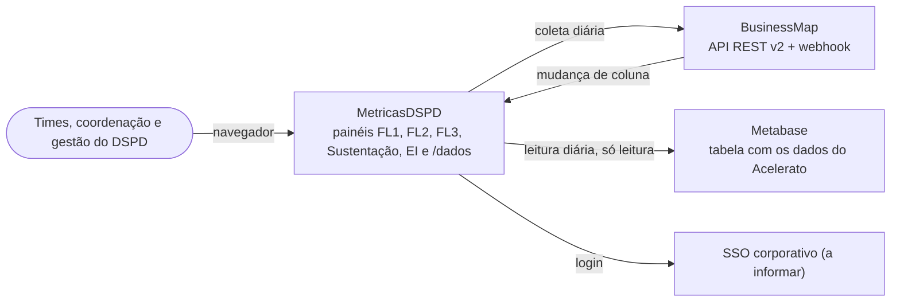
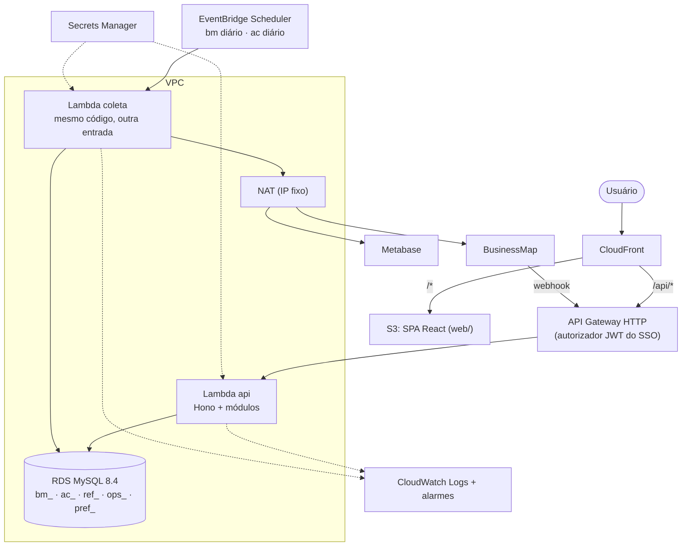
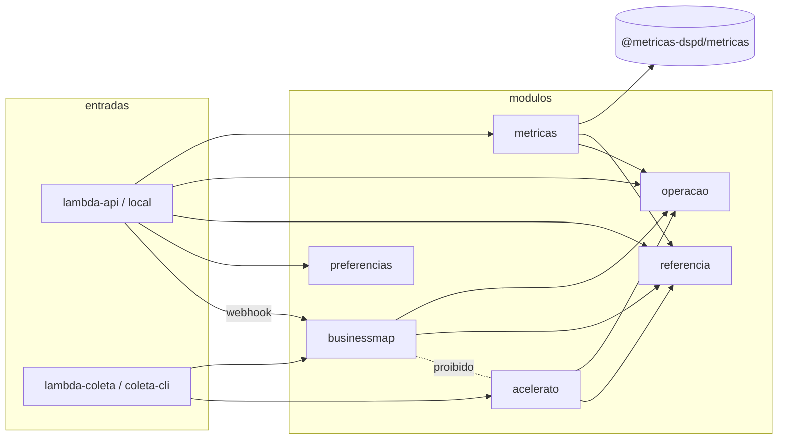
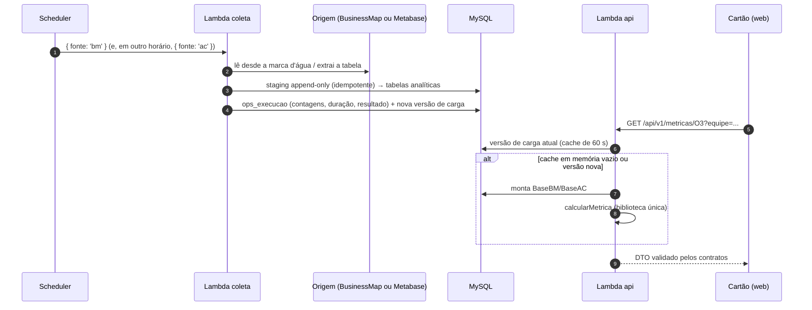

# Visão geral da arquitetura

Estado: 2026-10-10. Decisões: [ADR 0001](adr/0001-stack-front-dashboard-mock.md) (front), [ADR 0002](adr/0002-monorepo-pacotes-compartilhados.md) (monorepo), [ADR 0003](adr/0003-orcamento-de-performance.md) (performance), [ADR 0004](adr/0004-arquitetura-modular-serverless.md) (back-end modular em duas Lambdas na AWS).

Resumo: **um back-end Node em TypeScript, com módulos em pastas, publicado em duas Lambdas** (`api` e `coleta`), com MySQL 8.4 no RDS e a SPA React no S3 + CloudFront. Os dados vêm do BusinessMap (API e webhook) e do Acelerato (tabela no Metabase), uma vez ao dia.

## 1. Contexto (C4 nível 1)

## 2. Containers (C4 nível 2, AWS)

## 3. Módulos dentro do `server/`

Os módulos se chamam só pelo `index.ts` de cada um, e cada módulo só toca nas tabelas do próprio prefixo. Só o módulo `metricas` chama a biblioteca de cálculo; os coletores usam apenas o `core` e a derivação de marcos do próprio domínio.

## 4. Da coleta ao cartão

## 5. Onde cada regra inviolável é garantida
| Regra (CLAUDE.md) | Garantia |
|---|---|
| BusinessMap e Acelerato nunca se misturam | módulos sem import entre si (lint), prefixos de tabela separados, coleta de cada fonte em invocação separada |
| Nenhuma visão individual | nenhuma rota ou DTO agrega por pessoa; `preferencias` responde só ao próprio usuário; `/dados` sem campo de pessoa |
| Biblioteca única (T2.5) | só o módulo `metricas` calcula (lint) |
| Nunca sobrescrever histórico | staging append-only; versão nova (SCD tipo 2) quando a linha muda; nada é apagado |
| Mudança de critério marcada (T2.6) | módulo `referencia`; a consulta do Metabase é versionada no repositório |
| Credenciais fora do código, fonte só de leitura | Secrets Manager (`.env` no dev); chave do Metabase só de leitura |

## 6. Próximos entregáveis
1. `docs/architecture/data-model.md`: ER por prefixo, chaves naturais, índices e versionamento.
2. `docs/architecture/roadmap.md`: ordem WS2 → WS3/WS5, com a divisão por agente.
3. ADR de autenticação, quando o SSO for informado.
