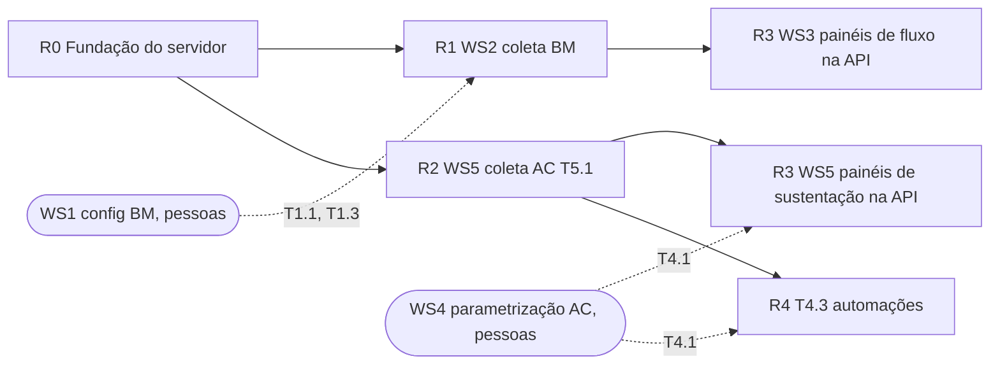

# Roadmap de implementação (pedido 002)

- Data: 2026-10-09 · Revisão: 2026-10-10 (ADRs 0013 e 0014) · Base: `overview.md`, `data-model.md`, ADRs 0004–0014
- Ordem obrigatória do briefing: configuração (WS1, WS4, por pessoas) → coleta (WS2, WS5) → painéis (WS3). Os painéis do 001 já existem sobre o mock; aqui "painel" = ligar na API real, o que só acontece depois do critério de pronto da coleta do domínio.
- Domínios avançam separados: BM pode ir à produção sem AC e vice-versa (flag de fonte por domínio no web).

## Fases

| Fase | Briefing | Entrega | Pronto quando | Depende de |
|---|---|---|---|---|
| **R0 Fundação** (K-017) | — | pnpm workspaces; `server/` com Fastify 5, `mysql2` puro, migrador próprio, outbox + poller (ADR 0014) e módulos em pastas (ADR 0013), entradas `lambda-api`, `lambda-coleta`, `lambda-migrar`, `local`, `coleta-cli`; saúde, config zod, pino; migrações dos três schemas (feitas) + `0011_core_outbox`; testes MySQL por execução, `ref:sync`, seed (feito), usuários por papel (feito), Docker local (feito), jobs `db` e `openapi` no CI, autenticador falso; `infra/` CDK (uma stack) | `up/down/up` verde; paridade mock × seed verde em todas as métricas; teste de esquema verde; A1/M1 e S1 medidos sobre 2 anos de seed | extração do 001 (D3), ADR 0013; P11 só para o deploy |
| **R1 WS2 BusinessMap** | T2.1 → T2.2 → T2.4 → T2.3; T2.5/T2.6 integrados | de-para da OpenAPI (apoio ao T2.1), coletor incremental, varredura semanal de excluídos, normalizador (inclusive do webhook), projetor (marcos via biblioteca), webhook + reconciliação, `ctl_*` e alarmes | T2.2: 7 execuções seguidas sem falha, contagem reconcilia, arquivados presentes; T2.4: 20 cards sorteados conferem; T2.3: divergência < 1 % em 1 semana; K1 (< 15 min, limite da Lambda), K3, K4 | T1.1, T1.3 (WS1); I-5, P11, P13 |
| **R2 WS5 Acelerato (base)** | T5.1 | cliente do Metabase com schema zod da tabela, SQL da pergunta versionado, staging AC com versão e ausência, projeções, views do recorte, exceção de SLA segregada | contagem de fechados e abertos reconcilia com o painel atual em 1 %; M3, K2 dentro do orçamento | **P5–P10, P12** (substituem I-4, I-4b); independe de WS4 |
| **R3 Painéis na API** | WS3 (T3.1–T3.4), WS5 (T5.2–T5.4) | `HttpFonteMetricas`, rotas `/api/v1` por métrica, cache, aquecimento; troca de fonte por domínio; E2E projeto `api` | painéis idênticos ao mock sobre o seed (paridade) e coerentes com dados reais; A1, F1–F5 dentro do orçamento; S-métricas só publicadas após T4.1 (as que dependem de 3.4) | R1 para fluxo; R2 + T4.1/T4.2 para sustentação; I-3 para produção |
| **R4 Automações** (fora até P4/I-6; nova ADR ao voltar) | T4.3 | função própria (provável terceira Lambda), cliente de escrita com ações fechadas, idempotência, modo simulação, alertas | cada automação testada em homologação em simulação e depois ativa, com registro no chamado e sem tocar no relógio de SLA | T4.1 (WS4), I-6, I-7 |
| Contínuo | T5.5, T6.x | apoio: consulta trimestral das justificativas (pessoa autorizada), relatórios de higiene | — | — |

R1 e R2 correm em paralelo depois do R0 (módulos e schemas distintos, sem dependência entre si).

## O que cada agente faz

| Agente | R0 | R1 | R2 | R3 | R4 |
|---|---|---|---|---|---|
| `software-architect` | revisão de modelagem das migrações; ajuste das ADRs com respostas I-* e L-* | de-para T2.1 (apoio), regras de reconciliação | mapeamento das colunas do Acelerato | plano técnico da troca de fonte | revisão da lista fechada de ações |
| `node-backend` | K-017: servidor, migrações, seed, `ref:sync`, CI `db` | coletor, normalizador, projetor, webhook, contratos `docs/api/` | leitor AC, views, projeções | rotas, cache, aquecimento, OpenAPI | processo de automações |
| `react-frontend` | ajuste dos tipos da biblioteca/mock (L-1) e função única de marcos em `metricas/businessmap` | — | — | `HttpFonteMetricas`, flag de fonte por domínio, estados de frescor (`GET /fontes/:dominio/estado`) | — |
| `ux-designer` | — | — | — | microcopy de dados defasados, marcação de critério e "dados reais" | texto dos registros no chamado |
| `qa-engineer` | paridade, teste de esquema, `up/down/up` | testes de idempotência (rodar 2×), reconciliação, sorteio dos 20 cards | reconciliação 1 % com o painel atual | E2E `api`, perf A1/F*, Lighthouse | roteiro de homologação T4.3 em simulação |
| `tech-lead` | review de modelagem e de código, commits | idem | idem | idem | idem |
| `jarvis` | levar I-*, L-*, N-* ao usuário | — | — | — | — |

## Cartões do `node-backend` pelas ADRs 0013 e 0014 (para o quadro)
Estado do `server/` na `main`: Kysely + `mysql2`, migrações 0001–0010, `grants.ts`, `lgpd.ts`, `staging.ts`, seed e `src/coletas/` (estado de coleta). **Não há servidor HTTP.** A numeração abaixo substitui a anterior (S-01 a S-10 da ADR 0013).

| # | Cartão | Pronto quando | Depende de |
|---|---|---|---|
| S-00 | **pnpm workspaces** na raiz (`pnpm-workspace.yaml`, `workspace:*`, `packageManager` via Corepack, `pnpm-lock.yaml`, remove `package-lock.json`); scripts e README com `pnpm`; CI com `pnpm/action-setup` e `--frozen-lockfile`. Faz junto com o `react-frontend` (web/e2e) | install limpo; mesmo nº de testes e mesmo hash da base mock (ADR 0002); CI verde | — |
| S-01 | Reorganizar em `src/plataforma/` (config zod, log pino, erros) e `src/modulos/<m>/index.ts`; `plataforma/db`: pools `mysql2/promise` por papel, `emTransacao`, `ehDuplicado` (1062), mapa `S` de schemas com `DSPD_SCHEMA_PREFIXO`; mover `src/coletas/` → `modulos/operacao`, `staging.ts` → `modulos/businessmap` | testes atuais verdes sem mudar comportamento; imports só por `index.ts` | S-00 |
| S-02 | **Kysely → `mysql2` puro**: reescrever `staging.ts`, seed, `coletas` (repositório), `grants.ts` (com prefixo); tipo de linha por repositório; remover `kysely`, `kysely-codegen`, `tipos.gen.ts`; snapshot de esquema (`information_schema`) | nenhum import de `kysely`; mesmos testes verdes; seed com o mesmo hash | S-01 |
| S-03 | **Migrador próprio** (`plataforma/db/migrador.ts`): registro estático, `ddl.up/down` sem o wrapper Kysely, tabela `dspd_core.kysely_migration` mantida, `GET_LOCK`, reescrita por prefixo, `migrate up\|down\|status`; `migrations/checksums.json` + teste | `up/down/up` verde; banco já migrado pelo Kysely reconhecido sem reaplicar; SQL com prefixo vazio idêntico | S-01 |
| S-04 | **Testes MySQL por execução**: `globalSetup`/`globalTeardown` com prefixo, migração e grants com usuários prefixados; projeto Vitest `mysql`; `db:limpar-testes`; job `db` com `docker compose --profile test` | duas execuções simultâneas verdes sem colisão; nada sobra após teardown | S-03 |
| S-05 | Regras de lint da ADR 0013 §9 + "consumidor da outbox só da própria fonte" + teste que lista os schemas usados por repositório | lint falha com exemplo proibido em cada regra | S-01 |
| S-06 | **Fastify 5**: `buildApp(deps)` com `validatorCompiler`/`serializerCompiler` do fastify-type-provider-zod 7 e schemas de `contratos`; `setErrorHandler` no formato da ADR 0007; `requestId` (pino); `/health/live`, `/health/ready`; rotas `/api/v1/fontes/*` sobre `operacao`; testes com `app.inject()`; plugins (helmet, rate-limit) com versão compatível | `docs/api/fontes.md` atendido; entrada `strict` recusa `?responsavel=`; resposta fora do schema = 500 | S-02 |
| S-07 | **OpenAPI**: `@fastify/swagger` 9 + `jsonSchemaTransform`, script `openapi:gerar` (sem `listen`) grava `docs/api/openapi.json` tipado com `openapi-types`; job `openapi`; swagger fora do bundle Lambda | gerado = versionado | S-06 |
| S-08 | **Outbox + poller**: migração `0011_core_outbox` (data-model §5) e grants; `publicarEvento(conn, evento)`; `processarOutbox({ fonte, agora, limite })` com `SKIP LOCKED`, reserva, backoff, `falha` após 8, retenção 30 dias; registro de consumidores por fonte; `coleta.concluida` gravado ao fechar `ctl_coleta` | evento só existe se a transação confirmou (teste de rollback); dois pollers simultâneos não processam o mesmo evento; consumidor reexecutado não duplica | S-03, S-04 |
| S-09 | Entradas: `local.ts` (Fastify `listen` + laço do poller), `lambda-api.ts` (`@fastify/aws-lambda`), `lambda-coleta.ts` (`{ fonte, tarefa }`, inclusive `eventos`), `coleta-cli.ts`, `lambda-migrar.ts`; esbuild por entrada; scripts `dev`, `coleta`, `build` | `pnpm dev` serve o app; bundles gerados; handler recusa fonte desconhecida. **Se P14 = contêiner**, troca `lambda-*` por imagem | S-06, S-08, P14 |
| S-10 | Módulo `metricas`: `BaseBM`/`BaseAC` das projeções, cache por `(metricaId, filtros, versão de carga)`, versão relida a cada 60 s; rotas `/api/v1/metricas/:id` | paridade mock × seed verde; S1 e A1 medidos | S-06 |
| S-11 | Webhook `POST /webhooks/businessmap` (segredo, 256 KB, `dspd_webhook`, hash único, 202): `stg_webhook_evento` + `bm.webhook.recebido` na mesma transação; consumidor em `businessmap` normaliza | reenvio não duplica; K4 < 1 s; evento normalizado em até 2 min | S-06, S-08, I-5 |
| S-12 | Migração `0012`: `ausente_na_extracao` em `dspd_ac.stg_chamado` e `stg_etapa` (data-model §4), com `down` | `up/down/up` verde; revisão de modelagem | S-03 |
| S-13 | Cliente do Metabase (`modulos/acelerato/cliente-api.ts`): chave por env, timeout e retentativa, schema zod da tabela, falha explícita em coluna divergente; testes com resposta gravada | **bloqueado** até P6/P12 (só esqueleto com falso) | S-01 |
| S-14 | `infra/` CDK (uma stack): VPC, NAT, RDS, Secrets, 3 Lambdas, API Gateway, Scheduler (coletas + `eventos` a cada 1 min), S3 + CloudFront, alarmes (inclui outbox em `falha`); job `deploy` com OIDC e pnpm | `cdk synth` verde no CI; deploy só após P11 | S-09, P11, P14 |

Ordem: S-00 → S-01; depois S-02, S-03, S-05 e S-13 em paralelo; S-04 após S-03; S-06 após S-02; S-07, S-10 após S-06; S-08 após S-03 e S-04; S-09 e S-11 após S-06 e S-08; S-12 após S-03.

## Gates entre fases
- Nenhuma migração sem revisão de modelagem (praticas §6).
- Nenhum painel ligado à API real sem o critério de pronto da coleta do domínio.
- Nenhuma automação ativa sem homologação em modo simulação e sem I-6 respondida.
- Pergunta de regra de negócio pendente vira célula `pendente-usuario`, nunca escolha no código.
