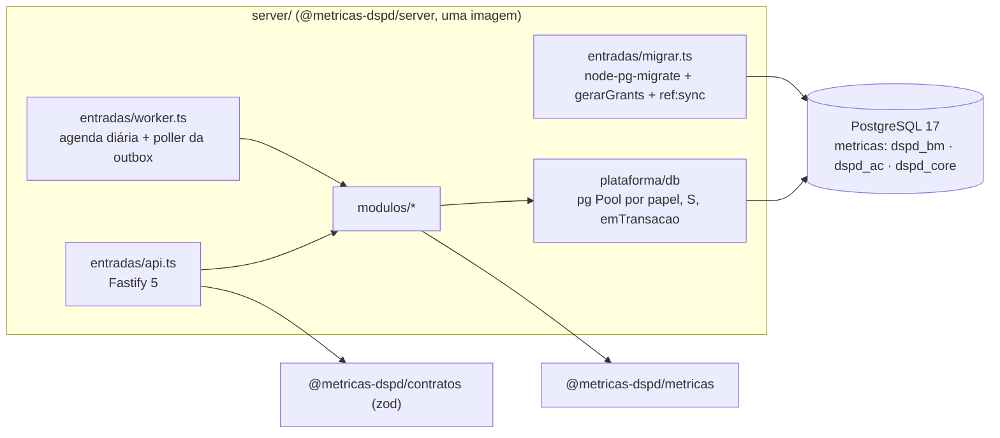
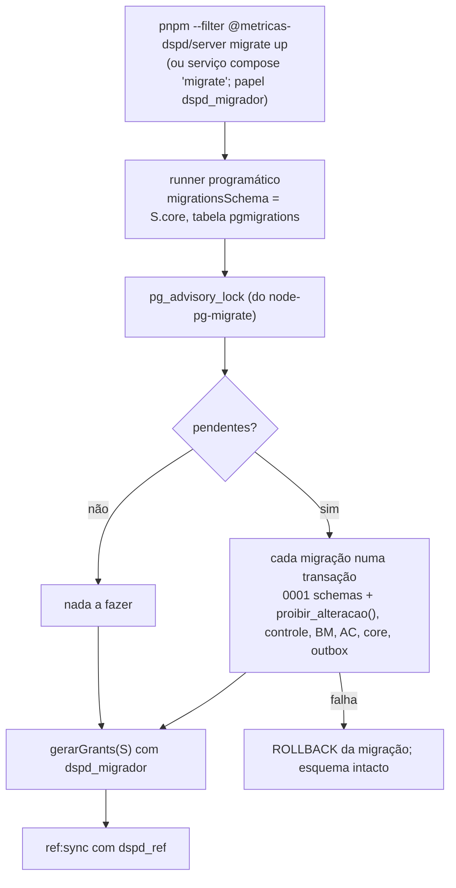
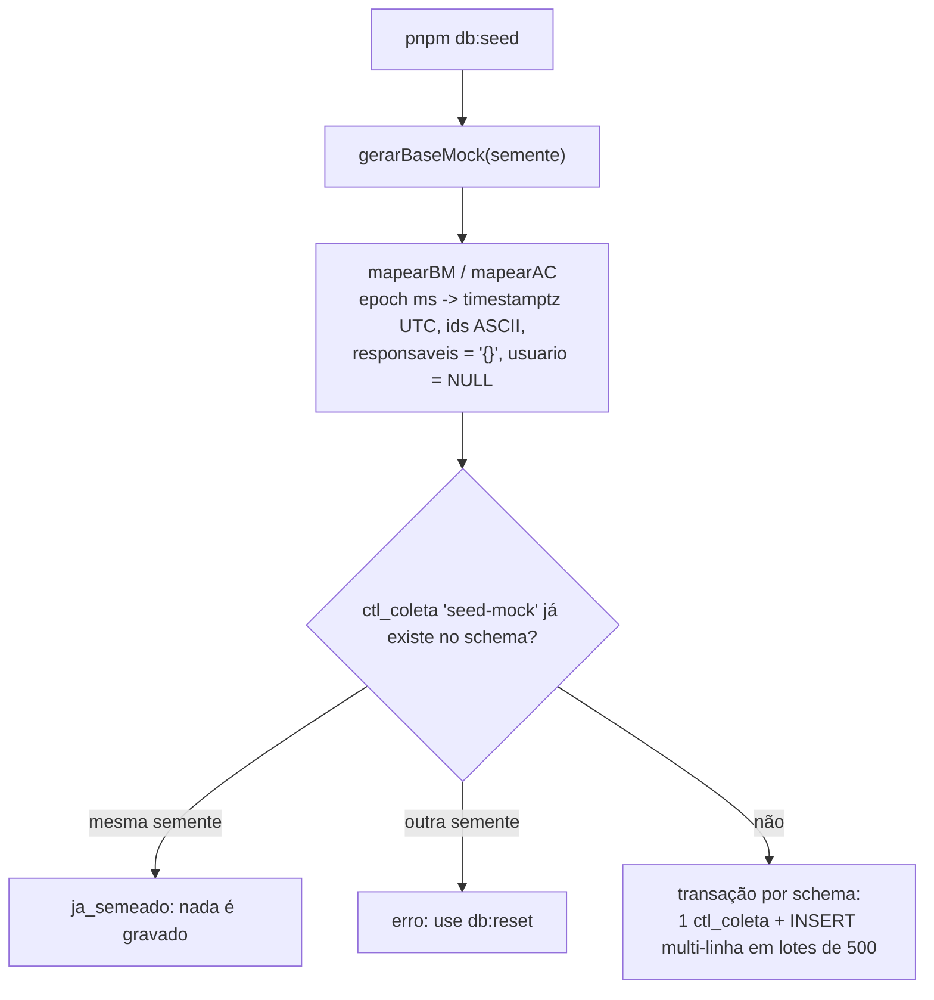
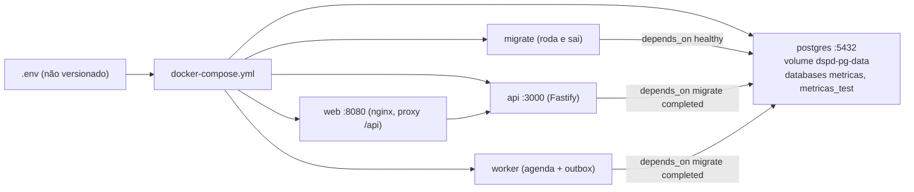

# Servidor (`server/`): módulos, migrações, seed e acesso ao PostgreSQL

Propósito: referência do servidor (estrutura, acesso a dados, migrações, seed, papéis, Compose) e diário dos lotes S-01 a S-12. Público: desenvolvedores do back-end, arquiteto e QA. Revisão: 2026-10-11.

**Referência atual (comece aqui):** estrutura e componentes em [`ddd/07-componentes.md`](ddd/07-componentes.md); eventos da outbox em [`ddd/04-eventos.md`](ddd/04-eventos.md); estados da coleta e da outbox em [`ddd/05-ciclos-de-vida.md`](ddd/05-ciclos-de-vida.md); sequências em [`ddd/06-sequencias.md`](ddd/06-sequencias.md); tabelas em [`data-model.md`](data-model.md); contexto em [`overview.md`](overview.md). As seções abaixo a partir de "Estado do port" e "Camada HTTP" são diário de lotes: leia-as como histórico, e confirme no código. Ainda não existem: `modulos/acelerato`, `modulos/preferencias`, `entradas/coleta-cli.ts`, `ref:sync`, tarefas do coletor no worker (WS2).

Status: revisado em 2026-10-10 para a **ADR 0014 revisão 2** (PostgreSQL, `pg` puro, node-pg-migrate, outbox com polling, Fastify 5, Zod 4, OpenAPI, Vitest com schemas por execução, pnpm, Docker Compose local). Modelo em `data-model.md`; módulos e fronteiras na ADR 0013; contrato da coleta na ADR 0006.

**Estado atual do código** (S-01 a S-05 feitos em 2026-10-10): Postgres 17 no Compose; `src/plataforma/db` (`pg`: `criarPool`, `emTransacao`, `ehDuplicado`, parsers, mapa `S`, `migrar`, `gerarGrants` com GRANT por coluna, `lgpd`, `seed`); migrações Postgres 0001-0011 (node-pg-migrate, `ddl(S)` + `pgm.sql`, `checksums.json`; 0011 = outbox); `src/modulos/businessmap/staging.ts` e `src/modulos/operacao/` (ex-`coletas`) sobre `pg`; testes `unit` (dublê de `pool`, cobertura 100%) e `pg` (schemas por execução). Kysely, `mysql2` e o MySQL saíram. 

**S-06 a S-10 feitos em 2026-10-10:** Fastify 5 (`src/app.ts`, `buildApp(deps)`; rotas `/health*`, `/api/v1/filtros/:dominio`, `/api/v1/referencia`; módulo `modulos/referencia`), erro no formato da ADR 0007 (`plataforma/erros.ts`), Pino com `requestId` e redação (`plataforma/log.ts`), config zod por entrada (`plataforma/config.ts`), OpenAPI (`docs/api/openapi.json`), outbox (`plataforma/eventos`: `publicarEvento`, `processarOutbox`, `RegistroConsumidores`), trava por fonte (`plataforma/db/trava.ts`), agenda e worker (`plataforma/agenda.ts`, `plataforma/worker.ts`), `fecharColeta` + consumidor de `coleta.concluida` em `modulos/operacao`, entradas `src/entradas/{api,worker,migrar,openapi}.ts`, `server/Dockerfile`, `docker/web/`, serviços `migrate/api/worker/web` no Compose. Ainda não: `coleta-cli`, tarefas do coletor no worker (WS2) e `ref:sync`. S-11 e S-12 abaixo.

## Estrutura alvo
Marcação em 2026-10-11: existem `modulos/businessmap`, `referencia`, `metricas`, `operacao` e as entradas `api.ts`, `worker.ts`, `migrar.ts`, `openapi.ts`; **são alvo** `modulos/acelerato`, `modulos/preferencias`, `entradas/coleta-cli.ts` e `plataforma/auth`. As migrações são 0001 a 0012 (a 0012 é `bm_limite_wip_fluxo_indices`).
```
server/
  Dockerfile       multi-stage, Node 24 slim, usuário não root; uma imagem, várias entradas
  migrations/      NNNN_*.ts: ddl(S) {up, down} + up/down(pgm) com pgm.sql; checksums.json
  src/
    app.ts         buildApp(deps): Fastify 5 + fastify-type-provider-zod com as rotas dos módulos
    plataforma/    config (zod), db (pg: pools por papel, emTransacao, mapa S, parsers, migrar.ts, grants, lgpd), eventos (publicarEvento, processarOutbox), log (pino), erros, auth
    modulos/       businessmap · acelerato · referencia · metricas · operacao (hoje src/coletas) · preferencias
    entradas/      api.ts (listen) · worker.ts (agenda + poller) · migrar.ts · coleta-cli.ts · openapi.ts
```
Cada módulo expõe só `index.ts`; `businessmap` grava só em `dspd_bm`, `acelerato` só em `dspd_ac` (ambos leem `dspd_core.ref_*`). `dspd_bm` e `dspd_ac` nunca se misturam: nenhuma FK nem consulta cruza os dois (teste que lista os schemas usados por repositório).



## Acesso a dados (`plataforma/db`)
- Um `Pool` do `pg` por papel; `TimeZone=UTC` e `statement_timeout` por pool; `emTransacao(pool, fn)`; `ehDuplicado(erro)` (SQLSTATE `23505`).
- Mapa `S = { bm, ac, core }` a partir de `DSPD_SCHEMA_PREFIXO` (vazio fora dos testes). Todo SQL qualificado: `${S.bm}.dim_card`. Parâmetros só por `$n`.
- Idempotência: `ON CONFLICT ON CONSTRAINT uq_<tabela> DO NOTHING RETURNING` com alvo explícito; zero linhas = já existente. `ON CONFLICT` sem alvo, `DO UPDATE` fora das projeções e `SELECT *` são reprovados pelo lint.
- Tipos de linha declarados por repositório; nada do driver sai do repositório. Parsers: `timestamptz` → `Date`, `int8` → `bigint`/`string`, `numeric` → `string`.

## Estado de coleta (`src/coletas/` → `modulos/operacao`)
`estadoColeta(db, dominio, agora)` e `historicoColetas(db, dominio, pagina)` leem `ctl_coleta` + `ctl_coleta_contagem` da fonte (schema fixo por domínio) e `ref_versao_criterio*`, e entregam a `montarEstadoColeta`/`paginarColetas` (regra única em `packages/metricas`). `erro_resumo` nunca sai: só a categoria. Contagens `arquivado_preservado` e `excluido_preservado` em `ctl_coleta_contagem.lidos`. Contrato HTTP em `docs/api/fontes.md`. Testes: SQL com driver falso (unitário) e `coletas.pg.test.ts` (projeto `pg`).

## Migrações (node-pg-migrate)

- Migrações **novas** para Postgres, numeradas a partir de `0001`, com as correções do `data-model.md` §11. As MySQL saem no mesmo PR.
- Cada arquivo exporta `ddl(S)` (SQL puro, usado pelos testes estáticos de LGPD, tamanhos e checksum) e `up/down(pgm)` que só chamam `pgm.sql`. Migração aplicada nunca é editada; correção vira migração nova. CI: `up → down → up`.
- Comandos: `migrate up|down|redo`. `down` desfaz a última.

## Seed (desenvolvimento)

- Grava `dim_card`, `fato_transicao` (`fonte = 'revision'`, `id_origem = seed-N`), `fato_bloqueio`, `ref_coluna` (BM) e `dim_chamado`, `fato_etapa_chamado` (AC). Arquivados e excluídos entram como estão. Determinístico (sem relógio). O mock não traz nomes: `responsaveis` vazio e `usuario` nulo.
- Nunca apaga nem sobrescreve (sem `ON CONFLICT DO UPDATE`, `DELETE`). `coluna_id` = `c<ordem>`; `data_acordada` com a data civil em America/Sao_Paulo.
- Fora do seed (não inferido): `ref_quadro`, `ref_dominio`, `ref_alvo_prioridade`, calendário, staging, `*_versao`, `evt_*` e `fato_etapa_chamado.totalizador`. Variáveis: `PG_MIGRADOR_URL`, `MOCK_SEMENTE` (opcional).
- Critério de pronto do port: mesmo hash da base mock lida do Postgres que o hash lido do MySQL antes (ou do mock direto, se o MySQL não estiver disponível).

## Papéis e grants (data-model §8; `plataforma/db/grants.ts`)
| Papel | Pode |
|---|---|
| `dspd_migrador` | dono dos objetos (DDL); seed em desenvolvimento |
| `dspd_coletor` | append-only em `stg_`, `evt_`, `*_versao`, `fato_transicao`, `rec_`; escrita nas projeções; `ctl_` com UPDATE por coluna; `outbox` (poller) |
| `dspd_ref` | `INSERT/SELECT` em `ref_` e `UPDATE (vigente_ate)` |
| `dspd_webhook` | `INSERT` em `dspd_bm.stg_webhook_evento` e em `dspd_core.outbox` (mesma transação) |
| `dspd_api` | `SELECT` em projeções, `vw_`, `ref_`, `ctl_`, **por coluna, sem as de `COLUNAS_PESSOA`**; sem `stg_`, `evt_`, `*_versao`, `outbox` |
| `dspd_automacao` | `dspd_ac.ctl_automacao` (sem uso até a T4.3) |

`gerarGrants(S)` produz os `GRANT`/`REVOKE` e é aplicado ao fim de cada `migrate up`. Senhas só em `.env`.

## Ambiente local com Docker Compose
Decisão do usuário (2026-10-10 §8): tudo local, sem custo. Arquivos: `docker-compose.yml`, `.env.example`, `docker/postgres/init/01-databases-papeis.sh`, `server/Dockerfile`, `web/Dockerfile` + `web/nginx.conf`.



O init (só na primeira criação do volume) cria os databases `metricas` e `metricas_test`, os papéis com `LOGIN` (senhas `DSPD_PWD_*`) e revoga `public`. Os schemas e grants vêm das migrações.

| Script (pnpm, raiz) | Faz |
|---|---|
| `pnpm db:up` / `db:down` | sobe só o `postgres` (aguarda healthcheck) / derruba, mantendo o volume |
| `pnpm db:reset` | apaga o volume e sobe de novo (reexecuta o init) |
| `pnpm db:migrate` | migrações + grants + `ref:sync` |
| `pnpm db:seed` | seed do mock |
| `pnpm stack:up` | `docker compose up -d --build` (postgres, migrate, api, worker, web) |
| `pnpm dev` | `api` e `worker` com `tsx watch` + Vite, contra o `postgres` do compose |
| `pnpm test:pg` | testes do projeto `pg` num conjunto de schemas por execução |
| `pnpm db:limpar-testes` | apaga schemas `t%_dspd_%` de execuções interrompidas |

Primeiro uso: `cp .env.example .env`, ajuste as senhas, `pnpm db:up && pnpm db:migrate && pnpm db:seed`; ou `pnpm stack:up` para tudo em contêiner.

### Testes contra o Postgres (sem Testcontainers)
`globalSetup` gera o prefixo `t<6 base36>_`, roda as migrações com o `S` prefixado no database `metricas_test` e aplica `gerarGrants(S)` (papéis compartilhados do cluster). `globalTeardown` faz `DROP SCHEMA ... CASCADE` (`DSPD_TESTE_MANTER=1` preserva). Projeto Vitest `pg` sem paralelismo de arquivos; cada teste cria seus dados. Sem `PG_TEST_URL`, os testes `pg` são pulados localmente; no CI são obrigatórios (job `db` sobe o mesmo compose).

### Instalar Docker no WSL2
1. Docker Desktop no Windows, com "Use the WSL 2 based engine" e a integração ligada para a distro.
2. Sem Desktop: Docker Engine pelo repositório apt oficial (docs.docker.com/engine/install/ubuntu), `sudo usermod -aG docker $USER`, reabrir o terminal; se o systemd não estiver ativo, `[boot]\nsystemd=true` em `/etc/wsl.conf` e `wsl --shutdown`.
3. Conferir com `docker compose version` e `docker run --rm hello-world`.

## Regra LGPD de colunas (`src/db/lgpd.ts` → `plataforma/db/lgpd.ts`)
Módulo único com `SEGMENTO_PESSOA`, `COLUNAS_PESSOA` (as colunas de pessoa permitidas no analítico: `dim_card.responsaveis`, `dim_card_versao.responsaveis`, `fato_transicao.usuario`), `EXCECOES_PESSOA` (`area_solicitante`) e `violaLgpd`. Usado pelos testes estáticos das migrações e do seed, pelo teste de catálogo e por `gerarGrants` (que tira as colunas de `COLUNAS_PESSOA` do `SELECT` da `dspd_api`). Regra completa em `data-model.md` §9.

## Staging de card
`gravarStgCard(cliente, entrada)` recebe `quadroId`, `arquivado` e `excluidoDetectado` do coletor; deduplica contra a última versão com `ON CONFLICT ON CONSTRAINT uq_stg_card DO NOTHING RETURNING stg_sk` e relê em caso de corrida (`data-model.md` §3.1). `fato_transicao.id_origem` é `varchar(64)` (SHA-256 hex do webhook).


## Estado do port para Postgres (S-01 a S-05)
- **Comandos:** `pnpm run db:up` (Compose), `db:migrate [up|down N|redo]`, `db:seed`, `db:limpar-testes`, `pnpm run test:pg` (sobe o `postgres`, roda o projeto Vitest `pg` com um conjunto de schemas por execução, `t<6 base36>_dspd_*` em `metricas_test`, removido pelo `globalTeardown`; `DSPD_TESTE_MANTER=1` preserva). `pnpm run pronto` roda typecheck, lint e cobertura 100% (thresholds ligados) sem banco: os testes `*.pg.test.ts` ficam pulados sem `PG_TESTE_URL`.
- **Variáveis:** `PG_MIGRADOR_URL`, `PG_TESTE_URL`, `DSPD_PWD_*`, `DSPD_SCHEMA_PREFIXO` (vazio fora dos testes); ver `.env.example`.
- **Grants:** `gerarGrants(S, catalogo)` lê tabelas, views e colunas do catálogo e é reaplicado ao fim de todo `migrate`. `dspd_api` recebe `SELECT` por coluna onde há coluna de `COLUNAS_PESSOA` (`responsaveis`, `usuario`); `fato_transicao` e `rec_transicao_par` entram para a API só porque `vw_transicao_canonica` (`security_invoker`) depende delas.
- **Staging:** `gravarStgCard` usa `ON CONFLICT ON CONSTRAINT uq_stg_card DO NOTHING RETURNING stg_sk` e relê; até 5 tentativas por item. Cada escritor perde no máximo (escritores simultâneos - 1) vezes, então mais de 5 escritores simultâneos sobre o mesmo item podem esgotar as tentativas (falha do item, reprocessada na coleta seguinte). Exige `READ COMMITTED`.
- **Pendências conhecidas:** os testes de catálogo e o `snapshot` rodam só no projeto `pg`; o job `db` do GitHub Actions e a regra de lint de SQL (S-06) ainda não existem; o critério "mesmo hash da base mock" foi substituído por contagem de linhas e instantes idênticos (o seed anterior em MySQL nunca foi executado).


## Camada HTTP, outbox e execução (S-06 a S-10)
- **Lint (`server/eslint.config.js`):** `SELECT *`, `ON CONFLICT` sem `ON CONSTRAINT` e `DO UPDATE` reprovados em literais SQL de `src/` e `migrations/` (seed isento); módulos só pelo `index.ts` (regex de `no-restricted-imports`), `businessmap` e `acelerato` sem import entre si, mock fora do servidor, `servico.ts`/`repositorio.ts` sem `Date.now`, `new Date()` e `Math.random`. `tests/plataforma2.test.ts` roda o ESLint sobre um exemplo proibido de cada regra.
- **Outbox:** `publicarEvento(cliente, evento)` na transação do chamador. `processarOutbox({ fonte, agora, consumidores, limite })`: transação curta com `FOR UPDATE SKIP LOCKED` marca `processando` (`reservado_ate` = agora + 5 min, `tentativas + 1`), confirma, chama o consumidor fora da transação; sucesso `processado`; erro volta a `pendente` com backoff 30 s x 2^(n-1) (teto 1 h) e `ultimo_erro` = só o nome da classe do erro; 8 tentativas = `falha`; o poller só reserva tipos com consumidor registrado (`RegistroConsumidores.tipos(fonte)`): evento sem consumidor fica `pendente`, sem consumir tentativas; `processado` com mais de 30 dias é apagado ao fim de cada execução. `RegistroConsumidores.registrar(fonte, tipo, fn)` recusa `bm.*` fora de `businessmap` e `ac.*` fora de `acelerato`. `fecharColeta` fecha `ctl_coleta` e publica `coleta.concluida` na mesma transação; o consumidor de `operacao` registra `warn` para `falha`/`parcial`.
- **Worker:** ciclo a cada `WORKER_INTERVALO_MS` (15 s), por fonte de `WORKER_FONTES` (fonte desconhecida = falha na partida): tarefas devidas (`agenda.ts`, diária e semanal em UTC-3, última execução em memória; repetir é seguro) sob `pg_try_advisory_lock` da fonte, depois o poller. A lista de tarefas está vazia até o coletor (WS2).
- **Config por entrada:** `api` lê `PG_API_URL` (papel `dspd_api`), `worker` lê `PG_COLETOR_URL`, `migrar` lê `PG_MIGRADOR_URL`; mais `DSPD_SCHEMA_PREFIXO`, `LOG_LEVEL`, `PORT`, `HOST`. A mensagem de erro cita só nomes de variáveis.
- **Imagem e Compose:** `server/Dockerfile` (multi-stage, usuário `node`, `pnpm install --frozen-lockfile --filter @metricas-dspd/server...`, execução com `node --import tsx`, porque os pacotes workspace e as migrações são TypeScript). Contexto = raiz. Serviços `migrate` (roda e sai), `api` (healthcheck em `/health/ready`), `worker`, `web` (`docker/web/Dockerfile`: build da SPA + nginx com proxy `/api` e `/health` para `api:3000`). `pnpm stack:up` / `docker compose up`. `pnpm dev:full` roda api, worker e Vite fora do contêiner (`scripts/dev.sh`); `pnpm dev` continua só com a web.
- **Testes:** `tests/app.test.ts` (inject com dublê de pool), `tests/plataforma2.test.ts` (config, outbox, agenda, worker, trava, OpenAPI, lint), `tests/outbox.pg.test.ts` (rollback, dois pollers, backoff, falha após 8, reserva expirada, retenção, rotas com `dspd_api`). Cobertura 100% sobre `src/`, exceto `src/entradas/**` (só ligam config, pool e sinais; exercitadas pelo Compose). CI: jobs `openapi` e `imagem`.


## Módulo `metricas`, fontes e webhook (S-11, S-12)
- **Fluxo:** `repositorio.ts` lê as projeções com colunas explícitas (nunca `responsaveis`/`usuario`; BM e AC em consultas separadas) -> `mapa.ts` monta `BaseBM`/`BaseAC` (nomes de coluna pelo `ref_coluna` vigente; pessoa sempre vazia) -> `servico.ts` calcula só por `calcularMetrica` da biblioteca -> `rotas.ts` (uma rota por métrica, entrada por domínio, saída = DTO do contrato). Cache e invalidação em `docs/api/metricas.md`.
- **Convenções provisórias de `ref_*` (confirmar com o usuário):** valor global grava `equipe = '*'` (`ref_limite_frentes`, `ref_sle`, `ref_alocacao_acordada`); SLE = percentil 85; natureza da alocação na coluna `classe_servico`; objetivos e áreas internas em `ref_dominio` (`objetivo_estrategico`, `area_interna`); limite de WIP do fluxo em `ref_limite_wip_fluxo` (tabela nova, migração 0012); calendário = `CALENDARIO_PADRAO` da biblioteca (P2); `data_acordada` (coluna `date`) vale até o fim do expediente do dia. Coluna sem tipo/papel em `ref_coluna` não entra (papel não se infere); cartão sem `criado_em`/`granularidade`/`tipo` fica de fora (carga parcial).
- **Paridade:** `tests/metricas.paridade.test.ts` (linhas do seed num banco falso) e `tests/metricas.pg.test.ts` (seed real, papel `dspd_api`) comparam as 33 métricas com o mock em memória "como o banco o representa" (`tests/base-duble.ts`): sem pessoa, `data_acordada` em fim de expediente, duração de bloqueio com 2 casas, ids de critério do banco. Sem essa normalização divergem O12 e os critérios (S7, VISAO_GERAL): o mock usa instante para `data_acordada`, o modelo guarda data.
- **Desempenho (pedido 009, item 4):** `tests/pg/desempenho.ts` gera ~5x o mock (27.798 cards, 226.571 transições, 30.057 chamados, 223.097 etapas; 24 meses). p95 das consultas que montam as amostras (10 execuções, dspd_api): dim_card 151-162 ms, fato_transicao 344-354 ms, fato_bloqueio 26-32 ms, ref_coluna 1-2 ms, dim_chamado 227-251 ms, fato_etapa_chamado 251-283 ms (orçamento 500 ms). Carga completa BM+AC com índice da biblioteca: ~1,7 s por versão de carga (não por requisição). API: p95 1 ms com cache; 143-149 ms sem cache de resultado (base já em memória); orçamento 300 ms. Ajuste que fez diferença: sem `ORDER BY` em transições e etapas (a biblioteca ordena; o sort ia a disco: p95 558/589 ms -> 354/283 ms) e instantes dessas duas tabelas como epoch ms (`float8`).
- **Índices por filtro** (as cargas leem a base inteira por versão; todo filtro de métrica é aplicado na biblioteca): `dim_card`: `ix_dim_card_criado` (início do histórico), `ix_dim_card_equipe`/`_sistema`/`_abertos`/`_pai`; `dim_chamado`: `ix_dim_chamado_equipe`, `_abertos` e **novo** `ix_dim_chamado_aberto` (`min(aberto_em)`: era varredura); `fato_transicao`: `ix_fato_transicao_card`, `_ocorrido`; `fato_etapa_chamado`: PK e `ix_fato_etapa_etapa`; `ctl_coleta`: `ix_ctl_coleta_tarefa` e **novos** `ix_ctl_coleta_ok` (marca d'água) e `ix_ctl_coleta_incremental` (estado/histórico); `ref_*`: índice parcial de vigente; `outbox`: `ix_outbox_fila`. `EXPLAIN (ANALYZE)` completo sai do mesmo script. As cargas são varredura sequencial por desenho (sem WHERE por filtro); se a base passar de ~10x, a saída é carga incremental por marca d'água, não índice.
- **Webhook:** `modulos/businessmap/webhook.ts`; a entrada `api` o liga com `PG_WEBHOOK_URL` + `WEBHOOK_BM_SEGREDO` (pool próprio do papel `dspd_webhook`, a api de leitura nunca o usa). O consumidor de `bm.webhook.recebido` que normaliza fica para o coletor (WS2): até lá os eventos ficam `pendente` na outbox (sem tentativas, sem `falha`) e o dado bruto segue em `stg_webhook_evento`; ao registrar o consumidor, o backlog é processado.
- **Testes negativos de pessoa:** nenhuma chave de pessoa em 33 respostas nem no OpenAPI; nenhuma consulta com `SELECT *`, com BM+AC juntos ou com as colunas de pessoa; a `dspd_api` recebe `permission denied` nelas.
