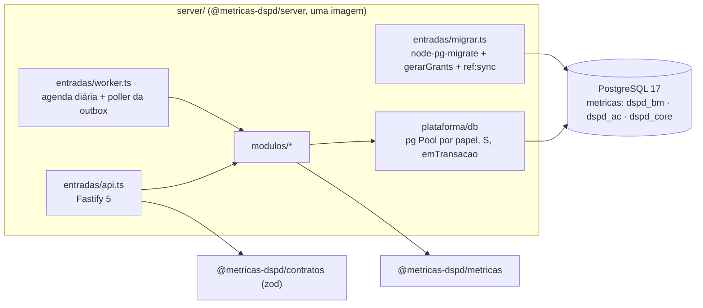
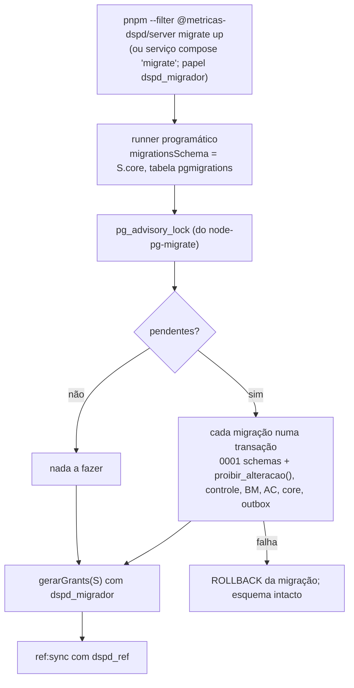
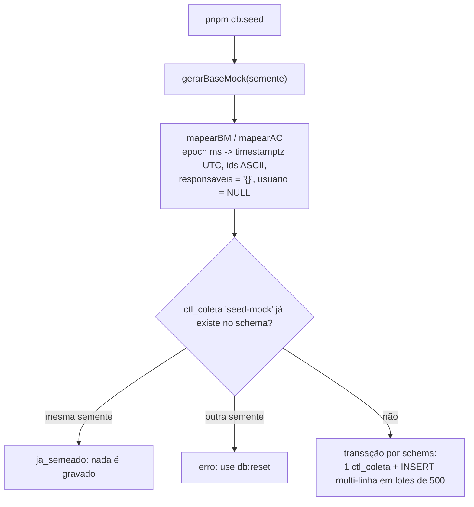
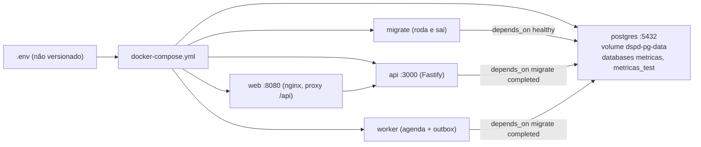

# Servidor (`server/`): módulos, migrações, seed e acesso ao PostgreSQL

Status: revisado em 2026-10-10 para a **ADR 0014 revisão 2** (PostgreSQL, `pg` puro, node-pg-migrate, outbox com polling, Fastify 5, Zod 4, OpenAPI, Vitest com schemas por execução, pnpm, Docker Compose local). Modelo em `data-model.md`; módulos e fronteiras na ADR 0013; contrato da coleta na ADR 0006.

**Estado atual do código** (S-01 a S-05 feitos em 2026-10-10): Postgres 17 no Compose; `src/plataforma/db` (`pg`: `criarPool`, `emTransacao`, `ehDuplicado`, parsers, mapa `S`, `migrar`, `gerarGrants` com GRANT por coluna, `lgpd`, `seed`); migrações Postgres 0001-0011 (node-pg-migrate, `ddl(S)` + `pgm.sql`, `checksums.json`; 0011 = outbox); `src/modulos/businessmap/staging.ts` e `src/modulos/operacao/` (ex-`coletas`) sobre `pg`; testes `unit` (dublê de `pool`, cobertura 100%) e `pg` (schemas por execução). Kysely, `mysql2` e o MySQL saíram. Sem servidor HTTP ainda (S-07).

## Estrutura alvo
```
server/
  Dockerfile       multi-stage, Node 24 slim, usuário não root; uma imagem, várias entradas
  migrations/      NNNN_*.ts: ddl(S) {up, down} + up/down(pgm) com pgm.sql; checksums.json
  src/
    app.ts         buildApp(deps): Fastify 5 + fastify-type-provider-zod com as rotas dos módulos
    plataforma/    config (zod), db (pg: pools por papel, emTransacao, mapa S, parsers, migrar.ts, grants, lgpd), eventos (publicarEvento, processarOutbox), log (pino), erros, auth
    modulos/       businessmap · acelerato · referencia · metricas · operacao (hoje src/coletas) · preferencias
    entradas/      api.ts (listen) · worker.ts (agenda + poller) · migrar.ts · coleta-cli.ts · openapi.ts
```
Cada módulo expõe só `index.ts`; `businessmap` grava só em `dspd_bm`, `acelerato` só em `dspd_ac` (ambos leem `dspd_core.ref_*`). `dspd_bm` e `dspd_ac` nunca se misturam: nenhuma FK nem consulta cruza os dois (teste que lista os schemas usados por repositório).



## Acesso a dados (`plataforma/db`)
- Um `Pool` do `pg` por papel; `TimeZone=UTC` e `statement_timeout` por pool; `emTransacao(pool, fn)`; `ehDuplicado(erro)` (SQLSTATE `23505`).
- Mapa `S = { bm, ac, core }` a partir de `DSPD_SCHEMA_PREFIXO` (vazio fora dos testes). Todo SQL qualificado: `${S.bm}.dim_card`. Parâmetros só por `$n`.
- Idempotência: `ON CONFLICT ON CONSTRAINT uq_<tabela> DO NOTHING RETURNING` com alvo explícito; zero linhas = já existente. `ON CONFLICT` sem alvo, `DO UPDATE` fora das projeções e `SELECT *` são reprovados pelo lint.
- Tipos de linha declarados por repositório; nada do driver sai do repositório. Parsers: `timestamptz` → `Date`, `int8` → `bigint`/`string`, `numeric` → `string`.

## Estado de coleta (`src/coletas/` → `modulos/operacao`)
`estadoColeta(db, dominio, agora)` e `historicoColetas(db, dominio, pagina)` leem `ctl_coleta` + `ctl_coleta_contagem` da fonte (schema fixo por domínio) e `ref_versao_criterio*`, e entregam a `montarEstadoColeta`/`paginarColetas` (regra única em `packages/metricas`). `erro_resumo` nunca sai: só a categoria. Contagens `arquivado_preservado` e `excluido_preservado` em `ctl_coleta_contagem.lidos`. Contrato HTTP em `docs/api/fontes.md`. Testes: SQL com driver falso (unitário) e `coletas.pg.test.ts` (projeto `pg`).

## Migrações (node-pg-migrate)

- Migrações **novas** para Postgres, numeradas a partir de `0001`, com as correções do `data-model.md` §11. As MySQL saem no mesmo PR.
- Cada arquivo exporta `ddl(S)` (SQL puro, usado pelos testes estáticos de LGPD, tamanhos e checksum) e `up/down(pgm)` que só chamam `pgm.sql`. Migração aplicada nunca é editada; correção vira migração nova. CI: `up → down → up`.
- Comandos: `migrate up|down|redo`. `down` desfaz a última.

## Seed (desenvolvimento)

- Grava `dim_card`, `fato_transicao` (`fonte = 'revision'`, `id_origem = seed-N`), `fato_bloqueio`, `ref_coluna` (BM) e `dim_chamado`, `fato_etapa_chamado` (AC). Arquivados e excluídos entram como estão. Determinístico (sem relógio). O mock não traz nomes: `responsaveis` vazio e `usuario` nulo.
- Nunca apaga nem sobrescreve (sem `ON CONFLICT DO UPDATE`, `DELETE`). `coluna_id` = `c<ordem>`; `data_acordada` com a data civil em America/Sao_Paulo.
- Fora do seed (não inferido): `ref_quadro`, `ref_dominio`, `ref_alvo_prioridade`, calendário, staging, `*_versao`, `evt_*` e `fato_etapa_chamado.totalizador`. Variáveis: `PG_MIGRADOR_URL`, `MOCK_SEMENTE` (opcional).
- Critério de pronto do port: mesmo hash da base mock lida do Postgres que o hash lido do MySQL antes (ou do mock direto, se o MySQL não estiver disponível).

## Papéis e grants (data-model §8; `plataforma/db/grants.ts`)
| Papel | Pode |
|---|---|
| `dspd_migrador` | dono dos objetos (DDL); seed em desenvolvimento |
| `dspd_coletor` | append-only em `stg_`, `evt_`, `*_versao`, `fato_transicao`, `rec_`; escrita nas projeções; `ctl_` com UPDATE por coluna; `outbox` (poller) |
| `dspd_ref` | `INSERT/SELECT` em `ref_` e `UPDATE (vigente_ate)` |
| `dspd_webhook` | `INSERT` em `dspd_bm.stg_webhook_evento` e em `dspd_core.outbox` (mesma transação) |
| `dspd_api` | `SELECT` em projeções, `vw_`, `ref_`, `ctl_`, **por coluna, sem as de `COLUNAS_PESSOA`**; sem `stg_`, `evt_`, `*_versao`, `outbox` |
| `dspd_automacao` | `dspd_ac.ctl_automacao` (sem uso até a T4.3) |

`gerarGrants(S)` produz os `GRANT`/`REVOKE` e é aplicado ao fim de cada `migrate up`. Senhas só em `.env`.

## Ambiente local com Docker Compose
Decisão do usuário (2026-10-10 §8): tudo local, sem custo. Arquivos: `docker-compose.yml`, `.env.example`, `docker/postgres/init/01-databases-papeis.sh`, `server/Dockerfile`, `web/Dockerfile` + `web/nginx.conf`.



O init (só na primeira criação do volume) cria os databases `metricas` e `metricas_test`, os papéis com `LOGIN` (senhas `DSPD_PWD_*`) e revoga `public`. Os schemas e grants vêm das migrações.

| Script (pnpm, raiz) | Faz |
|---|---|
| `pnpm db:up` / `db:down` | sobe só o `postgres` (aguarda healthcheck) / derruba, mantendo o volume |
| `pnpm db:reset` | apaga o volume e sobe de novo (reexecuta o init) |
| `pnpm db:migrate` | migrações + grants + `ref:sync` |
| `pnpm db:seed` | seed do mock |
| `pnpm stack:up` | `docker compose up -d --build` (postgres, migrate, api, worker, web) |
| `pnpm dev` | `api` e `worker` com `tsx watch` + Vite, contra o `postgres` do compose |
| `pnpm test:pg` | testes do projeto `pg` num conjunto de schemas por execução |
| `pnpm db:limpar-testes` | apaga schemas `t%_dspd_%` de execuções interrompidas |

Primeiro uso: `cp .env.example .env`, ajuste as senhas, `pnpm db:up && pnpm db:migrate && pnpm db:seed`; ou `pnpm stack:up` para tudo em contêiner.

### Testes contra o Postgres (sem Testcontainers)
`globalSetup` gera o prefixo `t<6 base36>_`, roda as migrações com o `S` prefixado no database `metricas_test` e aplica `gerarGrants(S)` (papéis compartilhados do cluster). `globalTeardown` faz `DROP SCHEMA ... CASCADE` (`DSPD_TESTE_MANTER=1` preserva). Projeto Vitest `pg` sem paralelismo de arquivos; cada teste cria seus dados. Sem `PG_TEST_URL`, os testes `pg` são pulados localmente; no CI são obrigatórios (job `db` sobe o mesmo compose).

### Instalar Docker no WSL2
1. Docker Desktop no Windows, com "Use the WSL 2 based engine" e a integração ligada para a distro.
2. Sem Desktop: Docker Engine pelo repositório apt oficial (docs.docker.com/engine/install/ubuntu), `sudo usermod -aG docker $USER`, reabrir o terminal; se o systemd não estiver ativo, `[boot]\nsystemd=true` em `/etc/wsl.conf` e `wsl --shutdown`.
3. Conferir com `docker compose version` e `docker run --rm hello-world`.

## Regra LGPD de colunas (`src/db/lgpd.ts` → `plataforma/db/lgpd.ts`)
Módulo único com `SEGMENTO_PESSOA`, `COLUNAS_PESSOA` (as colunas de pessoa permitidas no analítico: `dim_card.responsaveis`, `dim_card_versao.responsaveis`, `fato_transicao.usuario`), `EXCECOES_PESSOA` (`area_solicitante`) e `violaLgpd`. Usado pelos testes estáticos das migrações e do seed, pelo teste de catálogo e por `gerarGrants` (que tira as colunas de `COLUNAS_PESSOA` do `SELECT` da `dspd_api`). Regra completa em `data-model.md` §9.

## Staging de card
`gravarStgCard(cliente, entrada)` recebe `quadroId`, `arquivado` e `excluidoDetectado` do coletor; deduplica contra a última versão com `ON CONFLICT ON CONSTRAINT uq_stg_card DO NOTHING RETURNING stg_sk` e relê em caso de corrida (`data-model.md` §3.1). `fato_transicao.id_origem` é `varchar(64)` (SHA-256 hex do webhook).


## Estado do port para Postgres (S-01 a S-05)
- **Comandos:** `pnpm run db:up` (Compose), `db:migrate [up|down N|redo]`, `db:seed`, `db:limpar-testes`, `pnpm run test:pg` (sobe o `postgres`, roda o projeto Vitest `pg` com um conjunto de schemas por execução, `t<6 base36>_dspd_*` em `metricas_test`, removido pelo `globalTeardown`; `DSPD_TESTE_MANTER=1` preserva). `pnpm run pronto` roda typecheck, lint e cobertura 100% (thresholds ligados) sem banco: os testes `*.pg.test.ts` ficam pulados sem `PG_TESTE_URL`.
- **Variáveis:** `PG_MIGRADOR_URL`, `PG_TESTE_URL`, `DSPD_PWD_*`, `DSPD_SCHEMA_PREFIXO` (vazio fora dos testes); ver `.env.example`.
- **Grants:** `gerarGrants(S, catalogo)` lê tabelas, views e colunas do catálogo e é reaplicado ao fim de todo `migrate`. `dspd_api` recebe `SELECT` por coluna onde há coluna de `COLUNAS_PESSOA` (`responsaveis`, `usuario`); `fato_transicao` e `rec_transicao_par` entram para a API só porque `vw_transicao_canonica` (`security_invoker`) depende delas.
- **Staging:** `gravarStgCard` usa `ON CONFLICT ON CONSTRAINT uq_stg_card DO NOTHING RETURNING stg_sk` e relê; até 5 tentativas por item. Cada escritor perde no máximo (escritores simultâneos - 1) vezes, então mais de 5 escritores simultâneos sobre o mesmo item podem esgotar as tentativas (falha do item, reprocessada na coleta seguinte). Exige `READ COMMITTED`.
- **Pendências conhecidas:** os testes de catálogo e o `snapshot` rodam só no projeto `pg`; o job `db` do GitHub Actions e a regra de lint de SQL (S-06) ainda não existem; o critério "mesmo hash da base mock" foi substituído por contagem de linhas e instantes idênticos (o seed anterior em MySQL nunca foi executado).
