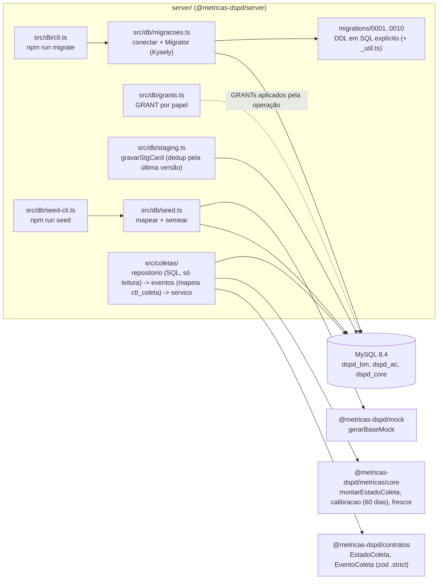
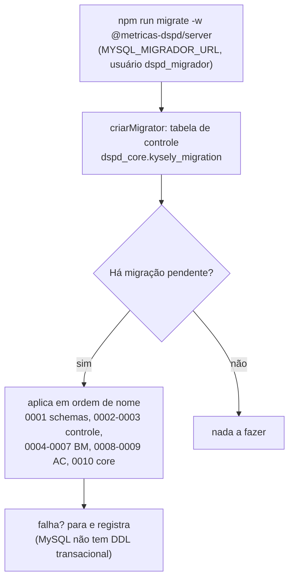
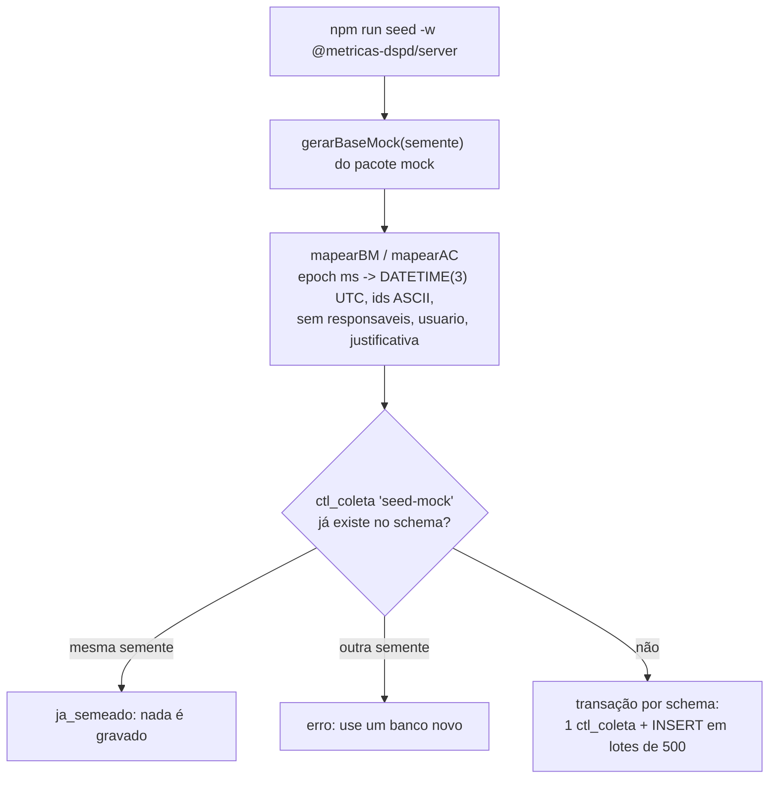
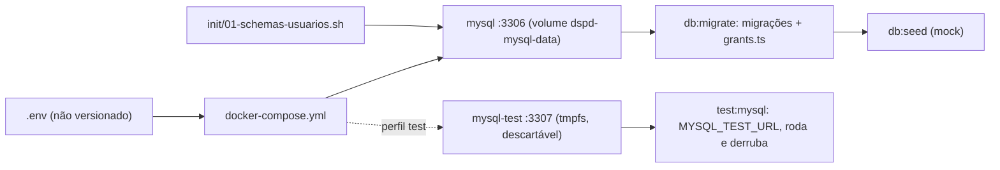

# Servidor (`server/`): módulos, migrações, seed e acesso ao MySQL

Status: K-017 parte 2. Modelo de dados em `data-model.md`; decisões em ADR 0004 (MySQL), 0005 (SQL explícito), 0006 (contrato da coleta), 0013 (duas Lambdas, Acelerato via Metabase) e **0014** (stack: pnpm, Fastify 5, `mysql2` puro, migrador próprio, outbox com polling, Zod 4, OpenAPI, Vitest com prefixo por execução).

## Estrutura alvo (ADRs 0013 e 0014)
O que está abaixo (`src/db/` com Kysely, `src/coletas/`) é o estado atual. A organização alvo, feita nos cartões S-00 a S-14 do `roadmap.md`:
```
server/
  migrations/      ddl.up/ddl.down inalterados (sai só o wrapper Kysely) + checksums.json
  src/
    app.ts         buildApp(deps): Fastify 5 + fastify-type-provider-zod com as rotas de todos os módulos
    plataforma/    config (zod), db (mysql2: pools por papel, emTransacao, mapa S de schemas com prefixo, migrador), eventos (publicarEvento, processarOutbox), log (pino), erros, auth
    modulos/       businessmap · acelerato · referencia · metricas · operacao (hoje src/coletas) · preferencias
    entradas/      lambda-api · lambda-coleta · lambda-migrar · local · coleta-cli
infra/             AWS CDK, uma stack
```
Cada módulo expõe só `index.ts`; `businessmap` grava só em `dspd_bm`, `acelerato` só em `dspd_ac`. Em produção, o banco é RDS MySQL 8.4 privado; as migrações rodam pela Lambda `migrar` no deploy. Localmente nada muda (Docker, abaixo).

## Módulos



`dspd_bm` (BusinessMap) e `dspd_ac` (Acelerato) nunca se misturam: nenhuma FK nem consulta cruza os dois. O pacote `@metricas-dspd/server` é workspace da raiz; `pnpm pronto` na raiz (antes `npm run pronto`; ADR 0014) roda typecheck, lint e testes do server junto com os demais pacotes (o server usa a própria configuração de ESLint).

### Estado de coleta (`src/coletas/`, integracao-real B1 a B4)

`estadoColeta(db, dominio, agora)` e `historicoColetas(db, dominio, pagina)`: leem `ctl_coleta` + `ctl_coleta_contagem` da fonte (schema fixo por domínio; BM e AC nunca na mesma consulta) e `ref_versao_criterio*`, e entregam a `montarEstadoColeta`/`paginarColetas` (regra única em `packages/metricas`; selo e calibração não são recalculados aqui). `erro_resumo` nunca sai: só a categoria (prefixo `categoria: detalhe`). Convenção com o coletor (002): contagens `arquivado_preservado` e `excluido_preservado` em `ctl_coleta_contagem.lidos`. Contrato HTTP em `docs/api/fontes.md` (sem rotas ainda: o servidor HTTP não existe nesta etapa). Testes: `tests/coletas.test.ts` (SQL compilado com driver falso, 100%) e `tests/coletas.mysql.test.ts` (pulado sem `MYSQL_TEST_URL`).

## Migrações

> **Alvo (ADR 0014, cartão S-03):** o `Migrator` do Kysely é trocado por um executor próprio sobre `mysql2` (`plataforma/db/migrador.ts`): mesmo registro estático, mesmas listas `ddl.up`/`ddl.down`, mesma tabela `dspd_core.kysely_migration`, lock por `GET_LOCK('dspd:migracao', 30)`, reescrita de `dspd_*.` para o prefixo de teste, checksum do SQL em `migrations/checksums.json`. Comando: `pnpm --filter @metricas-dspd/server migrate up|down|status`. Próxima migração: `0011_core_outbox`. O diagrama abaixo é o estado atual.



- `npm run migrate` aplica até a última; `npm run migrate -w @metricas-dspd/server -- down` desfaz a última.
- Migração aplicada nunca é editada: correção vira migração nova (ADR 0005). Cada migração exporta `ddl.up`/`ddl.down` (listas de instruções) para o teste estático.

## Seed (desenvolvimento)



- Grava `dim_card`, `fato_transicao` (`fonte = 'revision'`, `id_origem = seed-N`), `fato_bloqueio`, `ref_coluna` (BM) e `dim_chamado`, `fato_etapa_chamado` (AC). Cards arquivados e excluídos entram como estão.
- Determinístico: sem relógio; `coletado_em` = "hoje" da configuração do mock; mesma semente gera as mesmas linhas.
- Nunca apaga nem sobrescreve (sem `INSERT IGNORE`, `ON DUPLICATE KEY`, `DELETE`). `coluna_id` = `c<ordem>` (o nome com acento fica em `ref_coluna.nome`); `data_acordada` usa a data civil em America/Sao_Paulo (-03:00).
- Fora do seed (o mock não traz a informação; não foi inferida): `ref_quadro` (nível), `ref_dominio`, `ref_alvo_prioridade`, calendário, staging, `*_versao`, `evt_*` e `fato_etapa_chamado.totalizador`. Variáveis: `MYSQL_SEED_URL` (ou `MYSQL_MIGRADOR_URL`) e, opcional, `MOCK_SEMENTE`.

## Usuários e grants por papel (data-model §8; `src/db/grants.ts`)

| Usuário | Pode |
|---|---|
| `dspd_migrador` | DDL (só no job de deploy); também usado no seed em desenvolvimento |
| `dspd_coletor` | INSERT/SELECT em `stg_`, `evt_`, `*_versao`, `fato_transicao`, `rec_`; INSERT/UPDATE/DELETE nas projeções; SELECT/INSERT em `ctl_` (append-only, inclusive `ctl_automacao`), com `UPDATE (status, finalizado_em, marca_dagua_ate, erro_resumo)` em `ctl_coleta` e UPDATE em `ctl_coleta_contagem`; SELECT em `ref_` |
| `dspd_ref` | INSERT/SELECT em `ref_` e `UPDATE (vigente_ate)` por coluna |
| `dspd_webhook` | INSERT só em `dspd_bm.stg_webhook_evento` e, com a ADR 0014, em `dspd_core.outbox` (mesma transação) |
| `dspd_api` | SELECT em projeções, `vw_`, `ref_`, `ctl_`; sem acesso a `stg_` nem à `outbox` |
| `dspd_automacao` | INSERT/SELECT em `dspd_ac.ctl_automacao`; SELECT em `ref_` do core (sem uso até a T4.3 voltar, ADR 0013) |

Na AWS (ADR 0013): `api` usa `dspd_api` + `dspd_webhook`; `coleta`, `dspd_coletor`; `migrar`, `dspd_migrador` + `dspd_ref`. Senhas no Secrets Manager.

Os usuários são criados pela operação (com senha fora do repositório); `gerarGrants` produz os `GRANT` a aplicar depois das migrações. Credenciais só em `.env`.

## Ambiente local com Docker

Decisão do usuário (alinhamentos de 2026-10-10): o banco local roda em Docker. Arquivos: `docker-compose.yml`, `.env.example`, `docker/mysql/init/01-schemas-usuarios.sh`, `scripts/db.sh`, `scripts/test-mysql.sh`.



MySQL 8.4, utf8mb4, InnoDB, fuso UTC, healthcheck. O init (só na primeira criação do volume) cria `dspd_bm`, `dspd_ac`, `dspd_core` e os usuários por papel (senhas de `DSPD_PWD_*`); os `GRANT` por tabela vêm de `gerarGrants` e são aplicados ao fim de `db:migrate` (`MYSQL_GRANTS_URL`, conta root local).

Scripts com pnpm (ADR 0014; hoje ainda `npm run`):

| Script | Faz |
|---|---|
| `pnpm db:up` / `db:down` | sobe (aguarda healthcheck) / derruba, mantendo o volume |
| `pnpm db:reset` | derruba apagando o volume e sobe de novo (reexecuta o init) |
| `pnpm db:migrate` | migrações com `dspd_migrador` e depois os grants |
| `pnpm db:seed` | seed do mock (só desenvolvimento) |
| `pnpm test:mysql` | sobe o `mysql-test`, roda os testes MySQL num **conjunto de databases por execução** e derruba |
| `pnpm db:limpar-testes` | apaga sobras `t*_dspd_*` (e usuários de teste) de execuções interrompidas |

Primeiro uso: `cp .env.example .env`, ajuste as senhas, `pnpm db:up && pnpm db:migrate && pnpm db:seed`.

### Testes contra MySQL (ADR 0014, sem Testcontainers)
`globalSetup` do Vitest gera o prefixo `t<6 base36>_`, cria `<p>dspd_bm`, `<p>dspd_ac`, `<p>dspd_core` no `mysql-test` (perfil `test`, :3307), aplica as migrações pelo executor e `gerarGrants(prefixo)` com usuários de teste prefixados; `globalTeardown` apaga (`DSPD_TESTE_MANTER=1` preserva). O código lê os nomes do mapa `S` (`DSPD_SCHEMA_PREFIXO`). Projeto Vitest `mysql` sem paralelismo de arquivos; cada teste cria seus dados. Duas execuções simultâneas não colidem. No CI o job `db` sobe o mesmo compose.

### Instalar Docker no WSL2
1. Opção simples: Docker Desktop no Windows, com "Use the WSL 2 based engine" e a integração ligada para a distro em Settings > Resources > WSL integration.
2. Sem Desktop: no Ubuntu do WSL2, siga a instalação do Docker Engine pelo repositório apt oficial (docs.docker.com/engine/install/ubuntu), `sudo usermod -aG docker $USER`, reabra o terminal e, se o systemd não estiver ativo, adicione `[boot]\nsystemd=true` em `/etc/wsl.conf` e rode `wsl --shutdown` no Windows.
3. Confira com `docker compose version` e `docker run --rm hello-world`.

Nesta entrega os testes contra MySQL ainda não foram executados (Docker ausente na máquina); sem `MYSQL_TEST_URL` eles ficam pulados e os estáticos rodam sempre.

## Regra LGPD de colunas (`src/db/lgpd.ts`)
Módulo único, usado pelos testes estáticos das migrações e do seed (e pelo de `information_schema` no CI). O nome da coluna é dividido por `_` e falha se algum segmento casar `pessoa|responsav*|usuario*|user*|agente*|atendente*|solicitante*|autor*|criador*|email*|login*|assignee*|justificativa*`. Exceções só por `schema.tabela.coluna` (hoje `dspd_bm.dim_card.area_solicitante` e `dspd_bm.dim_card_versao.area_solicitante`, área organizacional, briefing 4.5). Decisão do usuário: nomes não são pseudonimizados; a garantia é que nenhuma view ou DTO expõe ou agrega por pessoa. O seed não grava responsáveis.

## Staging de card
`gravarStgCard(db, entrada)` recebe `quadroId`, `arquivado` e `excluidoDetectado` do coletor (nada é fixo em código). `fato_transicao.id_origem` é `VARCHAR(64) ascii` (hash SHA-256 hex do webhook). Removidos: índices `ix_*_versao_vigente` (redundantes com o UNIQUE) e `stg_webhook_evento.coleta_id`; `dim_chamado_versao` ganhou `organizacao` e `tipo`. `dspd_ref` tem `UPDATE (vigente_ate)` também em `dspd_core.ref_calendario_turno` e `ref_calendario_aplicacao`.
