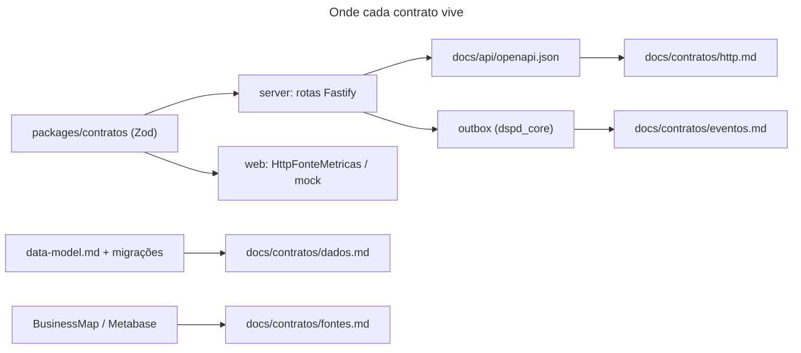

# Contratos do MetricasDSPD

- **Propósito:** ponto de entrada único para saber onde está cada contrato (API HTTP, eventos, dados, fontes, preferências, exportação) e quem o mantém.
- **Público:** time (desenvolvedores, QA, arquiteto, tech lead). Documentação só para o time, no repositório; não há Swagger UI público (decisão do time).
- **Revisão:** 2026-10-11.

## Perguntas frequentes

| Pergunta | Vá para |
|---|---|
| Que rotas existem, que filtros aceitam, que erros devolvem? | [http.md](http.md) e `docs/api/openapi.json` |
| O que devolve a métrica `O3` (campos, mínimo de 20 itens, filtros)? | `docs/contratos/metricas/` [planejado: gerado por outro agente, ainda não existe neste commit] |
| Posso mudar um campo do DTO? Quando vira `/api/v2`? | [politica-de-mudanca.md](politica-de-mudanca.md) |
| Que eventos a outbox carrega, quem produz e quem consome? | [eventos.md](eventos.md) |
| Que colunas guardam pessoa? Histórico, retenção, SCD2? | [dados.md](dados.md) |
| O que a API do BusinessMap e o Metabase do Acelerato entregam? | [fontes.md](fontes.md) |
| Formato das preferências de cartões e limites da exportação em PDF | [preferencias-e-exportacao.md](preferencias-e-exportacao.md) |
| Mudei uma regra de cálculo: é mudança de contrato? | Não: T2.6, ver [politica-de-mudanca.md](politica-de-mudanca.md) |

## Índice por tipo de contrato

| Tipo | Fonte da verdade no código | Página |
|---|---|---|
| API HTTP (43 rotas) | `server/src/modulos/*/rotas.ts`, `server/src/plataforma/saude.ts`; OpenAPI gerado em `docs/api/openapi.json` | [http.md](http.md) |
| DTOs e filtros | `packages/contratos/src/` (`comum.ts:96` `METRICA_IDS`, `metricas.ts:103` `APLICABILIDADE_FLUXO`, `coletas.ts`) | [http.md](http.md), `metricas/` [planejado] |
| Regras por métrica (`REGRAS_METRICA`) | `packages/metricas/src/core/regras.ts:68` | `docs/architecture/regras-metricas.md` |
| Eventos (outbox) | `server/src/plataforma/eventos/`, `modulos/operacao/concluida.ts`, `modulos/businessmap/webhook.ts` | [eventos.md](eventos.md) |
| Dados (staging, analítico, LGPD) | migrações, `server/src/plataforma/db/lgpd.ts`, `docs/architecture/data-model.md` | [dados.md](dados.md) |
| Fontes externas | `docs/architecture/data-model.md` §3.1 e §4, ADR 0006 e 0013 | [fontes.md](fontes.md) |
| Preferências (pedido 007) e exportação (pedido 008) | `packages/contratos/src/cartoes.ts`, `web/src/features/exportar/modelo.ts` | [preferencias-e-exportacao.md](preferencias-e-exportacao.md) |

### Onde cada contrato vive

Legenda: caixa = pasta ou arquivo; seta = "alimenta"; o rótulo traz o tipo.

Alternativa em lista

- packages/contratos (Zod) -> servidor (rotas Fastify) e web: schemas e tipos.
- Rotas -> `docs/api/openapi.json`: especificação HTTP gerada (descrita em `http.md`).
- Rotas -> outbox (`dspd_core`): eventos gravados (descritos em `eventos.md`).
- `data-model.md` e migrações -> `dados.md`: modelo de dados.
- BusinessMap e Metabase -> `fontes.md`: descrição das fontes externas.

## Regras que valem para todos os contratos
- Nenhum contrato carrega dado de pessoa (CLAUDE.md, regras invioláveis; `data-model.md` §9).
- BusinessMap e Acelerato nunca se misturam: o domínio vem do `id` da métrica, e as rotas de fonte respondem uma fonte por chamada.
- Abaixo de 20 itens a estatística não é publicada (`MINIMO_AMOSTRA = 20`, `packages/contratos/src/comum.ts:4`).
- Marcação [planejado] = ainda não existe no repositório.

## Dono e como mudar
Dono: `node-backend` (HTTP, eventos, dados), `react-frontend` (preferências e exportação), `software-architect` e `tech-lead` (revisão). Toda mudança segue [politica-de-mudanca.md](politica-de-mudanca.md).
