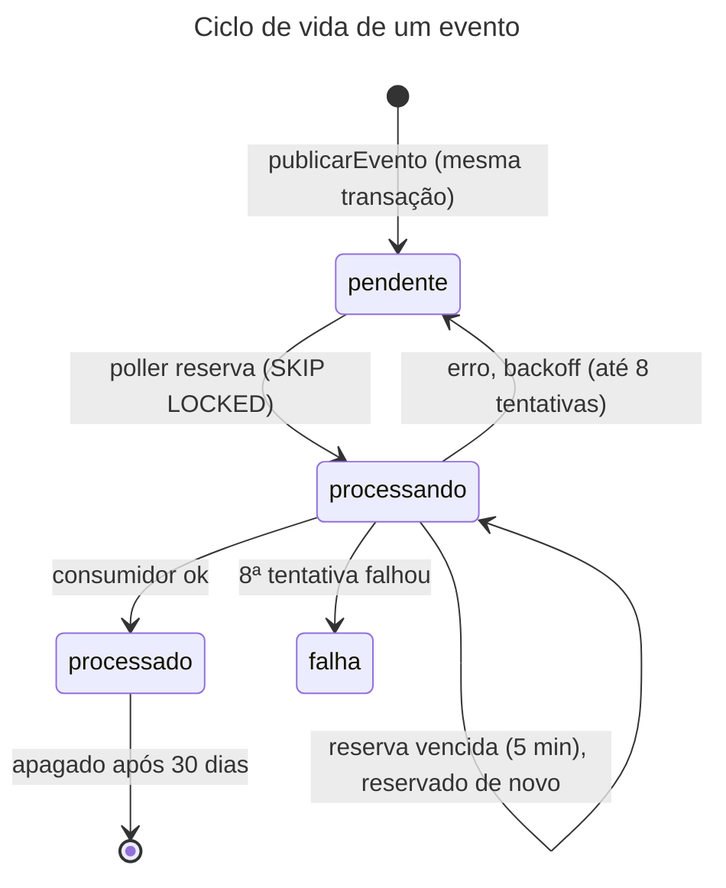

# Catálogo de eventos (outbox)

- **Propósito:** listar os eventos internos gravados na outbox, com produtor, consumidores, payload e garantias.
- **Público:** quem produz ou consome eventos (coletor, worker, webhook) e quem revisa mudanças.
- **Revisão:** 2026-10-11.
- **Fonte:** `server/src/plataforma/eventos/` (`catalogo.ts`, `outbox.ts`, `consumidores.ts`), tabela `dspd_core.outbox` em `docs/architecture/data-model.md` §5, ADR 0014. Os eventos são **internos**: não há API HTTP de eventos.

## 1. Catálogo

| Tipo | Fonte (`fonte`) | Produtor | Consumidores hoje | Payload |
|---|---|---|---|---|
| `coleta.concluida` | a da coleta (`businessmap` ou `acelerato`) | `fecharColeta`, na mesma transação que fecha `ctl_coleta` (`fecharColeta` em `server/src/modulos/operacao/concluida.ts`) | `consumidorColetaConcluida` (módulo `operacao`): `falha` ou `parcial` vira log `warn`; registrado por fonte em `server/src/entradas/worker.ts:15` | `{ fonte, coletaId: string, status: "sucesso" \| "parcial" \| "falha" }` (`concluida.ts:25`, `StatusFinal` em `:6`) |
| `bm.webhook.recebido` | `businessmap` | `receberWebhook`, na mesma transação que grava `stg_webhook_evento` (`receberWebhook` em `server/src/modulos/businessmap/webhook.ts`) | **nenhum** hoje; entra com o coletor (WS2) [planejado] | `{ webhookSk: string (dígitos), payloadSha256: string (hex de 64 caracteres) }` (schema `webhookRecebido` em `catalogo.ts`) |

Sobre o payload: só identificadores técnicos; **nenhum dado de pessoa**, nem o corpo do webhook (fica em `stg_webhook_evento`).

**Catálogo em código (existe):** `server/src/plataforma/eventos/catalogo.ts` tem um schema Zod `.strict()` por tipo (`CATALOGO_EVENTOS`) e um exemplo válido por tipo (`EXEMPLOS_EVENTOS`). `publicarEvento` (`outbox.ts`) chama `validarPayload` antes do `INSERT`: tipo fora do catálogo e payload inválido são recusados (a mensagem traz só os caminhos dos campos, nunca valores). `receberWebhook` usa o mesmo `validarPayload`, porque o `INSERT` do webhook é direto. O catálogo (`CATALOGO_EVENTOS`) é a **fonte única** dos tipos e é exportado como `@metricas-dspd/server/eventos` e alimenta a fotografia em `docs/contratos/snapshots/eventos/` (ver [politica-de-mudanca.md](politica-de-mudanca.md) §2). Nos consumidores o `payload` ainda chega como `unknown` (`consumidores.ts`) e `consumidorColetaConcluida` lê os campos com asserção de tipo.

**Este arquivo é o catálogo único dos eventos** (tipo, produtor, consumidores, payload e garantias). A página [04-eventos.md](../architecture/ddd/04-eventos.md) só trata da visão de domínio e remete para cá.

Observação: a coluna `tipo` é `varchar(64)` sem `CHECK`; a lista fechada de tipos vive no código (`catalogo.ts`), conferida em `publicarEvento`, e não no banco.

## 2. Regras de nome e de fonte
- Prefixo `bm.` pertence ao BusinessMap, `ac.` ao Acelerato; `coleta.*` vale para as duas, com a fonte no evento. O cadastro de consumidor recusa cruzamento (`consumidores.ts:7-19`: lança erro se o prefixo não bate com a fonte).
- Um consumidor por (fonte, tipo); duplicado lança erro (`consumidores.ts:21`).
- O poller roda **uma fonte por vez** e só vê eventos dela: BusinessMap e Acelerato nunca no mesmo lote.

## 3. Garantias de entrega e de idempotência

As referências usam o nome do símbolo, não o número de linha, para não ficarem velhas a cada edição do código.

| Tema | Garantia | Código |
|---|---|---|
| Atomicidade | o evento é gravado na mesma transação da mudança; se ela desfaz, o evento some | `outbox.ts` (`publicarEvento`) |
| Entrega | **pelo menos uma vez**; reserva com `FOR UPDATE SKIP LOCKED`, confirmada antes de chamar o consumidor | `outbox.ts` (`processarOutbox`) |
| Idempotência | o consumidor deve ser idempotente; chave = `eventoId` (`uuid`, coluna `evento_id`) | `outbox.ts` (`LinhaEvento`, chamada do consumidor em `processarOutbox`) |
| Ordem | processa por `evento_sk` dentro do lote; **sem garantia de ordem** entre reentregas após falha | `outbox.ts` (`ORDER BY evento_sk` em `processarOutbox`) |
| Reserva vencida | `processando` com `reservado_ate` vencida (5 min, `RESERVA_MS`) **continua `processando`** e é reservado de novo pelo poller (a cláusula `status = 'processando' AND reservado_ate < agora` do `SELECT`); cada reserva soma uma tentativa | `outbox.ts` (`RESERVA_MS`, `SELECT` e `UPDATE` de reserva em `processarOutbox`) |
| Falha e backoff | erro do consumidor reagenda com 30 s, 60 s, 120 s... teto de 1 h; após 8 tentativas, `status = falha` | `outbox.ts` (`MAX_TENTATIVAS`, `backoffMs`, `catch` em `processarOutbox`) |
| Tipo sem consumidor | fica `pendente`, sem gastar tentativas (o `SELECT` filtra `tipo = ANY(consumidores.tipos(fonte))`) | `outbox.ts` (`processarOutbox`), `consumidores.ts` (`tipos`) |
| Erro gravado | só a categoria (nome do erro) em `ultimo_erro`, nunca a mensagem | `outbox.ts` (`categoria`) |
| Retenção | `processado` é apagado após 30 dias (única exceção à regra de não apagar); `falha` e `pendente` permanecem | `outbox.ts` (`RETENCAO_DIAS`, `DELETE` final de `processarOutbox`) |
| Idempotência do webhook | entrega idêntica (mesmo SHA-256 do corpo) não grava linha nova nem evento novo | `webhook.ts` (`receberWebhook`, `ON CONFLICT ... DO NOTHING`) |

### Ciclo de vida de um evento

Legenda: elipse = estado em `outbox.status`; seta = transição.

Alternativa em lista

- (início) -> pendente: `publicarEvento`, na mesma transação.
- pendente -> processando: o poller reserva (SKIP LOCKED).
- processando -> processado: consumidor concluiu; apagado após 30 dias.
- processando -> pendente: erro do consumidor, com backoff (até 8 tentativas).
- processando -> processando: reserva vencida (5 min); o evento não volta a `pendente`, é reservado de novo.
- processando -> falha: a 8ª tentativa falhou.

## 4. Mudança de evento
Mudança incompatível de payload = tipo novo; ver [politica-de-mudanca.md](politica-de-mudanca.md) §3. Novo tipo exige: schema em `catalogo.ts` (com exemplo em `EXEMPLOS_EVENTOS`), produtor na mesma transação, consumidor idempotente, teste de que o payload não tem chave de pessoa, fotografia nova (`pnpm run docs:fotografar`) e linha neste catálogo.

**Conferência de fonte ao publicar (existe):** `publicarEvento` chama `conferirFonte` antes de validar o payload (`server/src/plataforma/eventos/outbox.ts:27`; função em `catalogo.ts:66-71`). Recusa o evento se o prefixo do tipo (`bm.`, `ac.`) pertence a outra fonte que a de `fonte`, ou se `payload.fonte`, quando existe, diverge da coluna. A mensagem não traz valores de payload. O cadastro de consumidor continua recusando o cruzamento (`consumidores.ts`).
