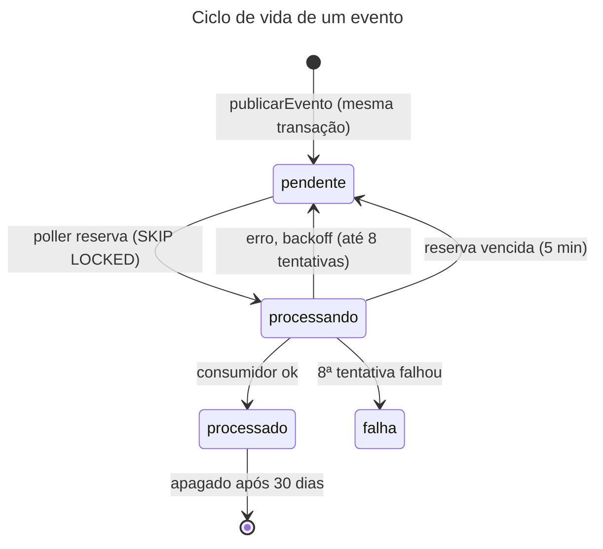

# Catálogo de eventos (outbox)

- **Propósito:** listar os eventos internos gravados na outbox, com produtor, consumidores, payload e garantias.
- **Público:** quem produz ou consome eventos (coletor, worker, webhook) e quem revisa mudanças.
- **Revisão:** 2026-10-11.
- **Fonte:** `server/src/plataforma/eventos/` (`outbox.ts`, `consumidores.ts`), tabela `dspd_core.outbox` em `docs/architecture/data-model.md` §5, ADR 0014. Os eventos são **internos**: não há API HTTP de eventos.

## 1. Catálogo

| Tipo | Fonte (`fonte`) | Produtor | Consumidores hoje | Payload |
|---|---|---|---|---|
| `coleta.concluida` | a da coleta (`businessmap` ou `acelerato`) | `fecharColeta`, na mesma transação que fecha `ctl_coleta` (`server/src/modulos/operacao/concluida.ts:14-27`) | `consumidorColetaConcluida` (módulo `operacao`): `falha` ou `parcial` vira log `warn`; registrado por fonte em `server/src/entradas/worker.ts:15` | `{ fonte, coletaId: string, status: "sucesso" \| "parcial" \| "falha" }` (`concluida.ts:25`, `StatusFinal` em `:6`) |
| `bm.webhook.recebido` | `businessmap` | `receberWebhook`, na mesma transação que grava `stg_webhook_evento` (`server/src/modulos/businessmap/webhook.ts:33-47`) | **nenhum** hoje; entra com o coletor (WS2) [planejado] | `{ webhookSk: string, payloadSha256: string (hex de 64 caracteres) }` (`webhook.ts:45`) |

Sobre o payload: só identificadores técnicos; **nenhum dado de pessoa**, nem o corpo do webhook (fica em `stg_webhook_evento`). O tipo de `payload` no código é `unknown` (`outbox.ts:7`, `consumidores.ts:3`); o schema Zod por tipo [planejado] (`docs/engineering/contratos-plano.md` §3, item 1). Enquanto isso, o consumidor de `coleta.concluida` lê os campos com asserção de tipo (`concluida.ts:36`).

Observação: `data-model.md` §5 diz "lista fechada no código" para `tipo`, mas o código aceita qualquer `varchar(64)`; a coluna não tem `CHECK` de tipos. Lista de tipos [planejado] junto com o schema.

## 2. Regras de nome e de fonte
- Prefixo `bm.` pertence ao BusinessMap, `ac.` ao Acelerato; `coleta.*` vale para as duas, com a fonte no evento. O cadastro de consumidor recusa cruzamento (`consumidores.ts:7-19`: lança erro se o prefixo não bate com a fonte).
- Um consumidor por (fonte, tipo); duplicado lança erro (`consumidores.ts:21`).
- O poller roda **uma fonte por vez** e só vê eventos dela: BusinessMap e Acelerato nunca no mesmo lote.

## 3. Garantias de entrega e de idempotência

| Tema | Garantia | Código |
|---|---|---|
| Atomicidade | o evento é gravado na mesma transação da mudança; se ela desfaz, o evento some | `outbox.ts:18-25` |
| Entrega | **pelo menos uma vez**; reserva com `FOR UPDATE SKIP LOCKED`, confirmada antes de chamar o consumidor | `outbox.ts:41-65` |
| Idempotência | o consumidor deve ser idempotente; chave = `eventoId` (`uuid`, coluna `evento_id`) | `outbox.ts:44` |
| Ordem | processa por `evento_sk` dentro do lote; **sem garantia de ordem** entre reentregas após falha | `outbox.ts:54` |
| Reserva vencida | `processando` com `reservado_ate` vencida (5 min) volta a ser elegível | `outbox.ts:11,52-53` |
| Falha e backoff | erro do consumidor reagenda com 30 s, 60 s, 120 s... teto de 1 h; após 8 tentativas, `status = falha` | `outbox.ts:9,13-16,79-87` |
| Tipo sem consumidor | fica `pendente`, sem gastar tentativas | `outbox.ts:42-43` |
| Erro gravado | só a categoria (nome do erro) em `ultimo_erro`, nunca a mensagem | `outbox.ts:38-39` |
| Retenção | `processado` é apagado após 30 dias (única exceção à regra de não apagar); `falha` e `pendente` permanecem | `outbox.ts:10,90-93` |
| Idempotência do webhook | entrega idêntica (mesmo SHA-256 do corpo) não grava linha nova nem evento novo | `webhook.ts:28-41` |

### Ciclo de vida de um evento

Legenda: elipse = estado em `outbox.status`; seta = transição.

Alternativa em lista

- (início) -> pendente: `publicarEvento`, na mesma transação.
- pendente -> processando: o poller reserva (SKIP LOCKED).
- processando -> processado: consumidor concluiu; apagado após 30 dias.
- processando -> pendente: erro com backoff (até 8 tentativas) ou reserva vencida (5 min).
- processando -> falha: a 8ª tentativa falhou.

## 4. Mudança de evento
Mudança incompatível de payload = tipo novo; ver [politica-de-mudanca.md](politica-de-mudanca.md) §3. Novo tipo exige: produtor na mesma transação, consumidor idempotente, teste de que o payload não tem chave de pessoa e linha neste catálogo.
