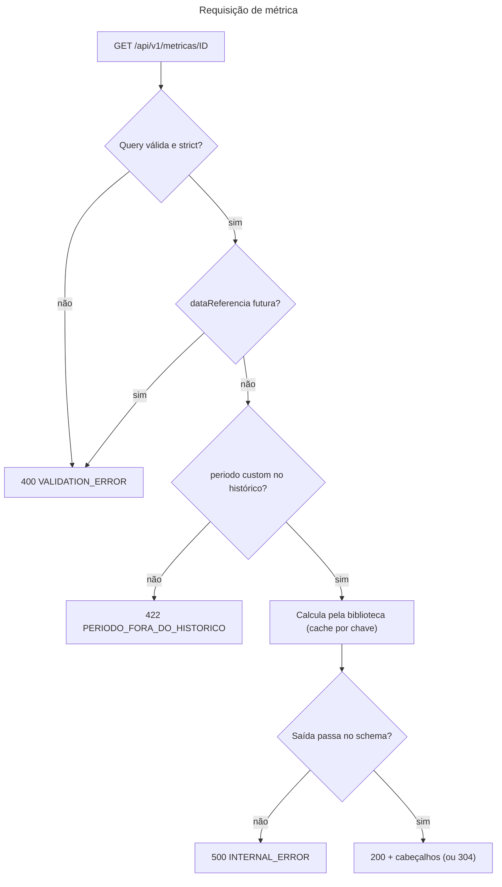

# Contrato HTTP da API

- **Propósito:** descrever as regras gerais da API (rotas, filtros, erros, paginação, cabeçalhos, cache). O detalhe de cada rota está no OpenAPI gerado; o de cada métrica, em `metricas/`.
- **Público:** desenvolvedores do front e do back, QA.
- **Revisão:** 2026-10-11.
- **Fontes:** [`docs/api/openapi.json`](../api/openapi.json) (gerado dos schemas Zod, não editar à mão); [metricas/](metricas/README.md) (gerado, uma página por métrica); código em `server/src/modulos/*/rotas.ts` e `server/src/app.ts`.
- Documentação só para o time; não há Swagger UI público (decisão do time).

## 1. Rotas (43 no OpenAPI)

Conferido em `docs/api/openapi.json` (43 caminhos, 43 operações, todas `GET` exceto o webhook).

| Grupo | Rotas | Código |
|---|---|---|
| Métricas (34 caminhos) | `GET /api/v1/metricas/{id}` com uma rota por `MetricaId` (33, vindas de `METRICA_IDS`, `packages/contratos/src/comum.ts:96`) mais a rota genérica `/metricas/:id` que responde 404 | `server/src/modulos/metricas/rotas.ts:33-54` |
| Saúde (3) | `GET /health/live`, `GET /health/ready`, `GET /health` (alias de `ready`), fora do prefixo | `server/src/plataforma/saude.ts:13-24` |
| Referência (2) | `GET /api/v1/filtros/{dominio}`, `GET /api/v1/referencia` | `server/src/modulos/referencia/rotas.ts:15-34` |
| Fontes (3) | `GET /api/v1/fontes/{dominio}/estado`, `GET /api/v1/fontes/{dominio}/coletas`, `GET /api/v1/criterios` | `server/src/modulos/operacao/rotas.ts:21-41` |
| Webhook (1) | `POST /webhooks/businessmap`, só existe com `WEBHOOK_BM_SEGREDO` configurado | `server/src/modulos/businessmap/webhook.ts:54` (`rotasWebhook`), `app.ts:62` |

Total: 34 + 3 + 2 + 3 + 1 = 43. (O plano de contratos descrevia "33 + 10"; a décima rota é a 404 genérica de métrica.)

Regras gerais:
- Base `/api/v1`, JSON camelCase, somente leitura (exceto o webhook, que só recebe).
- Datas civis `AAAA-MM-DD` (America/Sao_Paulo). Tempo: fluxo em dias úteis (O10 em dias corridos, exceção do briefing); sustentação em horas úteis.
- **Nenhuma rota expõe dado por pessoa**, nem como saída, filtro ou agrupamento; entrada `.strict()` recusa parâmetro desconhecido com 400 (`server/src/modulos/metricas/schemas.ts:47`). `cardId` e título de card são permitidos.
- BusinessMap e Acelerato nunca se misturam: o schema de entrada é escolhido pelo domínio da métrica (`rotas.ts:19-20`) e as rotas de fonte respondem uma fonte por chamada.
- Autenticação [planejado]: hoje a API não autentica (D6 em `docs/architecture/features/integracao-real.md`); `401 UNAUTHENTICATED`/`403 FORBIDDEN` dependem da ADR 0009 e do SSO. O webhook já exige `x-webhook-secret`.
- Instantes: o contrato de `GET /referencia` usa `AAAA-MM-DDTHH:MM:SS±HH:MM` (`server/src/modulos/referencia/schemas.ts:26`), enquanto a ADR 0007 diz "ISO 8601 com `Z`". Divergência a resolver [pendente, decisão do arquiteto].

## 2. Filtros por domínio

Listas em CSV (`equipe=a,b`); ausente ou vazio = "Todos" (`schemas.ts:9`).

| Domínio | Métricas | Parâmetros |
|---|---|---|
| Fluxo (BusinessMap) | `O*`, `T*`, `E*`, `BLOQUEADOS`, `EI_FL1..3` | `equipe` (slug), `tipo` (ids de `TIPO_ID`), `sistema` (slug), `periodo`, `de`, `ate`, `dataReferencia`, `page`, `pageSize` |
| Sustentação (Acelerato) | `S1..S7`, `EI_SUST` (`METRICAS_SUSTENTACAO`, `packages/contratos/src/metricas.ts:87`) | `equipe` (`totvs`, `senior`, `fluig`), `prioridade` (`P1..P5`, aceita minúscula), `periodo`, `de`, `ate`, `dataReferencia` |
| Visão geral | `VISAO_GERAL` | só `dataReferencia` |

- `periodo`: `4s | 12s | 6m | 12m` (padrão `12s`) ou `custom` com `de` e `ate`. `de`/`ate` só valem com `custom`, e `custom` exige os dois (`schemas.ts:24-37`).
- Filtro do mesmo domínio que não se aplica à métrica (ex.: `tipo` em O12) é aceito e ignorado, sem 400. Aplicabilidade: `APLICABILIDADE_FLUXO` (`packages/contratos/src/metricas.ts:103`).
- Filtro de outro domínio (ex.: `sistema` em S1) ou de pessoa: 400 `VALIDATION_ERROR`.
- `dataReferencia`: recalcula com corte no fim do dia; padrão = fim da última coleta bem-sucedida da fonte; futura = 400 (`server/src/modulos/metricas/servico.ts:142-144`). Em `VISAO_GERAL` vale o corte mais antigo das duas fontes (provisório).
- `/filtros/{dominio}` devolve as opções (equipes, tipos ou prioridades, sistemas, `historico`), sem opção de pessoa.

## 3. Resposta de métrica

200: corpo = `ResultadoDe<id>` (`SCHEMAS_RESULTADO[id]`), **sem envelope**. Estatística com menos de 20 itens vem como `status: "insuficiente"`, sem valor (`comum.ts:185-202`).

| Cabeçalho | Significado | Código |
|---|---|---|
| `X-Data-Referencia` | data de corte usada | `rotas.ts:46` |
| `X-Versao-Criterio` | versão de critério (T2.6) vigente na data; `"0"` se não há | `rotas.ts:47` |
| `Cache-Control: private, max-age=60` | cache do navegador | `rotas.ts:15` |
| `ETag` (fraco) + `304` com `If-None-Match` | por métrica, filtros, data, versões e página | `rotas.ts:45-48` |
| `X-Request-Id` | em todo response; aproveita o enviado se `[A-Za-z0-9._-]{8,64}`, senão UUID | `server/src/app.ts:38` (`gerarRequestId`) |

O frescor da coleta não vai em cabeçalho: está no corpo de `GET /fontes/{dominio}/estado` (D1 em `docs/architecture/features/integracao-real.md`). Marcações de mudança de critério vêm no corpo, em `criterios`.

## 4. Paginação (só O2)

`GET /api/v1/metricas/O2?page=&pageSize=` pagina apenas `itens`, ordenados por `idadeDiasUteis` decrescente com desempate por `cardId` (`rotas.ts:23-27`). Sem `pageSize`: página 1 devolve até 200 itens (`PAGINA_MAXIMA`) e as demais, 50 (`PAGINA_PADRAO`); `pageSize` máximo 200. `tipos`, referências e contagens são do conjunto completo. Metadados: `itensMeta: { page, pageSize, total }`. Exceção ao padrão `{ data, meta }`, para preservar o DTO existente. As demais métricas ignoram `page` e `pageSize`.

`GET /fontes/{dominio}/coletas?pagina=` pagina de 20 em 20 (`porPagina: 20`), mais recente primeiro; página além da última devolve `itens: []`; `pagina` inválida = 400 (`operacao/rotas.ts:15`).

## 5. Erros (tabela única)

Formato: `{ "error": { "code": string, "message": string, "details"?: [{ "caminho", "mensagem" }] } }` (`server/src/plataforma/erros.ts:18-29`). `details` nunca contém o valor recebido, só caminho e mensagem.

| Status | `code` | Quando | Código |
|---|---|---|---|
| 400 | `VALIDATION_ERROR` | parâmetro inválido, desconhecido, de outro domínio ou de pessoa; data futura | `erros.ts:32`, `servico.ts:142` |
| 400 | `PAYLOAD_INVALIDO` | corpo do webhook que não é objeto JSON | `webhook.ts:71` |
| 401 | `UNAUTHENTICATED` | segredo do webhook inválido (hoje só o webhook); demais rotas [planejado] | `webhook.ts:59` |
| 403 | `FORBIDDEN` | sem permissão [planejado, ADR 0009] | |
| 404 | `METRICA_NAO_ENCONTRADA` | id de métrica inexistente | `rotas.ts:53` |
| 404 | `ROTA_NAO_ENCONTRADA` | rota inexistente | `erros.ts:52` |
| 413 | `PAYLOAD_GRANDE` | corpo do webhook acima de 256 KB | `erros.ts:46` |
| 422 | `PERIODO_FORA_DO_HISTORICO` | `custom` fora do histórico ou `de > ate` | `servico.ts:161` |
| 4xx | `REQUISICAO_INVALIDA` | outro erro 4xx do Fastify | `erros.ts:46` |
| 500 | `INTERNAL_ERROR` | erro inesperado ou resposta fora do schema; sem detalhe interno | `erros.ts:40-49` |
| 503 | `REFERENCIA_AUSENTE` | S1 e `VISAO_GERAL` sem `ref_alvo_prioridade` carregada (nenhum prazo é presumido) | `servico.ts:148` |
| 503 | `BASE_INDISPONIVEL` | `/health/ready` não alcança o banco | `saude.ts:20` |

## 6. Cache no servidor
Chave: métrica, versão de carga (marca d'água da coleta e versão de critério mais recente), versão de critério vigente, `dataReferencia` e filtros normalizados (listas ordenadas); um cache por domínio, de modo que fluxo e sustentação nunca compartilham entrada (`server/src/modulos/metricas/servico.ts`, método `calcular`). Invalida com nova coleta incremental ou nova versão de critério. Nunca sobrescreve histórico da base; só descarta resultados calculados.

## 7. Ciclo de uma requisição de métrica

### Requisição de métrica

Legenda: retângulo = etapa; losango = decisão; texto na seta = resultado.

Alternativa em lista

- Query inválida ou não strict -> 400 `VALIDATION_ERROR`.
- `dataReferencia` futura -> 400 `VALIDATION_ERROR`.
- `periodo` custom fora do histórico -> 422 `PERIODO_FORA_DO_HISTORICO`.
- Cálculo pela biblioteca, com cache por chave; saída fora do schema -> 500 `INTERNAL_ERROR`.
- Saída válida -> 200 com `X-Data-Referencia`, `X-Versao-Criterio`, `ETag` e `Cache-Control`, ou 304.

