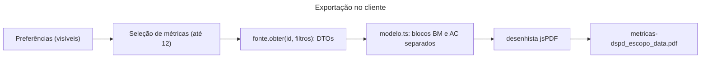

# Contratos de preferências (pedido 007) e exportação (pedido 008)

- **Propósito:** fixar o formato persistido das preferências de cartões e os limites e entradas da exportação em PDF.
- **Público:** react-frontend, QA, UX.
- **Revisão:** 2026-10-11.
- **Fontes:** `packages/contratos/src/cartoes.ts`, `web/src/features/preferencias/fonte.ts`, `web/src/features/exportar/modelo.ts`; planos em `docs/architecture/features/exportar-metricas.md` e `docs/ux/preferencias-metricas/06-especificacao.md`; decisões do usuário em `docs/alinhamentos/2026-10-10-decisoes-do-usuario.md` (§9, §10).
- Ambos são **só de interface**: não entram em cálculo, alerta ou aviso e nunca identificam nem comparam pessoas. Não há endpoint de back-end para nenhum dos dois hoje.

## 1. Preferências de métricas (pedido 007)

### Catálogo
`CATALOGO_CARTOES` (`cartoes.ts:61-124`) é a fonte única: cada cartão tem `id` (código da métrica em minúsculas: `o9`, `bloqueados`, `ei-fl1`), `codigo`, `rotulo`, `painel` (`operacional`, `tatico`, `estrategico`, `sustentacao`), `secao`, `metricas` e `leiaJunto` opcional. Papéis `time`, `coordenador`, `gerente` e os painéis que cada um vê na sugestão: `PAINEIS_DO_PAPEL` (`cartoes.ts:144-148`).

### Formato persistido
```json
{ "versao": 1, "paineis": { "operacional": { "ocultar": ["o9"] } }, "atualizadoEm": "2026-10-11T12:00:00.000Z" }
```
- Chave de armazenamento: `metricas-dspd:preferencias:v1` (`CHAVE_PREFERENCIAS`, `cartoes.ts:150`), no `localStorage` do navegador (`LocalStoragePreferencias`, `fonte.ts:30-56`).
- Schema: `preferenciasMetricasSchema` (`cartoes.ts:152-157`): `versao` literal `1`; `paineis` parcial por painel; `atualizadoEm` string.
- Guarda **os ocultos**: cartão novo no catálogo aparece por padrão.
- **Leitura tolerante:** ausente, corrompida ou inválida vira `PREFERENCIAS_PADRAO` (tudo visível), nunca quebra o painel (`fonte.ts:37-46`). Falha de gravação rejeita a promessa e a tela avisa (`fonte.ts:49-54`).
- **Id retirado ou renomeado:** `CARTOES_RETIRADOS` mapeia para o novo id ou `null`, aplicado na leitura, em silêncio; id inexistente é ignorado (`cartoes.ts:127`, `ocultosValidos` em `fonte.ts:59-67`). Hoje o mapa está vazio.
- **Papel nunca é gravado:** "Aplicar sugestão do meu papel" só marca caixas (`ocultosDaSugestao`, `fonte.ts:70-77`).

### Evolução
Mudança incompatível = nova chave `:v2`, com leitura migrada de `:v1` ([politica-de-mudanca.md](politica-de-mudanca.md) §3).

### Planejado
`GET`/`PUT /me/preferencias-metricas` por conta, quando houver SSO, sem parâmetro de usuário; a porta `FontePreferencias` (`fonte.ts:21-26`) já prevê `origem: 'conta'`. Não existe na API (não consta no OpenAPI). Diálogo de primeiro login: depende dessa entrega.

## 2. Exportação em PDF (pedido 008)

Gerada **no cliente** (jsPDF carregado sob demanda); sem back-end, sem endpoint, sem registro das exportações (D-5).

### Entrada
O modelo puro recebe DTOs de métrica **já agregados** (os mesmos do cartão, via `fonte.obter(id, filtros)`) mais os filtros em texto, e devolve blocos (`BlocoExportacao`) que o desenhista só pinta (`web/src/features/exportar/modelo.ts:34-80`, `montarConteudo` em `:422`). Nada é recalculado.

### Saída e conteúdo por bloco
Título, fonte (BusinessMap ou Acelerato), filtros aplicados em texto, janela, base amostral, gráfico ou tabela, nota e marca de mudança de critério. Amostra insuficiente imprime o mesmo texto do cartão e nenhum percentil (`textoInsuficiente`, `modelo.ts:179`). Mock imprime "Dados fictícios" (`TEXTO_FICTICIO`, `modelo.ts:32`) em todas as páginas.

### Limites

| Limite | Valor | Código |
|---|---|---|
| Métricas por exportação | 12 | `LIMITE_METRICAS`, `modelo.ts:27` (`excedeLimite`, `:118`) |
| Linhas por tabela | 20 | `MAX_LINHAS_TABELA`, `modelo.ts:28` |
| Colunas por tabela | 8 | `MAX_COLUNAS_TABELA`, `modelo.ts:29` |
| Tempo alvo para 12 métricas | < 5 s (alerta, não bloqueio) | `exportar-metricas.md` §5 |
| Chunk de exportação | < 150 KB gzip, carregado só ao clicar | `exportar-metricas.md` §1 |

### Regras
- **Fontes separadas:** seções por fonte, BusinessMap e depois Acelerato (`ORDEM_FONTES`, `modelo.ts:24`, `agruparPorFonte`, `:415`); nenhum gráfico, total ou percentil soma as duas.
- **Nada por pessoa:** chaves que casam `CAMPO_PESSOAL` (`modelo.ts:163-164`) nunca entram no arquivo; teste garante a ausência.
- **Escopo = o que está visível** segundo as preferências da seção 1; métrica oculta não entra.
- **Nome do arquivo:** `metricas-dspd_<escopo>_<AAAA-MM-DD>.pdf`, em minúsculas e sem acento; mock acrescenta `_ficticio` (`nomeArquivo`, `modelo.ts:114`). Escopos: `visao-geral`, `fluxo-operacional`, `fluxo-tatico`, `fluxo-estrategico`, `sustentacao`, `espera-invisivel`, `<metrica-id>` ou `personalizada`.
- **Rodapé padrão:** "O sistema não compara equipes nem avalia pessoas." (`RODAPE_PADRAO`, `modelo.ts:31`).
- **Erro:** qualquer exceção mostra mensagem genérica, sem detalhe técnico e sem arquivo parcial.

### Exportação no cliente


Legenda: retângulo = etapa; seta = dado que passa; nada sai do navegador.

<details open>
<summary>Alternativa em lista</summary>

- Preferências (visíveis) -> seleção de métricas: até 12.
- Seleção -> `fonte.obter(id, filtros)`: DTOs.
- DTOs -> `modelo.ts`: blocos BusinessMap e Acelerato separados.
- `modelo.ts` -> desenhista jsPDF: modelo do documento.
- Desenhista -> arquivo `metricas-dspd_escopo_data.pdf`: baixado pelo navegador.
</details>

### Mudança
Alterar limites, nome de arquivo ou campos do bloco é mudança de contrato de exportação: vale [politica-de-mudanca.md](politica-de-mudanca.md); o `react-frontend` revisa e o QA atualiza o E2E que lê o PDF.
