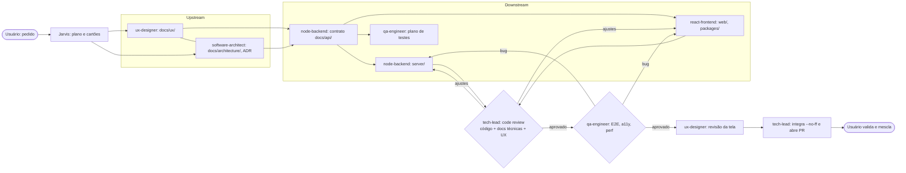
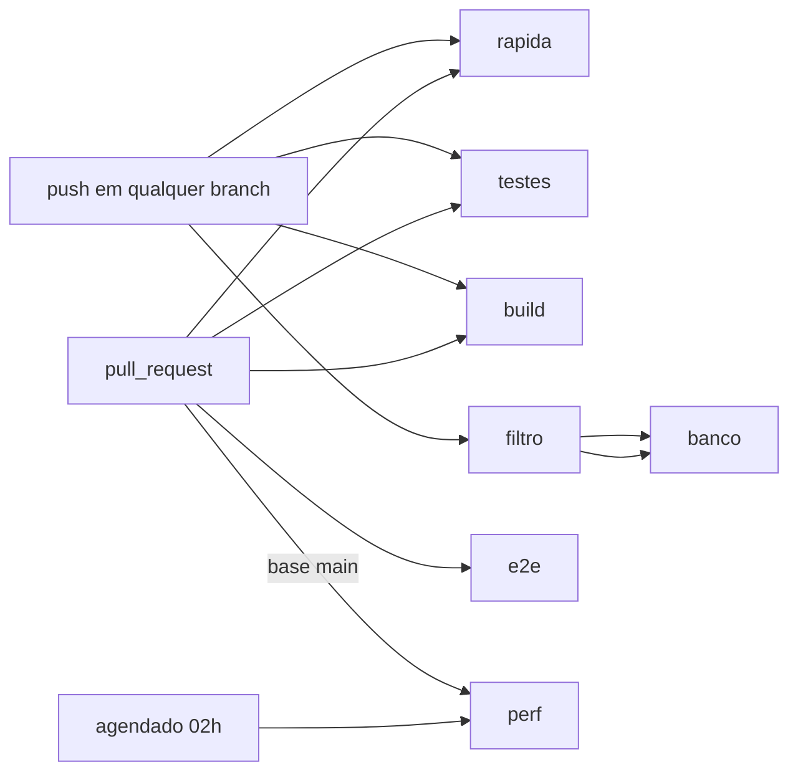

# Guia do desenvolvedor — MetricasDSPD

Versão 1 · 2026-10-10 · Mantido pelo tech-lead (com o software-architect). Regras normativas ficam em [`praticas.md`](praticas.md) e nos ADRs (`docs/architecture/adr/`); este guia mostra **como** fazer no dia a dia. Em conflito, vale `praticas.md`. Documentação técnica de cada módulo: `docs/tecnica/` (front e biblioteca), `docs/architecture/` + `docs/api/` (back).

## 1. Setup

```bash
nvm install 24 && nvm use 24          # engines: node >= 24
corepack enable                        # uma vez: habilita o pnpm fixado em packageManager (pnpm 10)
pnpm install                            # na raiz: instala todos os workspaces
git config core.hooksPath .githooks    # ativa o pre-push que bloqueia a main
pnpm run dev                            # SPA com dados fictícios (Vite)
```

Chromium do Playwright (E2E, perf, Lighthouse):

```bash
cd e2e && npx playwright install chromium
# WSL/Linux sem libs do sistema e sem sudo:
eval "$(bash scripts/setup-chromium-local.sh)"   # ou: pnpm run chromium:local (imprime o export)
```

O `export LD_LIBRARY_PATH` vale só para o shell atual; repita em cada terminal novo. Detalhes em [`docs/qa/gate-do-autor.md`](../qa/gate-do-autor.md).

## 2. Estrutura do monorepo

pnpm workspaces, escopo `@metricas-dspd/*`, pacotes em TS-fonte sem build próprio ([ADR 0002](../architecture/adr/0002-monorepo-pacotes-compartilhados.md)).

| Caminho | Pacote | Conteúdo |
|---|---|---|
| `packages/contratos` | `@metricas-dspd/contratos` | `MetricaId`, DTOs, filtros, schemas zod (`schemas.ts`), filtros aceitos por métrica (`metricas.ts`) |
| `packages/metricas` | `@metricas-dspd/metricas` | `core/` (calendário, janela, percentil, histograma, Monte Carlo, matriz `REGRAS_METRICA`), `businessmap/`, `acelerato/`, orquestração na raiz (`calcular.ts`, `visaoGeral.ts`) |
| `packages/mock` | `@metricas-dspd/mock` | gerador determinístico (PRNG com semente) das bases fictícias |
| `web/` | `@metricas-dspd/web` | SPA React: `app/` (shell, rotas), `components/ui` e `components/charts` (só aqui entra Recharts), `features/<painel>/`, `data/` (`FonteMetricas`, `useMetrica`; mock só em `data/mock/`), `content/catalogo-metricas.ts` |
| `e2e/` | `@metricas-dspd/e2e` | Playwright (`tests/`, `pages/`, `perf/`), scripts do gate, Lighthouse |
| `server/` | `@metricas-dspd/server` | pedido 002 (API, coletores, migrações) |

Grafo permitido: `contratos ← metricas ← mock`; `web` importa `contratos`; `metricas`/`mock` só em `web/src/data/mock/**` por `import()` dinâmico. Fronteiras verificadas por lint e por `pnpm run fronteiras`.

## 3. Scripts

| Comando | Onde | O que faz |
|---|---|---|
| `pnpm run pronto` | raiz | lint + Prettier + `pronto` de cada workspace (typecheck + testes; no `web`, também build e `size`). **Rode antes de cada commit.** |
| `pnpm run spec:check` | raiz | conferência spec↔teste (`tools/spec-check`); também roda dentro do `pronto` e no job `testes` do CI. No-op (exit 0) enquanto não houver `docs/especificacao` e `siegard-trace.json` |
| `pnpm run check` | raiz | lint + typecheck + testes + format:check |
| `pnpm run gate` | `e2e/` | gate do autor: fronteiras BM x AC, hash da base mock e tamanho do bundle; termina em `GATE DO AUTOR: APROVADO\|REPROVADO`. Exige `pnpm run build` antes |
| `pnpm run test:perf` | `e2e/` | projeto `perf` do Playwright (LCP, CLS, INP, troca de filtro, tarefas longas), contra `vite preview` |
| `pnpm run lighthouse` | `e2e/` | Lighthouse desktop (Performance >= 90, Acessibilidade >= 95) |
| `pnpm run e2e` / `pnpm run test:chromium` | raiz / `e2e/` | suíte E2E completa / só Chromium e semente alternativa |
| `pnpm run hash-base --salvar <arq>` | `e2e/` | regenera a referência da base mock (só com decisão registrada no cartão) |

Testes unitários rodam com `TZ=UTC` (já nos scripts): nunca dependem do fuso nem da hora da máquina.

## 4. Fluxo git

- A `main` é do usuário: só muda por PR que ele valida e mescla. O hook `pre-push` recusa envio para ela; `--no-verify` é proibido.
- Os devs commitam na `develop` (Conventional Commits em português, `Cartão: K-0xx` no corpo, linhas de atribuição no fim), sem merge, rebase, reset ou push.
- O tech-lead revisa o intervalo de commits do cartão e, com review e QA aprovados, integra na `feature/<pedido>` com `git merge --no-ff`. Essa branch vira o PR.
- Para trazer a `main`: `git fetch` + `git merge origin/main` na própria branch.

```mermaid
gitGraph
  commit id: "main"
  branch develop
  checkout develop
  commit id: "feat(metricas): K-0xx"
  commit id: "test(metricas): K-0xx"
  branch feature/pedido
  checkout develop
  commit id: "fix(...): ajuste do review"
  checkout feature/pedido
  merge develop id: "chore(integracao) --no-ff"
  checkout main
  merge feature/pedido id: "PR mesclado pelo usuário"
```

## 5. Fluxo de trabalho do time

Upstream (descoberta e definição) entrega especificação; downstream (construção) entrega código revisado. Code review vem **antes** do QA; achados viram cartões `[bug]`/`[ajuste]` e voltam ao autor.



## 6. Como criar uma métrica nova (ponta a ponta)

Pré-requisito: a métrica está no catálogo do briefing e tem especificação de UX. Regra que o briefing não responde vira pergunta ao usuário (célula `'pendente-usuario'`), nunca inferência.

1. **Matriz de regras.** Acrescente a entrada em `REGRAS_METRICA` (`packages/metricas/src/core/regras.ts`) e a linha em [`docs/architecture/regras-metricas.md`](../architecture/regras-metricas.md): domínio (BM ou AC, nunca os dois), granularidade, partes com mínimo de 20, segmentações permitidas (nunca pessoa nem comparação entre equipes). Os testes de propriedade (`regras.property.test.ts`) passam a cobri-la automaticamente.
2. **Contrato.** Em `packages/contratos`: o id em `MetricaId`, o schema zod do resultado em `schemas.ts`, o tipo e os filtros aceitos em `metricas.ts`. Com back-end, o contrato HTTP vai em `docs/api/<recurso>.md`.
3. **Cálculo.** Arquivo próprio no domínio (`packages/metricas/src/businessmap/<id>.ts` ou `acelerato/`), usando só `core` para tempo útil, janela de 12 semanas, percentis 50/85/95, histograma e Monte Carlo. Data de referência e `Calendario` por parâmetro; sem `Date.now`/`Math.random`. Registre no despachante de `calcular.ts`.
4. **Testes.** Unitários no domínio (`<dominio>.test.ts`) com as bordas da `praticas.md` seção 4 (n = 19/20, janela, fim de semana e feriado, item arquivado). Casos de aceitação do QA em `docs/qa/aceitacao/<cartão>.md` viram Vitest no mesmo cartão. Se a base mock mudar, o hash muda: decisão registrada no cartão.
5. **Cartão no painel.** `web/src/features/<painel>/components/Cartao<ID>.tsx`, montado com `CartaoMetrica` e os componentes de `components/ui` (estado vazio, erro, `AmostraInsuficiente`, `AvisoCriterio`, `AlternarTabela`) e gráficos de `components/charts`. Dados por `useMetrica('<ID>', filtros)`; o cartão **não calcula**. Entrada no `content/catalogo-metricas.ts` e nota em `notas.ts` do painel. Teste de UI no `<painel>.test.tsx`.
6. **Documentação.** Atualize `docs/tecnica/` (biblioteca e front) e, com back, `docs/architecture/` + `docs/api/`; confira `docs/ux/` com o ux-designer. Faz parte da definição de pronto.
7. **Aceitação.** `pnpm run pronto` e `pnpm run gate` verdes, saída colada no cartão; move para Code review.

## 7. Como criar um painel

1. Especificação em `docs/ux/` e plano em `docs/architecture/features/`.
2. Pasta `web/src/features/<painel>/` com `<Painel>Page.tsx` usando `PainelPagina` (cabeçalho, filtros, contexto), `components/`, `notas.ts` e teste.
3. Rota em `web/src/app/router.tsx` e destino em `web/src/app/rotas.ts` (`fluxo: true` para BusinessMap); filtros do painel em `features/filtros/paineis.ts`.
4. Carga lazy da rota (orçamento de bundle do ADR 0003; confira com `pnpm run size`).
5. E2E e axe pelo QA em `e2e/tests/`; perf em `e2e/perf/` se a rota entrar no orçamento.

## 8. Convenções (resumo)

TypeScript estrito sem `enum`, `namespace` nem `any`; tempo e aleatoriedade injetados; zod nas bordas; nomes em português do domínio; Recharts só em `components/charts`; acessibilidade com tabela alternativa em todo gráfico; commits `tipo(escopo): descrição` no imperativo. Lista completa e verificada por lint: `praticas.md` seções 1 a 5.

## Ligação especificação ↔ teste (Siegard)

Parte da definição de pronto: todo nó `rules/` e `scenarios/` de `docs/especificacao/` tem teste, e o teste e o `siegard-trace.json` (raiz, versionado) concordam.

- **Convenção de nomes.** O nome do `it`/`test`/`describe` cita o nó entre colchetes, com o caminho sem `.md`: `it('[rules/metrics/amostra-minima] não publica abaixo de 20 itens', ...)`.
- **Ligar.** Com o plugin instalado: `python3 trace.py --bind <alvo> <especificação> <nó> <arquivo>`; o arquivo é relativo ao alvo (ex.: `test/x.test.ts` para o alvo `server`). O trace é commitado.
- **Um arquivo de teste para poucos nós.** O plugin guarda o digest do arquivo inteiro: qualquer edição nele marca desvio em todos os nós ligados. Arquivo agregador com 20 nós = 20 falsos alarmes por um `it` alheio.
- **O que confere o quê.** `spec-check` (Node, local e CI): citação sem nó, nó sem teste, ligação sem citação, citação sem ligação, arquivo ou nó ligado inexistente. Não recalcula digests. O desvio (`trace.py --check`) é só local: o hook `pre-push` o roda se achar `trace.py` sob `~/.claude/plugins`; sem plugin, segue em silêncio.

## CI (GitHub Actions)

Workflow `.github/workflows/ci.yml`; custo zero (repositório público). Os nomes dos jobs são estáveis porque a proteção da `main` os referencia. Execuções antigas da mesma branch são canceladas (`concurrency`).



| Job | O que roda | Quando |
|---|---|---|
| `rapida` | install `--frozen-lockfile` (cache), lint, format:check, typecheck | push e PR |
| `testes` | typecheck + cobertura 100% bloqueante (`pnpm run cobertura`, igual ao `pronto` sem build) + `spec:check` | push e PR |
| `banco` | Postgres 17 como service container, `test:pg` com `PG_TESTE_URL` | push e PR, só se mudar `server/`, `packages/`, `scripts/`, `docker/`, lockfile ou o workflow (pulado conta como aprovado) |
| `build` | build do web, orçamento de tamanho e `pnpm run gate` (fronteiras, hash da base mock) | push e PR |
| `e2e` | Playwright Chromium (`--with-deps`), inclui axe nos dois temas | só PR (e disparo manual) |
| `perf` | `test:perf` + Lighthouse | PR para `main`, agendado 1x/noite e disparo manual |

Proteção: `rapida`, `testes`, `banco`, `build` e `e2e` são obrigatórios só na `main`; a `develop` aceita push direto. Dependabot (`.github/dependabot.yml`): npm semanal e Actions mensal, com dev agrupado. Localmente, o hook `pre-push` roda lint e typecheck antes de enviar (e continua bloqueando a `main`). Falha no CI: `gh run view --log-failed`.

## 9. Solução de problemas

| Sintoma | Causa provável | Solução |
|---|---|---|
| E2E ou perf testam código antigo | `vite preview` velho na porta 4173 é reaproveitado (`reuseExistingServer` fora do CI) | `fuser -k 4173/tcp` (ou `lsof -ti:4173 \| xargs kill`), `pnpm run build` e rode de novo |
| `error while loading shared libraries: libnss3.so` (WSL) | Chromium sem libs do sistema | `cd e2e && eval "$(bash scripts/setup-chromium-local.sh)"` no mesmo shell |
| Falha intermitente de C6 (tarefa longa), O1 a frio ou F5 | testes de tempo sob carga (suíte inteira em paralelo, máquina ocupada) | rode isolado: `pnpm run test:perf` sem outra suíte; reporte se persistir, **nunca** pule o teste |
| C5 (heap) retorna NaN | `JSHeapUsedSize` não vem do headless-shell | conhecido; tratado como alerta no relatório do QA |
| `pnpm run gate` reprova no hash | base mock mudou | se não era intencional, investigue; se era, `pnpm run hash-base --salvar ...` e decisão no cartão |
| Teste passa local e falha em outro fuso | dependência de `Date` local | use os scripts (`TZ=UTC`) e passe data de referência por parâmetro |

## Dependências e vulnerabilidades (K-065)
pnpm workspaces; versão do pnpm em `packageManager` (Corepack). `pnpm install --frozen-lockfile` no CI. Correções de segurança via `overrides` em `pnpm-workspace.yaml` (tmp, uuid, basic-ftp). Alertas sem versão corrigida publicada, justificados: `extract-zip` e `sprintf-js`, ambos transitivos de `@lhci/cli`/Playwright (só desenvolvimento, fora do bundle e do servidor).
