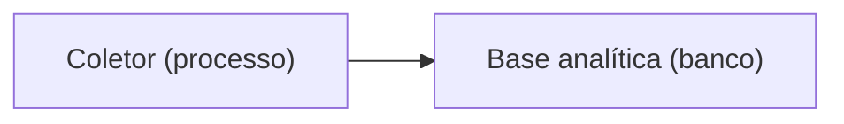

# Padrão de documentação

Propósito: definir cabeçalho, nomes, estado das ADRs e diagramas Mermaid de `docs/`. Público: quem escreve ou revisa documentação. Revisão: 2026-10-11.

## Cabeçalho padrão
Nas 5 primeiras linhas de toda página (exceto `reviews`, `qa/bugs`, `alinhamentos`, `kanban`, `retrospectivas`, `architecture/propostas`):

```markdown
# Título que responde a uma pergunta

Propósito: uma frase. Público: quem lê. Revisão: AAAA-MM-DD.
```

- Atualize a data de revisão sempre que o conteúdo mudar.
- Um assunto por página; parágrafos de até 5 linhas; links com texto descritivo, nunca "aqui".
- Tabelas para comparar, listas para passos.
- Regras invioláveis ficam no briefing e no `CLAUDE.md`: linke, não copie.

## Nomes de arquivo e pastas
- kebab-case, sem datas, exceto em `alinhamentos` e `retrospectivas`.
- ADR: `NNNN-assunto.md`, numeração sequencial, nunca reaproveitada.
- Cada pasta tem um `README.md` curto que lista seu conteúdo; `docs/README.md` é o índice único.
- Pastas por tipo: `especificacao/` domínio, `api/` e `contratos/` contratos, `architecture/` decisões, `tecnica/` como funciona, `engineering/` práticas. Mover pastas só com redirecionamento de todos os links.

## Estado das ADRs
Toda ADR traz, logo abaixo do título, uma linha `Estado: proposta|vigente|substituída por ...`. A linha é escrita à mão (a ferramenta ainda não a confere, ver "Verificação").

| Estado | Significa | Obrigatório na linha |
|---|---|---|
| proposta | Em avaliação; não vale ainda | O que a destrava |
| vigente | Vale; pode ter trechos substituídos, marcados no texto | Link da ADR que substituiu cada trecho |
| substituída | Não vale | Link da ADR que a substitui (`substituída por NNNN`) |

Arquivadas ficam em `architecture/propostas/` com aviso "arquivado, não vale". O índice (`docs/README.md`) separa vigentes de substituídas.

## Diagramas Mermaid
1. **Título** em `###` imediatamente acima do bloco.
2. **Legenda** logo abaixo, listando forma, cor e texto. Forma e cor nunca carregam o significado sozinhas: o rótulo traz o tipo, como "(banco)" ou "(externo)".
3. **No máximo 15 nós.** Acima disso, divida por contexto ou por nível C4.
4. **Alternativa em lista** em `<details open>`, após a legenda: "Quem conversa com quem", uma linha `origem -> destino: o que trafega`.
5. Contraste de 4.5:1 entre texto e fundo; no máximo 4 cores.
6. Cite o `_context.md` ou a ADR de origem; se a decisão está em ADR, aponte para ela.

Exemplo mínimo:

````markdown
### Fluxo da coleta (C4 nível 2)

Legenda: retângulo = processo ou banco; o tipo está no rótulo.

<details open>
<summary>Alternativa em lista</summary>

- Coletor -> Base analítica: cards coletados.
</details>
````

## Verificação (critérios de aceite)
`pnpm run docs:check` (`tools/docs-contratos/src/verificar-docs.ts`) confere, bloqueante no `pronto` e no CI:

| # | Critério | Escopo real da ferramenta |
|---|---|---|
| 1 | Link-check sem links quebrados, incluindo âncoras | todo `docs/**/*.md`, exceto `reviews/`, `qa/bugs/`, `alinhamentos/`, `kanban/`, `retrospectivas/` e `architecture/propostas/` |
| 2 | Cabeçalho com propósito, público e revisão (AAAA-MM-DD) nas 5 primeiras linhas | só `docs/contratos/`, `docs/architecture/ddd/` e `docs/README.md` |
| 3 | Página sem nenhum link recebido (órfã) | mesmo escopo do item 2 (um link para a pasta conta como link para o `README.md` dela e, hoje, para as demais páginas; ver M2 do review) |
| 4 | Bloco `mermaid` com título, legenda, lista alternativa e até 15 nós | mesmo escopo do item 2 |

Ainda **sem checagem automática** [planejado]; valem como regra de escrita e de revisão:
- cabeçalho, órfãs e Mermaid nas demais pastas de `docs/` (hoje só o link-check as cobre);
- linha `Estado:` em toda ADR (conferida na revisão; `docs/README.md` lista vigentes e substituídas);
- `api/openapi.json` a 1 clique do índice;
- achabilidade: 3 pessoas ou agentes achando contrato e diagrama de domínio em até 60 s (roteiro em `docs/README.md`; o teste ainda não foi feito);
- o índice de ADRs e o `Estado:` de cada arquivo concordarem.

Origem: [`ux/documentacao-tecnica/discovery.md`](../ux/documentacao-tecnica/discovery.md).
