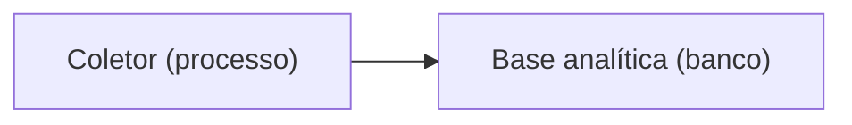

# Padrão de documentação

Propósito: definir cabeçalho, nomes, estado das ADRs e diagramas Mermaid de `docs/`. Público: quem escreve ou revisa documentação. Revisão: 2026-10-11.

## Cabeçalho padrão
Nas 5 primeiras linhas de toda página (exceto `reviews`, `qa/bugs`, `alinhamentos`, `kanban`):

```markdown
# Título que responde a uma pergunta

Propósito: uma frase. Público: quem lê. Revisão: AAAA-MM-DD.
```

- Atualize a data de revisão sempre que o conteúdo mudar.
- Um assunto por página; parágrafos de até 5 linhas; links com texto descritivo, nunca "aqui".
- Tabelas para comparar, listas para passos.
- Regras invioláveis ficam no briefing e no `CLAUDE.md`: linke, não copie.

## Nomes de arquivo e pastas
- kebab-case, sem datas, exceto em `alinhamentos` e `retrospectivas`.
- ADR: `NNNN-assunto.md`, numeração sequencial, nunca reaproveitada.
- Cada pasta tem um `README.md` curto que lista seu conteúdo; `docs/README.md` é o índice único.
- Pastas por tipo: `especificacao/` domínio, `api/` e `contratos/` contratos, `architecture/` decisões, `tecnica/` como funciona, `engineering/` práticas. Mover pastas só com redirecionamento de todos os links.

## Estado das ADRs
Toda ADR e proposta traz, no topo, uma linha `Estado:`.

| Estado | Significa | Obrigatório na linha |
|---|---|---|
| proposta | Em avaliação; não vale ainda | O que a destrava |
| vigente | Vale; pode ter trechos substituídos, marcados no texto | Link da ADR que substituiu cada trecho |
| substituída | Não vale | Link da ADR que a substitui (`substituída por NNNN`) |

Arquivadas ficam em `architecture/propostas/` com aviso "arquivado, não vale". O índice (`docs/README.md`) separa vigentes de substituídas.

## Diagramas Mermaid
1. **Título** em `###` imediatamente acima do bloco.
2. **Legenda** logo abaixo, listando forma, cor e texto. Forma e cor nunca carregam o significado sozinhas: o rótulo traz o tipo, como "(banco)" ou "(externo)".
3. **No máximo 15 nós.** Acima disso, divida por contexto ou por nível C4.
4. **Alternativa em lista** em `<details open>`, após a legenda: "Quem conversa com quem", uma linha `origem -> destino: o que trafega`.
5. Contraste de 4.5:1 entre texto e fundo; no máximo 4 cores.
6. Cite o `_context.md` ou a ADR de origem; se a decisão está em ADR, aponte para ela.

Exemplo mínimo:

````markdown
### Fluxo da coleta (C4 nível 2)

Legenda: retângulo = processo ou banco; o tipo está no rótulo.

<details open>
<summary>Alternativa em lista</summary>

- Coletor -> Base analítica: cards coletados.
</details>
````

## Verificação (critérios de aceite)
1. `docs/README.md` existe; cada leitor chega ao seu item em até 2 cliques (roteiro no próprio índice).
2. Link-check sem links quebrados em `docs/**/*.md`, incluindo âncoras; bloqueante no `pronto` e no CI.
3. Todo arquivo de `docs/` (exceto `reviews`, `qa/bugs`, `alinhamentos`, `kanban`) é alcançável a partir do índice e dos READMEs de pasta.
4. Toda página não excluída tem propósito, público e revisão nas 5 primeiras linhas.
5. Todo bloco `mermaid` tem título, legenda, lista alternativa e até 15 nós.
6. Toda ADR tem a linha `Estado:`.
7. `api/openapi.json` está a 1 clique do índice.
8. Achabilidade: 3 pessoas ou agentes achando contrato e diagrama de domínio em até 60 s.

Origem: [`ux/documentacao-tecnica/discovery.md`](../ux/documentacao-tecnica/discovery.md).
