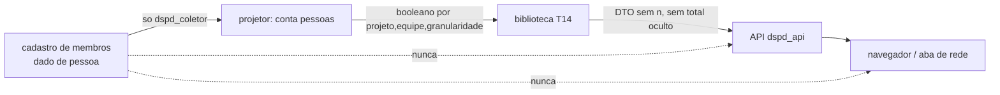

# Modelo de ameaças da T14 em mock: cadastro de membros por time (E1) e agregado dedutível (E2)

Propósito: requisitos de segurança (R-SEGURANCA, gatilhos de dado pessoal e de reidentificação/comparação entre times) para o E1.3 do node-backend, antes do código. Cartões K-112 (E1) e K-130 (E2). Público: node-backend, react-frontend, qa-engineer, software-architect, tech-lead. Parecer sobre o desenho e o estado atual (`4137981`, sem código novo): o veredito vale como requisito; o review do código final é outra rodada, sobre o commit final.

**Veredito: aprovado como requisito**, com 6 controles obrigatórios no E1.3 (C1 a C6, cadastro) e 6 no K-130 (D1 a D6, API). Os achados abaixo são os defeitos do código atual que o E1.3 tem de fechar; ficam recomendados neste parecer (sem código novo, nada a devolver) e viram bloqueantes no review de segurança do E1.3, que reprova se faltar qualquer controle C1 a C6 ou D1 a D6. Base: Q-T14-10 = B, R-1 = B, T14-M1 = B, ADR 0020 itens 1, 2, 5, 8 e 9, pareceres `025-t14-reidentificacao.md` (M-1, M-1a, "Fora do front") e `011-fase2-taticas.md`.

## Ativos e fronteiras
- **Cadastro de membros por time** (`equipe -> pessoas`, configuração WS1): dado de pessoa. Hoje não existe no repositório (nenhuma ocorrência de `membros` no contrato, na biblioteca nem no servidor); `ConfigBM.equipes[].sistemas` é só sistema.
- **Agregado "outros times"** (`n − k`): dado de unidade organizacional, mas reidentificável (R-1 = B: com menos de 2 pessoas é a vazão de uma pessoa).
- Fronteiras: (1) configuração/WS1 -> projetor (papel `dspd_coletor`); (2) projetor -> booleano `outrosPublicavel`; (3) biblioteca (`calcularT14`, recebe só o booleano) -> API (`dspd_api`) -> navegador; (4) no mock: gerador -> Web Worker/bundle no navegador (ADR 0021), onde não existe API de rede, mas existe bundle, memória, IndexedDB e export.

## E1: STRIDE do cadastro de membros
| Ameaça | Caminho (quem, de onde, o que ganha) | Controle |
|---|---|---|
| Divulgação pela API | Qualquer usuário da API lê a lista de membros de um time (nome, e-mail, id) pela rota de configuração ou por `SELECT` do `dspd_api` | C1, C2 |
| Divulgação no navegador (mock) | Quem abre o DevTools (Sources, Network, Application, memória do worker) lê nomes no seed do bundle ou no `postMessage` | C3, C4 |
| Divulgação em log/erro | Erro de validação do cadastro grava o valor da pessoa em log ou em `ctl_coleta_falha.erro` (legível pelo `dspd_api`) | C5 |
| Divulgação por export | Export CSV/PNG/relatório inclui membros ou contagem de pessoas | C6 |
| Reidentificação | A contagem de pessoas ou a identidade do "1 pessoa" sai no DTO; o time com 1 membro vira avaliação individual (regra inviolável) | C2, D1 |
| Adulteração | Cadastro alterado para forçar o time a "2 pessoas" e liberar `outrosTimes` | C1 (só WS1 grava) e registro de mudança com data (T2.6) |

### Controles obrigatórios do E1.3 e o teste que prova cada um
- **C1. Cadastro fora do alcance do `dspd_api`.** Tabela do cadastro com colunas de pessoa em `COLUNAS_PESSOA` (`server/src/plataforma/db/lgpd.ts`) e sem GRANT de nenhuma coluna de pessoa ao `dspd_api` (só o `dspd_coletor`). Teste: grants (`grants.ts` e teste de catálogo) provam que `dspd_api` não lê as colunas de pessoa do cadastro e que o catálogo LGPD as lista; um `SELECT` do `dspd_api` falha com permissão negada.
- **C2. A pessoa fica na fronteira; a saída é inteiro ou booleano.** A contagem de pessoas por (equipe, outros times) fica em `packages/metricas/src/coletor/` (ADR 0020 item 2), só importável de `server/src/modulos/coleta*`; a biblioteca pública continua recebendo só `outrosPublicavel`. Teste: lint de import (arquivo fora do módulo de coleta que importa `coletor` falha) e teste de bundle de `web/` sem a função; property test: DTO da T14 não tem campo de pessoa, de membro nem número de pessoas, para qualquer cadastro gerado.
- **C3. Mock com membros simulados, nunca dado real.** O seed do mock usa ids opacos sintéticos (`membro-001`), sem nome, e-mail nem derivação de pessoa real; nenhum nome real de colaborador entra em fixture, snapshot nem `docs/`. Teste: o gerador do mock com marcadores proibidos escritos no próprio teste (e-mail, `@`, nome de uma lista de nomes reais conhecidos do projeto) não os emite; teste de varredura do bundle de `web/` por esses padrões.
- **C4. O cadastro não chega ao front nem ao worker como pessoa.** O mock calcula o booleano no gerador/projetor simulado e entrega ao worker só `outrosPublicavel` (ADR 0020 item 8); a lista de membros não atravessa o `postMessage`, nem vai a `localStorage`, `sessionStorage` ou IndexedDB. Teste: no teste E2E/unidade do worker, o payload recebido por mensagem e o conteúdo do armazenamento do navegador não contêm id de membro nem a contagem de pessoas.
- **C5. Log e erro sem valor de pessoa** (ADR 0020 item 6). Teste: cadastro inválido com um marcador; o marcador não aparece no log nem em `ctl_coleta_falha` (como o teste B-4).
- **C6. Export sem membro.** Export e relatório da T14 trazem só o que a tela traz (k, e "não exibido"); teste: o export de um projeto com `outrosTimes` oculto não contém `n`, total do projeto nem id de membro.

## E2: STRIDE do K-130 (n − k dedutível)
Estado atual, que o E1.3 tem de mudar: com `outrosTimes = null` o DTO ainda entrega, para o projeto oculto, `total` (`t14.ts:104`), `semTime` (`:107`) e `meuTime` com `n` (`:105`; o schema de `taxa` traz `k`, `n` e `pct` em `comum.ts:299-305`); o bloco soma tudo em `total` (`:119`) e a `base.n` (`:129`); e a lista é ordenada por `total` (`:122`). Quem abre a aba de rede (ou, no mock, o `postMessage` do worker) calcula `n − k`, o que a decisão T14-M1 = B quis impedir.

Caminhos de dedução (todos com o mesmo ganho: a quantidade de cards dos outros times do projeto oculto, que com 1 pessoa é a vazão dela):
1. **Campo direto:** `total − semTime − meuTime.k`, ou `meuTime.n − meuTime.k`, no projeto oculto.
2. **Soma de campos:** `total` do bloco menos a soma dos `n` visíveis; `base.n` menos os `n` visíveis dá o `n` do(s) oculto(s) (com um oculto só, o valor exato).
3. **Diferença entre consultas:** mudar o filtro de `sistema` ou `período` para excluir o projeto e subtrair os totais de bloco/`base.n` das duas respostas.
4. **Ordem:** o ranking por `total` (CA-30) posiciona o oculto e dá faixa do total (já o A1 recomendado dos pareceres 025; segue válido).
5. **`pct` e `status`:** `meuTime.status` e `pct` revelam `n` (ex.: `k/pct`); `insuficiente` com `n` vs `ok` distingue o tamanho.

### Controles obrigatórios do contrato e da API (K-130)
- **D1. Projeto oculto: só `k`.** Para `outrosTimes = null`, o item do projeto não traz `total`, `semTime`, nem `meuTime.n`/`pct`/`status` baseados em `n`; o schema do contrato (`fechado`) permite o item oculto com forma própria (`{projetoId, codigo, titulo, meuTime: {k}, oculto: true}`, a forma exata é do arquiteto). Teste: property test sobre qualquer base e cadastro: para todo projeto com `outrosPublicavel` falso, nenhum campo numérico da resposta serializada é função de `n` (varia `n` mantendo `k` e a resposta é idêntica).
- **D2. Totais do bloco e `base.n` sem o oculto.** `total` do bloco e `base.n`/`base.complemento` somam só projetos publicáveis, ou não existem enquanto houver oculto; o front já cobre a tela (parecer 025), a API deixa de depender dele. Teste (a prova de caminho 2 e 3): mesma consulta com e sem o projeto oculto (filtro de sistema/período) gera respostas cujos totais não diferem em função do `n` do oculto; e `JSON.stringify(resposta)` não contém `n` nem `total` do oculto (seed com valores sentinela, como 47, 41 e 213 do teste do front).
- **D3. Ordem sem `total` do oculto.** A ordem de listagem usa só dado publicável; o projeto oculto vai por código (fechar o A1; é decisão do usuário, ver PERGUNTA 1). Teste: trocar o `total` do oculto sem mudar `k` não muda a ordem.
- **D4. Nenhum campo novo de pessoa, de time ou de contagem de pessoas** na resposta; contrato `strict` (já vale). Teste: o schema falha com chave desconhecida e property test de pessoa estendido à T14.
- **D5. O limiar `n ≥ 20` e o `outrosPublicavel` vêm de fora**; o oculto continua sendo decidido por booleano gerado na fronteira (ausente = oculto). Teste: chave ausente em `outrosPublicavel` oculta o projeto (fail-closed).
- **D6. Mesma regra no mock e na API real.** O worker (ADR 0021) e o servidor usam o mesmo `calcularT14`; sem cópia da regra no front. Teste: resposta do worker e resposta da rota para o mesmo seed são idênticas e ambas passam em D1 e D2.

## Casos de abuso (para o `qa-engineer` escrever como teste na implementação)
| # | Entrada | Caminho | Resultado esperado |
|---|---|---|---|
| CA-1 | `GET` da T14 com equipe única, projeto com `outrosPublicavel` falso | API -> aba de rede | item do oculto sem `total`, `semTime`, `n`, `pct` |
| CA-2 | Mesma consulta com e sem filtro de `sistema` que exclui o oculto | duas respostas subtraídas | diferença não revela `n` do oculto |
| CA-3 | `base.n` menos soma dos `n` visíveis | resposta única | não calculável (campos ausentes) |
| CA-4 | Variar o `total` do oculto mantendo `k` | ordem da lista | ordem inalterada |
| CA-5 | `SELECT` do papel `dspd_api` no cadastro de membros | banco | permissão negada |
| CA-6 | Procurar id/nome de membro no bundle, no `postMessage`, no armazenamento e no export | navegador | ausente |
| CA-7 | Cadastro inválido com marcador | log e `ctl_coleta_falha` | marcador ausente |
| CA-8 | Cadastro com 1 membro em "outros times" | projetor -> API | `outrosTimes` oculto; sem número de pessoas |
| CA-9 | Chave de `outrosPublicavel` ausente | biblioteca | oculto (fail-closed) |

## Achados
- A1 (recomendado) packages/metricas/src/businessmap/t14.ts:104 · o projeto com outrosTimes nulo ainda envia total, semTime e meuTime com n; a aba de rede dá n menos k (M-1 e M-1a, K-130); corrigir com D1 e D2 e property test antes do E1.3 ir ao QA
- A2 (recomendado) packages/metricas/src/businessmap/t14.ts:119 · total do bloco e base.n (:129) somam o projeto oculto; subtrair os n visíveis ou diferenciar duas consultas dá o n do oculto; somar só os publicáveis ou omitir enquanto houver oculto (D2)
- A3 (recomendado) packages/metricas/src/businessmap/t14.ts:122 · a ordem por total posiciona o projeto oculto e dá faixa do total dele; ordenar o oculto por código é decisão do usuário (PERGUNTA 1), herdado do A1 do parecer 025
- A4 (recomendado) packages/mock/src/businessmap/extensaoTambemFase2.ts:336 · o cadastro de membros por time ainda não existe; ao criá-lo, membros só simulados (ids opacos), fora do postMessage e do armazenamento do navegador, com teste de varredura do bundle (C3 e C4)
- A5 (recomendado) server/src/plataforma/db/grants.ts:67 · a tabela do cadastro, quando criada, entra em COLUNAS_PESSOA e sem GRANT de coluna de pessoa ao dspd_api (C1), com teste de grants e de catálogo LGPD; contagem de pessoas só em packages/metricas/src/coletor (C2)

## Perguntas ao dono (regra de negócio aberta, não decidida aqui)
- PERGUNTA 1: o projeto com "outros times" oculto deve ser ordenado por código (fora da ordem por total, CA-30), para fechar o A3? Sem a ordem por código, o D3 não se cumpre por inteiro.
- PERGUNTA 2: no cadastro de membros, um membro pode estar em mais de um time? Isso muda a regra de "menos de 2 pessoas" em "outros times" (a mesma pessoa em dois times) e o controle C2; não decido por inferência.

## Ferramentas
Leitura estática do desenho e do código atual. `gitleaks` e `osv-scanner` não rodados: nada de código nem de dependência muda nesta etapa; lacuna registrada. O review do código final do E1.3 e do K-130 é rodada própria, sobre o commit final.

## Riscos aceitos
Nenhum pedido.
