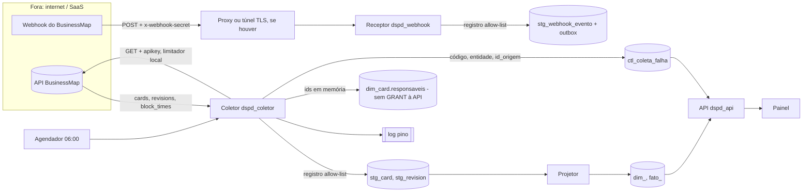

# Modelo de ameaças da integração real com o BusinessMap (pedido 052, E1.2)

Propósito: atualizar o modelo de ameaças da coleta (ADR 0020, K-084) para o cenário real: coleta agendada pela API, apikey de verdade e webhook. Público: software-architect (plano E1.1), tech-lead, node-backend, qa-engineer, devops-engineer, Jarvis. Data: 2026-10-29. Estado: modelo de ameaças e requisitos, **não é parecer**; o parecer de segurança (R-SEGURANCA) vem sobre o commit final de cada fatia de código. Base: `docs/security/adr-0020-protecao-de-pessoa.md`, `docs/security/k084-coletor-allow-list.md`, `docs/integracao/businessmap-api-configuracao.md` (§1, 4.8, 4.9, 6, 7), `server/src/modulos/businessmap/webhook.ts` e `allow-list.ts`, `server/src/plataforma/log.ts`, `server/src/plataforma/config.ts`. Leitura estática; nenhuma chamada à API, o `.env` não foi lido.

**Gatilhos (R-SEGURANCA):** credencial de integração externa (apikey), endpoint público novo (webhook), dado pessoal e texto livre na fronteira, rede de saída (cliente HTTP novo), log e erro com dado de terceiro.

## 1. Ativos
| Ativo | Por que importa | Onde vive |
|---|---|---|
| `BUSINESSMAP_APIKEY` | Herda as permissões do usuário que a gerou; a API não tem escopo somente leitura (§1). Vazada, dá leitura (e escrita, se o usuário puder) ao BusinessMap inteiro da conta, inclusive pessoas e texto livre. | `.env` da máquina do coletor |
| `WEBHOOK_BM_SEGREDO` | Única autenticação do receptor. | `.env`; cabeçalho `x-webhook-secret` |
| Dado de pessoa do BusinessMap (`owner_user_id`, `co_owner_ids`, `user_id`, autor de comentário, nomes e e-mails de `/users`) | LGPD; base append-only sem eliminação viável; proibição de métrica individual | memória do coletor; só `dim_card.responsaveis` e `dim_card_versao.responsaveis` (ADR 0020, 4b) |
| Texto livre (`title`, `custom_id`, `description`, `discard_comment`, comentários, subtarefas) | Pode conter nome de cliente, CPF, dado de terceiro | `title` e `custom_id` entram na `stg_card` por decisão (L-2, I-4); o resto nunca |
| Base analítica (`stg_*`, `dim_*`, `fato_*`, `ctl_*`) | Integridade do histórico; separação BusinessMap × Acelerato | PostgreSQL; papéis `dspd_coletor`, `dspd_webhook`, `dspd_api`, `dspd_migrador` |
| Disponibilidade da cota da API (30/min, 600/h, §3) | A cota é da conta inteira: coleta descontrolada consome a cota de quem usa o BusinessMap | conta BusinessMap |
| Credenciais dos papéis PG no `.env` | Credenciais só em `.env` (regra inviolável) | `.env` |

## 2. Fluxo e fronteiras de confiança

Fronteiras: **F1** BusinessMap → coletor (resposta da API é entrada não confiável); **F2** internet → receptor do webhook; **F3** coletor e receptor → banco (allow-list, GRANT por papel); **F4** banco → `dspd_api` (GRANT por coluna); **F5** processo → log e `ctl_`; **F6** `.env` e ambiente → processo (segredos); **F7** API → painel (reidentificação por agregado, já coberta pela ADR 0020 e pelo 048/T14, fora deste documento).

## 3. Ameaças (STRIDE), por prioridade
Severidade = probabilidade × impacto. "Estado" diz o que já existe no código (K-084) e o que falta.

### A1. Apikey com poder além da leitura (E, I) · **alta**
- Caminho: o dono gera a chave num usuário com papel de edição ou administração (a roteiro §7.1 admite o caso). Quem obtém a chave (backup do `.env`, log, histórico de shell, máquina do dev) lê tudo e pode escrever no BusinessMap, onde um erro ou ataque vira corrupção do fluxo real do time.
- Controles existentes: o doc §1 manda usuário de serviço com papel leitor; segredo só em `.env`; `redact` do pino cobre `*.apikey` (`log.ts:5-16`).
- **Faltantes:** (a) cliente HTTP só com GET, sem método genérico exportado, e teste que falha se existir chamada não-GET (já pedido em §1 do doc; vira requisito de segurança); (b) lista de hosts permitidos: o cliente só fala com o host de `BUSINESSMAP_URL_BASE`, validado na partida como `https`; (c) confirmação do dono de que o usuário de serviço é leitor (E1.4); se não for, risco vai ao usuário (`R-DECISAO`) e não se aceita por inferência; (d) rotação documentada: gerar nova chave invalida a anterior (§1), então rotação é feita à mão pelo dono e o coletor trata 401 como parada (item 4 do §3 do doc), sem retry.

### A2. Apikey em log, erro, URL ou payload gravado (I) · **alta**
- Caminho: erro do cliente HTTP (axios/undici/fetch) carrega a configuração da requisição, inclusive cabeçalhos; o pino registra o objeto de erro. O `redact` atual casa `*.apikey` com **um nível de profundidade** e com a chave exata `apikey`; um caminho como `err.config.headers.apikey` ou `err.request.headers.apikey` não casa. Cabeçalho `Authorization` de resposta/requisição do cliente também. Quem lê: qualquer pessoa com acesso ao log do worker.
- Estado: `CAMINHOS_REDIGIDOS` (`log.ts:5-16`) cobre o cabeçalho de entrada, não o de saída do cliente novo.
- **Faltantes:** o cliente nunca anexa a requisição ao erro (captura e relança erro próprio com `codigo`, `status`, `entidade`, `id_origem`, sem `cause` do cliente HTTP); a apikey fica só num cabeçalho montado dentro do cliente, nunca em query string nem em URL; acrescentar caminhos de `redact` para `*.headers.apikey` e `*.*.headers.apikey` (defesa em profundidade, não substitui o erro próprio); teste do marcador: apikey de teste fixa, forçar 401, 429, 5xx e timeout, e conferir que o valor não aparece no log, em `ctl_coleta_falha` nem em exceção propagada; `gitleaks --redact` no CI sobre o histórico (lacuna: não está no PATH desta máquina).

### A3. Webhook sem assinatura confiável (S, T) · **média, alta se for exposto sem TLS**
- Fato: o método de assinatura do BusinessMap **não foi lido** (§4.8: "NÃO LIDO"). O receptor usa um **segredo compartilhado estático em cabeçalho** (`x-webhook-secret`, `webhook.ts:12, 64-66`), comparado em tempo constante por SHA-256 (`webhook.ts:27-28`), antes de ler o corpo. Isso é autenticação por portador, não assinatura do corpo: não prova integridade nem impede replay.
- Caminho: (1) sem TLS ou com proxy que registra cabeçalhos, o segredo é capturado; com ele, qualquer um posta eventos forjados, que entram na `stg_webhook_evento` e disparam o evento `bm.webhook.recebido` na outbox (envenenamento de dado e de reconciliação, `rec_transicao_par`). (2) Replay: uma entrega capturada é idêntica, então o `ON CONFLICT` por SHA-256 do corpo a descarta (`webhook.ts:46-50`); replay idêntico é inofensivo, mas corpo alterado com o mesmo segredo não. (3) O formato do payload é suposto (`allow-list.ts:107-130`); se o real for diferente, falha fechado (nada gravado), o que é seguro e silencioso (I-1 do K-084). (4) Se o BusinessMap só permitir segredo em corpo ou HMAC, o receptor atual não confere o método e rejeita tudo com 401.
- Impacto contido: o receptor só grava o registro filtrado (ids de card e coluna, tipo, instante) e o papel `dspd_webhook` só tem INSERT em `stg_webhook_evento` e `outbox`; nenhuma métrica lê o webhook como verdade (polling é a fonte de verdade, §4.8).
- **Faltantes:** (a) ler o artigo de webhooks (roteiro §7.7) antes de ligar; se houver HMAC do corpo, implementar a verificação sobre o corpo bruto em tempo constante, com janela de tempo se o BusinessMap enviar instante assinado; (b) TLS obrigatório no caminho público (proxy ou túnel), a API em `127.0.0.1` e **só** a rota `/webhooks/businessmap` publicada, nenhuma outra rota da API pelo túnel; (c) limite de taxa por origem no proxy (o limite de corpo de 256 KB existe: `webhook.ts:11, 62`); (d) o evento do webhook só aciona reconsulta pela API (acelerador), nunca é fonte de valor para as tabelas de fato; (e) segredo com mínimo de 16 caracteres já é validado (`config.ts:28`), recomendar 32 bytes aleatórios e rotação com janela de dois segredos aceitos; (f) contador de ignorados por tipo e de 401 (alerta de tentativa).
- Decisão aberta do dono (item 8 do roteiro, "webhook ou só polling"): a vista de segurança favorece **só polling** na primeira entrega, porque elimina um endpoint público e a necessidade de túnel; o webhook entra depois, com (a) a (f) resolvidos. Recomendação, não decisão.

### A4. Dado de pessoa e texto livre chegam à base (I) · **média**
- Caminho: a resposta da API traz `owner_user_id`, `co_owner_ids`, autor de revisão, `description`, `discard_comment`, nomes e e-mails. A allow-list do K-084 fecha `stg_card`, `stg_revision` e `stg_webhook_evento` (`allow-list.ts:14-27, 66-130`; parecer K-084, M-1 a M-3 fechados). O `title` e o `custom_id` entram por decisão (L-2, I-4).
- Faltantes ainda abertos do K-084, que passam a ser **pré-condição da coleta real**:
  - B-K1: validar a **forma** das strings nas chaves permitidas (ids, instantes ISO 8601, `link_type` em conjunto fechado). Com dado real, o formato real é conhecido; sem isso, texto arbitrário entra em chave permitida.
  - B-K3: "negado por padrão" para `stg_bloqueio`, `stg_custom_field`, `stg_vinculo`, `stg_coluna` (hoje com `payload jsonb` sem allow-list) e teste estrutural dos `INSERT` em `stg_`. `block_times` traz o comentário e o autor de quem bloqueou: a allow-list de `stg_bloqueio` precisa de ADR antes do código.
  - I-2: `fields=` restrito no pedido à API (2ª camada) e garantia de que `extrairResponsaveis`/`gravarResponsaveis` rodam na mesma execução que `gravarStgCard` (4b); critérios de pronto do cliente e do worker.
  - `GET /users` **não é chamado** (§4.9): o coletor não tem método para isso; teste de que o cliente só acessa caminhos de uma lista fechada de endpoints (`/cards`, `/boards`, `/workflows`, `/customFields`, `/apiLimits`, `/cards/{id}/revisions` e o que a E1.1 listar).
  - Responsáveis: `dim_card.responsaveis` e `dim_card_versao.responsaveis` seguem em `COLUNAS_PESSOA` (`lgpd.ts:12-13`) sem GRANT à API; `fato_transicao.usuario` continua sem fonte (R-2 = B, ADR 0020).
  - Dados antigos: o levantamento do `docs/security/k097-levantamento-staging.md` (e do K-084, seção "Dados antigos") precisa estar concluído e o resultado conhecido **antes da primeira coleta real** no ambiente que a recebe.

### A5. Log com payload ou valor de dado (I) · **média**
- Caminho: exceção de JSON, zod ou Postgres ecoa um trecho do registro (K-084 B-K2: `\u0000` no `title` gera erro do Postgres com `CONTEXT: JSON data ...` que o pino registra e o catch pode copiar para `ctl_coleta_falha.erro`, que o `dspd_api` lê). O receptor já rejeita `\u0000` (`webhook.ts:80`) e loga só o tipo (`webhook.ts:84`); o coletor ainda não existe.
- **Faltantes:** remover `\u0000` e surrogate isolado nas strings de `registroCard` e `registroRevisao`; o catch do coletor grava só `err.code`, entidade e `id_origem` (categoria segura: `indisponivel`, `tempo-esgotado`, `autenticacao`, `formato`); o log do worker no nível `info` e `warn` nunca leva corpo de resposta da API nem do webhook; `LOG_LEVEL=debug` e `trace` proibidos em ambiente com dado real (validar na partida ou documentar); teste do marcador (item 7 da ADR 0020).

### A6. Taxa, retry e disponibilidade (D) · **média**
- Caminho: (1) retry sem limite ou sem jitter, ou várias instâncias do coletor, esgotam a cota de 30/min e 600/h da conta e **bloqueiam outras integrações e o uso do BusinessMap pelo time** (a cota é da conta, §3); (2) a carga inicial histórica é a única cara (~35 min por 1.000 cards só em revisões, §3.5); (3) 429 tratado como falha, ou 401/403 repetido, gera tempestade de chamadas e pode travar a chave; (4) resposta enorme ou paginação infinita (filtro ignorado sem erro, §3) consome memória do worker; (5) webhook inundado por quem tem o segredo ou por proxy aberto enche `stg_webhook_evento` (append-only, sem expurgo) e a outbox.
- **Faltantes:** limitador local abaixo do real (`BUSINESSMAP_LIMITE_POR_MINUTO` ≤ 25) lendo `PerMinute-Remaining`; 429 dorme `retry_after` mais jitter, sem contar falha; 5xx e rede: no máximo 3 tentativas com backoff e timeout por chamada; 401/403 interrompem a coleta, sem retry; teto de páginas e de bytes por resposta e validação de que a página devolvida respeita o filtro (contar e conferir datas); **exclusão mútua** da coleta (uma execução por vez, por trava no banco, `ctl_coleta`), inclusive entre carga inicial e incremental; carga inicial só manual, com o dono presente, nunca no agendador; alerta quando `Remaining` cai abaixo de um piso; teto de linhas por hora no receptor e política de retenção da `stg_webhook_evento` decidida pelo dono (hoje é append-only por regra: o volume é um risco de disco, não de segredo).

### A7. Resposta da API como entrada não confiável (T, S) · **média-baixa**
- Caminho: o host da API vem de `BUSINESSMAP_URL_BASE`; se alguém altera o `.env` para outro host (ou um proxy corporativo faz MITM), o coletor envia a apikey a terceiro e aceita dados forjados; um redirecionamento HTTP (3xx) leva o cabeçalho `apikey` a outro host. Resposta malformada (tipos errados, campos enormes) quebra o parse.
- **Faltantes:** `https` obrigatório e host fixo validado por zod na partida; **não seguir redirecionamento** (ou só para o mesmo host, sem reenviar `apikey`); sem desligar a verificação de certificado (`NODE_TLS_REJECT_UNAUTHORIZED`); o coletor valida o formato da resposta por esquema e trata falha de formato como falha do item, sem gravar parcial; limite de tamanho de string por campo.

### A8. Integridade da base e mistura de fontes (T) · **média**
- Caminho: dado do BusinessMap gravado em tabela do Acelerato (ou o contrário), ou carga que sobrescreve histórico. Mudança de apikey para outra conta (outro tenant) mistura dados de duas contas sem aviso.
- **Faltantes:** o coletor só escreve em `stg_` do esquema `bm` e `ctl_` (papel `dspd_coletor`, GRANT por tabela); `board_id` coletado sempre pertence a `BUSINESSMAP_QUADROS_IDS` e quadro de teste (`eh_teste`) é excluído do cálculo; registrar na `ctl_coleta` o host e o hash da lista de quadros e recusar a coleta se o host mudar sem migração explícita; nenhum `UPDATE` nem `DELETE` em `stg_` e histórico (regra do append-only).

### A9. Segredos e configuração (I) · **média**
- `.env` fora do git e `.env.example` só com nomes (§6); variáveis novas (`BUSINESSMAP_APIKEY` e as demais) validadas por zod na partida, **sem valor padrão** para a apikey e para a URL; a mensagem de erro do zod nunca imprime o valor (o `config.ts` atual usa mensagens fixas, manter); `docker-compose` não injeta a apikey em imagem nem em `environment` visível em `docker inspect` além do necessário (preferir `env_file`); sem apikey no worker de homologação sem decisão do dono (homologação lê dado real? vai ao dono, abaixo); `gitleaks` no CI e antes do commit do `.env.example`.

## 4. Controles existentes (resumo)
| Controle | Evidência |
|---|---|
| Allow-list por entidade na fronteira (card, revisão, webhook) e responsáveis só em memória | `allow-list.ts:14-152`; K-084 aprovado |
| Papéis PG por função e GRANT por coluna; colunas de pessoa fora da API | `lgpd.ts:12-13`; K-085 |
| Receptor: segredo em tempo constante antes de ler o corpo, 256 KB, objeto JSON, `\u0000` recusado, tipo fora da lista não grava, log só do tipo | `webhook.ts:11, 27-28, 62-66, 80, 84` |
| Hash do corpo bruto para dedupe do webhook; `ON CONFLICT DO NOTHING` | `webhook.ts:41-50` |
| `redact` de `x-webhook-secret`, `authorization`, `*.apikey` e outros | `log.ts:5-16` |
| Configuração do webhook exige as duas variáveis ou nenhuma | `config.ts:27-31` |
| Staging append-only (trigger) | `0004_bm_staging.ts` |

## 5. Controles faltantes, em ordem de pré-condição
1. **Antes de qualquer chamada real à API (primeira fatia do cliente):** A1(a), A1(b), A2, A7, A9; B-K1; teste de GET-apenas e de caminhos permitidos.
2. **Antes do worker de coleta:** A5 (B-K2), A6 (limitador, retry, exclusão mútua, teto de página), I-2 do K-084 (`fields=` e "mesma execução"), A8; levantamento de dados antigos concluído.
3. **Antes de qualquer tabela `stg_` além das três:** B-K3 ("negado por padrão" e ADR da allow-list de `stg_bloqueio`).
4. **Antes de ligar o webhook:** A3 (a) a (f) e o artigo de webhooks lido; revisão do parecer K-084 sobre `registroWebhook` com o formato real.
5. **Antes da primeira coleta com dado real:** E1.4 do dono (usuário leitor confirmado), apikey no `.env` da máquina certa, resultado do levantamento de dados antigos.

## 6. Perguntas ao dono (R-DECISAO; nenhuma resolvida por inferência)
1. **Usuário de serviço é leitor?** Opções: (A) sim, papel somente leitura nos quadros da coleta; (B) não é possível: a chave terá os poderes de quem a gerou e o risco vai a um registro de risco aceito pelo dono, com o `commit` deste modelo. A recomendação é A. (Item 1 do roteiro.)
2. **Webhook na primeira entrega?** Opções: (A) só polling agora (segurança recomenda; sem endpoint público); (B) webhook também, com túnel TLS, artigo de webhooks lido e A3 (a) a (f). O dono já pediu a recomendação do time; esta é a da segurança e se soma à do plano da E1.1.
3. **A coleta real roda onde?** Opções: (A) só na máquina de desenvolvimento do dono; (B) também em homologação local (`pnpm run homolog:subir`); (C) outro ambiente. Define em que `.env` a apikey existe, onde o log e o backup guardam dado real e a quem se aplica o levantamento de dados antigos. A recomendação é A, até o ambiente ter retenção e acesso definidos.
4. **Retenção da `stg_webhook_evento` e do log do worker**, se o webhook for ligado: o append-only da base impede expurgo; a política (por exemplo, rotação do log em 30 dias) é decisão do dono.

## 7. Casos de abuso (para o qa-engineer escrever como teste na implementação)
| # | Entrada | Caminho | Resultado esperado |
|---|---|---|---|
| CA-1 | Card com `owner_user_id`, `co_owner_ids`, `description`, `discard_comment`, `reporter`, `subtasks` e chave desconhecida contendo marcador | resposta da API → `registroCard` → `stg_card` | nenhum dos campos nem o marcador aparece em nenhuma `stg_`, nem no log; os ids de responsável só em `dim_card.responsaveis` |
| CA-2 | Erro 401, 429, 5xx e timeout do cliente com apikey de teste fixa | cliente HTTP → catch do coletor → log e `ctl_coleta_falha` | o valor da apikey não aparece no log, em `ctl_coleta_falha` nem na exceção; 401 interrompe sem retry; 429 espera `retry_after` sem contar falha |
| CA-3 | Qualquer método diferente de GET, ou caminho fora da lista (por exemplo `/users`, `/my/apiKey/generate`) | cliente HTTP | o cliente recusa antes de enviar |
| CA-4 | `BUSINESSMAP_URL_BASE` com `http://`, host diferente ou resposta 3xx apontando a outro host | partida e cliente | partida falha com mensagem sem o valor da chave; redirecionamento não é seguido e a apikey não é reenviada |
| CA-5 | POST ao webhook sem segredo, com segredo errado, vazio e de tamanho diferente | internet → receptor | 401 sem ler o corpo, sem gravar, sem outbox |
| CA-6 | POST com segredo certo e corpo de 300 KB, JSON inválido, array, `\u0000`, tipo de evento fora da lista | receptor | 413, 400, 400, 400, 202 sem gravar; nada em `stg_webhook_evento` nem na outbox (fora o último caso, que grava nada) |
| CA-7 | Mesmo corpo enviado duas vezes; corpo igual com campo de pessoa extra | receptor | primeira grava o registro filtrado; segunda é `duplicado`, sem nova outbox; o campo de pessoa não é gravado |
| CA-8 | Título com `\u0000` e com surrogate isolado; comentário malformado com marcador | coletor → Postgres → log e `ctl_coleta_falha` | caracteres removidos e coleta segue; em erro, só `codigo`, entidade e `id_origem`; marcador ausente |
| CA-9 | Resposta paginada que ignora o filtro e devolve muitas páginas, ou página gigante | cliente → coletor | para no teto de páginas e de bytes, registra falha categorizada, não esgota a cota |
| CA-10 | Duas execuções da coleta ao mesmo tempo (agendador e manual) | coletor → banco | a segunda não inicia (trava) e não consome cota |
| CA-11 | Card de quadro fora de `BUSINESSMAP_QUADROS_IDS` ou de quadro de teste | resposta → coletor | não gravado, ou gravado fora do cálculo; nunca misturado ao Acelerato |
| CA-12 | `INSERT INTO ...stg_` fora de função `registro*` da allow-list (teste estrutural) | código-fonte | o teste falha |
| CA-13 | Papel `dspd_api` lendo `responsaveis`, `stg_` e `ref_conta_automacao` | API → banco | permissão negada (já coberto por K-085; reexecutar com os dados reais) |

## 8. Riscos aceitos
Nenhum. Qualquer aceite (por exemplo, pergunta 1 = B) depende do usuário, pelo Jarvis, com `commit:` igual ao do parecer correspondente (`R-DECISAO`).

## 9. Ferramentas e lacunas
Revisão estática de documento e de código. `gitleaks`, `semgrep` e `osv-scanner`: não executados nesta etapa (lacuna a confirmar no PATH; as varreduras rodam no CI do projeto, `devops-engineer`). Nada foi executado contra o BusinessMap nem contra produção.
