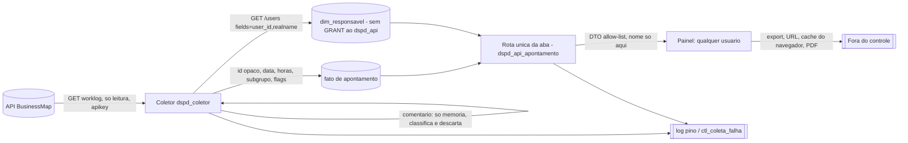

# Modelo de ameaças da aba Apontamento (pedido 059, E1.4)

Propósito: modelar as ameaças da aba Apontamento (horas apontadas por pessoa no BusinessMap, com **nome de pessoa exposto pela API a qualquer usuário do painel**) e propor a revisão da ADR 0020. Público: software-architect (E1.2), ux-designer, tech-lead, node-backend, qa-engineer, Jarvis, dono. Data: 2026-11-01. Estado: **modelo de ameaças e requisitos, não é parecer**; o parecer de segurança (R-SEGURANCA) vem sobre o commit final de cada fatia de código. Base: especificação do dono (seções 2, 3 e 6 a 10, fora do repositório), `docs/security/adr-0020-protecao-de-pessoa.md`, `docs/architecture/adr/0020-protecao-de-pessoa-no-coletor.md` (itens 1, 4 e revisão 3), `docs/security/052-integracao-businessmap-ameacas.md`, `server/src/plataforma/db/lgpd.ts`, `server/src/plataforma/db/grants.ts`, `server/src/plataforma/http.ts`, `server/src/plataforma/config.ts`, `server/src/app.ts`, `docker-compose.yml`. Leitura estática; nenhuma chamada à API, o `.env` não foi lido, nenhum nome de pessoa neste documento (ADR 0020).

**Decisões do dono que valem aqui (2026-11-01):** exceção "A" à regra de métrica individual, registrada por PR no `CLAUDE.md` e no briefing, com este discovery; "C" qualquer usuário do painel, inclusive fora do time, vê a aba; recibo confirmado "por enquanto sim". **Gatilhos (R-SEGURANCA):** dado pessoal (nome, id, horas por pessoa), texto livre na fronteira (comentário, títulos), tabela e papel novos no banco, endpoint novo que devolve pessoa, credencial de integração (a chave do dono, A1 do 052), rede de saída (endpoint novo do cliente HTTP), exportação.

## 0. Resumo para quem decide
1. **Achado estrutural (alta): o painel não tem autenticação nem autorização.** Não há `onRequest`/`preHandler` na API fora do webhook (`app.ts:62` só tem `onSend`; `webhook.ts:64` é o único `onRequest`), nem CORS, nem limite de taxa, e `HOST` tem padrão `0.0.0.0` (`config.ts:26`). Hoje isso é aceitável porque a API só sobe em `127.0.0.1` (`docker-compose.yml:48`, `docker-compose.homolog.yml:50`) e só com mock; a decisão C ("qualquer usuário do painel") **significa "quem alcança a porta da API"**. Expor nome de pessoa real com esse perfil só é seguro se o painel continuar na máquina do dono ou numa rede interna controlada. Isso vira a pergunta P-1 e a condição G-1 abaixo.
2. **O desenho que preserva a ADR 0020:** o `dspd_api` continua sem ler pessoa. Um papel novo, `dspd_api_apontamento`, com GRANT por coluna só nas tabelas da aba e usado por **uma única rota/módulo** (pool próprio), é a exceção auditável. O resto da API não muda.
3. **O comentário do apontamento nunca vai para a base**, nem em staging, nem em hash: é lido na fronteira, classificado em memória e descartado; a base guarda só o subgrupo, as flags de qualidade e inteiros (contagem de palavras).
4. **A exceção "A" é um risco de uso, não de vazamento:** utilização por pessoa, ordenação por total decrescente e mapa de calor pessoa × dia **são** o retrato individual. A segurança não decide o propósito, mas propõe 5 limites de projeto (seção 6) que o dono confirma ao registrar a exceção.
5. **Prazo 2026-11-02:** cabe a **fatia 1** (desenho, textos, ADR revisada, tela sobre mock com pessoas fictícias). **Não cabe** exibir nome real de pessoa nem coletar worklog real até o spike do endpoint, a ADR vigente, o papel novo e a resposta de P-1 (seção 8).

## 1. Ativos
| Ativo | Por que importa | Onde vive |
|---|---|---|
| Nome e id de pessoa do BusinessMap | LGPD; agora **sai da base** pela API | `dim_responsavel` (já existe, F3 do 052, fora do GRANT do `dspd_api`); novo: DTO da rota da aba |
| Horas por pessoa e dia (apontamento) | Dado pessoal de trabalho; alimenta utilização e mapa de calor; pode servir a avaliação | tabela fato nova (nome a definir pelo architect) |
| Comentário do apontamento (texto livre) | Pode ter nome de cliente, de colega, CPF, número de chamado, dado de terceiro | só memória do coletor |
| Títulos (card, card pai, subtarefa, raia) | Texto livre digitado por pessoas; o `title` do card já entra por L-2 | `stg_card` (card); subtarefa e card pai são **novos** |
| `BUSINESSMAP_APIKEY` (do dono, A1 do 052) | Lê **e escreve** no BusinessMap inteiro; coleta de worklog aumenta o uso | `.env` local do dono |
| Cota da API (30/min, 600/h) | Compartilhada com o time; worklog é volumoso (uma linha por apontamento) | conta BusinessMap |
| Histórico da base | Regra de nunca sobrescrever; apontamento é editável e removível no BusinessMap | PostgreSQL |

## 2. Fluxo e fronteiras

Fronteiras: **F1** BusinessMap → coletor (worklog é entrada não confiável, com texto livre); **F2** coletor → base (allow-list, sem comentário); **F3** base → papel de leitura (GRANT por coluna, papel novo); **F4** API → navegador (nome sai aqui, pela primeira vez); **F5** navegador → mundo (exportação, link com filtro, captura de tela, cache); **F6** processo → log e `ctl_`.

## 3. Ameaças e controles

### AP-1. Nome de pessoa exposto a qualquer um que alcance a API (I) · **alta**
- Caminho: a rota nova devolve nome (e horas por pessoa e dia). Sem autenticação (seção 0, item 1), quem alcança a porta (outra máquina da rede, outro processo no host, um proxy ou túnel publicado por engano, o `HOST` padrão `0.0.0.0` num contêiner sem o bind em `127.0.0.1`) lê nome e horas de toda a equipe. "Fora do time" na decisão C é lido como "quem o dono liberar para ver o painel", não como "internet".
- Controles propostos:
  - **G-1 (condição para nome real em qualquer ambiente fora da máquina do dono):** a decisão de onde o painel roda e quem o alcança (P-1) e, se for rede compartilhada, um controle de acesso na borda (proxy reverso com autenticação do provedor de identidade da empresa, ou lista de IP), **antes** da primeira resposta com nome real. É a mesma conclusão do S-3 do 052 (coleta só na máquina do dono) estendida à leitura.
  - **Interruptor no servidor:** variável de configuração (`APONTAMENTO_NOMES`, validada por zod na partida, **padrão desligado**); desligada, a rota devolve só o id opaco e o rótulo "Pessoa 1, 2, 3" (ordem estável por id), nunca o nome. Mock e CI ficam sempre sem nome real.
  - **Bind:** manter `127.0.0.1` nos compose; recomendar mudar o padrão de `HOST` para `127.0.0.1` fora de contêiner (recomendação, não bloqueante).
  - `Cache-Control: no-store` na rota; `Vary` e CORS fechados (sem `Access-Control-Allow-Origin: *`); sem listagem genérica de pessoas: só o que a tela pede.

### AP-2. Exceção vaza para o resto da API (E, I) · **alta se o controle for só convenção**
- Caminho: dar `SELECT` de `responsavel_nome` ao `dspd_api` para atender a aba faria toda rota, DTO ou consulta futura poder ler pessoa; um bug de `SELECT *` ou uma métrica nova passa a expor nome sem barreira de privilégio (a fronteira forte da ADR 0020 é o GRANT, I-2 do parecer de 2026-10-14).
- Controles propostos:
  - **Papel novo `dspd_api_apontamento`**, `LOGIN` separado, com `SELECT` por coluna **só** nas tabelas da aba e em `dim_responsavel` (`responsavel_id`, `responsavel_nome`). O `dspd_api` segue sem nenhuma coluna de `COLUNAS_PESSOA` (invariante intacto, teste de grants de K-085 inalterado).
  - **Pool e módulo próprios:** `server/src/modulos/apontamento/` é o único que abre conexão com o papel novo; regra de lint de import (mesma técnica do item 3 da ADR 0020: `no-restricted-imports` e diretiva inline proibida) impede outro módulo de importar o pool; é defesa em profundidade, a fronteira real é o privilégio.
  - `gerarGrants` ganha o papel e a lista de tabelas permitidas; tabela nova nasce **fora** de `paraApi` do `dspd_api` (`grants.ts:75-78`); teste: `dspd_api` negado em toda tabela da aba; `dspd_api_apontamento` negado em `stg_`, `evt_`, `ctl_` (exceto o necessário), `dim_card*` e em qualquer coluna fora da lista.
  - Alternativa **rejeitada**: GRANT por coluna ao `dspd_api` com a rota "protegida por código" (um erro de código vira vazamento; sem defesa em profundidade). Alternativa admitida se o architect preferir uma só conexão: `VIEW` `security_definer` dedicada, mais frágil que o papel (depende de `search_path` e do dono da view); só com revisão adicional.

### AP-3. Reidentificação e reuso para avaliação individual (I, comportamento) · **média**
- Caminho: utilização por pessoa e o mapa de calor ordenado por total decrescente viram ranking de quem apontou mais; coordenação usa como nota de desempenho ou compara pessoas e times (o que a regra do projeto proibia). A exceção "A" autoriza o dado, não esses usos. Quem lê: qualquer um, por decisão C.
- Controles propostos (limites de projeto, a confirmar pelo dono, seção 6): sem ordenação por total decrescente (ordem alfabética estável do rótulo ou por id), sem meta, limite, semáforo ou cor de "bom/ruim" por pessoa, sem comparação entre times, sem variação "pessoa × média da equipe", legenda que diz o propósito (capacidade e qualidade do apontamento) e que a base cobre parte da jornada (limitação 4 da especificação).
- Pessoa com poucos apontamentos: abaixo de 20 apontamentos na janela, a **estatística derivada** (utilização, percentual de qualidade) da pessoa não é publicada, só a soma de horas e a contagem (regra de piso do projeto; pergunta P-6, porque o dono pode querer exceção).

### AP-4. Comentário do apontamento chega à base, ao log ou à tela (I) · **média-alta**
- Caminho: o comentário é a base da classificação (seção 4 da especificação) e pode ter nome, cliente ou CPF. Se o coletor o gravar "para reclassificar depois" (em `payload`, coluna ou hash) ele fica em tabela sem eliminação viável; se um erro de parse o ecoar, vai para `ctl_coleta_falha` (lida pela API) e para o log.
- Controles propostos:
  - **Allow-list própria da entidade apontamento** (nova constante única, ADR 0020 item 4, ver revisão proposta): `logged_time_id` (chave natural, nome a confirmar no spike), `card_id`, `user_id` (só em memória até o projetor), `date`, `logged_time` (horas), `created_at`/`updated_at` se existirem. **Comentário nunca entra.** A classificação roda na fronteira, em memória, e entrega só: `subgrupo` (valor de lista fechada do dicionário), flags de qualidade (valores de lista fechada) e `qtd_palavras` (inteiro) se necessário.
  - Dicionário (palavras-chave) vive em tabela de referência configurável (`ref_`) com **valores de lista fechada**; a base nunca guarda o trecho que casou.
  - Erro e log levam `codigo`, entidade e `id_origem`, nunca o valor (B-4, A5 do 052); teste do marcador no comentário (CA-AP-2).
  - Consequência assumida, que o architect precisa ver: **mudar o dicionário não reclassifica o passado sem reler o worklog na API** (custo de cota). Segurança prefere isso a guardar o comentário. Se o dono quiser reclassificar sem reler, a única opção aceitável por esta vista é decisão nova do dono com ADR (guardar o comentário vira dado pessoal com eliminação a pedido, sem append-only, fora de qualquer papel de leitura da API).
  - O texto **não** é devolvido pela API, nem como "exemplo de apontamento" na tela (UX: sem drill-down que mostre comentário).

### AP-5. Títulos como texto livre: subtarefa, card pai, raia (I) · **média**
- Caminho: `subtask_title` e `logged_time_parent_title` são digitados por pessoas e podem conter nome ou dado de cliente. A ADR 0020 deixa `subtasks` fora da staging (4a). A aba usa subtarefa como categoria de filtro e de matriz.
- Controles: tratar o título de subtarefa e do card pai como o `title` do card (L-2: provisório, com o aviso "não escreva nomes no título"), **só se o dono confirmar** (P-4); alternativa mais segura: a aba usa só `tipo`, `tema` (raia), `projeto` (iniciativa raiz, via hierarquia por id) e `subgrupo`, e a subtarefa entra como **id + contagem**, com o título vindo do dicionário de referência quando for de domínio fechado. O nome do "projeto" (card raiz) já é o `title` do card (L-2). Validar tamanho e remover `\u0000` e surrogate isolado (K-084 B-K2).

### AP-6. Coleta do worklog: chave, GET, cota, endpoint não lido (E, D, T) · **média; alta se for escrita**
- Fatos: a doc de integração só lista `logged_times` entre os campos a **evitar** do card (`businessmap-api-configuracao.md:66`); o endpoint, o formato e a presença de `comment` e `user` do worklog **não foram lidos** `[NÃO LIDO]`. A chave é a do dono (A1 do 052, risco aceito por ele, pendência de usuário só leitor antes de produção).
- Controles propostos: o caminho do worklog entra na lista fechada de caminhos do cliente (ADR 0015, `http.ts`), só GET, com `fields=` fixo no código se a API aceitar (e allow-list no código como 2ª camada, porque a API pode ignorar `fields` sem erro, §4.9 do 052); spike obrigatório antes do código (formato, paginação, filtro por data de atualização, presença de identificador estável por apontamento); carga incremental pela data de atualização (não por criação, para pegar edições), com janela de reconciliação para detectar apontamentos **removidos** no BusinessMap (a especificação 1 descreve que o export perde editados e removidos; a API também não avisa exclusão); limitador local (≤ 25/min), exclusão mútua com a coleta de cards, carga inicial só manual com o dono presente (A6 do 052); 401/403 interrompem sem retry (A2). O host continua o de `BUSINESSMAP_URL_BASE` (A7), sem redirecionamento.
- BusinessMap e Acelerato **não se misturam**: tabela no esquema `dspd_bm`; nada de apontamento do Acelerato.

### AP-7. Integridade do apontamento: edição, remoção, anomalia, duplicidade (T) · **média**
- Caminho: apontamento editado muda a capacidade de alguém retroativamente; apontamento removido some; um apontamento irreal (limitação 5 da especificação, 115 h num dia) distorce utilização; duplicidade por combinação de campos (seção 10) infla horas.
- Controles: **chave única do apontamento** (do BusinessMap) como PK natural, nunca deduplicação por combinação; a carga incremental **não sobrescreve**: nova versão em `_versao` (padrão do projeto) e remoção como marca de exclusão com data (nunca `DELETE`), preservando o histórico (regra de carga incremental); validação na fronteira (`horas` > 0 e ≤ 24 por apontamento; data não futura; id e data com forma conferida); anomalia **não é descartada**, é marcada (flag de qualidade `valor_atipico`) e fica fora da soma só se o dono decidir (P-5); cálculos de dia útil e utilização pela biblioteca T2.5 (calendário com feriados é dimensão de referência, não cálculo próprio na aba). De-para de pessoa por **id** (limitação 6): nome nunca é chave de junção.

### AP-8. Exportação, URL, cache, captura de tela (I) · **média**
- Caminho: o painel tem exportação (`web/src/features/exportar/DialogoExportar.tsx`, PDF e imagem). Se a aba entrar nela, o nome e as horas saem do sistema (arquivo em e-mail e chat, sem eliminação possível). O filtro "Usuário" em query string põe nome ou id em log de acesso, histórico do navegador e link compartilhado; a resposta da API fica no cache do navegador.
- Controles propostos: a exportação **exclui** a aba por padrão (decisão do dono, P-3; se incluir, só o que está na tela, com marca de data e o propósito, sem exportação de linhas brutas por pessoa e dia, sem CSV); filtro de pessoa por **chave opaca** (identificador interno sequencial, que **não** é o `user_id` do BusinessMap), nunca por nome na URL; `no-store` na rota; o estado do filtro de pessoa não persiste em `localStorage`; log de acesso do Fastify não grava corpo e a query só leva a chave opaca; nenhuma captura (E2E, Playwright, traço) com dado real: **E2E e CI só com mock de pessoas fictícias marcadas como tal**.

### AP-9. Log e erro com pessoa (I) · **média**
- Caminho: a rota nova trabalha com nome em memória; uma exceção ou um `req.log` com a resposta grava nome; `ctl_coleta_falha.erro` é legível pela API.
- Controles: o `redact` do pino ganha `*.responsavel_nome`, `*.realname`, `*.comentario`, `*.comment` (defesa em profundidade, não substitui "nunca registrar valor"); a rota não loga corpo de resposta; `LOG_LEVEL=debug|trace` proibido com dado real (A5 do 052); teste do marcador de nome (CA-AP-3). Nome em `ctl_` e `stg_`: nunca (R3-3 da ADR continua).

### AP-10. Retenção, eliminação e base legal (I, LGPD) · **média**
- Caminho: horas por pessoa e dia, por anos, com nome ligado por junção; a decisão de 2026-10-29 deixou a retenção de `dim_responsavel` sem prazo (R-b, I-12). A tabela fato com chave de pessoa continua sendo dado pessoal mesmo sem o nome (pseudônimo, LGPD art. 13, §4). O pedido de eliminação do titular (ou de quem sai do time) precisa de caminho.
- Controles propostos: (a) a tabela fato guarda a **chave opaca da pessoa** (não o `user_id`) e **fica fora do gatilho `proibir_alteracao`** como `dim_responsavel`; (b) eliminação a pedido = procedimento do `dspd_migrador`: apagar a linha de `dim_responsavel` e anular a chave opaca nas linhas do fato (as horas ficam como agregado sem pessoa), registrando só data e responsável do procedimento; (c) impedir a releitura do id eliminado (parte da I-12); (d) **prazo de guarda e base legal** são decisão do dono e do DPO (P-2): a proposta de segurança é prazo curto (janela útil de capacidade, a definir) e finalidade declarada na legenda da aba; (e) backup: o prazo do backup entra no mesmo levantamento (fora do escopo desta máquina, local).
- Conflito a decidir: a regra "nunca sobrescrever histórico" e o direito de eliminação; a proposta (b) não sobrescreve valor de métrica, só desliga a ligação com a pessoa. Se o dono ler diferente, é pergunta (P-2).

### AP-11. Entrada não confiável e superfície nova da API (T, D) · **baixa-média**
- Rota GET com query `strict` (parâmetro desconhecido devolve 400, como no padrão atual), filtros por lista fechada (ano-mês `AAAA-MM`, tipo, subgrupo, qualidade, chave opaca de pessoa) validados por zod; sem SQL por concatenação; limite de linhas por resposta e janela máxima (a especificação fixa mês anterior até a data máxima); sem filtro de texto livre. Sem autenticação, o limite de taxa é o freio de DoS e de raspagem: recomendar `@fastify/rate-limit` (gratuito) na rota da aba (recomendação; o 059 não adiciona dependência sem o `devops-engineer` e o `tech-lead` verem a cadeia de suprimentos).

## 4. Revisão proposta da ADR 0020 (revisão 4; texto para o architect incorporar)
Dono do texto: `software-architect`. Esta proposta não altera a ADR; qualquer alteração da ADR pede nova leitura do security-engineer.

**O que muda**
1. **Item 1 (perímetro):** acrescentar a exceção declarada: "a identidade de pessoa também é lida, **só para a aba Apontamento do BusinessMap**, por uma rota e um papel dedicados (`dspd_api_apontamento`), por decisão do dono de 2026-11-01 (exceção A à regra de métrica individual, registrada no `CLAUDE.md` e no briefing §7.1). Todas as demais rotas, DTOs, telas e exportações continuam sem pessoa."
2. **Item 4 (allow-list), nova entrada 4h, entidade apontamento (worklog):** lista fechada de chaves (seção AP-4), **comentário nunca**, `user_id` só em memória até a chave opaca, classificação do comentário na fronteira com saída de lista fechada. Spike do formato antes do código.
3. **Revisão 3, R3-2, R3-3 e R3-4:** o nome continua só em `COLUNAS_PESSOA` e fora do GRANT do `dspd_api`; R3-3 ("nunca em rota, DTO, tela, exportação ou filtro") ganha a ressalva "exceto o DTO da aba Apontamento, pelo papel dedicado, com `APONTAMENTO_NOMES` ligado"; R3-4 ganha os testes de grants do papel novo (AP-2) e os casos CA-AP-*.
4. **Chave opaca da pessoa:** nova coluna de identidade interna (sequencial, sem relação com o `user_id`), em `COLUNAS_PESSOA` ou documentada como exceção com justificativa, para a URL, o filtro e a tabela fato; só o papel da aba a lê. (A ADR hoje diz que `responsavel_id` é o id do BusinessMap; a chave opaca é nova.)
5. **`data-model.md` §9, garantias 4 e 5:** o texto "nenhuma rota, DTO ou tela agrega por pessoa" ganha a exceção e aponta para esta revisão; a regra de `COLUNAS_PESSOA` ganha as colunas novas.
6. **Critério de reversão:** acrescentar: nome em log, `ctl_`, `stg_`, exportação, URL ou cache fora da rota da aba; qualquer rota fora da aba que leia o papel novo; mostrar nome sem `APONTAMENTO_NOMES`; uso do dado para ranking, meta ou comparação entre times (a exceção volta ao dono).
7. **Retenção (I-12):** `dim_responsavel` e a tabela fato de apontamento entram na I-12 com prazo e base legal (P-2).

**O que não muda**
- O `dspd_api` não lê coluna de pessoa; o teste de grants de K-085 segue como está.
- Nenhum nome, e-mail, comentário ou outro campo de `/users` em `stg_`, `fato_*` (exceto a chave opaca), `agg_*`, `vw_*`, `ctl_coleta_falha`, outbox, evento ou log; `GET /users` só com `fields=user_id,realname` (R3-1); só GET; cliente de lista fechada; coleta do BusinessMap só no `dspd_bm`.
- Acelerato fora: a exceção vale **só para o BusinessMap, só para a aba Apontamento**; a regra de pessoa do Acelerato (allow-list na fronteira, GRANT por coluna) segue integral. BusinessMap e Acelerato não se misturam.
- As revisões 1 a 3, as decisões R-1 e R-2 e as funções de `coletor/` (`houveTroca`, `faixaConcentracao`) ficam como estão; ids de pessoa continuam só em memória e em `dim_card.responsaveis` / `dim_responsavel`.
- Sem métrica por pessoa nas demais abas e sem ranking, meta por pessoa ou comparação entre times, mesmo dentro da aba (seção 6).

## 5. Controles já existentes que cobrem parte do problema
`dim_responsavel` já existe, com nome fora do GRANT da API, sem DELETE para o coletor e eliminação pelo migrador (`grants.ts:68`); cliente HTTP só GET, sem redirecionamento, erro sem corpo (`http.ts:8`); allow-list por entidade e `/users` com `fields` fixo (ADR 0020, R3-1); `redact` do pino para credenciais (`log.ts`); ver `docs/security/052-integracao-businessmap-ameacas.md` §4.

## 6. Limites de projeto que a segurança propõe ao registrar a exceção (decisão do dono)
1. Finalidade escrita na legenda da aba e no texto da exceção: dimensionar capacidade e melhorar a qualidade do apontamento; **não** avaliação de desempenho individual.
2. Sem ordenação por total decrescente de pessoas; ordem estável por rótulo ou chave opaca.
3. Sem meta, limite, semáforo ou "acima/abaixo da média" por pessoa; utilização apresentada como relativa (limitação 4 da especificação).
4. Sem comparação entre times e sem série individual comparada a outra pessoa.
5. Estatística derivada por pessoa só com 20 ou mais apontamentos na janela (piso do projeto); abaixo, só soma e contagem.
Nada disso é imposto pela segurança como regra nova de negócio: são propostas que o dono aceita, altera ou recusa (R-DECISAO).

## 7. Casos de abuso (para o qa-engineer escrever como teste na implementação)
| # | Entrada | Caminho | Resultado esperado |
|---|---|---|---|
| CA-AP-1 | Conexão com o papel `dspd_api` tentando `SELECT` em `dim_responsavel`, na tabela fato da aba e em qualquer coluna de `COLUNAS_PESSOA` | API geral → banco | permissão negada; o teste de K-085 continua verde |
| CA-AP-2 | Worklog com comentário contendo marcador, `reporter`, e-mail e chave desconhecida | resposta da API → coletor → base, log, `ctl_coleta_falha` | só as chaves da allow-list e a classificação de lista fechada; marcador, e-mail e comentário ausentes de toda tabela, de log e de `ctl_` |
| CA-AP-3 | Fixture com nome-marcador em `/users` e na resposta da rota da aba, com erro forçado (zod inválido, falha do banco) | coletor e rota → log | o marcador só na resposta autorizada da rota; nunca em log, `ctl_coleta_falha`, mensagem de erro ou exceção |
| CA-AP-4 | Rota da aba com `APONTAMENTO_NOMES` desligado | API → painel | nenhum nome na resposta, só "Pessoa n"; ligada, nome só no campo do DTO; qualquer outra rota sem nome |
| CA-AP-5 | Qualquer rota fora da aba (varredura do OpenAPI) | API → painel | nenhum campo de nome, id do BusinessMap ou chave opaca de pessoa em DTO fora da aba |
| CA-AP-6 | Query com parâmetro desconhecido, nome de pessoa em vez de chave opaca, mês inválido, filtro com texto livre ou injeção | painel → rota | 400 pelo `strict`; nenhuma consulta executada; nenhum eco do valor na resposta nem no log |
| CA-AP-7 | Exportação da aba (PDF, imagem, CSV) e persistência do filtro de pessoa | painel → navegador | sem CSV e sem linhas brutas por pessoa e dia; filtro de pessoa não persiste em `localStorage`; resposta com `Cache-Control: no-store` |
| CA-AP-8 | Mesmo apontamento coletado duas vezes; apontamento editado (horas diferentes); apontamento removido na origem | coletor → base | uma linha (chave única); a edição cria versão, sem sobrescrever; a remoção marca exclusão com data, sem `DELETE` |
| CA-AP-9 | Apontamento com 115 horas num dia, horas ≤ 0, data futura, id fora da forma | coletor | marcado ou recusado conforme a validação (P-5); nunca descartado em silêncio; não derruba a coleta |
| CA-AP-10 | Procedimento de eliminação de uma pessoa | migrador → base | linha de `dim_responsavel` apagada, chave de pessoa anulada no fato, horas preservadas como agregado, id não relido na coleta seguinte |
| CA-AP-11 | Caminho de worklog fora da lista, método diferente de GET, `fields` com campo de comentário | cliente HTTP | recusado antes de enviar (estende o CA-3 do 052) |
| CA-AP-12 | Pessoa com menos de 20 apontamentos na janela | rota → tela | sem utilização nem percentual; só soma e contagem (se P-6 mantiver o piso) |
| CA-AP-13 | Teste estrutural dos `INSERT` do worklog | código-fonte | falha se gravar chave fora da constante da allow-list ou se existir coluna de texto livre na tabela fato |

## 8. O que cabe até 2026-11-02 e o que fica para depois (fatias, vista de segurança)
- **Fatia 1 (cabe até 2026-11-02, sem dado real):** discovery (E1.2 a E1.4), texto da exceção em PR, ADR 0020 revisão 4 (texto), tela sobre **mock com pessoas fictícias** e o interruptor `APONTAMENTO_NOMES` desligado por padrão, sem papel novo e sem coleta. Não há gatilho de dado real; parecer de segurança sobre a ADR e o desenho.
- **Fatia 2:** spike do endpoint do worklog (formato, paginação, filtro por atualização, chave estável), cliente com o caminho novo, allow-list 4h e testes CA-AP-2, 8, 9, 11, 13; coleta só na máquina do dono. Parecer de segurança sobre o código.
- **Fatia 3:** papel `dspd_api_apontamento`, pool e rota única, DTO com nome, grants e testes CA-AP-1, 3 a 6; só liga `APONTAMENTO_NOMES` com P-1 respondida e G-1 atendida. Parecer de segurança sobre o código.
- **Fatia 4:** retenção e eliminação (CA-AP-10), exportação (CA-AP-7), regra do piso de 20, rate limit.
Cada fatia com código e dado pessoal pede parecer de segurança em commit final (R-SEGURANCA).

## 9. Perguntas ao dono (R-DECISAO; nenhuma resolvida por inferência)
- **P-1. Onde o painel roda e quem o alcança** quando a aba mostrar nome real? Hoje o painel não tem autenticação. Opções: (a) só na máquina do dono ou rede local sob controle dele; (b) rede interna da empresa com autenticação na borda (proxy com o provedor de identidade); (c) outro. "Qualquer usuário do painel, inclusive fora do time" fica entendido como "quem tiver acesso ao painel por (a) ou (b)", salvo resposta contrária. Sem (a) ou (b) definido, a segurança não aprova nome real.
- **P-2. Retenção e base legal:** por quanto tempo guardar horas por pessoa e dia e o nome (proposta: prazo curto, janela útil de capacidade, a definir com o DPO), e quem atende o pedido de eliminação. Confirmar o procedimento (b) do AP-10 (anular a chave de pessoa no fato, preservar as horas como agregado).
- **P-3. Exportação:** a aba entra na exportação do painel? Proposta de segurança: não; se sim, só o que está na tela, sem CSV nem linhas brutas.
- **P-4. Texto livre de subtarefa e de card pai:** aceitar como o `title` do card (L-2, com aviso aos times) ou limitar a aba a `tipo`, `tema`, `projeto` e `subgrupo`, com a subtarefa por id e dicionário.
- **P-5. Apontamento atípico (por exemplo 115 h num dia):** marcar e manter na soma, marcar e tirar da soma, ou recusar? A segurança propõe marcar e manter a decisão de cálculo com o dono; nunca descartar em silêncio.
- **P-6. Piso de 20 apontamentos por pessoa** para estatística derivada (utilização, percentual de qualidade): vale na aba, ou o dono abre exceção?
- **P-7. Limites de projeto 1 a 5 (seção 6):** aceita, altera ou recusa; a resposta entra no texto da exceção do `CLAUDE.md` e do briefing §7.1.
- **P-8. Reclassificação do comentário:** aceita que mudar o dicionário só vale para a coleta nova ou para o que for relido da API (recomendado), ou quer reclassificar o passado sem reler (exige decisão e ADR para guardar o comentário, o que a segurança desaconselha)?

## 10. Melhorias e correções à especificação (vista de segurança)
- Seção 1 e 10: o dado **não pode** ficar embutido em arquivo estático (um HTML com nomes e horas é um vazamento portátil); a versão de produção serve por API com o controle da seção AP-1 e AP-2.
- Seção 8, bloco 4 (achados escritos à mão com números fixos no código): gerar por cálculo (já é a limitação 7) e **não** escrever nome de pessoa em texto de achado.
- Seção 9, limitação 6 (de-para de nome por id): usar o id do BusinessMap só na coleta e a chave opaca no resto.
- Seção 8: o filtro "Usuário" por nome vira filtro por chave opaca com rótulo; sem busca por texto livre.

## 11. Ferramentas e lacunas
Leitura estática e `grep`; `forge-check` não foi necessário (documento sem frontmatter de parecer). `gitleaks`, `osv-scanner`, `semgrep`, `zizmor`, `actionlint` e `trivy` **não estão no PATH** desta máquina (lacuna registrada; não se aplicam a um modelo de ameaças, e as varreduras rodam no CI do `devops-engineer`). Nenhum segredo foi lido ou exibido.
