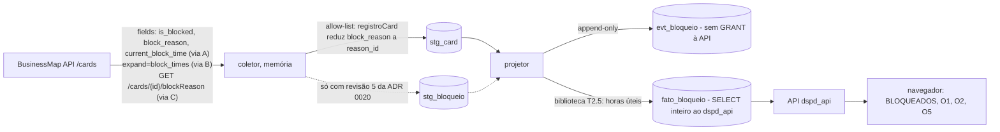

# Modelo de ameaças: bloqueios reais na coleta do BusinessMap (pedido 075)

Etapa E1.2 (cartão K-204). Autor: security-engineer. Data: 2026-11-06.
Base lida: `docs/pedidos/075-bloqueios-reais.md` (Escopo, Etapas) e, só leitura, o checkout da develop em `/home/rodrigoisensee/MetricasDSPD-056d` (HEAD f21220fe): `server/src/modulos/businessmap/{allow-list,coleta}.ts`, `server/src/plataforma/db/{grants,lgpd,ddl}.ts`, `server/src/plataforma/http.ts:48`, `server/migrations/{0004_bm_staging,0005_bm_historico,0006_bm_projecoes}.ts`, `server/src/modulos/metricas/{repositorio,servico}.ts`, `packages/contratos/src/{schemas,comum}.ts`, `server/tests/{allow-list,allow-list.qa,migracoes.estatico}.test.ts`, ADR 0020 (4a e "Numeração" da revisão 4), ADR 0022 item 3, `docs/integracao/businessmap-api-configuracao.md` §4.2 e §4.4 e `docs/security/052-integracao-businessmap-ameacas.md` (B-K3). Nenhum `.env` lido, nenhuma API nem base consultada, nada executado além de leitura.

Este documento é **modelo de ameaças, não parecer**. O desenho E1.1 (`docs/analises/075-desenho.md`) ainda não existe; por isso o modelo cobre as três vias de dado possíveis (seção 2) e diz o que cada uma exige. O parecer (R-SEGURANCA) sai sobre o commit final de cada lote do plano E3.1. Gatilhos: dado novo da fonte na fronteira (possivelmente), tabela `stg_` nova gravada, projeção lida pela API, texto livre e pessoa na origem do bloqueio. Os casos de abuso (CA-075-n) são para o qa-engineer escrever como teste durante a implementação.

## 1. Ativos e fronteiras

**Ativos:**
- Dado do bloqueio na origem (BusinessMap): `is_blocked`, `block_reason` (`reason_id`, e na origem também o rótulo, o **comentário livre** e **quem bloqueou**), `current_block_time`, e o histórico por `expand=block_times` (que traz comentário e autor, `052-integracao-businessmap-ameacas.md:67`).
- Staging append-only: `stg_card` (hoje já recebe `is_blocked`, `block_reason_id`, `current_block_time`: `allow-list.ts:19, 98-99`) e `stg_bloqueio` (existe com `payload jsonb` livre, `0004_bm_staging.ts:29`, e é **negada por padrão** até a revisão 5 da ADR 0020: ADR 0022 item 3, ADR 0020 "Numeração").
- `evt_bloqueio` (append-only, `0005_bm_historico.ts:49-53`; colunas `card_id`, `id_origem`, `tipo` início/fim, `motivo_codigo`, `coluna_id`, `fornecedor_codigo`, `ocorrido_em`) e `fato_bloqueio` (projeção, `0006_bm_projecoes.ts:32-38`; `motivo`, `fornecedor` em `varchar(80)`, `ddl.ts:12`).
- O GRANT do `dspd_api`: `fato_bloqueio` está em `PROJECAO` e, por não ter coluna de `COLUNAS_PESSOA`, recebe `SELECT` na tabela inteira (`grants.ts:53, 109-113`); `evt_bloqueio` é `IMUTAVEL` e a API não lê (`grants.ts:54, 108`).
- A resposta da API do projeto: `resultadoBloqueados` (`cardId`, `titulo`, `tipo`, `etapa`, `motivo` em enum fechado `MOTIVOS_BLOQUEIO`, `fornecedor`, `bloqueadoHaDiasUteis`: `packages/contratos/src/schemas.ts:93-106`, `comum.ts:97`), O1, O2 (`bloqueioMotivo`) e O5.
- A apikey do BusinessMap (só `.env`) e a cota da conta (30/min, 600/h).

**Fronteiras e fluxo:**

Fronteiras: (F1) resposta da API do BusinessMap → coletor; (F2) coletor → staging; (F3) staging → projetor → `evt_`/`fato_`; (F4) `fato_bloqueio` → `dspd_api` → navegador; (F5) coletor → log, `ctl_coleta_falha`, erro.

## 2. As três vias de dado e o que cada uma exige

| Via | O que lê da fonte | Mudança de fronteira | Risco |
|---|---|---|---|
| A. Instantâneo do card | o que já entra em `stg_card` (`is_blocked`, `block_reason_id`, `current_block_time`), comparado entre versões | nenhuma: sem campo novo, sem `stg_bloqueio`, sem chamada nova | baixo |
| B. Histórico `expand=block_times` | itens do histórico com instantes, motivo, **comentário e autor** | campo novo da fonte; grava `stg_bloqueio` (hoje negada por padrão); `expand` novo no pedido (`EXPAND_COLETA`, `coleta.ts:38`, hoje sem `block_times`) | alto: exige revisão 5 da ADR 0020 lida pela segurança **antes** do código |
| C. `GET /cards/{id}/blockReason` | bloqueio atual por card | caminho novo na lista fechada do cliente; uma chamada por card | médio: pessoa e texto livre na resposta, e cota |

Recomendação de segurança: **A como base**. Ela tira a tela do "sem dado real" sem trazer nenhum dado novo da fonte. B e C só se o desenho E1.1 mostrar que A não atende a regra de negócio (precisão do início do bloqueio, bloqueios que abrem e fecham entre duas coletas), e aí com os controles da seção 4. A perda de precisão de A é pergunta ao dono (P-075-1), não decisão técnica.

## 3. Ameaças (STRIDE)

| # | Ameaça | Caminho realista | Sev. |
|---|---|---|---|
| T1 | Comentário livre do bloqueio chega à base (I) | o comentário do `block_reason` ou de `block_times` costuma ter nome ("aguardando Fulano"), e-mail ou dado de cliente; se entrar em `stg_bloqueio.payload` (jsonb livre, append-only) ou em `fato_bloqueio.motivo` (`varchar(80)`), fica sem eliminação viável e, no `fato_`, vai ao navegador pelo GRANT da tabela inteira | alta |
| T2 | Quem bloqueou chega à base ou à API (I, e regra inviolável) | `user_id` do `block_reason`/`block_times` gravado "para auditoria"; junto com a contagem por card vira ranking de quem mais bloqueia ou de quem é bloqueado | alta |
| T3 | Coluna nova de `fato_bloqueio` vai à API sem ninguém decidir (I, E) | `fato_bloqueio` tem GRANT de tabela inteira ao `dspd_api`; a regra de pessoa (`SEGMENTO_PESSOA`, `lgpd.ts:7-8`) casa por segmento do nome, e nomes como `bloqueado_por`, `comentario`, `observacao`, `motivo_texto` ou `quem` **não casam**, logo passam no teste estático e entram no `SELECT` do `dspd_api` | alta |
| T4 | Rótulo do motivo como texto livre (I) | o catálogo de motivos (`/blockReasons`) é editado por administradores do quadro; um rótulo pode ter nome de pessoa ou de cliente; se o coletor gravar o rótulo recebido, em vez de um código de lista fechada, o texto chega à API | média |
| T5 | `stg_bloqueio` gravada sem lista fechada (I, T) | a tabela já existe com `payload jsonb`; um lote "simples" grava o objeto do `block_times` inteiro, furando o "negado por padrão" da ADR 0022 item 3 | alta |
| T6 | Sobrescrita ou perda de histórico (T) | o projetor reconstrói `fato_bloqueio` com `DELETE` (o coletor tem `DELETE` nas projeções, `grants.ts:92`) e apaga bloqueios de card arquivado ou descartado que a coleta incremental não traz mais; ou o `evt_bloqueio` ganha `id_origem` instável e duplica na reexecução | média |
| T7 | Limpeza do seed apaga dado real (T) | `limpar-seed` remove `fato_bloqueio` pela marca da coleta do seed (`limpar-seed.ts:95`); se a coleta real reaproveitar o marcador ou a projeção atualizar `atualizado_por_coleta_id` de linha do seed, a limpeza apaga bloqueio real | média |
| T8 | Valor da fonte em log ou erro (I) | erro de validação ou do banco ecoa o comentário ou o rótulo em `ctl_coleta_falha`, `erro_resumo` ou na saída do comando | média |
| T9 | Volume e cota (D) | via C: uma chamada por card esgota a cota da conta (é da conta, não do coletor: bloqueia o time no BusinessMap); via B: `block_times` aumenta a resposta de cada página; card com milhares de entradas no histórico | média (C), baixa (B) |
| T10 | Mistura de fontes (T, regra inviolável) | `fornecedor` do bloqueio tirado do Acelerato ou de tabela `ac`; ou contagem de bloqueados somada com chamados em espera | baixa |
| T11 | Reidentificação pela combinação (I) | tela BLOQUEADOS lista `titulo` + `motivo` + `bloqueadoHaDiasUteis`; se ganhar responsável ou "bloqueado por", passa a apontar pessoa. Hoje não tem (`schemas.ts:93-106`) | baixa enquanto a forma não mudar |

## 4. Controles exigidos

**Comuns a qualquer via:**
1. **Nenhum campo de pessoa ou texto livre do bloqueio é gravado, nem em memória além da redução**: do `block_reason` sai só `reason_id` (já é assim, `allow-list.ts:98-99`); `comment`, `label`, `user_id`, `date` (se não for usado) ficam fora. Campo novo exige revisão da ADR 0020 4a antes do código (T1, T2, T4).
2. **Motivo só como código de lista fechada**: `reason_id` → código por domínio fechado (`ref_dominio`, campo `motivo_bloqueio`, carregado por arquivo versionado como o L2-a do pedido 069), e daí ao enum `MOTIVOS_BLOQUEIO`; fora do domínio vira `desconhecido`, nunca o rótulo nem o comentário. `fato_bloqueio.motivo` e `evt_bloqueio.motivo_codigo` recebem só valor do enum (validação no projetor; `CHECK` no banco é recomendação) (T1, T4).
3. **Colunas de `fato_bloqueio` e `evt_bloqueio` fechadas por teste**: lista exata das colunas atuais escrita no teste estático (não derivada da migração); coluna nova reprova o teste e exige decisão. Com isso o GRANT de tabela inteira ao `dspd_api` não cresce sozinho. Alternativa equivalente: trocar o GRANT de `fato_bloqueio` para GRANT por coluna. Qualquer diff em `grants.ts`, `lgpd.ts` (`COLUNAS_PESSOA`, `EXCECOES_PESSOA`) ou na `PROJECAO` nesse pedido é achado bloqueante do parecer (T3).
4. **Sem GRANT novo**: o coletor já grava `evt_bloqueio` (`SELECT, INSERT`, imutável) e `fato_bloqueio` (projeção); a API já lê `fato_bloqueio` e nunca `evt_` nem `stg_`. Teste: saída de `gerarGrants` idêntica à da develop.
5. **Carga incremental sem sobrescrever**: `evt_bloqueio` append-only (gatilho existente) com `id_origem` determinístico (derivado de `card_id` + instante de início observado ou do id do item da fonte, nunca de texto); reexecução da mesma coleta não duplica (`uq_evt_bloqueio`); `fato_bloqueio` é derivado só de `evt_bloqueio`, por `INSERT ... ON CONFLICT` e `UPDATE` do `fim`/duração, **sem `DELETE`** de linha de card arquivado ou descartado; bloqueio aberto de card que sumiu da coleta fica como está (a regra de fechamento é pergunta, P-075-3) (T6).
6. **Duração só pela biblioteca T2.5** (horas úteis), nunca em SQL; mudança de critério registrada com data (T2.6): a troca de "sem dado real" para dado real é versão de critério nova que afeta O1, O2, O5 e BLOQUEADOS, e o interruptor `BLOQUEIOS_COM_DADO_REAL` (`servico.ts:307`) é o único ponto que muda a publicação.
7. **Seed separado do real**: a coleta real nunca grava com marcador de coleta do seed; o projetor recusa esquema com coleta `seed-mock` (já existe para a coleta, `coleta.ts` `esquema-com-seed`) também para os bloqueios (T7).
8. **Erro só com código**: falha de bloqueio em `ctl_coleta_falha` com código fixo, `card_id` e nome de campo constante; nunca valor recebido (T8).
9. **Só BusinessMap**: `fornecedor` do bloqueio vem do domínio do BusinessMap (`dim_card.fornecedor` ou `ref_dominio` de `dspd_bm`), nunca de `dspd_ac`; consulta do projetor só no esquema `bm` (T10).
10. **API sem pessoa**: `resultadoBloqueados`, O1, O2 e O5 não ganham campo de pessoa nem "bloqueado por"; nenhuma rota agrega bloqueio por pessoa (T2, T11).

**Só para a via B (`block_times`), além dos comuns:**
11. Revisão 5 da ADR 0020 com a lista fechada de `stg_bloqueio`, escrita a partir da forma real (spike com chaves e tipos, sem valores) e lida pela segurança **antes** do código; função `registroBloqueio` na allow-list, constante única, só escalares; teste estrutural de que todo `INSERT` em `stg_bloqueio` passa por ela (B-K3) (T5).
12. `expand` novo em `EXPAND_COLETA` e no regex do cliente (`http.ts:48` já aceita `block_times`); teto de itens de histórico por card antes de reduzir (T9).

**Só para a via C (`/blockReason` por card), além dos comuns:**
13. Caminho novo na lista fechada do cliente, com `fields` fixo se a API aceitar; chamada só para card com `is_blocked` verdadeiro na página; respeito ao limitador de cota e teto de chamadas por execução; resposta pela mesma redução do item 1 (T9).

## 5. Casos de abuso (para o qa-engineer)

| Id | Entrada | Caminho | Resultado esperado |
|---|---|---|---|
| CA-075-1 | card com `block_reason: { reason_id: 9, label: MARCADOR, comment: MARCADOR, user_id: 888 }` | `/cards` → `registroCard` → `stg_card` → projetor → `evt_bloqueio`/`fato_bloqueio` | só o `reason_id` reduzido segue; marcador e `888` ausentes de `stg_*`, `evt_bloqueio`, `fato_bloqueio`, log e `ctl_coleta_falha` |
| CA-075-2 | `reason_id` fora do domínio de `motivo_bloqueio`; `reason_id` nulo; `reason_id` objeto | projetor | motivo `desconhecido` (ou a regra de P-075-2), nunca o rótulo; objeto descartado na allow-list (já coberto em `allow-list.test.ts:81`) |
| CA-075-3 | linha de `ref_dominio` `motivo_bloqueio` com rótulo `MARCADOR-PESSOA-075` ou `@` | `bm:ref-sync` | recusa pelo `textoSeguro`; nada carregado |
| CA-075-4 | migração de teste que acrescenta `fato_bloqueio.bloqueado_por`, `.comentario` e `.observacao` | teste estático das colunas fechadas | o teste reprova as três (hoje o `SEGMENTO_PESSOA` não pega nenhuma) |
| CA-075-5 | papel `dspd_api` | `SELECT * FROM evt_bloqueio`, `SELECT * FROM stg_bloqueio` | `42501`; `SELECT` de `fato_bloqueio` só das colunas da lista fechada; `gerarGrants` igual ao da develop |
| CA-075-6 | mesma coleta reexecutada; coleta com sobreposição de 3600 s | projetor | `evt_bloqueio` sem linha nova; `fato_bloqueio` com a mesma contagem |
| CA-075-7 | card bloqueado que depois é arquivado, e card descartado | coleta incremental seguinte | bloqueio permanece em `evt_bloqueio` e `fato_bloqueio`; nenhuma linha removida |
| CA-075-8 | tentativa de `UPDATE`/`DELETE` em `evt_bloqueio` pelo coletor | banco | negado pelo gatilho append-only |
| CA-075-9 | base com coleta `seed-mock` mais coleta real; roda `limpar-seed` | limpeza | saem só as linhas do seed; bloqueios reais intactos |
| CA-075-10 | falha de validação de um bloqueio com comentário marcador | coletor | `ctl_coleta_falha` com código, `card_id` e campo constante; marcador ausente |
| CA-075-11 | resposta das rotas BLOQUEADOS, O1, O2, O5 e exportação | API | chaves exatamente as do contrato; nenhuma chave com segmento de pessoa nem "bloqueado por"; nenhum valor de `user_id` da fixture |
| CA-075-12 | `fornecedor` do card ausente no BusinessMap e chamado do Acelerato com fornecedor | projetor | fornecedor `null`/`desconhecido`; nenhuma leitura de `dspd_ac` (consulta só no esquema `bm`) |
| CA-075-13 (via B) | item de `block_times` com chaves extras, comentário e autor marcadores; card com 10 mil itens | `registroBloqueio` → `stg_bloqueio` | só as chaves da revisão 5; marcadores ausentes; teto aplicado com contagem em `ctl_coleta_contagem` |
| CA-075-14 (via C) | 500 cards bloqueados numa página | cliente | chamadas limitadas pelo limitador e pelo teto; nenhuma chamada a card não bloqueado |

Fixtures só com marcadores sintéticos (`MARCADOR-PESSOA-075`, `marcador075@exemplo.invalid`), nunca dado real. Lista de proibidos escrita no teste, não derivada das constantes do código.

## 6. Perguntas ao dono (regra de negócio, não se decide por inferência)

- **P-075-1 (via e precisão):** a via A (comparar o instantâneo entre coletas, sem dado novo da fonte) atende? Ela não vê bloqueio que abre e fecha entre duas coletas e marca o início pela coleta (ou por `current_block_time`). Se não atende, a via B traz o histórico, mas exige ADR antes (comentário e autor vêm junto na origem).
- **P-075-2 (motivo):** como cada motivo do catálogo do BusinessMap (`reason_id`) corresponde às categorias da tela (`MOTIVOS_BLOQUEIO`)? E bloqueio sem motivo de catálogo (só comentário) conta como bloqueio com motivo "desconhecido"/"outro", ou fica fora?
- **P-075-3 (fechamento):** card que sai da coleta ainda bloqueado (arquivado, descartado, excluído) fecha o bloqueio na data da saída ou fica aberto?
- **P-075-4 (fornecedor):** o fornecedor do bloqueio é o do campo do card no BusinessMap no momento do bloqueio, o atual, ou não se preenche?

## 7. Lacunas

- Desenho E1.1 não lido (não existia); este modelo deve ser conferido contra ele na E3.1, e a via escolhida define quais controles da seção 4 viram critério de pronto.
- Forma real de `block_reason` e `block_times` não confirmada neste checkout (o spike F1 guarda a saída fora do clone); a revisão 5 da ADR 0020 depende dela.
- Ferramentas de varredura não rodadas: modelo só de leitura; a varredura fica para o parecer do lote e para o CI.

**Veredito: segue com condição** (via A recomendada; controles 1 a 10 para qualquer via; 11 e 12 só com a revisão 5 da ADR 0020 lida pela segurança antes do código; 13 só se a via C for escolhida; P-075-1 a P-075-4 respondidas pelo dono antes do plano E3.1).
