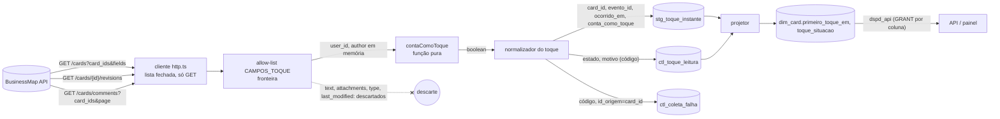

# Modelo de ameaças da coleta do primeiro toque do O22 (pedido 105, B6, E7.154)

Propósito: modelar a coleta nova do O22 (revisões por card e comentários em lote do BusinessMap, em produção) desenhada na ADR 0020 revisão 6 e em `docs/architecture/features/105-o22-primeiro-toque.md`, e fixar os requisitos de segurança e os casos de abuso que o B7a e o B7b precisam cumprir. Público: software-architect, node-backend, qa-engineer, tech-lead, Jarvis. Data: 2026-11-16. Estado: **modelo de ameaças e requisitos, não é parecer**; o parecer da revisão 6 está em `docs/security/105-o22-adr.md`. Base lida: branch `docs/105-o22-adr`, cabeça `45105e4f`, e o cliente HTTP da `develop` (`server/src/plataforma/http.ts`), mais o parecer do spike (`docs/security/105-o22-spike.md`, branch `feature/105-o22-spike`).

**Decisões do dono que valem aqui (pedido 105):** 05:54 (O22 no escopo; toque = primeira atualização de qualquer tipo; guarda só o horário e se contou; revisão de segurança obrigatória), 07:05 (sem contas próprias de automação; toda atualização com autor conta), 07:07 (passado de 12 semanas; comentário externo não conta). **Gatilhos (R-SEGURANCA):** dado pessoal na fronteira (id de pessoa, e-mail de remetente externo, texto livre de comentário), caminho novo na lista fechada do cliente que usa a credencial do dono, tabelas novas e mudança de privilégio no banco.

## 1. Ativos
| Ativo | Por que importa | Onde vive |
|---|---|---|
| `user_id` de quem fez a revisão | Id de pessoa; com o instante, vira perfil de atividade por pessoa | só memória do coletor, até `contaComoToque` |
| `author` do comentário (`type`, `value`) | `value` é id de pessoa (interno) ou **e-mail de terceiro** (externo, spike) | só memória, até `contaComoToque` |
| `text`, `attachments` do comentário | Texto livre: nome de cliente, colega, dado de terceiro, possivelmente dado sensível | só memória, nunca passa da fronteira |
| Instante e booleano por evento | Sem pessoa; com o card e o responsável, permite inferência fraca de quem tocou | `stg_toque_instante` (só `dspd_coletor`) |
| Situação de leitura por card | Controle; sem pessoa | `ctl_toque_leitura` (só `dspd_coletor`) |
| `primeiro_toque_em`, `toque_situacao` | Lidos pela API; por card, sem pessoa | `dim_card` |
| apikey do dono (pode escrever no quadro, Q-5 = B) | O cliente é a única barreira contra escrita e contra leitura ampla | `.env`; cabeçalho `apikey` |

## 2. Fluxo e fronteiras

Fronteiras: (F1) rede BusinessMap → processo da coleta; (F2) memória → banco (a allow-list); (F3) banco → API e painel (GRANT); (F4) processo → log e `ctl_coleta_falha`.

## 3. O que entra, o que nunca entra, quem lê
| Dado | Entra na memória | Entra na base | Quem lê na base |
|---|---|---|---|
| `revision`, `replaced_at` | sim | como `evento_id` (`r<n>`) e `ocorrido_em` | `dspd_coletor` |
| `user_id` da revisão | sim, até `contaComoToque` | **nunca** (nem hash, nem derivado) | ninguém |
| `card_id`, `comment_id`, `created_at` | sim | como `card_id`, `evento_id` (`c<id>`), `ocorrido_em` | `dspd_coletor` |
| `author.type`, `author.value` | sim, até `contaComoToque` | **nunca** | ninguém |
| `text`, `attachments`, `type`, `last_modified` | sim (a rota não tem `fields`) | **nunca**, nem hash, trecho ou tamanho | ninguém |
| `conta_como_toque` | derivado | `stg_toque_instante` | `dspd_coletor` |
| estado e motivo da leitura | derivado | `ctl_toque_leitura` | `dspd_coletor` (fora do `dspd_api`) |
| `primeiro_toque_em`, `toque_situacao` | derivado | `dim_card` | `dspd_coletor`, `dspd_api`; **não** `dspd_api_apontamento` (ver R-T5) |
| detalhe de revisão (`/cards/{id}/revisions/{n}`) | **não é pedido** | — | — |

## 4. Ameaças (STRIDE) e controles
| # | Fronteira | Ameaça | Prob. × impacto | Controle do desenho | Requisito (R-T) |
|---|---|---|---|---|---|
| T1 | F1 | **Divulgação:** chamada a `/cards/comments` sem `card_ids` (ou com `board_ids`) traz texto e autor de comentários da conta inteira, inclusive e-mail externo (sonda S1 do parecer do spike) | média × alta | `CONSULTA_COMENTARIOS` com `card_ids` obrigatório e só `page` (R6-2) | R-T1 |
| T2 | F1 | **Divulgação:** a API ignora ou interpreta mal o filtro e devolve comentários de cards fora do lote | baixa × alta | nenhum no desenho | R-T2 |
| T3 | F1 | **Divulgação / escrita:** caminho de revisões aceita consulta genérica (`http.ts:22` cai em `CONSULTA_PERMITIDA`, `http.ts:243`); ou alguém usa `/cards/{id}/revisions/{n}` (card inteiro com título, descrição, pessoas) | baixa × média | padrão sem o sufixo `/{n}`; "sem consulta" só no texto da ADR | R-T3 |
| T4 | F2 | **Divulgação:** campo de pessoa ou texto chega a `stg_`, `ctl_`, `dim_` por erro de normalizador (espalhar o objeto, chave desconhecida) | média × alta | allow-list única `CAMPOS_TOQUE`, registro de escalares sem `payload` | R-T4 |
| T5 | F4 | **Divulgação:** valor (e-mail externo, texto) vaza por mensagem de erro do validador, `ctl_coleta_falha` ou log | média × alta | item 6 (código e caminho, nunca valor), `redact` como defesa secundária | R-T6 |
| T6 | F3 | **Divulgação / uso indevido:** papel que lê pessoa por card (`dspd_api_apontamento`, `fato_apontamento.pessoa_ref`) ganha leitura do toque por card e permite "tempo de resposta por pessoa" | baixa × alta (regra inviolável) | GRANT por coluna; colunas novas só no `dspd_api` | R-T5 |
| T7 | F3 | **Uso indevido:** num recorte com uma pessoa só, os percentis aproximam o tempo de resposta dela (risco residual (a)) | média × média | 20 itens, recorte por tipo, sem filtro por responsável | R-T7 |
| T8 | F2 | **Adulteração / integridade:** lista de revisões cortada (paginação, card arquivado) vira "sem toque" e distorce o número | média × média | conferência da lista, `leitura_incompleta`, portão de carga | (correção; casos de abuso 9 a 11) |
| T9 | F1 | **Negação de serviço:** lote de comentários acima do teto de bytes ou card que sempre falha volta todo dia na frente da fila e consome o teto da execução | baixa × baixa | teto de bytes, teto por execução | R-T8 |
| T10 | F1 | **Divulgação:** `/cards/{id}/comments` segue aberto na lista (`http.ts:22`) sem uso pelo O22, com consulta genérica | baixa × média | nenhum | R-T3 |
| T11 | memória | **Divulgação:** texto e `user_id` na memória do processo (até 200 cards por página) vão a dump ou erro não tratado | baixa × média | erro sem corpo nem `cause` no cliente | R-T6 |
| T12 | fora do repositório | **Retenção:** o arquivo do dono do spike (nome, `user_id`, atividade por hora) continua na máquina depois da decisão | média × média | aviso pedido no parecer do spike (A3) | R-T9 |

Repúdio e elevação: sem caminho novo (nada é escrito no BusinessMap; papéis do banco não mudam além do GRANT das colunas novas).

## 5. Requisitos de segurança (o B7a e o B7b cumprem; o parecer do B7a confere)
- **R-T1.** `/cards/comments` só com `CONSULTA_COMENTARIOS`: `card_ids` obrigatório no formato `LISTA_IDS` (1 a 200 ids) e `page`; qualquer outro parâmetro ou a falta de `card_ids` recusa antes da rede (como `/loggedTime`, `http.ts:256`).
- **R-T2.** O normalizador descarta, sem gravar, todo comentário cujo `card_id` não esteja no lote pedido, e conta o caso com o código `toque_forma` (ou um código próprio) em `ctl_coleta_falha`, sem valor.
- **R-T3.** `/cards/{id}/revisions` com consulta fechada própria, vazia (ou só `page`, se o portão de carga mostrar paginação); `/cards/{id}/revisions/{n}` recusado. Recomendado: tirar `comments` do padrão `/^\/cards\/\d+\/(revisions|comments)$/` (o O22 não usa).
- **R-T4.** `CAMPOS_TOQUE` é a única fonte do corte; o registro gravado é construído campo a campo (nunca espalhando o objeto lido); nenhum `payload`, hash ou derivado de texto.
- **R-T5.** `dim_card.primeiro_toque_em` e `dim_card.toque_situacao` ficam fora de `COLUNAS_API_APONTAMENTO` (`server/src/plataforma/db/grants.ts:14`); o DTO do O22 publica o agregado e contagens por situação, nunca o toque por card junto de responsável ou `pessoa_ref`.
- **R-T6.** Erro do normalizador sai de `issue.path` e de um código próprio, nunca de `issue.message` nem de `received`/`input` do validador; o `redact` cobre também listas (`*.*.text` com o objeto dentro de um array, por exemplo `{ itens: [ { text } ] }`) e o teste prova; nenhum objeto lido vai ao logger.
- **R-T7.** O cartão e a API do O22 não oferecem filtro por responsável nem por pessoa; o corte mínimo de 20 itens vale em todo recorte publicado (tipo, quadro, time).
- **R-T8.** Falha de bytes no lote de comentários divide o lote (metade, até um card) em vez de falhar o lote inteiro todo dia; card que falha em N execuções seguidas sai da frente da fila (fica contado, não some).
- **R-T9.** Antes da carga do passado (B7c), o Jarvis registra no pedido que o arquivo do dono do spike (rodadas de 21 e de 60 cards) foi apagado.

## 6. Casos de abuso (para o qa-engineer escrever como teste no B7a e no B7b)
Um por linha: entrada · caminho · resultado esperado.
1. `get('/cards/comments', { consulta: {} })` · cliente `montarAlvo` · erro `consulta` antes da rede, nenhuma chamada ao `fetch`.
2. `get('/cards/comments', { consulta: { board_ids: '1' } })` e `{ card_ids: '1', board_ids: '1' }` · cliente · erro `consulta` antes da rede.
3. `card_ids` com 201 ids, com id vazio (`1,,2`) e com texto (`1,a`) · cliente · erro `consulta` antes da rede.
4. `get('/cards/123/revisions/5')` e `get('/cards/123/revisions', { consulta: { page: '1', board_ids: '1' } })` · cliente · o primeiro recusado como `caminho`; o segundo recusado como `consulta` (ao menos `board_ids`).
5. Resposta de `/cards/comments` com comentário de `card_id` fora do lote pedido · normalizador · comentário não gravado, ocorrência contada por código, nenhum valor no registro de falha.
6. Comentário com `text`, `attachments[].name` e `author.value` iguais a um marcador (inclusive e-mail) · fronteira até `stg_`, `ctl_`, `dim_`, log e `ctl_coleta_falha` · marcador ausente de tudo, em um e dois níveis e dentro de array.
7. Comentário com `author.type` = marcador e `author.value` = marcador (forma inválida) · validador e registro de erro · erro com caminho e código; marcador ausente da mensagem, do log e de `ctl_coleta_falha`.
8. Resposta de revisões com chave desconhecida e com todas as chaves do schema de `getCardRevisions` · allow-list · só `revision`, `replaced_at`, `user_id` chegam ao normalizador; só os quatro campos de `stg_toque_instante` são gravados.
9. Lista de revisões com buraco, repetição, mais curta e mais longa que `revision − 1` · normalizador · `leitura_incompleta` com o motivo, nenhum evento do card gravado, nunca `sem_toque`.
10. Item de revisão sem `replaced_at` · normalizador · `leitura_incompleta` (`instante_invalido`), nunca descarte silencioso.
11. Falha HTTP no meio de um card · coletor · nenhuma linha de controle nem evento do card (mesma transação), falha com `id_origem = card_id`.
12. `user_id` = 0, negativo, decimal, `"12a"`, nulo, ausente; comentário `external` com e-mail · `contaComoToque` · `false`.
13. Papel `dspd_api_apontamento` lê `dim_card.primeiro_toque_em` · banco · `permission denied`.
14. Papel `dspd_api` lê `stg_toque_instante` ou `ctl_toque_leitura` · banco · `permission denied`.
15. Lote de comentários com resposta acima do teto de bytes · coletor · lote dividido; cards lidos nos sublotes que passaram; nenhuma linha de controle nos que falharam.

## 7. O que vaza se der errado (impacto residual por controle que falha)
- Cai a guarda de `card_ids` (R-T1): a memória da coleta recebe texto e autor de toda a conta; a allow-list ainda impede a gravação, mas o risco passa a depender só do normalizador e do log.
- Cai a allow-list (R-T4): id de pessoa ou e-mail de terceiro em `stg_` (append-only, com gatilho `proibir_alteracao`): a correção exige migração revisada de eliminação, e é critério de reversão (i) da revisão 6.
- Cai o GRANT (R-T5): o tempo até o primeiro toque por card, ao lado de `pessoa_ref`, vira tempo de resposta por pessoa, contra a regra inviolável de avaliação individual.
- Cai o tratamento de erro (R-T6): e-mail externo ou trecho de comentário em `ctl_coleta_falha` ou no log do contêiner.

## 8. Ferramentas e lacunas
Revisão estática dos documentos e do cliente da `develop`. `gitleaks`, `osv-scanner` e o SAST não estão no PATH desta estação; o job de segurança do CI os cobre no PR do B7a. Não há código novo nesta etapa.
