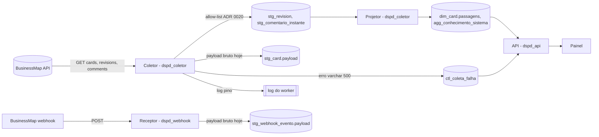

# Review de segurança: ADR 0020, proteção de pessoa no coletor (pedido 011)

Propósito: dar o parecer de segurança (R-SEGURANCA, gatilho de dados pessoais) sobre a ADR 0020 antes de ela passar a `vigente`. Público: architect (dono da ADR), tech-lead, node-backend, qa-engineer, Jarvis.

**Veredito: aprovado com ressalvas.** O campo `parecer` do frontmatter só aceita `aprovado`, `reprovado` ou `riscos-aceitos`; o valor `aprovado` vale **para a ADR passar a `vigente` e para a fase 2 (mock)**, que não toca dado real. As ressalvas M-1 a M-4 precisam estar incorporadas à ADR (ou ao plano) **antes do primeiro cartão da fase 3 (coleta real)**; sem isso, este parecer não cobre a fase 3. O R-1 vai ao usuário.

**Artefato revisado:** `docs/architecture/adr/0020-protecao-de-pessoa-no-coletor.md`, ainda **não commitado** (fora do `HEAD` acima), sha256 `88939e3567889f9655b26fa8f528d295c65ec6dac4b53e2f1e4ab1d6b079a431`. Uma alteração da ADR depois desse hash pede nova leitura deste parecer. Também lidos: plano `docs/architecture/features/metricas-tambem-disponiveis.md` (O22, O26, T13, E8, §3, §8 a, §9), `docs/architecture/data-model.md` §3.1, §8 e §9, `server/migrations/0004_bm_staging.ts`, `server/migrations/0002_bm_controle.ts`, `server/src/modulos/businessmap/webhook.ts`, `server/src/plataforma/db/grants.ts`, `server/src/plataforma/db/lgpd.ts`, `server/src/plataforma/log.ts`, `packages/metricas/package.json`, `eslint.config.js`.

## Gatilhos
- **Dados pessoais:** ids de responsável (`owner_user_id`, `co_owner_ids`), autor da revisão (`user_id`), autor e texto de comentário, `discard_comment` (texto livre), valor de campo customizado ("Time responsável").
- **Banco:** tabelas novas (`stg_comentario_instante`, `agg_conhecimento_sistema`, `ref_conta_automacao`), coluna nova (`dim_card.passagens`), mudança de forma da `stg_revision` e GRANTs do `dspd_api` (fase 3).

## Modelo de ameaças (curto)

Fronteiras: (1) API do BusinessMap → coletor e receptor do webhook; (2) memória do coletor → staging persistente e append-only; (3) base → papel `dspd_api`; (4) API → painel (público interno, coordenação e times).

| Ameaça (STRIDE) | Onde | Caminho realista | Prob. × impacto |
|---|---|---|---|
| **I: pessoa para a staging** | fronteira 2 | O coletor grava o objeto da API inteiro (`payload jsonb`) em vez do registro da allow-list; o webhook grava o corpo bruto. Id, autor, texto de comentário e `discard_comment` ficam em tabela append-only, sem eliminação viável (LGPD). Quem lê: `dspd_coletor`, `dspd_migrador`, quem tem backup. | média × alto |
| **I: pessoa para a API** | fronteira 3 | Coluna nova com pessoa sem entrar em `COLUNAS_PESSOA` (escapa do regex), ou texto de erro com valor do payload em `ctl_` (o `dspd_api` lê `ctl_`). | baixa × alto |
| **I: pessoa para o log** | coletor | Exceção de parse ou de validação que ecoa o valor (texto de comentário, id) no log do worker ou em `ctl_coleta_falha.erro`. O `redact` do pino cobre só credenciais. | média × médio |
| **I: reidentificação por agregado pequeno** | fronteira 4 | E8: sistema na faixa 1 publicado pelo nome, num time pequeno, aponta a pessoa; com `entregas` por sistema, vira a vazão de uma pessoa identificável (produtividade individual, 7.1). T14: com um único outro time, "outros times" é a contagem daquele time; se o time tiver uma pessoa, é a contagem dela. O26/O22: inteiro por card, sem pessoa associada pela API. | média × médio |
| **I: texto livre** | fronteiras 1 e 2 | Comentário, `discard_comment`, descrição de subtarefa e campo customizado de texto livre podem conter nome, CPF, dado de cliente. Só a allow-list estrutural resolve; filtro por conteúdo não resolve. | média × alto |
| **E: consumo indevido da função de contagem** | biblioteca | Uma métrica futura importa `houveTroca` e publica algo por pessoa. Mitigado pela regra de lint; a proteção forte é o GRANT (a API não tem os ids). | baixa × médio |

## Controles da ADR, um a um

| # | Controle | Avaliação |
|---|---|---|
| 1 | Identidade só no coletor e no projetor (`dspd_coletor`); saída inteira, booleana ou faixa | **Adequado.** É minimização correta e coerente com o GRANT por coluna (`grants.ts:54-55`). Ressalva: o perímetro declarado não inclui o receptor do webhook nem a `stg_card`, que hoje recebem o payload bruto (M-1, M-2). |
| 2 | Funções em `packages/metricas/src/coletor/`, fora do `index.ts`, entrada `./coletor` no `exports` | **Adequado.** Cumpre T2.5 sem expor a função ao front. `faixaConcentracao` recebe um número, não ids: bom. `packages/metricas/package.json:7-14` hoje não tem a entrada, nada a corrigir agora. |
| 3 | Lint de import (só `server/src/modulos/coleta*`) | **Adequado como defesa em profundidade.** Não é fronteira de segurança (contornável por import relativo, dinâmico ou `eslint-disable`), mas a fronteira real é o dado: fora do coletor não há ids para passar. Ver B-2. |
| 4a | Allow-list de `stg_revision` | **Correto no princípio, incompleto na especificação.** "Os campos já exigidos pela transição" não é uma lista fechada; a revisão traz `custom_fields`, `linked_cards` e `subtasks` (`docs/integracao/businessmap-api-configuracao.md:65`), que carregam ids de usuário e texto livre. A tabela atual tem `payload jsonb NOT NULL` (`server/migrations/0004_bm_staging.ts:16-19`). E o `user_id` descartado é a fonte de `fato_transicao.usuario` (`data-model.md` §3.2 e §9). Ver M-3. |
| 4b | `stg_comentario_instante (card_id, comentario_id, criado_em)`; autor comparado em memória com `ref_conta_automacao` | **Adequado.** Sem autor nem texto. `ref_conta_automacao` é lida pelo `dspd_api` (`grants.ts:55`, `ref_`): só pode conter contas de sistema (B-3). |
| 4c | `discard_comment` nunca entra | **Não se sustenta como escrito.** O card inteiro vai para `stg_card.payload` (`server/src/modulos/businessmap/staging.ts:29-32`), e `discard_comment` é campo do card (`businessmap-api-configuracao.md:57`). Ver M-1. |
| 4d | Allow-list como constante única por entidade, teste usa a constante | **Adequado**, com o reforço de B-1 (o teste também precisa de uma lista de proibidos independente da constante). |
| 5 | E8 por faixa (1, 2, 3+), sem pessoa | **Adequado para a faixa.** A coluna `entregas` por sistema, lida pelo `dspd_api`, reabre a reidentificação quando a faixa é 1 (M-4). A lista de sistemas "1 pessoa" é decisão do usuário (D-4 = B) e fica como risco a confirmar (R-1). |
| 6 | Testes obrigatórios | **Adequados.** Faltam: teste do receptor do webhook e da `stg_card` (M-1, M-2), teste de não vazamento em erro e log (B-4), teste de colunas da `agg_conhecimento_sistema` (M-4). |
| 7 | Mock gera inteiros e faixas direto, sem ler `responsaveis` | **Adequado.** A fase 2 não toca dado real; por isso o parecer aprova a ADR para ela. |
| Alt. | Hash dos ids rejeitado; contagem exata rejeitada | **Concordo.** Pseudônimo continua dado pessoal (LGPD art. 13, §4) e não é necessário. |
| Rev. | Critério de reversão: id de pessoa fora de `COLUNAS_PESSOA` | **Adequado.** Sugiro estender a "id, autor ou texto livre em qualquer `stg_`" (ver M-1). |

## Achados

### Média

**M-1. Payload bruto da `stg_card` guarda `discard_comment`, ids de responsável e texto livre, o que contradiz o item 4 da ADR e a decisão do O25**
- Evidência: `server/src/modulos/businessmap/staging.ts:29-32` grava `JSON.stringify(payload)` inteiro; `server/migrations/0004_bm_staging.ts:13-15` (`stg_card` com `payload`); `businessmap-api-configuracao.md:57` lista `discard_comment` entre os campos do card; plano, O25 (linha 173): "`discard_comment` **nunca** entra (nem na allow-list do coletor)".
- Caminho de ataque: não é um ataque externo, é exposição interna e LGPD. A coordenação escreve no `discard_comment` "cliente Fulano desistiu" ou o nome de um colega; o texto fica para sempre numa tabela append-only, legível por `dspd_coletor`, `dspd_migrador` e por quem tiver backup. Não há como eliminar a pedido do titular sem quebrar o append-only.
- Correção mínima: a ADR estende a allow-list à `stg_card` (lista fechada de chaves do card, de preferência pelo parâmetro `fields` do `GET /cards`, que a API já oferece, e de novo no código antes do `INSERT`); `discard_comment`, `description` e campos customizados de texto livre ficam de fora. Os ids de responsável, que o `data-model.md` §9 aceita hoje na staging, saem também se o projetor puder montar `responsaveis` direto em memória; se não puder, a ADR registra explicitamente que a `stg_card` é a exceção. O critério de reversão passa a cobrir qualquer `stg_`.
- Esforço: P (na ADR), M (no código da fase 3). Dono: software-architect (ADR), node-backend (implementação).

**M-2. Receptor do webhook grava o corpo bruto na `stg_webhook_evento`, fora do perímetro da ADR**
- Evidência: `server/src/modulos/businessmap/webhook.ts:40-42` (`INSERT ... payload` com o JSON inteiro); `server/migrations/0004_bm_staging.ts` (`stg_webhook_evento`, append-only).
- Caminho de ataque: o webhook do BusinessMap entrega eventos de card, e conforme a assinatura, também de comentário. O corpo traz autor, texto e `discard_comment`. Isso contorna a allow-list do item 4 pela porta de entrada paralela, e a ADR ("Autor e texto não entram") fica falsa.
- Correção mínima: a ADR inclui o receptor no perímetro. (a) A assinatura do webhook só cobre os tipos de evento usados (movimentação), e (b) o receptor aplica a mesma constante de allow-list antes do `INSERT`, mantendo o `payload_sha256` calculado sobre o corpo bruto para a deduplicação. Tipo de evento fora da lista é recusado com 2xx e não gravado.
- Esforço: P (ADR), M (código). Dono: software-architect, node-backend.

**M-3. Allow-list de `stg_revision` sem lista fechada; conflito com `fato_transicao.usuario`**
- Evidência: ADR, item 4 ("os campos já exigidos pela transição"); `businessmap-api-configuracao.md:65` (`CardRevision` com `custom_fields`, `subtasks`, `linked_cards`, `user_id`); `server/migrations/0004_bm_staging.ts:16-19` (`payload jsonb NOT NULL`); `data-model.md` §9 ("Usuário da transição: staging (revision, webhook) + `fato_transicao.usuario`").
- Caminho de ataque: (1) uma implementação de boa-fé copia `custom_fields` ou `subtasks` inteiros para atender T13 e T14 (Q-T14-8); campos customizados de tipo usuário, ou de texto livre, e descrição e dono das subtarefas entram na staging. (2) Ao descartar `user_id`, a ADR deixa `fato_transicao.usuario` sem fonte, e alguém "conserta" relendo `user_id` para a staging.
- Correção mínima: a ADR enumera a allow-list de `stg_revision`: `card_id`, `revision`, `replaced_at`, `column_id`, `lane_id`, `board_id`, `troca_responsavel`, os `linked_cards` reduzidos a `(card_id, link_type)` e os `custom_fields` reduzidos aos `field_id` de uma lista de referência (só os de domínio fechado que as métricas exigem, por exemplo "Time responsável"). `subtasks` fora. Diz se a coluna `payload` é removida ou passa a guardar só o registro da allow-list. Sobre `fato_transicao.usuario`: ou a ADR declara que o projetor o grava a partir da memória do coletor (sem staging), ou registra que a coluna fica sem fonte. Essa segunda opção muda a decisão do usuário de 2026-10-10 (data-model §9), e então vai ao usuário pelo Jarvis (R-DECISAO), sem decisão por inferência.
- Esforço: P (ADR). Dono: software-architect, com tech-lead.

**M-4. `agg_conhecimento_sistema.entregas` legível pelo `dspd_api` reidentifica a vazão de uma pessoa na faixa 1**
- Evidência: ADR, item 5 (`faixa_concentracao` e `entregas` por `(sistema_codigo, janela_fim, ...)`); plano, E8 (lista `sistemasUmaPessoa` com o nome do sistema); `grants.ts:55` (o `dspd_api` lê todas as projeções).
- Caminho de ataque: um coordenador sabe quem cuida do sistema X. O painel diz que X está em "1 pessoa"; uma consulta, ou uma rota futura que exponha `entregas` por sistema, dá as entregas daquela pessoa em 12 meses. Isso é produtividade individual (7.1) e uma reidentificação que a faixa queria evitar. O contrato atual do E8 não publica `entregas`, mas a coluna está ao alcance da API.
- Correção mínima: retirar `entregas` da tabela e guardar só `tem_entrega boolean`, que é o que o contrato usa (`sistemasComEntrega`). Se `entregas` for necessário, não dar GRANT dessa coluna ao `dspd_api` e testar isso no teste de grants. Acrescentar um teste de colunas da `agg_conhecimento_sistema` como o de `pesquisa.pg.test.ts`.
- Esforço: P. Dono: software-architect (ADR), node-backend.

### Baixa

**B-1. Teste da allow-list que só usa a constante prova pouco**
- Evidência: ADR, itens 4 e 6.
- Caminho: se alguém acrescenta `co_owner_ids` à constante, um teste que só confere "registro ⊆ constante" continua verde.
- Correção: manter a constante como fonte do que entra, e o teste com (a) uma lista de proibidos **escrita no teste** (`owner_user_id`, `co_owner_ids`, `user_id`, `author`, `text`, `discard_comment`, `description`, `subtasks`); (b) um fixture com todas as chaves do schema da OpenAPI e uma chave desconhecida, conferindo que só a lista sai. O item 6 já cita os proibidos; basta deixar explícito que eles não vêm da constante. Esforço P. Dono: qa-engineer, node-backend.

**B-2. Lint de import contornável**
- Evidência: ADR, item 3.
- Caminho: import relativo profundo (`../../packages/metricas/src/coletor/...`), `import()` dinâmico ou `eslint-disable` numa linha.
- Correção: o padrão do `no-restricted-imports` cobre `**/coletor` e `**/coletor/*`, como já é feito para `acelerato` (`eslint.config.js:264-276`); proibir `eslint-disable` para essa regra (`--report-unused-disable-directives` ou `noInlineConfig` no escopo); e um teste de build que falha se `houveTroca` aparecer no bundle de `web/`. Esforço P. Dono: tech-lead.

**B-3. `ref_conta_automacao` é legível pelo `dspd_api`**
- Evidência: `grants.ts:55` (`ref_` vai para a API); plano, O22 (`ref_conta_automacao`, ids técnicos).
- Caminho: se uma conta pessoal for cadastrada como "automação" (por engano, ou porque uma pessoa roda scripts com a própria conta), o id dela fica legível pela API e os comentários dela somem do O22.
- Correção: a ADR diz que a tabela só aceita contas de serviço confirmadas na WS1, com justificativa por linha, e deixa a tabela fora do GRANT do `dspd_api` (a API não precisa dela). Esforço P. Dono: software-architect.

**B-4. Erro e log do coletor podem ecoar valor do payload, e `ctl_` é legível pela API**
- Evidência: `server/migrations/0002_bm_controle.ts:27-33` (`ctl_coleta_falha.erro varchar(500)`); `grants.ts:55` (`ctl_` para a API); `server/src/plataforma/log.ts:5-19` (o `redact` cobre só credenciais).
- Caminho: um comentário malformado falha na validação, a mensagem do zod ou do `JSON.parse` traz o trecho do texto ou o id, e isso vai para o log do worker e para `ctl_coleta_falha.erro`. Hoje nenhuma rota lê essa tabela (grep em `server/src`), por isso a severidade é baixa.
- Correção: a ADR acrescenta ao perímetro "o coletor nunca registra valor de payload: erro e log levam código, entidade, `id_origem` e caminho do campo, nunca o valor"; um teste injeta um payload inválido com um marcador e confere que o marcador não aparece no log nem em `ctl_coleta_falha`. Esforço P. Dono: node-backend.

**B-5. Valor do campo "Time responsável" (T14) sem garantia de domínio fechado**
- Evidência: plano §9.1 (tipo e cardinalidade a confirmar no spike).
- Caminho: se o campo for de tipo usuário ou texto livre, o valor é pessoa ou texto livre e entra em `dim_card.equipe_responsavel`, que a API lê. A coluna escapa do regex de `lgpd.ts` (o segmento `equipe` não casa).
- Correção: o spike confirma que o campo é lista fechada; o coletor só grava valores mapeados em `ref_dominio` `equipe_responsavel` (valor fora do domínio vira `desconhecido`, não o texto); campo de tipo usuário é recusado e a decisão volta ao usuário. Esforço P. Dono: node-backend, software-architect.

### Informativa

**I-1. O26 e O22 publicam inteiro por card.** Sem pessoa na resposta e sem coluna de pessoa ao alcance do `dspd_api`, não há caminho de reidentificação pela API. Quem já sabe quem atendeu um card não ganha nada novo com o painel. Sem ação.

**I-2. A fronteira forte é o GRANT, não o lint.** A ADR já diz isso nas consequências; a revisão concorda.

**I-3. Ferramentas.** Revisão de documento e leitura de código; nada foi executado contra sistema algum. `gitleaks` e `semgrep` não estão no PATH (lacuna registrada; não se aplicam a uma ADR). `forge-check` existe no plugin e foi usado para validar este arquivo.

## Riscos a levar ao usuário (R-DECISAO)

**R-1. Reidentificação no E8 (sistemas "1 pessoa") e no T14 (um único outro time).** As duas foram decididas pelo usuário (D-4 = B, Q-T14-6 = A), e a restrição do pedido 011 diz que concentração de conhecimento e passagens de mão "nunca identificam pessoa". Num time pequeno, "sistema X: 1 pessoa" identifica a pessoa para quem conhece o time. No T14, se o único outro time for de uma pessoa só, "outros times" é a contagem dela. O que a segurança pede ao usuário: confirmar, ciente disso, que a lista por nome de sistema continua; ou escolher uma mitigação: (a) mostrar a lista só ao público de coordenação; (b) mostrar só a contagem de sistemas por faixa, sem nomes; (c) texto da tela que trate o dado como risco do sistema, nunca como avaliação de quem o mantém (o ux-designer já pode adotar (c) sem decisão nova). Não bloqueia a fase 2 (mock).

**R-2 (apoio a M-3).** Se o architect escolher deixar `fato_transicao.usuario` sem fonte, isso muda a decisão do usuário de 2026-10-10 e precisa da resposta dele.

## Riscos aceitos e ferramentas
- Nenhum risco aceito por este parecer. R-1 depende da resposta do usuário.
- Ferramentas: leitura estática e `grep`; `forge-check docs` para o formato. Faltam no PATH: `gitleaks`, `semgrep` (não instalados, sem impacto numa revisão de ADR).

## Plano em cartões (para o Jarvis)
| Cartão | Achado | Dono | Quando |
|---|---|---|---|
| Ajustar a ADR 0020: perímetro inclui `stg_card` e webhook, allow-list enumerada de `stg_revision`, fonte de `fato_transicao.usuario`, `entregas` fora do alcance da API, `ref_conta_automacao` fora do GRANT, regra de log | M-1 a M-4, B-3, B-4 | software-architect | antes da fase 3 (pode sair já; não bloqueia a fase 2) |
| Reforço de teste da allow-list e de log | B-1, B-4 | qa-engineer | fase 3 |
| Padrão de lint e teste de bundle | B-2 | tech-lead | com o cartão que cria `coletor/` |
| Spike do campo "Time responsável": tipo e domínio | B-5 | node-backend | spike da fase 3 |
| Pergunta R-1 (e R-2, se for o caso) | R-1, R-2 | Jarvis → usuário | antes da fase 3 |

## Releitura da ADR 0020, revisão 1 (2026-10-15)
Artefato relido: `docs/architecture/adr/0020-protecao-de-pessoa-no-coletor.md`, sha256 `a147ae9335865f08af2bd26cca8a25c4705c1df1552ceb56add9545fdff207bc` (ainda não commitado). O hash revisado antes era `88939e35...`. Uma alteração depois deste hash pede nova leitura.

**Veredito: mantido (aprovado), e agora estendido à fase 3.** A condição deste parecer para a fase 3 era incorporar M-1 a M-4 à ADR, e ela está cumprida:
- **M-1:** cumprido. O item 4a enumera a `stg_card` e lista o que fica fora. O item 4b tira os responsáveis da staging pelo caminho em memória, que é melhor que a exceção que eu tinha admitido.
- **M-2:** cumprido. O item 4f restringe a assinatura, aplica a allow-list no receptor, mantém o hash do corpo bruto e grava nada para tipo fora da lista.
- **M-3:** cumprido. O item 4c tem lista fechada. `fato_transicao.usuario` fica nulo até a R-2, e a recomendação (b) do arquiteto está alinhada com a minimização.
- **M-4:** cumprido pela alternativa que eu tinha admitido: GRANT por coluna sem `entregas` e uma lista própria fora de `COLUNAS_PESSOA`.
- **B-1 a B-5:** cumpridos nos itens 3, 4d, 4g, 6 e 7.

O K-084 (`docs/security/k084-coletor-allow-list.md`) confirma 4a, 4b, 4c e 4f no código.

Ressalvas novas, todas de severidade baixa e nenhuma bloqueante:
- **(a)** O item 1 cobre "toda `stg_` do BusinessMap", mas o item 4 não enumera `stg_bloqueio`, `stg_custom_field`, `stg_vinculo` e `stg_coluna`. Falta a regra "negado por padrão": `stg_` sem lista enumerada não recebe escrita (B-K3 do parecer do K-084).
- **(b)** `custom_id` (4a) é digitado por pessoas no BusinessMap. Merece o mesmo aviso do `title` (L-2), ou validação de forma, depois do spike.
- **(c)** O lado "não resolvido" das Consequências (E7 `entregas` por sistema cruzado com o E8 faixa 1) continua dentro da R-1, com o usuário. Concordo com o registro.

R-1 e R-2 seguem com o usuário. Até a resposta à R-2, o valor padrão (coluna nula) é seguro.
