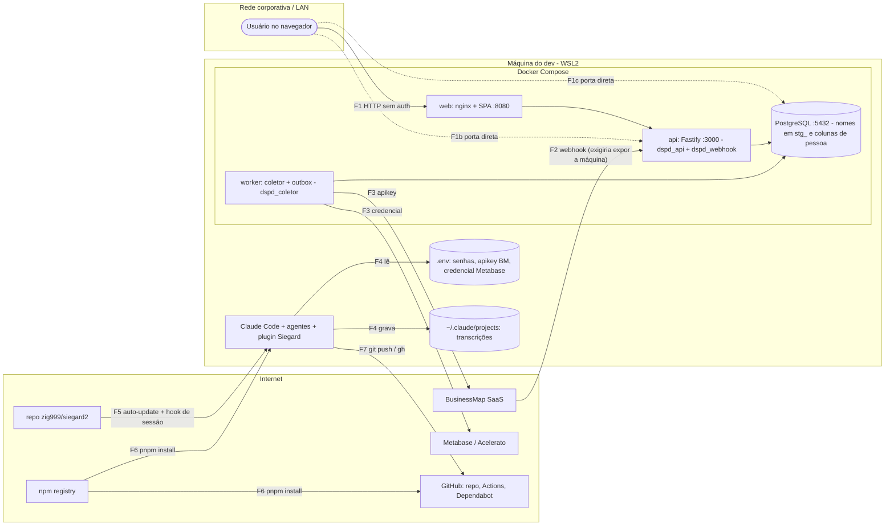

# Revisão de segurança e boas práticas

- Data: 2026-10-11 · Autor: `software-architect` (skill `cyber-security`) · Branch revisada: `develop` (após o merge do PR #8, Siegard)
- Escopo: `server/`, CI e cadeia de suprimentos, Docker/Compose, `web/`, LGPD, segredos, plugin Siegard e `.claude/settings.json`, governança do repositório.
- Método: revisão estática (código, configuração, migrações, workflows, docs). Nada foi explorado nem executado. Sem shell nesta revisão: **a varredura do histórico git por segredos ficou pendente** (S-30).
- Contexto considerado: custo zero, tudo local por enquanto, nuvem adiada, dados de produção ainda não carregados (coletor WS2 sem tarefas: `server/src/entradas/worker.ts:16`; web lê só o mock), usuário de confiança do autor do plugin.

## 1. Resumo executivo

O código do servidor está acima da média: entrada `strict` em todas as rotas, saída validada por schema (campo extra some), SQL parametrizado, identificadores só do mapa `S` validado, papéis do PostgreSQL com privilégio mínimo e **GRANT por coluna** que impede a API de ler nomes mesmo com bug, webhook autenticado em tempo constante **antes** de ler o corpo, erros sem detalhe interno, configuração validada na partida sem ecoar valores. Não há achado crítico.

Os riscos estão **em volta do código**: portas do Compose abertas em todas as interfaces (com o superusuário do Postgres e senhas padrão), API ainda sem autenticação (ADR 0009 em "proposta"), webhook que exigiria expor a máquina à internet, plugin de terceiros com atualização automática, `main` protegida só por hook local e instrução de agente, e LGPD sem retenção nem procedimento de eliminação para tabelas append-only.

| Severidade | Qtde | Itens |
|---|---|---|
| Crítica | 0 | — |
| Alta | 1 | A-1 |
| Média | 5 | M-1 a M-5 |
| Baixa | 7 | B-1 a B-7 |
| Informativa | 8 | I-1 a I-8 |

**Antes da primeira carga de dado real:** S-24 feito e decisões D-1, D-2 e D-5 tomadas. O resto pode seguir em paralelo com o WS2.

## 2. Modelo de ameaças

### 2.1 Ativos e fronteiras

Ativos: (1) nomes de pessoas (`stg_*.payload`, `dim_card.responsaveis`, `fato_transicao.usuario`); (2) credenciais (Postgres, apikey do BusinessMap, Metabase, token do `gh`); (3) integridade do histórico append-only e dos cálculos; (4) integridade da `main` e do CI; (5) a estação de trabalho do usuário.

### 2.2 STRIDE por fronteira (priorizado)

| Fronteira | Ameaça (STRIDE) | Prob. × impacto | Controle hoje | Lacuna |
|---|---|---|---|---|
| F1c LAN → Postgres | **E**/I: login como `postgres` com senha padrão; superusuário = leitura de nomes e execução de comando no contêiner | média × alto | senha por `.env` (com padrão fraco) | porta em `0.0.0.0` (A-1) |
| F1/F1b LAN → API/web | **I**: leitura de métricas e títulos; **D**: cálculo caro sob demanda | média × médio (alto com dado real) | entrada strict, sem coluna de pessoa | sem autenticação, porta aberta (M-1, B-6) |
| F2 BusinessMap → webhook | **S**: entrega forjada; **D**: inundação | baixa × médio | segredo em tempo constante, 256 KB, dedup por hash | expor à internet expõe a API inteira (M-2) |
| F5 plugin → máquina | **T/E**: código novo roda a cada sessão com os privilégios do usuário | baixa × alto | auditoria pontual, PR revisável | auto-update, sem fixação (M-3) |
| F7 agentes → GitHub | **T**: merge na `main` sem o usuário (erro de agente ou injeção de prompt) | baixa × médio | hook `pre-push`, instrução | nada do lado do servidor (M-4) |
| PG (dentro) | **R/I**: retenção indefinida de nomes; eliminação impossível pelo gatilho | alta × médio (LGPD) | GRANT por coluna, lista fechada de colunas | sem retenção nem procedimento (M-5) |
| F6 npm → máquina/CI | **T**: pacote comprometido | baixa × alto | lockfile, `--frozen-lockfile`, scripts bloqueados (só `esbuild`) | sem auditoria no CI, sem quarentena de versão nova (B-5) |
| F3 worker → fontes | **I**: vazamento da apikey em log; **E**: apikey com mais poder que leitura | baixa × alto | redação de `*.apikey`, config sem eco | conta de serviço só leitura não definida (I-8) |

## 3. Achados

Formato: evidência · caminho de ataque · correção mínima · esforço (P ≤ meio dia, M 1 a 2 dias, G 3+) · dono.

### Alta

**A-1 Postgres (superusuário) publicado em todas as interfaces, com senha padrão de fallback**
- Evidência: `docker-compose.yml:18` (`"${PG_PORT:-5432}:5432"`, sem IP), `:11` (`POSTGRES_PASSWORD` com padrão `troque-me-postgres`), `:12-17` (senhas `*_dev` como padrão). A imagem oficial aceita `host all all all scram-sha-256`.
- Caminho: colega ou dispositivo na mesma rede (Docker Desktop publica no host Windows; WSL em modo espelhado também) conecta em `:5432` como `postgres` com a senha padrão de qualquer clone sem `.env` → lê `stg_*` e colunas de pessoa, apaga histórico, e com `COPY ... FROM PROGRAM` executa comando no contêiner. Depende do modo de rede, mas a correção custa uma linha.
- Correção: `ports: ["127.0.0.1:${PG_PORT:-5432}:5432"]` (o mesmo para `api` e `web`, ver M-1). Opcional: `${POSTGRES_PASSWORD:?defina no .env}` só para o superusuário.
- Esforço P · Dono `node-backend` · Cartão S-24.

### Média

**M-1 API sem autenticação e publicada na rede**
- Evidência: ADR 0009 em "proposta" (`docs/architecture/adr/0009-autenticacao-e-autorizacao.md:2`); nenhuma verificação em `server/src/app.ts:55-61`; `docker-compose.yml:47` (`:3000`) e `:69` (`:8080`) sem IP; `server/src/plataforma/config.ts:23` (`HOST` padrão `0.0.0.0`, também no `pnpm dev`).
- Caminho: qualquer um na rede lê todas as métricas, `cardId` e **títulos** dos cartões (`packages/contratos/src/schemas.ts:87,118`) e gera PDFs. Hoje só há dado fictício: impacto baixo. Com a primeira carga real vira Alta. A porta `:3000` também contorna o nginx (e qualquer cabeçalho ou controle que ele venha a ter).
- Correção: S-24 (loopback em tudo; `HOST` padrão `127.0.0.1` e `HOST=0.0.0.0` só no Compose); manter uso individual na máquina até a decisão D-1.
- Esforço P · Dono `node-backend` · Decisão D-1.

**M-2 Webhook do BusinessMap exige expor a máquina local à internet, e com ela a API inteira**
- Evidência: o BusinessMap é SaaS; a rota vive no mesmo processo e porta da API (`server/src/app.ts:62`, `docker-compose.yml:43-47`); o nginx nem encaminha `/webhooks` (`docker/web/nginx.conf:4-6`); nenhum documento define como a entrega chega (ADR 0006/0014 silenciam).
- Caminho: para ligar o webhook alguém abre a porta 3000 no roteador ou num túnel → `/api/v1/*` sem autenticação fica na internet, junto do webhook.
- Correção: não ligar `WEBHOOK_BM_SEGREDO` enquanto local; quando houver hospedagem, só o caminho `/webhooks/businessmap` publicado por proxy com TLS, `trustProxy` ajustado para o limite por IP da S-21. O código do webhook em si está correto.
- Esforço P (decisão) · Dono `software-architect` · Decisão D-2.

**M-3 Plugin Siegard: código de terceiro que se atualiza sozinho e roda a cada sessão**
- Evidência: `.claude/settings.json:3-6` (marketplace `zig999/siegard2` sem ref/commit fixo, plugin habilitado para todo o repositório); `docs/analises/siegard-auditoria.md:18` (telemetria lê `~/.claude/projects`), `:23` (auto-update ligado; reauditoria só na 6.x); hook de início de sessão roda sempre para decidir se há `siegard.json`.
- Caminho: não é a confiança no autor, é a **conta** dele. Conta de 1 autor, repositório novo, sem licença: um token roubado ou um commit descuidado entra por auto-update numa versão 5.x (fora do gatilho de reauditoria) e roda com os privilégios do usuário: lê `.env` (futura apikey do BusinessMap e credencial do Metabase), o token do `gh`, a chave SSH e as transcrições (que podem conter segredos lidos pelos agentes).
- Correção mínima proporcional: desligar o auto-update e atualizar à mão após ler o diff (ou fixar `ref`/commit no marketplace, se a versão do Claude Code aceitar); negar leitura do `.env` aos agentes (S-31). Risco já aceito pelo usuário; reapresentado com este caminho.
- Esforço P · Dono `jarvis` (com aprovação do usuário) · Decisão D-3.

**M-4 A `main` só é protegida no cliente**
- Evidência: `.githooks/pre-push:3-8` (bloqueia só `git push` para `refs/heads/main`); regras em `.claude/agents/jarvis.md:98-100`; repositório em conta pessoal (`git@github.com:rodrigo-isensee/MetricasDSPD.git`); proteção de branch planejada no K-064 (`docs/kanban/historico.md:129`) sem evidência de que exista. Em conta GitHub Free, proteção de branch e rulesets em repositório **privado** não estão disponíveis.
- Caminho: `gh pr merge` (API, não passa pelo hook), `git -c core.hooksPath=/dev/null push` ou `--no-verify` por erro de agente ou injeção de prompt (conteúdo web, plugin) mescla na `main` sem o usuário. O token do `gh` do usuário costuma ter escopos `repo` e `workflow` completos.
- Correção: (1) `permissions.deny` no `.claude/settings.json` para `gh pr merge`, `git push --force`/`-f`, `--no-verify`, `core.hooksPath`; (2) ruleset na `main` (PR obrigatório + checks do CI) se o plano permitir; (3) token do `gh` fine-grained, só este repositório.
- Esforço P · Dono `jarvis` (usuário aprova) · Decisão D-4 · Cartão S-31.

**M-5 LGPD: sem retenção e sem procedimento de eliminação para dados em tabelas append-only**
- Evidência: `docs/architecture/data-model.md:253` ("Retenção a definir com o DPO (I-12)"); gatilho que proíbe UPDATE/DELETE (`server/migrations/0001_schemas.ts:14-18`) em `stg_*` (payload com nomes, e-mails do Acelerato), `*_versao` e `fato_transicao` (com `usuario`); logs com IP do requisitante sem retenção definida.
- Caminho: pedido de eliminação de um titular (ou desligamento) não tem como ser atendido sem violar a regra "nunca sobrescrever histórico"; dado pessoal fica para sempre por padrão. Não é ataque, é não conformidade.
- Correção: decisão de retenção e uma ADR curta com o procedimento: executado pelo `dspd_migrador`, numa transação que desliga o gatilho só da tabela alvo, **reda** os campos de pessoa (no `payload` jsonb e nas colunas da lista fechada) sem apagar a linha nem mexer em datas, e registra a eliminação sem o nome. Cálculos não mudam (a biblioteca não usa nomes).
- Esforço M · Dono `software-architect` (ADR) + `node-backend` · Decisão D-5 · Cartão S-32.

### Baixa

| Id | Achado e evidência | Caminho | Correção mínima | Esf. | Dono |
|---|---|---|---|---|---|
| B-1 | nginx sem cabeçalho de segurança nem CSP (`docker/web/nginx.conf:1-7`); a ADR 0015 dispensa o helmet **porque o nginx os define** (`adr/0015...:46`), o que não é verdade; `server_tokens` ligado | defesa em profundidade: hoje não há sink de XSS (nenhum `dangerouslySetInnerHTML`, jsPDF só com texto), mas nada contém um futuro | S-25: `Content-Security-Policy` (`default-src 'self'`, `script-src 'self' 'sha256-<script do tema>'`, `frame-ancestors 'none'`, `object-src 'none'`), `X-Content-Type-Options: nosniff`, `Referrer-Policy: no-referrer`, `server_tokens off`; teste E2E dos cabeçalhos | P | `react-frontend` |
| B-2 | `HOST` padrão `0.0.0.0` (`server/src/plataforma/config.ts:23`) | `pnpm dev` publica a API na rede sem querer | padrão `127.0.0.1`; Compose define `HOST=0.0.0.0` (S-24) | P | `node-backend` |
| B-3 | Imagens sem versão fixa e contêineres sem endurecimento: `postgres:17` (`docker-compose.yml:7`, `ci.yml:88`), `node:24-slim` (`server/Dockerfile:3,11`), `nginx:alpine` como root (`docker/web/Dockerfile:9`); sem `cap_drop`, `no-new-privileges`, `read_only` | imagem nova muda comportamento sem PR; contêiner comprometido tem mais poder que o necessário | S-26: tag de minor (`postgres:17.x`, `node:24.x-slim`), `nginxinc/nginx-unprivileged`, `security_opt: [no-new-privileges:true]` e `cap_drop: [ALL]` em `api`/`worker`/`migrate`; Dependabot `docker` | P | `node-backend` |
| B-4 | Ações de terceiros por tag móvel: `pnpm/action-setup@v4` (`ci.yml:28`...), `dorny/paths-filter@v3` (`ci.yml:67`) | tag repontada (caso tj-actions, 2025) roda no CI; impacto limitado (`contents: read`, nenhum segredo), mas pode envenenar o cache do pnpm | S-27: fixar por SHA as de terceiros (Dependabot já atualiza SHA); `actions/*` pode ficar por tag | P | `tech-lead` |
| B-5 | Cadeia de suprimentos: nenhum `pnpm audit` no CI; sem quarentena de versão recém-publicada; `overrides` abertos `>=` (`pnpm-workspace.yaml:8-11`); Dependabot sem `cooldown` (`.github/dependabot.yml`) | versão maliciosa recém-publicada entra no lockfile por PR do Dependabot e roda em teste/dev | S-27: job `auditoria` (`pnpm audit --prod --audit-level high`, bloqueante); `auditConfig.ignoreGhsas` com os 3 GHSA aceitos (I-4); `minimumReleaseAge: 4320` no workspace; `cooldown: { default-days: 3 }`; overrides com `^` | P | `tech-lead` |
| B-6 | Cálculo caro sob demanda sem limite: `dataReferencia` livre (`server/src/modulos/metricas/schemas.ts:18`) e combinações de filtro geram chaves novas, cálculo síncrono e expulsão do cache de 500 (`servico.ts:166-181`) | quem alcança a API prende o laço de eventos e esvazia o cache com um laço de requisições | estender a S-21: `@fastify/rate-limit` também em `/api/v1` com limite folgado (ex.: 120/min por IP); ver S-28 | P | `node-backend` |
| B-7 | Erro do `pg` logado inteiro (`server/src/plataforma/worker.ts:40,47`, `erros.ts:48`, `saude.ts:19`): `detail` pode trazer valores da linha (ex.: `Key (...)=(...)`), inclusive nomes no coletor | nome de pessoa vai parar no log, fora do GRANT | S-29 (junto da S-20): serializador de `err` que remove `detail`, `where`, `internalQuery`, `parameters` | P | `node-backend` |

### Informativa

| Id | Observação | Ação |
|---|---|---|
| I-1 | Senhas `*_dev` em `.env.example:3-20`, `ci.yml:91-107` e nos scripts | Só desenvolvimento/CI efêmero. Ambiente hospedado usa senhas próprias (ADR de implantação). |
| I-2 | `dspd_migrador` é dono de tudo e pode desligar gatilhos | Por desenho; é o papel do procedimento de eliminação (M-5). Não usar em serviço de longa duração. |
| I-3 | Títulos de cartão (texto livre, L-2 provisório) saem na API e no PDF, que circula fora do sistema | Decisão D-6. |
| I-4 | `pnpm audit`: 2 altas (`extract-zip`, symlink) e 1 moderada (`sprintf-js`, DoS), todas em `e2e > @lhci/cli`, só dev | **Concordo com o descarte**: o zip vem do download do Chrome pelo puppeteer, fonte confiável, e nada roda em produção. Registrar em `auditConfig.ignoreGhsas` com revisão quando o `@lhci/cli` atualizar (S-27). |
| I-5 | `tsx` em tempo de execução na imagem (`server/Dockerfile:22`) | Aceito pela ADR 0015; sem impacto de segurança relevante. |
| I-6 | O segredo do webhook é lido do cabeçalho `x-webhook-secret` | Confirmar na documentação do BusinessMap que ele envia cabeçalho próprio. Se só aceitar segredo na URL, redigir `req.url` no log (o Fastify loga a URL com query). |
| I-7 | Varredura de segredos: árvore de trabalho limpa para padrões conhecidos (tokens GitHub, AWS, chaves privadas, apikey literal); nenhum `.env` real versionado; `.gitignore` e `.dockerignore` corretos | Histórico **não** varrido (sem shell): S-30. |
| I-8 | Credenciais do coletor (WS2) ainda não existem | A apikey do BusinessMap herda as permissões do usuário dono: usar **conta de serviço só leitura** nos quadros necessários; Metabase com usuário só leitura e só as coleções do Acelerato. Pedir ao usuário junto do primeiro cartão de coleta. |

## 4. Plano em cartões

Numeração continua a da ADR 0015 (S-14 a S-23). A S-20 (redação de dados pessoais no log) e a S-21 (limite do webhook) dessa ADR já cobrem parte dos achados e continuam valendo.

| Cartão | Escopo | Fecha | Esf. | Dono | Depende de |
|---|---|---|---|---|---|
| **S-24** Portas e host em loopback | `127.0.0.1:` em `postgres`, `api`, `web` no Compose; `HOST` padrão `127.0.0.1` em `config.ts` e `HOST: 0.0.0.0` no serviço `api`; teste de config; nota no `server.md` | A-1, M-1 (parcial), B-2 | P | `node-backend` | — |
| **S-25** Cabeçalhos do nginx | CSP com hash do script do tema, `nosniff`, `Referrer-Policy`, `frame-ancestors`, `server_tokens off`; E2E confere os cabeçalhos; corrigir a frase da ADR 0015 se a decisão do helmet mudar | B-1 | P | `react-frontend` + `qa-engineer` | — |
| **S-26** Endurecimento dos contêineres | tags de minor, nginx sem root, `no-new-privileges`, `cap_drop: [ALL]`; `package-ecosystem: docker` no Dependabot | B-3 | P | `node-backend` | — |
| **S-27** CI e supply chain | SHA nas ações de terceiros; job `auditoria`; `ignoreGhsas` dos 3 aceitos; `minimumReleaseAge`; `cooldown`; overrides com `^` | B-4, B-5, I-4 | P | `tech-lead` | — |
| **S-28** Limite na API de leitura | S-21 passa a registrar o rate limit também em `/api/v1` (valor em config); 429 no formato único | B-6 | P | `node-backend` | S-21 |
| **S-29** Log de erro do banco | serializador de `err` sem `detail`/`where`/`internalQuery`/`parameters`; teste que loga um erro do `pg` com nome e confere a ausência | B-7 | P | `node-backend` | junto da S-20 |
| **S-30** Varredura do histórico | `gitleaks detect --log-opts="--all"` (imagem Docker, sem instalar nada) em todas as branches; resultado anotado aqui (só tipo e local, nunca o valor); se achar, girar a credencial antes de reescrever histórico | I-7 | P | `tech-lead` | — |
| **S-31** Barreiras de governança | conforme D-3/D-4: `permissions.deny` (merge via `gh`, push forçado, `--no-verify`, `core.hooksPath`, leitura de `.env*`), auto-update do Siegard, ruleset e token fine-grained | M-3, M-4 | P | `jarvis` | D-3, D-4 |
| **S-32** Retenção e eliminação | ADR com prazo, procedimento de redação sob `dspd_migrador`, registro sem nome, teste no Postgres de que o cálculo não muda e o gatilho volta | M-5 | M | `software-architect` + `node-backend` | D-5 |
| **S-33** Publicação do webhook | só quando houver hospedagem: proxy que expõe apenas `/webhooks/businessmap` com TLS, `trustProxy`, confirmação do I-6 | M-2, I-6 | P | `software-architect` | D-2 |

Ordem: S-24 primeiro (antes de qualquer outro trabalho com dado real). S-25, S-26, S-27, S-29, S-30 em paralelo a qualquer momento. S-28 depois da S-21. S-31 e S-32 após as decisões. S-33 só com hospedagem.

## 5. Decisões do usuário (uma por vez)

**D-1 Barreira de acesso até o SSO (M-1).** A ADR 0009 depende do SSO (I-3), ainda sem resposta.
- (a) Tudo em `127.0.0.1`, uso individual na máquina do usuário até o SSO. Prós: custo zero, nenhum código. Contras: ninguém mais vê os painéis.
- (b) Basic auth no nginx para demonstração na rede interna. Prós: P, compartilha com poucos. Contras: senha compartilhada, sem identidade; precisa da S-25 e de TLS para não trafegar a senha em claro.
- (c) Adiantar a ADR 0009 com o IdP disponível. Prós: solução definitiva. Contras: depende da TI corporativa.
- **Recomendação: (a)** agora; (c) quando houver resposta do I-3.

**D-2 Webhook enquanto o ambiente é local (M-2).**
- (a) Deixar desligado; frescor pela coleta incremental e pela varredura. Prós: nenhuma exposição. Contras: atraso de até um ciclo de coleta.
- (b) Túnel gratuito (ex.: Cloudflare Tunnel) só para o caminho do webhook. Prós: tempo quase real. Contras: terceiro termina o TLS e vê o payload, que tem nomes (LGPD); mais uma peça na máquina.
- (c) Esperar a hospedagem.
- **Recomendação: (a)** até (c).

**D-3 Siegard (M-3).** O usuário já decidiu instalar com auto-update; reapresento pelo caminho de conta comprometida, não por confiança no autor.
- (a) Manter como está. Prós: sem trabalho. Contras: qualquer versão nova roda sem revisão, inclusive 5.x.
- (b) Manter o plugin, **desligar o auto-update** e atualizar à mão depois de ler o diff (ou fixar `ref`/commit, se suportado). Prós: P, mantém o uso. Contras: atualização manual.
- (c) Desinstalar até haver licença. Prós: risco zero. Contras: perde o plugin.
- Em qualquer opção: negar leitura de `.env*` aos agentes (S-31), para que segredos não cheguem às transcrições que a telemetria leria.
- **Recomendação: (b).**

**D-4 Governança do repositório (M-4).** Preciso saber: o repositório é público ou privado, e o plano da conta?
- (a) Ruleset na `main` (PR obrigatório + checks). Prós: barreira no servidor. Contras: exige repositório público ou plano pago se privado; não distingue agente de usuário (mesmo token).
- (b) `permissions.deny` no `.claude/settings.json` + token do `gh` fine-grained só para este repositório. Prós: custo zero, vale para os agentes. Contras: não protege contra uso manual.
- (c) Transferir o repositório para uma organização da empresa. Prós: dono institucional, desligamento sem perda, recursos de organização. Contras: depende da TI.
- **Recomendação: (b) já**, (a) se disponível, e avaliar (c) antes de carregar dado real (código e modelo de dados corporativos estão hoje numa conta pessoal).

**D-5 Retenção e eliminação de dados pessoais (M-5, I-12 com o DPO).**
- (a) Prazo de retenção para nomes (ex.: duração do contrato de trabalho + N meses) e procedimento de **redação** nas tabelas append-only (S-32). Prós: cumpre LGPD sem perder o histórico de fluxo. Contras: exceção controlada à imutabilidade.
- (b) Pseudonimizar na entrada (revê a decisão L-1). Prós: elimina a maior parte do problema. Contras: perde a reconciliação por pessoa autorizada.
- (c) Guardar indefinidamente. Não recomendado: sem base para isso.
- **Recomendação: (a)**, com o prazo definido pelo DPO.

**D-6 Títulos de cartão na API e no PDF (I-3, L-2 provisório).**
- (a) Manter (são necessários para agir sobre o item envelhecido). (b) Manter na tela e omitir no PDF. (c) Mostrar só `cardId`.
- **Recomendação: (a)**, com uma linha no glossário pedindo que títulos não citem pessoas; (b) se o PDF passar a circular fora do DSPD.

**Risco aceito (só registrar):** as 3 vulnerabilidades de dev do `pnpm audit` (I-4), com revisão quando o `@lhci/cli` atualizar.

## 6. O que já está bom

- **Entrada**: todo schema de query/params é `.strict()` (parâmetro de pessoa recusado com 400), listas e datas validadas, `pageSize` limitado (`server/src/modulos/metricas/schemas.ts:40-75`, `operacao/rotas.ts:13-16`).
- **Saída**: serializador Zod remove campo fora do contrato; resposta fora do schema vira 500 sem detalhe (`plataforma/erros.ts:40-43`).
- **Erros**: formato único, nunca devolve o valor recebido nem stack (`erros.ts:27-50`); `erro_resumo` sai só como categoria (`modulos/operacao/eventos.ts:30`); `ultimo_erro` da outbox só com o nome do erro (`plataforma/eventos/outbox.ts:39`).
- **Webhook**: autenticação no `onRequest` antes de ler o corpo, `timingSafeEqual` sobre SHA-256, 256 KB, objeto JSON obrigatório, gravação + evento na mesma transação, idempotência por hash, papel `dspd_webhook` só com INSERT (`modulos/businessmap/webhook.ts:25-77`); rota só existe com segredo de 16+ caracteres (`config.ts:24-30`).
- **Banco**: um pool por papel, `statement_timeout` por pool, sessão em UTC; `REVOKE` geral antes dos GRANTs, GRANT por coluna derivado da lista fechada `COLUNAS_PESSOA`, API sem `stg_`/`evt_`/`*_versao`, `public` fechado (`plataforma/db/grants.ts`, `lgpd.ts`, `docker/postgres/init/01-databases-papeis.sh:19-27`); nenhuma `SECURITY DEFINER`; SQL parametrizado e identificadores só do prefixo validado (`db/esquemas.ts:8-12`); repositórios com colunas explícitas (`metricas/repositorio.ts`).
- **Separação de domínios e de privilégio**: `api` nunca recebe a credencial do coletor (`entradas/api.ts:6`, Compose), consumidores da outbox recusam cruzar fontes (`eventos/consumidores.ts:16-19`).
- **Logs**: redação de cabeçalhos de autenticação e segredos, `requestId` de entrada só se seguro (`plataforma/log.ts`); config cita só nomes de variáveis (`config.ts:44-49`).
- **Imagem**: multi-stage, usuário `node`, `.dockerignore` exclui `.env*`, `.git`, `.claude` e `docs`.
- **Supply chain**: lockfile com `--frozen-lockfile` em todos os jobs e imagens, `onlyBuiltDependencies` só `esbuild`, Dependabot para npm e Actions, `permissions: contents: read` no workflow, nenhum `pull_request_target`, nenhum segredo no CI.
- **Web**: nenhum `dangerouslySetInnerHTML`/`innerHTML`/`eval`; `localStorage` só com tema e preferências de visibilidade, lidas por schema com fallback (`features/preferencias/fonte.ts:37-47`); filtros só em memória; variáveis `VITE_*` são só de mock; PDF gerado no cliente só com texto (jsPDF 4), carregado sob demanda.
- **LGPD no desenho**: lista fechada de colunas de pessoa com teste de catálogo, mock com pseudônimos, seed sem colunas de pessoa, contratos sem campo de pessoa e OpenAPI sem rota por pessoa.
