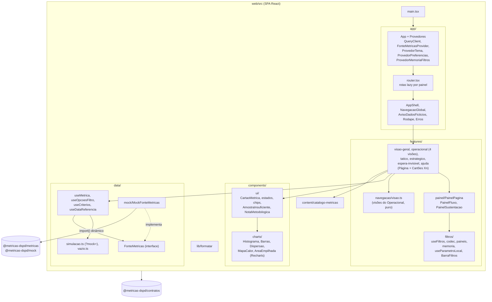
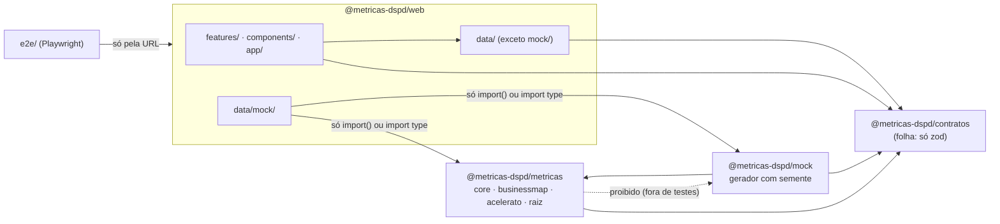
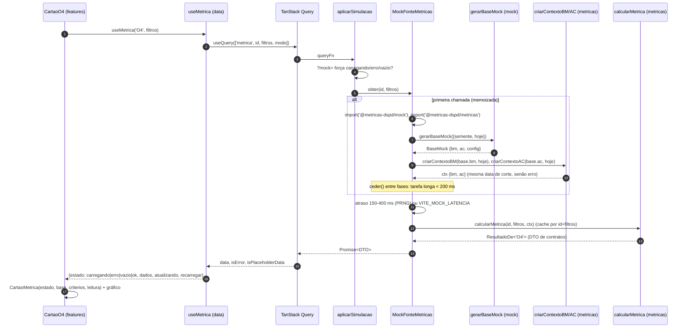
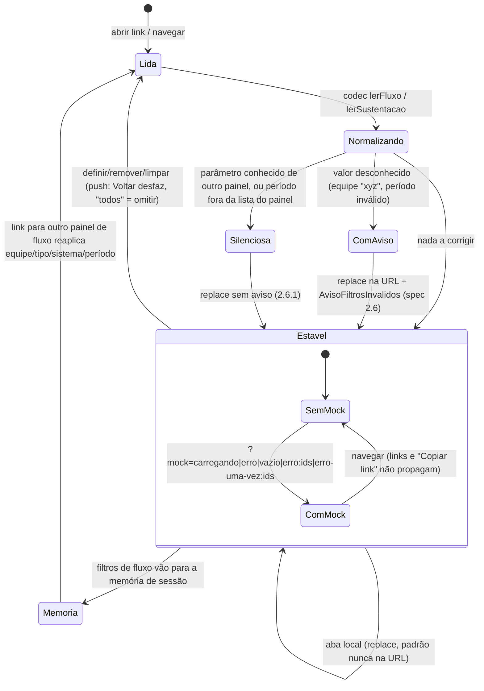

# Arquitetura do front-end (`web/`)

Estado do pedido 001 (dashboard com dados fictícios) e da integração real (seção 6). Decisões de base: [ADR 0001](../architecture/adr/0001-stack-front-dashboard-mock.md) (stack e fronteira `FonteMetricas`), [ADR 0002](../architecture/adr/0002-monorepo-pacotes-compartilhados.md) (pacotes e grafo), [ADR 0003](../architecture/adr/0003-orcamento-de-performance.md) (orçamento de performance). O cálculo em si está em [biblioteca-de-calculo.md](biblioteca-de-calculo.md); os dados, em [modelo-de-dados-mock.md](modelo-de-dados-mock.md).

## 1. C4 nível 3 — componentes do `web/`



Regras que o desenho garante:

- **Nenhum componente calcula.** Cartões recebem o DTO pronto de `useMetrica`; frases de leitura são montadas a partir do DTO (ex.: `CartaoO4`, o cartão de referência).
- **Uma porta de dados.** Painéis só conhecem `FonteMetricas` e os tipos de `contratos`. Trocar o mock pela API não toca em painel ([práticas](../engineering/praticas.md)).
- **Painéis em chunks separados** (`router.tsx`, `lazy`), e a biblioteca e o gerador fora do chunk inicial (`import()` dinâmico em `data/mock`, ADR 0003).

## 2. Dependências entre pacotes e fronteiras do lint



Fronteiras em `eslint.config.js` (cada uma vira erro de lint, não só revisão):

| Escopo                                                   | Proibido                                                                                            | Por quê                                                        |
| -------------------------------------------------------- | --------------------------------------------------------------------------------------------------- | -------------------------------------------------------------- |
| `web/src/features`, `components`, `app`                  | `@metricas-dspd/metricas`, `@metricas-dspd/mock`; `recharts` fora de `components/charts`            | UI não calcula nem gera dados (ADR 0001)                       |
| `web/src/data/**` (menos `data/mock`)                    | `metricas` e `mock`                                                                                 | Só a fonte mock conhece a biblioteca                           |
| `web/src/data/mock/**`                                   | import estático de `metricas`/`mock`                                                                | Fora do chunk inicial (ADR 0003)                               |
| `packages/contratos`                                     | outros `@metricas-dspd/*`, React                                                                    | Contratos são a folha do grafo (ADR 0002)                      |
| `packages/metricas/src`                                  | `@metricas-dspd/mock`                                                                               | Grafo é `metricas <- mock`                                     |
| `metricas/businessmap`, `mock/businessmap` ↔ `acelerato` | importar o outro domínio                                                                            | BusinessMap e Acelerato nunca se misturam                      |
| `metricas/core`                                          | domínios e a raiz (`calcular`, `visaoGeral`, `index`)                                               | O núcleo não conhece domínio                                   |
| `packages/metricas`, `packages/mock`                     | `Math.random`, `Date.now`, `new Date()`, `performance.now`                                          | Determinismo: "hoje" é parâmetro                               |
| métricas dos dois domínios                               | `sort` direto, leitura de `motivo_descarte`/`arquivado_em` fora de `descartado.ts`, percentil solto | Ordenação neutra, descarte único, percentil só sobre `Amostra` |
| todo o código                                            | caminho relativo entre pacotes; spread em `Math.min/max`                                            | Pacotes se conhecem pelo nome; pilha em base grande            |
| `e2e/`                                                   | qualquer `@metricas-dspd/*`                                                                         | Testa a aplicação pela URL                                     |

## 3. Do gerador ao cartão



- `QueryClient`: `retry: false`, `staleTime: Infinity`, sem refetch no foco (nada se atualiza sozinho, WCAG 2.2.2). `keepPreviousData` mantém o conteúdo esmaecido ao trocar filtro.
- "Amostra insuficiente" (< 20 itens) não é estado do cartão: vem por estatística dentro do DTO (`status: 'insuficiente'`), e o cartão mostra `AmostraInsuficiente`.
- Variáveis de ambiente da fonte padrão (`App.tsx`): `VITE_MOCK_SEMENTE`, `VITE_MOCK_HOJE`, `VITE_MOCK_LATENCIA` (`0` nos E2E).

## 4. Filtros na URL

A URL é a fonte da verdade (`useFiltros` + `codec.ts`); `paineis.ts` define, por painel, filtros, período padrão, períodos aceitos e parâmetros conhecidos. Fluxo e sustentação têm tipos distintos e nunca se herdam. Desde a Sustentação no Operacional (K-072/K-073) os dois conjuntos convivem na mesma URL, `/operacional` (seção 4.1).



| Grupo                                         | Parâmetros                                                                                                                                                                                  | Escrita                                                                                                                                 |
| --------------------------------------------- | ------------------------------------------------------------------------------------------------------------------------------------------------------------------------------------------- | --------------------------------------------------------------------------------------------------------------------------------------- |
| Filtros de fluxo                              | `equipe`, `tipo`, `sistema`, `periodo` (`4s`, `12s`, `6m`, `12m`, `custom`), `de`, `ate`                                                                                                    | `push`; padrão omitido; Estratégico só `sistema` e `6m`/`12m`                                                                           |
| Filtros de sustentação                        | `sust_equipe`, `sust_prioridade`, `sust_periodo`, `sust_de`, `sust_ate` (prefixo `sust_`, passado a `useFiltros`)                                                                           | `push`; independentes do fluxo, fora da memória de sessão                                                                               |
| Visão do Operacional                          | `cadencia` = `diaria`, `semanal` ou `sustentacao` (Resumo é o padrão e fica fora da URL)                                                                                                    | Escolha no seletor: `push`. Correção da URL (valor inválido, hash de outra visão, `cadencia=resumo`): `replace` (`useVisaoOperacional`) |
| Abas e seletores locais (`useParametroLocal`) | `o2`, `o3`, `o9`, `o10`, `t1`, `t4`, `t5`, `s3`, `s4` (`p1` padrão), `s5`, `s6`, `e1` (Iniciativa ou Melhoria, um por vez), `ei_fl1`, `ei_fl2`, `ei_fl3`, `ei_sust` (segmento do cartão EI) | `replace`; valor inválido cai no padrão. Os de cartão são únicos e sem prefixo (valem nas visões em que o cartão existe)                |
| Simulação                                     | `mock`                                                                                                                                                                                      | Lido por `useMetrica` só quando `fonte.tipo === 'mock'`; não é parâmetro conhecido de painel, então a normalização não o remove         |

**Busca pendente e URL canônica.** No React Router 7 a navegação é uma transição: num painel pesado, sob carga, o render da URL nova atrasa, e uma segunda ação do usuário que partisse da URL do último render desfaria a primeira (IF-001, IS-003). Por isso `buscaPendente.ts` guarda a última busca que o app mandou navegar. A regra: toda escrita de URL (`useFiltros`, `useParametroLocal`) lê a base com `buscaVigente(pathname, search)` e, ao navegar, chama `registrarBusca`. A pendência é descartada quando a URL renderizada a alcança, quando a rota muda ou depois de `VALIDADE_MS` (3 s, rede de segurança para navegações interrompidas ou normalizadas para outra URL). A URL escrita é canônica (IF-006): só valores fora do padrão, em minúsculas, sem repetição e sem "todas as opções" (marcar todas vira "Todos", lista vazia); a canonicalização só ocorre com as opções carregadas, que é quando se sabe o que é "todas". O `FiltroMulti` exibe a marcação da última emissão do usuário, não a prop (a URL, que pode vir atrasada): sem isso a caixa recém-marcada voltaria a desmarcada e o clique seguinte viraria "marcar" de novo. Uma prop igual a uma emissão anterior, dentro de `VALIDADE_MS`, não sobrescreve a marcação; uma prop nunca emitida (chip removido, Limpar) ressincroniza.

A memória de sessão (`memoria.tsx`) vive só em memória (nunca `localStorage`): recarregar zera. Ela é só dos filtros do fluxo (sem prefixo); os `sust_*` nunca entram nela.

### 4.1 Operacional: quatro visões em uma rota

Plano: [plano-sustentacao-no-operacional.md](../architecture/plano-sustentacao-no-operacional.md) (tabelas 4.1 a 4.5); [ADR 0019](../architecture/adr/0019-tendencia-mensal-por-data-de-referencia.md) para as tendências. A antiga página `sustentacao` deixou de existir: a Sustentação é uma visão do Operacional.

- **Visões** (`navegacao/visao.ts`, módulo puro, sem cálculo): `resumo` (padrão), `diaria`, `semanal` e `sustentacao`. URL canônica: `/operacional` abre o **Resumo**, sem `cadencia`; as demais levam `cadencia=<visão>`. `/operacional` sem `cadencia` deixou de abrir a Diária. Um link externo antigo para `/operacional` cai, portanto, no Resumo. `cadencia` desconhecido cai no Resumo com o aviso de valor inválido (`filtrosInvalidos` no `state` da navegação).
- **`useVisaoOperacional`** lê `cadencia` e o hash, e devolve `visao` e `escolher`. `escolher` usa `push` (o Voltar desfaz), mantém os demais parâmetros e usa `buscaVigente`/`registrarBusca` (seção 4); a correção de URL usa `replace`. `OperacionalPage` escolhe o molde: `VisaoResumo`, `PainelSustentacao` (com `prefixo="sust_"`, chunk `VisaoSustentacao` sob demanda, pré-carga por intenção em `SeletorVisao`) ou `PainelFluxo` (Diária e Semanal). O foco volta ao rádio do seletor após a troca (um `useRef` da página passado ao `SeletorVisao`, pois o seletor remonta quando o molde muda) e um `aria-live` próprio anuncia a visão e a fonte (`ANUNCIO_DA_VISAO`).
- **Tabela hash → visão** (`TABELA_HASH`, `visaoDoHash`): derivada do catálogo (`cartoesDoPainel`) e dos ids de seção; só os cartões da Diária (`o2`, `bloqueados`, `o1`) e as âncoras do Resumo (`resumo-fluxo`, `resumo-sustentacao`, `tendencia-fluxo`, `tendencia-sustentacao`) são escritos à mão. O hash **vence** `cadencia` (`resolverVisao`), sem diferenciar maiúsculas; hash vazio, `#mais-metricas` ou desconhecido não decide. Um teste prova que nenhum hash pertence a duas visões. Usada por `OperacionalPage`, `lib/destinoCartao` (o link de um cartão já cai na visão dona dele), `features/coleta/fontes` e pelo Resumo (`hrefDaVisao`, que mantém os dois conjuntos de filtros e nunca propaga `mock`).
- **Dois conjuntos de filtros na mesma URL.** Diária e Semanal usam o fluxo (sem prefixo); a Sustentação usa `sust_*`. Trocar de visão não apaga o conjunto da outra: ele fica guardado na URL, e `LinhaFiltrosGuardados` (com `contarAtivos`, que lê pelo `codec` sem normalizar nem gravar) avisa "N filtros do fluxo/da Sustentação guardados não se aplicam aqui". O Resumo não lê nem grava nenhum filtro: usa os padrões fixos (`FILTROS_FLUXO_RESUMO` e `FILTROS_SUST_RESUMO`, ambos com 12 semanas, decisão P3), então suas consultas são as mesmas da Diária e da Semanal e o cache é compartilhado. `PAINEIS.operacional.params` inclui os parâmetros de cartão da sustentação (`s3`, `s4`, `s5`, `s6`, `ei_sust`) para a Diária e a Semanal não os apagarem. BusinessMap e Acelerato nunca se misturam: cada bloco, consulta e filtro tem uma única fonte.
- **Redirecionadores** (`app/RedirecionaSustentacao`, `app/RedirecionaEsperaInvisivel`, síncronos, `Navigate replace`): `/sustentacao` vai para `/operacional?cadencia=sustentacao`, trocando `equipe`, `prioridade`, `periodo`, `de`, `ate` por `sust_*`, mantendo `sust_*`, `s3` a `s6`, `ei_sust` e `mock`, descartando o resto, e renomeando os hashes `#compl-<seção>` para `#compl-sust-<seção>`. `/espera-invisivel#ei-sust` vai direto para a visão Sustentação com os `sust_*` intactos. O destino é sempre um caminho interno fixo e a busca é reconstruída com `URLSearchParams` (sem redirecionamento aberto).
- **Fonte por visão.** `dominiosDaRota(caminho, busca, hash)` (`features/coleta/fontes.ts`) devolve as duas fontes no Resumo, só `acelerato` na Sustentação e só `businessmap` na Diária e na Semanal; `CalibracaoDasFontes` e o selo de frescor esperam só o estado dessas. O título da página é `handle.titulo` como função da `Location` (`Operacional · <visão>`).
- **Resumo** (`operacional/resumo/`): **não calcula**, só reorganiza DTOs que já existem. `BlocoFluxo` (BusinessMap) e `BlocoSustentacao` (Acelerato) são seções separadas com `NumeroChave`; `modelo.ts` (puro) monta o texto de cada número e `destinos.ts` os links. Origem de cada número (tabela 4.5 do plano): P85 do tipo predominante e P50 = `O3` (`tipoPredominante`, o mesmo critério da aba padrão do `CartaoO3`; empate de itens desempata pela ordem fixa `TIPOS_CARD`, a do cartão O3, nunca pela de chegada, e `tiposEmpatados` acrescenta "; empate com X" à base do número); vazão = `O4`; acima do P95 = `O2.acimaP95`; vencidos por causa interna = `O12`; aderência por prioridade = `S2`; mediana contra o alvo = `S1`; volume e P1+P2 = `S3`; "Pede atenção" = `operacional/atencao.ts` (as mesmas regras de Diária, Semanal e Sustentação, funções puras sobre os DTOs). **Janela do "Pede atenção" (U1 = (a), decidida pelo usuário em 2026-10-14):** o Resumo usa 12 semanas e o escreve na tela (`FaixaAtencao` ganhou a prop `janela`: "Janela: últimas 12 semanas", também no bloco Fluxo; vazio "Nada pede atenção na Sustentação nas últimas 12 semanas."), mais a nota "Mesmo alerta, janelas diferentes" com link "Ver na Sustentação" (`nota-janelas-alerta`). O texto sai de `textoPeriodoCurto(FILTROS_SUST_RESUMO.periodo)` (`filtros/paineis.ts`), então trocar a janela do alerta é trocar o filtro da constante e remover a nota. A visão Sustentação usa o filtro: título "Pede atenção no período · Sustentação (Acelerato)" e linha "Período do filtro: 6 meses" (dinâmica). Cada número tem carregando, erro (com "Tentar de novo" só dele) e "Poucos itens (n=…). Estatística não publicada." abaixo de 20.
- **Tendências** (`TendenciaFluxo`, `TendenciaSustentacao`, `SerieMensal`, `GraficoMensal`): dois DTOs próprios, `TENDENCIA_FLUXO` e `TENDENCIA_SUST`, com os 6 últimos meses fechados. A única entrada é `dataReferencia` (tipada como `SoDataReferencia` no contrato; `filtrosTendencia`): a mais antiga das duas últimas coletas ok (`useReferenciaDasTendencias`). A consulta só dispara depois dos números e do "Pede atenção" do bloco; o erro dela é só da série. Cada série tem "Ver como tabela" (um botão que alterna o próprio rótulo para "Ver como gráfico"; sem `aria-pressed`, D-05a), mês abaixo de 20 itens aparece sem valor (marcador vazado, "poucos itens (n=14)") e as mudanças de critério são marcadas. Se o O3 falha, a série de P85 mostra o próprio erro ("P85 indisponível", com "Tentar de novo" ligado ao O3), porque sem o tipo não há P85 a mostrar, e a de concluídos segue. Uma série de métrica oculta nas preferências some junto com o número. A frase da série de SLA nomeia o que foi contado ("N de M prioridades avaliadas estão abaixo de 90%", com a meta lida de `META_RAZAO_MIN`) e, sem prioridade avaliada, diz "nenhuma prioridade avaliada".
- **Delta pós-QA e UX (K-073).** (1) **Nível de título (D-01):** `FaixaAtencao` ganhou a prop `nivel` (`'h2'` padrão, `'h3'`); dentro de um bloco do Resumo o título da faixa é h3, para cada bloco ter um único h2, e a região usa `aria-labelledby` do título visível. (2) **Reservas de altura contra CLS (SNO-004):** enquanto carrega, `BlocoResumo.reserva` (número, ou `{ mobile, desktop }` com `--rb-m`/`--rb-d`), `FaixaAtencao.reserva` (`--fa-m`/`--fa-d`), `EsqueletoTendencia.series` e `FrescorFonte.reservarFalha` guardam a altura da versão pronta. São números medidos (448/192, 1890/950, 108/88, 560, 50 e 98 px, a 1280 e a 375 de largura); mudar texto ou espaçamento do Resumo exige remedir. O guarda é o caso `perf-resumo-reservas` em `e2e/perf/perf.spec.ts` (CLS do Resumo a 1280 e a 375, limite F2) e o Lighthouse do QA. (3) **Anúncio e foco na troca de visão (D-02, D-03):** o `aria-live` `anuncio-visao` sai da visão resolvida (efeito sobre `visao`), não do clique: Voltar, links "Ver na..." e hash também anunciam, e a montagem inicial não. Troca pelo seletor devolve o foco ao rádio; troca por link sem hash leva o foco ao h1 (`tabIndex=-1`, sem rolar; se o h1 ainda não existe, não move o foco); com hash o foco vai ao cartão. (4) **Preferências, versão mais nova (A6):** `salvar` rejeita com `ErroVersaoMaisNova` (erro de domínio tipado) quando o valor guardado tem `versao` maior que 1; `ProvedorPreferencias` distingue por `instanceof` e põe `estadoSalvar = 'versao-nova'` (em vez de `'erro'`), e `PreferenciasPage` mostra `role=alert` "Suas preferências foram salvas por uma versão mais nova do sistema e não serão alteradas aqui."
- **Modo mock `tendencia-poucos`** (`data/simulacao.ts`, só com fonte mock): meses com menos de 20 itens nas duas tendências (junho no fluxo; junho e julho na Sustentação), para testar e ver o estado sem valor. Os `?mock=` não são propagados por links.

## 5. Trocar o mock pela API (`HttpFonteMetricas`)

O ponto de troca é um só: `criarFontePadrao()` em `app/App.tsx`. Esqueleto proposto (o contrato HTTP final é do `node-backend`, em `docs/api/`):

```ts
// web/src/data/http/HttpFonteMetricas.ts (futuro)
import { SCHEMAS_RESULTADO } from '@metricas-dspd/contratos/validacao'
export class HttpFonteMetricas implements FonteMetricas {
  readonly tipo = 'api' as const
  constructor(private readonly baseUrl = '/api/v1') {}
  async obter<K extends MetricaId>(id: K, filtros: FiltrosDe<K>): Promise<ResultadoDe<K>> {
    const r = await fetch(`${this.baseUrl}/metricas/${id}?${serializar(filtros)}`)
    if (!r.ok) throw await erroDaApi(r)
    return SCHEMAS_RESULTADO[id].parse(await r.json()) // mesmo schema zod que a API usa
  }
  // opcoesFiltro(dominio), criterios(), dataReferencia(): um GET cada
  // estadoColeta(dominio): GET /api/v1/fontes/:dominio/estado
  // historicoColetas(dominio, pagina): GET /api/v1/fontes/:dominio/coletas?pagina=
}
```

Passos:

1. Criar `data/http/` (cai na regra de `data/**`: pode usar `contratos` e `contratos/validacao`, nunca `metricas`/`mock`).
2. `criarFontePadrao()` escolhe a fonte por variável de ambiente (ex.: `VITE_FONTE=api`); o mock continua disponível para dev e E2E.
3. Com `tipo: 'api'`, `?mock=` já é ignorado por `useMetrica`. O `AvisoDadosFicticios`, o texto do rodapé e o sufixo do título só aparecem com `useFonte().tipo === 'mock'` (feito na integração real, D5).
4. Revisar o `QueryClient` para dados reais (retentativa limitada em erro de rede, `staleTime` amarrado à data de corte da carga): decisão aberta, a registrar em ADR junto com o pedido 002.
5. Os testes de painel usam `fonteFixa` (`features/painel/testes`) e não mudam; a paridade mock × API fica nos testes de contrato (ver [qualidade-e-testes.md](qualidade-e-testes.md)).

## 6. Coletas, frescor, calibração e `/dados` (integração real, K-034)

Plano: [integracao-real.md](../architecture/features/integracao-real.md); spec: `docs/ux/integracao-real/05-especificacao.md`.

- **Nova fonte na porta única.** `FonteMetricas` ganha `estadoColeta(dominio)` e `historicoColetas(dominio, pagina)` (uma fonte por chamada, nunca somadas). O mock calcula com `gerarColetasMock` (`@metricas-dspd/mock`, fora da `BaseMock`) e `montarEstadoColeta`/`paginarColetas` (`@metricas-dspd/metricas`), sempre pelo mesmo `import()` dinâmico; selo, janela de 60 dias e `metricasEmCalibracao` chegam prontos, a UI só exibe.
- **Hooks** (`data/useMetrica.ts`): `useEstadoColeta(dominio)` (chave `['coleta', dominio, modo]`, compartilhada por selo, faixa, cartões e `/dados`), `useHistoricoColetas(dominio, pagina)` e `useMetricasEmCalibracao(dominio)`.
- **`?mock=` novos** (só com fonte mock): `coleta-atrasada:bm|ac`, `coleta-vazia:bm|ac`, `coleta-erro:bm|ac` (afetam só a fonte indicada) e `sem-calibracao`; `carregando` também deixa o estado de coleta carregando. Aplicados em `aplicarSimulacaoEstado`/`aplicarSimulacaoHistorico` (`data/simulacao.ts`).
- **Selo e faixa nos painéis.** `PainelFluxo`/`PainelSustentacao` recebem `fontes`; o cabeçalho mostra `FrescorFonte` (Atualizado em, `SeloFrescor`, "Entenda" para `/dados?fonte=bm|ac`) e `FaixaCalibracaoFonte`. Visão geral e Espera invisível mostram um selo por fonte, separados. Sem nenhuma coleta ok, o painel de uma fonte mostra `SemDadosDaFonte`.
- **Calibração nos cartões.** `CalibracaoDasFontes` (dentro do `AppShell`) liga o conjunto de métricas em calibração ao contexto de `components/ui/Calibracao.tsx`. `CartaoMetrica` mostra o selo "Em calibração", `StatusMeta` vira o selo (nunca Dentro/Fora) e `FaixaAtencao` omite essas métricas e avisa. Enquanto o estado de coleta carrega, o cartão fica em carregando e a faixa em "Verificando", para nenhum status aparecer e sumir. Cartões isolados, sem o shell, não têm calibração.
- **Rota `/dados`** (`features/dados`, lazy; item "Dados e coletas" em `app/rotas.ts`): abas `role="tablist"` com `?fonte=bm|ac` (inválido cai em BusinessMap), um `PainelFonte` por aba com carregando, vazio, erro ("Tentar de novo") e as seções Última coleta, Contagens, Janela de calibração, Falhas recentes, Histórico paginado (20) e Mudanças de critério (filtradas pelas métricas da fonte). Sem cadastro, sem coluna por pessoa, sem autenticação nesta etapa.
- **Pendências de regra** (a confirmar com o usuário): janela de 60 dias e gatilhos; tolerância do "Atrasado" (provisória, 0 h).

## 7. Preferências de métricas (pedido 007)

Spec: `docs/ux/preferencias-metricas/06-especificacao.md` e `viabilidade-tecnica.md`; decisões finais em `docs/alinhamentos/2026-10-10-decisoes-do-usuario.md` §6 e §9.

- **Catálogo único de cartões** em `@metricas-dspd/contratos` (`cartoes.ts`): `CATALOGO_CARTOES` (id = código em minúsculas, painel, seção, métricas, par "leia junto"), `CARTOES_RETIRADOS`, conjuntos por papel (`PAINEIS_DO_PAPEL`) e o schema zod `PreferenciasMetricas` (`{versao, paineis: {<painel>: {ocultar: ids}}, atualizadoEm}`; guarda os ocultos, então cartão novo aparece). Um teste confere que todo `metrica-*` desenhado está no catálogo.
- **Porta `FontePreferencias`** (`features/preferencias/fonte.ts`): `origem`, `obter()` e `salvar()`. Hoje `LocalStoragePreferencias` (chave `metricas-dspd:preferencias:v1`); preferência ausente, corrompida ou de versão desconhecida vira "tudo visível" **sem erro na tela e sem gravar nada na leitura**; a primeira alteração grava `versao: 1`, exceto se o valor guardado tiver `versao` maior que 1 (versão futura): `salvar` rejeita sem sobrescrever (a tela mantém a escolha e avisa, como em qualquer falha de gravação). Com o SSO entra uma implementação HTTP (`GET`/`PUT /me/preferencias-metricas`, sem parâmetro de usuário) injetada em `Provedores`, e a tela não muda. **Fora desta entrega:** o diálogo de primeiro login ("Usar estas preferências" / "Começar do padrão do meu papel", CA-14) depende do SSO; a porta já expõe `origem` para ele.
- **Dois níveis de estado.** `ProvedorPreferencias` (global, em `Provedores`) guarda o perfil (persistido) e os ajustes da visita (só memória, por painel; nunca em URL nem em storage). `ProvedorPainelPreferencias` (um por painel, dentro de `Casca` de `PainelPagina`; a Espera invisível não tem) deriva o recorte efetivo (visita, senão perfil) e oferece `ocultarCartao` (anúncio em `aria-live`, "Desfazer" por 10 s e foco no próximo título ou no título restaurado), `mostrar`, `mostrarVarios`, `mostrarTodas` e `usarMinhas`. Contexto e hooks (`usePreferenciasPainel`, `useCartaoVisivel`) ficam em `components/ui/PreferenciasPainel.ts` para a UI não importar de `features/`; fora de um painel com preferências nada é recortado (Visão geral, Espera invisível, testes de cartão isolado).
- **O recorte é só de renderização.** `CartaoMetrica` devolve `null` se o cartão está oculto, mas o hook de dados do cartão continua rodando e a faixa "Pede atenção" tem as próprias consultas (cache compartilhado). Nada muda em `FonteMetricas`, no payload ou nos cálculos.
- **Faixa "Pede atenção" nunca é filtrada.** `FaixaAtencao` troca o link "Ver X" por selo "métrica oculta" e botão "Mostrar X nesta visita" quando o id do item está oculto. Mudança de critério em métrica oculta (`useCriterios` x `metricas` do catálogo) vira aviso com "Mostrar X" (`AvisosCriterioOcultas`). Avisos do painel e internos de cartão visível (base, amostra insuficiente, nota, dados fictícios) não passam pelo recorte.
- **Tela do painel.** `BotaoMetricas` ("Métricas: N de M", `Dialog` do Radix: foco preso, Esc, retorno ao botão; folha no celular, painel ancorado à direita em `lg`), `FaixaOcultas` ("N métricas ocultas: ids · Mostrar todas · Usar minhas preferências"), `SecaoPainel` (substitui `Secao` nos painéis: seção toda oculta mostra "Mostrar métricas da seção"; painel todo oculto some e `PainelOcultoVazio` assume), "Ir para" do Operacional só lista seção com métrica visível, e os links "leia junto" (O18 e T1) somem quando o par está oculto. O painel espera a primeira leitura das preferências (bloco reservado, como o estado de coleta) para o recorte certo aparecer de primeira.
- **Link compartilhado leva só os filtros.** Não existe parâmetro `ocultar` na URL: o destinatário vê as próprias preferências. A Visão geral é sempre completa e traz a linha "As preferências de métricas valem para os painéis".
- **Rota `/preferencias`** (`PreferenciasPage`, lazy; link "Preferências" no cabeçalho e no menu do celular): um `fieldset` por painel com as caixas por seção e "N de M visíveis", atalho opcional "Aplicar sugestão do meu papel" (só marca caixas; o papel não é gravado; time = Operacional, coordenador = Operacional + Tático, gerente = Tático + Estratégico), "Restaurar padrão" com confirmação nomeando as métricas, `role=status` "Salvo neste navegador" e `role=alert` em falha de gravação (a escolha continua na tela). Esqueleto enquanto lê.
- **Privacidade (regra do briefing).** Nada por pessoa, nenhuma telemetria ou log de preferência, nenhum ranking; o perfil nunca sai do navegador.
- **Testes.** Unitários (`fonte.test.ts`, `provedores.test.tsx`), sistêmicos (`preferencias.test.tsx`, painéis completos com o mock) e E2E (`e2e/tests/preferencias.spec.ts`: axe a 375 e 1280, temas claro e escuro, popover aberto, estado vazio, teclado, foco, "Copiar link" sem seleção).

## 8. Exportação em PDF (pedido 008)

Plano: `docs/architecture/features/exportar-metricas.md`; UX: `docs/ux/exportar-metricas/`; decisões D-1 a D-5: `docs/alinhamentos/2026-10-10-decisoes-do-usuario.md` §10. Só front, sem endpoint e sem migração.

- **Módulo `features/exportar/`.** `modelo.ts` (puro): DTO + filtros viram `BlocoExportacao` (título, fonte, filtros em texto, janela dos dados e dos percentis, base, "amostra insuficiente" lida do próprio DTO, nota resumida do catálogo `notas.ts`, mudanças de critério, tabela). Nada é recalculado e campos de pessoa (`CAMPO_PESSOAL`) nunca entram. `selecao.ts` lista as métricas **visíveis** por nível (preferências do 007; a Espera invisível, sem preferências, lista as quatro), calcula escopo, nome do arquivo e prévia, e resolve os filtros de cada métrica (URL do painel em que o usuário está; senão a memória de sessão do fluxo; a Sustentação e a EI-SUST nunca herdam filtros do fluxo). `DialogoExportar.tsx` é o diálogo (Radix: foco preso, Esc, retorno do foco; folha no celular; estados vazio, carregando, gerando, erro e pronto com "Baixar"); `BotaoExportar.tsx` o liga a `usePreferencias`, à fonte e ao cache do React Query; `gerar.ts` lê os DTOs pela mesma chave de cache dos cartões e monta o conteúdo; `desenhista.ts` pinta com jsPDF.
- **Onde aparece.** Barra de cada painel (ao lado de "Métricas: N de M") e da Visão geral: "Exportar" (o painel; a Visão geral exporta os blocos por nível) e "Exportação personalizada" (todos os níveis, marcando métricas visíveis; um PDF só). Limite de 12 métricas; o excedente fica desabilitado com explicação.
- **BusinessMap e Acelerato nunca se misturam.** O conteúdo é agrupado em seções por fonte (BusinessMap, depois Acelerato), cada uma com capa de seção; cada métrica leva os próprios filtros e a própria fonte; um bloco nunca soma as duas.
- **Bundle (ADR 0003, F11).** O jsPDF fica no chunk `exportar-pdf` (130,9 KB gzip) e o desenhista no chunk `desenhista` (1,8 KB), ambos só por `import()` em `carregarPdf.ts`, ao clicar em "Gerar arquivo"; o helper de preload do Vite foi fixado no grupo inicial (`vite.config.ts`) para o jsPDF não virar dependência estática. O `svg2pdf.js` estourava o orçamento (160 KB): **no lugar do gráfico vai a tabela com os dados do DTO** (fallback do plano; também é o equivalente textual). Fontes padrão do PDF (Helvetica) cobrem o pt-BR; símbolos sem glifo (`≥`, `→`) viram equivalentes simples em `limparTexto`.
- **PDF.** A4 retrato; título e idioma pt-BR; texto selecionável; cabeçalho e rodapé em todas as páginas; "Dados fictícios" em todas quando `fonte.tipo === 'mock'`, e `_ficticio` no nome. Nome: `metricas-dspd_<escopo>_<AAAA-MM-DD>[_ficticio].pdf` (dia civil de São Paulo; escopo `visao-geral`, `fluxo-operacional`, `fluxo-tatico`, `fluxo-estrategico`, `sustentacao`, `espera-invisivel`, `personalizada` ou o id da métrica, se for uma só). Qualquer exceção vira "Não foi possível gerar o arquivo. Tente de novo.", sem detalhe técnico e sem arquivo parcial.
- **Privacidade.** Sem log, contador ou telemetria das exportações (D-5); o arquivo é gerado e baixado no navegador, nada sai dele.
- **Testes.** Unitários (`modelo`, `selecao`, `desenhista`, `gerar`, `carregarPdf`), componente (`DialogoExportar`), sistêmico com o mock (`exportar.sistemico.test.tsx`: só visíveis, chunk só no clique, BM antes de AC) e E2E (`e2e/tests/exportar.spec.ts`: baixa o PDF e lê o texto com `pdfjs-dist`; axe a 375 e 1280 nos dois temas).

## 9. Largura com a fonte ampliada a 200% (SNO-001, K-073)

A 375 px com `html { font-size: 200% }` nenhuma página pode passar de 375 px de largura (WCAG 1.4.4 e 1.4.10). Causa raiz: `body { min-width: 20rem }` em `web/src/styles/tokens.css`. Em `rem` o piso de 320 px virava 640 px com a fonte a 200%, e o cabeçalho, o `main` e o rodapé herdavam essa largura (medida com Playwright: `body`, `header`, `main` com 640 px; o botão Menu terminava em x = 538). A tentativa de trocar `flex-nowrap` por `flex-wrap` no cabeçalho não bastava por isso.

Regras que ficam:
- O piso do `body` é em px CSS: `min-width: min(20rem, 320px)`. Nunca use `rem` para um piso de largura de página.
- O grupo da direita do cabeçalho (`AppShell`) quebra linha (`flex-wrap`); o selo "Dados fictícios", o tema e o Menu continuam todos visíveis.
- Grupos de ações de cartão (`CartaoT3`, `CartaoS3`, `CartaoMotivos`), o seletor de visão (`SeletorCadencia`, grade 2x2 abaixo de 400 px, MOB-CA-12), os três números do `CartaoEI` (`auto-fit` com mínimo de 6 rem), a lista de `FaixaAtencao` e o link da faixa de calibração (`Calibracao`) quebram linha em vez de impor largura (`flex-wrap`, `min-w-0`, `max-w-full`, sem `whitespace-nowrap`).
- Teste: `e2e/tests/cabecalho-fonte-200.spec.ts` mede `scrollWidth <= clientWidth` do documento e do cabeçalho nas rotas `/`, `/tatico`, `/operacional?cadencia=semanal` e `?cadencia=sustentacao`.
- O redesenho mobile completo do cabeçalho (uma linha, tema na gaveta, MOB-CA-9) é do K-075 e não foi antecipado aqui.

## 10. Fila de montagem dos gráficos (K-102)

O Lighthouse de `/operacional?cadencia=semanal` ficou em 0,88 a 0,89 na CI (PR de release #90), com TBT de 256 a 263 ms contra 23 a 56 ms na diária. Causa provada por perfil de CPU (build sem minificação, mock com latência): as respostas dos cartões chegam juntas (latência de 150 a 400 ms por chamada) e os gráficos Recharts de todos os cartões montavam no mesmo commit do React (`completeRoot`, `commitHookEffectListMount`, seletores do Recharts), em duas tarefas longas de cerca de 200 e 120 ms. Escalonar a montagem das *seções* não resolve (testado: sem ganho), porque o que concentra o custo é a chegada dos dados, não a montagem dos cartões.

Correção: `web/src/components/charts/filaDeGraficos.ts`, usada por `GraficoBase`, que atende todos os gráficos, exceto o `GraficoMensal` (usado em `SerieMensal`, resumo operacional): ele não passa pelo `GraficoBase`, monta fora da fila e foi mantido assim porque o perf medido (três rotas verdes) não pedia mais e para não ampliar o escopo do K-102.
- O cartão, a frase de leitura, a legenda e a tabela de dados aparecem no primeiro commit. O desenho do gráfico espera a vez numa fila global e entra um por tarefa (`MessageChannel` + `flushSync`; o primeiro turno espera o paint).
- A caixa do gráfico (`height` e `min-height` do `GraficoBase`) já existe no primeiro commit, então a reserva de altura do SNO-004 continua valendo e não há salto de layout (CLS inalterado: 0,018 na semanal, 0,004 na diária, 0,067 na Sustentação, os mesmos de antes).
- A tabela equivalente continua sendo a alternativa textual (ADR 0001); gráfico desmontado antes da vez sai da fila.
- Testes de gráfico isolado usam `definirFilaImediata(true)`; o comportamento da fila tem teste próprio (`filaDeGraficos.test.tsx`).
- A fila usa `flushSync` e por isso interrompe transições do React; hoje não há `startTransition`, `useTransition` nem `useDeferredValue` em `web/src`, e quem adotar um deles deve reavaliar a fila.
- Critério de reversão: remover o `useVezDoGrafico` do `GraficoBase` se o TBT da semanal na CI voltar a ficar acima de 200 ms com a fila, ou se algum gráfico deixar de aparecer.
- Não há ordem entre cartões: vale a ordem de montagem. Não use a fila para conteúdo que carregue o LCP (o LCP da semanal é o texto do cartão O3, não o gráfico).

Medição local (mesmo preset e build da CI: `pnpm run build` sem `VITE_*`, mock com latência, `lhci`, 3 execuções), `?cadencia=semanal`:
- antes: notas 0,95 / 0,93 / 0,93, TBT 155 / 188 / 186 ms, LCP 977 a 996 ms, tarefas longas de 181 a 193 ms (react) e 125 a 135 ms;
- depois: notas 0,99 / 0,99 / 0,99, TBT 22 / 21 / 23 ms, LCP 856 a 895 ms, maior tarefa do React com 71 ms (a de ~155 ms que sobra é a geração do mock, igual nas três rotas).
Diária: 0,99 antes e depois. Sustentação: 0,98 antes e depois (TBT de 52 a 82 ms para 9 a 31 ms).
