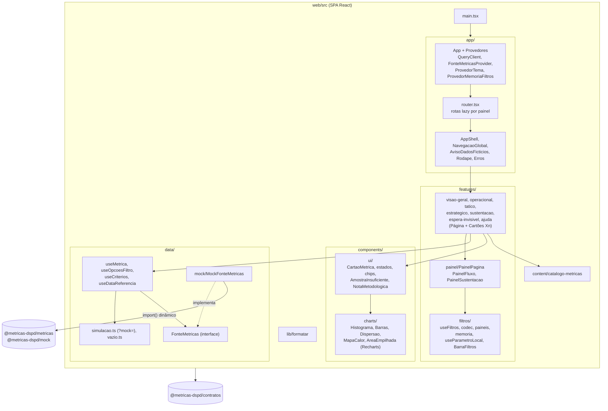
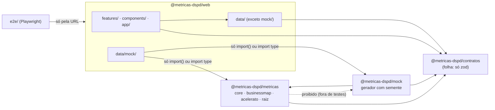
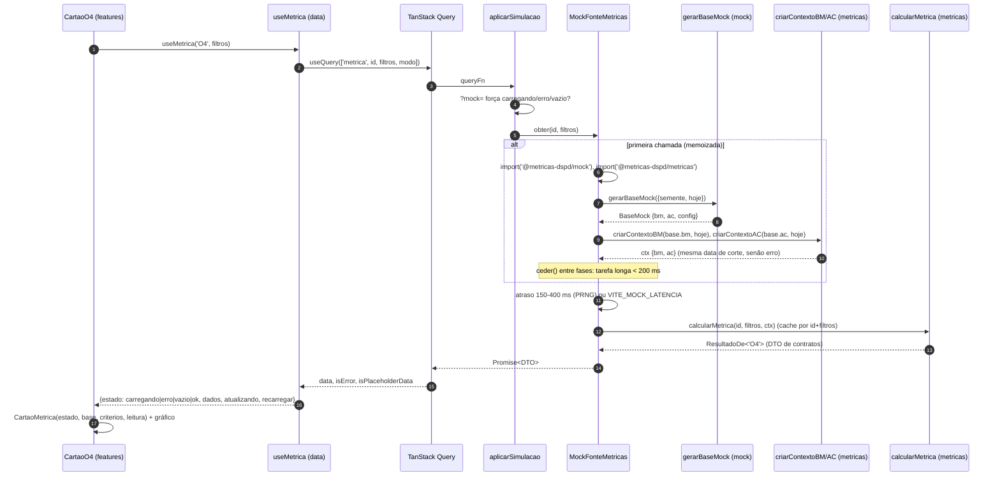

# Arquitetura do front-end (`web/`)

Estado do pedido 001 (dashboard com dados fictícios). Decisões de base: [ADR 0001](../architecture/adr/0001-stack-front-dashboard-mock.md) (stack e fronteira `FonteMetricas`), [ADR 0002](../architecture/adr/0002-monorepo-pacotes-compartilhados.md) (pacotes e grafo), [ADR 0003](../architecture/adr/0003-orcamento-de-performance.md) (orçamento de performance). O cálculo em si está em [biblioteca-de-calculo.md](biblioteca-de-calculo.md); os dados, em [modelo-de-dados-mock.md](modelo-de-dados-mock.md).

## 1. C4 nível 3 — componentes do `web/`



Regras que o desenho garante:
- **Nenhum componente calcula.** Cartões recebem o DTO pronto de `useMetrica`; frases de leitura são montadas a partir do DTO (ex.: `CartaoO4`, o cartão de referência).
- **Uma porta de dados.** Painéis só conhecem `FonteMetricas` e os tipos de `contratos`. Trocar o mock pela API não toca em painel ([práticas](../engineering/praticas.md)).
- **Painéis em chunks separados** (`router.tsx`, `lazy`), e a biblioteca e o gerador fora do chunk inicial (`import()` dinâmico em `data/mock`, ADR 0003).

## 2. Dependências entre pacotes e fronteiras do lint



Fronteiras em `eslint.config.js` (cada uma vira erro de lint, não só revisão):

| Escopo | Proibido | Por quê |
|---|---|---|
| `web/src/features`, `components`, `app` | `@metricas-dspd/metricas`, `@metricas-dspd/mock`; `recharts` fora de `components/charts` | UI não calcula nem gera dados (ADR 0001) |
| `web/src/data/**` (menos `data/mock`) | `metricas` e `mock` | Só a fonte mock conhece a biblioteca |
| `web/src/data/mock/**` | import estático de `metricas`/`mock` | Fora do chunk inicial (ADR 0003) |
| `packages/contratos` | outros `@metricas-dspd/*`, React | Contratos são a folha do grafo (ADR 0002) |
| `packages/metricas/src` | `@metricas-dspd/mock` | Grafo é `metricas <- mock` |
| `metricas/businessmap`, `mock/businessmap` ↔ `acelerato` | importar o outro domínio | BusinessMap e Acelerato nunca se misturam |
| `metricas/core` | domínios e a raiz (`calcular`, `visaoGeral`, `index`) | O núcleo não conhece domínio |
| `packages/metricas`, `packages/mock` | `Math.random`, `Date.now`, `new Date()`, `performance.now` | Determinismo: "hoje" é parâmetro |
| métricas dos dois domínios | `sort` direto, leitura de `motivo_descarte`/`arquivado_em` fora de `descartado.ts`, percentil solto | Ordenação neutra, descarte único, percentil só sobre `Amostra` |
| todo o código | caminho relativo entre pacotes; spread em `Math.min/max` | Pacotes se conhecem pelo nome; pilha em base grande |
| `e2e/` | qualquer `@metricas-dspd/*` | Testa a aplicação pela URL |

## 3. Do gerador ao cartão



- `QueryClient`: `retry: false`, `staleTime: Infinity`, sem refetch no foco (nada se atualiza sozinho, WCAG 2.2.2). `keepPreviousData` mantém o conteúdo esmaecido ao trocar filtro.
- "Amostra insuficiente" (< 20 itens) não é estado do cartão: vem por estatística dentro do DTO (`status: 'insuficiente'`), e o cartão mostra `AmostraInsuficiente`.
- Variáveis de ambiente da fonte padrão (`App.tsx`): `VITE_MOCK_SEMENTE`, `VITE_MOCK_HOJE`, `VITE_MOCK_LATENCIA` (`0` nos E2E).

## 4. Filtros na URL

A URL é a fonte da verdade (`useFiltros` + `codec.ts`); `paineis.ts` define, por painel, filtros, período padrão, períodos aceitos e parâmetros conhecidos. Fluxo e sustentação têm tipos distintos e nunca se herdam.

```mermaid
stateDiagram-v2
  [*] --> Lida: abrir link / navegar
  Lida --> Normalizando: codec lerFluxo / lerSustentacao
  Normalizando --> ComAviso: valor desconhecido (equipe "xyz", período inválido)
  Normalizando --> Silenciosa: parâmetro conhecido de outro painel, ou período fora da lista do painel
  Normalizando --> Estavel: nada a corrigir
  ComAviso --> Estavel: replace na URL + AvisoFiltrosInvalidos (spec 2.6)
  Silenciosa --> Estavel: replace sem aviso (2.6.1)
  Estavel --> Lida: definir/remover/limpar (push: Voltar desfaz; "todos" = omitir)
  Estavel --> Estavel: aba local (replace, padrão nunca na URL)
  Estavel --> Memoria: filtros de fluxo vão para a memória de sessão
  Memoria --> Lida: link para outro painel de fluxo reaplica equipe/tipo/sistema/período
  state Estavel {
    [*] --> SemMock
    SemMock --> ComMock: ?mock=carregando|erro|vazio|erro:ids|erro-uma-vez:ids
    ComMock --> SemMock: navegar (links e "Copiar link" não propagam)
  }
```

| Grupo | Parâmetros | Escrita |
|---|---|---|
| Filtros de fluxo | `equipe`, `tipo`, `sistema`, `periodo` (`4s`, `12s`, `6m`, `12m`, `custom`), `de`, `ate` | `push`; padrão omitido; Estratégico só `sistema` e `6m`/`12m` |
| Filtros de sustentação | `equipe`, `prioridade`, `periodo`, `de`, `ate` | `push`; independentes do fluxo, fora da memória de sessão |
| Abas e seletores locais (`useParametroLocal`) | `cadencia`, `o2`, `o3`, `o9`, `o10`, `t1`, `t4`, `t5`, `s3`, `s4` (`p1` padrão), `s5`, `s6`, `e1` (Iniciativa ou Melhoria, um por vez), `ei_fl1`, `ei_fl2`, `ei_fl3`, `ei_sust` (segmento do cartão EI) | `replace`; valor inválido cai no padrão |
| Simulação | `mock` | Lido por `useMetrica` só quando `fonte.tipo === 'mock'`; não é parâmetro conhecido de painel, então a normalização não o remove |

A memória de sessão (`memoria.tsx`) vive só em memória (nunca `localStorage`): recarregar zera.

## 5. Trocar o mock pela API (`HttpFonteMetricas`)

O ponto de troca é um só: `criarFontePadrao()` em `app/App.tsx`. Esqueleto proposto (o contrato HTTP final é do `node-backend`, em `docs/api/`):

```ts
// web/src/data/http/HttpFonteMetricas.ts (futuro)
import { SCHEMAS_RESULTADO } from '@metricas-dspd/contratos/validacao'
export class HttpFonteMetricas implements FonteMetricas {
  readonly tipo = 'api' as const
  constructor(private readonly baseUrl = '/api/v1') {}
  async obter<K extends MetricaId>(id: K, filtros: FiltrosDe<K>): Promise<ResultadoDe<K>> {
    const r = await fetch(`${this.baseUrl}/metricas/${id}?${serializar(filtros)}`)
    if (!r.ok) throw await erroDaApi(r)
    return SCHEMAS_RESULTADO[id].parse(await r.json()) // mesmo schema zod que a API usa
  }
  // opcoesFiltro(dominio), criterios(), dataReferencia(): um GET cada
}
```

Passos:
1. Criar `data/http/` (cai na regra de `data/**`: pode usar `contratos` e `contratos/validacao`, nunca `metricas`/`mock`).
2. `criarFontePadrao()` escolhe a fonte por variável de ambiente (ex.: `VITE_FONTE=api`); o mock continua disponível para dev e E2E.
3. Com `tipo: 'api'`, `?mock=` já é ignorado por `useMetrica`. Atenção: o `AvisoDadosFicticios` hoje é renderizado sem condição no `AppShell`, apesar do comentário de `FonteMetricas.tipo`; a troca precisa condicioná-lo a `useFonte().tipo === 'mock'`.
4. Revisar o `QueryClient` para dados reais (retentativa limitada em erro de rede, `staleTime` amarrado à data de corte da carga): decisão aberta, a registrar em ADR junto com o pedido 002.
5. Os testes de painel usam `fonteFixa` (`features/painel/testes`) e não mudam; a paridade mock × API fica nos testes de contrato (ver [qualidade-e-testes.md](qualidade-e-testes.md)).
