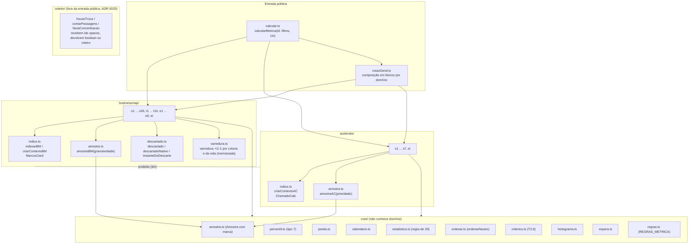
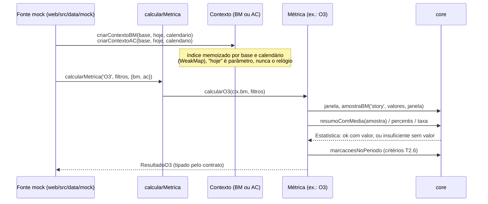

# Biblioteca de cálculo (`packages/metricas`)

Documentação técnica do pedido 001. Este documento descreve o que o código faz hoje. As regras de negócio estão no briefing (`docs/briefing-execucao-metricas.md`), que é a fonte da verdade. Decisões de estrutura: ADR 0002 (monorepo e pacotes compartilhados) e `docs/architecture/regras-metricas.md` (M-005).

Toda métrica de tempo, percentil, taxa e histograma passa por esta biblioteca (T2.5). Nenhuma métrica faz cálculo próprio, e a UI não importa a biblioteca: só a fonte em `web/src/data/mock` a carrega, por `import()` dinâmico. O lint bloqueia os dois casos.

## 1. Estrutura



Regras de fronteira (verificadas por `eslint.config.js` e pelo meta-teste `web/src/test/lint.meta.test.ts`):
- `businessmap/` e `acelerato/` não se importam (BusinessMap e Acelerato nunca se misturam).
- `core/` não importa nenhum domínio.
- `criarAmostraInterna` só é chamada por `businessmap/amostra.ts` e `acelerato/amostra.ts`.
- `motivo_descarte` e `arquivado_em` só são lidos em `businessmap/descartado.ts`.
- Sem `sort`/`toSorted` direto em métrica (usar `ordenarNeutro`), sem `Math.min(...xs)`/`Math.max(...xs)` (usar `minimo()`/`maximo()`), sem `Math.random`, sem `mediana` sobre valores soltos.
- A biblioteca não importa o mock (só os testes importam).
- `coletor/` (ADR 0020) recebe identidade opaca de pessoa e devolve só boolean ou inteiro; **não** entra em `exports` do `package.json`, em `src/index.ts` nem em `./businessmap`, e nenhuma métrica a importa (teste em `coletor/houveTroca.test.ts`; a regra de lint de import por caminho é da fase 3).

## 2. Fluxo de um cálculo



`calcularMetrica` é um despacho tipado (`CALCULOS: { [K in MetricaId]: ... }`): uma métrica nova sem entrada não compila. Cada métrica recebe só o contexto do seu domínio; apenas `VISAO_GERAL` recebe os dois, e os usa em blocos separados.

## 3. Núcleo

### 3.1 Calendário útil (`core/calendario.ts`)
- Instantes em epoch ms; "dia" é o número de dias desde 1970-01-01 no fuso do calendário. Não usa `Date` nem o fuso da máquina (os testes rodam com `TZ=UTC` para garantir isso).
- Padrão (provisório, P2): fuso -03:00, turnos 08:00-12:00 e 13:00-17:00 (8 h/dia), feriados nacionais 2025-2026.
- `modo: 'corrido'` (`calendarioCorrido`) conta 24 h/dia, para a exceção de plantão (4.2). Não está ligado a nenhuma prioridade.
- Funções principais: `horasUteisEntre(inicio, fim, cal)` (aditiva em intervalos contíguos; erro se `fim < inicio`), `somarHorasUteis`, `diasUteis(horas) = horas / horasPorDia`, `fimDoExpediente(dia)` (lido dos turnos, nada de 17:00 fixo), `instanteDeIso` (parser próprio de ISO com fuso).

### 3.2 Percentil tipo 7 (`core/percentil.ts`)
- Interpolação linear entre ordens, `h = (n - 1) * p`; `valor = x[floor(h)] + (h - floor(h)) * (x[floor(h)+1] - x[floor(h)])`. É o tipo 7 de Hyndman-Fan, igual a `PERCENTILE.INC` do Excel/Power BI e ao padrão do NumPy. Constante `METODO_PERCENTIL = 'interpolacao-linear-tipo-7'` (critério v1, provisório P1).
- `media` soma em ordem crescente, para que o resultado não dependa da ordem de entrada.

### 3.3 Janela móvel (`core/janela.ts`)
- `JANELA_POR_GRANULARIDADE` é o único lugar da regra: hoje as quatro classes (story, frente, projeto, chamado) usam `JANELA_PERCENTIS_PADRAO` (12 semanas, em `@metricas-dspd/contratos`). Se o usuário decidir 12 meses para frente e projeto (pergunta P3/2), muda uma linha.
- 12 semanas = 84 dias corridos, inclusive: o dia 84 está dentro, o dia 85 fora.
- `janelaDeslocada(j, meses)` gera a janela equivalente anterior (comparação semestral/anual).

### 3.4 Regra de 20 itens (`core/estatistica.ts`)
- `MINIMO_AMOSTRA = 20` (em contratos). `publicavel(n) = n >= 20`.
- `estatistica(n, janela, calcular)`: abaixo de 20 devolve `{ status: 'insuficiente', n, minimo, janela }` **sem chamar** `calcular` (o valor nem existe); senão `{ status: 'ok', n, valor, janela }`.
- `percentis(a)` (P50/P85/P95), `resumoComMedia(a)` (a média só existe junto dos percentis), `taxa(k, n)` (o `pct` só existe com `n >= 20`), `pctOuNulo`.
- Os cartões novos (O19, O21, O24, O25, T10, E7, E9) importam `MINIMO_AMOSTRA` de `@metricas-dspd/contratos` em vez de repetir o 20; nenhum literal de mínimo fica no código de métrica.
- `percentisDe`/`medianaDe` não aplicam o mínimo e só podem ser usados dentro de uma `estatistica(...)` já protegida.

### 3.5 `Amostra` com marca (`core/amostra.ts`)
```ts
interface Amostra<D extends Dominio, G extends string> {
  readonly dominio: D; readonly classe: G
  readonly valores: readonly number[]; readonly janela: Intervalo
  readonly [marcaAmostra]: true   // unique symbol: literal de objeto não compila
}
```
- Só `amostraBM(granularidade, ...)` e `amostraAC(prioridade, ...)` constroem amostras; o resultado é congelado.
- Não existe função de concatenação de amostras. Com isso, misturar BusinessMap com Acelerato, ou story com frente ou projeto, não tem caminho no tipo. Histograma (`histograma(a, faixas)`) também recebe uma `Amostra`, logo uma única classe e granularidade, e devolve `null` abaixo de 20.
- `histogramaEmpilhado` é só para contagem de retrato (backlog do O10), não aplica a regra de 20 e só empilha tipos da mesma granularidade.

### 3.6 `descartado` (`businessmap/descartado.ts`)
- **Única definição (P-1 = A, que substituiu a Q6):** `descartado(card)` = estado nativo do BusinessMap, isto é, descartado ou excluído (`descartadoNativo`). Motivo de descarte preenchido sem descarte deixa de tirar o card dos cálculos e vira aviso no O25 (`motivoSemDescarte`). A mudança vale a partir de 2026-10-15 e está registrada na `VersaoCriterio` `criterio-2026-10-15-descarte-nativo` (T2.6), cujo `afeta` é derivado do catálogo (toda métrica de fonte BusinessMap, menos as listadas em `NASCIDAS_DEPOIS_DO_DESCARTE_NATIVO`).
- Arquivado não é descartado: entregue e arquivado é o fim normal e permanece nos cálculos (4.2, 7.3).
- `arquivadoSemDesfecho(card, entregue)`: arquivado, sem descarte e sem entrega. Pela regra provisória P1 sai do "trabalho aberto" e é contado à parte; a célula correspondente da matriz continua `pendente-usuario`.
- **Definição nativa (R-2' = A, P-1 = A)** em `descartado.ts`: `descartadoNativo(card)` = excluído, ou motivo preenchido junto com arquivamento (projeção do estado `discarded` do BusinessMap na fase 1); é a definição única de `descartado()`. `motivoSemDescarte(card)` = motivo preenchido sem ser descartado nem excluído (aviso de preenchimento, fora da taxa, CA-26). `instanteDoDescarte` devolve o instante (`excluido_em` ou o arquivamento como `discarded_at`) e `aproximado: true` quando só há a última revisão (`instanteDeExcluido`). `discard_comment` nunca é lido.
- **Mock (B11a):** a base do BusinessMap passa por `aplicarTambemFase1` (`packages/mock/src/businessmap/tambem.ts`), pós-processamento em streams próprias `businessmap/tambem:<passo>` (passos `descarte`, `ordem`, `area`, `ida-e-volta`, `retorno`, `motivo`, `aviso`, `parados`, `projetos`). O Acelerato não passa por ali (hash intacto).
- `MarcosCard.ativo = não excluído && não subtarefa && não descartado`. Excluídos e arquivados permanecem na base (carga incremental nunca apaga histórico).

### 3.7 `ordenarNeutro` (`core/ordenar.ts`)
- Ordenação estável e total por lista de chaves; números por valor (negativo para decrescente), textos por ponto de código (sem `localeCompare`). A última chave é sempre o id, então a saída não depende da ordem de entrada nem do ambiente.
- "Ordem neutra" do domínio (fluxo, P1 a P5, taxonomia 4.3, domínio fechado) com desempate por id; nunca ordem por desempenho de pessoa ou equipe.

### 3.8 Versões de critério (T2.6, `core/criterios.ts`)
- A lista de `VersaoCriterio` (`id`, `data`, `descricao`, `afeta: MetricaId[]`) vive na configuração da base. **Exceção (B2):** as versões que nascem de uma constante da própria biblioteca ficam em `VERSOES_DA_BIBLIOTECA` (`VERSAO_CRITERIO_PARADOS_V1`, id `criterio-2026-10-14-parados-v1`, data 2026-10-14, afeta O2; e `VERSAO_CRITERIO_DESCARTE_NATIVO`, id `criterio-2026-10-15-descarte-nativo`, data 2026-10-15, com `afeta` derivado de `METRICA_IDS` filtrado por `fonteDaMetrica === 'businessmap'`, menos `NASCIDAS_DEPOIS_DO_DESCARTE_NATIVO`) e `marcacoesNoPeriodo` as soma às da base sem repetir id. Alinhar com o texto do A8 é pendência do architect.
- `LIMITE_PARADO_DIAS_UTEIS = 5` (O23, bloco `parados` do O2): constante única; mudar o valor exige nova `VersaoCriterio` no mesmo commit.
- `marcacoesNoPeriodo(metrica, periodo, versoes)` devolve as mudanças que afetam a métrica com data em `(inicio, fim]`, ordenadas por data. `criteriosDe` devolve as marcações da série e da janela; todo resultado traz `criterios`, que a UI marca no gráfico.
- Critério v1: percentil tipo 7 e janela de 12 semanas.

### 3.9 Outros módulos do núcleo
- `espera.ts`: espera invisível = `(mediana cliente - mediana time) / mediana cliente * 100`, sobre os mesmos itens e a mesma janela; abaixo de 20 nenhuma das duas visões é publicada.
- `histograma.ts`: faixas inteiras inclusivas sobre `floor(valor)`, presets `rapida`, `lenta`, `frente`, `projeto`, `backlog` (provisórios, P14).
- `series.ts`: recortes em semanas, meses e trimestres com marca `emAndamento`.
- Monte Carlo: ver 3.11 (`core/montecarlo.ts`, K-059).

### 3.9.1 Extensão do pedido 011 e custo (`businessmap/extensao.ts`, `businessmap/custo.ts`)
- `ExtensaoTambemBM` (só mock, gerada por `gerarExtensaoTambemMock`, lazy e fora da montagem do contexto) carrega o que a base ainda não tem: `entradasSazonais` (T11), `primeiroToque` (O22), `passagens` (O26), `vinculos` (T13), `datasProjeto` (E6), `conhecimentoSistema` (E8), `equipeResponsavel`, `outrosPublicavel` e `configEquipes` (T14). Nenhum campo é pessoa: são instantes, inteiros, faixas e booleanos já agregados, como o coletor os entregaria (ADR 0020, item 8). `ContextosMetricas.tambem` a recebe; sem ela, cada métrica devolve o estado vazio (nunca erro), e o T13 e o O26 tratam tudo como "sem dado", nunca como "0".
- `custoDoPeriodo(config, periodo)`: custo total do DSPD do período, por pró-rata em dias corridos de cada vigência dentro de cada mês (ou ano) (Q-E7-1); `null` quando nenhuma vigência cobre o período. `ContextosMetricas.custo` só chega por fixture de teste (no mock não há custo, CA-13).

### 3.10 Contextos e índices
- `criarContextoBM(base, hoje, cal)` monta `MarcosCard` uma vez por base e calendário: entrada, compromisso, início, entrega vigente (`null` se reaberto), segmentos de execução, `cicloHU` (soma dos segmentos; o intervalo entregue não conta, P10), coluna e papel atuais, bloqueio aberto, projeto e frente de origem.
- `criarContextoAC(base, hoje, cal)` monta `ChamadoCalc`: `fechado`, `apuravel` (fechado e sem exceção de registro posterior), primeiro atendimento e restauração em horas úteis (pendências descontadas do relógio de resolução), horas por totalizador e por etapa, `vidaHU`.

### 3.10.1 Varredura por coluna e da vida (`businessmap/varredura.ts`, `estado.ts`, B8)
- `varreduraPorColuna(ctx, f, quadro, instantes)`: varredura +1/-1 por coluna dos cards em progresso (stories ativas ou não, sem subtarefa nem excluídos: a base do O1). É a única fonte do WIP do O1 e do `emProgresso` do O20 (a invariante "igual ao `wip` do O1 no dia" é teste).
- `varreduraVida(ctx, f, quadro, instantes, desde)`: o mesmo, da vida inteira do card (de Backlog a Entregue, inclusive o entregue arquivado, P1), usada pelo O20.
- As duas são memoizadas por contexto (`WeakMap`). A chave leva o quadro (`null` = todos), os filtros normalizados (`ordenarNeutro`) e os instantes; o resultado é compartilhado e não pode ser alterado. Também são memoizados `selecionar` (`comum.ts`) e a varredura de filas do O24 (que não depende de filtro). Os caches não têm teto: item para o `security-engineer` (disponibilidade).
- O1 a frio caiu de 31-38 ms para cerca de 10 ms; a impressão digital do O1 é igual em 8 filtros (`varredura.test.ts`).

### 3.11 Monte Carlo (`core/montecarlo.ts`)
- `preverTermino(vazao, itens, granularidade, { prng, simulacoes? })`: "quando terminam N itens", em períodos. `preverItens(vazao, periodos, ...)`: "quantos itens saem em D períodos". Ambas reamostram com reposição a vazão (itens por período) de uma única `Amostra`, logo um domínio, uma classe e uma granularidade; BusinessMap e Acelerato, ou story, frente e projeto, não se combinam. `granularidade` (`dia`/`semana`) só rotula o resultado.
- PRNG injetado (`Prng = () => número em [0,1)`); `criarPrng(semente)` (mulberry32) dá reprodutibilidade. O núcleo nunca chama `Math.random`. `simulacoes` padrão: 10 000.
- Resultado `Estatistica<...>` em P50/P85/P95, nunca só média. Em `preverTermino` o P85 é o prazo que cobre 85% das simulações (p50 <= p85 <= p95). Em `preverItens` o rótulo é a confiança: P85 é o número de itens que se entrega em pelo menos 85% das simulações (quantil conservador; p95 <= p85 <= p50).
- Regra de 20: `n` = total de itens entregues na janela (soma da vazão); abaixo de 20 é `insuficiente` e a simulação não roda. Interpretação adotada para "20 itens" na previsão; confirmar com o usuário se a regra deveria contar períodos.
- A janela de 12 semanas e a filtragem por classe são responsabilidade de quem monta a `Amostra`. Não está na matriz `REGRAS_METRICA`: T6/E5 ainda não são métricas do núcleo.
- Vazão deve ser de inteiros >= 0; outro valor lança `RangeError`. Testes: unitário, propriedade (monotonicidade, determinismo, mais itens nunca terminam antes) e 100% de cobertura.

## 4. Matriz `REGRAS_METRICA` (`core/regras.ts`)

As regras do briefing como dados executáveis, uma linha por `MetricaId` (`satisfies Record<MetricaId, RegraMetrica>`; faltar ou sobrar métrica não compila). Não tem lógica de cálculo. Célula que o briefing não responde vale `'pendente-usuario'`; ninguém preenche por inferência.

| Campo | Significado |
|---|---|
| `dominio` | `businessmap`, `acelerato` ou `composicao` (só `VISAO_GERAL`, que não calcula) |
| `segmentacao` | chaves de classe; a primeira é a classe estatística (percentis e taxas dentro dela, nunca entre classes). Proibido: pessoa, responsável, equipe |
| `ordem` | `neutra` (ordem fixa do domínio + id) ou `temporal` (eixo de tempo, inclui aging, P2) |
| `incluiArquivados` | BM: card arquivado permanece (4.2, 7.3, Q6); AC: `nao-se-aplica`; ou `pendente-usuario` (P1) |
| `minimo` / `minimoSobre` | `20` e as partes protegidas (`percentis`, `mediana`, `faixa`, `taxa`, `referencia-percentil`), ou `0` para contagem, censo ou retrato |
| `granularidade` | `story`, `frente`, `projeto` ou `chamado`; lista só em composição |
| `refBriefing` | onde a regra está no briefing |
| `status` | `pendente-usuario` se e somente se alguma célula for pendente (verificado por teste) |

Estado atual (cartões novos do pedido 011): O19, O21, O22, O24, O25, O26, T10, T12, T13, E6, E7, E8 e E9 não têm pendência (`status: 'ok'`; as decididas Q-a, Q-b e Q-E7-1 valem como regra do O26 e do E7); o **T14** é a única com `status: 'pendente-usuario'` (cardinalidade do campo "Time responsável" e Q-T14-2, 3, 4, 7, 8, 9 e 10). Nas propriedades eles aparecem como exceções nominais onde a chave vive fora do card ou do conjunto (ver 4.1). 7 linhas com `status: 'pendente-usuario'`, todas pela P1 (arquivado sem desfecho): O1, O2, BLOQUEADOS, O10, T4, T7, T9.

### 4.1 As 6 propriedades (`regras.property.test.ts`)
Cada propriedade itera a matriz com fast-check sobre a base mock (escala 0,5, semente fixa) e lista as exceções **nominalmente**, com motivo.

| # | Propriedade | Aplica a | Exceções nominais |
|---|---|---|---|
| P1 | Arquivar card **entregue** não muda o resultado | BM com `incluiArquivados` definido | O1, O2, BLOQUEADOS, O10, T4, T7, T9 (P1 pendente) |
| P2 | Classe isolada = a mesma classe dentro do conjunto | métricas com segmentação (exceto `VISAO_GERAL`) | O1, BLOQUEADOS, O12, O18, T3, T7, T9, E2, E3, S3, S5, S6, S7 (classificador não implementado ou participação no total por definição); **novas:** O19 e T10 (motivo e fornecedor vivem no bloqueio, não no card), T12 (área é campo do card, sem classificador no harness) e E7 (sistema é campo do card; participação é fração do total) |
| P3 | Dados do outro domínio não alteram o resultado | todas; `VISAO_GERAL` por bloco | nenhuma |
| P4 | Fronteira 19/20: n = 19 não publica, n = 20 publica; `insuficiente` nunca carrega `valor`/`pct` | `minimo = 20` | E1, EI_FL3 (o mock não tem 20 projetos por tipo, Q4; coberto em `businessmap.test.ts`); **novas:** E9 (idem, fronteira da referência P85 em `e9.test.ts`) e T10 (percentis na janela de 12 semanas: na base de escala 0,5 nenhum fornecedor chega a 20; fronteira 19/20 e corte do dia 84/85 em `bloqueios.test.ts`) |
| P5 | Embaralhar a entrada não muda a saída nem a ordem | todas | nenhuma |
| P6 | Nenhuma chave nem valor por pessoa; equipe só como filtro aplicado | todas | nenhuma |

Meta-testes (bloqueiam o `pnpm run pronto`): a matriz cobre exatamente `METRICA_IDS`; `status` coerente com as células; nenhuma chave proibida na segmentação e T7 temporal (P2); exceção só de id existente e a que a propriedade se aplica (exceção desnecessária esconde regra); fronteira exata 20/19 alcançada em pelo menos 20 métricas; toda métrica exercitada por cada propriedade ou listada como exceção.


## 5. Catálogo das 48 métricas

As 33 do núcleo e as 15 do pedido 011 com cálculo próprio (fase 1: O19, O20, O21, O24, O25, T10, T12, E7, E9, mais o bloco O23 dentro do O2 e a T11, descrita em `docs/api/metricas.md`; fase 2, em mock: O22, O26, T13, T14, E6, E8). Todas as novas são só BusinessMap e nenhuma tem campo de pessoa ou de equipe; o contrato de cada uma está em `docs/contratos/metricas/`.

Legenda de unidade: DU = dias úteis; HU = horas úteis; DC = dias corridos. "Classe" é a primeira chave de segmentação (estatística calculada dentro dela). A referência é o `refBriefing` da matriz.

### 5.1 BusinessMap, fluxo operacional (FL1)

| Métrica | Função | Fórmula resumida | Segmentação | Unidade | Mínimo | Ref. briefing |
|---|---|---|---|---|---|---|
| O1 | `calcularO1` | WIP por dia útil no fim do expediente (fila e bloqueados contam) vs limite somado das equipes; % de dias dentro do limite; retrato por coluna se uma equipe | coluna, tipo | itens; % de dias | 0 (taxa de dias usa `taxa`) | 06 O1; 4.2 colunas; 7.3 |
| O2 | `calcularO2` | idade de cada item aberto vs P85/P95 do ciclo do próprio tipo na janela (dentro, entre P85-P95, acima P95); **bloco O23 (`parados`, B2):** k de n dos itens do WIP sem mudar de coluna há mais de `LIMITE_PARADO_DIAS_UTEIS` (5) DU, por etapa, percentual só com n >= 20, sem tempo apontado | tipo, etapa | DU | 20 na referência de percentil | 06 O2; 4.1 início |
| BLOQUEADOS | `calcularBloqueados` | itens em WIP com bloqueio aberto; tempo bloqueado = HU do início do bloqueio até o corte | coluna, tipo | DU | 0 | 4.2; 06 O1 |
| O3 | `calcularO3` | tempo de ciclo (soma dos segmentos de execução) dos entregues na janela: P50/P85/P95 + média; série semanal do P85; variação do P85 vs janela 6 meses antes | tipo | DU | 20 (percentis) | 06 O3; 4.1; 4.2 |
| O4 | `calcularO4` | entregas por semana; faixa mín-máx e mediana das semanas completas da janela | tipo | itens/semana | 20 (faixa, mediana) | 06 O4; 4.2 |
| O7 | `calcularO7` | entradas x saídas por tipo e mês (mínimo 6 meses), saldo e acumulado; situação cresce/estável/diminui (tolerância 10%) | tipo | itens | 0 | 06 O7; 4.1 |
| O9 | `calcularO9` | três relógios por item entregue: cliente (entrada a entrega), equipe (compromisso a entrega), ciclo; P50/P85/P95, histogramas e série mensal | tipo, relógio | DU | 20 | 06 O9; 4.1 |
| O10 | `calcularO10` | idade dos não iniciados no corte (visão do time; visão do cliente = área externa); histograma empilhado por tipo; >180 dias; série mensal P50/P85 | tipo, faixa de idade | DC | 20 (percentis) | 06 O10; 4.1 |
| O12 | `calcularO12` | acordos com data no mês; vencido = data acordada < entrega (ou corte); por responsabilidade do atraso; % vencidos | responsabilidade do atraso | itens; % | 20 (taxa) | 06 O12; 7.3 |
| O15 | `calcularO15` | bugs com fase de detecção criados no período; contenção = fases internas / total; escape = Produção / total | fase de detecção | % | 20 (taxa) | 06 O15; 4.3; 4.2; 7.2 |
| O18 | `calcularO18` | entregas com e sem bug vinculado até 30 dias após a entrega; taxa limpa, densidade geral (bugs/entregues) e entre afetados (bugs/com bug); mês "em apuração" até fechar os 30 dias | com/sem bug, tipo | %; bugs/item | 20 (taxa) | 06 O18; 4.2 |
| O19 | `calcularO19` | bloqueios encerrados no período por motivo (7 motivos do domínio fechado): contagem e soma em DU (censo) e `pctDoTotal` = k de n (n = bloqueios encerrados, não dias); P50/P85/P95 da duração **na janela de 12 semanas**; abertos no fim do período (inclui os que terminam depois) à parte, fora da soma | motivo do bloqueio | DU; % | 20 (taxa e percentis, por motivo) | pedido 011 O19; R6; B3-1 |
| O20 | `calcularO20` | contagem diária de itens por faixa, de Backlog a Entregue (varredura da vida, B8), mais `emProgresso` = WIP do O1; faixa = coluna com uma equipe, papel nos demais casos; destaque = fila de maior crescimento entre o primeiro e o último dia do período; vazio sem transição no período | coluna (uma equipe) ou papel | itens | 0 (censo) | pedido 011 O20; B8; R5 |
| O21 | `calcularO21` | entregas do período com ao menos um retorno (inclui reabertura); matriz origem para destino por coluna (uma equipe) ou por papel; par com x sem retorno do tempo de ciclo do O3 (`entreguesDe`), só dentro do tipo, `grupoAbaixoDoMinimo` indica o grupo que faltou | tipo; coluna ou papel | %; DU | 20 (taxa; 20 em cada grupo do par) | pedido 011 O21; CA-6; regra 7 |
| O24 | `calcularO24` | inícios da classe Padrão que passaram na frente de um mais antigo do mesmo quadro e tipo (varredura FIFO O(n log n)); custo = espera do ultrapassado, do início do primeiro que passou até o próprio início (R-1 = A), P50/P85 por tipo na janela | tipo (grupo `equipe-tipo-padrao`) | %; DU | 20 (taxa; percentis por tipo) | pedido 011 O24; D-6' = A; R-1 = A; CA-17 |
| O25 | `calcularO25` | encerrados (entregues e descartados) no período: taxa de descarte, série mensal; tempo consumido depois do início por tipo (P50/P85 na janela; antes do início à parte, D-13); aviso de preenchimento = motivo sem descarte que saiu da taxa do período (B6-1); `porMotivo` nulo (CA-44) | tipo | %; DU | 20 (taxa; percentis por tipo) | pedido 011 O25; R-2' = A; P-1 = A |
| O22 | `calcularO22` | dias úteis da criação ao primeiro comentário humano (instante vindo da extensão; autor e texto nunca chegam), por tipo, na janela de 12 semanas pelo instante do toque: P50/P85/P95 e histograma de 6 faixas fixas (via `histograma` do núcleo, sobre meios dias); "sem toque" = abertos com campo nulo e a idade do mais antigo (retrato de hoje) | tipo | DU | 20 (percentis e histograma, por tipo) | pedido 011 O22; D-9'; CA-43 |
| O26 | `calcularO26` | entregas do período por faixa de passagens (0, 1, 2, 3, 4+; só o inteiro `passagens`), por tipo: contagem sempre, `pct` com 20 ou mais e P85 do ciclo do O3 (`entreguesDe`) por faixa na janela; `semDado` à parte. A contagem de trocas fica em `coletor/` (`houveTroca`, Q-a = 1, Q-b = conta) | tipo, faixa de passagens | itens; % ; DU | 20 (taxa e P85, por faixa) | pedido 011 O26; D-5' = B; CA-38 |
| EI_FL1 | `calcularEIBM(..., 'FL1')` | (mediana cliente - mediana equipe) / mediana cliente, por tipo de demanda (sem Bug interno) | tipo | %; DU | 20 (mediana) | T3.4; 06 EI; Q4 |

### 5.2 BusinessMap, tático (FL2)

| Métrica | Função | Fórmula resumida | Segmentação | Unidade | Mínimo | Ref. briefing |
|---|---|---|---|---|---|---|
| T1 | `calcularT1` | lead time ponta a ponta por classe de serviço: P50/P85/P95 do total, medianas dos blocos fila/espera/execução/homologação, fração em fila | classe de serviço, etapa | DU; % | 20 | 06 T1; Q3 |
| T2 | `calcularT2` | % de entregues dentro do SLE publicado da classe; estouros atribuídos à etapa de maior bloco | classe de serviço, etapa | %; itens | 20 (taxa) | 06 T2; Q3 |
| T3 | `calcularT3` | participação por natureza (Sustentação, Evolução, Projetos, Dívida técnica) em itens e em tempo de ciclo, vs acordado; desvio em p.p. (mapa tipo→natureza provisório, P8) | natureza de alocação | %; p.p. | 20 (taxa) | 06 T3; 4.3; P8 |
| T4 | `calcularT4` | chegadas x vazão por semana e classe; faixas, razão chegada/vazão, backlog, semanas para zerar | classe de serviço | itens/semana; razão | 20 (mediana, faixa) | 06 T4; Q3 |
| T5 | `calcularT5` | % de demanda de falha (origem preenchida) por sistema e por área, origens; variação semestral dos 2 sistemas de maior parcela | sistema, área | % | 20 (taxa) | 06 T5; 4.2 |
| T7 | `calcularT7` | frentes abertas por projeto vs limite; idade de cada frente vs P85/P95 do ciclo das frentes concluídas; histograma de frentes | projeto (granularidade frente) | DU | 20 (percentis) | 06 T7; 02; 7.3; P2 |
| T10 | `calcularT10` | bloqueios encerrados com fornecedor informado, de qualquer motivo: contagem e soma em DU por fornecedor (censo no período), P50/P85/P95 **na janela de 12 semanas** (opção A até o usuário decidir); sem prazo contratado nem status (D-10 = A) | fornecedor | DU | 20 (percentis, por fornecedor) | pedido 011 T10; D-10 = A; R-5; B3-1 |
| T12 | `calcularT12` | demandas criadas no período com "ida e volta" = bloqueio "Falta de informação no chamado" antes do início (ou card nunca iniciado) OU retorno compromisso para backlog (D-8 = A, conta uma vez); k de n por área, em ordem de volume | área solicitante | % | 20 (taxa, total e por área) | pedido 011 T12; D-8 = A |
| T13 | `calcularT13` | entregas do período que dependeram de outro quadro (vínculo `predecessor`, vigente antes da entrega, inclusive removido; quadro desconhecido = `semDado`), em blocos de demanda e de frente, nunca juntos; par com x sem do lead time do T1 (`blocosDe`) por tipo, 20 em cada grupo; só o booleano agregado | tipo; granularidade em blocos | %; DU | 20 (taxa; 20 em cada grupo do par) | pedido 011 T13; D-14' = A; R-4; CA-6; CA-8 |
| T14 | `calcularT14` | por projeto em andamento no período (ligado a sistema do meu time ou com 1 card dele): `meuTime` = k de n (n = cards com time informado), `semTime` fora do denominador, `outrosTimes` = n - k, ou `null` quando o booleano `outrosPublicavel` (calculado fora, R-1 = B) é falso; só com uma equipe no filtro; nunca nome de outra equipe nem contagem de pessoas | (nenhuma); granularidade em blocos | %; itens | 20 (taxa, por projeto e total) | pedido 011 T14; Q-T14-1 = B, Q-T14-5 = D, Q-T14-6 = A, R-1 = B; CA-27 a CA-34 |
| T9 | `calcularT9` | por projeto em andamento: avanço = frentes concluídas / total; crescimento de escopo = adicionadas / originais | projeto (granularidade frente) | % (censo) | 0 | 06 T9; 7.1 |
| EI_FL2 | `calcularEIBM(..., 'FL2')` | espera invisível de frentes: cliente = entrada a entrega; time = compromisso a entrega; segmento único | (nenhuma) | %; DU | 20 (mediana) | T3.4; 02 |

### 5.3 BusinessMap, estratégico (FL3)

| Métrica | Função | Fórmula resumida | Segmentação | Unidade | Mínimo | Ref. briefing |
|---|---|---|---|---|---|---|
| E1 | `calcularE1` | lead time de projetos (entrada a entrega) por tipo de projeto (Iniciativa, Melhoria): P50/P85/P95, medianas antes e depois do início; variação da mediana vs 12 meses antes | tipo de projeto | DU | 20 | 06 E1; Q4 |
| E2 | `calcularE2` | entregas por trimestre e categoria (objetivo, obrigação legal, manutenção, fora de objetivo); % da evolução vinculada a objetivo (meta 60%) | objetivo, natureza | %; itens | 20 (taxa) | 06 E2; Q5 |
| E3 | `calcularE3` | iniciativas com e sem ficha de resultado; atingimento = ganho medido / previsto | iniciativa | % (censo) | 0 | 06 E3 |
| E7 | `calcularE7` | demandas entregues no período por sistema (peso por contagem, D-2) e por natureza do T3 (`naturezaDe`, sem mapa próprio); `participacao` = k de n com o total só com 20 ou mais entregas no sistema, senão `null` (B5-1); sem R$ (`custoConfigurado: false`, CA-13) a menos que a configuração do custo total do DSPD chegue por fixture (`custo.ts`, pró-rata por dias corridos, Q-E7-1): `custoRateado` = custo do período x entregas / total e `custoPorDemanda` = rateado / entregas, só com 20 ou mais entregas no sistema | sistema, natureza | itens; % | 20 (taxa) | pedido 011 E7; D-1' = A; D-2; CA-23 |
| E6 | `calcularE6` | projetos concluídos no período com data comprometida (extensão): deslize em DU inteiros com sinal (`diasUteisNoIntervalo`), na data pelo dia civil (tolerância zero, D-7); `naData` (taxa) e P50/P85 do deslize (janela de 12 semanas) só com 20 ou mais; pontos sempre; `semData` à parte | (nenhuma) | DU; % | 20 (taxa e P50/P85) | pedido 011 E6; D-7; CA-20 |
| E8 | `calcularE8` | conta SISTEMAS por faixa de pessoas (1, 2, 3 ou mais) a partir do agregado por sistema (extensão; no real, `agg_conhecimento_sistema`), janela fixa de 12 meses; menos de 5 sistemas = recorte pequeno, sem faixas; nenhum nome de sistema (R-1 = B); nunca lê pessoa | (nenhuma) | sistemas | 0 (censo) | pedido 011 E8; D-3; R-1 = B; CA-10 |
| E9 | `calcularE9` | projetos aprovados e ainda não iniciados (retrato de hoje): idade em DU desde a criação, faixa fixa (0-30, 31-90, 91-180, mais de 180); referência P85 por tipo de projeto, importada do E1 (`concluidosDeProjeto`), mínimo 20 por tipo | tipo de projeto | DU | 20 (referência P85, por tipo) | pedido 011 E9; regra 7; Q4 |
| EI_FL3 | `calcularEIBM(..., 'FL3')` | espera invisível de projetos: cliente = entrada a entrega; time = início a entrega; por tipo de projeto | tipo de projeto | %; DU | 20 (mediana) | T3.4; Q4 |

### 5.4 Acelerato, sustentação

| Métrica | Função | Fórmula resumida | Segmentação | Unidade | Mínimo | Ref. briefing |
|---|---|---|---|---|---|---|
| S1 | `calcularS1` | primeiro atendimento e restauração (pendências descontadas) dos apuráveis fechados na janela: P50/P85/P95 + média; razão mediana/alvo e P85/alvo | prioridade | HU | 20 | 06 S1; 3.2; Q2 |
| S2 | `calcularS2` | % no prazo do SLA de primeiro atendimento (`status_sla_pa`) e de restauração (`status_sla_r`), separados; meta 90% | prioridade | % | 20 (taxa) | 06 S2; 3.2; Q2 |
| S3 | `calcularS3` | chamados abertos por mês e prioridade; proporção, % P1+P2, ajustes manuais; `janela` = total e P1+P2 (k de n) do período inteiro | prioridade | chamados; % | 0 (proporção só com n ≥ 20 no mês) | 06 S3 |
| S4 | `calcularS4` | nível de resolução (N1, N2, N3, Fornecedor) dentro de cada prioridade; P50/P85/P95 do tempo na etapa do nível | prioridade, nível | %; HU | 20 (mediana) | 06 S4; 7.2; Q2 |
| S5 | `calcularS5` | motivos de escalação (domínio fechado) entre resolvidos em N2, N3 ou Fornecedor; não informado à parte; evolução mensal | motivo de escalação | % | 20 (taxa) | 06 S5; 7.3 |
| S6 | `calcularS6` | motivos de encerramento dos fechados; taxa de contorno; não informado nunca inferido | motivo de encerramento | % | 20 (taxa) | 06 S6 |
| S7 | `calcularS7` | dois fenômenos nunca somados: % de ajuste manual de prioridade (abertos) e % de reclassificação de tipo (fechados) | tipo de reclassificação | % | 20 (taxa) | 06 S7 |
| EI_SUST | `calcularEIAcelerato` | espera invisível: cliente = vida do chamado (soma dos 5 totalizadores); time = totalizador "em atendimento"; por prioridade | prioridade | %; HU | 20 (mediana) | T3.4; Q2 |

### 5.5 Composição

| Métrica | Função | Fórmula resumida | Segmentação | Unidade | Mínimo | Ref. briefing |
|---|---|---|---|---|---|---|
| TENDENCIA_FLUXO | `businessmap/tendencia.ts` `calcularTendenciaFluxo` | seis meses fechados; cada ponto é o núcleo do O3 (`classesNaJanela`, o mesmo do `calcularO3`) na janela de 12 semanas até o fim do mês, projetado em `{ tipo, n, estatistica{p50,p85} }`; `concluidos` pela seleção do O4 (`concluidosDeDemanda`). Sem fórmula própria | `tipo` | DU; itens | 20 (percentis, herdado do O3) | ADR 0019; plano sustentacao-no-operacional |
| TENDENCIA_SUST | `acelerato/tendencia.ts` `calcularTendenciaSust` | seis meses fechados; cada ponto é o núcleo do S2 (`aderenciaPorPrioridade`, o mesmo do `calcularS2`) na janela de 12 semanas até o fim do mês e `volume` pela abertura (`diasDeAbertura`, base do S3). Sem fórmula própria | `prioridade` | %; chamados | 20 (taxa, herdado do S2) | ADR 0019; plano sustentacao-no-operacional |
| VISAO_GERAL | `calcularVisaoGeral` | reexpõe O1, O2, BLOQUEADOS, O10, O12, T2, T3, T4, T9, E2, E3, S1, S2 e os 4 EI em blocos por nível e fonte; alertas por meta violada. Não calcula nada que misture domínios | (por bloco) | herdada | herdado de cada métrica | spec UX 3.1; Q1 |

## 6. Pendências que afetam a biblioteca
Nenhuma é resolvida por inferência; ficam com o usuário.
- P1: arquivado sem desfecho (7 linhas `pendente-usuario`; comportamento provisório testado em `regras.test.ts`).
- P2: calendário útil (turnos e feriados) é provisório.
- Método de percentil (tipo 7): provisório; o comentário de `core/percentil.ts` o marca como "P1", numeração diferente da P1 de arquivados acima.
- P3/pergunta 2: janela de 12 meses para frente e projeto.
- P8: mapa tipo para natureza do T3.
- P14/pergunta 13: faixas de histograma.
- T10, janela dos percentis (pedido 011): opção A em vigor (12 semanas, regra geral); opção B (janela própria de 12 meses, parâmetro único) depende do usuário.
- O19, base do percentual: `pctDoTotal` sobre bloqueios (provisório); sobre dias exigiria pergunta ao usuário sobre o mínimo de 20.
- O25(b): entregue e depois excluído conta como descarte? Com o usuário.
- O20: o Backlog pode ser o destaque no "Todas"? Pergunta à UX; fica como está (Backlog é fila).
