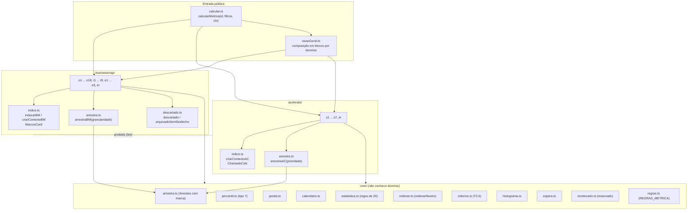

# Biblioteca de cálculo (`packages/metricas`)

Documentação técnica do pedido 001. Este documento descreve o que o código faz hoje. As regras de negócio estão no briefing (`docs/briefing-execucao-metricas.md`), que é a fonte da verdade. Decisões de estrutura: ADR 0002 (monorepo e pacotes compartilhados) e `docs/architecture/regras-metricas.md` (M-005).

Toda métrica de tempo, percentil, taxa e histograma passa por esta biblioteca (T2.5). Nenhuma métrica faz cálculo próprio, e a UI não importa a biblioteca: só a fonte em `web/src/data/mock` a carrega, por `import()` dinâmico. O lint bloqueia os dois casos.

## 1. Estrutura



Regras de fronteira (verificadas por `eslint.config.js` e pelo meta-teste `web/src/test/lint.meta.test.ts`):
- `businessmap/` e `acelerato/` não se importam (BusinessMap e Acelerato nunca se misturam).
- `core/` não importa nenhum domínio.
- `criarAmostraInterna` só é chamada por `businessmap/amostra.ts` e `acelerato/amostra.ts`.
- `motivo_descarte` e `arquivado_em` só são lidos em `businessmap/descartado.ts`.
- Sem `sort`/`toSorted` direto em métrica (usar `ordenarNeutro`), sem `Math.min(...xs)`/`Math.max(...xs)` (usar `minimo()`/`maximo()`), sem `Math.random`, sem `mediana` sobre valores soltos.
- A biblioteca não importa o mock (só os testes importam).

## 2. Fluxo de um cálculo

```mermaid
sequenceDiagram
  participant F as Fonte mock (web/src/data/mock)
  participant C as calcularMetrica
  participant X as Contexto (BM ou AC)
  participant M as Métrica (ex.: O3)
  participant K as core
  F->>X: criarContextoBM(base, hoje, calendario)<br/>criarContextoAC(base, hoje, calendario)
  Note over X: índice memoizado por base e calendário<br/>(WeakMap); "hoje" é parâmetro, nunca o relógio
  F->>C: calcularMetrica('O3', filtros, {bm, ac})
  C->>M: calcularO3(ctx.bm, filtros)
  M->>K: janela, amostraBM('story', valores, janela)
  M->>K: resumoComMedia(amostra) / percentis / taxa
  K-->>M: Estatistica: ok com valor, ou insuficiente sem valor
  M->>K: marcacoesNoPeriodo (critérios T2.6)
  M-->>F: ResultadoO3 (tipado pelo contrato)
```

`calcularMetrica` é um despacho tipado (`CALCULOS: { [K in MetricaId]: ... }`): uma métrica nova sem entrada não compila. Cada métrica recebe só o contexto do seu domínio; apenas `VISAO_GERAL` recebe os dois, e os usa em blocos separados.

## 3. Núcleo

### 3.1 Calendário útil (`core/calendario.ts`)
- Instantes em epoch ms; "dia" é o número de dias desde 1970-01-01 no fuso do calendário. Não usa `Date` nem o fuso da máquina (os testes rodam com `TZ=UTC` para garantir isso).
- Padrão (provisório, P2): fuso -03:00, turnos 08:00-12:00 e 13:00-17:00 (8 h/dia), feriados nacionais 2025-2026.
- `modo: 'corrido'` (`calendarioCorrido`) conta 24 h/dia, para a exceção de plantão (4.2). Não está ligado a nenhuma prioridade.
- Funções principais: `horasUteisEntre(inicio, fim, cal)` (aditiva em intervalos contíguos; erro se `fim < inicio`), `somarHorasUteis`, `diasUteis(horas) = horas / horasPorDia`, `fimDoExpediente(dia)` (lido dos turnos, nada de 17:00 fixo), `instanteDeIso` (parser próprio de ISO com fuso).

### 3.2 Percentil tipo 7 (`core/percentil.ts`)
- Interpolação linear entre ordens, `h = (n - 1) * p`; `valor = x[floor(h)] + (h - floor(h)) * (x[floor(h)+1] - x[floor(h)])`. É o tipo 7 de Hyndman-Fan, igual a `PERCENTILE.INC` do Excel/Power BI e ao padrão do NumPy. Constante `METODO_PERCENTIL = 'interpolacao-linear-tipo-7'` (critério v1, provisório P1).
- `media` soma em ordem crescente, para que o resultado não dependa da ordem de entrada.

### 3.3 Janela móvel (`core/janela.ts`)
- `JANELA_POR_GRANULARIDADE` é o único lugar da regra: hoje as quatro classes (story, frente, projeto, chamado) usam `JANELA_PERCENTIS_PADRAO` (12 semanas, em `@metricas-dspd/contratos`). Se o usuário decidir 12 meses para frente e projeto (pergunta P3/2), muda uma linha.
- 12 semanas = 84 dias corridos, inclusive: o dia 84 está dentro, o dia 85 fora.
- `janelaDeslocada(j, meses)` gera a janela equivalente anterior (comparação semestral/anual).

### 3.4 Regra de 20 itens (`core/estatistica.ts`)
- `MINIMO_AMOSTRA = 20` (em contratos). `publicavel(n) = n >= 20`.
- `estatistica(n, janela, calcular)`: abaixo de 20 devolve `{ status: 'insuficiente', n, minimo, janela }` **sem chamar** `calcular` (o valor nem existe); senão `{ status: 'ok', n, valor, janela }`.
- `percentis(a)` (P50/P85/P95), `resumoComMedia(a)` (a média só existe junto dos percentis), `taxa(k, n)` (o `pct` só existe com `n >= 20`), `pctOuNulo`.
- `percentisDe`/`medianaDe` não aplicam o mínimo e só podem ser usados dentro de uma `estatistica(...)` já protegida.

### 3.5 `Amostra` com marca (`core/amostra.ts`)
```ts
interface Amostra<D extends Dominio, G extends string> {
  readonly dominio: D; readonly classe: G
  readonly valores: readonly number[]; readonly janela: Intervalo
  readonly [marcaAmostra]: true   // unique symbol: literal de objeto não compila
}
```
- Só `amostraBM(granularidade, ...)` e `amostraAC(prioridade, ...)` constroem amostras; o resultado é congelado.
- Não existe função de concatenação de amostras. Com isso, misturar BusinessMap com Acelerato, ou story com frente ou projeto, não tem caminho no tipo. Histograma (`histograma(a, faixas)`) também recebe uma `Amostra`, logo uma única classe e granularidade, e devolve `null` abaixo de 20.
- `histogramaEmpilhado` é só para contagem de retrato (backlog do O10), não aplica a regra de 20 e só empilha tipos da mesma granularidade.

### 3.6 `descartado` (`businessmap/descartado.ts`)
- Única definição (Q6): `descartado(card) = card.motivo_descarte !== null`.
- Arquivado não é descartado: entregue e arquivado é o fim normal e permanece nos cálculos (4.2, 7.3).
- `arquivadoSemDesfecho(card, entregue)`: arquivado, sem descarte e sem entrega. Pela regra provisória P1 sai do "trabalho aberto" e é contado à parte; a célula correspondente da matriz continua `pendente-usuario`.
- `MarcosCard.ativo = não excluído && não subtarefa && não descartado`. Excluídos e arquivados permanecem na base (carga incremental nunca apaga histórico).

### 3.7 `ordenarNeutro` (`core/ordenar.ts`)
- Ordenação estável e total por lista de chaves; números por valor (negativo para decrescente), textos por ponto de código (sem `localeCompare`). A última chave é sempre o id, então a saída não depende da ordem de entrada nem do ambiente.
- "Ordem neutra" do domínio (fluxo, P1 a P5, taxonomia 4.3, domínio fechado) com desempate por id; nunca ordem por desempenho de pessoa ou equipe.

### 3.8 Versões de critério (T2.6, `core/criterios.ts`)
- A lista de `VersaoCriterio` (`id`, `data`, `descricao`, `afeta: MetricaId[]`) vive na configuração da base, não no código.
- `marcacoesNoPeriodo(metrica, periodo, versoes)` devolve as mudanças que afetam a métrica com data em `(inicio, fim]`, ordenadas por data. `criteriosDe` devolve as marcações da série e da janela; todo resultado traz `criterios`, que a UI marca no gráfico.
- Critério v1: percentil tipo 7 e janela de 12 semanas.

### 3.9 Outros módulos do núcleo
- `espera.ts`: espera invisível = `(mediana cliente - mediana time) / mediana cliente * 100`, sobre os mesmos itens e a mesma janela; abaixo de 20 nenhuma das duas visões é publicada.
- `histograma.ts`: faixas inteiras inclusivas sobre `floor(valor)`, presets `rapida`, `lenta`, `frente`, `projeto`, `backlog` (provisórios, P14).
- `series.ts`: recortes em semanas, meses e trimestres com marca `emAndamento`.
- `montecarlo.ts`: reservado. Nenhuma métrica desta etapa usa Monte Carlo (T6 e E5 fora); quando existir, recebe PRNG injetado.

### 3.10 Contextos e índices
- `criarContextoBM(base, hoje, cal)` monta `MarcosCard` uma vez por base e calendário: entrada, compromisso, início, entrega vigente (`null` se reaberto), segmentos de execução, `cicloHU` (soma dos segmentos; o intervalo entregue não conta, P10), coluna e papel atuais, bloqueio aberto, projeto e frente de origem.
- `criarContextoAC(base, hoje, cal)` monta `ChamadoCalc`: `fechado`, `apuravel` (fechado e sem exceção de registro posterior), primeiro atendimento e restauração em horas úteis (pendências descontadas do relógio de resolução), horas por totalizador e por etapa, `vidaHU`.

## 4. Matriz `REGRAS_METRICA` (`core/regras.ts`)

As regras do briefing como dados executáveis, uma linha por `MetricaId` (`satisfies Record<MetricaId, RegraMetrica>`; faltar ou sobrar métrica não compila). Não tem lógica de cálculo. Célula que o briefing não responde vale `'pendente-usuario'`; ninguém preenche por inferência.

| Campo | Significado |
|---|---|
| `dominio` | `businessmap`, `acelerato` ou `composicao` (só `VISAO_GERAL`, que não calcula) |
| `segmentacao` | chaves de classe; a primeira é a classe estatística (percentis e taxas dentro dela, nunca entre classes). Proibido: pessoa, responsável, equipe |
| `ordem` | `neutra` (ordem fixa do domínio + id) ou `temporal` (eixo de tempo, inclui aging, P2) |
| `incluiArquivados` | BM: card arquivado permanece (4.2, 7.3, Q6); AC: `nao-se-aplica`; ou `pendente-usuario` (P1) |
| `minimo` / `minimoSobre` | `20` e as partes protegidas (`percentis`, `mediana`, `faixa`, `taxa`, `referencia-percentil`), ou `0` para contagem, censo ou retrato |
| `granularidade` | `story`, `frente`, `projeto` ou `chamado`; lista só em composição |
| `refBriefing` | onde a regra está no briefing |
| `status` | `pendente-usuario` se e somente se alguma célula for pendente (verificado por teste) |

Estado atual: 7 linhas com `status: 'pendente-usuario'`, todas pela P1 (arquivado sem desfecho): O1, O2, BLOQUEADOS, O10, T4, T7, T9.

### 4.1 As 6 propriedades (`regras.property.test.ts`)
Cada propriedade itera a matriz com fast-check sobre a base mock (escala 0,5, semente fixa) e lista as exceções **nominalmente**, com motivo.

| # | Propriedade | Aplica a | Exceções nominais |
|---|---|---|---|
| P1 | Arquivar card **entregue** não muda o resultado | BM com `incluiArquivados` definido | O1, O2, BLOQUEADOS, O10, T4, T7, T9 (P1 pendente) |
| P2 | Classe isolada = a mesma classe dentro do conjunto | métricas com segmentação (exceto `VISAO_GERAL`) | O1, BLOQUEADOS, O12, O18, T3, T7, T9, E2, E3, S3, S5, S6, S7 (classificador não implementado ou participação no total por definição) |
| P3 | Dados do outro domínio não alteram o resultado | todas; `VISAO_GERAL` por bloco | nenhuma |
| P4 | Fronteira 19/20: n = 19 não publica, n = 20 publica; `insuficiente` nunca carrega `valor`/`pct` | `minimo = 20` | E1, EI_FL3 (o mock não tem 20 projetos por tipo, Q4; coberto em `businessmap.test.ts`) |
| P5 | Embaralhar a entrada não muda a saída nem a ordem | todas | nenhuma |
| P6 | Nenhuma chave nem valor por pessoa; equipe só como filtro aplicado | todas | nenhuma |

Meta-testes (bloqueiam o `npm run pronto`): a matriz cobre exatamente `METRICA_IDS`; `status` coerente com as células; nenhuma chave proibida na segmentação e T7 temporal (P2); exceção só de id existente e a que a propriedade se aplica (exceção desnecessária esconde regra); fronteira exata 20/19 alcançada em pelo menos 20 métricas; toda métrica exercitada por cada propriedade ou listada como exceção.


## 5. Catálogo das 33 métricas

Legenda de unidade: DU = dias úteis; HU = horas úteis; DC = dias corridos. "Classe" é a primeira chave de segmentação (estatística calculada dentro dela). A referência é o `refBriefing` da matriz.

### 5.1 BusinessMap, fluxo operacional (FL1)

| Métrica | Função | Fórmula resumida | Segmentação | Unidade | Mínimo | Ref. briefing |
|---|---|---|---|---|---|---|
| O1 | `calcularO1` | WIP por dia útil no fim do expediente (fila e bloqueados contam) vs limite somado das equipes; % de dias dentro do limite; retrato por coluna se uma equipe | coluna, tipo | itens; % de dias | 0 (taxa de dias usa `taxa`) | 06 O1; 4.2 colunas; 7.3 |
| O2 | `calcularO2` | idade de cada item aberto vs P85/P95 do ciclo do próprio tipo na janela (dentro, entre P85-P95, acima P95) | tipo, etapa | DU | 20 na referência de percentil | 06 O2; 4.1 início |
| BLOQUEADOS | `calcularBloqueados` | itens em WIP com bloqueio aberto; tempo bloqueado = HU do início do bloqueio até o corte | coluna, tipo | DU | 0 | 4.2; 06 O1 |
| O3 | `calcularO3` | tempo de ciclo (soma dos segmentos de execução) dos entregues na janela: P50/P85/P95 + média; série semanal do P85; variação do P85 vs janela 6 meses antes | tipo | DU | 20 (percentis) | 06 O3; 4.1; 4.2 |
| O4 | `calcularO4` | entregas por semana; faixa mín-máx e mediana das semanas completas da janela | tipo | itens/semana | 20 (faixa, mediana) | 06 O4; 4.2 |
| O7 | `calcularO7` | entradas x saídas por tipo e mês (mínimo 6 meses), saldo e acumulado; situação cresce/estável/diminui (tolerância 10%) | tipo | itens | 0 | 06 O7; 4.1 |
| O9 | `calcularO9` | três relógios por item entregue: cliente (entrada a entrega), equipe (compromisso a entrega), ciclo; P50/P85/P95, histogramas e série mensal | tipo, relógio | DU | 20 | 06 O9; 4.1 |
| O10 | `calcularO10` | idade dos não iniciados no corte (visão do time; visão do cliente = área externa); histograma empilhado por tipo; >180 dias; série mensal P50/P85 | tipo, faixa de idade | DC | 20 (percentis) | 06 O10; 4.1 |
| O12 | `calcularO12` | acordos com data no mês; vencido = data acordada < entrega (ou corte); por responsabilidade do atraso; % vencidos | responsabilidade do atraso | itens; % | 20 (taxa) | 06 O12; 7.3 |
| O15 | `calcularO15` | bugs com fase de detecção criados no período; contenção = fases internas / total; escape = Produção / total | fase de detecção | % | 20 (taxa) | 06 O15; 4.3; 4.2; 7.2 |
| O18 | `calcularO18` | entregas com e sem bug vinculado até 30 dias após a entrega; taxa limpa, densidade geral (bugs/entregues) e entre afetados (bugs/com bug); mês "em apuração" até fechar os 30 dias | com/sem bug, tipo | %; bugs/item | 20 (taxa) | 06 O18; 4.2 |
| EI_FL1 | `calcularEIBM(..., 'FL1')` | (mediana cliente - mediana equipe) / mediana cliente, por tipo de demanda (sem Bug interno) | tipo | %; DU | 20 (mediana) | T3.4; 06 EI; Q4 |

### 5.2 BusinessMap, tático (FL2)

| Métrica | Função | Fórmula resumida | Segmentação | Unidade | Mínimo | Ref. briefing |
|---|---|---|---|---|---|---|
| T1 | `calcularT1` | lead time ponta a ponta por classe de serviço: P50/P85/P95 do total, medianas dos blocos fila/espera/execução/homologação, fração em fila | classe de serviço, etapa | DU; % | 20 | 06 T1; Q3 |
| T2 | `calcularT2` | % de entregues dentro do SLE publicado da classe; estouros atribuídos à etapa de maior bloco | classe de serviço, etapa | %; itens | 20 (taxa) | 06 T2; Q3 |
| T3 | `calcularT3` | participação por natureza (Sustentação, Evolução, Projetos, Dívida técnica) em itens e em tempo de ciclo, vs acordado; desvio em p.p. (mapa tipo→natureza provisório, P8) | natureza de alocação | %; p.p. | 20 (taxa) | 06 T3; 4.3; P8 |
| T4 | `calcularT4` | chegadas x vazão por semana e classe; faixas, razão chegada/vazão, backlog, semanas para zerar | classe de serviço | itens/semana; razão | 20 (mediana, faixa) | 06 T4; Q3 |
| T5 | `calcularT5` | % de demanda de falha (origem preenchida) por sistema e por área, origens; variação semestral dos 2 sistemas de maior parcela | sistema, área | % | 20 (taxa) | 06 T5; 4.2 |
| T7 | `calcularT7` | frentes abertas por projeto vs limite; idade de cada frente vs P85/P95 do ciclo das frentes concluídas; histograma de frentes | projeto (granularidade frente) | DU | 20 (percentis) | 06 T7; 02; 7.3; P2 |
| T9 | `calcularT9` | por projeto em andamento: avanço = frentes concluídas / total; crescimento de escopo = adicionadas / originais | projeto (granularidade frente) | % (censo) | 0 | 06 T9; 7.1 |
| EI_FL2 | `calcularEIBM(..., 'FL2')` | espera invisível de frentes: cliente = entrada a entrega; time = compromisso a entrega; segmento único | (nenhuma) | %; DU | 20 (mediana) | T3.4; 02 |

### 5.3 BusinessMap, estratégico (FL3)

| Métrica | Função | Fórmula resumida | Segmentação | Unidade | Mínimo | Ref. briefing |
|---|---|---|---|---|---|---|
| E1 | `calcularE1` | lead time de projetos (entrada a entrega) por tipo de projeto (Iniciativa, Melhoria): P50/P85/P95, medianas antes e depois do início; variação da mediana vs 12 meses antes | tipo de projeto | DU | 20 | 06 E1; Q4 |
| E2 | `calcularE2` | entregas por trimestre e categoria (objetivo, obrigação legal, manutenção, fora de objetivo); % da evolução vinculada a objetivo (meta 60%) | objetivo, natureza | %; itens | 20 (taxa) | 06 E2; Q5 |
| E3 | `calcularE3` | iniciativas com e sem ficha de resultado; atingimento = ganho medido / previsto | iniciativa | % (censo) | 0 | 06 E3 |
| EI_FL3 | `calcularEIBM(..., 'FL3')` | espera invisível de projetos: cliente = entrada a entrega; time = início a entrega; por tipo de projeto | tipo de projeto | %; DU | 20 (mediana) | T3.4; Q4 |

### 5.4 Acelerato, sustentação

| Métrica | Função | Fórmula resumida | Segmentação | Unidade | Mínimo | Ref. briefing |
|---|---|---|---|---|---|---|
| S1 | `calcularS1` | primeiro atendimento e restauração (pendências descontadas) dos apuráveis fechados na janela: P50/P85/P95 + média; razão mediana/alvo e P85/alvo | prioridade | HU | 20 | 06 S1; 3.2; Q2 |
| S2 | `calcularS2` | % no prazo do SLA de primeiro atendimento (`status_sla_pa`) e de restauração (`status_sla_r`), separados; meta 90% | prioridade | % | 20 (taxa) | 06 S2; 3.2; Q2 |
| S3 | `calcularS3` | chamados abertos por mês e prioridade; proporção, % P1+P2, ajustes manuais | prioridade | chamados; % | 0 (proporção só com n ≥ 20 no mês) | 06 S3 |
| S4 | `calcularS4` | nível de resolução (N1, N2, N3, Fornecedor) dentro de cada prioridade; P50/P85/P95 do tempo na etapa do nível | prioridade, nível | %; HU | 20 (mediana) | 06 S4; 7.2; Q2 |
| S5 | `calcularS5` | motivos de escalação (domínio fechado) entre resolvidos em N2, N3 ou Fornecedor; não informado à parte; evolução mensal | motivo de escalação | % | 20 (taxa) | 06 S5; 7.3 |
| S6 | `calcularS6` | motivos de encerramento dos fechados; taxa de contorno; não informado nunca inferido | motivo de encerramento | % | 20 (taxa) | 06 S6 |
| S7 | `calcularS7` | dois fenômenos nunca somados: % de ajuste manual de prioridade (abertos) e % de reclassificação de tipo (fechados) | tipo de reclassificação | % | 20 (taxa) | 06 S7 |
| EI_SUST | `calcularEIAcelerato` | espera invisível: cliente = vida do chamado (soma dos 5 totalizadores); time = totalizador "em atendimento"; por prioridade | prioridade | %; HU | 20 (mediana) | T3.4; Q2 |

### 5.5 Composição

| Métrica | Função | Fórmula resumida | Segmentação | Unidade | Mínimo | Ref. briefing |
|---|---|---|---|---|---|---|
| VISAO_GERAL | `calcularVisaoGeral` | reexpõe O1, O2, BLOQUEADOS, O10, O12, T2, T3, T4, T9, E2, E3, S1, S2 e os 4 EI em blocos por nível e fonte; alertas por meta violada. Não calcula nada que misture domínios | (por bloco) | herdada | herdado de cada métrica | spec UX 3.1; Q1 |

## 6. Pendências que afetam a biblioteca
Nenhuma é resolvida por inferência; ficam com o usuário.
- P1: arquivado sem desfecho (7 linhas `pendente-usuario`; comportamento provisório testado em `regras.test.ts`).
- P2: calendário útil (turnos e feriados) é provisório.
- Método de percentil (tipo 7): provisório; o comentário de `core/percentil.ts` o marca como "P1", numeração diferente da P1 de arquivados acima.
- P3/pergunta 2: janela de 12 meses para frente e projeto.
- P8: mapa tipo para natureza do T3.
- P14/pergunta 13: faixas de histograma.
