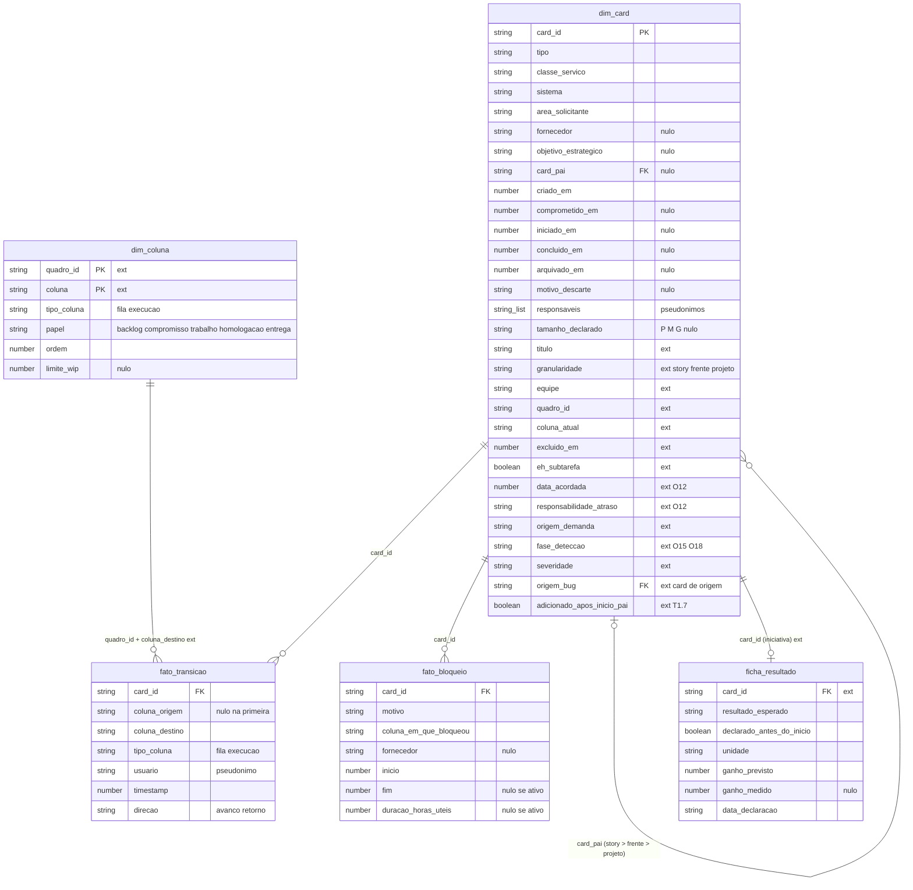
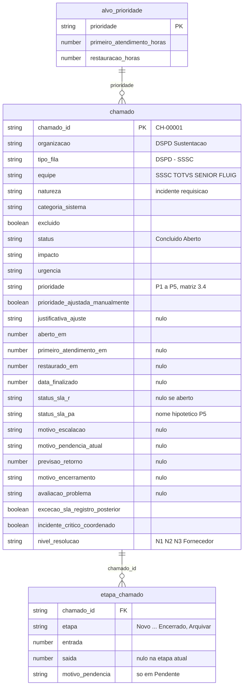

# Modelo de dados do mock (`@metricas-dspd/mock`)

Base fictícia do pedido 001. Os tipos moram na biblioteca (`packages/metricas/src/businessmap/modelo.ts` e `acelerato/modelo.ts`) e o gerador em `packages/mock/src`; o grafo `metricas <- mock` está no [ADR 0002](../architecture/adr/0002-monorepo-pacotes-compartilhados.md). Os dois domínios são bases separadas, sem chave comum: **BusinessMap e Acelerato nunca se misturam** (o lint impede um gerador de importar o outro; ver [arquitetura-front.md](arquitetura-front.md#2-dependências-entre-pacotes-e-fronteiras-do-lint)).

Convenções: instantes em epoch ms; datas civis em `AAAA-MM-DD`; durações em horas úteis (8 h por dia útil). Cards arquivados e excluídos **permanecem** na base. Pessoas são só pseudônimos `Pessoa NN`, e nenhuma função agrega por pessoa.

## 1. BusinessMap (briefing 4.5 + extensões)

Campos sem marca são os do briefing 4.5. `ext` marca extensão (campos de 4.4 ou necessidade do núcleo de cálculo).

Além das tabelas, `BaseBM.config` (extensão) traz o que, no sistema real, vem de configuração (WS1/WS4): `limite_wip_fluxo` por equipe (14), `limite_frentes` (12), SLE por classe (Urgente 4, Prazo fixo 8, Padrão 5 dias úteis, Intangível sem SLE), alocação acordada (30/15/45/10 %), objetivos estratégicos, equipes × sistemas e as mudanças de critério (T2.6).

Regras de integridade (verificadas em `packages/mock/src/mock.test.ts`):
- `card_pai` sempre existe e tem a granularidade imediatamente superior; há stories sem pai.
- Marcos em ordem (`criado ≤ comprometido ≤ iniciado ≤ concluido ≤ hoje`) e coerentes com as transições: a primeira tem `coluna_origem` nula, a última termina em `coluna_atual`.
- Colunas de fila começam por "Aguardando" ou "Pronto para" (4.2). Quadros: time (9 colunas, com WIP), coordenação (4) e gerência (3).
- Marcos derivados das transições pelo papel da coluna: `comprometido_em` na primeira coluna de compromisso; `iniciado_em` na primeira de execução de trabalho/homologação; `concluido_em` só se a última coluna é a de entrega.
- Há retornos (`direcao = retorno`), bloqueios ativos, todos os motivos de bloqueio e todas as fases de detecção.

## 2. Acelerato (briefing 3.2 e 3.4, fora do 4.5)

O 4.5 só modela o BusinessMap; o modelo do Acelerato é próprio e não compartilha tipo com ele.

Integridade: prioridade segue a matriz Impacto × Urgência salvo ajuste manual; `status_sla_r` só em concluídos; abertura em dia útil; etapas em ordem; a soma dos totalizadores é o tempo de vida (aberto → encerrado); todo P1 é incidente crítico coordenado. Etapas `Pendente` e `Aguardando validação` pausam o relógio de SLA. Alvos (h úteis, PA / R): P1 0,25/4, P2 0,5/8, P3 2/16, P4 4/40, P5 8/80.

## 3. Parâmetros do gerador

`gerarBaseMock(parcial)` mescla `parcial` com `CONFIG_PADRAO` e gera os dois domínios de forma independente.

| Parâmetro | Padrão | Efeito |
|---|---|---|
| `semente` | `20261009` | Raiz de todo sorteio (`VITE_MOCK_SEMENTE`) |
| `hoje` | `2026-10-09T18:00:00-03:00` | Data de corte; nada é gerado depois dela (`VITE_MOCK_HOJE`). Os dois contextos têm de concordar |
| `mesesHistorico` | `18` | Início do histórico (12+ meses exigidos) |
| `escala` | `1` | Multiplicador de volume; testes usam `0,1` a `0,2` |

**Aleatoriedade.** PRNG `mulberry32`; cada fluxo usa `derivar(semente, rótulo)` = `mulberry32(semente XOR FNV-1a(rótulo))`, com rótulos `businessmap`, `businessmap/projetos`, `businessmap/orfaos`, `businessmap/bugs`, `businessmap/bloqueios`, `acelerato` e `latencia`. Mudar o volume de um fluxo não altera os outros. `Math.random` e relógio do sistema são proibidos por lint.

**Distribuições** (`distribuicoes.ts`): chegadas Poisson por dia útil; durações lognormais parametrizadas por mediana e sigma; Bernoulli para eventos; escolha ponderada para categorias.

| Domínio | Volume (escala 1) | Principais parâmetros |
|---|---|---|
| BusinessMap, demanda sem projeto | ~1.500 stories em 18 meses | Tipos 32/38/24/6 (Incidente, Requisição, Melhoria, Dívida); 95% na equipe dona do sistema; descarte 6% (12% deles excluídos como "Criado por engano"); "esquecidos" (fila ~2.400 h) em 10% das Melhorias e 30% das Dívidas |
| BusinessMap, projetos | 40 projetos (mín. 4), 11 iniciativas (2 sem ficha) | 3 a 8 frentes originais; 35% dos projetos ganham 1 a 4 frentes após o início; 4% das frentes descartadas; 4 a 20 stories por frente; 3% sem pai |
| BusinessMap, eventos | — | Passos do fluxo com medianas de 2 a 10 h × multiplicador do tipo (0,4 a 2); bloqueios em 20% das concluídas e 12% das abertas (1 a 3, ~8 h); data acordada em 30% (sempre em Prazo fixo); reabertura 3% gera defeito em produção; bugs Poisson (λ 0,04 a 0,12; 1,5 em 15% das stories) |
| Acelerato | ~6.000 chamados em 18 meses | Prioridade P1..P5 com pesos 1/6/30/43/20 (pico em jun/2026: 4/22 e volume ×1,1); ajuste manual 4%; equipes 50/25/25; nível N1 52, N2 30, N3 9, Fornecedor 9; pendência extra 25%; excluídos 1%; medianas de SLA calibradas para aderência de ~80 a 90% |
| Latência | por chamada | 150 a 400 ms sorteados com semente; `latenciaMs: 0` desliga |

Base padrão gerada: **5.788 cards** e **6.062 chamados**, em ~150 ms (limite de 1,5 s, [ADR 0003](../architecture/adr/0003-orcamento-de-performance.md)).

**Mudanças de critério fictícias** (`criterios.ts`, neutro aos dois geradores): `2026-03-02` (marco de entrada; afeta O7, O9, O10, T1, EI_FL1..3) e `2026-06-01` (novas etapas do Acelerato; afeta S1..S7, EI_SUST).

## 4. Classes abaixo de 20 itens (de propósito)

A base garante os dois lados da regra "abaixo de 20 itens, não publicar" para que a UI exiba `AmostraInsuficiente` com dados reais do gerador (spec de UX 9.2, testes em `mock.test.ts`):

| Onde | Insuficiente | Publicado |
|---|---|---|
| O3 e T1 (12 semanas), por tipo/classe | ao menos uma classe com 0 < n < 20 | ao menos uma com `status: ok` |
| T5, por sistema | ao menos um sistema (ex.: "Portal do cliente", peso 4) | outros sistemas |
| S1 (6 meses), restauração | P1 | P3 |

Também são garantidos: itens acima do P95 (O2), backlog acima de 180 dias (O10), bloqueados agora, as quatro responsabilidades de atraso (O12), escopo adicionado (T9) e ao menos duas iniciativas sem ficha (E3).

## 5. Hash da base

`hashJson(base)` = FNV-1a 32 bits sobre `JSON.stringify` da base, em hexadecimal. Fixado em teste: qualquer mudança no gerador que altere dados quebra o teste e exige decisão explícita (os números da UI e das evidências de QA mudam).

| Configuração | Hash |
|---|---|
| Padrão (`semente 20261009`, `escala 1`) | `924448d4` |
| `escala: 0.2` | `b2bfd4c0` |
| Só BusinessMap / só Acelerato (padrão) | `f780e90f` / `0113e077` |

Fonte: `packages/mock/src/mock.test.ts` e [evidência da fase A](../qa/evidencias/hash-base-fase-a.json) (o caminho `web/src/mock` ali é anterior ao monorepo; o hash se manteve).
