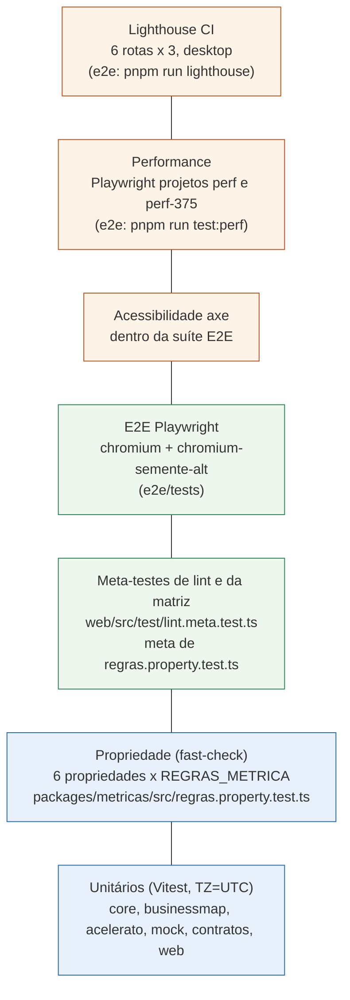
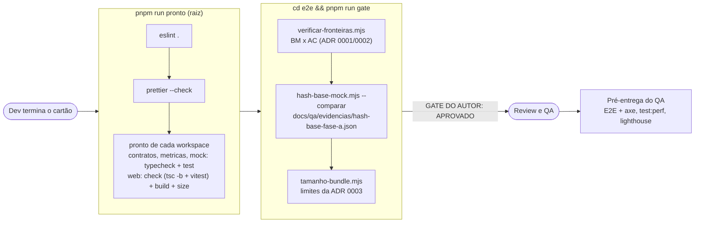

# Qualidade e testes

Documentação técnica do pedido 001. Estratégia de cobertura detalhada (metas por pacote e o que fica fora): [`docs/qa/estrategia-de-cobertura.md`](../qa/estrategia-de-cobertura.md), mantida pelo `qa-engineer`. Plano de testes: [`docs/qa/plano-testes-dashboard-mock.md`](../qa/plano-testes-dashboard-mock.md). Orçamento de performance: [ADR 0003](../architecture/adr/0003-orcamento-de-performance.md).

## 1. Pirâmide de testes

| Camada | O que garante | Onde | Comando |
|---|---|---|---|
| Unitário | Calendário útil, percentil tipo 7, janela, regra de 20, cada métrica com casos de aceite (`docs/qa/aceitacao/<cartão>.md` viram Vitest), gerador do mock determinístico, componentes e fonte mock da UI. Todos com `TZ=UTC` (o cálculo não pode depender do fuso da máquina) | `packages/*/src/**/*.test.ts`, `web/src/**/*.test.ts(x)` | `pnpm test` |
| Propriedade | As 6 propriedades sobre todas as 33 métricas, com exceções nominais (ver `biblioteca-de-calculo.md`, seção 4.1): arquivar entregue, classe isolada, domínios separados, fronteira 19/20, embaralhamento, nenhuma chave por pessoa | `packages/metricas/src/regras.property.test.ts` | `pnpm test -w @metricas-dspd/metricas` |
| Meta-teste de lint | Fixtures que **devem** falhar (BM x AC, core importando domínio, `Math.min(...xs)`, `sort` direto, leitura de `motivo_descarte`/`arquivado_em` fora de `descartado.ts`, `criarAmostraInterna` fora de `amostra.ts`, `Math.random`, UI importando a biblioteca, imports estáticos do mock, caminhos relativos entre pacotes) e fixtures que devem passar (sem falso positivo). Afrouxar uma regra quebra o teste | `web/src/test/lint.meta.test.ts` | `pnpm test -w @metricas-dspd/web` |
| Meta-teste da matriz | Matriz cobre exatamente `METRICA_IDS`; `status` coerente; exceção órfã ou desnecessária falha; toda métrica exercitada por cada propriedade | fim de `regras.property.test.ts` | idem propriedade |
| E2E | Navegação, filtros, estados de cartão, responsivo, regras visíveis (regra de 20, domínios separados), com uma segunda semente do mock (`chromium-semente-alt`) | `e2e/tests/*.spec.ts` | `pnpm run test:e2e` (raiz; `pnpm test` não a roda) |
| Acessibilidade | axe em cada rota e estado, zero violações; complementado por `eslint-plugin-jsx-a11y` | `e2e/tests/a11y.spec.ts` e evidências B3/B12 | dentro da suíte E2E |
| Performance | F1-F5 (LCP, CLS, INP, troca de filtro), C5 (heap), C6 (tarefa longa), desktop e 375 px | `e2e/perf/` | `cd e2e && pnpm run test:perf` |
| Lighthouse | Performance e Acessibilidade por rota, desktop | `e2e/scripts/lighthouse.sh` | `cd e2e && pnpm run lighthouse` |
| Bundle | F6-F9 por chunk (inicial, rota, gráficos, mock + biblioteca) | `web/scripts/size.mjs`, `e2e/scripts/tamanho-bundle.mjs` | `pnpm --filter @metricas-dspd/web run size` |

## 2. Portões

- **`pnpm run pronto`** (raiz): `eslint .` + `prettier --check` + o script `pronto` de cada workspace. Em `packages/contratos`, `packages/metricas` e `packages/mock`: `typecheck` + `test`. Em `web`: `check` (`tsc -b` + Vitest), `build` e `size`. Inclui os testes de propriedade, os meta-testes e os testes de tempo C2/C3/C4 com os limites de CI.
- **`pnpm run gate`** (em `e2e/`, gate do autor, `docs/qa/gate-do-autor.md`): pressupõe o `pronto` (o build precisa existir). Encadeia fronteiras, hash da base mock e tamanho do bundle; imprime `GATE DO AUTOR: APROVADO|REPROVADO` e sai com código 1 se reprovar. A base mock não muda sem decisão registrada: se o hash mudar de propósito, regenera-se a referência com `pnpm run hash-base --salvar ...` e a decisão vai para o cartão.
- O dev cola a saída dos dois no cartão antes de pedir review. E2E, axe, `test:perf` e Lighthouse rodam na pré-entrega do QA.

## 3. Orçamento de performance (ADR 0003) e números finais do 001

Números do parecer final do QA, revisão 3, de 2026-10-10 (`docs/qa/001-dashboard-mock.md`, develop `13d35e6`, Chromium local contra `vite preview`).

| # | Item | Orçamento | Medido (final) | Situação |
|---|---|---|---|---|
| F1 | LCP desktop, carga fria | < 2,0 s | p95 116 ms (revisão 2; a revisão 3 passou no `test:perf` sem registrar o número) | ok |
| F2 | CLS | < 0,1 | desktop 0,001-0,016; 375 px 0,000-0,019 (era 0,2-0,25, bug 008 fechado) | ok |
| F3 | INP | < 200 ms | 48 ms | ok |
| F4 | Troca de filtro, resposta visual | < 100 ms | p95 62 ms | ok |
| F5 | Troca de filtro, painel inteiro | < 500 ms | p95 337 ms | ok |
| F6 | Bundle JS inicial (gzip) | < 200 KB | 175,39 KB | ok |
| F8 | Chunk de gráficos (gzip) | < 130 KB | 111,61 KB | ok |
| F7, F9 | Chunk de rota; mock + biblioteca fora do inicial | < 60 KB (alerta); < 120 KB (alerta), fora do inicial (bloqueia) | verificados no `size` e no gate (aprovados); valores não constam do parecer | ok |
| F10 | Lighthouse desktop | Performance ≥ 90, Acessibilidade ≥ 95 | Performance 99-100 (mediana), Acessibilidade 100, CLS 0,002-0,042; 6 rotas x 3 | ok |
| C1-C4 | Geração do mock + contexto; cálculo por métrica e por painel | < 500 ms; < 50 ms a frio; < 300 ms | dentro dos limites de CI (3x o orçamento) no `pnpm run pronto`; o parecer final não registra o número na máquina de referência | número pendente |
| C5 | Heap após abrir todos os painéis | < 150 MB (alerta) | NaN no harness (medição indisponível, bug baixo) | pendente |
| C6 | Tarefa longa única | < 200 ms | 125-134 ms isolado; instável com a suíte inteira em paralelo (1 falha em 189, bug baixo) | ok isolado, instável sob carga |

Resultado das suítes na revisão 3: `pnpm run pronto` exit 0 (unitários 261 + 26 + 174); gate APROVADO; `test:perf` 15/15; suíte E2E completa com axe: 188 passaram, 1 falhou (C6 sob paralelismo, já registrado), zero violações axe. Veredito do QA: **APROVADO**, sem bug crítico, alto ou médio aberto.

Os itens A (API), M (MySQL) e K (coletas) da ADR 0003 valem para o pedido 002 e ainda não foram medidos.

## 4. Lacunas conhecidas
- C1, C3 e C4: medir na máquina de referência e registrar o número no relatório do QA (a ADR 0003 pede "medição real ou pendente, nunca ok sem número").
- C5: o harness devolve NaN; falta uma medição de heap que funcione no Chromium do Playwright.
- C6: instável quando a suíte inteira roda em paralelo; rodar `perf` isolado ou com menos workers.
- Propriedade P2 tem 13 exceções: 10 por classificador não implementado e 3 por definição (S3, S5, S6 são participação no total); as 10 são a principal frente de aumento de cobertura (detalhe em `docs/qa/estrategia-de-cobertura.md`).
